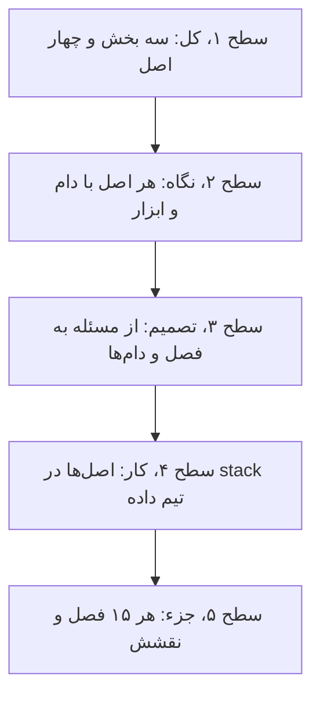
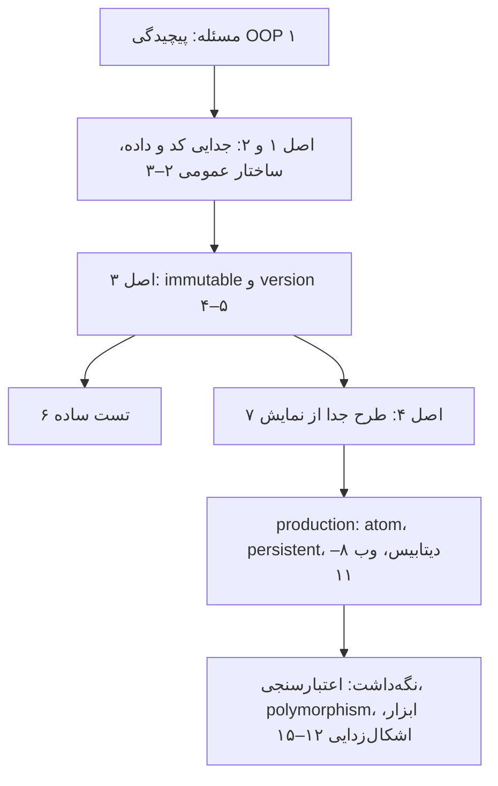
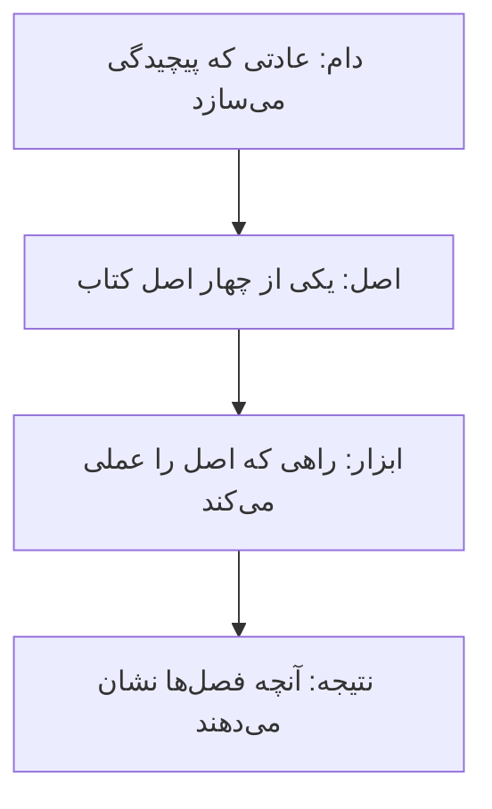
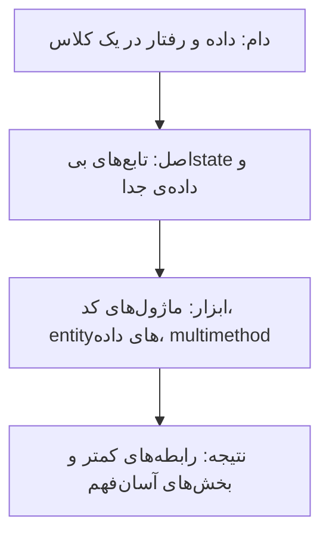
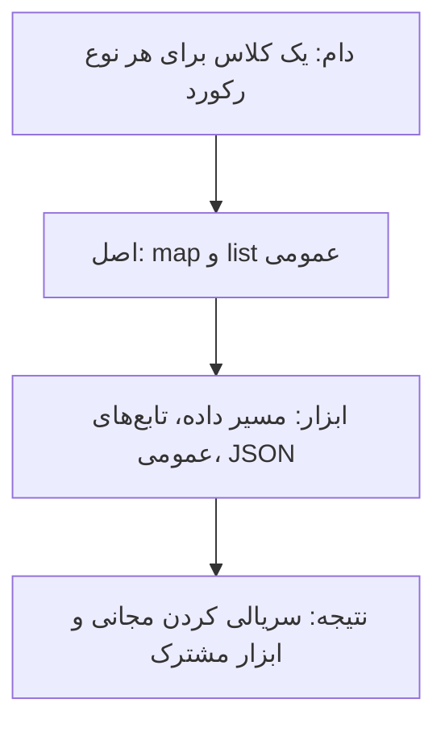
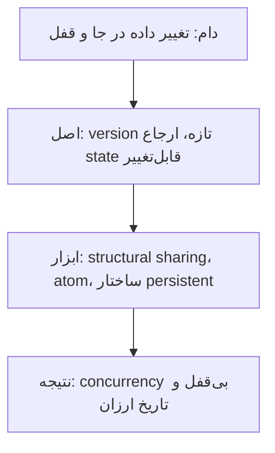
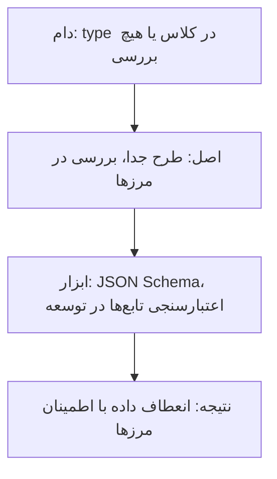

# چارچوب کتاب: چهار اصل و پیامدهایشان

[کتاب](README.md) · [فصل ۱ ←](chapters/01-complexity-of-object-oriented-programming.md)

این صفحه **سنتز خود vault** است، نه بخشی از کتاب. کتاب چهار اصل را معرفی می‌کند و بقیه‌ی فصل‌ها نشان می‌دهند هر اصل در concurrency و تست و دیتابیس و سرویس وب و اشکال‌زدایی چه پیامدی دارد. این‌جا اصل‌ها و پیامدها در یک جدول کنار هم می‌نشینند تا ببینید هر فصل از کدام اصل می‌آید.

چارچوب سه لایه دارد. **نقشه‌ی کتاب** می‌گوید کتاب از سه بخش ساخته شده است: اصل‌ها، کاربردشان در یک سیستم واقعی، و نگه‌داشت. **چهار اصل** همان اصل‌های خود کتاب‌اند، هر کدام با دام و ابزار و نتیجه. **راهنمای تصمیم و stack** می‌گوید برای هر مسئله کدام فصل را باز کنید و هر اصل در stack تیم داده کجا می‌نشیند. اصل‌ها مال نویسنده‌اند؛ چیدمان و پیوندها مال vault است.

## تصویر کل

### کل کتاب در سه جمله

خوانش vault از کتاب، پیش از هر جزئی:

1. **پیچیدگی از قاطی کردن کد و داده و از mutability داده می‌آید.** کتاب نقد OOP نیست؛ نشان می‌دهد این دو انتخاب رابطه‌ها را چند برابر می‌کنند ([۱](chapters/01-complexity-of-object-oriented-programming.md)).
2. **داده را با ساختار عمومی و immutable نمایش دهید و کد را جدا نگه دارید.** همین دو حرکت concurrency بی‌قفل، تست ساده و اشکال‌زدایی قابل‌بازتولید را ممکن می‌کنند ([۲](chapters/02-separation-between-code-and-data.md)–[۵](chapters/05-basic-concurrency-control.md)، [۸](chapters/08-advanced-concurrency-control.md)، [۱۵](chapters/15-debugging.md)).
3. **انعطاف را با اعتبارسنجی در مرزها جبران کنید.** طرح داده جدا از نمایش آن است و در مرزهای سیستم بررسی می‌شود ([۷](chapters/07-basic-data-validation.md)، [۱۲](chapters/12-advanced-data-validation.md)).

### از کل به جزء

## نقشه‌ی کتاب

### سه بخش

*سطح ۱ از ۵: کل.*

بخش یک اصل‌ها را روی یک نمونه‌ی اولیه می‌سازد. بخش دو همان سیستم را به production می‌برد و به چهار ایراد جواب می‌دهد: اعتبارسنجی، thread-safe بودن، کارایی ساختار immutable و داده‌ی بیرون از حافظه. بخش سه به نگه‌داشت می‌رسد: اعتبارسنجی پیشرفته، polymorphism، ابزارهای عمومی و اشکال‌زدایی.

### اصل‌ها و پیامدهایشان

| اصل کتاب | پیامد در production | پیامد در نگه‌داشت | بده‌بستان اصلی | فصل‌ها |
|---|---|---|---|---|
| ۱. کد جدا از داده | تابع‌های بی‌state و ماژول‌های ساده | multimethod به‌جای کلاس | گسترش‌پذیری در برابر کشف‌پذیری | [۲](chapters/02-separation-between-code-and-data.md)، [۱۳](chapters/13-polymorphism.md) |
| ۲. ساختار داده‌ی عمومی | ردیف دیتابیس و JSON سرویس همان map‌اند | ابزارهای عمومی دست‌کاری | انعطاف در برابر ایمنی type | [۳](chapters/03-basic-data-manipulation.md)، [۱۰](chapters/10-database-operations.md)، [۱۱](chapters/11-web-services.md)، [۱۴](chapters/14-advanced-data-manipulation.md) |
| ۳. داده‌ی immutable | atom و concurrency بی‌قفل، ساختار persistent | اشکال‌زدایی قابل‌بازتولید | حافظه و کپی در برابر سادگی استدلال | [۴](chapters/04-state-management.md)، [۵](chapters/05-basic-concurrency-control.md)، [۸](chapters/08-advanced-concurrency-control.md)، [۹](chapters/09-persistent-data-structures.md)، [۱۵](chapters/15-debugging.md) |
| ۴. طرح جدا از نمایش | اعتبارسنجی در مرزها با JSON Schema | اعتبارسنجی تابع‌ها مثل تست | هزینه‌ی اجرا در برابر اطمینان | [۷](chapters/07-basic-data-validation.md)، [۱۲](chapters/12-advanced-data-validation.md) |

## چهار اصل

*سطح ۲ از ۵: نگاه.*

هر اصل با یک زنجیره‌ی چهارتایی شروع می‌شود: **دام** رایج، **اصل** کتاب، **ابزاری** که اصل را عملی می‌کند و **نتیجه**. اصل‌ها و شماره‌هایشان مال نویسنده‌اند.

### اصل ۱: کد را از داده جدا کن

- **قاطی کردن کد و داده رابطه‌ها را چند برابر می‌کند** ([۱](chapters/01-complexity-of-object-oriented-programming.md)).
- **در OOP، state شیء آرگومان ناصریح متدهاست و در DOP صریح** ([۲](chapters/02-separation-between-code-and-data.md)).
- **مفهوم polymorphism برای گسترش‌پذیری است** و multimethod آن را بدون کلاس می‌دهد ([۱۳](chapters/13-polymorphism.md)).

### اصل ۲: داده را با ساختار عمومی نمایش بده

- **رکوردها map ناهمگن‌اند و indexها map همگن** ([۳](chapters/03-basic-data-manipulation.md)).
- **ردیف‌های دیتابیس map‌اند** و بهترین راه دست‌کاری داده نمایش آن به‌شکل داده است ([۱۰](chapters/10-database-operations.md)).
- **درون را مانند بیرون بسازید**: جریان داده‌ی یک سرویس وب سرتاپا داده است ([۱۱](chapters/11-web-services.md))؛ و تابع‌های عمومی خودتان را بنویسید تا منطق کسب‌وکار موجز بماند ([۱۴](chapters/14-advanced-data-manipulation.md)).

### اصل ۳: داده immutable است

- **داده immutable است ولی ارجاع state mutable**؛ تاریخ ارزان است ([۴](chapters/04-state-management.md)).
- **الگوریتم optimistic concurrency control بی‌قفل است** و reconciliation با three-way merge فیلدها را می‌سنجد ([۵](chapters/05-basic-concurrency-control.md))؛ atom هیچ‌وقت deadlock نمی‌دهد ([۸](chapters/08-advanced-concurrency-control.md)).
- **ساختارهای persistent versionهای قبلی را نگه می‌دارند** و به‌روزرسانی را لگاریتمی می‌کنند ([۹](chapters/09-persistent-data-structures.md))؛ و داده‌ی immutable اشکال‌زدایی را قابل‌بازتولید می‌کند ([۱۵](chapters/15-debugging.md)).

### اصل ۴: طرح داده را از نمایش جدا کن

- **مرزها جایی‌اند که سیستم داده مبادله می‌کند** و همان‌جا باید بررسی کرد ([۷](chapters/07-basic-data-validation.md)).
- **در آنچه می‌فرستید سخت باشید و در آنچه می‌گیرید نرم** ([۷](chapters/07-basic-data-validation.md)).
- **اعتبارسنجی درون سیستم برای آسانی توسعه است** و در production می‌شود خاموشش کرد؛ طرح‌ها نمودار و تست هم می‌سازند ([۱۲](chapters/12-advanced-data-validation.md)).

## از مسئله به فصل

*سطح ۳ از ۵: تصمیم.*

| مسئله | اول بخوانید | بعد |
|---|---|---|
| کلاس‌ها سلسله‌مراتب شکننده ساخته‌اند | [۱](chapters/01-complexity-of-object-oriented-programming.md) | [۲](chapters/02-separation-between-code-and-data.md) |
| هر نوع رکورد کلاس خودش را دارد | [۳](chapters/03-basic-data-manipulation.md) | [۱۰](chapters/10-database-operations.md) |
| دو نوشتن concurrent هم را خراب می‌کنند | [۵](chapters/05-basic-concurrency-control.md) | [۸](chapters/08-advanced-concurrency-control.md) |
| کپی داده برای immutable بودن کند است | [۹](chapters/09-persistent-data-structures.md) | [۴](chapters/04-state-management.md) |
| تست‌ها پر از mock‌اند | [۶](chapters/06-unit-tests.md) | [۱۵](chapters/15-debugging.md) |
| داده‌ی ورودی گاهی خراب است | [۷](chapters/07-basic-data-validation.md) | [۱۲](chapters/12-advanced-data-validation.md) |
| پاسخ API بیرونی تنک و ناپایدار است | [۱۱](chapters/11-web-services.md) | [۷](chapters/07-basic-data-validation.md) |
| رفتار بر پایه‌ی type با switch | [۱۳](chapters/13-polymorphism.md) | [۲](chapters/02-separation-between-code-and-data.md) |
| منطق کسب‌وکار پر از جزئیات دست‌کاری داده | [۱۴](chapters/14-advanced-data-manipulation.md) | [۳](chapters/03-basic-data-manipulation.md) |
| باگ production بازتولید نمی‌شود | [۱۵](chapters/15-debugging.md) | [۴](chapters/04-state-management.md) |

## دام‌ها

1. **دیدن کتاب به‌عنوان نقد OOP**؛ کتاب درباره‌ی پیچیدگی است ([۱](chapters/01-complexity-of-object-oriented-programming.md)).
2. **تابع‌های پیش‌فرض Lodash** که mutation می‌دهند ([۴](chapters/04-state-management.md)).
3. **نگه داشتن state در جاهای مختلف** به‌جای یک ارجاع ([۴](chapters/04-state-management.md)، [۸](chapters/08-advanced-concurrency-control.md)).
4. **کلون کردن داده برای پرهیز از قفل خواندن**، که مقیاس نمی‌گیرد ([۸](chapters/08-advanced-concurrency-control.md)).
5. **یکی دانستن مجموعه‌ی immutable و ساختار persistent** ([۹](chapters/09-persistent-data-structures.md)).
6. **مقایسه‌ی رشته‌ای در تست** ([۶](chapters/06-unit-tests.md)).
7. **اعتبارسنجی همه‌جا در production** به‌جای مرزها ([۷](chapters/07-basic-data-validation.md)، [۱۲](chapters/12-advanced-data-validation.md)).
8. **نوشتن SQL پیچیده** وقتی می‌شود در برنامه دوباره شکل داد ([۱۰](chapters/10-database-operations.md)).
9. **ابزار عمومی بیش‌ازحد عمومی**؛ کم‌عمومی‌ترین تابع سودمند را بردارید ([۱۴](chapters/14-advanced-data-manipulation.md)).
10. **اشکال‌زدایی قدم‌به‌قدم بدون گرفتن زمینه** ([۱۵](chapters/15-debugging.md)).

## در stack شما

*سطح ۴ از ۵: کار.*

هر اصل در [stack مرجع](../../practice/reference-stack.md) یک جای مشخص دارد. کادرهای *In practice* هر فصل جزئیاتش را می‌دهند.

| بخش stack | اصل | فصل‌ها | یادآوری |
|---|---|---|---|
| config loader و DAGها به‌شکل داده | ۱، ۲ | [۲](chapters/02-separation-between-code-and-data.md)، [۳](chapters/03-basic-data-manipulation.md) | منبع‌ها را در YAML یا JSON تعریف کنید و یک تابع عمومی آن‌ها را اجرا کند |
| Bronze append-only | ۳ | [۴](chapters/04-state-management.md)، [۹](chapters/09-persistent-data-structures.md) | لایه‌ی خام immutable است؛ هر اصلاح یک version تازه است |
| `EXCHANGE TABLES` در ClickHouse | ۳ | [۴](chapters/04-state-management.md)، [۸](chapters/08-advanced-concurrency-control.md) | جدول تازه را کنار بسازید و ارجاع را اتمی عوض کنید |
| Argo CD و GitOps | ۳ | [۵](chapters/05-basic-concurrency-control.md) | حالت مطلوب در Git و reconciliation به‌سمت آن |
| اعتبارسنجی در loader و API | ۴ | [۷](chapters/07-basic-data-validation.md)، [۱۲](chapters/12-advanced-data-validation.md) | طرح در مرز ورود و مرز API، نه در هر تابع |
| تست در GitLab CI | ۱، ۲ | [۶](chapters/06-unit-tests.md) | تابع داده‌به‌داده با fixture ساده تست می‌شود |
| خطای pipeline | ۳ | [۱۵](chapters/15-debugging.md) | ورودی شکست‌خورده را ذخیره کنید تا در notebook قابل‌بازتولید باشد |

> **In practice:** اصل‌های immutable بودن و طرح جدا از نمایش در یک تغییر schema به هم می‌رسند.
>
> **Your turn:** منبعی یک فیلد تازه اضافه کرده و یک فیلد قدیمی را nullable کرده است. loader چه کند و جدول Silver چطور بی‌وقفه عوض شود؟
>
> *Answer:* loader در مرز ورود با طرح نرم بررسی کند: فیلد ناشناخته را بپذیرد و فیلد اجباری گم‌شده را رد کند، طبق «در گرفتن نرم» ([۷](chapters/07-basic-data-validation.md)). Silver تازه را کنار جدول قدیم بسازید و با یک جابه‌جایی اتمی ارجاع را عوض کنید، مثل یک version تازه از داده‌ی immutable ([۴](chapters/04-state-management.md)، [۸](chapters/08-advanced-concurrency-control.md)).

## نقشه‌ی فصل‌ها

*سطح ۵ از ۵: جزء.*

| فصل | بخش | اصل | نقش در چارچوب |
|---|---|---|---|
| [۱](chapters/01-complexity-of-object-oriented-programming.md) | مسئله | همه | پیچیدگی OOP: کد و داده‌ی قاطی و داده‌ی mutable |
| [۲](chapters/02-separation-between-code-and-data.md) | اصل‌ها | ۱ | جدایی کد از داده |
| [۳](chapters/03-basic-data-manipulation.md) | اصل‌ها | ۲ | ساختار داده‌ی عمومی و مسیر داده |
| [۴](chapters/04-state-management.md) | اصل‌ها | ۳ | داده‌ی immutable، version و structural sharing |
| [۵](chapters/05-basic-concurrency-control.md) | اصل‌ها | ۳ | الگوریتم optimistic concurrency control و reconciliation |
| [۶](chapters/06-unit-tests.md) | اصل‌ها | ۱، ۲ | تست unit داده‌گرا |
| [۷](chapters/07-basic-data-validation.md) | production | ۴ | اعتبارسنجی پایه با JSON Schema |
| [۸](chapters/08-advanced-concurrency-control.md) | production | ۳ | مفهوم atom و concurrency بی‌قفل |
| [۹](chapters/09-persistent-data-structures.md) | production | ۳ | ساختار داده‌ی persistent |
| [۱۰](chapters/10-database-operations.md) | production | ۲ | دیتابیس: ردیف به‌شکل map |
| [۱۱](chapters/11-web-services.md) | production | ۲ | سرویس وب: درون مانند بیرون |
| [۱۲](chapters/12-advanced-data-validation.md) | نگه‌داشت | ۴ | اعتبارسنجی پیشرفته‌ی تابع‌ها |
| [۱۳](chapters/13-polymorphism.md) | نگه‌داشت | ۱ | مفهوم polymorphism با multimethod |
| [۱۴](chapters/14-advanced-data-manipulation.md) | نگه‌داشت | ۲ | ابزارهای عمومی دست‌کاری داده |
| [۱۵](chapters/15-debugging.md) | نگه‌داشت | ۳ | اشکال‌زدایی قابل‌بازتولید |
