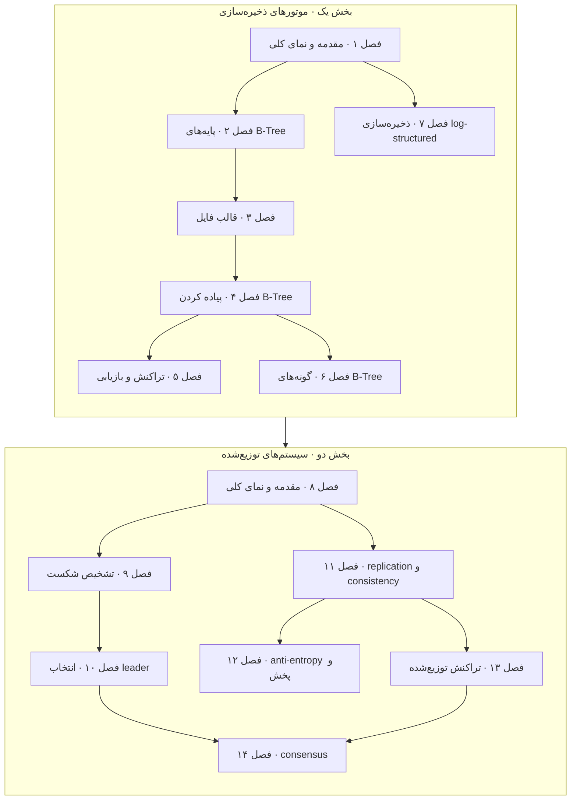

# Database Internals

**فایل [`index.html`](index.html) را در مرورگر باز کنید** تا نسخه‌ی تعاملی را ببینید: برای هر فصلی یک درس اسلاید‌به‌اسلاید، با شبیه‌سازی‌های جا‌داده‌شده و خودسنجی. هر چه این‌جاست روی GitHub هم خوب خوانده می‌شود.

## درباره‌ی کتاب

زیرعنوانش *A Deep Dive into How Distributed Data Systems Work* است. کتاب آن چیزی را که درون یک دیتابیس رخ می‌دهد در دو بخش توضیح می‌دهد:

- **بخش یک، موتورهای ذخیره‌سازی:** این‌که یک نود تنها داده را چطور می‌چیند و index می‌کند و cache و log و بازیابی. B-Tree و گونه‌هایش، قالب فایل، مدیریت buffer، تراکنش و بازیابی، و ذخیره‌سازی log-structured را می‌پوشاند.
- **بخش دو، سیستم‌های توزیع‌شده:** این‌که نودهای زیاد چطور هم‌کاری می‌کنند. مدل سیستم و نتیجه‌های ناممکنی، تشخیص شکست، انتخاب leader، replication و سازگاری، anti-entropy و gossip، و تراکنش توزیع‌شده و consensus را می‌پوشاند.

هر فصلی با خلاصه‌ای و خواندنی‌های بیشتر تمام می‌شود، و کتاب‌نامه‌اش مفصل است.

## محتوای این پوشه

| مسیر | چه چیزی است |
|---|---|
| [`chapters/NN-*.md`](chapters/01-introduction-and-overview.md) | یادداشت‌های فصل، که **سرچشمه‌ی حقیقت**اند. هر فایل `.md` یک درس `.html` تولید‌شده کنار خودش دارد |
| [`widgets/`](widgets/02-bplus-tree.html) | شبیه‌سازی‌های دست‌ساز، که در درس‌ها جا داده شده‌اند؛ هر کدام جدا هم باز می‌شود |
| [`lab/`](lab/02-btree-height/README.md) | آزمایش‌های اجراشدنی Python با خروجی چشم‌داشته |
| `index.html` | صفحه‌ی مرکزی کتاب، که از همین README و فصل‌ها تولید می‌شود |

## کتاب چطور به هم وصل است

آن دو بخش کتاب از پایین به بالا بنا می‌شوند. نتیجه‌گیری بخش یک سه خاصیت، یعنی buffer کردن و immutability و ترتیب، را به کار می‌برد تا ساختارهای ذخیره‌سازی‌ای را که پوشانده وصف کند (شکل I-1). می‌گوید که قاطی کردنشان بده‌بستان است: ارزان‌تر کردن یک عملیات دیگری را گران‌تر می‌کند (pp. 165–166). آغاز بخش دو شرکت‌کننده‌ها و پیوندها و ساعت‌ها را تعریف می‌کند، و الگوریتم‌های توزیع‌شده را به‌شکل قدم‌های محلی به‌علاوه‌ی تبادل پیام برای هم‌آهنگی و هم‌کاری و پخش و consensus وصف (pp. 167–169). بعد فصل ۸ آن مغلطه‌ها و مدل‌های شکست و نتیجه‌های ناممکنی را می‌چیند که فصل‌های باقی‌مانده درونشان کار می‌کنند.

*فلش‌ها خوانش vault از وابستگی فصل‌هاست؛ و بخش‌ها و ترتیب فصل‌ها مال کتاب.*

چند رشته از هر دو بخش رد می‌شوند:

- **مفهوم log**ها به‌شکل WAL در فصل ۵، LSM-Tree در فصل ۷، لاگ تکرارشده در فصل ۱۱ و consensus در فصل ۱۴ پیدا می‌شوند.
- **ترتیب و زمان** به‌شکل ساعت منطقی و consistency model در فصل ۱۱، TrueTime در Spanner در فصل ۱۳ و termها در Raft در فصل ۱۴.
- **مفهوم quorum**ها به‌شکل consistency قابل تنظیم در فصل ۱۱، و Paxos و quorumهای Flexible Paxos در فصل ۱۴، و 3f + 1 در PBFT در فصل ۱۴.

## فصل‌ها

| # | فصل | صفحه‌ها |
|---:|---|---|
| ۱ | [مقدمه و نمای کلی](chapters/01-introduction-and-overview.md) | ۷–۲۴ |
| ۲ | [پایه‌های B-Tree](chapters/02-b-tree-basics.md) | ۲۵–۴۳ |
| ۳ | [قالب فایل](chapters/03-file-formats.md) | ۴۵–۶۰ |
| ۴ | [پیاده کردن B-Tree](chapters/04-implementing-b-trees.md) | ۶۱–۷۷ |
| ۵ | [پردازش تراکنش و بازیابی](chapters/05-transaction-processing-and-recovery.md) | ۷۹–۱۱۰ |
| ۶ | [گونه‌های B-Tree](chapters/06-b-tree-variants.md) | ۱۱۱–۱۲۸ |
| ۷ | [ذخیره‌سازی log-structured](chapters/07-log-structured-storage.md) | ۱۲۹–۱۶۳ |
| ۸ | [مقدمه و نمای کلی](chapters/08-introduction-and-overview.md) | ۱۷۱–۱۹۴ |
| ۹ | [تشخیص شکست](chapters/09-failure-detection.md) | ۱۹۵–۲۰۳ |
| ۱۰ | [انتخاب leader](chapters/10-leader-election.md) | ۲۰۵–۲۱۳ |
| ۱۱ | [replication و consistency](chapters/11-replication-and-consistency.md) | ۲۱۵–۲۴۲ |
| ۱۲ | [anti-entropy و پخش](chapters/12-anti-entropy-and-dissemination.md) | ۲۴۳–۲۵۶ |
| ۱۳ | [تراکنش توزیع‌شده](chapters/13-distributed-transactions.md) | ۲۵۷–۲۷۸ |
| ۱۴ | [consensus](chapters/14-consensus.md) | ۲۷۹–۳۱۲ |

بازه‌های صفحه صفحه‌ی چاپی‌اند. فصل‌های ۱ تا ۷ بخش یک، یعنی *Storage Engines*، را می‌سازند، از ص. ۱، و فصل‌های ۸ تا ۱۴ بخش دو، یعنی *Distributed Systems*، را، از ص. ۱۶۷. هر بخشی نتیجه‌گیری کوتاهی دارد، در صص. ۱۶۵–۱۶۶ و صص. ۳۱۳–۳۱۶، و کتاب با کتاب‌نامه و index تمام می‌شود.

## مفهوم‌های کلیدی

این ایده‌ها در فصل‌ها بازمی‌گردند؛ هر ردیفی فصل‌هایی را می‌آورد که درباره‌شان حرف می‌زنند. تعریف‌ها خلاصه‌های vault از توضیح‌های کتاب‌اند.

| مفهوم | تعریف | فصل‌ها |
|---|---|---|
| B-Tree | درخت جست‌و‌جوی متوازن و پرشاخه که نودهایش صفحه‌ی دیسک‌اند. جست‌و‌جو به اندازه‌ی log_N(M) خواندن صفحه خرج می‌کند، و درج‌ها نودهای سرریز را تا ریشه می‌شکنند. | [۲](chapters/02-b-tree-basics.md) · [۴](chapters/04-implementing-b-trees.md) · [۶](chapters/06-b-tree-variants.md) |
| buffer pool که page cache هم نامیده می‌شود | صفحه‌هایی که در حافظه cache شده‌اند، با صفحه‌های کثیفی که بعدتر flush می‌شوند. سیاست‌های بیرون انداختن مثل LRU و CLOCK و LFU تصمیم می‌گیرند چه چیزی انداخته شود. | [۱](chapters/01-introduction-and-overview.md) · [۵](chapters/05-transaction-processing-and-recovery.md) |
| write-ahead log که WAL است | logی append-only که پیش از صفحه‌های داده پایا می‌شود، و برای redo یا undo کردن تغییرها پس از از کار افتادنی به کار می‌رود، چنان‌که ARIES می‌کند. | [۵](chapters/05-transaction-processing-and-recovery.md) · [۷](chapters/07-log-structured-storage.md) |
| buffer کردن و immutability و ترتیب | آن سه خاصیتی که کتاب برای رده‌بندی ساختارهای ذخیره‌سازی به کار می‌برد: این‌که نوشتن‌ها در حافظه دسته می‌شوند یا نه، این‌که فایل‌ها سر جا به‌روز می‌شوند یا نه، و این‌که رکوردها به ترتیب کلید ذخیره می‌شوند یا نه. | [۱](chapters/01-introduction-and-overview.md) · [۶](chapters/06-b-tree-variants.md) · [۷](chapters/07-log-structured-storage.md) |
| LSM-Tree | نوشتن‌های buffer‌شده در memtableی، که به‌شکل جدول‌های مرتب و immutable flush و با compaction merge می‌شوند. تقویت خواندن و نوشتن و فضا با هم بده‌بستان می‌شوند. | [۷](chapters/07-log-structured-storage.md) |
| slotted page | چیدمان صفحه‌ای با آرایه‌ای از اشاره‌گر که از یک سر رشد می‌کند و cellهای variable-size که از سر دیگر، تا رکوردها بی جابه‌جا شدن مرتب شوند. | [۳](chapters/03-file-formats.md) · [۴](chapters/04-implementing-b-trees.md) |
| isolation و concurrency control | قاعده‌های این‌که تراکنش‌های هم‌زمان چه چیزی مجازند ببینند، که با قفل‌گذاری یعنی 2PL یا اعتبارسنجی خوش‌بینانه یا چند‌نسخه‌ای یعنی MVCC اجبار می‌شوند. | [۵](chapters/05-transaction-processing-and-recovery.md) · [۱۳](chapters/13-distributed-transactions.md) |
| failure detector | مؤلفه‌ای که به processهای از کار افتاده گمان می‌برد، و سرعت تشخیص را با دقت بده‌بستان می‌کند. heartbeat و φ-accrual و gossip نمونه‌اند. | [۸](chapters/08-introduction-and-overview.md) · [۹](chapters/09-failure-detection.md) · [۱۴](chapters/14-consensus.md) |
| leader و split brain | processی تنها که کار را مرتب و هم‌آهنگ می‌کند. split brain یعنی دو leader در یک زمان، که تنها پروتکل‌های اکثریت‌محور جلوش را می‌گیرند. | [۱۰](chapters/10-leader-election.md) · [۱۳](chapters/13-distributed-transactions.md) · [۱۴](chapters/14-consensus.md) |
| consistency modelها | تضمین‌هایی درباره‌ی ترتیب و دیدنی بودن عملیات بین replicaها، از linearizability تا consistency علّی تا eventual consistency. | [۱۱](chapters/11-replication-and-consistency.md) · [۱۳](chapters/13-distributed-transactions.md) |
| quorum | کمینه شمار نودهایی که باید پاسخ بدهند. quorumهای هم‌پوشان، یعنی R + W > N و Q₁ + Q₂ > N، مطمئن می‌شوند که نودی هر دو عملیات را می‌بیند. | [۱۱](chapters/11-replication-and-consistency.md) · [۱۴](chapters/14-consensus.md) |
| anti-entropy | تعمیر پس‌زمینه‌ی replicaهای واگرا، با read repair یا hinted handoff یا درخت Merkle یا gossip. | [۱۲](chapters/12-anti-entropy-and-dissemination.md) |
| commitment اتمی | همه‌ی شرکت‌کننده‌ها تراکنشی را commit می‌کنند یا هیچ‌کدام: commit دو‌فازی و سه‌فازی، یا commitی که روی consensus بنا شده چنان‌که در Spanner و Calvin. | [۵](chapters/05-transaction-processing-and-recovery.md) · [۱۳](chapters/13-distributed-transactions.md) |
| consensus | توافق processهای درست روی یک مقدار پیشنهادشده به‌رغم شکست‌ها. با پخش اتمی هم‌ارز است، و Paxos و Raft و ZAB و PBFT پیاده‌اش می‌کنند. | [۸](chapters/08-introduction-and-overview.md) · [۱۰](chapters/10-leader-election.md) · [۱۴](chapters/14-consensus.md) |

## این یادداشت‌ها چطور نوشته شده‌اند

- **هر چه در یادداشت فصل بالای *فراتر از کتاب* است کتاب را بازمی‌گوید**، با ارجاع به صفحه‌ی چاپی. مطلب افزوده، یعنی منبع‌های بیرونی و تفسیر vault، زیر *فراتر از کتاب* یا در کادرهای `> **Vault note:**` می‌نشیند.
- فهرست بخش‌ها همان فهرست مطالب تو‌در‌توی خود کتاب است، که از bookmarkهای PDF برداشته شده.
- نمودارهای Mermaid بازترسیم vault از شکل‌های کتاب‌اند، یا خلاصه‌های خودش. زیرنویس‌ها می‌گویند کدام.
- پرسش‌ها و پاسخ‌های *خودتان را بسنجید* مال vault است و از روی یادداشت‌ها نوشته شده؛ پاسخ‌ها به صفحه ارجاع می‌دهند.
- شبیه‌سازی‌ها و آزمایش‌ها پیاده‌سازی‌های خود vault از مکانیزم‌هایی‌اند که کتاب وصف می‌کند. هر کدام می‌گوید چه صفحه‌هایی را تصویر می‌کند و چه چیزی را ساده.
- چند موضوع در [Designing Data-Intensive Applications](../designing-data-intensive-applications/README.md) هم پیدا می‌شوند. جایی که DDIA از قبل شبیه‌سازی‌ای دارد، یعنی پایه‌های B-Tree در برابر LSM و 2PC و consensus از جنس Raft، شبیه‌سازی‌های این کتاب زاویه‌ی دیگری می‌گیرند، و یادداشت‌های فصل به هم پیوند می‌دهند.

## منبع

- **منبع اصلی:** فایل PDF ناشر از ویراست اول، اکتبر ۲۰۱۹، با ۳۷۱ صفحه‌ی PDF. شماره‌ی صفحه‌ی چاپی برابر شماره‌ی صفحه‌ی PDF منهای ۲۰ است. آن PDF بیرون کنترل نسخه نگه داشته می‌شود، در `.gitignore` ببینید.
- **فهرست مطالب:** از فهرست bookmarkهای PDF برداشته شده، که بخش‌ها و زیربخش‌های هر فصلی را با شماره‌ی صفحه می‌دهد.
- **ساختار:** یک پیش‌گفتار، دو بخش که هر یک هفت فصل و نتیجه‌گیری کوتاهی دارند، یک کتاب‌نامه و یک index.
- **پوشش:** هر ۱۴ فصل پوشش داده شده‌اند.
