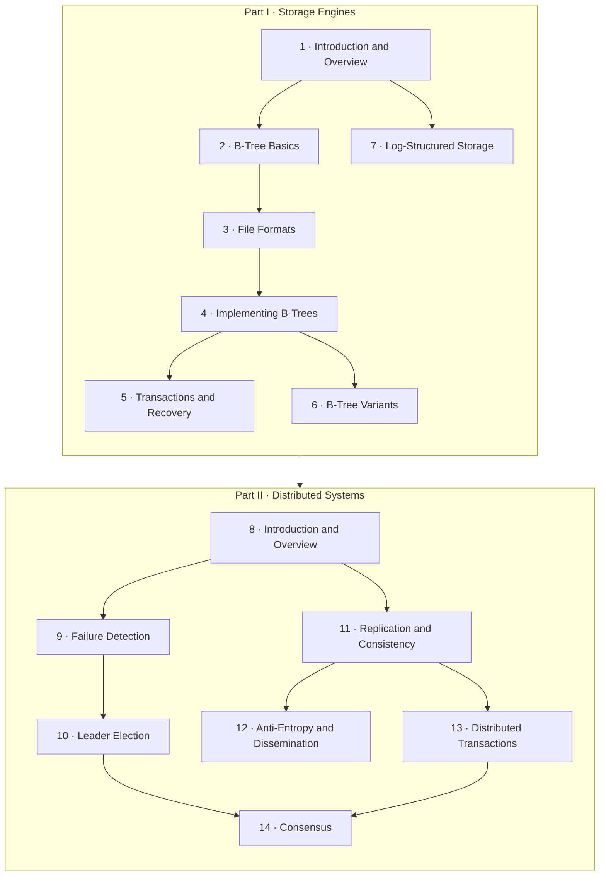

# Database Internals

**Open [`index.html`](index.html) in a browser** for the interactive version: one slide-by-slide lesson per chapter, with embedded simulations and self-checks. Everything here also reads fine on GitHub.

## About

Subtitled *A Deep Dive into How Distributed Data Systems Work*. The book explains what happens inside a database in two parts:

- **Part I, Storage Engines:** how a single node lays out, indexes, caches, logs and recovers data. It covers B-Trees and their variants, file formats, buffer management, transactions and recovery, and log-structured storage.
- **Part II, Distributed Systems:** how many nodes cooperate. It covers system models and impossibility results, failure detection, leader election, replication and consistency, anti-entropy and gossip, distributed transactions and consensus.

Each chapter ends with a summary and further reading, and the bibliography is extensive.

## What's in this folder

| Path | What it is |
|---|---|
| [`chapters/NN-*.md`](chapters/01-introduction-and-overview.md) | Chapter notes, **the source of truth**. Each `.md` has a generated `.html` lesson next to it |
| [`widgets/`](widgets/02-bplus-tree.html) | Hand-built simulations, embedded in the lessons; each also opens on its own |
| [`lab/`](lab/02-btree-height/README.md) | Runnable Python experiments with expected output |
| `index.html` | The book hub, generated from this README and the chapters |

## How the book fits together

The book's two parts build bottom-up. The Part I conclusion uses three properties, buffering, immutability and ordering, to describe the storage structures it covered (Figure I-1). It notes that mixing them is a trade-off: making one operation cheaper makes another more expensive (pp. 165–166). The Part II opener defines participants, links and clocks, and describes distributed algorithms as local steps plus message exchange for coordination, cooperation, dissemination and consensus (pp. 167–169). Chapter 8 then sets out the fallacies, failure models and impossibility results that the remaining chapters work within.

*The arrows are the vault's reading of the chapters' dependencies; the parts and chapter order are the book's.*

Some threads run through both parts:

- **Logs** appear as the WAL (5), LSM-Trees (7), replicated logs (11) and consensus (14).
- **Ordering and time** appear as logical clocks and consistency models (11), TrueTime in Spanner (13) and terms in Raft (14).
- **Quorums** appear as tunable consistency (11), Paxos and Flexible Paxos (14), and PBFT's 3f + 1 (14).

## Chapters

| # | Chapter | Pages |
|---:|---|---|
| 1 | [Introduction and Overview](chapters/01-introduction-and-overview.md) | 7–24 |
| 2 | [B-Tree Basics](chapters/02-b-tree-basics.md) | 25–43 |
| 3 | [File Formats](chapters/03-file-formats.md) | 45–60 |
| 4 | [Implementing B-Trees](chapters/04-implementing-b-trees.md) | 61–77 |
| 5 | [Transaction Processing and Recovery](chapters/05-transaction-processing-and-recovery.md) | 79–110 |
| 6 | [B-Tree Variants](chapters/06-b-tree-variants.md) | 111–128 |
| 7 | [Log-Structured Storage](chapters/07-log-structured-storage.md) | 129–163 |
| 8 | [Introduction and Overview](chapters/08-introduction-and-overview.md) | 171–194 |
| 9 | [Failure Detection](chapters/09-failure-detection.md) | 195–203 |
| 10 | [Leader Election](chapters/10-leader-election.md) | 205–213 |
| 11 | [Replication and Consistency](chapters/11-replication-and-consistency.md) | 215–242 |
| 12 | [Anti-Entropy and Dissemination](chapters/12-anti-entropy-and-dissemination.md) | 243–256 |
| 13 | [Distributed Transactions](chapters/13-distributed-transactions.md) | 257–278 |
| 14 | [Consensus](chapters/14-consensus.md) | 279–312 |

Page ranges are printed pages. Chapters 1–7 make up Part I, *Storage Engines* (from p. 1), and chapters 8–14 make up Part II, *Distributed Systems* (from p. 167). Each part has a short conclusion (pp. 165–166 and pp. 313–316), and the book closes with a bibliography and an index.

## Key concepts

These ideas recur across chapters; each row lists the chapters that discuss them. The definitions are the vault's summaries of the book's explanations.

| Concept | Definition | Chapters |
|---|---|---|
| B-Tree | A balanced, high-fanout search tree whose nodes are disk pages. Lookups cost log_N(M) page reads, and inserts split overflowing nodes up to the root. | [2](chapters/02-b-tree-basics.md) · [4](chapters/04-implementing-b-trees.md) · [6](chapters/06-b-tree-variants.md) |
| Buffer pool (page cache) | Pages cached in memory, with dirty pages flushed later. Eviction policies such as LRU, CLOCK and LFU decide what to drop. | [1](chapters/01-introduction-and-overview.md) · [5](chapters/05-transaction-processing-and-recovery.md) |
| Write-ahead log (WAL) | An append-only log persisted before data pages, used to redo or undo changes after a crash, as ARIES does. | [5](chapters/05-transaction-processing-and-recovery.md) · [7](chapters/07-log-structured-storage.md) |
| Buffering, immutability, ordering | The three properties the book uses to classify storage structures: whether writes are batched in memory, whether files are updated in place, and whether records are stored in key order. | [1](chapters/01-introduction-and-overview.md) · [6](chapters/06-b-tree-variants.md) · [7](chapters/07-log-structured-storage.md) |
| LSM-Tree | Buffered writes in a memtable, flushed as immutable sorted tables and merged by compaction. Read, write and space amplification trade off against each other. | [7](chapters/07-log-structured-storage.md) |
| Slotted page | A page layout with an array of pointers growing from one end and variable-size cells from the other, so records can be reordered without being moved. | [3](chapters/03-file-formats.md) · [4](chapters/04-implementing-b-trees.md) |
| Isolation and concurrency control | Rules for what concurrent transactions may see, enforced by locking (2PL), optimistic validation or multiversioning (MVCC). | [5](chapters/05-transaction-processing-and-recovery.md) · [13](chapters/13-distributed-transactions.md) |
| Failure detector | A component that suspects crashed processes, trading detection speed against accuracy. Heartbeats, φ-accrual and gossip are examples. | [8](chapters/08-introduction-and-overview.md) · [9](chapters/09-failure-detection.md) · [14](chapters/14-consensus.md) |
| Leader / split brain | A single process that orders and coordinates work. Split brain is two leaders at once, which only majority-based protocols prevent. | [10](chapters/10-leader-election.md) · [13](chapters/13-distributed-transactions.md) · [14](chapters/14-consensus.md) |
| Consistency models | Guarantees about the order and visibility of operations across replicas, from linearizability through causal consistency to eventual consistency. | [11](chapters/11-replication-and-consistency.md) · [13](chapters/13-distributed-transactions.md) |
| Quorum | The minimum number of nodes that must respond. Overlapping quorums (R + W > N, Q₁ + Q₂ > N) make sure some node sees both operations. | [11](chapters/11-replication-and-consistency.md) · [14](chapters/14-consensus.md) |
| Anti-entropy | Background repair of diverged replicas, using read repair, hinted handoff, Merkle trees or gossip. | [12](chapters/12-anti-entropy-and-dissemination.md) |
| Atomic commitment | All participants commit a transaction or none do: two-phase and three-phase commit, or commit built on consensus as in Spanner and Calvin. | [5](chapters/05-transaction-processing-and-recovery.md) · [13](chapters/13-distributed-transactions.md) |
| Consensus | Correct processes agreeing on one proposed value despite failures. It is equivalent to atomic broadcast, and Paxos, Raft, ZAB and PBFT implement it. | [8](chapters/08-introduction-and-overview.md) · [10](chapters/10-leader-election.md) · [14](chapters/14-consensus.md) |

## How these notes work

- **Everything above *Beyond the book* in a chapter note restates the book**, with printed page references. Supplementary material, meaning outside sources and the vault's interpretation, lives under *Beyond the book* or in `> **Vault note:**` callouts.
- Section outlines are the book's own nested table of contents, taken from the PDF's bookmarks.
- Mermaid diagrams are the vault's redrawings of the book's figures, or its own summaries. Captions say which.
- *Check yourself* questions and answers are the vault's, written from the notes; the answers cite pages.
- Simulations and experiments are the vault's own implementations of mechanisms the book describes. Each says which pages it illustrates and what it simplifies.
- Several topics also appear in [Designing Data-Intensive Applications](../designing-data-intensive-applications/README.md). Where DDIA already has a simulation (B-Tree vs LSM basics, 2PC, Raft-style consensus), this book's simulations take a different angle, and the chapter notes link across.

## Source

- **Primary source:** the publisher's PDF of the first edition, October 2019 (371 PDF pages). The printed page number is the PDF page number minus 20. The PDF is kept outside version control (see `.gitignore`).
- **Table of contents:** taken from the PDF's bookmark outline, which gives each chapter's sections and subsections with page numbers.
- **Structure:** a preface, two parts of seven chapters each with a short conclusion per part, a bibliography and an index.
- **Coverage:** all 14 chapters are covered.
