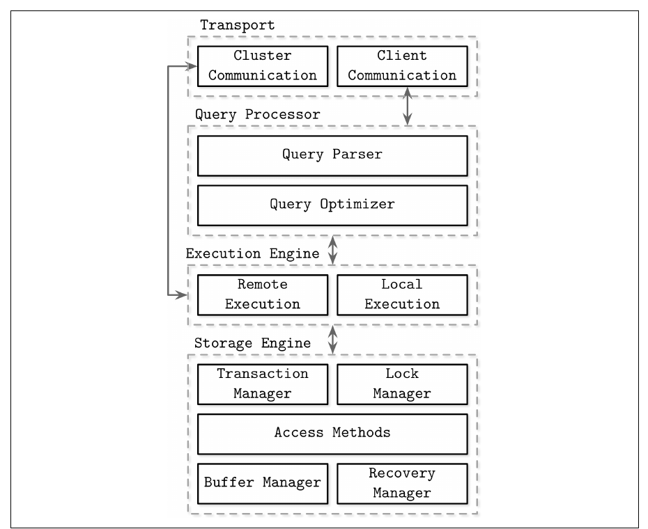
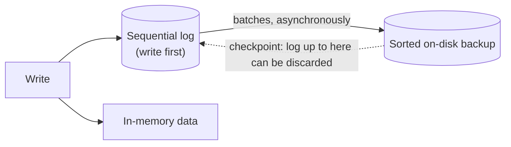
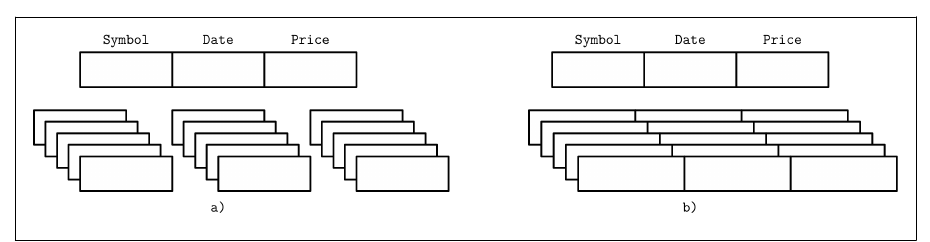
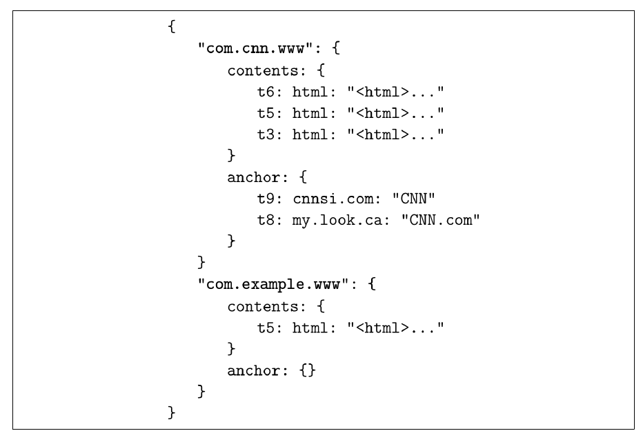
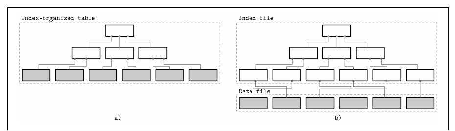
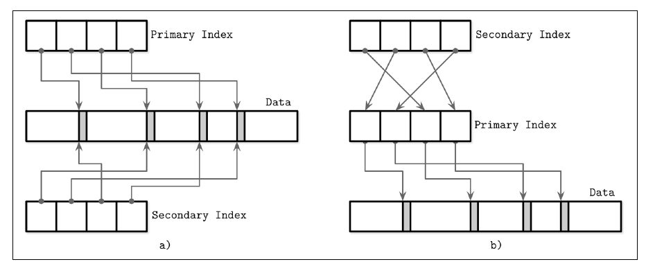

# 1. Introduction and Overview

[Book](../README.md) · [2. B-Tree Basics →](02-b-tree-basics.md)

## Summary

Part I, *Storage Engines*, opens with a classification of database management systems and definitions for terms that are often confused. Every DBMS is built a little differently, but a common architecture has emerged:

- a **transport** layer receives queries;
- the **query processor** parses and validates them;
- the **optimizer** chooses an execution plan;
- the **execution engine** runs local and remote operations;
- the **storage engine** holds the transaction, lock, buffer and recovery managers and the access methods (pp. 8–10).

The chapter then contrasts **memory-based** with **disk-based** systems, which differ in their data structures, not only in where the data lives, and **row-oriented** with **column-oriented** layouts, which suit different access patterns. **Wide column stores** such as Bigtable are a different thing again. It also separates **data files** (heap, hashed or index-organized) from **index files**: primary vs secondary indexes, clustered vs nonclustered indexes, and direct offsets vs a primary key used as indirection. Finally, it introduces the three variables that the rest of Part I uses to tell storage structures apart: **buffering**, **mutability** and **ordering** (pp. 21–22).

## Key takeaways

- **The storage engine is a set of cooperating managers.** Transaction and lock managers provide concurrency control; access methods, the buffer manager and the recovery manager manage pages on disk and in memory (p. 10).
- **An in-memory database isn't a disk database with a big cache.** Its serialization format, data layout and data structures can all be different (p. 12).
- **In-memory stores stay durable with a log plus a sorted on-disk backup.** Checkpointing applies log batches to the backup so the log can be truncated (pp. 11–12).
- **Choose row or column layout by access pattern.** Point queries and range scans over whole records favour rows; scans of many rows that aggregate a few columns favour columns, which also vectorize and compress better (pp. 13–15).
- **Wide column stores aren't column stores.** Bigtable and HBase group columns into families and store each family row-wise (p. 15).
- **Index-organized tables store records in the index**, saving at least one disk seek per lookup. Heap files need a separate index (p. 18).
- **Direct offsets make reads cheaper; primary-key indirection makes updates cheaper.** MySQL InnoDB's secondary indexes take the second route (p. 20).

## Section outline

*From the book’s own table of contents (PDF bookmarks); printed page numbers.*

- DBMS Architecture — p. 8
- Memory- Versus Disk-Based DBMS — p. 10
  - Durability in Memory-Based Stores — p. 11
- Column- Versus Row-Oriented DBMS — p. 12
  - Row-Oriented Data Layout — p. 13
  - Column-Oriented Data Layout — p. 14
  - Distinctions and Optimizations — p. 15
  - Wide Column Stores — p. 15
- Data Files and Index Files — p. 17
  - Data Files — p. 18
  - Index Files — p. 18
  - Primary Index as an Indirection — p. 20
- Buffering, Immutability, and Ordering — p. 21
- Summary — p. 22

## Notes

Database systems serve very different purposes: hot temporary data, long-lived cold storage, complex analytics, key-only access, time series or large blobs (p. 7). One common grouping, which the book mentions but doesn't rely on (pp. 7–8):

| Category | Workload |
|---|---|
| **OLTP** | Many short, user-facing requests and transactions, usually predefined |
| **OLAP** | Complex aggregations and long-running ad hoc queries; analytics and data warehousing |
| **HTAP** | Both OLTP and OLAP properties |

Other labels exist (key-value, relational, document, graph), but a full taxonomy isn't needed, because the concepts in the book apply to most of them (p. 8).

### DBMS architecture

There's no common blueprint, and in code, components that look independent are often coupled for performance or edge cases (p. 8). Figure 1-1 shows common themes from the literature. Database nodes are servers and application instances are clients.



*Figure 1-1 (p. 9): a request flows top to bottom; the transport layer also links straight to remote execution, because other nodes send work too.*

The **transport** subsystem takes client queries and also talks to other nodes. The **query processor** parses, interprets, validates and checks access control (p. 9).

The **optimizer** removes impossible and redundant parts of a query. It then picks the cheapest **execution plan** (or query plan) based on internal statistics, such as index cardinality and approximate intersection size, and on data placement, meaning which nodes hold the data and what moving it costs (p. 9).

| Storage engine component | Responsibility (p. 10) |
|---|---|
| **Transaction manager** | Schedules transactions so they can't leave the database logically inconsistent |
| **Lock manager** | Locks database objects so concurrent operations don't violate *physical* data integrity |
| **Access methods** (storage structures) | Organize data on disk: heap files, B-Trees, LSM Trees |
| **Buffer manager** | Caches data pages in memory |
| **Recovery manager** | Keeps the operation log and restores state after a failure |

Together, the transaction and lock managers provide **concurrency control** (p. 10).

### Memory- versus disk-based DBMS

**In-memory** (main memory) systems keep data primarily in RAM and use disk for recovery and logging. **Disk-based** systems keep most data on disk and use memory as a cache (p. 10).

| | In-memory | Disk-based |
|---|---|---|
| Why | Performance, low access cost, fine access granularity, simpler programming (the OS manages allocation) | Disks are cheaper and easier to maintain |
| Limits | RAM is volatile and expensive | Must manage references, serialization, freed space and fragmentation by hand |
| Structures | Free to use pointer-heavy structures | Wide, short trees (Ch. 2) |

**Non-Volatile Memory (NVM)** may change the picture: it reduces or removes the asymmetry between read and write latency and allows byte-addressable access (p. 11).

#### Durability in memory-based stores

An operation is complete only once its result is written to a **sequential log** (p. 11). To avoid replaying the whole log at startup, the store also keeps a **backup copy** as a sorted disk-based structure. Changes to it are applied asynchronously, in batches. After a batch is applied, the backup is a snapshot at a point in time, and the log up to that point can be discarded. This is **checkpointing** (pp. 11–12).



The book warns that an in-memory database is *not* just an on-disk database with a huge page cache. Serialization and data layout overheads prevent the optimizations in-memory stores can make (p. 12). Some datasets fit in memory naturally because the real world bounds them, such as school student records or a store's inventory (p. 12).

### Column- versus row-oriented DBMS

A **field** is the intersection of a column and a row. A **row** is the set of values belonging to one record, usually identified by a key (p. 12). Tables can be partitioned **horizontally**, storing rows together, or **vertically**, storing columns together (Figure 1-2). Row stores include MySQL, PostgreSQL and most traditional relational databases. The pioneering open source column stores were **MonetDB** and **C-Store**, the predecessor of Vertica (p. 13).



*Figure 1-2 (p. 13): (a) column-oriented — each column's values sit together; (b) row-oriented — each record's fields sit together.*

#### Row-oriented data layout

The layout is close to the tabular view. The book's example is user records with ID, name, birth date and phone number (p. 13). Fields of one record are usually written and read together, which improves **spatial locality**. Disks are accessed block-wise, so a block holds all columns of its rows. That's ideal for fetching whole records, but costly for queries that read one field across many records, such as only phone numbers (pp. 13–14).

#### Column-oriented data layout

Values of a column are stored contiguously, for example historical stock price quotes. Queries read only the columns they need, in one pass (p. 14).

*The book's example (p. 14): the same table, physically stored by column*

```text
Symbol: 1:DOW; 2:DOW; 3:S&P; 4:S&P
Date:   1:08 Aug 2018; 2:09 Aug 2018; 3:08 Aug 2018; 4:09 Aug 2018
Price:  1:24,314.65; 2:24,136.16; 3:2,414.45; 4:2,232.32
```

To rebuild tuples for joins, filters and multirow aggregates, each value must be linked to its row. Storing the key with each value duplicates data, so some column stores use **virtual IDs**: the value's position (offset) (p. 14). Newer column formats and stores include Apache Parquet, Apache ORC, RCFile, Apache Kudu and ClickHouse (pp. 14–15).

#### Distinctions and optimizations

Layout is only one of the optimizations column stores target (p. 15):

- Reading many values of one column at once improves **cache utilization**, and **vectorized** (SIMD) instructions process several values per CPU instruction.
- Values of the same type compress better, and each type can use its best **compression** algorithm.
- **Rule of thumb:** records read whole, point queries and range scans → rows. Scans over many rows aggregating a subset of columns → columns.

#### Wide column stores

**Bigtable** and **HBase** represent data as a **multidimensional sorted map**. Columns are grouped into **column families**, and *inside* each family data is stored row-wise. This suits retrieval by a key or a sequence of keys (p. 15).

The canonical **Webtable** example from the Bigtable paper (pp. 15–17):

- The row key is the page's **reversed URL**.
- Column families such as `contents` and `anchor` are stored separately on disk.
- A column key is the family name plus a qualifier, for example `anchor:cnnsi.com`.
- Each cell keeps several **versions by timestamp**.



*Figure 1-3 (p. 16): row key → column family → qualifier → timestamped versions. Physically each family is stored separately, and within a family one key's data is kept together (Figure 1-4, p. 17).*

### Data files and index files

Databases use files, but with their own formats instead of filesystem hierarchies, for **storage efficiency** (little overhead per record), **access efficiency** (few steps to locate a record) and **update efficiency** (few changes on disk) (p. 17).

Tables are usually separate files, and records are found through **indexes**: auxiliary structures built over a subset of fields. Index files are usually smaller than data files. Files are split into **pages** of one or more disk blocks, organized as sequences of records or as slotted pages (Ch. 3) (pp. 17–18).

Most modern storage systems don't delete in place. They write **deletion markers** (tombstones) holding a key and a timestamp. **Garbage collection** later rewrites live records and discards the shadowed ones (p. 18).

#### Data files

| Data file type | Organization (p. 18) |
|---|---|
| **Heap file** (heap-organized table) | No particular order, usually write order; appends need no reorganization; requires a separate index |
| **Hashed file** | The key's hash picks a **bucket**; within a bucket, records are in append order or sorted |
| **Index-organized table (IOT)** | Records live *in* the index, in key order; range scans read sequentially; saves at least one seek per lookup |

When records live in a separate file, index entries hold enough to find them, such as file offsets (**row locators**) or bucket IDs. In IOTs, the entries hold the records themselves (p. 18).

#### Index files

An index maps keys to the locations of records (heap files) or to primary keys (IOTs). The index on the primary file is the **primary index**, usually over the primary key. All others are **secondary**. They point either to the record or to its primary key, and they may hold several entries per search key (p. 19).



*Figure 1-5 (p. 19): (a) records in the index itself; (b) the index stores offsets into a separate data file (data segments shaded).*

| | Clustered (clustering) | Nonclustered (unclustered) |
|---|---|---|
| Data order | Follows the key order | Doesn't follow the key order |
| Typical | IOTs (always), most primary indexes | Secondary indexes (by definition) |

If no primary key is specified, the engine may create an implicit one. MySQL InnoDB, for example, adds an auto-increment column. The terminology applies across relational systems (MySQL, PostgreSQL), Dynamo-based stores (Cassandra, Riak) and document stores (MongoDB) (p. 20).

#### Primary index as an indirection

Should secondary indexes point at records directly or through the primary index? (p. 20)

| | Direct offsets | Primary-key indirection |
|---|---|---|
| Reads | Fewer seeks | Two lookups (secondary, then primary) |
| Updates and relocations | Every index pointer must be updated | Only the primary index changes |
| Suits | Read-mostly workloads with few indexes | Write-heavy workloads with many indexes; e.g. **MySQL InnoDB** |



*Figure 1-6 (p. 21): (a) every index holds data offsets, so moving a record touches them all; (b) secondary entries go through the primary index.*

A hybrid stores both an offset and the primary key. It tries the offset first and, if it's stale, goes through the primary index and repairs the offset (p. 21).

### Buffering, immutability, and ordering

Data structures don't describe caching, recovery or transactions; storage engines add those (p. 21). Most of the differences between the storage structures in the book come from three variables (pp. 21–22):

| Variable | Question | Examples in the book |
|---|---|---|
| **Buffering** | Collect data in memory before writing? (beyond the unavoidable block-sized buffering) | Lazy B-Trees buffer in nodes (p. 114); two-component LSM Trees combine buffering with immutability (p. 132) |
| **Mutability** | Update in place, or append / copy-on-write? | Copy-on-write B-Trees (p. 112); Bw-Trees are B-Tree-inspired but immutable (p. 120) |
| **Ordering** | Store records in key order on disk? | Ordered → efficient range scans; out of order (insertion order) → write optimizations, as in Bitcask (p. 153) and WiscKey (p. 154) |

### Summary

The chapter covers DBMS architecture, memory- vs disk-based stores, row vs column layouts, data vs index files, and the buffering–mutability–ordering triad used throughout the book (pp. 22–23). Further reading: Hellerstein, Stonebraker and Hamilton's *Architecture of a Database System* (2007); Abadi et al., *The Design and Implementation of Modern Column-Oriented Database Systems* (2013); Faerber, Kemper and Larson, *Main Memory Database Systems* (2017) (p. 23).

## Trade-offs at a glance

| Choice | Option A | Option B |
|---|---|---|
| Primary medium | Memory: fast, simple structures, volatile, costly | Disk: cheap, durable, needs disk-aware structures |
| Layout | Row: whole-record access, point queries | Column: scans and aggregates, compression, SIMD |
| Data file | Heap: cheap appends, needs an index | IOT: one fewer seek, ordered scans |
| Secondary index target | Offset: fast reads | Primary key: cheap updates |

## Beyond the book

- The third author of *Main Memory Database Systems* is Per-Åke Larson; the book's further-reading entry prints “Per-Åke Alfons”.
- Many systems today mix the two layouts. PAX, for example, stores a page's rows column by column, and Parquet's row groups use the same idea.

## Connections

- **Related chapters:** [2. B-Tree Basics](02-b-tree-basics.md) (wide, short trees on disk), [3. File Formats](03-file-formats.md) (pages and slotted pages), [5. Transaction Processing and Recovery](05-transaction-processing-and-recovery.md) (buffer, recovery and lock managers), [6. B-Tree Variants](06-b-tree-variants.md) (copy-on-write, lazy B-Trees, Bw-Trees), [7. Log-Structured Storage](07-log-structured-storage.md) (LSM Trees, Bitcask, WiscKey).

## Check yourself

*Questions and answers are the vault's, written from the notes above; answers cite the book's pages.*

1. **Which storage engine components together provide concurrency control?**
   - [ ] Buffer manager and recovery manager
   - [x] Transaction manager and lock manager
   - [ ] Access methods and query optimizer

   *Answer:* The transaction manager keeps the database logically consistent; the lock manager protects physical integrity (p. 10).

2. **How does an in-memory store avoid replaying its entire log after a crash?**

   *Answer:* It keeps a sorted on-disk backup, updated asynchronously from the log in batches. Each checkpoint lets the log up to that point be discarded (pp. 11–12).

3. **A query computes the average price per symbol over ten years of quotes. Which layout fits?**
   - [ ] Row-oriented
   - [x] Column-oriented
   - [ ] A wide column store

   *Answer:* It scans many rows and reads only two columns. Column stores read just those columns and add cache, SIMD and compression benefits (pp. 14–15).

4. **Is HBase a column-oriented database?**

   *Answer:* No. It's a wide column store: columns are grouped into families, and each family is stored row-wise as a sorted multidimensional map (p. 15).

5. **Why does MySQL InnoDB look up the primary index after a secondary index hit?**

   *Answer:* Its secondary indexes store primary keys instead of offsets. Records can then move without updating every secondary index, at the cost of a second lookup (p. 20).

6. **Name the three variables the book uses to compare storage structures.**

   *Answer:* Buffering, mutability (immutability) and ordering (pp. 21–22).
