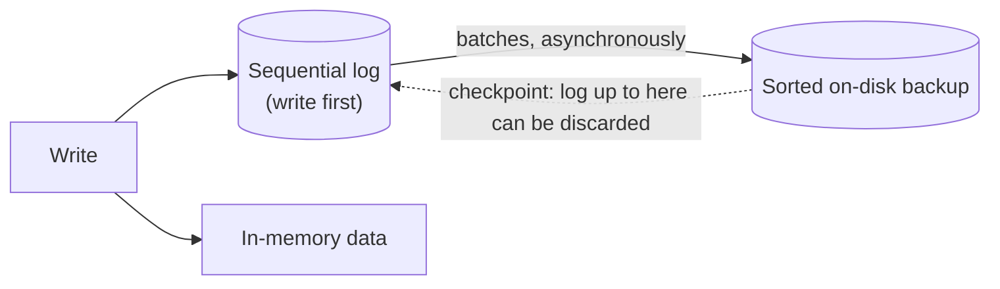

# فصل ۱: مقدمه و نمای کلی

[کتاب](../README.md) · [فصل ۲: پایه‌های B-Tree ←](02-b-tree-basics.md)

## خلاصه

بخش یک، یعنی *Storage Engines*، با رده‌بندی سیستم‌های مدیریت دیتابیس و تعریف اصطلاح‌هایی که اغلب قاطی می‌شوند باز می‌شود. هر DBMSی کمی طور دیگری ساخته شده، ولی معماری‌ای مشترک سر در آورده:

- لایه‌ی **transport** queryها را می‌گیرد؛
- پردازشگر query آن‌ها را parse و اعتبارسنجی می‌کند؛
- **نقش optimizer** برنامه‌ی اجرایی را برمی‌دارد؛
- موتور اجرا عملیات محلی و دور را اجرا می‌کند؛
- و موتور ذخیره‌سازی مدیرهای تراکنش و قفل و buffer و بازیابی و روش‌های دسترسی را دارد (pp. 8–10).

بعد فصل سیستم‌های **حافظه‌محور** را با **دیسک‌محور** مقابل می‌گذارد، که در ساختار داده‌شان فرق دارند و نه فقط در جای زندگی داده، و چیدمان **ردیف‌محور** را با **ستون‌محور**، که به الگوهای دسترسی مختلفی می‌خورند. **wide column store**هایی مثل Bigtable بازهم چیز دیگری‌اند. همچنین **فایل‌های داده**، یعنی heap یا hash‌شده یا index‌چیده، را از **فایل‌های index** جدا می‌کند: index اولیه در برابر ثانویه، index clusterی در برابر ناخوشه‌ای، و offset مستقیم در برابر کلید اولیه به‌شکل واسطه. در آخر، آن سه متغیر را معرفی می‌کند که بقیه‌ی بخش یک برای جدا کردن ساختارهای ذخیره‌سازی به کارشان می‌برد: **buffer کردن** و **mutability** و **ترتیب** (pp. 21–22).

## نکته‌های کلیدی

- **موتور ذخیره‌سازی مجموعه‌ای از مدیرهای هم‌کار است.** مدیرهای تراکنش و قفل concurrency control می‌دهند؛ و روش‌های دسترسی و مدیر buffer و مدیر بازیابی صفحه‌ها را روی دیسک و در حافظه می‌گردانند (p. 10).
- **دیتابیس in-memoryی دیتابیس دیسکی با cacheی بزرگ نیست.** قالب سری‌سازی و چیدمان داده و ساختار داده‌اش همه می‌توانند فرق داشته باشند (p. 12).
- **انباره‌های in-memoryی با یک log به‌علاوه‌ی پشتیبانی مرتب روی دیسک پایا می‌مانند.** checkpoint گرفتن دسته‌های log را روی پشتیبان اعمال می‌کند تا log بریده شود (pp. 11–12).
- **چیدمان ردیفی یا ستونی را از الگوی دسترسی بردارید.** query نقطه‌ای و اسکن بازه‌ای روی کل رکورد به ردیف‌ها می‌خورند؛ و اسکن ردیف‌های زیاد که چند ستون را تجمیع می‌کند به ستون‌ها، که برداری شدن و فشرده شدنشان هم بهتر است (pp. 13–15).
- **ساختار wide column store انباره‌ی ستونی نیست.** سیستم‌های Bigtable و HBase ستون‌ها را در خانواده گروه می‌کنند و هر خانواده‌ای را ردیفی ذخیره (p. 15).
- **جدول index‌چیده رکوردها را در index ذخیره می‌کند**، و برای هر جست‌و‌جویی دست‌کم یک seek دیسک صرفه‌جویی می‌کند. فایل heap index جدایی لازم دارد (p. 18).
- **مفهوم offset مستقیم خواندن را ارزان‌تر می‌کند؛ و واسطه‌شدن کلید اولیه به‌روزرسانی را.** indexهای ثانویه‌ی InnoDB در MySQL راه دوم را می‌روند (p. 20).

## فهرست بخش‌ها

*از فهرست مطالب خود کتاب، از bookmarkهای PDF؛ شماره‌ها صفحه‌ی چاپی‌اند.*

- معماری DBMS — ص. ۸
- بخش DBMS حافظه‌محور در برابر دیسک‌محور — ص. ۱۰
  - پایایی در انباره‌های حافظه‌محور — ص. ۱۱
- بخش DBMS ستون‌محور در برابر ردیف‌محور — ص. ۱۲
  - چیدمان داده‌ی ردیف‌محور — ص. ۱۳
  - چیدمان داده‌ی ستون‌محور — ص. ۱۴
  - تمایزها و بهینه‌سازی‌ها — ص. ۱۵
  - بخش wide column store — ص. ۱۵
- فایل داده و فایل index — ص. ۱۷
  - فایل داده — ص. ۱۸
  - فایل index — ص. ۱۸
  - بخش index اولیه به‌شکل واسطه — ص. ۲۰
- بخش buffer کردن و immutability و ترتیب — ص. ۲۱
- خلاصه — ص. ۲۲

## یادداشت‌ها

سیستم‌های دیتابیس هدف‌های خیلی مختلفی را سرویس می‌دهند: داده‌ی موقت داغ، ذخیره‌سازی سرد دیرزیست، تحلیل پیچیده، دسترسی فقط‌کلیدی، سری‌زمانی یا blobهای بزرگ (p. 7). یک گروه‌بندی رایج، که کتاب نامش را می‌برد ولی به آن تکیه نمی‌کند (pp. 7–8):

| رده | بار کاری |
|---|---|
| **OLTP** | درخواست‌ها و تراکنش‌های زیاد و کوتاه و کاربر‌رو، که معمولاً پیش‌تعریف‌شده‌اند |
| **OLAP** | تجمیع پیچیده و queryهای دیرپای موردی؛ تحلیل و data warehouse |
| **HTAP** | هم خاصیت‌های OLTP و هم OLAP |

برچسب‌های دیگری هم هست، مثل key-value و رابطه‌ای و document و graph، ولی رده‌بندی کاملی لازم نیست، چون مفهوم‌های کتاب به بیشترشان به کار می‌آیند (p. 8).

### معماری DBMS

نقشه‌ی مشترکی نیست، و در کد، مؤلفه‌هایی که مستقل به نظر می‌رسند اغلب برای کارایی یا حالت‌های حاشیه‌ای به هم گره خورده‌اند (p. 8). شکل ۱-۱ مضمون‌های مشترک ادبیات را نشان می‌دهد. نودهای دیتابیس سرورند و نمونه‌های برنامه کلاینت.


*Figure 1-1 (p. 9): درخواست از بالا به پایین جاری می‌شود؛ لایه‌ی transport یک‌راست به اجرای دور هم پیوند دارد، چون نودهای دیگر هم کار می‌فرستند.*

زیرسیستم **transport** queryهای کلاینت را می‌گیرد و با نودهای دیگر هم حرف می‌زند. پردازشگر query آن‌ها را parse و تفسیر و اعتبارسنجی می‌کند و کنترل دسترسی را می‌سنجد (p. 9).

جزء **optimizer** بخش‌های ناممکن و زائد یک query را برمی‌دارد. بعد ارزان‌ترین **برنامه‌ی اجرایی**، یا برنامه‌ی query، را بر پایه‌ی آمارهای درونی، مثل cardinality هر indexی و اندازه‌ی تقریبی اشتراک، و بر پایه‌ی جای‌دهی داده، یعنی این‌که کدام نودها داده را دارند و جابه‌جا کردنش چه خرجی دارد، برمی‌دارد (p. 9).

| مؤلفه‌ی موتور ذخیره‌سازی | مسئولیت (p. 10) |
|---|---|
| **مدیر تراکنش** | تراکنش‌ها را چنان زمان‌بندی می‌کند که نتوانند دیتابیس را منطقاً ناسازگار بگذارند |
| **مدیر قفل** | objectهای دیتابیس را قفل می‌کند تا عملیات هم‌زمان تمامیت *فیزیکی* داده را نقض نکنند |
| **روش‌های دسترسی** که ساختارهای ذخیره‌سازی‌اند | داده را روی دیسک سازمان می‌دهند: فایل heap و B-Tree و LSM Tree |
| **مدیر buffer** | صفحه‌های داده را در حافظه cache می‌کند |
| **مدیر بازیابی** | log عملیات را نگه می‌دارد و حالت را پس از شکستی بازمی‌گرداند |

مدیرهای تراکنش و قفل با هم **concurrency control** می‌دهند (p. 10).

### سیستم DBMS حافظه‌محور در برابر دیسک‌محور

سیستم‌های **in-memoryی**، یعنی حافظه‌ی اصلی، داده را بیشتر در RAM نگه می‌دارند و دیسک را برای بازیابی و log به کار می‌برند. سیستم‌های **دیسک‌محور** بیشتر داده را روی دیسک نگه می‌دارند و حافظه را به‌شکل cache (p. 10).

| | in-memoryی | دیسک‌محور |
|---|---|---|
| چرا | کارایی، هزینه‌ی کم دسترسی، دانه‌ریزی دسترسی، برنامه‌نویسی ساده‌تر، چون سیستم عامل تخصیص را می‌گرداند | دیسک ارزان‌تر و نگهداشتش آسان‌تر است |
| حدها | حافظه‌ی RAM فرار و گران است | باید ارجاع و سری‌سازی و فضای آزادشده و تکه‌تکه شدن را دستی گرداند |
| ساختارها | آزادند ساختارهای پراشاره‌گر به کار ببرند | درخت‌های پهن و کوتاه، از فصل ۲ |

حافظه‌ی **Non-Volatile Memory** که NVM است می‌تواند تصویر را عوض کند: نامتقارنی latency خواندن و نوشتن را کم یا بردارد و دسترسی بایت‌نشانی را مجاز کند (p. 11).

#### پایایی در انباره‌های حافظه‌محور

عملیاتی تنها وقتی تمام است که نتیجه‌اش در یک **log ترتیبی** نوشته شود (p. 11). انباره، برای پرهیز از replay کل log سر راه افتادن، یک **کپی پشتیبان** هم به‌شکل ساختاری مرتب و دیسکی نگه می‌دارد. تغییرهای آن asynchronous و دسته‌دسته اعمال می‌شوند. پس از اعمال هر دسته‌ای، پشتیبان snapshotی در نقطه‌ای از زمان است، و log تا آن نقطه انداختنی است. این همان **checkpoint گرفتن** است (pp. 11–12).



کتاب هشدار می‌دهد که دیتابیس in-memoryی دیتابیسی دیسکی با page cacheی غول‌آسا *نیست*. سرریز سری‌سازی و چیدمان داده جلو آن بهینه‌سازی‌هایی را می‌گیرد که انباره‌های in-memoryی می‌توانند بکنند (p. 12). برخی مجموعه‌داده‌ها طبیعتاً در حافظه جا می‌شوند چون دنیای واقعی حدشان می‌زند، مثل پرونده‌ی دانش‌آموزهای یک مدرسه یا موجودی یک فروشگاه (p. 12).

### سیستم DBMS ستون‌محور در برابر ردیف‌محور

**فیلد** اشتراک یک ستون و یک ردیف است. **ردیف** مجموعه‌ی مقدارهایی است که به یک رکورد تعلق دارند، و معمولاً کلیدی شناسایی‌اش می‌کند (p. 12). جدول‌ها می‌توانند **افقی** پارتیشن شوند، یعنی ردیف‌ها با هم ذخیره شوند، یا **عمودی**، یعنی ستون‌ها با هم (شکل ۱-۲). انباره‌های ردیفی شامل MySQL و PostgreSQL و بیشتر دیتابیس‌های رابطه‌ای سنتی‌اند. انباره‌های ستونی پیشگام و open source عبارت **MonetDB** و **C-Store** بودند، که دومی پیشین Vertica است (p. 13).


*Figure 1-2 (p. 13): (الف) ستون‌محور، که مقدارهای هر ستونی با هم می‌نشینند؛ (ب) ردیف‌محور، که فیلدهای هر رکوردی با هم می‌نشینند.*

#### چیدمان داده‌ی ردیف‌محور

چیدمان به آن نمای جدولی نزدیک است. نمونه‌ی کتاب رکوردهای کاربر با ID و نام و تاریخ تولد و شماره‌ی تلفن است (p. 13). فیلدهای یک رکورد معمولاً با هم نوشته و خوانده می‌شوند، که **محلیت فضایی** را بهتر می‌کند. دیسک‌ها بلوک‌به‌بلوک دسترسی می‌شوند، پس بلوکی همه‌ی ستون‌های ردیف‌هایش را دارد. این برای گرفتن کل رکوردها آرمانی است، ولی برای queryهایی که یک فیلد را روی رکوردهای زیادی می‌خوانند گران، مثل فقط شماره‌های تلفن (pp. 13–14).

#### چیدمان داده‌ی ستون‌محور

مقدارهای یک ستون پیوسته ذخیره می‌شوند، مثلاً نرخ‌های تاریخی سهام. queryها تنها همان ستون‌هایی را که لازم دارند و در یک گذر می‌خوانند (p. 14).

*نمونه‌ی کتاب (p. 14): همان جدول، که فیزیکی ستون‌به‌ستون ذخیره شده*

```text
Symbol: 1:DOW; 2:DOW; 3:S&P; 4:S&P
Date:   1:08 Aug 2018; 2:09 Aug 2018; 3:08 Aug 2018; 4:09 Aug 2018
Price:  1:24,314.65; 2:24,136.16; 3:2,414.45; 4:2,232.32
```

برای ساختن دوباره‌ی tupleها در join و فیلتر و تجمیع چند‌ردیفی، هر مقداری باید به ردیفش پیوند داشته باشد. ذخیره‌ی کلید با هر مقداری داده را تکرار می‌کند، پس برخی انباره‌های ستونی **ID مجازی** به کار می‌برند: جای مقدار، یعنی offsetش (p. 14). قالب‌ها و انباره‌های ستونی تازه‌تر شامل Apache Parquet و Apache ORC و RCFile و Apache Kudu و ClickHouse‌اند (pp. 14–15).

#### تمایزها و بهینه‌سازی‌ها

چیدمان تنها یکی از بهینه‌سازی‌هایی است که انباره‌های ستونی هدف می‌گیرند (p. 15):

- خواندن مقدارهای زیادی از یک ستون در یک بار **بهره‌گیری از cache** را بهتر می‌کند، و دستورهای **برداری**، یعنی SIMD، چند مقدار را در یک دستور CPU پردازش می‌کنند.
- مقدارهای همان نوع بهتر فشرده می‌شوند، و هر نوعی می‌تواند بهترین الگوریتم **فشرده‌سازی** خودش را به کار ببرد.
- **قاعده‌ی سرانگشتی:** رکوردهایی که کامل خوانده می‌شوند و query نقطه‌ای و اسکن بازه‌ای ← ردیف. اسکن روی ردیف‌های زیاد که زیرمجموعه‌ای از ستون‌ها را تجمیع می‌کند ← ستون.

#### wide column store

سیستم‌های **Bigtable** و **HBase** داده را به‌شکل **نقشه‌ی مرتب چند‌بُعدی** نمایش می‌دهند. ستون‌ها در **خانواده‌های ستون** گروه می‌شوند، و *درون* هر خانواده‌ای داده ردیفی ذخیره می‌شود. این به بازیابی با یک کلید یا دنباله‌ای از کلید می‌خورد (p. 15).

نمونه‌ی مرجع **Webtable** از مقاله‌ی Bigtable (pp. 15–17):

- کلید ردیف همان **URL برگردانده‌ی** صفحه است.
- خانواده‌های ستون مثل `contents` و `anchor` جدا روی دیسک ذخیره می‌شوند.
- کلید ستون برابر نام خانواده به‌علاوه‌ی یک qualifier است، مثلاً `anchor:cnnsi.com`.
- هر cellی چند **نسخه بر حسب timestamp** نگه می‌دارد.


*Figure 1-3 (p. 16): کلید ردیف ← خانواده‌ی ستون ← qualifier ← نسخه‌های timestamp‌خورده. فیزیکی هر خانواده‌ای جدا ذخیره می‌شود، و درون خانواده‌ای داده‌ی یک کلید با هم نگه داشته می‌شود (شکل ۱-۴، ص. ۱۷).*

> **In practice:** منبع‌های ما row store‌اند و warehouse یک column store است؛ همین تفاوت توضیح می‌دهد چرا یک کوئری در یکی سریع و در دیگری کند است.
>
> **Your turn:** تحلیلگری `SELECT *` روی جدول ۸۰ ستونی Silver برای یک ماه می‌زند و کوئری کند است، ولی همان کوئری با سه ستون سریع است. چرا؟
>
> *Answer:* column store هر ستون را جدا ذخیره و فشرده می‌کند و فقط ستون‌های نام‌برده را می‌خواند؛ `SELECT *` هر ۸۰ ستون را می‌خواند و برای ساختن ردیف کنار هم می‌گذارد. column store برای اسکن و تجمیع چند ستون ساخته شده، نه برای برگرداندن ردیف کامل (pp. 12–16).

### فایل داده و فایل index

دیتابیس‌ها فایل به کار می‌برند، ولی با قالب‌های خودشان به‌جای سلسله‌مراتب فایل‌سیستم، برای **کارایی ذخیره‌سازی**، یعنی سرریز کم برای هر رکوردی، **کارایی دسترسی**، یعنی قدم‌های کم برای یافتن رکوردی، و **کارایی به‌روزرسانی**، یعنی تغییرهای کم روی دیسک (p. 17).

جدول‌ها معمولاً فایل‌های جدایند، و رکوردها از راه **index**ها پیدا می‌شوند: ساختارهای کمکی که روی زیرمجموعه‌ای از فیلدها بنا شده‌اند. فایل‌های index معمولاً از فایل‌های داده کوچک‌ترند. فایل‌ها به **صفحه**هایی از یک بلوک دیسک یا بیشتر شکسته می‌شوند، که به‌شکل دنباله‌ای از رکورد یا به‌شکل slotted page سازمان می‌یابند، از فصل ۳ (pp. 17–18).

بیشتر سیستم‌های ذخیره‌سازی امروزی سر جا حذف نمی‌کنند. **علامت حذف** می‌نویسند، که tombstone نامیده می‌شود و کلیدی و timestampی دارد. **garbage collectorی** بعدتر رکوردهای زنده را دوباره می‌نویسد و آن‌هایی را که سایه افتاده‌اند می‌اندازد (p. 18).

#### فایل داده

| گونه‌ی فایل داده | سازمان (p. 18) |
|---|---|
| **فایل heap** که جدول heap‌چیده است | ترتیب معینی ندارد، و معمولاً ترتیب نوشتن؛ افزودن سازمان‌دهی دوباره لازم ندارد؛ index جدایی می‌خواهد |
| **فایل hash‌شده** | مقدار hash کلید **bucket**ی را برمی‌دارد؛ درون bucketی، رکوردها به ترتیب افزودن یا مرتب‌اند |
| **جدول index‌چیده** که IOT است | رکوردها *در* index زندگی می‌کنند، به ترتیب کلید؛ اسکن بازه‌ای ترتیبی خوانده می‌شود؛ برای هر جست‌و‌جویی دست‌کم یک seek صرفه‌جویی می‌کند |

وقتی رکوردها در فایلی جدا زندگی کنند، entryهای index آن‌قدری دارند که پیدایشان کنند، مثل offset فایل که **row locator** است، یا ID مربوط به bucket. در IOTها، entryها خود رکوردها را دارند (p. 18).

#### فایل index

هر indexی کلیدها را به جای رکوردها، در فایل heap، یا به کلیدهای اولیه، در IOT، map می‌کند. آن indexی که روی فایل اصلی است **index اولیه** است، و معمولاً روی کلید اولیه. بقیه همه **ثانویه**اند. یا به رکورد اشاره می‌کنند یا به کلید اولیه‌اش، و می‌توانند برای هر کلید جست‌و‌جویی چند entry داشته باشند (p. 19).


*Figure 1-5 (p. 19): (الف) رکوردها در خود index؛ (ب) آن index offsetهایی را در فایل داده‌ی جدا ذخیره می‌کند، که قطعه‌های داده سایه خورده‌اند.*

| | clusterی | ناخوشه‌ای |
|---|---|---|
| ترتیب داده | از ترتیب کلید پی می‌گیرد | از ترتیب کلید پی نمی‌گیرد |
| معمولاً | IOTها، همیشه، و بیشتر indexهای اولیه | indexهای ثانویه، بنا به تعریف |

اگر کلید اولیه‌ای مشخص نشود، موتور می‌تواند کلیدی ضمنی بسازد. مثلاً InnoDB در MySQL ستونی خود‌افزا می‌افزاید. این اصطلاح‌ها در سیستم‌های رابطه‌ای یعنی MySQL و PostgreSQL، و انباره‌های Dynamo‌محور یعنی Cassandra و Riak، و انباره‌های document یعنی MongoDB به کار می‌آیند (p. 20).

#### ساختار index اولیه به‌شکل واسطه

آیا indexهای ثانویه باید یک‌راست به رکوردها اشاره کنند یا از راه index اولیه؟ (p. 20)

| | offset مستقیم | واسطه‌شدن کلید اولیه |
|---|---|---|
| خواندن | seek کم‌تر | دو جست‌و‌جو، اول ثانویه بعد اولیه |
| به‌روزرسانی و جابه‌جایی | هر اشاره‌گر indexی باید به‌روز شود | تنها index اولیه عوض می‌شود |
| به چه می‌خورد | بارهای بیشتر‌خوان با indexهای کم | بارهای پرنوشتن با indexهای زیاد؛ مثلاً **InnoDB در MySQL** |


*Figure 1-6 (p. 21): (الف) هر indexی offsetهای داده را دارد، پس جابه‌جا کردن رکوردی به همه‌شان دست می‌زند؛ (ب) entryهای ثانویه از index اولیه رد می‌شوند.*

روشی دوگانه هم offset و هم کلید اولیه را ذخیره می‌کند. اول offset را می‌کوشد و، اگر کهنه باشد، از index اولیه رد می‌شود و offset را تعمیر می‌کند (p. 21).

> **In practice:** index اولیه‌ی ClickHouse sparse است: برای هر granule، که پیش‌فرضش ۸۱۹۲ ردیف است، یک entry، و فقط روی ستون‌های `ORDER BY`.
>
> **Your turn:** چرا پیدا کردن یک `transaction_id` تنها در ClickHouse کند است، در حالی که دیتابیس منبع آن را در چند میلی‌ثانیه پیدا می‌کند؟
>
> *Answer:* منبع روی کلید index از نوع B-Tree دارد که مستقیم به ردیف می‌رسد؛ index ClickHouse فقط ستون‌های `ORDER BY` را می‌شناسد، پس برای ستونی بیرون از آن باید همه‌ی granuleها را اسکن کند، مگر یک skip index بسازید. این همان تمایز index اولیه و ثانویه در کتاب است (pp. 17–20).

### سه اصل buffer کردن، immutability و ترتیب

ساختارهای داده cache و بازیابی و تراکنش را وصف نمی‌کنند؛ موتورهای ذخیره‌سازی آن‌ها را می‌افزایند (p. 21). بیشتر تفاوت‌های میان ساختارهای ذخیره‌سازی کتاب از سه متغیر می‌آید (pp. 21–22):

| متغیر | پرسش | نمونه‌ها در کتاب |
|---|---|---|
| **buffer کردن** | داده پیش از نوشتن در حافظه جمع شود؟ فراتر از آن buffer کردن ناگزیر به اندازه‌ی بلوک | B-Treeهای تنبل در نودها buffer می‌کنند (p. 114)؛ LSM Treeهای دو‌مؤلفه‌ای buffer کردن را با immutability ترکیب می‌کنند (p. 132) |
| **mutability** | سر جا به‌روز شود، یا افزودن و copy-on-write؟ | B-Treeهای copy-on-write (p. 112)؛ Bw-Treeها از B-Tree الهام گرفته‌اند ولی تغییرناپذیرند (p. 120) |
| **ترتیب** | رکوردها روی دیسک به ترتیب کلید ذخیره شوند؟ | مرتب ← اسکن بازه‌ای کارا؛ بی‌ترتیب، یعنی ترتیب درج، ← بهینه‌سازی نوشتن، چنان‌که در Bitcask (p. 153) و WiscKey (p. 154) |

### خلاصه

فصل معماری DBMS، انباره‌های حافظه‌محور در برابر دیسک‌محور، چیدمان ردیفی در برابر ستونی، فایل داده در برابر فایل index، و آن سه‌گانه‌ی buffer کردن و mutability و ترتیب را که در کل کتاب به کار می‌رود پوشش می‌دهد (pp. 22–23). خواندنی‌های بیشتر: مقاله‌ی *Architecture of a Database System* از هلرستین و استون‌بریکر و همیلتون در ۲۰۰۷؛ *The Design and Implementation of Modern Column-Oriented Database Systems* از ابادی و همکاران در ۲۰۱۳؛ و *Main Memory Database Systems* از فربر و کمپر و لارسون در ۲۰۱۷ (p. 23).

## بده‌بستان‌ها در یک نگاه

| انتخاب | گزینه‌ی الف | گزینه‌ی ب |
|---|---|---|
| رسانه‌ی اصلی | حافظه: سریع، ساختارهای ساده، فرار، گران | دیسک: ارزان، پایا، ساختارهای دیسک‌آگاه لازم دارد |
| چیدمان | ردیف: دسترسی به کل رکورد، query نقطه‌ای | ستون: اسکن و تجمیع، فشرده‌سازی، SIMD |
| فایل داده | heap: افزودن ارزان، index لازم دارد | IOT: یک seek کم‌تر، اسکن مرتب |
| هدف index ثانویه | offset: خواندن سریع | کلید اولیه: به‌روزرسانی ارزان |

## فراتر از کتاب

- نویسنده‌ی سوم *Main Memory Database Systems* پر-آکه لارسون است؛ entry خواندنی‌های بیشتر کتاب «Per-Åke Alfons» را چاپ می‌کند.
- امروز خیلی از سیستم‌ها آن دو چیدمان را قاطی می‌کنند. مثلاً PAX ردیف‌های یک صفحه را ستون‌به‌ستون ذخیره می‌کند، و گروه‌های ردیف Parquet همان ایده را به کار می‌برند.

## پیوندها

- **فصل‌های مرتبط:** [فصل ۲: پایه‌های B-Tree](02-b-tree-basics.md) که درخت‌های پهن و کوتاه روی دیسک را دارد، [فصل ۳: قالب فایل](03-file-formats.md) که صفحه و slotted page را دارد، [فصل ۵: پردازش تراکنش و بازیابی](05-transaction-processing-and-recovery.md) که مدیرهای buffer و بازیابی و قفل را دارد، [فصل ۶: گونه‌های B-Tree](06-b-tree-variants.md) که copy-on-write و B-Treeهای تنبل و Bw-Tree را دارد، و [فصل ۷: ذخیره‌سازی log-structured](07-log-structured-storage.md) که LSM Tree و Bitcask و WiscKey را دارد.

## خودتان را بسنجید

*پرسش‌ها و پاسخ‌ها مال vault است و از روی یادداشت‌های بالا نوشته شده؛ پاسخ‌ها به صفحه‌های کتاب ارجاع می‌دهند.*

1. **کدام مؤلفه‌های موتور ذخیره‌سازی با هم concurrency control می‌دهند؟**
   - [ ] مدیر buffer و مدیر بازیابی
   - [x] مدیر تراکنش و مدیر قفل
   - [ ] روش‌های دسترسی و optimizer برای query

   *Answer:* مدیر تراکنش دیتابیس را منطقاً سازگار نگه می‌دارد؛ و مدیر قفل تمامیت فیزیکی را می‌پاید (p. 10).

2. **انباره‌ای in-memoryی چطور از replay کل logش پس از از کار افتادنی می‌پرهیزد؟**

   *Answer:* پشتیبانی مرتب روی دیسک نگه می‌دارد، که asynchronous و دسته‌دسته از log به‌روز می‌شود. هر checkpointی می‌گذارد log تا آن نقطه انداخته شود (pp. 11–12).

3. **یک query میانگین قیمت هر symbol را روی ده سال نرخ حساب می‌کند. کدام چیدمان می‌خورد؟**
   - [ ] ردیف‌محور
   - [x] ستون‌محور
   - [ ] یک wide column store

   *Answer:* ردیف‌های زیادی را اسکن می‌کند و تنها دو ستون را می‌خواند. انباره‌های ستونی تنها همان ستون‌ها را می‌خوانند و سود cache و SIMD و فشرده‌سازی را هم می‌افزایند (pp. 14–15).

4. **آیا HBase دیتابیسی ستون‌محور است؟**

   *Answer:* نه. یک wide column store است: ستون‌ها در خانواده گروه می‌شوند، و هر خانواده‌ای ردیفی و به‌شکل نقشه‌ی مرتب چند‌بُعدی ذخیره می‌شود (p. 15).

5. **چرا InnoDB در MySQL پس از خوردن به index ثانویه index اولیه را جست‌و‌جو می‌کند؟**

   *Answer:* indexهای ثانویه‌اش به‌جای offset کلید اولیه را ذخیره می‌کنند. آن‌وقت رکوردها می‌توانند بی به‌روز شدن هر index ثانویه‌ای جابه‌جا شوند، به بهای جست‌و‌جویی دوم (p. 20).

6. **آن سه متغیری را نام ببرید که کتاب برای مقایسه‌ی ساختارهای ذخیره‌سازی به کار می‌برد.**

   *Answer:* buffer کردن و mutability یا immutability و ترتیب (pp. 21–22).
