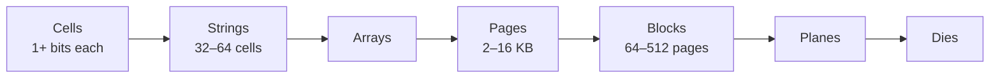
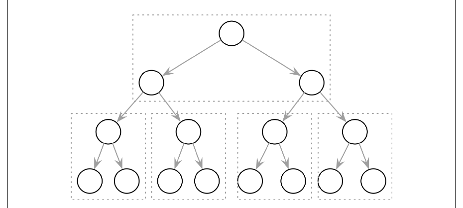
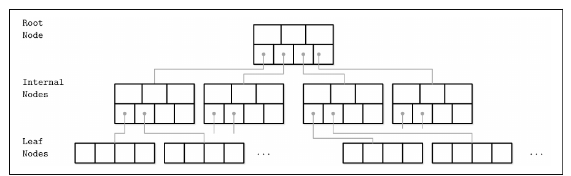
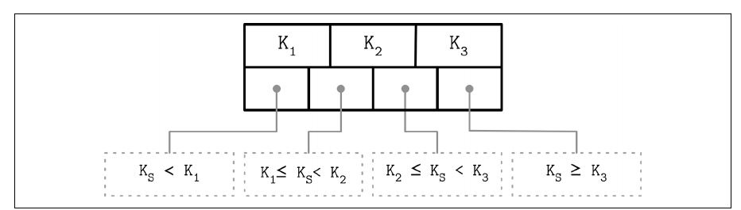
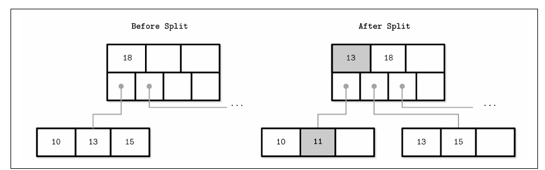
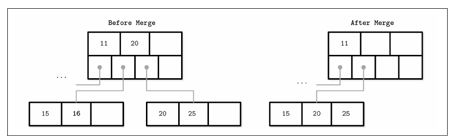

# 2. B-Tree Basics

[← 1. Introduction and Overview](01-introduction-and-overview.md) · [Book](../README.md) · [3. File Formats →](03-file-formats.md)

## Summary

B-Trees, introduced by Bayer and McCreight in 1971, are the most widespread mutable, in-place-update storage structure (p. 25). The chapter starts by explaining why balanced **binary search trees**, though O(log₂ N) in memory, are impractical on disk. Their **fanout** of two makes them tall, so each level costs a seek. Their nodes have no locality, and frequent rebalancing means constant pointer updates (pp. 26–29).

It then looks at the media. **HDDs** pay mainly for head positioning, so sequential I/O is cheap. **SSDs** read and write pages but erase whole blocks, with a **Flash Translation Layer** remapping pages and collecting garbage. Both are **block devices**, so the smallest unit of I/O is a block (pp. 30–32).

**B-Trees** answer this with high fanout and low height: nodes are pages holding up to N keys and N + 1 child pointers. In the **B⁺-Tree** variant the book uses throughout, values live only in leaves and internal nodes hold **separator keys** (pp. 33–37). A lookup touches log_N M pages but makes log₂ M comparisons (p. 37). Inserts that overflow a node **split** it and **promote** a separator key; deletes that underflow **merge** siblings and **demote** a key. Both can propagate to the root, and that is the only way the tree's height changes (pp. 39–42).

## Key takeaways

- **On disk, the cost is seeks, not comparisons.** A BST needs about one seek per comparison; a B-Tree needs one per level (pp. 29, 34).
- **Fanout and height are inversely related.** High fanout gives locality among neighbouring keys and few seeks (p. 29).
- **The smallest unit of disk I/O is a block,** so on-disk structures minimize disk accesses and out-of-page pointers (pp. 31–32).
- **SSDs write pages but erase blocks.** The FTL relocates live pages during garbage collection, which can hurt random and unaligned writes (pp. 31–32).
- **Among 4 billion items, a lookup needs about 32 comparisons,** but B-Tree nodes hold dozens or hundreds of keys, so only one seek per level is needed (p. 34).
- **B-Trees grow from the bottom up.** Only a root split adds a level, and only a merge into a new root removes one (pp. 37, 39).
- **Occupancy can fall to 50%** because nodes reserve space for future inserts; higher occupancy doesn't hurt performance (p. 37).

## Section outline

*From the book’s own table of contents (PDF bookmarks); printed page numbers.*

- Binary Search Trees — p. 26
  - Tree Balancing — p. 27
  - Trees for Disk-Based Storage — p. 28
- Disk-Based Structures — p. 29
  - Hard Disk Drives — p. 30
  - Solid State Drives — p. 30
  - On-Disk Structures — p. 32
- Ubiquitous B-Trees — p. 33
  - B-Tree Hierarchy — p. 35
  - Separator Keys — p. 36
  - B-Tree Lookup Complexity — p. 37
  - B-Tree Lookup Algorithm — p. 38
  - Counting Keys — p. 38
  - B-Tree Node Splits — p. 39
  - B-Tree Node Merges — p. 41
- Summary — p. 42

## Notes

Mutable structures mostly use **in-place updates**: inserts, updates and deletes change records where they are in the file (p. 25). Engines can keep several versions of a record (with MVCC or slotted pages), but the chapter assumes one record per key, at a unique location. By 1979 there were already enough B-Tree variants for Douglas Comer to survey them (p. 25).

### Binary search trees

A **BST** is a sorted in-memory structure. Each node holds a key, a value and two child pointers. Every key in a node's left subtree is smaller than the node's key, and every key in its right subtree is larger (pp. 26–27). Following left pointers reaches the smallest key and right pointers the largest. Values can be stored at any level, so a search may stop early (p. 27).

#### Tree balancing

Random inserts can make a tree **unbalanced**. In the worst case, a **pathological** tree degenerates into a linked list with O(N) lookups (Figure 2-3) (p. 27). A **balanced** tree has height log₂ N, and its two subtrees differ in height by at most one, as AVL trees require. Each step then halves the search space: O(log₂ N) (pp. 27–28).

Balancing reorganizes nodes after each operation, for example with a **rotation**. When two consecutive nodes in a branch each have one child, the middle node, the **rotation pivot**, is promoted a level and its parent becomes its right child (Figure 2-4, p. 28).

#### Trees for disk-based storage

**Fanout** is the maximum number of children per node. BSTs have a fanout of two, which causes three problems on disk (pp. 28–29):

| Problem | Why |
|---|---|
| **Locality** | Nodes are added in random order, so a child may sit on a different page from its parent |
| **Height** | log₂ N levels means O(log₂ N) seeks and transfers; 2-3-Trees have the same limitation |
| **Maintenance** | Frequent balancing relocates nodes and updates pointers |

A naive on-disk BST needs as many seeks as comparisons (p. 29). An on-disk tree should have **high fanout**, for locality of neighbouring keys, and **low height**, for few seeks. The two are inversely related (p. 29).

### Disk-based structures

On-disk structures are used when data is too large to keep in memory. Only a fraction is cached at any time (p. 29).

#### Hard disk drives

Most classic algorithms were designed for spinning disks (p. 30). A **seek** (rotation plus head movement) makes random reads expensive. Once the head is positioned, contiguous bytes are cheap, which is why sequential I/O is praised. The smallest transfer unit is a **sector**, typically 512 bytes to 4 KB (p. 30).

#### Solid state drives

SSDs have no moving parts. Their memory hierarchy (Figure 2-5, pp. 30–31):

| Operation | Unit (p. 31) |
|---|---|
| Read, write (program) | Page; only previously erased cells can be written |
| Erase | **Erase block** (many pages); pages in an empty block are written sequentially |

The **Flash Translation Layer (FTL)** maps page IDs to physical locations and tracks empty, written and discarded pages. During **garbage collection** it relocates live pages out of a block, remaps their IDs and erases the block (p. 31).

Both device types are addressed in chunks, so operating systems expose a **block device** abstraction. Reading one word reads its whole block (p. 31). On SSDs, the gap between random and sequential I/O is smaller than on HDDs, though prefetching, contiguous pages and internal parallelism still matter. Background garbage collection can still hurt write performance, especially for random and unaligned writes. Writing full blocks and combining writes to the same block reduces I/O, which motivates the book's later discussion of buffering and immutability (pp. 31–32).

#### On-disk structures

Following a pointer within a block means fetching the whole block, so the layout should exploit that (p. 32). On disk, "pointers" are offsets that the code computes and follows explicitly. They're either precomputed (when the pointer is written before its target) or cached in memory until flushed. Long chains of pointers add complexity, so keep their number and span small (p. 32). Good on-disk structures improve locality, optimize their internal representation and reduce **out-of-page pointers**. B-Trees combine these ideas: higher fanout, lower height, fewer pointers and less frequent balancing (p. 32).

#### Paged binary trees

Grouping binary tree nodes into pages (Figure 2-6) improves locality, because the next node is often in the page already fetched. Node and pointer overhead remains, though, and balancing randomly inserted keys means reorganizing pages and updating pointers (p. 33).

*Figure 2-6 (p. 33): each dashed box is one disk page; a lookup reads a page and follows several pointers inside it before the next fetch.*

### Ubiquitous B-Trees

The book compares a B-Tree to a library catalog room: pick the cabinet, then the shelf, the drawer and finally the card (p. 33). B-Tree nodes are drawn as rectangles with explicit pointer blocks, because each node splits its range into many subranges (Figures 2-7, 2-8, p. 34). Keys within a node are sorted, so each node can be searched with binary search. Finding one of 4 × 10⁹ items takes about **32 comparisons**, but only one seek per level (p. 34). B-Trees serve both **point queries** (`=`) and **range queries** (`<`, `>`, `≤`, `≥`) (p. 35).

#### B-Tree hierarchy

Each node holds up to **N keys and N + 1 child pointers** (p. 35).

| Node type | Role |
|---|---|
| **Root** | No parent; the top of the tree |
| **Internal** | Connect the root with the leaves; usually several levels |
| **Leaf** | Bottom level; no children |

*Figure 2-9 (p. 35): every node is one page; fanout is wide, so the tree stays only a few levels deep.*

B-Trees organize fixed-size pages, so *node* and *page* are used interchangeably. **Occupancy** is the ratio of keys held to node capacity. High fanout amortizes balancing and lets keys and child pointers share one block or a few consecutive blocks. Splits and merges are triggered when nodes become full or nearly empty (p. 35).

**B⁺-Trees** (p. 36): the B-Tree in the strict sense stores values at any level. A B⁺-Tree stores values *only in leaves*, and internal nodes hold separator keys. Every insert, update, delete and read therefore touches only leaves, and changes reach higher levels only through splits and merges. B⁺-Trees became the default; MySQL InnoDB calls its B⁺-Tree a "B-tree", and the book follows the same convention.

#### Separator keys

Keys in nodes are called **index entries**, **separator keys** or **divider cells**. They split the tree into **subtrees** (branches, subranges) (p. 36). The first pointer leads to keys smaller than the first key, the last pointer to keys greater than or equal to the last key, and pointer *i* to keys with **K₍ᵢ₋₁₎ ≤ Kₛ < Kᵢ** (Figure 2-10).

*Figure 2-10 (p. 36): N keys give N + 1 pointers, and each pointer owns the half-open range between its neighbouring keys.*

Some variants add **sibling pointers**, usually at the leaf level and sometimes in both directions, so range scans and reverse iteration don't have to go back to the parent (p. 37). B-Trees are built **bottom-up**: more leaves lead to more internal nodes and a taller tree. Storage utilization can drop to 50% but is usually much higher (p. 37).

#### B-Tree lookup complexity

There are two ways to count the cost of a lookup (p. 37):

| Measure | Base | Cost |
|---|---|---|
| **Block transfers** (seeks) | Keys per node | log_K M pages, one per level, i.e. the height *h* |
| **Comparisons** | 2 (binary search within nodes) | log₂ M |

Textbooks write simply **log M**, because changing the base only adds a constant factor (p. 37).

#### B-Tree lookup algorithm

A lookup is one root-to-leaf traversal that finds the key or its **predecessor** (p. 38). The key itself serves point queries, updates and deletes; the predecessor serves range scans and inserts.

- At each node, binary search finds the first separator greater than the searched key, and the lookup follows the corresponding pointer.
- At the leaf, the key is either found or shown absent by its predecessor.
- A range scan then iterates from the closest key over sibling pointers until the range predicate is exhausted.

Each level gives a more precise view of the key space (p. 38).

#### Counting keys

Bayer (1972) used a device-dependent *k*: pages hold between *k* and 2*k* keys, with *k* + 1 to 2*k* + 1 child pointers, and the root holds 1 to 2*k* keys. Graefe (2011) uses up to N keys and N + 1 pointers. The two are equivalent, and the book uses **N** (p. 38).

#### B-Tree node splits

An insert locates the target leaf and adds the key and value. An update locates the leaf and replaces the value (p. 39). A node **overflows** and must split when (p. 39):

- **a leaf** already holds N key-value pairs and receives another;
- **a nonleaf node** already holds N + 1 pointers and receives another.

Splitting allocates a new node and moves half the elements to it: everything after the **split point** (midpoint), including the split point itself for nonleaf nodes. The new node's first key is **promoted** to the parent with a pointer (p. 39). If the parent is full, it splits too, possibly all the way up. A **root split** allocates a new root holding the split key, and the tree grows a level. Otherwise the tree grows only horizontally (p. 39).

Figures 2-11 and 2-12 split a full leaf and a full nonleaf node while inserting **11**. Nonleaf splits always come from a split below, which adds the extra pointer to the new lower node. After the split, the new element goes to the old node if it's smaller than the promoted key, and to the new node otherwise (p. 40).

*Figure 2-11 (p. 40): the full leaf splits at its midpoint, 11 lands in the left half, and the new node's first key (13) is promoted; new and promoted keys are shaded.*

The four steps (p. 41):

1. Allocate a new node.
2. Copy half the elements to it.
3. Place the new element.
4. Add a separator key and a pointer to the parent.

> **Try it:** [B⁺-Tree splits and merges](../widgets/02-bplus-tree.html) — insert and delete keys with a chosen node capacity, and watch splits promote keys, merges demote them, and the tree gain or lose a level.

#### B-Tree node merges

A delete locates the leaf and removes the key and value (p. 41). If neighbouring nodes fall below an occupancy threshold, the node has **underflowed**. Bayer describes two cases: if adjacent siblings with a common parent fit in one node, they are **merged**; otherwise keys are **redistributed** between them (rebalancing, Ch. 4). Nodes merge when (p. 41):

- **leaves:** their combined key-value pairs number at most N;
- **nonleaf nodes:** their combined pointers number at most N + 1.

Usually the right sibling's elements move to the left node. Figure 2-13 shows a leaf merge while deleting 16 (p. 41). A nonleaf merge, shown in Figure 2-14 while deleting 10, **demotes** the parent's separator key into the merged node, and the parent loses a pointer. Merges can also propagate to the root (p. 42).

*Figure 2-13 (p. 41): deleting 16 leaves two underfull siblings that fit in one node, so they merge and the parent drops a pointer.*

The three steps, once the element is removed (p. 42):

1. Copy all elements from the right node to the left one.
2. Remove the right node's pointer from the parent, or demote it for a nonleaf merge.
3. Remove the right node.

**Rebalancing** reduces the number of splits and merges (p. 70, Ch. 4).

### Summary

BSTs fall short on disk because of low fanout and frequent relocations. B-Trees fix both with high fanout and infrequent balancing, using splits and merges to stay balanced. Building an on-disk implementation still requires page layouts and encoding formats, the topic of the next chapter (pp. 42–43).

## Trade-offs at a glance

| | Binary search tree | B-Tree (B⁺-Tree) |
|---|---|---|
| Fanout | 2 | Dozens to hundreds |
| Seeks per lookup | ≈ comparisons (log₂ M) | Height (log_N M) |
| Balancing | After every operation (rotations) | Only on overflow or underflow (splits, merges) |
| Locality | Poor on disk | A node is a page |
| Best for | Memory | Disk |

| | HDD | SSD |
|---|---|---|
| Expensive part | Head positioning (seek) | Erasing blocks; GC relocations |
| Random vs sequential | Large gap | Smaller gap |
| Minimal unit | Sector (512 B–4 KB) | Page (2–16 KB) for reads and writes; block for erases |

## Beyond the book

- The 32 comparisons for 4 billion keys are just log₂(4 × 10⁹) ≈ 31.9. With 500 keys per node, the same lookup needs ⌈log₅₀₀(4 × 10⁹)⌉ = 4 page reads. The [fanout experiment](../lab/02-btree-height/README.md) prints heights for several fanouts and occupancies.
- PostgreSQL's B-tree implementation follows Lehman and Yao's B-link tree, which adds the sibling ("right-link") pointers the book mentions to support concurrent access. Chapter 6 returns to B-link trees.

## Connections

- **Run it:** [B-Tree height vs fanout](../lab/02-btree-height/README.md) — builds B⁺-Trees with different node capacities and counts levels, page reads per lookup and comparisons.
- **Related chapters:** [1. Introduction](01-introduction-and-overview.md) (in-place updates, index-organized tables), [3. File Formats](03-file-formats.md) (laying nodes out on pages), [4. Implementing B-Trees](04-implementing-b-trees.md) (rebalancing, right-only appends, bulk loading), [6. B-Tree Variants](06-b-tree-variants.md) (copy-on-write, lazy, Bw-Trees).

## Check yourself

*Questions and answers are the vault's, written from the notes above; answers cite the book's pages.*

1. **Why is a balanced BST still a poor on-disk structure?**

   *Answer:* Its fanout is two, so it is tall and needs about one seek per comparison. Its nodes have no locality, and frequent balancing relocates nodes and rewrites pointers (pp. 28–29).

2. **What is the smallest unit an SSD can erase?**
   - [ ] A cell
   - [ ] A page
   - [x] A block of many pages

   *Answer:* Pages are written and read, but only erased blocks can be written again. The FTL relocates live pages before erasing (p. 31).

3. **In a B⁺-Tree, where are values stored?**
   - [ ] In every node
   - [x] Only in leaves; internal nodes hold separator keys
   - [ ] Only in the root

   *Answer:* That's why updates touch only leaves and propagate upward only through splits and merges (p. 36).

4. **A lookup in a B⁺-Tree over M keys with N keys per node: how many page reads and how many comparisons?**

   *Answer:* About log_N M page reads, one per level, and log₂ M comparisons, from binary search within nodes (p. 37).

5. **When does a B-Tree's height change?**

   *Answer:* Only when the root splits (a new root is allocated) or when a merge forms a new root. Otherwise the tree grows and shrinks horizontally (p. 39).

6. **During a nonleaf merge, what happens to the parent's separator key?**

   *Answer:* It is demoted into the merged node, and the parent loses one pointer (p. 42).
