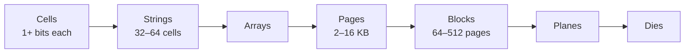

# فصل ۲: پایه‌های B-Tree

[فصل ۱: مقدمه و نمای کلی →](01-introduction-and-overview.md) · [کتاب](../README.md) · [فصل ۳: قالب فایل ←](03-file-formats.md)

## خلاصه

همه‌ی B-Treeها، که بایر و مک‌کرایت در ۱۹۷۱ معرفی‌شان کردند، پرگسترده‌ترین ساختار ذخیره‌سازی mutable و سر‌جا‌به‌روز‌شونده‌اند (p. 25). فصل با توضیح این باز می‌شود که چرا **درخت جست‌و‌جوی دوگانی** متوازن، هرچند در حافظه از مرتبه‌ی O(log₂ N) است، روی دیسک ناعملی است. **fanout** دوشان بلندقدشان می‌کند، پس هر سطحی یک seek خرج دارد. نودهایشان محلیت ندارند، و متوازن کردن پیوسته یعنی به‌روزرسانی مدام اشاره‌گرها (pp. 26–29).

بعد به رسانه نگاه می‌کند. **HDD**ها بیشتر بهای جای‌دهی هد را می‌دهند، پس I/O ترتیبی ارزان است. **SSD**ها صفحه می‌خوانند و می‌نویسند ولی کل بلوک را پاک می‌کنند، با یک **Flash Translation Layer** که صفحه‌ها را mapping دوباره می‌کند و زباله می‌روبد. هر دو **دستگاه بلوکی**اند، پس کوچک‌ترین یکای I/O یک بلوک است (pp. 30–32).

**ساختار B-Tree**ها با fanout بالا و ارتفاع کم پاسخ می‌دهند: نودها صفحه‌هایی‌اند که تا N کلید و N + 1 اشاره‌گر فرزند دارند. در گونه‌ی **B⁺-Tree** که کتاب در سراسرش به کار می‌برد، مقدارها تنها در برگ‌ها زندگی می‌کنند و نودهای درونی **کلید جداکننده** دارند (pp. 33–37). هر جست‌و‌جویی به log_N M صفحه دست می‌زند ولی log₂ M مقایسه می‌کند (p. 37). درج‌هایی که نودی را سرریز می‌کنند **می‌شکنندش** و کلید جداکننده‌ای را **بالا می‌برند**؛ و حذف‌هایی که underflow می‌کنند siblingها را **merge** می‌کنند و کلیدی را **پایین می‌آورند**. هر دو می‌توانند تا ریشه پخش شوند، و همین تنها راه عوض شدن ارتفاع درخت است (pp. 39–42).

## نکته‌های کلیدی

- **روی دیسک، هزینه seek است و نه مقایسه.** درخت جست‌و‌جوی دوگانی تقریباً برای هر مقایسه‌ای یک seek لازم دارد؛ و B-Tree برای هر سطحی یکی (pp. 29, 34).
- **مفهوم fanout و ارتفاع رابطه‌ی عکس دارند.** fanout بالا بین کلیدهای همسایه محلیت می‌دهد و seek کم (p. 29).
- **کوچک‌ترین یکای I/O دیسک یک بلوک است**، پس ساختارهای دیسکی دسترسی به دیسک و اشاره‌گرهای بیرون‌صفحه را کمینه می‌کنند (pp. 31–32).
- **همه‌ی SSDها صفحه می‌نویسند ولی بلوک پاک می‌کنند.** لایه‌ی FTL در garbage collectorی صفحه‌های زنده را جابه‌جا می‌کند، که می‌تواند به نوشتن تصادفی و ناهم‌تراز صدمه بزند (pp. 31–32).
- **میان چهار میلیارد قلم، هر جست‌و‌جویی تقریباً ۳۲ مقایسه لازم دارد**، ولی نودهای B-Tree ده‌ها یا صدها کلید دارند، پس تنها یک seek برای هر سطحی لازم است (p. 34).
- **همه‌ی B-Treeها از پایین به بالا رشد می‌کنند.** تنها شکستن ریشه سطحی می‌افزاید، و تنها mergeی که ریشه‌ی تازه بسازد سطحی برمی‌دارد (pp. 37, 39).
- **اشغال می‌تواند تا ۵۰٪ بیفتد** چون نودها برای درج‌های آینده جا نگه می‌دارند؛ اشغال بالاتر به کارایی صدمه نمی‌زند (p. 37).

## فهرست بخش‌ها

*از فهرست مطالب خود کتاب، از bookmarkهای PDF؛ شماره‌ها صفحه‌ی چاپی‌اند.*

- درخت جست‌و‌جوی دوگانی — ص. ۲۶
  - متوازن کردن درخت — ص. ۲۷
  - درخت برای ذخیره‌سازی دیسک‌محور — ص. ۲۸
- ساختارهای دیسک‌محور — ص. ۲۹
  - دیسک سخت — ص. ۳۰
  - دیسک حالت جامد — ص. ۳۰
  - ساختارهای روی دیسک — ص. ۳۲
- بخش B-Treeهای همه‌جا‌حاضر — ص. ۳۳
  - سلسله‌مراتب B-Tree — ص. ۳۵
  - کلیدهای جداکننده — ص. ۳۶
  - پیچیدگی جست‌و‌جو در B-Tree — ص. ۳۷
  - الگوریتم جست‌و‌جو در B-Tree — ص. ۳۸
  - شمردن کلیدها — ص. ۳۸
  - شکستن نود B-Tree — ص. ۳۹
  - بخش merge کردن نود B-Tree — ص. ۴۱
- خلاصه — ص. ۴۲

## یادداشت‌ها

ساختارهای mutable بیشتر **به‌روزرسانی سر جا** به کار می‌برند: درج و به‌روزرسانی و حذف رکوردها را همان‌جایی که در فایل‌اند عوض می‌کنند (p. 25). موتورها می‌توانند چند نسخه از یک رکورد نگه دارند، با MVCC یا slotted page، ولی فصل یک رکورد برای هر کلیدی و در جایی یگانه فرض می‌گیرد. تا ۱۹۷۹ آن‌قدر گونه‌ی B-Tree بود که داگلاس کامر مروری بر آن‌ها بنویسد (p. 25).

### درخت جست‌و‌جوی دوگانی

**ساختار BST** ساختاری مرتب و in-memoryی است. هر نودی یک کلید و یک مقدار و دو اشاره‌گر فرزند دارد. هر کلیدی در زیردرخت چپ نودی از کلید خود نود کوچک‌تر است، و هر کلیدی در زیردرخت راستش بزرگ‌تر (pp. 26–27). پی گرفتن اشاره‌گرهای چپ به کوچک‌ترین کلید می‌رسد و اشاره‌گرهای راست به بزرگ‌ترین. مقدارها در هر سطحی ذخیره‌شدنی‌اند، پس جست‌و‌جویی می‌تواند زود تمام شود (p. 27).

#### متوازن کردن درخت

درج تصادفی می‌تواند درختی را **نامتوازن** کند. در بدترین حالت، درختی **بیمارگونه** به فهرستی پیوندی از مرتبه‌ی O(N) برای جست‌و‌جو زوال می‌یابد (شکل ۲-۳) (p. 27). درخت **متوازن** ارتفاع log₂ N دارد، و ارتفاع دو زیردرختش حداکثر یک فرق دارد، چنان‌که درخت AVL می‌خواهد. آن‌وقت هر قدمی فضای جست‌و‌جو را نصف می‌کند: از مرتبه‌ی O(log₂ N) (pp. 27–28).

متوازن کردن پس از هر عملیاتی نودها را سازمان دوباره می‌دهد، مثلاً با یک **چرخش**. وقتی دو نود پشت‌سر‌هم در شاخه‌ای هر یک یک فرزند داشته باشند، نود میانی، یعنی **محور چرخش**، یک سطح بالا می‌رود و پدرش فرزند راستش می‌شود (شکل ۲-۴، ص. ۲۸).

#### درخت برای ذخیره‌سازی دیسک‌محور

**مفهوم fanout** بیشینه شمار فرزند برای هر نودی است. BSTها fanout دو دارند، که روی دیسک سه مسئله می‌سازد (pp. 28–29):

| مسئله | چرا |
|---|---|
| **محلیت** | نودها به ترتیب تصادفی افزوده می‌شوند، پس فرزندی می‌تواند روی صفحه‌ای غیر از پدرش بنشیند |
| **ارتفاع** | log₂ N سطح یعنی O(log₂ N) بار seek و انتقال؛ 2-3-Treeها همین محدودیت را دارند |
| **نگهداشت** | متوازن کردن پیوسته نودها را جابه‌جا و اشاره‌گرها را به‌روز می‌کند |

ساختار BST ساده‌دل روی دیسک همان‌قدر seek لازم دارد که مقایسه (p. 29). درخت دیسکی باید **fanout بالا** داشته باشد، برای محلیت کلیدهای همسایه، و **ارتفاع کم**، برای seek کم. این دو رابطه‌ی عکس دارند (p. 29).

### ساختارهای دیسک‌محور

ساختارهای دیسکی وقتی به کار می‌روند که داده برای ماندن در حافظه زیادی بزرگ باشد. در هر زمانی تنها کسری cache شده (p. 29).

#### دیسک سخت

بیشتر الگوریتم‌های کلاسیک برای دیسک‌های گردان طراحی شدند (p. 30). یک **seek**، یعنی چرخش به‌علاوه‌ی حرکت هد، خواندن تصادفی را گران می‌کند. همین که هد جای گرفت، بایت‌های پیوسته ارزان‌اند، که از همین‌جاست که I/O ترتیبی ستایش می‌شود. کوچک‌ترین یکای انتقال یک **سکتور** است، که معمولاً ۵۱۲ بایت تا ۴ کیلوبایت است (p. 30).

#### دیسک حالت جامد

همه‌ی SSDها قطعه‌ی متحرک ندارند. سلسله‌مراتب حافظه‌شان (شکل ۲-۵، صص. ۳۰–۳۱):

| عملیات | یکا (p. 31) |
|---|---|
| خواندن و نوشتن که program است | صفحه؛ تنها cellهایی نوشتنی‌اند که پیش‌تر پاک شده‌اند |
| پاک کردن | **بلوک پاک‌شدنی** با صفحه‌های زیاد؛ صفحه‌های بلوکی خالی ترتیبی نوشته می‌شوند |

لایه‌ی **Flash Translation Layer** که FTL است، IDهای صفحه را به جاهای فیزیکی map می‌کند و صفحه‌های خالی و نوشته‌شده و انداخته‌شده را پی می‌گیرد. در **garbage collectorی** صفحه‌های زنده را از بلوکی بیرون جابه‌جا می‌کند، IDهایشان را mapping دوباره می‌کند و بلوک را پاک (p. 31).

هر دو گونه‌ی دستگاه تکه‌تکه نشانی می‌شوند، پس سیستم‌های عامل انتزاع **دستگاه بلوکی** را عرضه می‌کنند. خواندن یک کلمه کل بلوکش را می‌خواند (p. 31). روی SSDها، شکاف میان I/O تصادفی و ترتیبی از HDDها کم‌تر است، هرچند prefetch و صفحه‌های پیوسته و موازی بودن درونی باز هم مهم‌اند. garbage collectorی پس‌زمینه باز هم می‌تواند به کارایی نوشتن صدمه بزند، به‌ویژه برای نوشتن تصادفی و ناهم‌تراز. نوشتن بلوک کامل و ترکیب کردن نوشتن‌های یک بلوک I/O را کم می‌کند، که انگیزه‌ی بحث بعدی کتاب درباره‌ی buffer کردن و immutability است (pp. 31–32).

#### ساختارهای روی دیسک

پی گرفتن اشاره‌گری درون بلوکی یعنی گرفتن کل بلوک، پس چیدمان باید از همین بهره بگیرد (p. 32). روی دیسک، «اشاره‌گر»ها offsetهایی‌اند که کد حسابشان می‌کند و صریح پی‌شان می‌گیرد. یا پیش‌حساب‌شده‌اند، وقتی اشاره‌گر پیش از هدفش نوشته شود، یا تا flush شدن در حافظه cache می‌شوند. زنجیره‌های بلند اشاره‌گر پیچیدگی می‌افزایند، پس شمار و گستره‌شان را کم نگه دارید (p. 32). ساختارهای خوب دیسکی محلیت را بهتر می‌کنند، نمایش درونی‌شان را بهینه، و **اشاره‌گرهای بیرون‌صفحه** را کم. B-Treeها این ایده‌ها را ترکیب می‌کنند: fanout بالاتر، ارتفاع کم‌تر، اشاره‌گر کم‌تر و متوازن کردن کم‌تکرارتر (p. 32).

#### درخت دوگانی صفحه‌بندی‌شده

گروه کردن نودهای درخت دوگانی در صفحه‌ها (شکل ۲-۶) محلیت را بهتر می‌کند، چون نود بعدی اغلب در همان صفحه‌ای است که از قبل گرفته شده. ولی سرریز نود و اشاره‌گر می‌ماند، و متوازن کردن کلیدهایی که تصادفی درج شده‌اند یعنی سازمان دوباره دادن صفحه‌ها و به‌روز کردن اشاره‌گرها (p. 33).

*Figure 2-6 (p. 33): هر کادر خط‌چینی یک صفحه‌ی دیسک است؛ جست‌و‌جویی صفحه‌ای را می‌خواند و پیش از گرفتن بعدی چند اشاره‌گر درونش را پی می‌گیرد.*

> **In practice:** هر کوئری روی warehouse آخرش به خواندن بلوک از دیسک ختم می‌شود؛ ClickHouse هم مثل B-Tree واحد خواندن را درشت می‌گیرد تا seek کم شود.
>
> **Your turn:** چرا ClickHouse به‌جای ردیف، granuleهای هزاران‌ردیفی می‌خواند حتی وقتی کوئری یک ردیف می‌خواهد؟
>
> *Answer:* خواندن یک بلوک بزرگ پشت‌سرهم تقریباً هم‌قیمت خواندن یک بلوک کوچک است و index کوچک می‌ماند؛ کتاب همین را دلیل fanout بالا و صفحه‌های بزرگ در ساختارهای دیسکی می‌داند: کم کردن seek و تعداد دسترسی به دیسک (pp. 29–32).

### حضور همه‌جایی B-Treeها

کتاب B-Tree را با اتاق فهرست کتابخانه مقایسه می‌کند: کابینت را بردارید، بعد قفسه، بعد کشو و در آخر کارت (p. 33). نودهای B-Tree به‌شکل مستطیل با بلوک‌های صریح اشاره‌گر کشیده می‌شوند، چون هر نودی بازه‌اش را به زیربازه‌های زیادی می‌شکند (شکل‌های ۲-۷ و ۲-۸، ص. ۳۴). کلیدهای درون نودی مرتب‌اند، پس هر نودی با جست‌و‌جوی دوگانی جست‌و‌جو‌شدنی است. یافتن یکی از ۴ × ۱۰⁹ قلم تقریباً **۳۲ مقایسه** می‌برد، ولی تنها یک seek برای هر سطحی (p. 34). B-Treeها هم **query نقطه‌ای** با `=` و هم **query بازه‌ای** با `<` و `>` و `≤` و `≥` را سرویس می‌دهند (p. 35).

#### سلسله‌مراتب B-Tree

هر نودی تا **N کلید و N + 1 اشاره‌گر فرزند** دارد (p. 35).

| گونه‌ی نود | نقش |
|---|---|
| **ریشه** | پدری ندارد؛ سر درخت است |
| **درونی** | ریشه را به برگ‌ها وصل می‌کند؛ معمولاً چند سطح |
| **برگ** | سطح پایین؛ فرزندی ندارد |

*Figure 2-9 (p. 35): هر نودی یک صفحه است؛ fanout پهن است، پس درخت فقط چند سطح عمیق می‌ماند.*

همه‌ی B-Treeها صفحه‌های fixed-size را سازمان می‌دهند، پس *نود* و *صفحه* جابه‌جا به کار می‌روند. **اشغال** نسبت کلیدهای نگه‌داشته به گنجایش نود است. fanout بالا متوازن کردن را سرشکن می‌کند و می‌گذارد کلیدها و اشاره‌گرهای فرزند یک بلوک یا چند بلوک پشت‌سر‌هم را مشترک داشته باشند. شکستن و merge وقتی برانگیخته می‌شوند که نودها پر یا تقریباً خالی شوند (p. 35).

**ساختار B⁺-Tree**ها (p. 36): B-Tree به معنای سخت‌گیرانه مقدارها را در هر سطحی ذخیره می‌کند. B⁺-Tree مقدارها را *تنها در برگ‌ها* ذخیره می‌کند، و نودهای درونی کلید جداکننده دارند. بنابراین هر درج و به‌روزرسانی و حذف و خواندنی تنها به برگ‌ها دست می‌زند، و تغییرها تنها از راه شکستن و merge به سطح‌های بالاتر می‌رسند. B⁺-Treeها پیش‌فرض شدند؛ InnoDB در MySQL به B⁺-Treeش «B-tree» می‌گوید، و کتاب همان قرارداد را پی می‌گیرد.

#### کلیدهای جداکننده

کلیدهای درون نودها **entry index** یا **کلید جداکننده** یا **cell تقسیم‌کننده** نامیده می‌شوند. درخت را به **زیردرخت**، یعنی شاخه یا زیربازه، می‌شکنند (p. 36). اشاره‌گر اول به کلیدهای کوچک‌تر از کلید اول می‌رسد، اشاره‌گر آخر به کلیدهای بزرگ‌تر یا برابر کلید آخر، و اشاره‌گر *i* به کلیدهایی با **K₍ᵢ₋₁₎ ≤ Kₛ < Kᵢ** (شکل ۲-۱۰).

*Figure 2-10 (p. 36): N کلید N + 1 اشاره‌گر می‌دهد، و هر اشاره‌گری بازه‌ی نیم‌باز میان کلیدهای همسایه‌اش را مالک است.*

برخی گونه‌ها **اشاره‌گر sibling** می‌افزایند، معمولاً در سطح برگ و گاهی در هر دو جهت، تا اسکن بازه‌ای و پیمایش برگشتی لازم نباشد به پدر برگردند (p. 37). B-Treeها **از پایین به بالا** بنا می‌شوند: برگ‌های بیشتر به نودهای درونی بیشتر و درختی بلندتر می‌رسند. بهره‌گیری از ذخیره‌سازی می‌تواند تا ۵۰٪ بیفتد ولی معمولاً خیلی بالاتر است (p. 37).

#### پیچیدگی جست‌و‌جو در B-Tree

دو راه برای شمردن هزینه‌ی یک جست‌و‌جو هست (p. 37):

| سنجه | پایه | هزینه |
|---|---|---|
| **انتقال بلوک** که seek است | کلید برای هر نودی | log_K M صفحه، یکی برای هر سطحی، یعنی ارتفاع *h* |
| **مقایسه** | ۲، یعنی جست‌و‌جوی دوگانی درون نودها | log₂ M |

کتاب‌های درسی ساده **log M** می‌نویسند، چون عوض کردن پایه فقط ضریبی ثابت می‌افزاید (p. 37).

#### الگوریتم جست‌و‌جو در B-Tree

جست‌و‌جو یک پیمایش ریشه‌تا‌برگ است که کلید یا **پیشین**ش را پیدا می‌کند (p. 38). خود کلید query نقطه‌ای و به‌روزرسانی و حذف را سرویس می‌دهد؛ و آن پیشین اسکن بازه‌ای و درج را.

- در هر نودی، جست‌و‌جوی دوگانی اولین جداکننده‌ی بزرگ‌تر از کلید جست‌و‌جو‌شده را پیدا می‌کند، و جست‌و‌جو اشاره‌گر متناظر را پی می‌گیرد.
- در برگ، کلید یا پیدا می‌شود یا با پیشینش نبودنش نشان داده می‌شود.
- بعد اسکن بازه‌ای از نزدیک‌ترین کلید روی اشاره‌گرهای sibling پیمایش می‌کند تا گزاره‌ی بازه ته بکشد.

هر سطحی نمای دقیق‌تری از فضای کلید می‌دهد (p. 38).

#### شمردن کلیدها

بایر در ۱۹۷۲ یک *k* دستگاه‌وابسته به کار برد: صفحه‌ها بین *k* و ۲*k* کلید دارند، با *k* + 1 تا ۲*k* + 1 اشاره‌گر فرزند، و ریشه ۱ تا ۲*k* کلید دارد. گریفه در ۲۰۱۱ تا N کلید و N + 1 اشاره‌گر به کار می‌برد. این دو هم‌ارزند، و کتاب **N** را به کار می‌برد (p. 38).

#### شکستن نود B-Tree

درج برگ هدف را پیدا می‌کند و کلید و مقدار را می‌افزاید. به‌روزرسانی برگ را پیدا می‌کند و مقدار را عوض (p. 39). نودی **سرریز** می‌کند و باید بشکند وقتی (p. 39):

- **برگی** از قبل N زوج کلید‌مقدار دارد و یکی دیگر بگیرد؛
- **نودی غیربرگ** از قبل N + 1 اشاره‌گر دارد و یکی دیگر بگیرد.

شکستن نود تازه‌ای تخصیص می‌دهد و نصف عنصرها را به آن جابه‌جا می‌کند: هر چه پس از **نقطه‌ی شکست**، یعنی نقطه‌ی میانی، است، و برای نودهای غیربرگ خود آن نقطه هم. کلید اول نود تازه با یک اشاره‌گر به پدر **بالا برده** می‌شود (p. 39). اگر پدر پر باشد، او هم می‌شکند، و شاید تا بالا. **شکستن ریشه** ریشه‌ی تازه‌ای تخصیص می‌دهد که کلید شکست را دارد، و درخت سطحی رشد می‌کند. وگرنه درخت تنها افقی رشد می‌کند (p. 39).

شکل‌های ۲-۱۱ و ۲-۱۲ برگی پر و نودی غیربرگ و پر را سر درج **۱۱** می‌شکنند. شکستن غیربرگ همیشه از شکستنی در پایین می‌آید، که آن اشاره‌گر اضافه را به نود پایینی تازه می‌افزاید. پس از شکستن، عنصر تازه به نود قدیم می‌رود اگر از کلید بالا‌برده‌شده کوچک‌تر باشد، و وگرنه به نود تازه (p. 40).

*Figure 2-11 (p. 40): آن برگ پر در نقطه‌ی میانی‌اش می‌شکند، عدد ۱۱ در نیمه‌ی چپ می‌نشیند، و کلید اول نود تازه، یعنی ۱۳، بالا برده می‌شود؛ کلیدهای تازه و بالا‌برده‌شده سایه خورده‌اند.*

آن چهار قدم (p. 41):

1. نودی تازه تخصیص بده.
2. نصف عنصرها را به آن کپی کن.
3. عنصر تازه را جای بده.
4. کلید جداکننده‌ای و اشاره‌گری به پدر بیفزا.

> **Try it:** [شکستن و merge در B⁺-Tree](../widgets/02-bplus-tree.html)؛ با گنجایش نودی که برمی‌دارید کلید درج و حذف کنید، و ببینید شکستن‌ها کلید بالا می‌برند، mergeها پایین می‌آورند، و درخت سطحی می‌گیرد یا می‌بازد.

#### عمل merge کردن نود B-Tree

حذف برگ را پیدا می‌کند و کلید و مقدار را برمی‌دارد (p. 41). اگر نودهای همسایه زیر آستانه‌ی اشغالی بیفتند، آن نود **underflow** کرده. بایر دو حالت را وصف می‌کند: اگر siblingهای مجاور با پدری مشترک در یک نود جا شوند، **merge** می‌شوند؛ وگرنه کلیدها بینشان **پخش دوباره** می‌شوند، که همان متوازن کردن دوباره در فصل ۴ است. نودها وقتی merge می‌شوند که (p. 41):

- **برگ‌ها:** زوج‌های کلید‌مقدار روی‌هم‌شان حداکثر N باشند؛
- **نودهای غیربرگ:** اشاره‌گرهای روی‌هم‌شان حداکثر N + 1 باشند.

معمولاً عنصرهای sibling راست به نود چپ جابه‌جا می‌شوند. شکل ۲-۱۳ merge برگی را سر حذف ۱۶ نشان می‌دهد (p. 41). merge غیربرگ، که در شکل ۲-۱۴ سر حذف ۱۰ نشان داده می‌شود، کلید جداکننده‌ی پدر را به نود merge‌شده **پایین می‌آورد**، و پدر اشاره‌گری می‌بازد. mergeها هم می‌توانند تا ریشه پخش شوند (p. 42).

*Figure 2-13 (p. 41): حذف ۱۶ دو sibling کم‌پر می‌گذارد که در یک نود جا می‌شوند، پس merge می‌شوند و پدر اشاره‌گری می‌اندازد.*

آن سه قدم، همین که عنصر برداشته شد (p. 42):

1. همه‌ی عنصرهای نود راست را به چپی کپی کن.
2. اشاره‌گر نود راست را از پدر بردار، یا برای merge غیربرگ پایینش بیاور.
3. نود راست را بردار.

**متوازن کردن دوباره** شمار شکستن‌ها و mergeها را کم می‌کند (p. 70).

> **In practice:** indexهای دیتابیس‌های منبع، مثل هر دیتابیس رابطه‌ای رایج، B-Tree‌اند، و loader ما هر ساعت روی یکی از آن‌ها کوئری می‌زند.
>
> **Your turn:** loader با cursor روی `update_date` هر ساعت از replica منبع می‌خواند. چرا بدون index روی `update_date` این کوئری با رشد جدول مدام کندتر می‌شود و با index نه؟
>
> *Answer:* بدون index هر اجرا کل جدول را اسکن می‌کند. با B-Tree، پیدا کردن اولین کلید بزرگ‌تر از cursor چند خواندن صفحه است، چون ارتفاع درخت لگاریتم تعداد کلیدها با پایه‌ی fanout است، و بعد ردیف‌های تازه پشت سر هم از برگ‌ها خوانده می‌شوند (pp. 33–37).

### خلاصه

همه‌ی BSTها روی دیسک به‌خاطر fanout کم و جابه‌جایی پیوسته کم می‌آورند. B-Treeها هر دو را با fanout بالا و متوازن کردن کم‌تکرار درست می‌کنند، و با شکستن و merge متوازن می‌مانند. ساختن پیاده‌سازی دیسکی باز هم چیدمان صفحه و قالب encoding لازم دارد، که موضوع فصل بعد است (pp. 42–43).

## بده‌بستان‌ها در یک نگاه

| | درخت جست‌و‌جوی دوگانی | B-Tree یعنی B⁺-Tree |
|---|---|---|
| fanout | ۲ | ده‌ها تا صدها |
| seek برای هر جست‌و‌جویی | تقریباً به شمار مقایسه‌ها، یعنی log₂ M | ارتفاع، یعنی log_N M |
| متوازن کردن | پس از هر عملیاتی، با چرخش | تنها سر سرریز یا کم‌ریز، با شکستن و merge |
| محلیت | روی دیسک ضعیف | نودی یک صفحه است |
| برای چه بهتر است | حافظه | دیسک |

| | HDD | SSD |
|---|---|---|
| بخش گران | جای‌دهی هد که seek است | پاک کردن بلوک؛ جابه‌جایی garbage collectorی |
| تصادفی در برابر ترتیبی | شکاف بزرگ | شکاف کوچک‌تر |
| کمینه یکا | سکتور، ۵۱۲ بایت تا ۴ کیلوبایت | صفحه، ۲ تا ۱۶ کیلوبایت، برای خواندن و نوشتن؛ و بلوک برای پاک کردن |

## فراتر از کتاب

- آن ۳۲ مقایسه برای چهار میلیارد کلید همان log₂(4 × 10⁹) ≈ 31.9 است. با پانصد کلید برای هر نودی، همان جست‌و‌جو ⌈log₅₀₀(4 × 10⁹)⌉ = 4 خواندن صفحه لازم دارد. [آزمایش fanout](../lab/02-btree-height/README.md) ارتفاع‌ها را برای چند fanout و اشغال چاپ می‌کند.
- پیاده‌سازی B-tree در PostgreSQL از درخت B-link لیمن و یائو پی می‌گیرد، که همان اشاره‌گرهای خواهر‌و‌برادر، یعنی right-link، را که کتاب نامشان را می‌برد برای پشتیبانی از دسترسی هم‌زمان می‌افزاید. فصل ۶ به درخت‌های B-link برمی‌گردد.

## پیوندها

- **Run it:** [ارتفاع B-Tree در برابر fanout](../lab/02-btree-height/README.md)؛ B⁺-Treeهایی با گنجایش نود مختلف می‌سازد و سطح‌ها و خواندن صفحه برای هر جست‌و‌جویی و مقایسه‌ها را می‌شمارد.
- **فصل‌های مرتبط:** [فصل ۱: مقدمه](01-introduction-and-overview.md) که به‌روزرسانی سر جا و جدول index‌چیده را دارد، [فصل ۳: قالب فایل](03-file-formats.md) که چیدن نودها روی صفحه‌ها را دارد، [فصل ۴: پیاده کردن B-Tree](04-implementing-b-trees.md) که متوازن کردن دوباره و افزودن تنها‌راست و بار‌گذاری انبوه را دارد، و [فصل ۶: گونه‌های B-Tree](06-b-tree-variants.md) که copy-on-write و تنبل و Bw-Tree را دارد.

## خودتان را بسنجید

*پرسش‌ها و پاسخ‌ها مال vault است و از روی یادداشت‌های بالا نوشته شده؛ پاسخ‌ها به صفحه‌های کتاب ارجاع می‌دهند.*

1. **چرا BST متوازن باز هم ساختار دیسکی ضعیفی است؟**

   *Answer:* fanoutش دو است، پس بلندقد است و تقریباً برای هر مقایسه‌ای یک seek لازم دارد. نودهایش محلیت ندارند، و متوازن کردن پیوسته نودها را جابه‌جا و اشاره‌گرها را دوباره می‌نویسد (pp. 28–29).

2. **کوچک‌ترین یکایی که SSD می‌تواند پاک کند چیست؟**
   - [ ] یک cell
   - [ ] یک صفحه
   - [x] بلوکی از صفحه‌های زیاد

   *Answer:* صفحه‌ها نوشته و خوانده می‌شوند، ولی تنها بلوک‌های پاک‌شده بازهم نوشتنی‌اند. لایه‌ی FTL پیش از پاک کردن صفحه‌های زنده را جابه‌جا می‌کند (p. 31).

3. **در B⁺-Tree، مقدارها کجا ذخیره می‌شوند؟**
   - [ ] در هر نودی
   - [x] تنها در برگ‌ها؛ نودهای درونی کلید جداکننده دارند
   - [ ] تنها در ریشه

   *Answer:* از همین‌جاست که به‌روزرسانی‌ها تنها به برگ‌ها دست می‌زنند و تنها از راه شکستن و merge رو‌به‌بالا پخش می‌شوند (p. 36).

4. **جست‌و‌جویی در B⁺-Treeی روی M کلید با N کلید برای هر نودی: چند خواندن صفحه و چند مقایسه؟**

   *Answer:* تقریباً log_N M خواندن صفحه، یکی برای هر سطحی، و log₂ M مقایسه، از جست‌و‌جوی دوگانی درون نودها (p. 37).

5. **ارتفاع B-Tree کِی عوض می‌شود؟**

   *Answer:* تنها وقتی ریشه بشکند، که ریشه‌ای تازه تخصیص می‌شود، یا وقتی mergeی ریشه‌ای تازه بسازد. وگرنه درخت افقی رشد می‌کند و آب می‌رود (p. 39).

6. **در merge غیربرگ، چه چیزی سر کلید جداکننده‌ی پدر می‌آید؟**

   *Answer:* به نود merge‌شده پایین آورده می‌شود، و پدر یک اشاره‌گر می‌بازد (p. 42).
