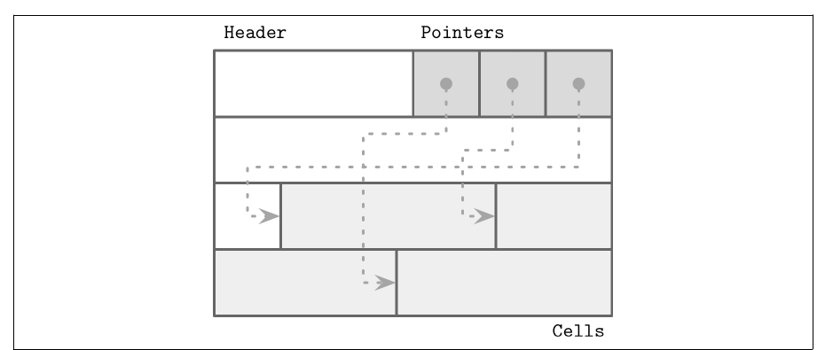
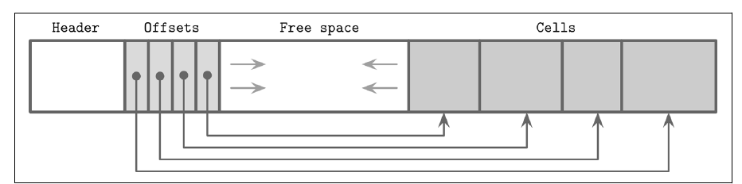
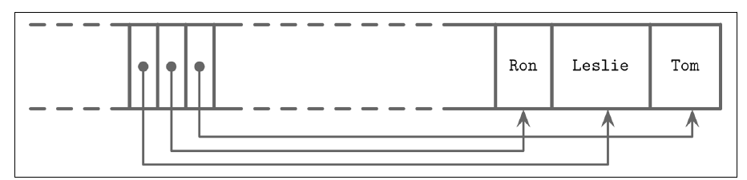
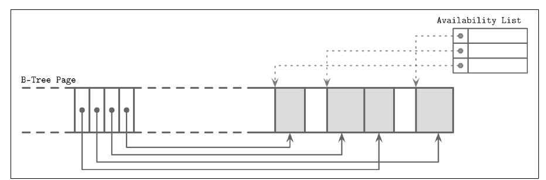

# فصل ۳: قالب فایل

[فصل ۲: پایه‌های B-Tree →](02-b-tree-basics.md) · [کتاب](../README.md) · [فصل ۴: پیاده کردن B-Tree ←](04-implementing-b-trees.md)

## خلاصه

دسترسی به حافظه، به لطف حافظه‌ی مجازی، برای توسعه‌دهنده بیشتر شفاف است. دیسک، در مقابل، با system call دسترسی می‌شود: offsetی در فایلی را نام می‌برید و بایت‌هایی که پس می‌گیرید را به شکلی in-memoryی ترجمه می‌کنید (p. 45). این فصل قاعده‌های کلی طراحی ساختارهای دیسکی را می‌پوشاند، و نه فقط B-Tree را. قاب کتاب این است که B-Treeی دیسکی را **مکانیزم مدیریت صفحه** بگیرد، که در آن الگوریتم‌ها صفحه‌ها را ترکیب و پیمایش می‌کنند (p. 45).

از پایین بالا می‌آید:

- **نوع‌های اولیه** و ترتیب بایت، بعد **رشته** و داده‌ی متغیر‌اندازه، بعد boolean و enum و flag که **بیت‌بسته‌بندی** شده‌اند (pp. 47–50).
- **قاعده‌های کلی:** صفحه‌های fixed-size به‌علاوه‌ی header و دنباله‌ی فایل، و فیلدهای ثابت که پیش از فیلدهای متغیر جای می‌گیرند (pp. 50–51).
- **ساختار slotted page:** آرایه‌ای از اشاره‌گر از یک سر صفحه رشد می‌کند و cellها از سر دیگر. رکوردها به هر ترتیبی درج‌شدنی‌اند، کلیدها با مرتب کردن دوباره‌ی اشاره‌گرها مرتب می‌مانند، و رکوردها با ID مربوط به slot ارجاع می‌شوند (pp. 52–57).
- **مدیریت فضای آزاد:** فهرست availability با جای‌دهی first-fit یا best-fit، بعد یکپارچه‌سازی، بعد صفحه‌ی سرریز (pp. 57–58).
- **نسخه‌بندی** قالب فایل و **checksum گرفتن** از صفحه‌ها برای گرفتن خرابی (pp. 58–59).

## نکته‌های کلیدی

- **روی دیسک، تکه‌تکه شدن و garbage collectorی را خودتان می‌گردانید.** هیچ `malloc` یا `free`ی نیست، تنها `read` و `write` (pp. 46–47).
- **ترتیب بایت باید سر encoding و کدگشایی بخواند.** big-endian پرارزش‌ترین بایت را اول می‌گذارد؛ و little-endian کم‌ارزش‌ترین را (p. 47).
- **رشته‌های طول‌پیشوندی، یعنی Pascal، از null‌خاتمه بهترند.** طول در زمانی ثابت معلوم است، و بایت‌ها یک‌راست برش‌خوردنی‌اند (p. 49).
- **همه‌ی flagها ماسک بیتی با مقدارهای توان دو هستند.** flagی را با `|` می‌نشانید، با `& ~` پاک می‌کنید، و با `& … != 0` می‌سنجید (p. 50).
- **فیلدهای fixed-size را اول گروه کنید.** آن‌وقت offsetهای ایستا دارند، و تنها فیلدهای variable-size حساب offset لازم دارند (pp. 51, 54).
- **ساختار slotted page سه مسئله را یک‌جا حل می‌کند:** کمینه سرریز، یعنی فقط آرایه‌ی اشاره‌گر، بازپس‌گیری فضا، یعنی یکپارچه کردن صفحه، و چیدمانی پویا، چون cellها از بیرون صفحه با ID ارجاع می‌شوند (p. 54).
- **برای هر صفحه‌ای checksum بگیرید و نه برای هر فایلی.** اگر صفحه‌ای خراب باشد، تنها همان صفحه را باید انداخت. CRCها خطای رگباری را تشخیص می‌دهند، ولی hashهای ناـرمزنگاری سنجش دست‌کاری نیستند (p. 59).

## فهرست بخش‌ها

*از فهرست مطالب خود کتاب، از bookmarkهای PDF؛ شماره‌ها صفحه‌ی چاپی‌اند.*

- انگیزه — ص. ۴۶
- بخش encoding دوگانی — ص. ۴۷
  - نوع‌های اولیه — ص. ۴۷
  - رشته و داده‌ی variable-size — ص. ۴۹
  - داده‌ی بیت‌بسته‌بندی‌شده: boolean و enum و flag — ص. ۴۹
- قاعده‌های کلی — ص. ۵۰
- ساختار صفحه — ص. ۵۲
- بخش slotted page — ص. ۵۲
- چیدمان cell — ص. ۵۴
- ترکیب cellها در slotted page — ص. ۵۶
- گرداندن داده‌ی variable-size — ص. ۵۷
- نسخه‌بندی — ص. ۵۸
- بخش checksum گرفتن — ص. ۵۹
- خلاصه — ص. ۶۰

## یادداشت‌ها

شکستن و merge برای پیاده کردن B-Tree لازم‌اند ولی کافی نه، چون مدیریت اشاره‌گر روی دیسک طور دیگری از حافظه کار می‌کند (p. 45). بیشتر پیچیدگی B-Tree از mutability می‌آید، پس این فصل و بعدی روی چیدمان صفحه و شکستن و جابه‌جایی تمرکز می‌کنند. فصل LSM در عوض روی مرتب کردن و نگهداشت تمرکز می‌کند (p. 46).

### انگیزه

طراحی قالب فایل مثل کار کردن با ساختار داده در زبانی بی حافظه‌ی مدیریت‌شده است: بلوکی تخصیص می‌دهید و به اولیه‌ها و ساختارهای fixed-size برشش می‌دهید، و برای تکه‌های بزرگ‌تر یا variable-size اشاره‌گر به کار می‌برید (p. 46). ولی برعکس حافظه، دیسک تخصیص مجانی نمی‌دهد، پس تکه‌تکه شدن و garbage collectorی را باید خودتان رسیدگی کنید. چیدمان روی دیسک خیلی بیشتر از حافظه مهم است، که در حافظه چیدمان‌های ویژه بیشتر بهینه‌سازی cache پردازنده‌اند (p. 46).

### عمل encoding دوگانی

داده باید جمع‌و‌جور encoding شود و سری‌سازی و سری‌گشایی‌اش آسان باشد (p. 47). همان قاعده‌ها به قالب فایل و قالب سری‌سازی و پروتکل شبکه به کار می‌آیند.

#### نوع‌های اولیه

بیشتر عددها fixed-sizeاند. **endianness** یک مقدار چند‌بایتی باید سر نوشتن و خواندن بخواند (p. 47):

| ترتیب بایت | بایت اول | مقدار `0xAABBCCDD` در حافظه، از نشانی پایین |
|---|---|---|
| **big-endian** | پرارزش‌ترین بایت که MSB است | `AA BB CC DD` |
| **little-endian** | کم‌ارزش‌ترین بایت که LSB است | `DD CC BB AA` |

*ستون حافظه شکل ۳-۱ را بازمی‌گوید (p. 47).*

سیستم RocksDB ترتیب بایت سکو را تشخیص می‌دهد. اگر با ترتیب مقدار نخواند، بایت‌ها را برمی‌گرداند، با `EncodeFixed64WithEndian` و `EndianTransform` (p. 48).

| نوع | اندازه (p. 48) |
|---|---|
| `byte` | ۸ بیت |
| `short` | ۲ بایت |
| `int` | ۴ بایت |
| `long` | ۸ بایت |
| `float` که دقت تک IEEE 754 است | ۳۲ بیت: ۲۳ بیت کسر، ۸ بیت توان، ۱ بیت علامت |
| `double` | دقت دوگانه |

مقدارهای ممیز شناور تقریب‌اند. شکل ۳-۲ عدد ۰٫۱۵۶۵۲ را encoding می‌کند (p. 48).

#### رشته و داده‌ی variable-size

مقدارهای پیچیده مثل `struct` در C ترکیب می‌شوند، از اولیه‌ها و آرایه‌های fixed-size و اشاره‌گرها. compilerها می‌توانند padding معماری‌وابسته بیفزایند، که فرض‌ها را درباره‌ی offsetها می‌شکند (p. 49). داده‌ی variable-size طولی است و پس از آن همان‌قدر بایت، چنان‌که در **رشته‌ی Pascal** که UCSD است (p. 49):

```text
String
{
    size    uint_16
    data    byte[size]
}
```

در مقایسه با **رشته‌های null‌خاتمه**، طول در زمانی ثابت معلوم است، و رشته‌ای با برش دادن `size` بایت ساختنی است (p. 49).

#### داده‌ی بیت‌بسته‌بندی‌شده: boolean و enum و flag

- **ساختار boolean:** یک بایت کامل برای هر booleanی ولخرجی است، پس اغلب هشت‌تا در هر بایت بسته‌بندی می‌شوند. بیت ۱ *نشسته* است؛ و بیت ۰ *نانشسته* (p. 49).
- **ساختار enum:** مقدارهای کم‌cardinality و پرتکرار که به‌شکل عدد صحیح encoding شده‌اند، مثل نوع نود با `ROOT = 0x00` و `INTERNAL = 0x01` و `LEAF = 0x02` (p. 49).
- **مفهوم flag:** booleanهای نام‌دار که دو‌به‌دو ناسازگار نیستند، مثلاً «برگ است» و «مقدارهای variable-size» و «صفحه‌ی سرریز دارد». هر ماسکی توان دو است، پس یک بیت نشسته دارد (p. 50).

| عملیات | عبارت (p. 50) |
|---|---|
| نشاندن | `flags \|= MASK` یا `flags \|= (1 << n)` |
| پاک کردن | `flags &= ~MASK` |
| سنجیدن | `(flags & MASK) != 0` |

### قاعده‌های کلی

نخستین تصمیم این است که **نشانی‌دهی** چطور باشد: این‌که فایل به صفحه‌های هم‌اندازه شکسته شود یا نه، که هر یک یک بلوک یا چند بلوک پیوسته‌اند (p. 50). ساختارهای سر‌جا‌به‌روز‌شونده بیشتر صفحه‌های fixed-size به کار می‌برند چون دسترسی را ساده می‌کند. ساختارهای append-only هم اغلب صفحه‌به‌صفحه می‌نویسند، و صفحه‌ای را همین که در حافظه پر شود flush می‌کنند (p. 50). فایلی معمولاً **header**ی fixed-size دارد، و اختیاری **دنباله**ای fixed-size برای metadataیی که برای دسترسی سریع یا کدگشایی لازم است، و صفحه‌ها در میان (شکل ۳-۳، صص. ۵۰–۵۱).

با **schema ثابت**، فیلدها با جایشان شناسایی می‌شوند و نه با نام (p. 51). نمونه‌ی دفترچه‌ی کارمندهای کتاب فیلدهای fixed-size را اول می‌گذارد، و پس از آن variable-sizeها را:

```text
Fixed-size:    employee_id (4) | tax_number (4) | date (3) | gender (1)
               | first_name_length (2) | last_name_length (2)
Variable-size: first_name (first_name_length) | last_name (last_name_length)
```

خواندن `last_name` این‌طور یعنی جمع زدن اندازه‌ی فیلدهای متغیر پیش از آن. ذخیره‌ی یک **offset و طول** برای هر فیلد متغیری در ناحیه‌ی ثابت هر فیلدی را یک‌راست نشانی‌پذیر می‌کند (p. 51). قالب‌ها معمولاً سلسله‌مراتب‌اند: فیلد ← cell ← صفحه ← بخش ← ناحیه. جدول جست‌و‌جویی، که در header یا دنباله یا فایلی جدا نگه داشته می‌شود، به جای شروع هر بخشی اشاره می‌کند (p. 51).

### ساختار صفحه

فایل‌های داده و index به **صفحه**های fixed-size بخش می‌شوند، که هر یک اغلب چند بلوک فایل‌سیستم است و معمولاً ۴ تا ۱۶ کیلوبایت (p. 52). برگ‌ها زوج کلید و رکورد دارند؛ و نودهای غیربرگ کلید و اشاره‌گر. چیدمان اصلی بایر هم‌چسبانی ساده‌ی سه‌گانه‌هاست: کلید و مقدار و اشاره‌گر فرزند (شکل ۳-۴) (p. 52). اشکال‌هایش (p. 52):

- درج در هر جایی جز سمت راست عنصرها را جابه‌جا می‌کند؛
- تنها برای رکوردهای fixed-size کار می‌کند.

### slotted page

مسئله‌ی مغزی رکوردهای variable-size **مدیریت فضای آزاد** است (pp. 52–53):

- رکوردی به اندازه‌ی *n* تنها وقتی شکافی به اندازه‌ی *m* را بازاستفاده می‌کند که *m* = *n* باشد یا رکورد دیگری به اندازه‌ی *m* − *n* وجود داشته باشد.
- قطعه‌های ثابت‌اندازه، مثلاً ۶۴ بایت، برای هر رکوردی `64 − (n mod 64)` بایت را حرام می‌کنند.
- جابه‌جا کردن رکوردها برای بازپس‌گیری فضا باید همان offsetهایی را که اشاره‌گرهای بیرون‌صفحه به‌شان ارجاع می‌دهند نگه دارد.

پس قالب صفحه باید رکوردهای variable-size را با کمینه سرریز ذخیره کند، فضای حذف‌شده را بازپس بگیرد و رکوردها را بی توجه به جای دقیقشان ارجاع دهد (p. 53). پاسخ همان **slotted page** است، که **slot directory** هم نامیده می‌شود و از جمله PostgreSQL به کارش می‌برد (p. 53). اشاره‌گرها و cellها در دو ناحیه‌ی مستقل در دو سوی مقابل صفحه زندگی می‌کنند:

- ترتیب با سازمان دوباره دادن تنها اشاره‌گرها نگه داشته می‌شود؛
- حذف اشاره‌گری را پوچ می‌کند یا برمی‌دارد؛
- یک header fixed-size metadata صفحه را دارد (شکل ۳-۵).



*Figure 3-5 (p. 53): اشاره‌گرها در آرایه‌ای کوچک در آغاز می‌نشینند؛ cellها می‌توانند هر جای صفحه زندگی کنند، پس تنها اشاره‌گرها باید جابه‌جا شوند.*

| نیازمندی | slotted page چطور برآوردش می‌کند (p. 54) |
|---|---|
| کمینه سرریز | تنها آرایه‌ی اشاره‌گر از offsetهای cell |
| بازپس‌گیری فضا | صفحه را یکپارچه و دوباره بنویس |
| چیدمان پویا | بیرون صفحه، cellها تنها با ID مربوط به slot ارجاع می‌شوند |

### چیدمان cell

همه‌ی cellها دو گونه‌اند (p. 54):

- **همه‌ی cellهای کلید** یک کلید جداکننده و یک ID صفحه‌ی فرزند دارند.
- **همه‌ی cellهای کلید‌مقدار** یک کلید و یک رکورد داده دارند.

فرض می‌شود که همه‌ی cellهای یک صفحه یکدست‌اند، یعنی همه cell کلید یا همه cell کلید‌مقدار، و همه fixed-size یا همه متغیر‌اندازه، پس metadata مربوط به cell برای هر صفحه‌ای یک بار ذخیره می‌شود (p. 54).

**ساختار cell کلید** یک نوع، که از صفحه در می‌آید، و اندازه‌ی کلید و ID صفحه‌ی فرزند و بایت‌های کلید لازم دارد (p. 54):

```text
0                4               8
+----------------+---------------+-------------+
| [int] key_size | [int] page_id | [bytes] key |
+----------------+---------------+-------------+
```

**ساختار cell کلید‌مقدار** flagها و اندازه‌ی کلید و اندازه‌ی مقدار و بایت‌های کلید و بایت‌های رکورد دارد (p. 55):

```text
0              1                5                  9
+--------------+----------------+------------------+-------------+----------------------+
| [byte] flags | [int] key_size | [int] value_size | [bytes] key | [bytes] data_record  |
+--------------+----------------+------------------+-------------+----------------------+
```

*هر دو چیدمان از ص. ۵۵‌اند؛ کتاب دومی را در دو خط می‌شکند.*

فیلدهای ثابت اول می‌آیند، پس offsetهایشان ایستاست. cellها یک **ID صفحه** ذخیره می‌کنند و نه offset فایل: page cache آن IDها را از راه جدول جست‌و‌جویی ترجمه می‌کند. offsetهای cell صفحه‌محلی‌اند، پس عددهای صحیح کوچک‌تر کافی‌اند (p. 55).

**داده‌ی variable-size** (p. 55): برای خواندن کلید، از header بپرید و `key_size` بایت بخوانید. برای خواندن مقدار، از header به‌علاوه‌ی `key_size` بایت بپرید و `value_size` بایت بخوانید. ذخیره‌ی اندازه‌ی کل و در آوردن اندازه‌ی مقدار هم کار می‌کند. نکته این است که آن‌قدر اطلاع باشد که cell برش بخورد.

### ترکیب cellها در slotted page

همه‌ی cellها رو‌به‌پایان صفحه افزوده می‌شوند و offsetها در آغاز نگه داشته می‌شوند، پس آن دو رو‌به‌هم رشد می‌کنند (شکل ۳-۶) (p. 56). کلیدها می‌توانند به هر ترتیبی برسند. ترتیب منطقی با **مرتب کردن offsetها** نگه داشته می‌شود، که جست‌و‌جوی دوگانی را ممکن می‌کند، و cellها سر درج و به‌روزرسانی و حذف هیچ‌وقت جابه‌جا نمی‌شوند (p. 56).



*Figure 3-6 (p. 56): offsetها رو‌به‌راست رشد می‌کنند و cellها رو‌به‌چپ، هر دو در آن فضای آزاد مشترک؛ صفحه وقتی پر است که به هم برسند.*

نمونه‌ی کتاب (شکل‌های ۳-۷ و ۳-۸، صص. ۵۶–۵۷):

| قدم | cellها به ترتیب فیزیکی یعنی ترتیب درج | offsetها به ترتیب منطقی |
|---|---|---|
| درج Tom و Leslie | Tom، Leslie | Leslie، Tom |
| درج Ron | Tom، Leslie، Ron | Leslie، **Ron**، Tom: اشاره‌گرهای پس از نقطه‌ی درج رو‌به‌راست می‌لغزند |



*Figure 3-8 (p. 57): پس از افزودن Ron، cellها به ترتیب رسیدن‌اند ولی offsetها، که از چپ به راست خوانده شوند، ترتیب مرتب را می‌دهند.*

> **Try it:** [slotted page](../widgets/03-slotted-page.html)؛ رکوردهای variable-size درج و حذف کنید، ببینید offsetها مرتب می‌مانند در حالی که cellها به ترتیب درج می‌مانند، و پیش از واداشتن یکپارچه‌سازی first fit و best fit را مقایسه کنید.

### گرداندن داده‌ی variable-size

حذف لازم نیست cellهای باقی‌مانده را بلغزاند. آن cell حذف‌شده علامت می‌خورد، و یک **فهرست availability** in-memoryی offset و اندازه‌ی قطعه‌ی آزادشده را ثبت می‌کند. درج‌ها اول این فهرست را می‌سنجند (شکل ۳-۹) (p. 57). سیستم SQLite به قطعه‌های آزاد **freeblock** می‌گوید: اشاره‌گری به اولینشان را در header صفحه نگه می‌دارد، به‌علاوه‌ی کل شمار بایت‌های آزاد، تا بتواند زود بگوید که cellی پس از یکپارچه‌سازی جا می‌شود یا نه (p. 57).



*Figure 3-9 (p. 57): cellهای اشغال‌شده سایه خورده‌اند؛ اشاره‌گرهای نقطه‌چین فهرست availability به قطعه‌های آزادشده‌ای می‌رسند که درجی می‌تواند بازاستفاده‌شان کند.*

| راهبرد جا شدن | رفتار (pp. 57–58) |
|---|---|
| **first fit** | اولین قطعه‌ی مناسب را به کار می‌برد. ته‌مانده می‌تواند برای هر cellی زیادی کوچک باشد و عملاً حرام شود |
| **best fit** | قطعه‌ای را برمی‌دارد که کوچک‌ترین ته‌مانده را می‌گذارد |

اگر فضای پیوسته‌ای به آن اندازه نباشد ولی فضای تکه‌تکه‌شده به آن اندازه باشد، صفحه **یکپارچه** می‌شود: cellهای زنده خوانده و دوباره نوشته می‌شوند. اگر حتی آن هم کافی نباشد، **صفحه‌ی سرریز** ساخته می‌شود، از فصل ۴، ص. ۶۵ (p. 58). برخی موتورها کلید و مقدار برگ را جدا ذخیره می‌کنند تا محلیت کلید در جست‌و‌جو بهتر شود، به بهای اشاره‌گر cell مقدار اضافه برای کلیدهای variable-size (p. 58).

مدل ساده‌شده برای بقیه‌ی کتاب: یک نود برای هر صفحه‌ای، که از headerی ثابت و بلوکی از اشاره‌گر cell و cellها ساخته شده. IDهای صفحه نودهای فرزند را در فایل پیدا می‌کنند، و offsetهای cell آن cellها را درون صفحه‌ای (p. 58).

### نسخه‌بندی

موتورهای ذخیره‌سازی معمولاً باید بیشتر از یک نسخه‌ی قالب را بخوانند، پس نسخه باید کشف‌شدنی باشد (pp. 58–59):

| کجا | نمونه |
|---|---|
| پیشوند نام فایل | نسخه‌ی ۴.۰ سیستم Cassandra فایل `na-1-big-Data.db` را می‌نویسد؛ و فایل‌های ۳.۰ پیشوند `ma` به کار می‌برند |
| فایلی جدا | فایل `PG_VERSION` در PostgreSQL |
| header فایل | بخشی از header قالبی به کار می‌برد که هیچ‌وقت عوض نمی‌شود؛ بعد خواننده‌ی نسخه‌ویژه تحویل می‌گیرد. magic number از فصل ۴، ص. ۶۲ |

> **In practice:** فرمت فایل‌ها هم نسخه دارد: Parquetی که loader می‌نویسد و partهای ClickHouse هر دو نسخه‌ی فرمت را در metadata خود نگه می‌دارند.
>
> **Your turn:** نسخه‌ی loader ارتقا یافته و Parquet را با قابلیتی تازه‌تر می‌نویسد. پیش از deploy با Argo CD چه چیزی را چک می‌کنید؟
>
> *Answer:* این‌که خواننده‌ی بعدی، یعنی `INSERT … SELECT` در ClickHouse، آن نسخه‌ی فرمت را می‌فهمد؛ یک تست در GitLab CI که فایل نمونه‌ی loader تازه را با همان نسخه‌ی ClickHouse می‌خواند کافی است. کتاب نسخه‌ی فرمت را در خود فایل نگه می‌دارد تا خواننده بداند چطور decode کند (pp. 58–59).

### عمل checksum گرفتن

اشکال و شکست سخت‌افزار فایل‌ها را خراب می‌کنند. **checksum** و **CRC** خرابی را پیش از پخش شدنش به زیرسیستم‌ها یا نودهای دیگر تشخیص می‌دهند (p. 59).

| مکانیزم | چه چیزی را تشخیص می‌دهد (p. 59) |
|---|---|
| checksum با XOR و توازن، یا جمع | ضعیف‌ترین؛ نمی‌تواند خرابی چند‌بیتی را تشخیص بدهد |
| CRC با جدول جست‌و‌جو و تقسیم چند‌جمله‌ای | خطای رگباری، یعنی بیت‌های خراب پشت‌سر‌هم، که روی شبکه و ذخیره‌سازی رایج است |
| hash رمزنگاری | دست‌کاری؛ CRCها و hashهای ناـرمزنگاری برای این طراحی نشده‌اند |

سر نوشتن، checksum را حساب کنید و با داده ذخیره. سر خواندن، دوباره حساب و مقایسه کنید، و هیچ‌وقت داده‌ی نخوان را به کار نبرید (p. 59). checksumها معمولاً برای هر صفحه‌ای در **header صفحه** ذخیره می‌شوند: checksum کل‌فایلی ناعملی است چون فایل‌ها کم کامل خوانده می‌شوند، و صفحه‌ای خراب کل فایل را بی‌اعتبار نمی‌کند (p. 59).

> **In practice:** ClickHouse برای هر part فایلی از checksumها نگه می‌دارد و replica هنگام گرفتن part از replica دیگر آن را چک می‌کند.
>
> **Your turn:** دیسک یکی از replicaهای warehouse بی‌صدا چند بایت را خراب کرده است. کِی متوجه می‌شوید و چه چیزی داده را برمی‌گرداند؟
>
> *Answer:* وقتی آن part خوانده یا fetch شود و checksum نخواند؛ ClickHouse آن را broken علامت می‌زند و از replica دیگر می‌گیرد. checksum جلوی خرابی را نمی‌گیرد و فقط آن را آشکار می‌کند؛ replica دوم است که داده را نجات می‌دهد (p. 59).

### خلاصه

فصل سری‌سازی اولیه‌ها و ترکیب cellها و ساختن slotted page و رسیدگی به داده‌ی variable-size را پوشاند. همان قاعده‌ها برای ساختارهای دیسکی و پروتکل‌های شبکه کار می‌کنند (p. 60).

## بده‌بستان‌ها در یک نگاه

| چیدمان | خوبی‌ها | بدی‌ها |
|---|---|---|
| سه‌گانه‌های ثابت‌اندازه، مال بایر | ساده | تنها رکوردهای ثابت‌اندازه؛ درج‌ها عنصرها را جابه‌جا می‌کنند |
| قطعه‌های fixed-size | مدیریت فضای ساده | برای هر رکوردی تا یک قطعه حرام می‌شود |
| slotted page | رکوردهای متغیر‌اندازه؛ IDهای پایدار slot؛ بی جابه‌جایی cell | سرریز آرایه‌ی اشاره‌گر؛ تکه‌تکه شدن فهرست availability و یکپارچه‌سازی لازم دارد |

| | first fit | best fit |
|---|---|---|
| جست‌و‌جو | سر اولین خورندگی می‌ایستد | همه‌ی قطعه‌های آزاد را اسکن می‌کند |
| حرام شدن | می‌تواند ته‌مانده‌های به‌کار‌نیامدنی بگذارد | کوچک‌ترین ته‌مانده |

## فراتر از کتاب

- **مفهوم endianness در عمل.** معماری x86-64 و بیشتر چیدمان‌های ARM little-endian‌اند؛ و پروتکل‌های شبکه سنتاً big-endian به کار می‌برند، که «network byte order» است. ماژول `struct` در Python این انتخاب را با `<` و `>` صریح می‌کند.
- **چیدمان صفحه در PostgreSQL** به مدل کتاب نزدیک می‌خواند. headerی ۲۴ بایتی هست و پس از آن آرایه‌ای از *line pointer*های ۴ بایتی که رو‌به‌جلو رشد می‌کنند، در حالی که tupleها از پایان صفحه رو‌به‌عقب رشد می‌کنند. entryی از index ردیفی را با شماره‌ی صفحه و index line pointer، یعنی یک TID، نشانی می‌دهد، پس tupleها می‌توانند درون صفحه‌ای بی عوض شدن هیچ indexی جابه‌جا شوند.
- **عبارت CRC32C** که Castagnoli است همان checksumی است که خیلی از سیستم‌های ذخیره‌سازی به کارش می‌برند، از جمله RocksDB و metadata در ext4. پردازنده‌های امروزی سخت‌افزاری حسابش می‌کنند.

## پیوندها

- **فصل‌های مرتبط:** [فصل ۲: پایه‌های B-Tree](02-b-tree-basics.md) که در آن نود برابر صفحه است، [فصل ۴: پیاده کردن B-Tree](04-implementing-b-trees.md) که header صفحه و magic number و صفحه‌ی سرریز و جست‌و‌جوی دوگانی روی offsetها را دارد، [فصل ۵: پردازش تراکنش و بازیابی](05-transaction-processing-and-recovery.md) که page cache را دارد، و [فصل ۷: ذخیره‌سازی log-structured](07-log-structured-storage.md) که چیدمان SSTable را دارد.

## خودتان را بسنجید

*پرسش‌ها و پاسخ‌ها مال vault است و از روی یادداشت‌های بالا نوشته شده؛ پاسخ‌ها به صفحه‌های کتاب ارجاع می‌دهند.*

1. **مقدار ۳۲ بیتی `0xAABBCCDD` به ترتیب little-endian چطور چیده می‌شود؟**
   - [ ] `AA BB CC DD`
   - [x] `DD CC BB AA`
   - [ ] `BB AA DD CC`

   *Answer:* روش little-endian با کم‌ارزش‌ترین بایت شروع می‌کند (p. 47).

2. **چرا در قالب فایلی رشته‌های Pascal را به null‌خاتمه ترجیح بدهیم؟**

   *Answer:* طول بی اسکن کردن و در زمانی ثابت در دسترس است، و رشته با برش دادن `size` بایت ساختنی است (p. 49).

3. **چطور می‌سنجید که flag مربوط به `HAS_OVERFLOW_PAGES` نشسته یا نه؟**

   *Answer:* با `(flags & HAS_OVERFLOW_PAGES) != 0`. ماسک‌ها توان دو هستند، پس هر کدام یک بیت نشسته دارد (p. 50).

4. **در slotted pageی، وقتی کلیدی میان دو کلید موجود درج شود چه چیزی جابه‌جا می‌شود؟**
   - [ ] همه‌ی cellهای پس از نقطه‌ی درج
   - [x] تنها اشاره‌گرهای offset پس از نقطه‌ی درج
   - [ ] هیچ؛ صفحه سر خواندن دوباره مرتب می‌شود

   *Answer:* cellها به ترتیب درج افزوده می‌شوند. آرایه‌ی offset مرتب نگه داشته می‌شود، پس اشاره‌گرهای پس از نقطه‌ی درج می‌لغزند (pp. 56–57).

5. **وقتی cellی تازه در هیچ قطعه‌ی آزادی جا نشود ولی صفحه روی‌هم بایت آزاد کافی داشته باشد چه می‌شود؟**

   *Answer:* صفحه یکپارچه می‌شود: cellهای زنده خوانده و دوباره نوشته می‌شوند تا فضا بازپس گرفته شود. اگر باز هم جای کافی نباشد، صفحه‌ی سرریزی ساخته می‌شود (p. 58).

6. **چرا checksumها برای هر صفحه‌ای ذخیره می‌شوند و نه برای هر فایلی؟**

   *Answer:* فایل‌ها کم کامل خوانده می‌شوند، پس checksum کل‌فایلی ناعملی است. checksum برای هر صفحه‌ای استوارتر است، و یک صفحه‌ی خراب کل فایل را بی‌اعتبار نمی‌کند (p. 59).
