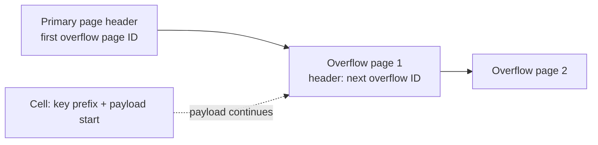
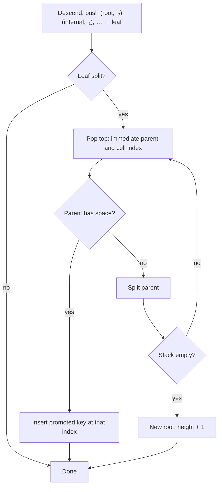

# 4. Implementing B-Trees

[← 3. File Formats](03-file-formats.md) · [Book](../README.md) · [5. Transaction Processing and Recovery →](05-transaction-processing-and-recovery.md)

## Summary

This chapter connects the textbook B-Tree with real engines. It covers three groups of topics (p. 61):

1. **Organization:** the **page header**, **magic numbers**, **sibling links**, the **rightmost pointer** (stored separately because it isn't paired with a key), **high keys** (as in PostgreSQL's B-link trees), and **overflow pages** for payloads that don't fit (pp. 61–67).
2. **Root-to-leaf traversal:** **binary search through indirection pointers**, and remembering the path either with **parent pointers** or with a stack of **breadcrumbs**, so that splits and merges can propagate upward (pp. 67–70).
3. **Optimizations and maintenance:**
   - **rebalancing** between siblings (B*-Trees split two nodes into three, each two-thirds full);
   - **right-only appends** for monotonically increasing keys (PostgreSQL's *fastpath*, SQLite's *quickbalance*);
   - **bulk loading** sorted data bottom-up;
   - page-wise or data-only **compression**;
   - **vacuum**, which defragments pages and returns freed pages to a freelist (pp. 70–76).

## Key takeaways

- **The page header carries navigation metadata:** flags, cell count, lower and upper free-space offsets, and engine-specific fields (p. 61).
- **A magic number is a cheap sanity check.** Random bytes are very unlikely to match it, so a match suggests the page is correctly located and aligned (p. 62).
- **Sibling links save trips to the parent** but must be updated on every split and merge, possibly requiring extra locking (pp. 62–63).
- **A node has N keys but N + 1 pointers.** Engines either store the unpaired rightmost pointer separately (SQLite keeps it in the header) or pair it with a **high key** (B-link trees) (pp. 63–64).
- **Overflow pages keep fixed-size pages workable.** At most `max_payload_size` = node size / fanout bytes are stored inline; the rest goes to linked overflow pages (pp. 65–66).
- **Breadcrumbs make propagation cheap.** A stack of the nodes and cell indices visited on the way down lets a split walk back up; PostgreSQL calls it `BTStack` (p. 69).
- **Sorted input avoids splits entirely.** Bulk loading writes leaves page by page and builds parents bottom-up; immutable trees can fill every page completely (p. 72).
- **Deletes only drop cell offsets.** Fragmentation then accumulates until **vacuum** rewrites the page and persists the freelist (pp. 75–76).

## Section outline

*From the book’s own table of contents (PDF bookmarks); printed page numbers.*

- Page Header — p. 61
  - Magic Numbers — p. 62
  - Sibling Links — p. 62
  - Rightmost Pointers — p. 63
  - Node High Keys — p. 64
  - Overflow Pages — p. 65
- Binary Search — p. 67
  - Binary Search with Indirection Pointers — p. 67
- Propagating Splits and Merges — p. 68
  - Breadcrumbs — p. 69
- Rebalancing — p. 70
- Right-Only Appends — p. 71
  - Bulk Loading — p. 72
- Compression — p. 73
- Vacuum and Maintenance — p. 74
  - Fragmentation Caused by Updates and Deletes — p. 75
  - Page Defragmentation — p. 76
- Summary — p. 76

## Notes

The previous chapter's principles apply to both in-place and append-only structures. This one is specific to B-Trees (p. 61).

### Page header

The header holds information used for navigation, maintenance and optimization: flags describing contents and layout, the number of cells, the **lower and upper offsets** bounding the free space (where new offsets and cells are appended), and more (p. 61).

| Engine | Stored in the page header (p. 61) |
|---|---|
| PostgreSQL | Page size, layout version |
| MySQL InnoDB | Number of heap records, level, others |
| SQLite | Number of cells, rightmost pointer |

#### Magic numbers

A **magic number** is a multibyte constant in the file or page header. It marks a block as a page, identifies its kind or names its version (p. 62). It's used for validation: write `50 41 47 45` (hex for `PAGE`) and compare those four bytes on read. A random offset is very unlikely to match, so a match means the offset is probably correct (p. 62).

#### Sibling links

Some engines store forward and backward links to sibling pages, so a neighbour can be found without climbing back to the parent. Without them, the climb may go all the way to the root, because a parent only addresses its own children (Figure 4-1) (p. 62). The price: when a non-rightmost node splits, its right sibling's backward pointer has to be redirected to the new node. Because that change happens in a *different* node, it may need extra locking. B-link trees exploit sibling links for concurrency (Ch. 6, p. 107) (pp. 62–63).

#### Rightmost pointers

There is always one more child pointer than keys, which is where the "+1" comes from (p. 63). Many implementations pair each separator key with a child pointer and store the last pointer separately (Figure 4-2). SQLite keeps it in the header (p. 63). When the rightmost child splits, the cell appended to the parent holds the promoted key and points to the *split* node, while the pointer to the *new* node replaces the old rightmost pointer (Figure 4-3; SQLite's `balance_deeper`) (pp. 63–64).

#### Node high keys

Alternatively, the rightmost pointer is stored with a **high key**, the highest key that can be present in the node's subtree. PostgreSQL does this; the structure is called a **B-link tree** (p. 64). Keys in subtree *i* satisfy K₍ᵢ₋₁₎ ≤ Kₛ < Kᵢ, with an implicit K₀ = −∞. B-link trees add an explicit K₍N+1₎ as the upper bound (Figure 4-4) (p. 64).

| | Without a high key | With a high key |
|---|---|---|
| Last subtree's upper bound | Virtual +∞ | Stored high key |
| Pointer storage | Rightmost pointer is a special case | Pointers stored pairwise with keys, fewer edge cases |

*Restates Figures 4-4 and 4-5 (pp. 64–65).*

#### Overflow pages

Node size and fanout are fixed, but no single value suits every workload: large variable-size values fit only a few per page, and tiny ones waste reserved space (p. 65). A node can still have room by B-Tree rules while its page is physically full, and resizing a page would mean copying it, which is impractical (p. 65).

Nodes therefore grow in page-size increments: a 4 KB **overflow page** is linked from the **primary page** (p. 65). Most implementations store at most `max_payload_size` = node size / fanout bytes inline and spill the rest to overflow pages, so the primary page can never run completely out of space (p. 65).

*The vault's sketch of Figure 4-6 and the linking scheme described on p. 66.*

- If the node already has an overflow page with room, the extra bytes go there; otherwise a new one is allocated (p. 66).
- The first overflow page's ID goes in the primary page's header. Further overflow pages are chained through their own headers, so finding an overflow part may mean walking several pages (p. 66).
- Overflow pages fragment too and need the same bookkeeping (p. 66).
- **Keys** have high cardinality, so most comparisons can be decided on the trimmed key prefix in the primary page. **Values** in overflow pages are fetched only to return them, which is infrequent. If every record is oversize, consider dedicated blob storage (pp. 66–67).

### Binary search

Binary search only works on sorted data, which is why the sorted-key invariant matters (p. 67). It returns a non-negative position when the key is found and a negative value when it isn't. The negative value encodes the **insertion point**, the index of the first element greater than the key (p. 67). On higher levels most searches don't find an exact match: what matters is the first key greater than the searched one, whose child pointer is followed (p. 67).

#### Binary search with indirection pointers

Cells are in insertion order and only the offsets are sorted. Each probe therefore picks the middle *offset*, follows it to its cell, compares that cell's key, and recurses left or right (Figure 4-7) (pp. 67–68).

### Propagating splits and merges

Splits and merges have to be able to walk back to the root (p. 68). Nodes may store **parent pointers**. They don't even need to be persisted, because a child is always paged in from its parent. They do have to be updated whenever a separator key and page ID move between nodes: during parent splits, merges and rebalancing (p. 68). WiredTiger traverses leaves through parent pointers rather than sibling pointers to avoid deadlocks (p. 68).

#### Breadcrumbs

Instead of maintaining parent pointers, record the path on the way down. Whether an insert or delete will split or merge isn't known until the leaf is reached, so the path is always collected (p. 69). **Breadcrumbs** are references to the visited nodes plus the index of each child pointer followed, kept on an in-memory stack. PostgreSQL's stack is `BTStack` (p. 69).

*The vault's flowchart of the process around Figure 4-8 (pp. 69–70).*

### Rebalancing

Some engines postpone splits and merges by moving elements between siblings, which raises occupancy and can reduce height, at a higher maintenance cost (p. 70). On overflow, elements move to a sibling instead of splitting. On a delete, elements are borrowed from a neighbour so the node stays at least half full [Graefe 2011] (p. 70).

**B\*-Trees** keep redistributing until both siblings are full, then split **two nodes into three**, each two-thirds full. SQLite uses this variant (pp. 70–71). Higher occupancy means a lower tree and fewer pages per search. Rebalancing changes the siblings' min/max boundaries, so the parent's keys and pointers have to be updated (Figure 4-9) (p. 71). SQLite's `balance-siblings` is close to this. Because rebalancing is isolated, it can be added later as an optimization (p. 71).

### Right-only appends

With auto-incremented primary keys, every insert lands in the **rightmost leaf**, so splits happen mostly on the rightmost node of each level, and nonleaf pages fragment less (p. 71).

| Engine | Optimization (pp. 71–72) |
|---|---|
| PostgreSQL **fastpath** | If the key is strictly greater than the first key in the rightmost page and that page has room, insert into the cached rightmost leaf and skip the read path |
| SQLite **quickbalance** | If the far-right target node is full, allocate a new rightmost node and add its pointer to the parent instead of splitting. The new page starts nearly empty but will likely fill quickly |

#### Bulk loading

Sorted input, or a rebuild for defragmentation, takes this idea further: every item goes at the rightmost position, so splits and merges can be avoided altogether (p. 72). Write leaves **page-wise**, push each leaf's first key to its parent, and build higher levels with the normal algorithm, in which all splits happen on the rightmost node (p. 72). Because the entire leaf level can be written before any parent, all child pointers are at hand. Only the parents of the leaf currently being filled stay in memory, and nothing is split or merged on disk (p. 72). **Immutable B-Trees** are built the same way, but every page can be filled completely because no space has to be reserved for future changes (p. 72).

> **Try it:** [B⁺-Tree splits and merges](../widgets/02-bplus-tree.html) — switch the insert order to *ascending* to see right-only appends: splits happen only on the right edge, and every left node stays half full.

### Compression

The trade-off is access speed against compression ratio: a better ratio fetches more data per access but costs CPU and RAM (p. 73).

| Granularity | Trade-off (pp. 73–74) |
|---|---|
| Whole file | Best ratio, but any update recompresses the file, and reaching one page means decompressing the file or a section of it |
| **Per page** | Fits fixed-size pages and couples with loading and flushing. A compressed page may fill only part of a disk block, so extra bytes or an extra block get read (Figure 4-10) |
| Data only (row-wise or column-wise) | Decouples compression from page management |

Engines usually make compression pluggable (Snappy, zlib, lz4, …). Libraries are compared on memory overhead, compression speed, decompression speed and ratio, as in the Squash Compression Benchmark (p. 74).

### Vacuum and maintenance

Background processes maintain integrity, reclaim space and keep pages in order, so foreground operations don't pay for cleanup (p. 74). A slotted page can have enough *logical* free space but not enough *contiguous* space (Figure 4-11) (p. 74). Records reachable by following pointers from the root are **live** (addressable). Unreachable ones are **garbage**. Garbage is usually not zero-filled, because it will be overwritten anyway (p. 75).

#### Fragmentation caused by updates and deletes

- **Deletes** on a leaf remove only the cell's offset; the cell itself becomes unaddressable and stays put (p. 75).
- **Splits** just trim offsets. The unreferenced cells are overwritten later or collected by vacuum (p. 75).
- **MVCC** engines deliberately keep removed and updated cells for concurrent transactions. Some track **ghost records** that are collected once every transaction that might have seen them has finished (p. 75).
- **Inserts** leave tuples in insertion order. That has little impact, but naturally sorted tuples help cache prefetching (p. 75).
- **Updates** mostly affect leaves and rarely change structure beyond creating overflow pages. A leaf update avoids rewriting the page, so several versions of a cell may sit in the page with only one addressable (p. 76).

#### Page defragmentation

**Compaction**, **vacuum** or **maintenance** can run synchronously, when a write finds too little physical space and wants to avoid creating an overflow page. Usually, though, it is an asynchronous process that walks pages, collects garbage, and rewrites live cells in logical order, possibly relocating pages within the file (p. 76). Freed in-memory pages go back to the page cache. Freed on-disk page IDs go on the **freelist**, which must be persisted so free space isn't leaked across crashes (p. 76). SQLite keeps trunk pages of free-page addresses in a linked list (note 3, p. 76).

### Summary

Page headers, rightmost pointers, high keys and overflow pages organize nodes. Binary search through indirection pointers, plus parent pointers or breadcrumbs, support traversal. Rebalancing, right-only appends, bulk loading and garbage collection optimize and maintain the tree (pp. 76–77).

## Trade-offs at a glance

| Technique | Benefit | Cost |
|---|---|---|
| Sibling links | Range scans without returning to the parent | Updated on every split and merge; extra locking |
| High keys (B-link) | Uniform cells; explicit subtree bounds | One extra key per node |
| Overflow pages | Variable-size payloads in fixed pages | Chains to traverse; fragmentation to manage |
| Parent pointers | Upward traversal without state | Updated whenever separators move |
| Breadcrumbs | No persisted parent links | In-memory stack per operation; indices may go stale |
| Rebalancing / B*-Trees | Higher occupancy, lower tree | More complex logic |
| Bulk loading | No splits or merges; full pages possible | Requires sorted input |
| Page compression | Smaller I/O | CPU; block padding |

## Beyond the book

- **Fill factor.** PostgreSQL's `fillfactor` storage parameter is a direct control over the space-for-future-inserts trade-off. B-tree indexes default to 90%, and a `CREATE INDEX` on existing rows is a bulk load in the book's sense: it sorts the tuples and writes leaves left to right.
- **Why random UUID keys hurt.** Random primary keys spread inserts over all leaves, which causes splits everywhere, roughly half-full pages and a much larger working set. Time-ordered identifiers (UUIDv7, ULID) restore the right-only append pattern the book describes. The widget's *ascending* versus *random* insert orders show the occupancy difference.

## Connections

- **Related chapters:** [3. File Formats](03-file-formats.md) (slotted pages, cells), [5. Transaction Processing and Recovery](05-transaction-processing-and-recovery.md) (page cache, MVCC), [6. B-Tree Variants](06-b-tree-variants.md) (B-link trees, copy-on-write, Bw-Trees), [7. Log-Structured Storage](07-log-structured-storage.md) (immutable structures built from sorted runs).

## Check yourself

*Questions and answers are the vault's, written from the notes above; answers cite the book's pages.*

1. **What does a magic number in a page header help detect?**

   *Answer:* A page that is misaligned or read from the wrong offset. A random byte sequence is very unlikely to equal the constant, for example `50 41 47 45` (`PAGE`) (p. 62).

2. **Why might sibling links need extra locking during a split?**

   *Answer:* The right sibling's backward pointer has to be redirected to the new node, and that update happens in a node other than the one being split (pp. 62–63).

3. **What is a node's high key?**
   - [ ] Its largest current key
   - [x] The upper bound of keys that may appear in its subtree
   - [ ] The key promoted on the last split

   *Answer:* B-link trees store K₍N+1₎ explicitly instead of an implicit +∞, so pointers can be stored pairwise (p. 64).

4. **How do overflow pages ensure that a primary page never runs out of space?**

   *Answer:* Each cell stores at most `max_payload_size` = node size / fanout bytes inline and spills the rest, so the page always has room for its N entries (p. 65).

5. **What do breadcrumbs contain, and when are they used?**

   *Answer:* A stack of the nodes visited and the indices of the child pointers followed. They're popped to find each parent and its insertion point when a split or merge propagates upward (p. 69).

6. **How does a B\*-Tree split differ from a regular split?**

   *Answer:* It redistributes between siblings until both are full, then splits two nodes into three, each two-thirds full, instead of one node into two half-full ones (pp. 70–71).

7. **Why can an immutable B-Tree have better occupancy than a bulk-loaded mutable one?**

   *Answer:* It never changes, so it needs no reserved space for later inserts, and every page can be filled completely (p. 72).
