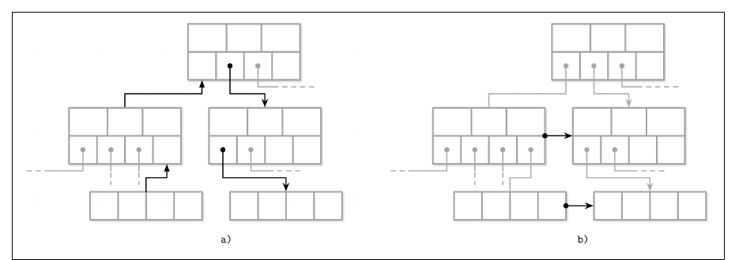
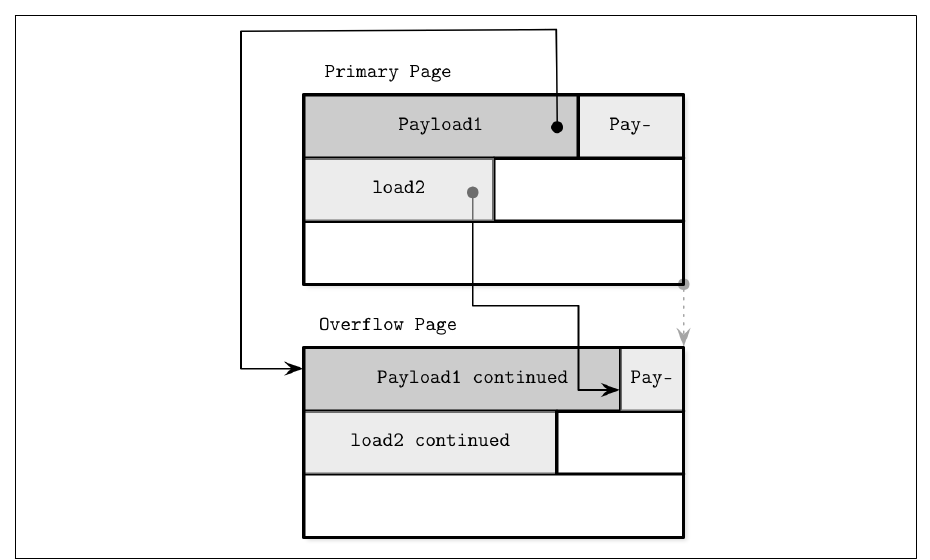
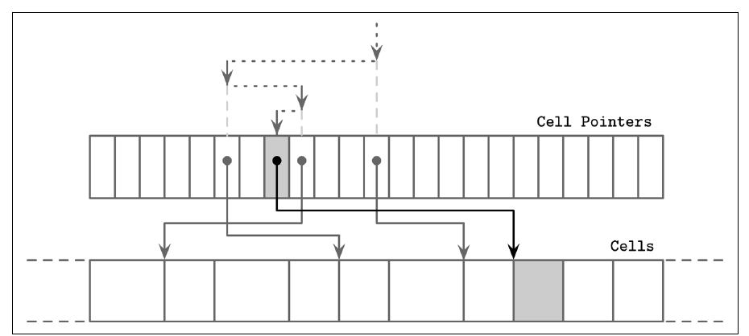
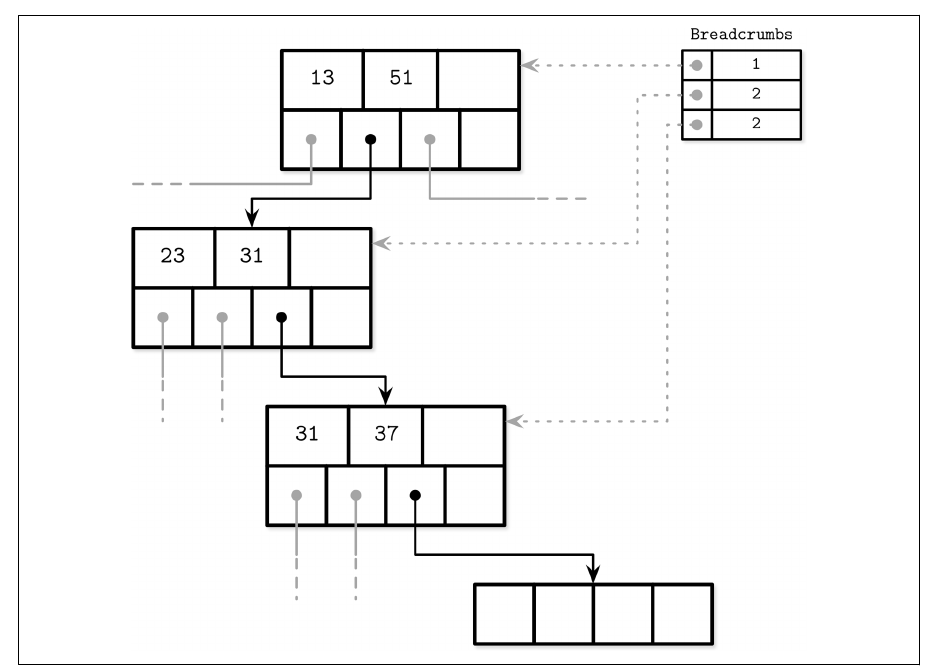
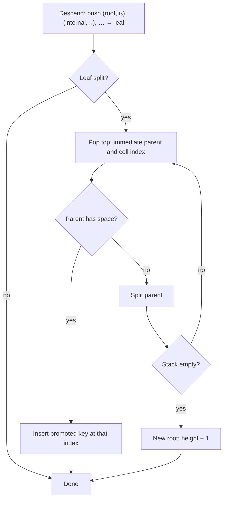
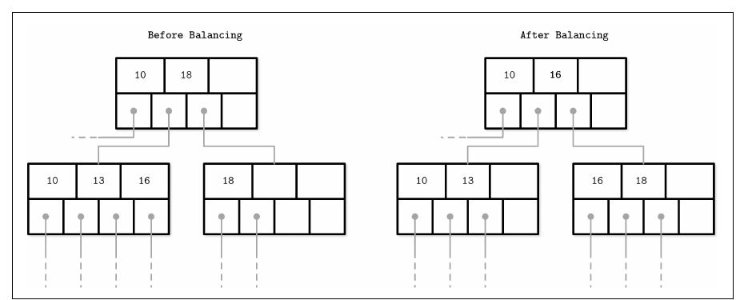

# فصل ۴: پیاده کردن B-Tree

[فصل ۳: قالب فایل →](03-file-formats.md) · [کتاب](../README.md) · [فصل ۵: پردازش تراکنش و بازیابی ←](05-transaction-processing-and-recovery.md)

## خلاصه

این فصل B-Tree کتاب درسی را به موتورهای واقعی وصل می‌کند. سه گروه موضوع را می‌پوشاند (p. 61):

1. **سازمان:** **header صفحه**، **magic number**، **پیوند sibling**، **اشاره‌گر راست‌ترین** که جدا ذخیره می‌شود چون با کلیدی جفت نیست، **کلید سقف** چنان‌که در درخت‌های B-link در PostgreSQL، و **صفحه‌ی سرریز** برای باری که جا نمی‌شود (pp. 61–67).
2. **پیمایش ریشه‌تا‌برگ:** **جست‌و‌جوی دوگانی از راه اشاره‌گرهای واسطه**، و یاد سپردن مسیر یا با **اشاره‌گر پدر** یا با پشته‌ای از **خرده‌نان**، تا شکستن و merge رو‌به‌بالا پخش شوند (pp. 67–70).
3. **بهینه‌سازی و نگهداشت:**
   - **متوازن کردن دوباره** میان خواهر‌و‌برادرها، که B*-Treeها دو نود را به سه می‌شکنند و هر یک دو‌سوم پر؛
   - **افزودن تنها‌راست** برای کلیدهای یکنوا‌افزایشی، یعنی *fastpath* در PostgreSQL و *quickbalance* در SQLite؛
   - **بار‌گذاری انبوه** داده‌ی مرتب از پایین به بالا؛
   - **فشرده‌سازی** صفحه‌به‌صفحه یا فقط‌داده؛
   - و **vacuum**، که صفحه‌ها را یکپارچه می‌کند و صفحه‌های آزادشده را به freelistی برمی‌گرداند (pp. 70–76).

## نکته‌های کلیدی

- **بخش header صفحه metadata پیمایش را حمل می‌کند:** flagها، شمار cell، offsetهای پایین و بالای فضای آزاد، و فیلدهای موتور‌ویژه (p. 61).
- **ساختار magic number سنجشی ارزان برای عقل سلیم است.** احتمال خواندن بایت‌های تصادفی با آن خیلی کم است، پس خواندنشان می‌رساند که صفحه درست جا گرفته و هم‌تراز است (p. 62).
- **پیوندهای sibling سفرهای به پدر را صرفه‌جویی می‌کنند** ولی سر هر شکستن و mergeی باید به‌روز شوند، و شاید قفل‌گذاری اضافه لازم داشته باشند (pp. 62–63).
- **نودی N کلید دارد ولی N + 1 اشاره‌گر.** موتورها یا آن اشاره‌گر راست‌ترین جفت‌نشده را جدا ذخیره می‌کنند، که SQLite در header نگهش می‌دارد، یا با یک **کلید سقف** جفتش می‌کنند، که درخت B-link است (pp. 63–64).
- **صفحه‌های سرریز صفحه‌های fixed-size را کار‌راه‌انداز نگه می‌دارند.** حداکثر `max_payload_size` که برابر اندازه‌ی نود تقسیم بر fanout است درون‌خط ذخیره می‌شود؛ و بقیه به صفحه‌های سرریز پیوندخورده می‌رود (pp. 65–66).
- **خرده‌نان‌ها پخش را ارزان می‌کنند.** پشته‌ای از نودها و index cellهایی که سر راه پایین دیده شده‌اند می‌گذارد شکستنی پس بالا بیاید؛ PostgreSQL اسمش را `BTStack` می‌گذارد (p. 69).
- **ورودی مرتب تماماً از شکستن می‌پرهیزد.** بار‌گذاری انبوه برگ‌ها را صفحه‌به‌صفحه می‌نویسد و پدرها را از پایین به بالا می‌سازد؛ درخت‌های immutable می‌توانند هر صفحه‌ای را کامل پر کنند (p. 72).
- **حذف‌ها تنها offsetهای cell را می‌اندازند.** آن‌وقت تکه‌تکه شدن انبار می‌شود تا **vacuum** صفحه را دوباره بنویسد و freelist را پایا کند (pp. 75–76).

## فهرست بخش‌ها

*از فهرست مطالب خود کتاب، از bookmarkهای PDF؛ شماره‌ها صفحه‌ی چاپی‌اند.*

- بخش header صفحه — ص. ۶۱
  - بخش magic number — ص. ۶۲
  - پیوند sibling — ص. ۶۲
  - اشاره‌گر راست‌ترین — ص. ۶۳
  - کلید سقف نود — ص. ۶۴
  - صفحه‌ی سرریز — ص. ۶۵
- جست‌و‌جوی دوگانی — ص. ۶۷
  - جست‌و‌جوی دوگانی با اشاره‌گرهای واسطه — ص. ۶۷
- پخش کردن شکستن و merge — ص. ۶۸
  - خرده‌نان — ص. ۶۹
- متوازن کردن دوباره — ص. ۷۰
- افزودن تنها‌راست — ص. ۷۱
  - بار‌گذاری انبوه — ص. ۷۲
- فشرده‌سازی — ص. ۷۳
- بخش vacuum و نگهداشت — ص. ۷۴
  - تکه‌تکه شدن از به‌روزرسانی و حذف — ص. ۷۵
  - یکپارچه‌سازی صفحه — ص. ۷۶
- خلاصه — ص. ۷۶

## یادداشت‌ها

قاعده‌های فصل پیش به ساختارهای سر‌جا و append-only هر دو به کار می‌آیند. این فصل ویژه‌ی B-Tree است (p. 61).

### بخش header صفحه

ساختار header اطلاعی را دارد که برای پیمایش و نگهداشت و بهینه‌سازی به کار می‌رود: flagهایی که محتوا و چیدمان را وصف می‌کنند، شمار cellها، **offsetهای پایین و بالا** که فضای آزاد را کران می‌زنند، یعنی جایی که offsetها و cellهای تازه افزوده می‌شوند، و بیشتر (p. 61).

| موتور | چه چیزی در header صفحه ذخیره می‌شود (p. 61) |
|---|---|
| PostgreSQL | اندازه‌ی صفحه، نسخه‌ی چیدمان |
| InnoDB در MySQL | شمار رکوردهای heap، سطح، و بقیه |
| SQLite | شمار cellها، اشاره‌گر راست‌ترین |

#### magic number

**ساختار magic number** ثابتی چند‌بایتی در header فایل یا صفحه است. بلوکی را به‌شکل صفحه علامت می‌زند، گونه‌اش را شناسایی می‌کند یا نسخه‌اش را نام می‌برد (p. 62). برای اعتبارسنجی به کار می‌رود: `50 41 47 45` را بنویسید، که hex برای `PAGE` است، و سر خواندن آن چهار بایت را مقایسه کنید. احتمال خواندن offsetی تصادفی با آن خیلی کم است، پس خواندنشان یعنی offset احتمالاً درست است (p. 62).

#### پیوند sibling

برخی موتورها پیوندهای جلو و عقب به صفحه‌های sibling ذخیره می‌کنند، تا همسایه‌ای بی بالا رفتن به پدر پیدا شود. بی آن‌ها، بالا رفتن می‌تواند تا ریشه برود، چون هر پدری تنها فرزندهای خودش را نشانی می‌دهد (شکل ۴-۱) (p. 62). بهایش: وقتی نودی غیر‌راست‌ترین بشکند، اشاره‌گر عقب sibling راستش باید به نود تازه برگردانده شود. چون آن تغییر در نودی *دیگر* رخ می‌دهد، می‌تواند قفل‌گذاری اضافه لازم داشته باشد. درخت‌های B-link از پیوندهای sibling برای concurrency بهره می‌گیرند، فصل ۶، ص. ۱۰۷ (pp. 62–63).

*Figure 4-1 (p. 62): (الف) بی پیوند sibling مسیر به همسایه از پدر رد می‌شود؛ (ب) با آن‌ها یک پرش است.*

#### اشاره‌گر راست‌ترین

همیشه یک اشاره‌گر فرزند بیشتر از کلیدها هست، که آن «+1» از همین‌جاست (p. 63). خیلی از پیاده‌سازی‌ها هر کلید جداکننده‌ای را با یک اشاره‌گر فرزند جفت می‌کنند و اشاره‌گر آخر را جدا ذخیره (شکل ۴-۲). سیستم SQLite در header نگهش می‌دارد (p. 63). وقتی راست‌ترین فرزند بشکند، آن cellی که به پدر افزوده می‌شود کلید بالا‌برده‌شده را دارد و به نود *شکسته* اشاره می‌کند، در حالی که اشاره‌گر به نود *تازه* جای اشاره‌گر راست‌ترین قدیم را می‌گیرد، شکل ۴-۳؛ و `balance_deeper` در SQLite (pp. 63–64).

#### کلید سقف نود

به‌جایش، اشاره‌گر راست‌ترین با یک **کلید سقف** ذخیره می‌شود، یعنی بالاترین کلیدی که در زیردرخت آن نود می‌تواند حاضر باشد. PostgreSQL همین را می‌کند؛ آن ساختار **درخت B-link** نامیده می‌شود (p. 64). کلیدهای زیردرخت *i* شرط K₍ᵢ₋₁₎ ≤ Kₛ < Kᵢ را برمی‌آورند، با K₀ = −∞ ضمنی. درخت‌های B-link یک K₍N+1₎ صریح به‌شکل کران بالا می‌افزایند (شکل ۴-۴) (p. 64).

| | بی کلید سقف | با کلید سقف |
|---|---|---|
| کران بالای زیردرخت آخر | ∞+ مجازی | کلید سقف ذخیره‌شده |
| ذخیره‌ی اشاره‌گر | اشاره‌گر راست‌ترین حالتی ویژه است | اشاره‌گرها زوجی با کلیدها ذخیره می‌شوند، با حالت‌های حاشیه‌ای کم‌تر |

*شکل‌های ۴-۴ و ۴-۵ را بازمی‌گوید (pp. 64–65).*

#### صفحه‌ی سرریز

اندازه‌ی نود و fanout ثابت‌اند، ولی هیچ مقدار تنهایی به هر بار کاری نمی‌خورد: مقدارهای بزرگ و variable-size تنها چندتا در هر صفحه‌ای جا می‌شوند، و ریزها فضای نگه‌داشته را حرام می‌کنند (p. 65). نودی می‌تواند بنا به قاعده‌های B-Tree باز هم جا داشته باشد در حالی که صفحه‌اش فیزیکی پر است، و تغییر اندازه‌ی صفحه یعنی کپی کردنش، که ناعملی است (p. 65).

پس نودها به گام‌های به اندازه‌ی صفحه رشد می‌کنند: **صفحه‌ی سرریز** ۴ کیلوبایتی از **صفحه‌ی اصلی** پیوند می‌خورد (p. 65). بیشتر پیاده‌سازی‌ها حداکثر `max_payload_size`، که برابر اندازه‌ی نود تقسیم بر fanout است، را درون‌خط ذخیره می‌کنند و بقیه را به صفحه‌های سرریز می‌ریزند، پس صفحه‌ی اصلی هیچ‌وقت تماماً از فضا در نمی‌ماند (p. 65).

*Figure 4-6 (p. 66): هر رکوردی بایت‌های اولش را در صفحه‌ی اصلی نگه می‌دارد و در صفحه‌ی سرریز پیوندخورده ادامه می‌دهد.*

- اگر نود از قبل صفحه‌ی سرریزی با جا داشته باشد، بایت‌های اضافه آن‌جا می‌روند؛ وگرنه تازه‌ای تخصیص می‌شود (p. 66).
- مفهوم ID نخستین صفحه‌ی سرریز در header صفحه‌ی اصلی می‌رود. صفحه‌های سرریز بعدی از راه headerهای خودشان زنجیر می‌شوند، پس یافتن بخشی از سرریز می‌تواند یعنی راه رفتن روی چند صفحه (p. 66).
- صفحه‌های سرریز هم تکه‌تکه می‌شوند و همان حساب‌داری را لازم دارند (p. 66).
- **کلید**ها cardinality بالا دارند، پس بیشتر مقایسه‌ها را می‌شود روی پیشوند بریده‌ی کلید در صفحه‌ی اصلی تصمیم گرفت. **مقدار**های صفحه‌های سرریز تنها برای برگرداندنشان گرفته می‌شوند، که کم‌تکرار است. اگر هر رکوردی بیش‌اندازه باشد، ذخیره‌سازی اختصاصی blob را بسنجید (pp. 66–67).

### جست‌و‌جوی دوگانی

جست‌و‌جوی دوگانی تنها روی داده‌ی مرتب کار می‌کند، که از همین‌جاست که ناوردای کلید مرتب مهم است (p. 67). وقتی کلید پیدا شود جایی نامنفی برمی‌گرداند و وقتی پیدا نشود مقداری منفی. آن مقدار منفی **نقطه‌ی درج** را کد می‌کند، یعنی index نخستین عنصر بزرگ‌تر از کلید (p. 67). در سطح‌های بالاتر بیشتر جست‌و‌جوها خوردنی دقیق پیدا نمی‌کنند: آن چیزی که مهم است نخستین کلید بزرگ‌تر از کلید جست‌و‌جو‌شده است، که اشاره‌گر فرزندش پی گرفته می‌شود (p. 67).

#### جست‌و‌جوی دوگانی با اشاره‌گرهای واسطه

همه‌ی cellها به ترتیب درج‌اند و تنها offsetها مرتب. پس هر کاوشی *offset* میانی را برمی‌دارد، تا cellش پی‌اش می‌گیرد، کلید آن cell را مقایسه می‌کند، و چپ یا راست بازگشتی می‌شود (شکل ۴-۷) (pp. 67–68).

*Figure 4-7 (p. 68): جست‌و‌جو آرایه‌ی اشاره‌گر را نصف می‌کند و نه cellها را؛ هر کاوشی اشاره‌گری را از‌ارجاع‌در‌می‌آورد تا کلیدی را که مقایسه می‌کند بخواند.*

### پخش کردن شکستن و merge

شکستن و merge باید بتوانند تا ریشه پس راه بروند (p. 68). نودها می‌توانند **اشاره‌گر پدر** ذخیره کنند. لازم هم نیست پایا شوند، چون هر فرزندی همیشه از پدرش به حافظه می‌آید. ولی هر جا کلید جداکننده‌ای و ID صفحه‌ای میان نودها جابه‌جا شود باید به‌روز شوند: در شکستن پدر و merge و متوازن کردن دوباره (p. 68). سیستم WiredTiger برگ‌ها را از راه اشاره‌گر پدر پیمایش می‌کند و نه اشاره‌گر خواهر‌و‌برادر، تا از deadlock بپرهیزد (p. 68).

#### خرده‌نان

به‌جای نگهداشتن اشاره‌گر پدر، مسیر را سر راه پایین ثبت کنید. تا رسیدن به برگ معلوم نیست که درجی یا حذفی خواهد شکست یا merge، پس مسیر همیشه جمع می‌شود (p. 69). **خرده‌نان**ها ارجاع به نودهای دیده‌شده به‌علاوه‌ی index هر اشاره‌گر فرزندی‌اند که پی گرفته شده، که روی پشته‌ای in-memoryی نگه داشته می‌شوند. پشته‌ی PostgreSQL همان `BTStack` است (p. 69).

*Figure 4-8 (p. 70): سر راه پایین، هر نود دیده‌شده و index اشاره‌گری که برداشته شده push می‌شوند؛ شکستنی popشان می‌کند تا دقیقاً پیدا کند کلید بالا‌برده‌شده کجا می‌رود.*

*نمودار جریان vault از فرایند گرد شکل ۴-۸ (pp. 69–70).*

### متوازن کردن دوباره

برخی موتورها شکستن و merge را با جابه‌جا کردن عنصرها میان siblingها عقب می‌اندازند، که اشغال را بالا می‌برد و می‌تواند ارتفاع را کم کند، به بهای نگهداشت بالاتر (p. 70). سر سرریز، عنصرها به‌جای شکستن به siblingی جابه‌جا می‌شوند. سر حذف، عنصرها از همسایه‌ای قرض گرفته می‌شوند تا نود دست‌کم نیمه‌پر بماند، از گریفه در ۲۰۱۱ (p. 70).

**ساختار B\*-Tree**ها همین‌طور پخش دوباره می‌کنند تا هر دو sibling پر شوند، بعد **دو نود را به سه** می‌شکنند، که هر یک دو‌سوم پر است. سیستم SQLite همین گونه را به کار می‌برد (pp. 70–71). اشغال بالاتر یعنی درختی کوتاه‌تر و صفحه‌ی کم‌تر برای هر جست‌و‌جویی. متوازن کردن دوباره مرزهای کمینه و بیشینه‌ی siblingها را عوض می‌کند، پس کلیدها و اشاره‌گرهای پدر باید به‌روز شوند (شکل ۴-۹) (p. 71). عبارت `balance-siblings` در SQLite به همین نزدیک است. چون متوازن کردن دوباره منزوی است، می‌شود بعدتر به‌شکل بهینه‌سازی افزودش (p. 71).

*Figure 4-9 (p. 71): عدد ۱۶ از نود پرتر به sibling خالی‌تر جابه‌جا می‌شود، پس جداکننده‌ی پدر از ۱۸ به ۱۶ عوض می‌شود؛ بی شکستن، بی نود تازه.*

### افزودن تنها‌راست

با کلیدهای اولیه‌ی خود‌افزا، هر درجی در **راست‌ترین برگ** می‌نشیند، پس شکستن‌ها بیشتر روی راست‌ترین نود هر سطحی رخ می‌دهند، و صفحه‌های غیربرگ کم‌تر تکه‌تکه می‌شوند (p. 71).

| موتور | بهینه‌سازی (pp. 71–72) |
|---|---|
| **fastpath** در PostgreSQL | اگر کلید اکیداً از کلید اول راست‌ترین صفحه بزرگ‌تر باشد و آن صفحه جا داشته باشد، در راست‌ترین برگ cache‌شده درج کن و از مسیر خواندن بپر |
| **quickbalance** در SQLite | اگر نود هدف در دور‌راست پر باشد، به‌جای شکستن نودی راست‌ترین تازه تخصیص بده و اشاره‌گرش را به پدر بیفزا. صفحه‌ی تازه تقریباً خالی شروع می‌کند ولی احتمالاً زود پر می‌شود |

#### بار‌گذاری انبوه

ورودی مرتب، یا ساختن دوباره برای یکپارچه‌سازی، این ایده را جلوتر می‌برد: هر قلمی در راست‌ترین جا می‌رود، پس شکستن و merge تماماً پرهیزشدنی‌اند (p. 72). برگ‌ها را **صفحه‌به‌صفحه** بنویسید، کلید اول هر برگی را به پدرش بالا ببرید، و سطح‌های بالاتر را با الگوریتم عادی بسازید، که در آن همه‌ی شکستن‌ها روی راست‌ترین نود رخ می‌دهند (p. 72). چون کل سطح برگ پیش از هر پدری نوشتنی است، همه‌ی اشاره‌گرهای فرزند دم دست‌اند. تنها پدرهای آن برگی که همین حالا پر می‌شود در حافظه می‌مانند، و روی دیسک چیزی شکسته یا merge نمی‌شود (p. 72). **B-Treeهای immutable** همان‌طور ساخته می‌شوند، ولی هر صفحه‌ای کامل پر‌شدنی است چون لازم نیست برای تغییرهای آینده فضایی نگه داشته شود (p. 72).

> **Try it:** [شکستن و merge در B⁺-Tree](../widgets/02-bplus-tree.html)؛ ترتیب درج را به *صعودی* عوض کنید تا افزودن تنها‌راست را ببینید: شکستن‌ها تنها روی لبه‌ی راست رخ می‌دهند، و هر نود چپی نیمه‌پر می‌ماند.

### فشرده‌سازی

بده‌بستان سرعت دسترسی در برابر نسبت فشرده‌سازی است: نسبت بهتر برای هر دسترسی داده‌ی بیشتری می‌گیرد ولی CPU و حافظه‌ی RAM خرج می‌کند (p. 73).

| granularity | بده‌بستان (pp. 73–74) |
|---|---|
| کل فایل | بهترین نسبت، ولی هر به‌روزرسانی فایل را دوباره فشرده می‌کند، و رسیدن به یک صفحه یعنی فشرده‌گشایی فایل یا بخشی از آن |
| **هر صفحه‌ای** | به صفحه‌های fixed-size می‌خورد و به بار کردن و flush node می‌خورد. صفحه‌ای فشرده می‌تواند تنها بخشی از بلوک دیسک را پر کند، پس بایت‌های اضافه یا بلوکی اضافه خوانده می‌شود (شکل ۴-۱۰) |
| فقط داده، ردیفی یا ستونی | فشرده‌سازی را از مدیریت صفحه جدا می‌کند |

موتورها معمولاً فشرده‌سازی را قابل جا‌گذاری می‌کنند، مثل Snappy و zlib و lz4. کتابخانه‌ها بر حسب سرریز حافظه و سرعت فشرده‌سازی و سرعت فشرده‌گشایی و نسبت مقایسه می‌شوند، چنان‌که در Squash Compression Benchmark (p. 74).

> **In practice:** ClickHouse هر ستون را جدا با LZ4 یا ZSTD فشرده می‌کند و هر چه مقدارهای ستون تکراری‌تر و مرتب‌تر، نسبت بهتر.
>
> **Your turn:** کدام ستون Silver بهتر فشرده می‌شود، `merchant_category` یا `transaction_id`، و چرا؟
>
> *Answer:* ستون دسته با مقدارهای تکراری زیاد، که با `LowCardinality` و قرار گرفتن در `ORDER BY` حتی بهتر می‌شود؛ شناسه‌ی یکتا تقریباً فشرده نمی‌شود. کتاب بده‌بستان را سرعت دسترسی در برابر نسبت فشرده‌سازی می‌داند (p. 73).

### عمل vacuum و نگهداشت

همه‌ی processهای پس‌زمینه تمامیت را نگه می‌دارند، فضا را بازپس می‌گیرند و صفحه‌ها را مرتب، تا عملیات پیش‌زمینه بهای تمیزکاری را ندهد (p. 74). slotted pageی می‌تواند فضای آزاد *منطقی* کافی داشته باشد ولی فضای *پیوسته*ی کافی نه (شکل ۴-۱۱) (p. 74). رکوردهایی که با پی گرفتن اشاره‌گرها از ریشه دست‌یافتنی‌اند **زنده**، یعنی نشانی‌پذیر، هستند. دست‌نیافتنی‌ها **زباله**اند. زباله معمولاً صفر‌پر نمی‌شود، چون هر طور که باشد روی‌نویسی می‌شود (p. 75).

#### تکه‌تکه شدن از به‌روزرسانی و حذف

- **حذف** روی برگی تنها offset آن cell را برمی‌دارد؛ خود آن cell نانشانی‌پذیر می‌شود و سر جا می‌ماند (p. 75).
- **شکستن** تنها offsetها را می‌برد. cellهای بی‌ارجاع بعدتر روی‌نویسی یا با vacuum جمع می‌شوند (p. 75).
- موتورهای **MVCC** cellهای برداشته و به‌روز‌شده را عمداً برای تراکنش‌های هم‌زمان نگه می‌دارند. برخی **رکوردهای شبح** را پی می‌گیرند که همین که هر تراکنشی که می‌توانست دیده باشدشان تمام شود جمع می‌شوند (p. 75).
- **درج** tupleها را به ترتیب درج می‌گذارد. این اثر کمی دارد، ولی tupleهای طبیعتاً مرتب به prefetch مربوط به cache کمک می‌کنند (p. 75).
- **به‌روزرسانی** بیشتر به برگ‌ها اثر می‌گذارد و کم ساختار را فراتر از ساختن صفحه‌ی سرریز عوض می‌کند. به‌روزرسانی برگی از نوشتن دوباره‌ی صفحه می‌پرهیزد، پس چند نسخه از یک cell می‌توانند در صفحه بنشینند و تنها یکی نشانی‌پذیر باشد (p. 76).

#### یکپارچه‌سازی صفحه

**عمل compaction** یا **vacuum** یا **نگهداشت** می‌تواند هم‌زمان اجرا شود، وقتی نوشتنی فضای فیزیکی زیادی کم پیدا کند و بخواهد از ساختن صفحه‌ی سرریز بپرهیزد. ولی معمولاً processی asynchronous است که روی صفحه‌ها راه می‌رود، زباله جمع می‌کند، و cellهای زنده را به ترتیب منطقی دوباره می‌نویسد، و شاید صفحه‌ها را درون فایل جابه‌جا کند (p. 76). صفحه‌های in-memoryی آزادشده به page cache برمی‌گردند. IDهای صفحه‌ی آزادشده‌ی دیسکی به **freelist** می‌روند، که باید پایا شود تا فضای آزاد در از کار افتادن‌ها چکه نکند (p. 76). سیستم SQLite صفحه‌های تنه‌ای از نشانی صفحه‌های آزاد را در فهرستی پیوندی نگه می‌دارد، یادداشت ۳، ص. ۷۶.

> **In practice:** دیتابیس‌های منبع با به‌روزرسانی زیاد نسخه‌های مرده جمع می‌کنند و vacuum آن‌ها را پاک می‌کند؛ کوئری‌های loader روی replica هم در این کار نقش دارند.
>
> **Your turn:** DBAها می‌گویند کوئری طولانی روی replica، vacuum را روی primary عقب انداخته است. ربطش به loader چیست؟
>
> *Answer:* با `hot_standby_feedback`، کوئری طولانی روی replica نمی‌گذارد primary نسخه‌های مرده‌ای را که آن کوئری هنوز می‌بیند پاک کند؛ پس loader باید کوئری‌های کوتاه و incremental بزند، نه اسکن‌های چندساعته. vacuum کاری پس‌زمینه است که فضای نسخه‌های مرده را پس می‌گیرد و تکه‌تکه شدن را کم می‌کند (pp. 74–76).

### خلاصه

بخش header صفحه و اشاره‌گر راست‌ترین و کلید سقف و صفحه‌ی سرریز نودها را سازمان می‌دهند. جست‌و‌جوی دوگانی از راه اشاره‌گرهای واسطه، به‌علاوه‌ی اشاره‌گر پدر یا خرده‌نان، پیمایش را پشتیبانی می‌کنند. متوازن کردن دوباره و افزودن تنها‌راست و بار‌گذاری انبوه و garbage collectorی درخت را بهینه و نگهداری می‌کنند (pp. 76–77).

## بده‌بستان‌ها در یک نگاه

| تکنیک | سود | هزینه |
|---|---|---|
| پیوند sibling | اسکن بازه‌ای بی برگشتن به پدر | سر هر شکستن و mergeی به‌روز می‌شود؛ قفل‌گذاری اضافه |
| کلید سقف یعنی B-link | cellهای یکدست؛ کران‌های صریح زیردرخت | یک کلید اضافه برای هر نودی |
| صفحه‌ی سرریز | بار variable-size در صفحه‌های ثابت | زنجیره‌هایی برای پیمایش؛ تکه‌تکه شدنی برای گرداندن |
| اشاره‌گر پدر | پیمایش رو‌به‌بالا بی حالت | هر جا جداکننده‌ها جابه‌جا شوند به‌روز می‌شود |
| خرده‌نان | پیوند پدر پایا‌شده لازم ندارد | پشته‌ای in-memoryی برای هر عملیاتی؛ indexها می‌توانند کهنه شوند |
| متوازن کردن دوباره یا B*-Tree | اشغال بالاتر، درخت کوتاه‌تر | منطق پیچیده‌تر |
| بار‌گذاری انبوه | بی شکستن و merge؛ صفحه‌های کامل ممکن است | ورودی مرتب لازم دارد |
| فشرده‌سازی صفحه | I/O کوچک‌تر | CPU؛ padding بلوک |

## فراتر از کتاب

- **ضریب پر شدن.** پارامتر ذخیره‌سازی `fillfactor` در PostgreSQL کنترلی مستقیم روی بده‌بستان فضا‌برای‌درج‌های‌آینده است. indexهای B-tree پیش‌فرض ۹۰٪‌اند، و `CREATE INDEX` روی ردیف‌های موجود به معنای کتاب بار‌گذاری انبوه است: tupleها را مرتب می‌کند و برگ‌ها را از چپ به راست می‌نویسد.
- **چرا کلیدهای UUID تصادفی صدمه می‌زنند.** کلیدهای اولیه‌ی تصادفی درج‌ها را روی همه‌ی برگ‌ها پخش می‌کنند، که همه‌جا شکستن می‌سازد، صفحه‌هایی تقریباً نیمه‌پر و مجموعه‌ی کاری خیلی بزرگ‌تر. شناسه‌های زمان‌مرتب، مثل UUIDv7 و ULID، همان الگوی افزودن تنها‌راست کتاب را برمی‌گردانند. ترتیب درج *صعودی* در برابر *تصادفی* در آن widget تفاوت اشغال را نشان می‌دهد.

## پیوندها

- **فصل‌های مرتبط:** [فصل ۳: قالب فایل](03-file-formats.md) که slotted page و cell را دارد، [فصل ۵: پردازش تراکنش و بازیابی](05-transaction-processing-and-recovery.md) که page cache و MVCC را دارد، [فصل ۶: گونه‌های B-Tree](06-b-tree-variants.md) که درخت B-link و copy-on-write و Bw-Tree را دارد، و [فصل ۷: ذخیره‌سازی log-structured](07-log-structured-storage.md) که ساختارهای immutability را دارد که از دور‌های مرتب ساخته می‌شوند.

## خودتان را بسنجید

*پرسش‌ها و پاسخ‌ها مال vault است و از روی یادداشت‌های بالا نوشته شده؛ پاسخ‌ها به صفحه‌های کتاب ارجاع می‌دهند.*

1. **ساختار magic number در header صفحه به تشخیص چه چیزی کمک می‌کند؟**

   *Answer:* صفحه‌ای که ناهم‌تراز است یا از offset غلطی خوانده شده. احتمال برابر شدن دنباله‌ای تصادفی از بایت با آن ثابت خیلی کم است، مثلاً `50 41 47 45` که `PAGE` است (p. 62).

2. **چرا پیوندهای sibling سر شکستنی می‌توانند قفل‌گذاری اضافه لازم داشته باشند؟**

   *Answer:* اشاره‌گر عقب sibling راست باید به نود تازه برگردانده شود، و آن به‌روزرسانی در نودی غیر از آن یکی که می‌شکند رخ می‌دهد (pp. 62–63).

3. **کلید سقف یک نود چیست؟**
   - [ ] بزرگ‌ترین کلید جاری‌اش
   - [x] کران بالای کلیدهایی که می‌توانند در زیردرختش پیدا شوند
   - [ ] کلیدی که سر آخرین شکستن بالا برده شد

   *Answer:* درخت‌های B-link به‌جای ∞+ ضمنی مقدار K₍N+1₎ را صریح ذخیره می‌کنند، پس اشاره‌گرها زوجی ذخیره‌شدنی‌اند (p. 64).

4. **صفحه‌های سرریز چطور تأمین می‌کنند که صفحه‌ی اصلی هیچ‌وقت از فضا در نمی‌ماند؟**

   *Answer:* هر cellی حداکثر `max_payload_size`، که برابر اندازه‌ی نود تقسیم بر fanout است، را درون‌خط ذخیره می‌کند و بقیه را می‌ریزد، پس صفحه همیشه برای N entryش جا دارد (p. 65).

5. **خرده‌نان‌ها چه چیزی دارند، و کِی به کار می‌روند؟**

   *Answer:* پشته‌ای از نودهای دیده‌شده و index اشاره‌گرهای فرزندی که پی گرفته شده. وقتی شکستن یا mergeی رو‌به‌بالا پخش شود pop می‌شوند تا هر پدری و نقطه‌ی درجش پیدا شود (p. 69).

6. **شکستن در B\*-Tree با شکستن عادی چه تفاوتی دارد؟**

   *Answer:* میان siblingها پخش دوباره می‌کند تا هر دو پر شوند، بعد دو نود را به سه می‌شکند که هر یک دو‌سوم پر است، به‌جای یک نود به دو نود نیمه‌پر (pp. 70–71).

7. **چرا B-Treeی immutable می‌تواند اشغال بهتری از یکی mutable و بار‌گذاری‌انبوه‌شده داشته باشد؟**

   *Answer:* هیچ‌وقت عوض نمی‌شود، پس فضای نگه‌داشته برای درج‌های بعدی لازم ندارد، و هر صفحه‌ای کامل پر‌شدنی است (p. 72).
