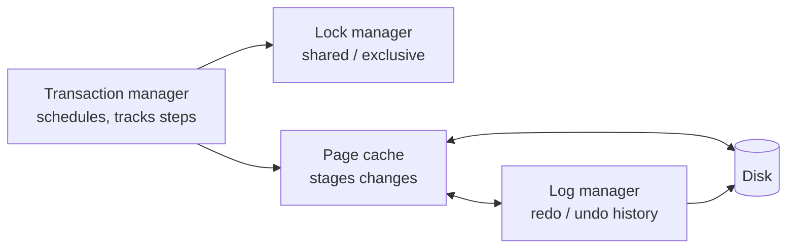
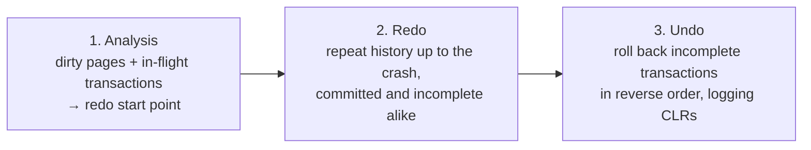
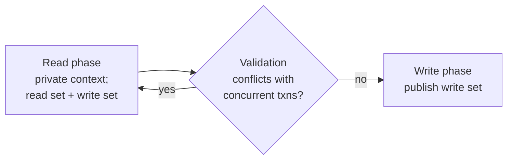

# 5. Transaction Processing and Recovery

[← 4. Implementing B-Trees](04-implementing-b-trees.md) · [Book](../README.md) · [6. B-Tree Variants →](06-b-tree-variants.md)

## Summary

With the storage structures in place, the book moves up to the components that make **transactions** possible (p. 79):

- the **transaction manager** coordinates and tracks transactions and their steps;
- the **lock manager** grants shared or exclusive access to resources;
- the **page cache** stages changes in memory;
- the **log manager** keeps the history needed to redo or undo those changes (p. 80).

**Buffer management** (pp. 81–88):

- The page cache keeps pages in memory, pins hot ones such as the upper tree levels, and flushes dirty pages through the checkpoint process.
- When it is full, it picks pages to evict with a **page-replacement policy**: FIFO, LRU and its variants (2Q, LRU-K), CLOCK-sweep, or frequency-based LFU and TinyLFU.

**Recovery** (pp. 88–93):

- The **write-ahead log** records every change before the page is modified, uses LSNs and fuzzy checkpoints, and combines physical redo with logical undo.
- **Steal/force** policies decide when dirty pages may reach disk.
- **ARIES**, a steal/no-force algorithm, recovers in three phases: analysis, redo and undo.

**Concurrency control** (pp. 93–108):

- **Serializability** and the anomalies and isolation levels around it, including snapshot isolation.
- **OCC** (read, validate, write), **MVCC**, **timestamp ordering** with the Thomas Write Rule, and **two-phase locking**, with deadlock detection or avoidance (wait-die, wound-wait).
- **Locks** guard logical contents; **latches** guard physical pages. **Latch crabbing**, latch upgrading and **B-link trees** keep tree traversal concurrent.

## Key takeaways

- **ACID:** atomicity (all or nothing), consistency (app-defined invariants, the weakest-defined property), isolation (as if alone) and durability (survives crashes) (pp. 79–80).
- **The page cache decouples logical writes from physical ones.** Dirty pages must be flushed before eviction, and pinned or referenced pages can't be evicted (pp. 83–84).
- **A bigger cache can mean more misses** under a non-optimal policy (Bélády's anomaly) (p. 85).
- **FIFO evicts the root first**, which is clearly wrong for B-Trees. LRU fixes that but relinks on every access. CLOCK approximates LRU with access bits and compare-and-swap. TinyLFU uses frequency (pp. 86–88).
- **Log before you modify.** A transaction commits only once the log is forced up to its commit record's LSN (pp. 89–90).
- **Steal needs undo; no-force needs redo.** ARIES is steal/no-force with physical redo and logical undo, and it *repeats history* before undoing incomplete transactions (pp. 91–93).
- **Snapshot isolation prevents lost updates but allows write skew** (p. 97).
- **Locks are logical and last for the transaction; latches are physical and as short as possible** (pp. 102–103).
- **B-link trees tolerate half-splits.** A reader whose key exceeds a node's high key follows the sibling link, so a parent's latch needn't be held during a split (p. 107).

## Section outline

*From the book’s own table of contents (PDF bookmarks); printed page numbers.*

- Buffer Management — p. 81
  - Caching Semantics — p. 83
  - Cache Eviction — p. 83
  - Locking Pages in Cache — p. 84
  - Page Replacement — p. 85
- Recovery — p. 88
  - Log Semantics — p. 90
  - Operation Versus Data Log — p. 91
  - Steal and Force Policies — p. 91
  - ARIES — p. 92
- Concurrency Control — p. 93
  - Serializability — p. 94
  - Transaction Isolation — p. 95
  - Read and Write Anomalies — p. 95
  - Isolation Levels — p. 96
  - Optimistic Concurrency Control — p. 98
  - Multiversion Concurrency Control — p. 99
  - Pessimistic Concurrency Control — p. 99
  - Lock-Based Concurrency Control — p. 100
- Summary — p. 108

## Notes

A **transaction** is an indivisible logical unit of work. It commits, making all its writes visible, or aborts, rolling back its side effects. Commit is final; after an abort the transaction can be retried (p. 79).

| Property | Meaning (pp. 79–80) |
|---|---|
| **Atomicity** | All steps happen or none do; never partial |
| **Consistency** | Moves the database from one valid state to another; application-defined, the weakest-defined property |
| **Isolation** | Concurrent transactions run as if alone; many engines use weaker levels for performance |
| **Durability** | Committed changes survive power loss, failures and crashes |

*The vault's diagram of the components on p. 80.* Distributed transactions are covered in Ch. 13 (p. 80).

### Buffer management

Databases use a two-level hierarchy of slow persistent storage and fast RAM (p. 81). Cached pages can be reused on the assumption that no other process modifies the file. Bayer called this the **virtual disk**; the usual names are **page cache** and **buffer pool**. The book prefers *page cache*, because *buffer pool* suggests pooling empty buffers rather than caching contents (p. 81).

- Pages are **paged in** from disk. A modified page is **dirty** until flushed (p. 81).
- Pages are loaded into free slots out of order, so memory order doesn't match disk order (Figure 5-1, p. 81).
- The page cache serves cached pages, buffers modifications, pages in on a miss when there's space, and otherwise evicts and flushes another page first (p. 82).

> **Vault note:** the book's sidebar on `O_DIRECT` (p. 82): many databases bypass the kernel page cache to manage buffers themselves. Linus Torvalds has criticized this because `O_DIRECT` isn't asynchronous and has no readahead. `fadvise` only gives hints, and `mmap` avoids syscalls at the cost of control over caching.

#### Caching semantics

Synchronization is one-way, from memory to disk, because no other process writes the file (p. 83). The page cache is an application-specific equivalent of the kernel's, accessing the block device directly. Caching keeps part of the tree in memory without changing the algorithm: just replace disk accesses with page-cache calls (p. 83). A returned buffer is **referenced** until the engine hands it back. A page can be **pinned** so it isn't evicted, and a modified page is marked **dirty** (p. 83).

#### Cache eviction

A clean, unpinned, unreferenced page can be evicted immediately. A dirty page must be flushed first, and a referenced page must not be evicted while another thread uses it (p. 83). Flushing on every eviction is slow, so PostgreSQL's **background flush writer** cycles through dirty pages likely to be evicted (p. 83). For durability, the **checkpoint process** keeps the WAL and the page cache in lockstep: WAL records can be discarded only once their pages have been flushed (pp. 83–84).

Competing goals (p. 84):

- postpone flushes to reduce disk accesses;
- flush preemptively to allow quick eviction;
- evict and flush in the best order;
- stay within the memory budget;
- never lose data that isn't yet persisted.

#### Locking pages in cache

The tree narrows toward the top, so upper levels are hit by most reads and are eventually touched by propagating splits and merges (p. 84). **Pinning** them keeps them in memory. Each level has exponentially more nodes than the one above, so the top levels are a small fraction of the tree and can stay resident: a lookup then hits disk only for the lower, uncached levels rather than for all *h* levels (p. 84). Contradicting structural changes, such as merges followed by splits in the same subtree, can be buffered in memory and written once (pp. 84–85).

#### Prefetching and immediate eviction

The page cache can **prefetch**, for example the next leaves during a range scan, and can **evict immediately** pages loaded by maintenance processes. PostgreSQL uses a circular buffer (FIFO) for large sequential scans (p. 85).

#### Page replacement

An eviction (page-replacement) policy tries to evict the pages least likely to be needed soon. The ideal policy would need a crystal ball (p. 85). **Bélády's anomaly**: with a non-optimal algorithm, *more* cache pages can produce *more* evictions (p. 85).

| Policy | How it works | Weakness (pp. 86–88) |
|---|---|---|
| **FIFO** | Queue in page-in order; evict the head | Ignores accesses; evicts the root and top levels first |
| **LRU** | Move a page to the tail on each access | Relinking on every access is costly under concurrency |
| **2Q** | First queue on first access, a hot queue on later ones | Separates recent from frequent |
| **LRU-K** | Track the last K accesses per page | Estimates access times |
| **CLOCK-sweep** | Circular buffer with access bits (or counters); the hand clears bits and evicts a page whose bit is already 0; referenced pages are skipped | Approximate, but compact and cache-friendly; hand and contents updated with CAS. Linux uses a variant |
| **LFU / TinyLFU** | Order by usage frequency, with a compact frequency histogram; admission (LRU), probation and protected queues | Used in Caffeine (Java) |

TinyLFU chooses which items to **promote for retention** rather than which to evict. An item enters probation only if its frequency beats the item it would evict, and moves on to protected with further accesses (p. 88). For a database under heavy load, recency may say little, which is why frequency matters (p. 87).

> **Try it:** [Page replacement](../widgets/05-page-replacement.html) — replay the same page-reference string under FIFO, LRU, CLOCK and LFU, change the cache size, and watch hits, misses and the clock hand. Includes the classic sequence that shows Bélády's anomaly.

### Recovery

Every layer under a database can fail, and data that was "promised" to be written must actually be written (p. 88). The **write-ahead log** (WAL, commit log) is an append-only, disk-resident structure for crash and transaction recovery. Until cached pages are flushed, the WAL is the only on-disk copy of the operation history; PostgreSQL and MySQL both use one (pp. 88–89). Its jobs (p. 89):

- let the page cache buffer updates while keeping durability;
- persist every operation **before** the affected page is modified, until the page is flushed;
- rebuild lost in-memory changes after a crash.

The book refers to **ARIES** throughout (p. 89).

> **Vault note:** the book's sidebar on PostgreSQL and `fsync()` (pp. 89–90). On Linux and some other systems, `fsync` clears the dirty flag even on pages that failed to flush after an I/O error, and reports errors only to file descriptors open at the time of the failure. PostgreSQL's checkpointer doesn't keep every file open, so it could miss the error and assume the data was on disk. The book's advice: think through and test every failure scenario.

#### Log semantics

The WAL is append-only and immutable, so writes are sequential, and readers can read up to the latest write threshold while the writer appends (p. 90).

- Each **log record** has a unique, monotonically increasing **LSN**, a counter or timestamp.
- Records are cached in a **log buffer** and flushed by a **force**, when the buffer fills or at the transaction manager's or page cache's request, always in LSN order.
- A transaction counts as committed only once the log is forced up to its **commit record's LSN**.
- Some systems write **compensation log records (CLRs)** during undo, so a crash during rollback or recovery is survivable (p. 90).
- The WAL is trimmed at checkpoints. The slightest disagreement between trimming and actual persistence can lose data (p. 90).

| Checkpoint | How (pp. 90–91) |
|---|---|
| **Sync checkpoint** | Force all dirty pages; impractical because operations pause |
| **Fuzzy checkpoint** | Write `begin_checkpoint`, then `end_checkpoint` with the dirty pages and the transaction table. Pages are flushed asynchronously; when done, `last_checkpoint` in the log header gets the LSN of `begin_checkpoint`, and recovery starts there |

#### Operation versus data log

**Shadow paging**, used by System R, is copy-on-write: new contents go to an unpublished shadow page, and a pointer flip makes them visible (p. 91). Any change can be expressed as a before-image and an after-image, or as redo and undo operations (p. 91).

| Log type | Records (p. 91) |
|---|---|
| **Physical** | Whole page state or byte-wise changes (before and after images) |
| **Logical** | Operations, e.g. "insert data record X for key Y", with the inverse undo, "remove the value associated with Y" |

Many systems combine them: **logical undo** for concurrency and performance, **physical redo** for faster recovery (p. 91).

#### Steal and force policies

| Policy | Allows (pp. 91–92) | Implication |
|---|---|---|
| **Steal** | Flushing a page modified by an *uncommitted* transaction | Needs **undo** information |
| **No-steal** | Uncommitted changes never reach disk | Recovery can use redo only |
| **Force** | All modified pages flushed *before* commit | No redo needed, but slower commits |
| **No-force** | Commit before the pages are flushed | Needs **redo**; buffers more updates; may need a larger cache |

Until a transaction commits, the log must hold enough to undo it (if its pages were flushed) or redo it (if they weren't). It can't commit until those records are written (p. 92).

#### ARIES

ARIES is **steal/no-force** (pp. 92–93). It uses physical redo (changes install quickly during recovery), logical undo (operations apply to pages independently, which helps concurrency), and **repeating history**: it rebuilds the exact pre-crash state, then undoes incomplete transactions, writing CLRs as it goes.

*Restates the three phases (pp. 92–93).* ARIES uses LSNs, a **dirty page table**, physical redo, logical undo and fuzzy checkpoints. The paper is from 1992, and its ideas are still current (p. 93).

> **Try it:** [ARIES recovery](../widgets/05-aries-recovery.html) — write a small log of updates, commits and a checkpoint, crash at any point, and step through analysis, redo and undo, including the CLRs that make recovery itself restartable.

### Concurrency control

The transaction manager and lock manager together handle concurrency control (p. 93):

| Category | Idea (pp. 93–94) |
|---|---|
| **Optimistic (OCC)** | Run concurrently, record histories, check for conflicts before commit; abort one of the conflicting transactions |
| **Multiversion (MVCC)** | Multiple timestamped versions give a consistent view of a past point; implemented with validation, timestamp ordering or 2PL |
| **Pessimistic (PCC)** | Lock-based (hold locks on records) or nonlocking (restrict execution by schedule); can deadlock |

This chapter covers node-local techniques. Deterministic concurrency control (Calvin) is in Ch. 13 (p. 94).

#### Serializability

A **schedule** is the list of database-visible operations (read, write, commit, abort) needed to execute a set of transactions; other operations are assumed side-effect-free (p. 94). It is **complete** if it contains every operation of every transaction. It is **serial** if transactions don't interleave, which is easy to reason about but slow. It is **serializable** if it is equivalent to *some* complete serial schedule. Three transactions have 3! = 6 serial orders (Figure 5-4) (pp. 94–95).

#### Transaction isolation

An **isolation level** says how and when one transaction's changes become visible to others, and thus which anomalies can occur. More isolation costs more coordination (p. 95).

#### Read and write anomalies

| Anomaly | Example (pp. 95–96) |
|---|---|
| **Dirty read** | T2 reads T1's uncommitted address change; T1 aborts |
| **Nonrepeatable (fuzzy) read** | T1 reads a row, T2 updates and commits it, T1 rereads a different value |
| **Phantom read** | Same as above, but for a range: the set of rows changes |
| **Lost update** | T1 and T2 both read V; T1 writes and commits; T2 writes and commits, overwriting T1 |
| **Dirty write** | A transaction modifies and saves a value it dirty-read |
| **Write skew** | A1 = $100, A2 = $150, invariant A1 + A2 ≥ 0. T1 withdraws $200 from A1, T2 withdraws $200 from A2; each sees $250 total; both commit, leaving −$100 and −$50 |

#### Isolation levels

| Level | Dirty read | Nonrepeatable read | Phantom read |
|---|---|---|---|
| **Read uncommitted** | allowed | allowed | allowed |
| **Read committed** | — | allowed | allowed |
| **Repeatable read** | — | — | allowed |
| **Serializable** | — | — | — |

*Restates Figure 5-5 and the text on pp. 96–97.*

Serializability doesn't impose a particular order, unlike **linearizability** (Ch. 11, p. 223). Isolation in the ACID sense means serializability, and implementing it requires coordination (p. 97).

**Snapshot isolation** (p. 97):

- A transaction sees everything committed when it started, through an unchanging snapshot.
- It commits only if the values it modified haven't changed since; otherwise it aborts and retries.
- Of two transactions writing the same value, only the first to commit wins, which prevents **lost updates**.
- **Write skew** is still possible, because transactions that modify *independent* records while preserving local invariants both commit. Percolator (Ch. 13, p. 272) returns to this.

#### Optimistic concurrency control

OCC assumes conflicts are rare (p. 98):

- **Backward-oriented** validation checks against already committed transactions; **forward-oriented** checks against transactions currently validating. Validation and write must be atomic as a pair: no transaction commits while another is validating. That critical section is acceptable because those phases are short (p. 98).
- For any T1 and T2 in backward validation, T2 may commit if (pp. 98–99):
  1. T1 committed before T2's read phase began, or
  2. T1 committed before T2's write phase and T1's write set doesn't intersect T2's read set, or
  3. T1's read phase finished before T2's, and T2's write set intersects neither T1's read set nor its write set.
- OCC is efficient when validation usually succeeds, because retries are expensive. Readers-writer locks and upgradeable locks are a way to allow nonexclusive ownership (p. 99).

#### Multiversion concurrency control

**MVCC** keeps multiple record versions with monotonic transaction IDs or timestamps, so reads continue on old versions while new ones are being written (p. 99). The last committed version is current, and the transaction manager aims for at most one uncommitted version at a time. Whether reads may see uncommitted versions depends on the isolation level. MVCC can be built on 2PL, scheduling or timestamp ordering, and is a major way of implementing snapshot isolation (p. 99).

#### Pessimistic concurrency control

Conflicts are found while transactions run, and execution is blocked or aborted (p. 99). **Timestamp ordering**, a lock-free scheme, keeps `max_read_timestamp` and `max_write_timestamp` per value (pp. 99–100):

| Operation with timestamp *t* | Rule |
|---|---|
| Read, *t* < `max_write_timestamp` | Abort: a newer value already exists |
| Write, *t* < `max_read_timestamp` | Abort: it conflicts with a more recent read |
| Write, *t* < `max_write_timestamp` | Allowed and **ignored**: the outdated write can be skipped (the **Thomas Write Rule**) |

Aborted transactions restart with a *new* timestamp, because the old one would be aborted again (p. 100).

#### Lock-based concurrency control

Locks bring contention and scalability problems (p. 100). **Two-phase locking (2PL)** has a **growing** phase, in which locks are acquired and none released, and a **shrinking** phase, in which they are released. Once a transaction releases any lock, it can't acquire another. Execution can happen in either phase, though **conservative 2PL** restricts this (p. 100).

> **Vault note:** the book warns that 2PL, a concurrency control mechanism, is unrelated to two-phase commit, a distributed commit protocol (Ch. 13, p. 259) (p. 100).

#### Deadlocks

A **deadlock**: T1 holds L1 and waits for L2, while T2 holds L2 and waits for L1 (Figure 5-6) (p. 101).

| Approach | How (pp. 101–102) |
|---|---|
| Timeouts | Abort long-running transactions; limits concurrency |
| Conservative 2PL | Acquire all locks before executing, or abort; limits concurrency |
| **Detection** | A **waits-for graph**; a cycle means deadlock. Checked periodically or continuously; usually the most recent requester is aborted |
| **Avoidance** | Priority by timestamp (lower = older = higher priority) |

When T1 requests a lock held by T2 (p. 102):

| Scheme | T1 older than T2 | T1 younger than T2 |
|---|---|---|
| **Wait-die** | T1 waits | T1 aborts ("dies") and restarts |
| **Wound-wait** | T2 is aborted ("wounded") | T1 waits |

Latches don't use deadlock handling: the programmer must ensure they can't deadlock (p. 102).

#### Locks

| | **Locks** | **Latches** |
|---|---|---|
| Guard | Logical contents: a key, existing or not, or a key range | Physical representation: page contents and tree structure |
| Managed by | The lock manager, outside the tree | The tree implementation, per page |
| Held | For the transaction's duration | As briefly as possible |
| Weight | Heavier | Lighter; what systems programmers call "locks" |

*From pp. 102–103.*

#### Latches

Leaf pages change on insert, update and delete. Nonleaf pages and the tree structure change on splits and merges, so latches may be needed on several levels, and queries must never see partial writes or half-done splits (p. 103). Lockless concurrency control still needs latches (p. 103). There are three kinds of interference: concurrent reads, concurrent updates and reads during writes, including those from maintenance (p. 103).

**Readers-writer (RW) locks**: many readers can share; a writer needs exclusive access (Figures 5-7, 5-8) (pp. 103–104).

| Held \\ Requested | Read | Write |
|---|---|---|
| **Read** | shared ✓ | wait ✗ |
| **Write** | wait ✗ | wait ✗ |

**Busy-wait and queueing** (p. 104): blocking algorithms deschedule threads, while busy-waiting spins briefly. Queue-based locks use compare-and-swap, and each waiter spins on a variable that only its predecessor updates, which cuts CPU traffic (Mellor-Crummey and Scott).

**Latch crabbing** (latch coupling) (pp. 105–106):

- *Reads:* latch the child, then release the parent.
- *Inserts:* release the parent if the child isn't full.
- *Deletes:* release the parent if the child won't underflow.
- This is optimistic: structural changes become rarer higher up the tree.
- If the child page isn't cached, either latch the page while it loads, or release the parent and restart the descent after the load (Figure 5-9).

> **Try it:** [Latch crabbing](../widgets/05-latch-crabbing.html) — descend a B-Tree for a read, an insert or a delete and see which latches are held at each step, and when a full child forces the parent's latch to be kept.

**Latch upgrading** (p. 107): take *shared* latches on the way down and an exclusive one only at the leaf. If a split or merge is needed, upgrade the parent's latch; competing upgraders wait or restart. Every request starts at the root, which becomes a bottleneck. The root splits last, though, so it can be latched optimistically, and the cost of a retry (**pointer chasing**) is rarely paid (p. 107).

**B-link trees** (Lehman and Yao) build on B*-Trees and add high keys and sibling links (p. 107). Every node except the root has a child pointer from its parent and a sibling link from its left neighbour.

- A **half-split** node is reachable by the sibling link but not yet from its parent.
- A reader whose key exceeds a node's high key knows the node changed concurrently and follows the sibling link instead of restarting.
- The parent's latch isn't held when descending even if the child splits, and the parent pointer is added lazily (pp. 107–108).
- Benefits: less contention, a constant number of latches during structural changes, reads concurrent with splits, and no deadlocks from modifications ascending to parents (p. 108).

### Summary

Efficiency needs concurrent transactions; correctness needs ACID. Isolation levels limit which anomalies can occur, and concurrency control decides how transactions are scheduled. The page cache reduces disk accesses, the WAL guarantees durability and rollback, and steal/force policies coordinate the two (p. 108).

## Trade-offs at a glance

| | Steal | No-steal |
|---|---|---|
| **Force** | Undo needed; slow commits | Simplest recovery; slow commits, big cache |
| **No-force** | Undo + redo (ARIES); fastest normal operation | Redo only; large cache |

| Concurrency control | Blocks? | Best when | Risk |
|---|---|---|---|
| OCC | No, validates at commit | Conflicts are rare | Wasted work on retries |
| MVCC | Readers don't block writers | Read-heavy workloads; snapshots | Version garbage; write skew under SI |
| Timestamp ordering | No locks | Mostly ordered access | Aborts on late operations |
| 2PL | Yes | Strict serializability needed | Deadlocks, contention |

| Page replacement | Signal | Cost |
|---|---|---|
| FIFO | Page-in time | Cheapest; evicts hot pages |
| LRU | Recency | Relink per access |
| CLOCK | Approximate recency | One bit per page, lock-free hand |
| TinyLFU | Frequency | Histogram + three queues |

## Beyond the book

- **Bélády's anomaly in numbers.** The textbook reference string `1 2 3 4 1 2 5 1 2 3 4 5` under FIFO gives 9 faults with 3 frames but 10 with 4. LRU is a *stack algorithm* and can't show the anomaly. The page-replacement widget includes this string.
- **PostgreSQL's buffer manager** uses a clock-sweep with a small usage counter (up to 5) per buffer, a "counters instead of bits" variant like the one the book mentions, plus ring buffers for bulk reads, writes and vacuum, the circular-buffer case on p. 85.
- **Write skew under snapshot isolation** is why PostgreSQL added *Serializable Snapshot Isolation* (SSI, 2012). It tracks read-write dependencies between concurrent transactions and aborts one when a dangerous structure appears. See also [DDIA Ch. 8](../../designing-data-intensive-applications/chapters/08-transactions.md).

## Connections

- **Related chapters:** [4. Implementing B-Trees](04-implementing-b-trees.md) (high keys, sibling links), [6. B-Tree Variants](06-b-tree-variants.md) (copy-on-write instead of latches), [13. Distributed Transactions](13-distributed-transactions.md) (2PC, Calvin, Percolator, Spanner), [11. Replication and Consistency](11-replication-and-consistency.md) (linearizability versus serializability).
- **Run it:** [Page-replacement hit ratios](../lab/05-page-replacement/README.md) — replays a skewed page-reference trace from a B-Tree workload under FIFO, LRU, CLOCK and LFU at several cache sizes, and checks Bélády's anomaly for FIFO.

## Check yourself

*Questions and answers are the vault's, written from the notes above; answers cite the book's pages.*

1. **Why is FIFO a poor page-replacement policy for a B-Tree?**

   *Answer:* It considers only page-in time. The root and upper-level pages are paged in first, so they are the first evicted, although they are the most likely to be needed again (p. 86).

2. **In CLOCK-sweep, what happens when the hand reaches an unreferenced page whose access bit is 1?**
   - [ ] It is evicted
   - [x] The bit is set to 0 and the hand moves on
   - [ ] The page is pinned

   *Answer:* Only a page whose bit is already 0 becomes a candidate for eviction. Referenced pages keep their bit (p. 86).

3. **When is a transaction considered committed with respect to the log?**

   *Answer:* Once the log has been forced to disk up to the LSN of its commit record (p. 90).

4. **Which policy combination does ARIES use, and what does that require of the log?**

   *Answer:* Steal/no-force. Stolen uncommitted pages need undo records, and unflushed committed pages need redo records (pp. 91–92).

5. **Why does ARIES redo incomplete transactions before undoing them?**

   *Answer:* *Repeating history* restores the exact pre-crash state, including the effects of incomplete transactions. The undo phase then rolls those back in reverse order and logs CLRs, so a crash during recovery doesn't repeat work (pp. 92–93).

6. **Which anomaly does snapshot isolation still allow?**
   - [ ] Lost update
   - [ ] Dirty read
   - [x] Write skew

   *Answer:* Two transactions that update *different* records, each preserving its local invariant, both commit (p. 97).

7. **Under timestamp ordering, what does the Thomas Write Rule allow?**

   *Answer:* A write whose timestamp is lower than `max_write_timestamp` can be safely ignored instead of aborting, because a newer value already exists (p. 100).

8. **With wound-wait, an older T1 requests a lock held by a younger T2. What happens?**

   *Answer:* T1 *wounds* T2: T2 is aborted and restarted. A transaction can only be blocked by an older one (p. 102).

9. **In latch crabbing during an insert, when can the parent's latch be released?**

   *Answer:* As soon as the child is latched and found not to be full, because then no split can propagate to the parent (p. 105).

10. **How does a B-link tree reader detect a concurrent split?**

    *Answer:* The searched key exceeds the node's high key. The reader follows the sibling link to the new node instead of restarting (p. 107).
