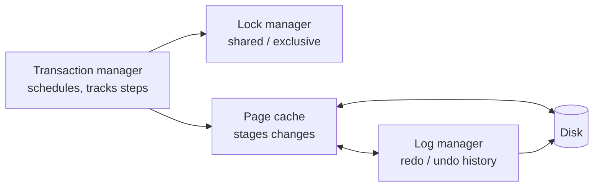
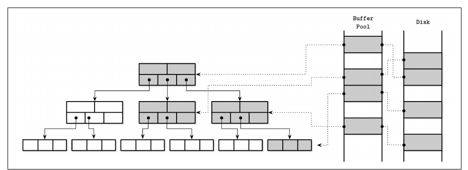
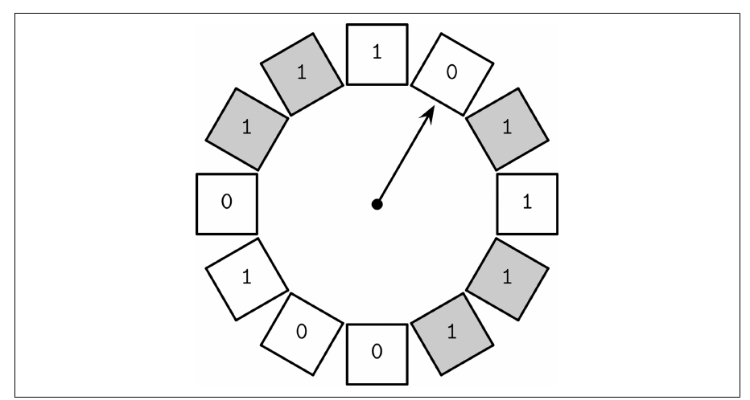
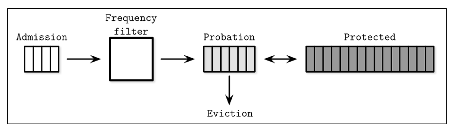
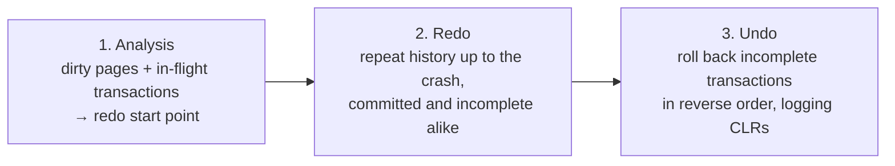
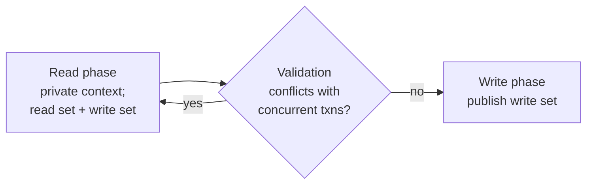
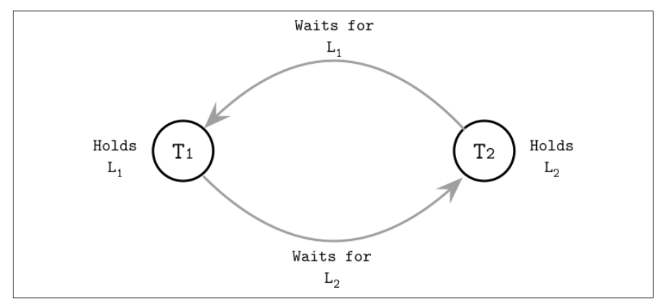
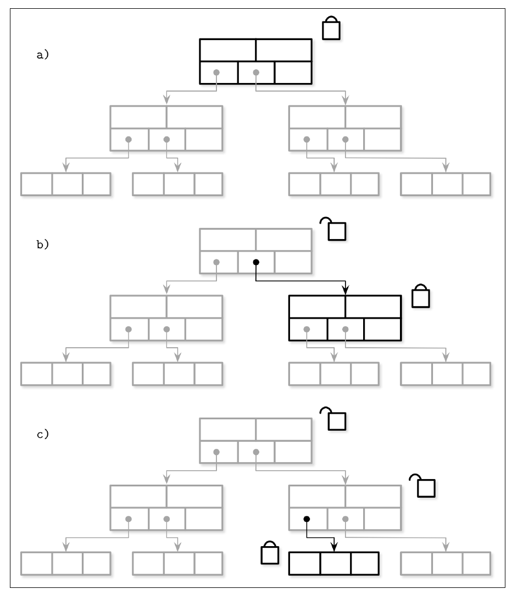

# فصل ۵: پردازش تراکنش و بازیابی

[فصل ۴: پیاده کردن B-Tree →](04-implementing-b-trees.md) · [کتاب](../README.md) · [فصل ۶: گونه‌های B-Tree ←](06-b-tree-variants.md)

## خلاصه

حالا که ساختارهای ذخیره‌سازی سر جایشان‌اند، کتاب به مؤلفه‌هایی بالا می‌رود که **تراکنش** را ممکن می‌کنند (p. 79):

- **مدیر تراکنش** تراکنش‌ها و قدم‌هایشان را هم‌آهنگ و پی می‌گیرد؛
- **مدیر قفل** دسترسی مشترک یا انحصاری به منبع‌ها می‌دهد؛
- **ساختار page cache** تغییرها را در حافظه آماده می‌کند؛
- و **مدیر log** تاریخی را نگه می‌دارد که برای redo یا undo کردن آن تغییرها لازم است (p. 80).

**مدیریت buffer** (pp. 81–88):

- ساختار page cache صفحه‌ها را در حافظه نگه می‌دارد، داغ‌ها مثل سطح‌های بالای درخت را pin می‌کند، و صفحه‌های کثیف را از راه process checkpoint فلاش.
- وقتی پر باشد، صفحه‌هایی را با **سیاست جانشینی صفحه** برای بیرون انداختن برمی‌دارد: FIFO و LRU و گونه‌هایش یعنی 2Q و LRU-K، و CLOCK-sweep، یا فراوانی‌محورهای LFU و TinyLFU.

**بازیابی** (pp. 88–93):

- **ساختار write-ahead log** هر تغییری را پیش از عوض شدن صفحه ثبت می‌کند، LSN و checkpoint مه‌آلود به کار می‌برد، و redo فیزیکی را با undo منطقی ترکیب.
- سیاست‌های **steal و force** تصمیم می‌گیرند که صفحه‌های کثیف کِی مجازند به دیسک برسند.
- و **ARIES**، که الگوریتمی steal و no-force است، در سه فاز بازیابی می‌کند: تحلیل و redo و undo.

**مفهوم concurrency control** (pp. 93–108):

- **مفهوم serializable بودن** و ناهنجاری‌ها و سطح‌های isolationی گردش، از جمله isolationی snapshot.
- روش **OCC** یعنی خواندن و اعتبارسنجی و نوشتن، و **MVCC**، و **ترتیب‌دهی timestamp** با قاعده‌ی نوشتن توماس، و **قفل‌گذاری دو‌فازی**، با تشخیص deadlock یا پرهیز از آن، یعنی wait-die و wound-wait.
- **قفل**ها محتوای منطقی را می‌پایند؛ و **latch**ها صفحه‌های فیزیکی را. **latch crabbing** و ارتقای latch و **درخت B-link** پیمایش درخت را هم‌زمان نگه می‌دارند.

## نکته‌های کلیدی

- **مفهوم ACID:** اتمی بودن، یعنی همه یا هیچ، سازگاری، یعنی ناوردای برنامه‌تعریف‌شده که ضعیف‌تعریف‌شده‌ترین خاصیت است، انزوا، یعنی انگار تنهاست، و پایایی، یعنی از از کار افتادن جان به در می‌برد (pp. 79–80).
- **ساختار page cache نوشتن منطقی را از فیزیکی جدا می‌کند.** صفحه‌های کثیف باید پیش از بیرون انداخته شدن flush شوند، و صفحه‌های pin‌شده یا ارجاع‌شده بیرون‌انداختنی نیستند (pp. 83–84).
- **مفهوم cache بزرگ‌تر می‌تواند یعنی miss بیشتر**، زیر سیاستی ناـبهینه، که همان ناهنجاری بلیدی است (p. 85).
- **مفهوم FIFO اول ریشه را بیرون می‌اندازد**، که برای B-Tree آشکارا غلط است. LRU درستش می‌کند ولی سر هر دسترسی پیوند دوباره می‌زند. CLOCK با بیت‌های دسترسی و compare-and-swap تقریب LRU می‌زند. TinyLFU فراوانی به کار می‌برد (pp. 86–88).
- **پیش از عوض کردن، log کنید.** تراکنشی تنها وقتی commit می‌کند که log تا LSN رکورد commitش force شده باشد (pp. 89–90).
- **عمل steal به undo نیاز دارد؛ و no-force به redo.** الگوریتم ARIES از جنس steal و no-force با redo فیزیکی و undo منطقی است، و پیش از undo کردن تراکنش‌های ناتمام *تاریخ را تکرار می‌کند* (pp. 91–93).
- **یک isolation snapshot جلو به‌روزرسانی گم‌شده را می‌گیرد ولی write skew را مجاز می‌کند** (p. 97).
- **قفل‌ها منطقی‌اند و به اندازه‌ی تراکنش می‌پایند؛ و latchها فیزیکی‌اند و تا جای ممکن کوتاه** (pp. 102–103).
- **درخت‌های B-link نیم‌شکست را تحمل می‌کنند.** خواننده‌ای که کلیدش از کلید سقف نودی بزند پیوند sibling را پی می‌گیرد، پس سر شکستنی لازم نیست latch پدری نگه داشته شود (p. 107).

## فهرست بخش‌ها

*از فهرست مطالب خود کتاب، از bookmarkهای PDF؛ شماره‌ها صفحه‌ی چاپی‌اند.*

- مدیریت buffer — ص. ۸۱
  - معناشناسی cache — ص. ۸۳
  - بیرون انداختن از cache — ص. ۸۳
  - قفل کردن صفحه‌ها در cache — ص. ۸۴
  - جانشینی صفحه — ص. ۸۵
- بازیابی — ص. ۸۸
  - معناشناسی log — ص. ۹۰
  - بخش log عملیات در برابر log داده — ص. ۹۱
  - سیاست‌های steal و force — ص. ۹۱
  - الگوریتم ARIES — ص. ۹۲
- بخش concurrency control — ص. ۹۳
  - بخش serializable بودن — ص. ۹۴
  - بخش isolationی تراکنش — ص. ۹۵
  - ناهنجاری خواندن و نوشتن — ص. ۹۵
  - سطح‌های isolation — ص. ۹۶
  - بخش concurrency control خوش‌بینانه — ص. ۹۸
  - بخش concurrency control چند‌نسخه‌ای — ص. ۹۹
  - بخش concurrency control بدبینانه — ص. ۹۹
  - بخش concurrency control قفل‌محور — ص. ۱۰۰
- خلاصه — ص. ۱۰۸

## یادداشت‌ها

**تراکنش** یکای منطقی و بخش‌ناپذیر کار است. commit می‌کند، که همه‌ی نوشتن‌هایش را دیدنی می‌کند، یا abort، که اثرهای جانبی‌اش را واگردان. commit نهایی است؛ و پس از abortی تراکنش دوباره‌کوشیدنی است (p. 79).

| خاصیت | معنا (pp. 79–80) |
|---|---|
| **اتمی بودن** | همه‌ی قدم‌ها رخ می‌دهند یا هیچ‌کدام؛ هیچ‌وقت جزئی |
| **consistency** | دیتابیس را از حالتی معتبر به حالتی معتبر می‌برد؛ برنامه‌تعریف‌شده، و ضعیف‌تعریف‌شده‌ترین خاصیت |
| **isolation** | تراکنش‌های هم‌زمان انگار تنها اجرا می‌شوند؛ خیلی از موتورها برای کارایی سطح‌های ضعیف‌تر به کار می‌برند |
| **پایایی** | تغییرهای commit‌شده از رفتن برق و شکست و از کار افتادن جان به در می‌برند |

*نمودار vault از مؤلفه‌های ص. ۸۰.* تراکنش توزیع‌شده در فصل ۱۳ پوشش داده می‌شود (p. 80).

### مدیریت buffer

دیتابیس‌ها سلسله‌مراتبی دو‌سطحی از ذخیره‌سازی پایای کند و RAM سریع به کار می‌برند (p. 81). صفحه‌های cache‌شده با این فرض بازاستفاده‌شدنی‌اند که هیچ process دیگری فایل را عوض نمی‌کند. بایر اسمش را **دیسک مجازی** گذاشت؛ و نام‌های رایج **page cache** و **buffer pool**‌اند. کتاب *page cache* را ترجیح می‌دهد، چون *buffer pool* می‌رساند که bufferهای خالی استخر شده‌اند و نه این‌که محتوا cache شده (p. 81).

- صفحه‌ها از دیسک به حافظه **page in** می‌شوند. صفحه‌ای عوض‌شده تا flush شدن **کثیف** است (p. 81).
- صفحه‌ها بی‌ترتیب در جاهای خالی بار می‌شوند، پس ترتیب حافظه با ترتیب دیسک نمی‌خواند (شکل ۵-۱، ص. ۸۱).
- ساختار page cache صفحه‌های cache‌شده را سرویس می‌دهد، تغییرها را buffer می‌کند، سر missی وقتی جا باشد page in می‌کند، و وگرنه اول صفحه‌ای دیگر را بیرون می‌اندازد و flush (p. 82).

*Figure 5-1 (p. 82): نودهای داغ درخت در جاهای buffer pool زندگی می‌کنند، و ترتیب جاها هیچ ربطی به ترتیب صفحه‌ها روی دیسک ندارد.*

> **Vault note:** کادر کناری کتاب درباره‌ی `O_DIRECT` (p. 82): خیلی از دیتابیس‌ها از page cache هسته رد می‌شوند تا خودشان bufferها را بگردانند. لینوس توروالدز این را نقد کرده چون `O_DIRECT` asynchronous نیست و readahead ندارد. دستور `fadvise` تنها اشاره می‌دهد، و `mmap` به بهای کنترل روی cache از syscall می‌پرهیزد.

#### معناشناسی cache

مفهوم synchronization یک‌سویه است، از حافظه به دیسک، چون هیچ process دیگری فایل را نمی‌نویسد (p. 83). page cache هم‌ارز برنامه‌ویژه‌ی آن یکی هسته است، که یک‌راست به دستگاه بلوکی دسترسی می‌کند. cache کردن بخشی از درخت را بی عوض کردن الگوریتم در حافظه نگه می‌دارد: فقط دسترسی‌های دیسک را با فراخوانی‌های page cache عوض کنید (p. 83). bufferی که برگردانده شود تا وقتی موتور پسش بدهد **ارجاع‌شده** است. صفحه‌ای **pin‌شدنی** است تا بیرون انداخته نشود، و صفحه‌ای عوض‌شده **کثیف** علامت می‌خورد (p. 83).

#### بیرون انداختن از cache

صفحه‌ای تمیز و pin‌نشده و ارجاع‌نشده فوری بیرون‌انداختنی است. صفحه‌ای کثیف باید اول flush شود، و صفحه‌ای ارجاع‌شده تا وقتی thread دیگری به کارش می‌برد نباید بیرون انداخته شود (p. 83). flush سر هر بیرون انداختنی کند است، پس **نویسنده‌ی flush پس‌زمینه** در PostgreSQL روی صفحه‌های کثیفی چرخ می‌زند که احتمالاً بیرون انداخته می‌شوند (p. 83). برای پایایی، **process checkpoint** آن WAL و page cache را هم‌قدم نگه می‌دارد: رکوردهای WAL تنها وقتی انداختنی‌اند که صفحه‌هایشان flush شده باشند (pp. 83–84).

هدف‌های رقیب (p. 84):

- همه‌ی flushها را عقب بینداز تا دسترسی به دیسک کم شود؛
- پیش‌کنشی flush کن تا بیرون انداختن سریع ممکن باشد؛
- به بهترین ترتیب بیرون بینداز و flush کن؛
- درون بودجه‌ی حافظه بمان؛
- هیچ‌وقت داده‌ای را که هنوز پایا نشده گم نکن.

#### قفل کردن صفحه‌ها در cache

درخت رو‌به‌بالا تنگ می‌شود، پس سطح‌های بالا بیشتر خواندن‌ها را می‌خورند و در غایت شکستن و merge پخش‌شونده هم به‌شان دست می‌زند (p. 84). **pin کردن**شان در حافظه نگهشان می‌دارد. هر سطحی نمایی نود بیشتر از سطح بالایش دارد، پس سطح‌های بالا کسری کوچک از درخت‌اند و مقیم‌شدنی: آن‌وقت جست‌و‌جویی تنها برای سطح‌های پایینی و cache‌نشده به دیسک می‌خورد و نه برای هر *h* سطح (p. 84). تغییرهای ساختاری متناقض، مثل mergeهایی که در همان زیردرخت شکستن در پی دارند، در حافظه buffer‌شدنی و یک بار نوشتنی‌اند (pp. 84–85).

#### عمل prefetch و بیرون انداختن فوری

ساختار page cache می‌تواند **prefetch** کند، مثلاً برگ‌های بعدی را در اسکن بازه‌ای، و می‌تواند صفحه‌هایی را که processهای نگهداشت بار کرده‌اند **فوری بیرون بیندازد**. PostgreSQL برای اسکن‌های ترتیبی بزرگ یک buffer حلقوی یعنی FIFO به کار می‌برد (p. 85).

#### جانشینی صفحه

سیاست بیرون انداختن، یعنی جانشینی صفحه، می‌کوشد صفحه‌هایی را بیرون بیندازد که کم‌ترین احتمال لازم شدن به‌زودی را دارند. سیاست آرمانی گوی بلورین لازم دارد (p. 85). **ناهنجاری بلیدی**: با الگوریتمی ناـبهینه، صفحه‌های cache *بیشتر* می‌توانند بیرون انداختن *بیشتر* بسازند (p. 85).

| سیاست | چطور کار می‌کند | ضعف (pp. 86–88) |
|---|---|---|
| **FIFO** | صفی به ترتیب page in؛ سر صف را بیرون بینداز | دسترسی‌ها را نادیده می‌گیرد؛ ریشه و سطح‌های بالا را اول بیرون می‌اندازد |
| **LRU** | سر هر دسترسی صفحه‌ای را به ته ببر | پیوند دوباره زدن سر هر دسترسی زیر concurrency گران است |
| **2Q** | صف اول سر نخستین دسترسی، و صفی داغ سر دسترسی‌های بعدی | تازگی را از پرتکراری جدا می‌کند |
| **LRU-K** | K دسترسی آخر هر صفحه‌ای را پی بگیر | زمان دسترسی‌ها را تخمین می‌زند |
| **CLOCK-sweep** | buffer حلقوی با بیت دسترسی، یا شمارنده؛ عقربه بیت‌ها را پاک می‌کند و صفحه‌ای را که بیتش از قبل ۰ است بیرون می‌اندازد؛ صفحه‌های ارجاع‌شده رد می‌شوند | تقریبی است، ولی جمع‌و‌جور و cache‌دوست؛ عقربه و محتوا با CAS به‌روز می‌شوند. لینوکس گونه‌ای از آن را به کار می‌برد |
| **LFU و TinyLFU** | مرتب بر حسب فراوانی به‌کار‌رفتن، با هیستوگرام فراوانی جمع‌و‌جور؛ صف‌های پذیرش یعنی LRU و آزمایشی و محافظت‌شده | در Caffeine در Java به کار می‌رود |

روش TinyLFU برمی‌دارد که کدام قلم‌ها **برای ماندن ارتقا** بیابند و نه این‌که کدام بیرون بیفتند. قلمی تنها وقتی به آزمایشی وارد می‌شود که فراوانی‌اش از آن قلمی که بیرون می‌انداخت بزند، و با دسترسی‌های بیشتر به محافظت‌شده می‌رود (p. 88). برای دیتابیسی زیر بار سنگین، تازگی شاید کم بگوید، که از همین‌جاست که فراوانی مهم است (p. 87).

*Figure 5-2 (p. 87): عقربه روی دایره می‌روبد؛ مقدار ۱ پاک و رد می‌شود، و ۰ بیرون انداخته.*

*Figure 5-3 (p. 88): تازه‌واردی باید مقایسه‌ی فراوانی را ببرد تا به آزمایشی وارد شود؛ خوردن‌های پیاپی به محافظت‌شده ارتقایش می‌دهند.*

> **Try it:** [جانشینی صفحه](../widgets/05-page-replacement.html)؛ همان رشته‌ی ارجاع صفحه را زیر FIFO و LRU و CLOCK و LFU replay کنید، اندازه‌ی cache را عوض کنید، و hit و miss و عقربه‌ی ساعت را ببینید. آن دنباله‌ی کلاسیکی را دارد که ناهنجاری بلیدی را نشان می‌دهد.

### بازیابی

هر لایه‌ای زیر دیتابیسی می‌تواند بشکند، و داده‌ای که نوشته شدنش «قول داده شده» باید واقعاً نوشته شود (p. 88). **write-ahead log**، که WAL یا commit log است، ساختاری append-only و دیسک‌مقیم برای بازیابی از کار افتادن و تراکنش است. تا flush شدن صفحه‌های cache‌شده، WAL تنها کپی دیسکی تاریخ عملیات است؛ و PostgreSQL و MySQL هر دو یکی به کار می‌برند (pp. 88–89). کارهایش (p. 89):

- می‌گذارد page cache به‌روزرسانی‌ها را buffer کند و در همان حال پایایی را نگه دارد؛
- هر عملیاتی را **پیش از** عوض شدن صفحه‌ی اثرپذیر پایا می‌کند، تا وقتی صفحه flush شود؛
- تغییرهای in-memoryی گم‌شده را پس از از کار افتادنی دوباره می‌سازد.

کتاب در سراسرش به **ARIES** ارجاع می‌دهد (p. 89).

> **Vault note:** کادر کناری کتاب درباره‌ی PostgreSQL و `fsync()` (pp. 89–90). روی لینوکس و برخی سیستم‌های دیگر، `fsync` flag کثیفی را حتی روی صفحه‌هایی که پس از خطای I/O در flush باز مانده‌اند پاک می‌کند، و خطاها را تنها به file descriptorهایی گزارش می‌دهد که سر شکست باز بودند. checkpointer در PostgreSQL هر فایلی را باز نگه نمی‌دارد، پس می‌توانست آن خطا را از دست بدهد و فرض بگیرد داده روی دیسک است. اندرز کتاب: هر صحنه‌ی شکستی را بیندیشید و بیازمایید.

#### معناشناسی log

آن WAL append-only و immutable است، پس نوشتن‌ها ترتیبی‌اند، و خواننده‌ها می‌توانند تا آخرین آستانه‌ی نوشتن بخوانند در حالی که نویسنده می‌افزاید (p. 90).

- هر **رکورد log** یک **LSN** یکتا و یکنوا‌افزایشی دارد، که شمارنده یا timestamp است.
- رکوردها در یک **log buffer** یعنی حافظه cache می‌شوند و با یک **force** فلاش، وقتی buffer پر شود یا به درخواست مدیر تراکنش یا page cache، و همیشه به ترتیب LSN.
- تراکنشی تنها وقتی commit‌شده به حساب می‌آید که log تا **LSN رکورد commit**ش force شده باشد.
- برخی سیستم‌ها در undo **رکوردهای log جبرانی** که CLR هستند می‌نویسند، تا از کار افتادنی در میانه‌ی واگردان یا بازیابی جان‌به‌در‌بردنی باشد (p. 90).
- آن WAL سر checkpointها بریده می‌شود. کوچک‌ترین اختلاف میان بریدن و پایایی واقعی می‌تواند داده گم کند (p. 90).

| checkpoint | چطور (pp. 90–91) |
|---|---|
| **checkpoint هم‌گام** | همه‌ی صفحه‌های کثیف را force کن؛ ناعملی است چون عملیات می‌ایستند |
| **checkpoint مه‌آلود** | رکورد `begin_checkpoint` را بنویس، بعد `end_checkpoint` را با صفحه‌های کثیف و جدول تراکنش. صفحه‌ها asynchronous flush می‌شوند؛ وقتی تمام شود، `last_checkpoint` در header log مقدار LSN مربوط به `begin_checkpoint` را می‌گیرد، و بازیابی از همان‌جا شروع می‌کند |

#### مفهوم log عملیات در برابر log داده

**عمل shadow paging**، که System R به کارش برد، copy-on-write است: محتوای تازه به صفحه‌ای سایه و منتشر‌نشده می‌رود، و برگرداندن اشاره‌گری دیدنی‌اش می‌کند (p. 91). هر تغییری با یک تصویر پیش و یک تصویر پس بیان‌شدنی است، یا با عملیات redo و undo (p. 91).

| گونه‌ی log | چه چیزی را ثبت می‌کند (p. 91) |
|---|---|
| **فیزیکی** | کل حالت صفحه یا تغییرهای بایتی، یعنی تصویرهای پیش و پس |
| **منطقی** | عملیات، مثلاً «رکورد داده‌ی X را برای کلید Y درج کن»، با undo وارونش، یعنی «مقدار وابسته به Y را بردار» |

خیلی از سیستم‌ها ترکیبشان می‌کنند: **undo منطقی** برای concurrency و کارایی، و **redo فیزیکی** برای بازیابی سریع‌تر (p. 91).

#### سیاست‌های steal و force

| سیاست | چه چیزی را مجاز می‌کند (pp. 91–92) | پیامد |
|---|---|---|
| **steal** | flush کردن صفحه‌ای که تراکنشی *commit‌نشده* عوضش کرده | اطلاع **undo** لازم دارد |
| **no-steal** | تغییرهای commit‌نشده هیچ‌وقت به دیسک نمی‌رسند | بازیابی تنها redo به کار می‌برد |
| **force** | همه‌ی صفحه‌های عوض‌شده *پیش از* commit فلاش می‌شوند | redo لازم نیست، ولی commitها کندترند |
| **no-force** | commit پیش از flush شدن صفحه‌ها | **redo** لازم دارد؛ به‌روزرسانی بیشتری buffer می‌کند؛ شاید cache بزرگ‌تر لازم داشته باشد |

تا وقتی تراکنشی commit کند، log باید آن‌قدر داشته باشد که undoش کند، اگر صفحه‌هایش flush شده بودند، یا redoش، اگر نشده بودند. تا نوشته شدن آن رکوردها نمی‌تواند commit کند (p. 92).

#### الگوریتم ARIES

الگوریتم ARIES از جنس **steal و no-force** است (pp. 92–93). redo فیزیکی به کار می‌برد، چون تغییرها در بازیابی زود نصب می‌شوند، و undo منطقی، چون عملیات مستقل روی صفحه‌ها اعمال می‌شوند که به concurrency کمک می‌کند، و **تکرار تاریخ**: حالت دقیق پیش از از کار افتادن را دوباره می‌سازد، بعد تراکنش‌های ناتمام را undo می‌کند و سر راه CLR می‌نویسد.

*آن سه فاز را بازمی‌گوید (pp. 92–93).* الگوریتم ARIES از LSNها و یک **جدول صفحه‌ی کثیف** و redo فیزیکی و undo منطقی و checkpointهای مه‌آلود بهره می‌گیرد. مقاله از ۱۹۹۲ است، و ایده‌هایش هنوز به‌روزند (p. 93).

> **Try it:** [بازیابی ARIES](../widgets/05-aries-recovery.html)؛ logی کوچک از به‌روزرسانی و commit و یک checkpoint بنویسید، در هر نقطه‌ای از کارش بیندازید، و تحلیل و redo و undo را قدم‌به‌قدم بگذرانید، از جمله آن CLRهایی که خود بازیابی را از‌سر‌شدنی می‌کنند.

> **In practice:** write-ahead log فقط برای بازیابی نیست: replication و CDC هم آن را می‌خوانند.
>
> **Your turn:** اگر loader روزی به logical replication منبع کوچ کند، چرا یک replication slot رهاشده می‌تواند دیسک primary را پر کند؟
>
> *Answer:* primary باید WAL را تا وقتی slot مصرفش نکرده نگه دارد، چون log تنها منبع بازیابی و replication است؛ consumer مرده یعنی WAL بی‌پایان. پس lag هر slot را در Prometheus بسنجید و رویش alert بگذارید (pp. 88–93).

### concurrency control

مدیر تراکنش و مدیر قفل با هم concurrency control را رسیدگی می‌کنند (p. 93):

| رده | ایده (pp. 93–94) |
|---|---|
| **خوش‌بینانه که OCC است** | هم‌زمان اجرا کن، تاریخ‌ها را ثبت کن، پیش از commit تعارض‌ها را بسنج؛ یکی از تراکنش‌های متعارض را abort کن |
| **چند‌نسخه‌ای که MVCC است** | چند نسخه‌ی timestamp‌خورده نمایی سازگار از نقطه‌ای گذشته می‌دهند؛ با اعتبارسنجی یا ترتیب‌دهی timestamp یا 2PL پیاده می‌شود |
| **بدبینانه که PCC است** | قفل‌محور، یعنی نگه داشتن قفل روی رکوردها، یا ناقفلی، یعنی محدود کردن اجرا با زمان‌بندی؛ می‌تواند deadlock بزند |

این فصل تکنیک‌های نود‌محلی را می‌پوشاند. concurrency control قطعی، یعنی Calvin، در فصل ۱۳ است (p. 94).

#### مفهوم serializable بودن

**زمان‌بندی** فهرست عملیات دیتابیس‌دیدنی است، یعنی خواندن و نوشتن و commit و abort، که برای اجرای مجموعه‌ای از تراکنش لازم است؛ فرض می‌شود که بقیه‌ی عملیات بی‌اثر جانبی‌اند (p. 94). **کامل** است اگر هر عملیاتی از هر تراکنشی را داشته باشد. **سری** است اگر تراکنش‌ها لابه‌لای هم نروند، که استدلال درباره‌اش آسان است ولی کند. **serializable** است اگر هم‌ارز *یک* زمان‌بندی سری و کامل باشد. سه تراکنش !۳ یعنی ۶ ترتیب سری دارند (شکل ۵-۴) (pp. 94–95).

#### سطح‌های isolation تراکنش

**سطح isolation** می‌گوید که تغییرهای یک تراکنش چطور و کِی برای بقیه دیدنی می‌شوند، و بنابراین کدام ناهنجاری‌ها می‌توانند رخ بدهند. isolationی بیشتر هم‌آهنگی بیشتری خرج دارد (p. 95).

#### ناهنجاری خواندن و نوشتن

| ناهنجاری | نمونه (pp. 95–96) |
|---|---|
| **خواندن کثیف** | تراکنش T2 تغییر نشانی commit‌نشده‌ی T1 را می‌خواند؛ و T1 عملیات abort می‌کند |
| **خواندن ناتکرارپذیر که مه‌آلود هم نامیده می‌شود** | تراکنش T1 ردیفی را می‌خواند، T2 به‌روز و commitش می‌کند، و T1 دوباره مقداری دیگر می‌خواند |
| **خواندن شبح** | همان بالایی، ولی برای بازه‌ای: مجموعه‌ی ردیف‌ها عوض می‌شود |
| **به‌روزرسانی گم‌شده** | تراکنش‌های T1 و T2 هر دو V را می‌خوانند؛ T1 می‌نویسد و commit می‌کند؛ T2 می‌نویسد و commit می‌کند، و روی T1 را می‌نویسد |
| **نوشتن کثیف** | تراکنشی مقداری را که کثیف‌خوانده عوض و ذخیره می‌کند |
| **write skew** | با A1 = $100 و A2 = $150 و ناوردای A1 + A2 ≥ 0، تراکنش T1 دویست دلار از A1 برمی‌دارد و T2 دویست دلار از A2؛ هر کدام جمع ۲۵۰ دلار را می‌بیند؛ هر دو commit می‌کنند، و −۱۰۰ و −۵۰ دلار می‌ماند |

#### سطح‌های isolation

| سطح | خواندن کثیف | خواندن ناتکرارپذیر | خواندن شبح |
|---|---|---|---|
| **read uncommitted** | مجاز | مجاز | مجاز |
| **read committed** | — | مجاز | مجاز |
| **repeatable read** | — | — | مجاز |
| **serializable** | — | — | — |

*شکل ۵-۵ و متن صص. ۹۶–۹۷ را بازمی‌گوید.*

مفهوم serializable بودن ترتیب معینی را تحمیل نمی‌کند، برعکس **linearizability** در فصل ۱۱، ص. ۲۲۳. isolation به معنای ACID یعنی serializable بودن، و پیاده کردنش هم‌آهنگی لازم دارد (p. 97).

**یک isolation snapshot** (p. 97):

- تراکنشی هر چه را سر شروعش commit شده بود می‌بیند، از راه snapshotی بی‌تغییر.
- تنها وقتی commit می‌کند که مقدارهایی که عوض کرده از آن وقت عوض نشده باشند؛ وگرنه abort و دوباره‌کوشی می‌کند.
- از دو تراکنشی که همان مقدار را می‌نویسند، تنها اولی که commit کند می‌برد، که جلو **به‌روزرسانی گم‌شده** را می‌گیرد.
- **عمل write skew** باز هم ممکن است، چون تراکنش‌هایی که رکوردهای *مستقل* را عوض می‌کنند و ناوردای محلی را نگه می‌دارند هر دو commit می‌کنند. Percolator در فصل ۱۳، ص. ۲۷۲، به این برمی‌گردد.

#### مفهوم concurrency control خوش‌بینانه

روش OCC فرض می‌گیرد تعارض کمیاب است (p. 98):

- اعتبارسنجی **روبه‌عقب** در برابر تراکنش‌هایی که از قبل commit شده‌اند می‌سنجد؛ و **روبه‌جلو** در برابر تراکنش‌هایی که همین حالا اعتبارسنجی می‌شوند. اعتبارسنجی و نوشتن باید به‌شکل زوج اتمی باشند: هیچ تراکنشی در حالی که دیگری اعتبارسنجی می‌شود commit نمی‌کند. آن ناحیه‌ی بحرانی پذیرفتنی است چون آن فازها کوتاه‌اند (p. 98).
- برای هر T1 و T2ی در اعتبارسنجی روبه‌عقب، T2 مجاز است commit کند اگر (pp. 98–99):
  1. تراکنش T1 پیش از شروع فاز خواندن T2 commit کرده باشد، یا
  2. تراکنش T1 پیش از فاز نوشتن T2 commit کرده باشد و مجموعه‌ی نوشتن T1 با مجموعه‌ی خواندن T2 اشتراک نداشته باشد، یا
  3. فاز خواندن T1 پیش از T2 تمام شده باشد، و مجموعه‌ی نوشتن T2 نه با مجموعه‌ی خواندن T1 اشتراک داشته باشد و نه با مجموعه‌ی نوشتنش.
- روش OCC وقتی کاراست که اعتبارسنجی معمولاً موفق شود، چون دوباره‌کوشی گران است. قفل‌های خواننده‌نویسنده و قفل‌های ارتقا‌پذیر راهی‌اند برای مجاز کردن مالکیت ناانحصاری (p. 99).

#### مفهوم concurrency control چند‌نسخه‌ای

روش **MVCC** چند نسخه‌ی رکورد را با ID تراکنش یکنوا یا timestamp نگه می‌دارد، پس خواندن‌ها روی نسخه‌های قدیم ادامه می‌دهند در حالی که تازه‌ها نوشته می‌شوند (p. 99). آخرین نسخه‌ی commit‌شده جاری است، و مدیر تراکنش هدفش حداکثر یک نسخه‌ی commit‌نشده در هر زمانی است. این‌که خواندن‌ها مجازند نسخه‌های commit‌نشده را ببینند یا نه به سطح isolation بستگی دارد. روش MVCC روی 2PL یا زمان‌بندی یا ترتیب‌دهی timestamp ساختنی است، و راهی عمده برای پیاده کردن isolationی snapshot (p. 99).

#### مفهوم concurrency control بدبینانه

تعارض‌ها در حین اجرای تراکنش‌ها پیدا می‌شوند، و اجرا بند می‌آید یا abort (p. 99). **ترتیب‌دهی timestamp**، که طرحی بی‌قفل است، برای هر مقداری `max_read_timestamp` و `max_write_timestamp` نگه می‌دارد (pp. 99–100):

| عملیات با timestamp *t* | قاعده |
|---|---|
| خواندن، با *t* < `max_write_timestamp` | عملیات abort: مقداری تازه‌تر از قبل هست |
| نوشتن، با *t* < `max_read_timestamp` | عملیات abort: با خواندنی تازه‌تر تعارض دارد |
| نوشتن، با *t* < `max_write_timestamp` | مجاز و **نادیده‌گرفته**: از آن نوشتن کهنه می‌شود رد شد، که **قاعده‌ی نوشتن توماس** است |

تراکنش‌های abort‌شده با timestampی *تازه* دوباره شروع می‌کنند، چون قدیمی بازهم abort می‌شد (p. 100).

#### مفهوم concurrency control قفل‌محور

قفل‌ها رقابت و مسئله‌ی مقیاس‌پذیری می‌آورند (p. 100). **قفل‌گذاری دو‌فازی** که 2PL است یک فاز **رشد** دارد، که در آن قفل گرفته می‌شود و هیچ‌کدام رها نمی‌شود، و یک فاز **آب رفتن**، که در آن رها می‌شوند. همین که تراکنشی قفلی را رها کند، نمی‌تواند قفلی دیگر بگیرد. اجرا می‌تواند در هر فازی رخ بدهد، هرچند **2PL محافظه‌کار** محدودش می‌کند (p. 100).

> **Vault note:** کتاب هشدار می‌دهد که 2PL، که مکانیزم concurrency control است، ربطی به two-phase commit ندارد، که پروتکلی توزیع‌شده برای commit است، فصل ۱۳، ص. ۲۵۹ (p. 100).

#### deadlock

**مفهوم deadlock**: تراکنش T1 قفل L1 را دارد و منتظر L2 است، در حالی که T2 قفل L2 را دارد و منتظر L1 (شکل ۵-۶) (p. 101).

*Figure 5-6 (p. 101): هر کدام منتظر قفلی است که آن یکی دارد؛ همان حلقه‌ای که گراف انتظار تشخیصش می‌دهد.*

| رویکرد | چطور (pp. 101–102) |
|---|---|
| timeout | تراکنش‌های دیرپا را abort کن؛ concurrency را حد می‌زند |
| 2PL محافظه‌کار | همه‌ی قفل‌ها را پیش از اجرا بگیر، یا abort کن؛ concurrency را حد می‌زند |
| **تشخیص** | یک **گراف انتظار**؛ حلقه یعنی deadlock. دوره‌ای یا پیوسته سنجیده می‌شود؛ معمولاً تازه‌ترین درخواست‌دهنده abort می‌شود |
| **پرهیز** | اولویت بر حسب timestamp، که پایین‌تر یعنی قدیمی‌تر یعنی اولویت بالاتر |

وقتی T1 قفلی را بخواهد که T2 دارد (p. 102):

| طرح | اگر T1 از T2 قدیمی‌تر باشد | اگر T1 از T2 جوان‌تر باشد |
|---|---|---|
| **wait-die** | تراکنش T1 منتظر می‌ماند | تراکنش T1 با abort «می‌میرد» و دوباره شروع می‌کند |
| **wound-wait** | تراکنش T2 با abort «زخمی» می‌شود | تراکنش T1 منتظر می‌ماند |

همه‌ی latchها رسیدگی به deadlock ندارند: برنامه‌نویس باید تأمین کند که deadlock نمی‌زنند (p. 102).

#### قفل‌ها

| | **قفل** | **latch** |
|---|---|---|
| چه را می‌پاید | محتوای منطقی: کلیدی که هست یا نیست، یا بازه‌ای از کلید | نمایش فیزیکی: محتوای صفحه و ساختار درخت |
| چه کسی می‌گرداندش | مدیر قفل، بیرون درخت | پیاده‌سازی درخت، برای هر صفحه‌ای |
| چقدر نگه داشته می‌شود | به اندازه‌ی تراکنش | تا جای ممکن کوتاه |
| وزن | سنگین‌تر | سبک‌تر؛ همان چیزی که برنامه‌نویس‌های سیستم «قفل» می‌نامندش |

*از صص. ۱۰۲–۱۰۳.*

#### مفهوم latch

صفحه‌های برگ سر درج و به‌روزرسانی و حذف عوض می‌شوند. صفحه‌های غیربرگ و ساختار درخت سر شکستن و merge عوض می‌شوند، پس شاید روی چند سطحی latch لازم باشد، و queryها هیچ‌وقت نباید نوشتن جزئی یا شکستن نیمه‌کاره ببینند (p. 103). concurrency control بی‌قفل باز هم latch لازم دارد (p. 103). سه گونه تداخل هست: خواندن‌های هم‌زمان، به‌روزرسانی‌های هم‌زمان، و خواندن در میانه‌ی نوشتن، از جمله آن‌هایی که از نگهداشت می‌آیند (p. 103).

**قفل خواننده‌نویسنده** که RW است: خواننده‌های زیادی می‌توانند مشترک شوند؛ و نویسنده‌ای دسترسی انحصاری لازم دارد (شکل‌های ۵-۷ و ۵-۸) (pp. 103–104).

| نگه‌داشته \\ خواسته‌شده | خواندن | نوشتن |
|---|---|---|
| **خواندن** | مشترک ✓ | منتظر ✗ |
| **نوشتن** | منتظر ✗ | منتظر ✗ |

**انتظار مشغول و صف‌بندی** (p. 104): الگوریتم‌های بند‌آور threadها را از زمان‌بندی در می‌آورند، در حالی که انتظار مشغول کوتاه می‌چرخد. قفل‌های صف‌محور compare-and-swap به کار می‌برند، و هر منتظری روی متغیری می‌چرخد که تنها پیشینش به‌روزش می‌کند، که ترافیک CPU را می‌برد، از ملور-کرامی و اسکات.

**مفهوم latch crabbing** که latch coupling هم نامیده می‌شود (pp. 105–106):

- *خواندن:* فرزند را latch کن، بعد پدر را رها.
- *درج:* اگر فرزند پر نباشد پدر را رها کن.
- *حذف:* اگر فرزند underflow نکند پدر را رها کن.
- این خوش‌بینانه است: تغییرهای ساختاری هر چه بالاتر در درخت کمیاب‌ترند.
- اگر صفحه‌ی فرزند cache نشده باشد، یا صفحه را در حین بار شدن latch کنید، یا پدر را رها کنید و پس از بار شدن پایین رفتن را از سر بگیرید (شکل ۵-۹).

*Figure 5-9 (p. 106): در هر قدمی حداکثر یک پدر و یک فرزند latch خورده‌اند؛ پدر همین که معلوم شود فرزند ایمن است رها می‌شود.*

> **Try it:** [latch crabbing](../widgets/05-latch-crabbing.html)؛ روی B-Treeی برای خواندن یا درج یا حذف پایین بروید و ببینید در هر قدمی کدام latchها نگه داشته شده‌اند، و کِی فرزندی پر نگه داشتن latch پدر را وا می‌دارد.

**ارتقای latch** (p. 107): سر راه پایین latchهای *مشترک* بگیرید و تنها در برگ انحصاری. اگر شکستن یا mergeی لازم باشد، latch پدر را ارتقا بدهید؛ ارتقا‌دهنده‌های رقیب منتظر می‌مانند یا از سر می‌گیرند. هر درخواستی از ریشه شروع می‌کند، که گلوگاه می‌شود. ولی ریشه آخر از همه می‌شکند، پس خوش‌بینانه latch‌شدنی است، و بهای دوباره‌کوشی، یعنی **اشاره‌گر‌دوانی**، کم پرداخت می‌شود (p. 107).

**درخت‌های B-link** از لیمن و یائو روی B*-Treeها بنا می‌شوند و کلید سقف و پیوند sibling می‌افزایند (p. 107). هر نودی جز ریشه اشاره‌گری فرزند از پدرش و پیوندی sibling از همسایه‌ی چپش دارد.

- نودی که **نیم‌شکسته** است از راه پیوند sibling دست‌یافتنی است ولی هنوز نه از پدرش.
- خواننده‌ای که کلیدش از کلید سقف نودی بزند می‌داند که نود هم‌زمان عوض شده و به‌جای از سر گرفتن پیوند sibling را پی می‌گیرد.
- مفهوم latch پدر سر پایین رفتن نگه داشته نمی‌شود حتی اگر فرزند بشکند، و اشاره‌گر پدر تنبل افزوده می‌شود (pp. 107–108).
- سودها: رقابت کم‌تر، شمار ثابتی latch در تغییرهای ساختاری، خواندن هم‌زمان با شکستن، و بی deadlock از تغییرهایی که به پدرها بالا می‌روند (p. 108).

> **In practice:** loader از replica منبع با isolation پیش‌فرض دیتابیس می‌خواند و هر جدول را با کوئری جدا.
>
> **Your turn:** loader جدول‌های `accounts` و `postings` را با دو کوئری جدا می‌خواند و گاهی postingی می‌بیند که account آن هنوز نیامده. چرا، و چطور درستش می‌کنید؟
>
> *Answer:* دو کوئری دو snapshot جدا دیده‌اند. هر دو را در یک تراکنش `REPEATABLE READ` بخوانید تا یک snapshot ببینند، یا در Silver بپذیرید که ارجاع‌ها موقتاً ناقص‌اند. snapshot isolation همین را تضمین می‌کند: همه‌ی خواندن‌های یک تراکنش یک نسخه از داده را می‌بینند (pp. 93–100).

### خلاصه

کارایی تراکنش هم‌زمان لازم دارد؛ و درستی ACID. سطح‌های isolation حد می‌زنند که کدام ناهنجاری‌ها می‌توانند رخ بدهند، و concurrency control تصمیم می‌گیرد تراکنش‌ها چطور زمان‌بندی شوند. page cache دسترسی به دیسک را کم می‌کند، WAL پایایی و واگردان را تضمین، و سیاست‌های steal و force آن دو را هم‌آهنگ (p. 108).

## بده‌بستان‌ها در یک نگاه

| | steal | no-steal |
|---|---|---|
| **force** | undo لازم است؛ commitهای کند | ساده‌ترین بازیابی؛ commitهای کند، cache بزرگ |
| **no-force** | undo به‌علاوه‌ی redo، یعنی ARIES؛ سریع‌ترین کار عادی | تنها redo؛ cache بزرگ |

| concurrency control | بند می‌آورد؟ | کِی بهترین است | ریسک |
|---|---|---|---|
| OCC | نه، سر commit اعتبارسنجی می‌کند | وقتی تعارض کمیاب باشد | کار حرام‌شده در دوباره‌کوشی |
| MVCC | خواننده‌ها نویسنده‌ها را بند نمی‌آورند | بارهای پرخواندن؛ snapshot | زباله‌ی نسخه‌ها؛ write skew زیر SI |
| ترتیب‌دهی timestamp | بی قفل | دسترسی بیشتر مرتب | عملیات abort سر عملیات late |
| 2PL | بله | وقتی serializable بودن سخت‌گیرانه لازم باشد | بن‌بست، رقابت |

| جانشینی صفحه | سیگنال | هزینه |
|---|---|---|
| FIFO | زمان page in | ارزان‌ترین؛ صفحه‌های داغ را بیرون می‌اندازد |
| LRU | تازگی | پیوند دوباره برای هر دسترسی |
| CLOCK | تازگی تقریبی | یک بیت برای هر صفحه‌ای، عقربه‌ی بی‌قفل |
| TinyLFU | فراوانی | هیستوگرام به‌علاوه‌ی سه صف |

## فراتر از کتاب

- **ناهنجاری بلیدی در عدد.** رشته‌ی ارجاع کتاب درسی یعنی `1 2 3 4 1 2 5 1 2 3 4 5` زیر FIFO با سه قاب ۹ خطا می‌دهد ولی با چهار قاب ۱۰ تا. روش LRU یک *الگوریتم پشته‌ای* است و نمی‌تواند آن ناهنجاری را نشان بدهد. widget جانشینی صفحه این رشته را دارد.
- **مدیر buffer در PostgreSQL** clock-sweep با شمارنده‌ی کوچک به‌کار‌رفتن، تا ۵، برای هر bufferی به کار می‌برد، که گونه‌ی «شمارنده به‌جای بیت» است و کتاب نامش را می‌برد، به‌علاوه‌ی buffer حلقوی برای خواندن و نوشتن انبوه و vacuum، که همان حالت buffer حلقوی ص. ۸۵ است.
- **عمل write skew زیر isolationی snapshot** علت افزودن *Serializable Snapshot Isolation* که SSI است به PostgreSQL در ۲۰۱۲ بود. وابستگی‌های خواندن‌نوشتن میان تراکنش‌های هم‌زمان را پی می‌گیرد و وقتی ساختاری خطرناک پیدا شود یکی را abort می‌کند. [فصل ۸ کتاب DDIA](../../designing-data-intensive-applications/chapters/08-transactions.md) را هم ببینید.

## پیوندها

- **فصل‌های مرتبط:** [فصل ۴: پیاده کردن B-Tree](04-implementing-b-trees.md) که کلید سقف و پیوند sibling را دارد، [فصل ۶: گونه‌های B-Tree](06-b-tree-variants.md) که copy-on-write به‌جای latch را دارد، [فصل ۱۳: تراکنش توزیع‌شده](13-distributed-transactions.md) که 2PC و Calvin و Percolator و Spanner را دارد، و [فصل ۱۱: replication و consistency](11-replication-and-consistency.md) که linearizability در برابر serializable بودن را دارد.
- **Run it:** [نسبت خوردن در جانشینی صفحه](../lab/05-page-replacement/README.md)؛ ردی کج از ارجاع صفحه از بار کاری B-Tree را زیر FIFO و LRU و CLOCK و LFU در چند اندازه‌ی cache replay می‌کند، و ناهنجاری بلیدی را برای FIFO می‌سنجد.

## خودتان را بسنجید

*پرسش‌ها و پاسخ‌ها مال vault است و از روی یادداشت‌های بالا نوشته شده؛ پاسخ‌ها به صفحه‌های کتاب ارجاع می‌دهند.*

1. **چرا FIFO سیاست جانشینی صفحه‌ی ضعیفی برای B-Tree است؟**

   *Answer:* تنها زمان page in را در نظر می‌گیرد. ریشه و صفحه‌های سطح بالا اول page in می‌شوند، پس اول بیرون انداخته می‌شوند، هرچند بیشترین احتمال لازم شدن دوباره را دارند (p. 86).

2. **در CLOCK-sweep، وقتی عقربه به صفحه‌ای ارجاع‌نشده برسد که بیت دسترسی‌اش ۱ است چه می‌شود؟**
   - [ ] بیرون انداخته می‌شود
   - [x] بیت ۰ می‌شود و عقربه جلو می‌رود
   - [ ] صفحه pin می‌شود

   *Answer:* تنها صفحه‌ای که بیتش از قبل ۰ است نامزد بیرون انداخته شدن می‌شود. صفحه‌های ارجاع‌شده بیتشان را نگه می‌دارند (p. 86).

3. **تراکنشی نسبت به log کِی commit‌شده به حساب می‌آید؟**

   *Answer:* همین که log تا LSN رکورد commitش به دیسک force شده باشد (p. 90).

4. **الگوریتم ARIES کدام ترکیب سیاست را به کار می‌برد، و آن از log چه می‌خواهد؟**

   *Answer:* ترکیب steal و no-force. صفحه‌های commit‌نشده‌ی دزدیده‌شده رکورد undo لازم دارند، و صفحه‌های commit‌شده‌ی flush‌نشده رکورد redo (pp. 91–92).

5. **چرا ARIES پیش از undo کردن تراکنش‌های ناتمام آن‌ها را redo می‌کند؟**

   *Answer:* *تکرار تاریخ* حالت دقیق پیش از از کار افتادن را بازمی‌گرداند، از جمله اثرهای تراکنش‌های ناتمام. بعد فاز undo آن‌ها را به ترتیب معکوس واگردان و CLR ثبت می‌کند، پس از کار افتادنی در میانه‌ی بازیابی کار را تکرار نمی‌کند (pp. 92–93).

6. **یک isolation snapshot کدام ناهنجاری را باز هم مجاز می‌کند؟**
   - [ ] به‌روزرسانی گم‌شده
   - [ ] خواندن کثیف
   - [x] write skew

   *Answer:* دو تراکنش که رکوردهای *مختلف* را به‌روز می‌کنند و هر کدام ناوردای محلی‌اش را نگه می‌دارد هر دو commit می‌کنند (p. 97).

7. **زیر ترتیب‌دهی timestamp، قاعده‌ی نوشتن توماس چه چیزی را مجاز می‌کند؟**

   *Answer:* نوشتنی که timestampش از `max_write_timestamp` پایین‌تر باشد به‌جای abort ایمن نادیده‌گرفتنی است، چون مقداری تازه‌تر از قبل هست (p. 100).

8. **با wound-wait، تراکنش قدیمی‌تر T1 قفلی را می‌خواهد که T2 جوان‌تر دارد. چه می‌شود؟**

   *Answer:* تراکنش T1 مؤلفه‌ی T2 را *زخمی* می‌کند: مؤلفه‌ی T2 با abort دوباره شروع می‌شود. تراکنشی تنها با قدیمی‌تری بند می‌آید (p. 102).

9. **در latch crabbing سر درجی، latch پدر کِی رها‌شدنی است؟**

   *Answer:* همین که فرزند latch بخورد و معلوم شود پر نیست، چون آن‌وقت هیچ شکستنی به پدر پخش نمی‌شود (p. 105).

10. **خواننده‌ی درخت B-link چطور شکستنی هم‌زمان را تشخیص می‌دهد؟**

    *Answer:* کلید جست‌و‌جو‌شده از کلید سقف نود می‌زند. خواننده به‌جای از سر گرفتن پیوند sibling را به نود تازه پی می‌گیرد (p. 107).
