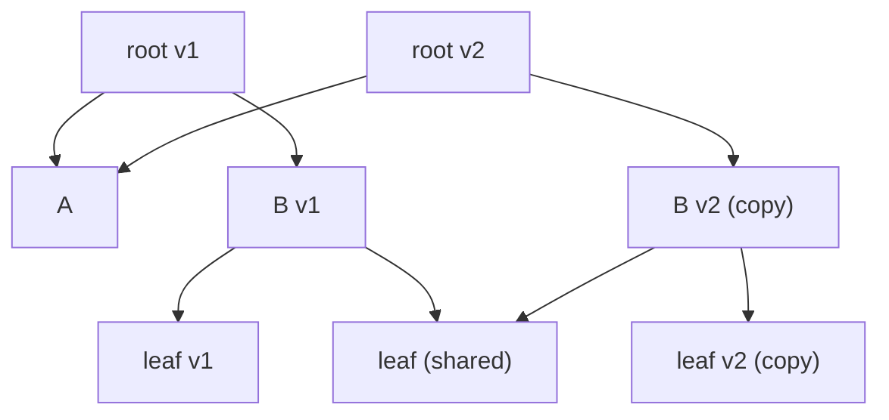
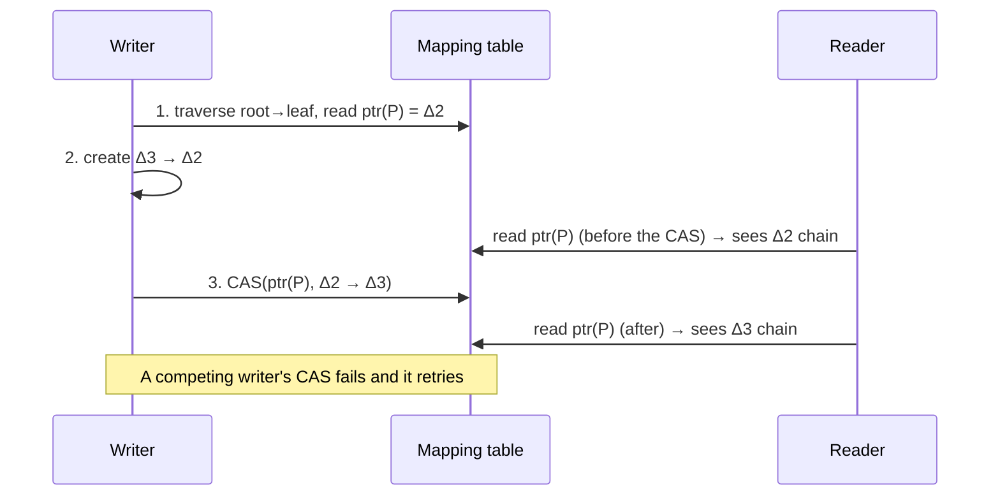

# 6. B-Tree Variants

[← 5. Transaction Processing and Recovery](05-transaction-processing-and-recovery.md) · [Book](../README.md) · [7. Log-Structured Storage →](07-log-structured-storage.md)

## Summary

Every B-Tree variant shares the tree structure, balancing through splits and merges, and the lookup and delete algorithms. They differ in concurrency, page representation, sibling links and maintenance (p. 111). The chapter covers five approaches to the original design's problems on modern hardware: **write amplification** from page rewrites, **space amplification** from reserved space, and latching complexity (pp. 111, 127).

| Variant | Idea |
|---|---|
| **Copy-on-write** (LMDB) | Immutable pages: copy the root-to-leaf path, then swap the root pointer atomically. Readers need no latches |
| **Lazy B-Trees** (WiredTiger, LA-Tree) | Buffer updates in memory per node or per subtree; reconcile later |
| **FD-Tree** | A small mutable head B-Tree plus immutable, logarithmically sized sorted runs connected by **fractional cascading** |
| **Bw-Tree** | Logical nodes made of a base node plus a chain of **delta nodes**, addressed through an in-memory **mapping table** updated with compare-and-swap; latch-free |
| **Cache-oblivious B-Tree** | **van Emde Boas layout** plus a **packed array**: asymptotically optimal for any memory hierarchy without tuning |

## Key takeaways

- **Copy-on-write trades space and CPU for simplicity.** Readers never block, nothing is ever seen half-written, and a crash can't corrupt pages because the root pointer flips only at the end (p. 112).
- **LMDB needs no page cache, WAL, checkpointing or compaction.** It serves reads straight from the memory map and keeps just two root versions (p. 113).
- **There are three ways to represent a node in memory:** raw bytes cast to structs, materialized native objects (simpler concurrency, double memory), or wrapper objects over the buffer (pp. 113–114).
- **WiredTiger keeps different formats in memory and on disk.** Updates go to skiplist update buffers, which are **reconciled** with the page on flush, and background threads do splits and merges (pp. 114–115).
- **Fractional cascading turns k binary searches into one.** Every Nth element of a lower level is pulled up as a bridge, so each later search starts near the right spot (pp. 118–119).
- **A Bw-Tree update is a CAS on the mapping table.** Concurrent readers see either the old chain or the new one; of two competing writers, one retries (pp. 121–122).
- **Bw-Tree splits and merges are multistep SMOs.** Any thread that finds one half-done must help finish it. Freed nodes are reclaimed with **epoch-based reclamation** (pp. 122–124).

## Section outline

*From the book’s own table of contents (PDF bookmarks); printed page numbers.*

- Copy-on-Write — p. 112
  - Implementing Copy-on-Write: LMDB — p. 113
- Abstracting Node Updates — p. 113
- Lazy B-Trees — p. 114
  - WiredTiger — p. 114
  - Lazy-Adaptive Tree — p. 116
- FD-Trees — p. 117
  - Fractional Cascading — p. 118
  - Logarithmic Runs — p. 119
- Bw-Trees — p. 120
  - Update Chains — p. 121
  - Taming Concurrency with Compare-and-Swap — p. 121
  - Structural Modification Operations — p. 122
  - Consolidation and Garbage Collection — p. 123
- Cache-Oblivious B-Trees — p. 124
  - van Emde Boas Layout — p. 125
- Summary — p. 127

## Notes

### Copy-on-write

Instead of complex latching, some databases **copy** a page whenever it's about to be modified, change the copy, and build a parallel tree hierarchy (p. 112). Readers keep using the old version, and writers to modified pages wait for earlier writers. When the new hierarchy is complete, the **topmost pointer is updated atomically**, and untouched pages are shared between versions (Figure 6-1) (p. 112).

*The vault's sketch of Figure 6-1: an update copies only the path from the root to the modified leaf (p. 112).*

| Pros (p. 112) | Cons (p. 112) |
|---|---|
| Readers need no synchronization; pages are immutable | Extra space (old versions, briefly) |
| Readers don't block writers | CPU time to copy whole pages |
| No operation sees an incomplete page | |
| A crash can't corrupt pages | |

B-Trees are shallow, so the simplicity often wins (p. 112).

#### Implementing copy-on-write: LMDB

The **Lightning Memory-Mapped Database**, the key-value store of the OpenLDAP project, needs no page cache, WAL, checkpointing or compaction (p. 113).

- It's a **single-level store**: reads and writes go directly through the memory map, without materialization or copying into buffers.
- An update copies every branch node on the root-to-leaf path; nodes the change doesn't reach stay intact.
- It keeps **two root versions**: the latest, and the one new changes will be committed to. Old pages are reclaimed once the reads referencing them finish.
- It has no sibling pointers, because of its append-only design, so sequential scans climb back up to the parent.
- The structure is inherently **multiversioned**, so readers run without locks (p. 113).

### Abstracting node updates

| Representation | Notes (pp. 113–114) |
|---|---|
| Raw bytes behind native pointers and casts | Unmanaged languages; points into page-cache memory or an mmap |
| **Materialized native objects** | Simpler concurrency, because raw pages are managed separately; twice the memory (raw and native copies) |
| **Wrapper objects** over the backing buffer | Common in managed languages; changes are applied to the buffer immediately |

Keeping on-disk pages, cached pages and in-memory objects separate lets them have different life cycles. For example, operations can be buffered and reconciled with the disk version during reads (p. 114).

### Lazy B-Trees

The book's own name (note 2, p. 114) for algorithms that buffer updates in lighter, concurrency-friendly in-memory structures and propagate them later (p. 114).

#### WiredTiger

MongoDB's default engine materializes nodes when they're paged in (pp. 114–115):

- A **clean page** is just an index built from the on-disk image. Updates go to an **update buffer** implemented as a **skiplist**, with search-tree complexity but better concurrency (p. 115).
- **Reads** merge the update buffer with the on-disk contents.
- On **flush**, the page goes through **reconciliation**, overwriting the original page, and is split if it's too big (p. 115).
- Clean and dirty pages both have in-memory versions referencing a base image on disk; dirty pages also have an update buffer (Figure 6-3) (p. 115).
- Page updates and structural changes run on a **background thread**, so readers and writers don't wait (p. 115).

#### Lazy-Adaptive Tree

The **LA-Tree** attaches an update buffer to each **subtree** rather than each node (p. 116). An insert goes into the root's buffer. When that buffer fills, it is emptied into the buffers one level down, recursively, until updates reach the leaves. There they're applied in one batch, so splits and merges propagate in batches too (Figure 6-4) (pp. 116–117). Both lazy designs need extra lookups in the in-memory buffers and reconciliation with stale disk data (p. 117).

### FD-Trees

Buffering avoids many small random writes: HDDs pay for head positioning, and SSDs pay extra garbage collection (p. 117). B-Tree maintenance is full of random writes, from leaf writes and splits and merges propagating to parents. An alternative is to **append** all updates and merge them later, the idea that also inspired LSM Trees (p. 117). The **Flash Disk Tree** (FD-Tree) has a small mutable **head tree**, the only place random writes happen, and several **immutable sorted runs**. When the head fills up, it is written to a run, and runs that exceed a threshold are merged into the next level (p. 118).

#### Fractional cascading

Searching a cascade of sorted arrays costs log *n* in the first array, but later searches can start from the closest match on the previous level (p. 118). Mapping every element to the next level costs too many pointers, while mapping only shared elements leaves big gaps, so **every Nth element** of a lower level is pulled up to build **bridges**, which the FD-Tree paper calls *fences* (pp. 118–119).

The book's example pulls every other element up one level (p. 118):

| Array | Before | After bridging |
|---|---|---|
| A1 | 12, 24, 32, 34, 39 | 12, 24, **25**, **30**, 32, 34, 39 |
| A2 | 22, 25, 28, 30, 35 | **16**, 22, 25, **26**, 28, 30, 35 |
| A3 | 11, 16, 24, 26, 30 | 11, 16, 24, 26, 30 |

Search binary-searches the top level, then follows bridges to the approximate position on each level below (Figure 6-5) (p. 119).

#### Logarithmic runs

Runs are immutable sorted arrays whose sizes grow by a factor of *k*. Each level is created by merging the level above with the current one (p. 119):

- When the head tree fills, its leaves become the first run. On the next fill, they're merged with that run and replace it.
- A lower run is created, or replaced by a merge, when the run above reaches its threshold. This resembles LSM compaction (Figure 6-6).
- Head elements of lower-level pages are propagated upward as pointers, so a lower-level search continues from the closest match above (pp. 119–120).
- Deletes insert **tombstones** (*filter entries*) that shadow lower-level records. They're dropped when they reach the lowest level (p. 120).

### Bw-Trees

In-place B-Trees have three problems (p. 120):

1. **Write amplification:** each update may rewrite the on-disk page.
2. **Space amplification:** space is reserved for updates, and empty bytes are transferred with useful ones.
3. **Concurrency complexity:** latches.

Buffering helps with the first two but not the third. The **Bw-Tree** ("Buzzword-Tree") batches updates in append-only storage, links nodes into chains, and installs pointers with a single **compare-and-swap**, which makes the tree **lock-free** (p. 120).

#### Update chains

A base node is written separately from its modifications. **Delta nodes** (inserts, updates, which are indistinguishable from inserts, and deletes) form a linked list from the newest delta, through older ones, to the base node (p. 121). Nothing is modified in place, so no space has to be reserved, nodes needn't be fixed-size or contiguous, and base and delta nodes can be stored contiguously even though they aren't page-aligned. The cost: a read must walk the chain and apply every delta to the base, similar to LA-Trees replaying buffered updates (p. 121).

#### Taming concurrency with compare-and-swap

Updating parents with a pointer to each new delta would be too costly, so nodes have **logical IDs**, and an in-memory **mapping table** maps them to physical locations. The table also replaces latches: writes CAS the physical pointer (Figure 6-7) (p. 121).

*The vault's diagram of the three update steps on p. 122.*

> **Try it:** [Bw-Tree delta chains](../widgets/06-bw-tree.html) — prepend deltas to logical pages through the mapping table, race two writers' CAS on the same page, watch read cost grow with chain length, and consolidate past a threshold.

#### Structural modification operations

Bw-Tree nodes still overflow and underflow, so they need **SMOs**. Their semantics match B-Tree splits and merges, but the implementation differs (p. 122).

| SMO | Steps (pp. 122–123) |
|---|---|
| **Split** | Consolidate the node and create a new page for the elements right of the split point. (1) Append a **split delta** holding the separator key and a link to the new sibling. (2) **Parent update**: add the new child to the parent. Until then the state resembles a B-link half-split |
| **Merge** | (1) Append a **remove delta** to the right sibling. (2) Append a **merge delta** to the left sibling, pointing at the right sibling's contents. (3) **Parent update**: remove the link to the right sibling |

- The parent update is only an optimization: everything stays reachable without it (p. 123).
- Because the tree is latch-free, any thread may meet an incomplete SMO and must **help finish it** before continuing (p. 123).
- Concurrent SMOs need an **abort delta** on the parent, which acts like a write lock: any thread trying to append to it aborts (p. 123).
- The tree grows when the root splits into two children under a new root (p. 123).

#### Consolidation and garbage collection

Longer chains make reads slower. Past a configurable threshold, a node is **consolidated**: base and deltas are merged into a new base, written to a new location, and the mapping table is updated. Ch. 7 covers this under LLAMA (p. 123). Old pieces can't be freed immediately because readers hold no latches, so **epoch-based reclamation** keeps nodes removed during an epoch until every reader that started in that epoch or earlier has finished (p. 124).

Benefits: lower write amplification, nonblocking access and cache friendliness. Sled, an experimental engine, implements a modified version, and CMU's in-memory **OpenBw-Tree** comes with an implementation guide (p. 124).

### Cache-oblivious B-Trees

Block size, node size and cache-line alignment all affect performance. **Cache-oblivious** structures are asymptotically optimal *without knowing* those sizes and work unmodified on different machines (p. 124). B-Trees so far assume a **two-level** model, page cache and disk, transferring whole blocks; that's **cache-aware** (pp. 124–125). Cache-oblivious algorithms are reasoned about in the two-level model but keep the number of transfers within a constant factor for any pair of adjacent levels, by working at the highest cache level as much as possible (p. 125).

#### van Emde Boas layout

A cache-oblivious B-Tree consists of a **static B-Tree** and a **packed array** (p. 125).

| Part | How (pp. 125–126) |
|---|---|
| Static tree, **van Emde Boas layout** | Split the tree at the middle level of its edges, then split each subtree recursively, giving subtrees of size √N. Every recursive subtree is stored in one contiguous block (Figure 6-8) |
| **Packed array** | Contiguous segments with gaps reserved for inserts, spaced by a density threshold. Items move only to open a gap. The array is rebuilt when too dense or too sparse (Figure 6-9) |

The static tree indexes the packed array and must be updated when elements move (p. 126). The author knew of no nonacademic implementation. Possible reasons: paging and eviction still hurt when caching is abstracted away, and in block transfers the complexity equals the cache-aware tree's. That may change with byte-addressable nonvolatile memory (p. 126).

### Summary

The original B-Tree suited spinning disks but is less efficient on SSDs, with high write amplification and space overhead (p. 127):

- **Lazy B-Trees** buffer updates to reduce write amplification.
- **FD-Trees** use immutable runs and limit the mutable part to reduce space amplification.
- **Bw-Trees** store nodes and deltas immutably in a log-structured store, reconcile rarely, and need no latches, because the virtual pointers live in memory (p. 127).

## Trade-offs at a glance

| | Write amplification | Space amplification | Concurrency | Read cost |
|---|---|---|---|---|
| Classic in-place B-Tree | High (page rewrites) | Reserved space | Latches | One page per level |
| Copy-on-write | Path copy per write | Old versions briefly | Readers lock-free | One page per level |
| Lazy B-Tree | Lower (batched) | Same as B-Tree | Background SMOs | Merge buffer + page |
| FD-Tree | Low (appends, merges) | Low (immutable runs) | — | Search head + runs via bridges |
| Bw-Tree | Low (deltas) | None reserved | Latch-free CAS | Walk the delta chain |

## Beyond the book

- **Copy-on-write file systems** (ZFS, Btrfs) use the same root-pointer flip as LMDB for crash consistency. The "uberblock" (ZFS) or superblock is the atomic switch, and old roots double as cheap snapshots.
- **Epoch-based reclamation** is a general lock-free memory technique, used for example in the Rust `crossbeam-epoch` crate, which Sled built on. It solves the same problem as hazard pointers with less per-read overhead.
- The **B^ε-tree** (used in TokuDB and PerconaFT) generalizes the LA-Tree's per-subtree buffers: each internal node reserves part of its space for a message buffer, trading a little read cost for much cheaper writes.

## Connections

- **Related chapters:** [4. Implementing B-Trees](04-implementing-b-trees.md) (overflow pages, rebalancing), [5. Transaction Processing and Recovery](05-transaction-processing-and-recovery.md) (latches, B-link half-splits, MVCC), [7. Log-Structured Storage](07-log-structured-storage.md) (LSM Trees, LLAMA and mindful stacking underneath Bw-Trees).

## Check yourself

*Questions and answers are the vault's, written from the notes above; answers cite the book's pages.*

1. **Why can't a crash leave a copy-on-write B-Tree corrupted?**

   *Answer:* All modifications go to copies, and the topmost pointer is switched only after every page has been written (p. 112).

2. **Which components does LMDB *not* need, and why?**

   *Answer:* A page cache, a WAL, checkpointing and compaction. It's a single-level, copy-on-write store served directly from the memory map, keeping two root versions (p. 113).

3. **How does a WiredTiger read return the latest data for a dirty page?**

   *Answer:* It merges the page's skiplist update buffer with the on-disk page contents (p. 115).

4. **What problem does fractional cascading solve in an FD-Tree?**
   - [ ] Write amplification in the head tree
   - [x] The cost of searching several sorted runs one after another
   - [ ] Tombstone garbage collection

   *Answer:* Bridges pulled up from lower levels let each subsequent search start near the right position instead of doing a full binary search (pp. 118–119).

5. **Two threads try to prepend a delta to the same Bw-Tree node at once. What happens?**

   *Answer:* Both CAS the mapping table entry. Exactly one succeeds; the other's CAS fails and it retries. Readers are ordered before or after the swap without blocking (p. 122).

6. **Why must a Bw-Tree thread that finds a half-finished split complete it?**

   *Answer:* The tree is latch-free, so no thread owns the SMO. Cooperative completion keeps the structure progressing, and later threads can then use the parent pointer directly (p. 123).

7. **When may the memory of a consolidated Bw-Tree node be freed?**

   *Answer:* Under epoch-based reclamation: once every reader that started during the same epoch or earlier has finished, because later readers couldn't have reached it (p. 124).
