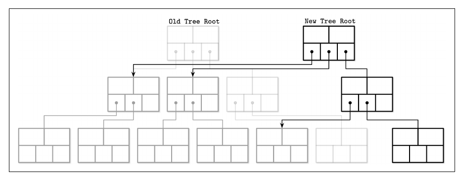
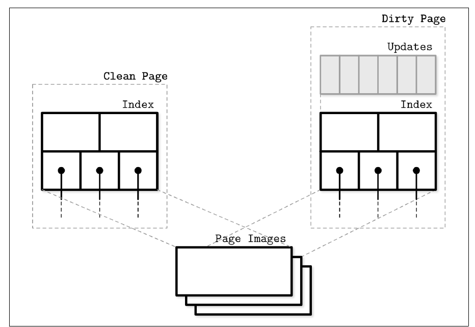
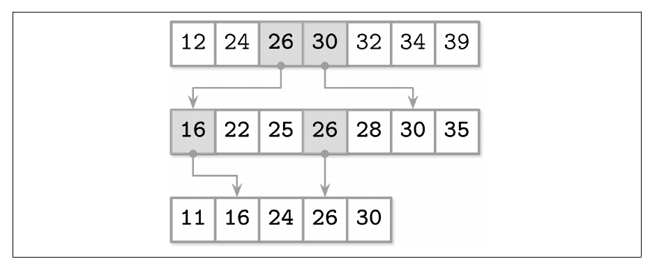
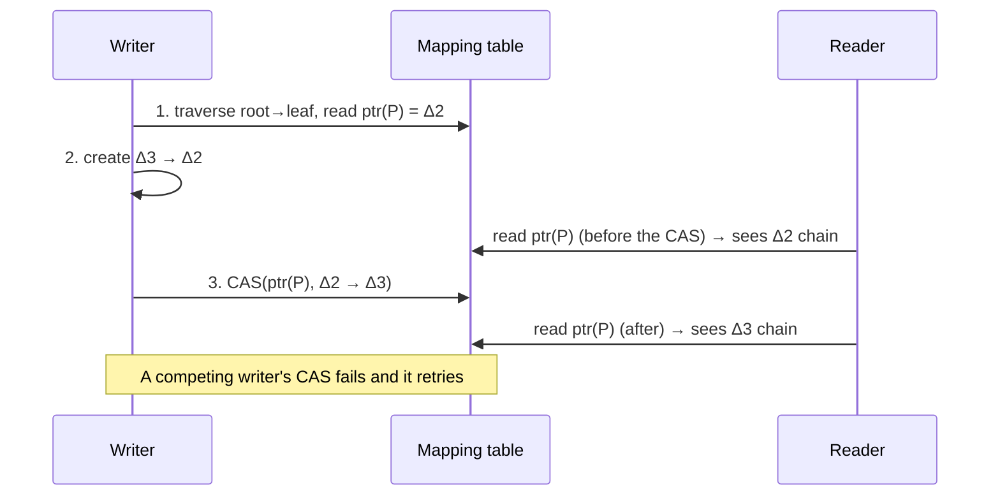

# فصل ۶: گونه‌های B-Tree

[فصل ۵: پردازش تراکنش و بازیابی →](05-transaction-processing-and-recovery.md) · [کتاب](../README.md) · [فصل ۷: ذخیره‌سازی log-structured ←](07-log-structured-storage.md)

## خلاصه

هر گونه‌ای از B-Tree ساختار درخت و متوازن شدن با شکستن و merge و الگوریتم‌های جست‌و‌جو و حذف را مشترک دارد. در concurrency و نمایش صفحه و پیوند sibling و نگهداشت فرق دارند (p. 111). فصل پنج رویکرد به مسئله‌های طرح اصلی روی سخت‌افزار امروزی را می‌پوشاند: **تقویت نوشتن** از نوشتن دوباره‌ی صفحه، **تقویت فضا** از فضای نگه‌داشته، و پیچیدگی latch (pp. 111, 127).

| گونه | ایده |
|---|---|
| **copy-on-write** که LMDB است | صفحه‌های immutable: مسیر ریشه‌تا‌برگ را کپی کن، بعد اشاره‌گر ریشه را اتمی عوض. خواننده‌ها latch لازم ندارند |
| **B-Treeهای تنبل** که WiredTiger و LA-Tree هستند | به‌روزرسانی‌ها را در حافظه برای هر نودی یا هر زیردرختی buffer کن؛ بعدتر آشتی بده |
| **FD-Tree** | B-Treeی سری کوچک و mutable به‌علاوه‌ی دورهای مرتب و immutable با اندازه‌های لگاریتمی که با **آبشار کسری** به هم وصل‌اند |
| **Bw-Tree** | نودهای منطقی که از نودی پایه به‌علاوه‌ی زنجیره‌ای از **نود دلتا** ساخته شده‌اند، و از راه **جدول mapping** in-memoryی نشانی می‌شوند که با compare-and-swap به‌روز می‌شود؛ بی‌latch |
| **B-Tree غافل از cache** | **چیدمان فان امده بواس** به‌علاوه‌ی **آرایه‌ی بسته‌بندی‌شده**: مجانب بهینه برای هر سلسله‌مراتب حافظه‌ای، بی تنظیم |

## نکته‌های کلیدی

- **الگوریتم copy-on-write فضا و CPU را با سادگی بده‌بستان می‌کند.** خواننده‌ها هیچ‌وقت بند نمی‌آیند، هیچ چیزی نیمه‌نوشته دیده نمی‌شود، و از کار افتادنی نمی‌تواند صفحه‌ها را خراب کند چون اشاره‌گر ریشه تنها در پایان برمی‌گردد (p. 112).
- **سیستم LMDB نه page cache لازم دارد و نه WAL و نه checkpoint و نه compaction.** خواندن‌ها را یک‌راست از mapping حافظه سرویس می‌دهد و تنها دو نسخه‌ی ریشه نگه می‌دارد (p. 113).
- **سه راه برای نمایش نودی در حافظه هست:** بایت خام که به structها cast می‌شود، objectهای بومی و مادی‌شده، که concurrencyاش ساده‌تر است و حافظه‌اش دو برابر، یا objectهای پوششی روی buffer (pp. 113–114).
- **سیستم WiredTiger قالب‌های مختلفی در حافظه و روی دیسک نگه می‌دارد.** به‌روزرسانی‌ها به bufferهای به‌روزرسانی از جنس skiplist می‌روند، که سر flush با صفحه **آشتی** می‌شوند، و threadهای پس‌زمینه شکستن و merge می‌کنند (pp. 114–115).
- **آبشار کسری k جست‌و‌جوی دوگانی را به یکی تبدیل می‌کند.** هر عنصر Nام سطح پایین‌تری به‌شکل پل بالا کشیده می‌شود، پس هر جست‌و‌جوی بعدی نزدیک جای درست شروع می‌کند (pp. 118–119).
- **به‌روزرسانی Bw-Tree یک CAS روی جدول mapping است.** خواننده‌های هم‌زمان یا زنجیره‌ی قدیم را می‌بینند یا تازه را؛ و از دو نویسنده‌ی رقیب، یکی دوباره می‌کوشد (pp. 121–122).
- **شکستن و merge در Bw-Tree همان SMOهای چند‌قدمی‌اند.** هر threadی که یکی‌شان را نیمه‌کاره ببیند باید به تمام شدنش کمک کند. نودهای آزادشده با **بازپس‌گیری دوره‌محور** بازپس گرفته می‌شوند (pp. 122–124).

## فهرست بخش‌ها

*از فهرست مطالب خود کتاب، از bookmarkهای PDF؛ شماره‌ها صفحه‌ی چاپی‌اند.*

- بخش copy-on-write — ص. ۱۱۲
  - پیاده کردن copy-on-write: سیستم LMDB — ص. ۱۱۳
- انتزاعی کردن به‌روزرسانی نود — ص. ۱۱۳
- بخش B-Treeهای تنبل — ص. ۱۱۴
  - سیستم WiredTiger — ص. ۱۱۴
  - درخت تنبل‌وفق‌پذیر — ص. ۱۱۶
- بخش FD-Tree — ص. ۱۱۷
  - آبشار کسری — ص. ۱۱۸
  - دورهای لگاریتمی — ص. ۱۱۹
- بخش Bw-Tree — ص. ۱۲۰
  - زنجیره‌ی به‌روزرسانی — ص. ۱۲۱
  - رام کردن concurrency با compare-and-swap — ص. ۱۲۱
  - عملیات تغییر ساختاری — ص. ۱۲۲
  - بخش merge و garbage collectorی — ص. ۱۲۳
- بخش B-Treeهای غافل از cache — ص. ۱۲۴
  - چیدمان فان امده بواس — ص. ۱۲۵
- خلاصه — ص. ۱۲۷

## یادداشت‌ها

### copy-on-write

برخی دیتابیس‌ها به‌جای latch‌گذاری پیچیده، هر صفحه‌ای را که قرار است عوض شود **کپی** می‌کنند، کپی را عوض می‌کنند، و سلسله‌مراتبی موازی از درخت می‌سازند (p. 112). خواننده‌ها همین‌طور نسخه‌ی قدیم را به کار می‌برند، و نویسنده‌های صفحه‌های عوض‌شده منتظر نویسنده‌های پیشین می‌مانند. وقتی سلسله‌مراتب تازه کامل شود، **بالاترین اشاره‌گر اتمی به‌روز می‌شود**، و صفحه‌های دست‌نخورده میان نسخه‌ها مشترک‌اند (شکل ۶-۱) (p. 112).

*Figure 6-1 (p. 112): به‌روزرسانی تنها مسیر ریشه تا برگ عوض‌شده را کپی می‌کند؛ ریشه‌ی تازه برای هر چیز دست‌نخورده‌ای به درخت قدیم پس اشاره می‌کند.*

| خوبی‌ها (p. 112) | بدی‌ها (p. 112) |
|---|---|
| خواننده‌ها synchronization لازم ندارند؛ صفحه‌ها تغییرناپذیرند | فضای اضافه، یعنی نسخه‌های قدیم، کوتاه‌مدت |
| خواننده‌ها نویسنده‌ها را بند نمی‌آورند | زمان CPU برای کپی کردن کل صفحه‌ها |
| هیچ عملیاتی صفحه‌ای ناتمام نمی‌بیند | |
| از کار افتادنی نمی‌تواند صفحه‌ها را خراب کند | |

همه‌ی B-Treeها کم‌عمق‌اند، پس اغلب سادگی می‌برد (p. 112).

#### پیاده کردن copy-on-write: سیستم LMDB

**سیستم Lightning Memory-Mapped Database**، که انباره‌ی key-value پروژه‌ی OpenLDAP است، نه page cache لازم دارد و نه WAL و نه checkpoint و نه compaction (p. 113).

- انباره‌ای **تک‌سطحی** است: خواندن و نوشتن یک‌راست از راه mapping حافظه می‌روند، بی مادی‌سازی یا کپی در bufferها.
- به‌روزرسانی هر نود شاخه‌ای را روی مسیر ریشه‌تا‌برگ کپی می‌کند؛ نودهایی که تغییر به‌شان نمی‌رسد دست‌نخورده می‌مانند.
- **دو نسخه‌ی ریشه** نگه می‌دارد: تازه‌ترین، و آن یکی که تغییرهای تازه به آن commit می‌شوند. صفحه‌های قدیم همین که خواندن‌هایی که به‌شان ارجاع می‌دهند تمام شوند بازپس گرفته می‌شوند.
- اشاره‌گر sibling ندارد، به‌خاطر طرح append-only‌اش، پس اسکن ترتیبی به پدر بالا می‌رود.
- ساختار ذاتاً **چند‌نسخه‌ای** است، پس خواننده‌ها بی قفل اجرا می‌شوند (p. 113).

> **In practice:** partهای MergeTree هم copy-on-write‌اند: هیچ partی سر جایش عوض نمی‌شود و هر تغییر part تازه‌ای می‌نویسد.
>
> **Your turn:** چرا `ALTER TABLE … UPDATE` برای چند ردیف در ClickHouse می‌تواند گیگابایت‌ها بنویسد؟
>
> *Answer:* چون partها immutable‌اند، mutation ستون‌های عوض‌شده‌ی همه‌ی partهایی را که آن ردیف‌ها را دارند از نو می‌نویسد، نه فقط ردیف‌ها را. این هزینه‌ی copy-on-write است: خواننده‌ها هیچ‌وقت بند نمی‌آیند، ولی نوشتن کپی می‌کند (pp. 112–113).

### انتزاعی کردن به‌روزرسانی نود

| نمایش | یادداشت (pp. 113–114) |
|---|---|
| بایت خام پشت اشاره‌گرهای بومی و castها | زبان‌های نامدیریت‌شده؛ به حافظه‌ی page cache یا mmapی اشاره می‌کند |
| **objectهای بومی مادی‌شده** | concurrency ساده‌تر، چون صفحه‌های خام جدا گردانده می‌شوند؛ دو برابر حافظه، یعنی کپی خام و بومی |
| **objectهای پوششی** روی buffer پشتیبان | در زبان‌های مدیریت‌شده رایج است؛ تغییرها فوری روی buffer اعمال می‌شوند |

جدا نگه داشتن صفحه‌های دیسکی و صفحه‌های cache‌شده و objectهای in-memoryی می‌گذارد چرخه‌ی زندگی مختلفی داشته باشند. مثلاً عملیات buffer‌شدنی‌اند و در خواندن با نسخه‌ی دیسکی آشتی‌شدنی (p. 114).

### درخت‌های B-Tree تنبل

نام خود کتاب، یادداشت ۲، ص. ۱۱۴، برای الگوریتم‌هایی که به‌روزرسانی‌ها را در ساختارهای in-memoryی سبک‌تر و concurrency‌دوست buffer می‌کنند و بعدتر پخششان (p. 114).

#### سیستم WiredTiger

موتور پیش‌فرض MongoDB نودها را وقتی page in شوند مادی می‌کند (pp. 114–115):

- **صفحه‌ی تمیز** تنها indexی است که از تصویر دیسکی ساخته شده. به‌روزرسانی‌ها به یک **buffer به‌روزرسانی** می‌روند که به‌شکل **skiplist** پیاده شده، با پیچیدگی درخت جست‌و‌جو ولی concurrency بهتر (p. 115).
- **خواندن**ها buffer به‌روزرسانی را با محتوای دیسکی merge می‌کنند.
- سر **flush**، صفحه از **آشتی‌دهی** می‌گذرد، که روی صفحه‌ی اصلی می‌نویسد، و اگر زیادی بزرگ باشد شکسته می‌شود (p. 115).
- صفحه‌های تمیز و کثیف هر دو نسخه‌ی in-memoryی دارند که به تصویری پایه روی دیسک ارجاع می‌دهد؛ و صفحه‌های کثیف buffer به‌روزرسانی هم دارند (شکل ۶-۳) (p. 115).

*Figure 6-3 (p. 116): صفحه‌ی کثیف تغییرهایش را در buffer به‌روزرسانی جدایی روی همان تصویر دیسکی نگه می‌دارد.*

- به‌روزرسانی صفحه و تغییرهای ساختاری روی **thread پس‌زمینه** اجرا می‌شوند، پس خواننده‌ها و نویسنده‌ها منتظر نمی‌مانند (p. 115).

#### درخت تنبل‌وفق‌پذیر

**ساختار LA-Tree** به‌جای هر نودی به هر **زیردرخت**ی buffer به‌روزرسانی می‌چسباند (p. 116). درجی به buffer ریشه می‌رود. وقتی آن buffer پر شود، در bufferهای یک سطح پایین‌تر خالی می‌شود، و بازگشتی، تا به‌روزرسانی‌ها به برگ‌ها برسند. آن‌جا در یک دسته اعمال می‌شوند، پس شکستن و merge هم دسته‌دسته پخش می‌شوند (شکل ۶-۴) (pp. 116–117). هر دو طرح تنبل جست‌و‌جوی اضافه در bufferهای in-memoryی و آشتی با داده‌ی کهنه‌ی دیسکی لازم دارند (p. 117).

> **In practice:** async insert در ClickHouse همان ایده‌ی buffer کردن به‌روزرسانی‌هاست: نوشتن‌های کوچک در حافظه جمع می‌شوند تا درشت‌تر روی دیسک بروند.
>
> **Your turn:** async insert را با `wait_for_async_insert=0` روشن کرده‌اید و loader بلافاصله بعد از insert شمار ردیف را چک می‌کند و کمتر می‌بیند. چرا؟
>
> *Answer:* داده هنوز در buffer است و flush نشده؛ مثل درخت تنبل، به‌روزرسانی‌ها جمع می‌شوند تا ارزان‌تر نوشته شوند، و خواندنی که buffer را نبیند داده‌ی تازه را نمی‌بیند. یا منتظر تأیید بمانید یا چک را بعد از flush بگذارید (pp. 114–117).

### FD-Tree

ساختار buffer کردن از خیلی نوشتن‌های کوچک و تصادفی می‌پرهیزد: HDDها بهای جای‌دهی هد را می‌دهند، و SSDها garbage collectorی اضافه (p. 117). نگهداشت B-Tree پر از نوشتن تصادفی است، از نوشتن برگ و شکستن و mergeی که به پدرها پخش می‌شود. جایگزینی این است که همه‌ی به‌روزرسانی‌ها **افزوده** شوند و بعدتر merge، همان ایده‌ای که به LSM Treeها هم الهام داد (p. 117). **Flash Disk Tree** که FD-Tree است یک **درخت سر** کوچک و mutable دارد، که تنها جایی است که نوشتن تصادفی رخ می‌دهد، و چند **دور مرتب immutable**. وقتی سر پر شود، در دوری نوشته می‌شود، و دورهایی که از آستانه‌ای بزنند در سطح بعدی merge می‌شوند (p. 118).

#### آبشار کسری

جست‌و‌جوی آبشاری از آرایه‌های مرتب در آرایه‌ی اول log *n* خرج دارد، ولی جست‌و‌جوهای بعدی می‌توانند از نزدیک‌ترین خوردنی سطح پیشین شروع کنند (p. 118). mapping هر عنصری به سطح بعد اشاره‌گر زیادی خرج دارد، در حالی که mapping تنها عنصرهای مشترک شکاف‌های بزرگی می‌گذارد، پس **هر عنصر Nام** سطح پایین‌تری بالا کشیده می‌شود تا **پل** ساخته شود، که مقاله‌ی FD-Tree اسمشان را *fence* می‌گذارد (pp. 118–119).

نمونه‌ی کتاب هر عنصر دومی را یک سطح بالا می‌کشد (p. 118):

| آرایه | پیش | پس از پل زدن |
|---|---|---|
| A1 | ۱۲، ۲۴، ۳۲، ۳۴، ۳۹ | ۱۲، ۲۴، **۲۵**، **۳۰**، ۳۲، ۳۴، ۳۹ |
| A2 | ۲۲، ۲۵، ۲۸، ۳۰، ۳۵ | **۱۶**، ۲۲، ۲۵، **۲۶**، ۲۸، ۳۰، ۳۵ |
| A3 | ۱۱، ۱۶، ۲۴، ۲۶، ۳۰ | ۱۱، ۱۶، ۲۴، ۲۶، ۳۰ |

جست‌و‌جو سطح بالا را دوگانی می‌جوید، بعد پل‌ها را تا جای تقریبی در هر سطح پایین‌تری پی می‌گیرد (شکل ۶-۵) (p. 119).

*Figure 6-5 (p. 119): پل‌های سایه‌خورده عنصرهایی‌اند که با سطح پایین‌تر مشترک‌اند؛ پی گرفتنشان از جست‌و‌جوی دوگانی تازه در هر سطحی می‌پرد.*

#### دورهای لگاریتمی

دورها آرایه‌های مرتب تغییرناپذیرند که اندازه‌شان با ضریب *k* رشد می‌کند. هر سطحی با merge کردن سطح بالا با سطح جاری ساخته می‌شود (p. 119):

- وقتی درخت سر پر شود، برگ‌هایش دور اول می‌شوند. سر پر شدن بعدی، با آن دور merge می‌شوند و جایش را می‌گیرند.
- دوری پایین‌تر وقتی ساخته می‌شود، یا با mergeی جایش عوض، که دور بالایی به آستانه‌اش برسد. این به compaction مربوط به LSM می‌ماند (شکل ۶-۶).
- عنصرهای سر صفحه‌های سطح پایین‌تر به‌شکل اشاره‌گر رو‌به‌بالا پخش می‌شوند، پس جست‌و‌جوی سطح پایین‌تر از نزدیک‌ترین خوردنی بالا ادامه می‌دهد (pp. 119–120).
- حذف‌ها **tombstone** درج می‌کنند، که *entry فیلتر* نامیده می‌شوند و روی رکوردهای سطح پایین‌تر سایه می‌اندازند. وقتی به پایین‌ترین سطح برسند انداخته می‌شوند (p. 120).

### Bw-Tree

همه‌ی B-Treeهای سر‌جا سه مسئله دارند (p. 120):

۱. **تقویت نوشتن:** هر به‌روزرسانی‌ای می‌تواند صفحه‌ی دیسکی را دوباره بنویسد.
۲. **تقویت فضا:** فضایی برای به‌روزرسانی نگه داشته می‌شود، و بایت‌های خالی با بایت‌های به‌درد‌بخور منتقل می‌شوند.
۳. **پیچیدگی concurrency:** latchها.

ساختار buffer کردن به دو تای اول کمک می‌کند ولی به سومی نه. **Bw-Tree**، یعنی «Buzzword-Tree»، به‌روزرسانی‌ها را در ذخیره‌سازی append-only دسته می‌کند، نودها را در زنجیره پیوند می‌دهد، و اشاره‌گرها را با یک **compare-and-swap** تنها نصب، که درخت را **بی‌قفل** می‌کند (p. 120).

#### زنجیره‌ی به‌روزرسانی

نودی پایه جدا از تغییرهایش نوشته می‌شود. **نودهای دلتا**، یعنی درج و به‌روزرسانی که از درج تشخیص‌ناپذیر است و حذف، فهرستی پیوندی از تازه‌ترین دلتا، از راه قدیمی‌ترها، تا نود پایه می‌سازند (p. 121). هیچ چیزی سر جا عوض نمی‌شود، پس لازم نیست فضایی نگه داشته شود، نودها لازم نیست fixed-size یا پیوسته باشند، و نودهای پایه و دلتا پیوسته ذخیره‌شدنی‌اند هرچند صفحه‌هم‌تراز نیستند. هزینه‌اش: خواندنی باید روی زنجیره راه برود و هر دلتایی را روی پایه اعمال کند، شبیه replay به‌روزرسانی‌های buffer‌شده در LA-Treeها (p. 121).

#### رام کردن concurrency با compare-and-swap

به‌روز کردن پدرها با اشاره‌گری به هر دلتای تازه زیادی گران می‌بود، پس نودها **ID منطقی** دارند، و **جدول mapping**ی in-memoryی آن‌ها را به جاهای فیزیکی map می‌کند. آن جدول جای latchها را هم می‌گیرد: نوشتن‌ها اشاره‌گر فیزیکی را CAS می‌کنند (شکل ۶-۷) (p. 121).

*نمودار vault از آن سه قدم به‌روزرسانی در ص. ۱۲۲.*

> **Try it:** [زنجیره‌های دلتای Bw-Tree](../widgets/06-bw-tree.html)؛ از راه جدول mapping به صفحه‌های منطقی دلتا پیش‌بیفزایید، CAS دو نویسنده را روی همان صفحه مسابقه بدهید، ببینید هزینه‌ی خواندن با طول زنجیره رشد می‌کند، و از آستانه‌ای رد شوید تا merge شود.

#### عملیات تغییر ساختاری

نودهای Bw-Tree باز هم سرریز و underflow می‌کنند، پس **SMO** لازم دارند. معناشناسی‌شان با شکستن و merge در B-Tree می‌خواند، ولی پیاده‌سازی فرق دارد (p. 122).

| SMO | قدم‌ها (pp. 122–123) |
|---|---|
| **شکستن** | نود را merge کن و صفحه‌ای تازه برای عنصرهای راست نقطه‌ی شکست بساز. (۱) یک **دلتای شکست** بیفزا که کلید جداکننده و پیوندی به sibling تازه را دارد. (۲) **به‌روزرسانی پدر**: فرزند تازه را به پدر بیفزا. تا آن وقت حالت به نیم‌شکست B-link می‌ماند |
| **merge** | (۱) یک **دلتای برداشتن** به sibling راست بیفزا. (۲) یک **دلتای merge** به sibling چپ بیفزا، که به محتوای sibling راست اشاره می‌کند. (۳) **به‌روزرسانی پدر**: پیوند به sibling راست را بردار |

- به‌روزرسانی پدر تنها بهینه‌سازی است: بی آن هم همه چیز دست‌یافتنی می‌ماند (p. 123).
- چون درخت بی‌latch است، هر threadی می‌تواند با SMOی ناتمام روبه‌رو شود و باید پیش از ادامه **به تمام شدنش کمک کند** (p. 123).
- همه‌ی SMOهای هم‌زمان یک **دلتای abort** روی پدر لازم دارند، که مثل قفل نوشتن عمل می‌کند: هر threadی که بکوشد به آن بیفزاید abort می‌شود (p. 123).
- درخت وقتی رشد می‌کند که ریشه به دو فرزند زیر ریشه‌ای تازه بشکند (p. 123).

#### عمل merge و garbage collection

زنجیره‌های بلندتر خواندن را کندتر می‌کنند. از آستانه‌ای تنظیم‌پذیر که بگذرد، نودی **merge** می‌شود: پایه و دلتاها در پایه‌ای تازه merge می‌شوند، در جایی تازه نوشته، و جدول mapping به‌روز. فصل ۷ این را زیر LLAMA می‌پوشاند (p. 123). تکه‌های قدیم فوری آزاد‌شدنی نیستند چون خواننده‌ها latchی ندارند، پس **بازپس‌گیری دوره‌محور** نودهایی را که در دوره‌ای برداشته شده‌اند نگه می‌دارد تا هر خواننده‌ای که در آن دوره یا پیش‌تر شروع کرده تمام کند (p. 124).

سودها: تقویت نوشتن کم‌تر، دسترسی بی‌بند‌آمدن و cache‌دوستی. موتور آزمایشی Sled گونه‌ای تغییریافته را پیاده می‌کند، و **OpenBw-Tree** in-memoryی از CMU با راهنمای پیاده‌سازی می‌آید (p. 124).

### درخت‌های B-Tree غافل از cache

اندازه‌ی بلوک و اندازه‌ی نود و هم‌ترازی خط cache همه روی کارایی اثر می‌گذارند. ساختارهای **غافل از cache** مجانب بهینه‌اند *بی دانستن* آن اندازه‌ها و روی ماشین‌های مختلف بی تغییر کار می‌کنند (p. 124). B-Treeها تا این‌جا مدلی **دو‌سطحی** را فرض می‌گیرند، یعنی page cache و دیسک، که کل بلوک‌ها را منتقل می‌کند؛ این **cache‌آگاه** است (pp. 124–125). درباره‌ی الگوریتم‌های غافل از cache در همان مدل دو‌سطحی استدلال می‌شود ولی شمار انتقال‌ها را برای هر زوج سطح مجاوری درون ضریبی ثابت نگه می‌دارند، با کار کردن تا جای ممکن در بالاترین سطح cache (p. 125).

#### چیدمان فان امده بواس

یک B-Tree غافل از cache از یک **درخت ایستای B-Tree** و یک **آرایه‌ی بسته‌بندی‌شده** ساخته شده (p. 125).

| بخش | چطور (pp. 125–126) |
|---|---|
| درخت ایستا، با **چیدمان فان امده بواس** | درخت را در سطح میانی یال‌هایش بشکن، بعد هر زیردرختی را بازگشتی، که زیردرخت‌هایی به اندازه‌ی √N می‌دهد. هر زیردرخت بازگشتی در یک بلوک پیوسته ذخیره می‌شود (شکل ۶-۸) |
| **آرایه‌ی بسته‌بندی‌شده** | قطعه‌های پیوسته با شکاف‌هایی که برای درج نگه داشته شده‌اند، با فاصله‌ای که آستانه‌ی چگالی می‌دهد. قلم‌ها تنها برای باز کردن شکافی جابه‌جا می‌شوند. آرایه وقتی زیادی چگال یا زیادی تنک باشد دوباره ساخته می‌شود (شکل ۶-۹) |

درخت ایستا آرایه‌ی بسته‌بندی‌شده را index می‌کند و وقتی عنصرها جابه‌جا شوند باید به‌روز شود (p. 126). نویسنده از هیچ پیاده‌سازی ناـدانشگاهی‌ای خبر نداشت. دلیل‌های ممکن: صفحه‌بندی و بیرون انداختن وقتی cache انتزاعی شود باز هم صدمه می‌زنند، و در انتقال بلوک پیچیدگی با درخت cache‌آگاه برابر است. شاید با حافظه‌ی ناپایای بایت‌نشانی عوض شود (p. 126).

### خلاصه

ساختار B-Tree اصلی به دیسک‌های گردان می‌خورد ولی روی SSDها کم‌کاراتر است، با تقویت نوشتن بالا و سرریز فضا (p. 127):

- **درخت‌های B-Tree تنبل** به‌روزرسانی‌ها را buffer می‌کنند تا تقویت نوشتن کم شود.
- **ساختار FD-Tree**ها دورهای immutable به کار می‌برند و بخش mutable را حد می‌زنند تا تقویت فضا کم شود.
- **ساختار Bw-Tree**ها نودها و دلتاها را immutable در انباره‌ای log-structured ذخیره می‌کنند، کم آشتی می‌دهند، و latch لازم ندارند، چون اشاره‌گرهای مجازی در حافظه زندگی می‌کنند (p. 127).

## بده‌بستان‌ها در یک نگاه

| | تقویت نوشتن | تقویت فضا | concurrency | هزینه‌ی خواندن |
|---|---|---|---|---|
| B-Tree کلاسیک و سر‌جا | بالا، از نوشتن دوباره‌ی صفحه | فضای نگه‌داشته | latch | یک صفحه برای هر سطحی |
| copy-on-write | کپی مسیر برای هر نوشتنی | نسخه‌های قدیم کوتاه‌مدت | خواننده‌ها بی‌قفل | یک صفحه برای هر سطحی |
| B-Tree تنبل | کم‌تر، چون دسته‌ای | مثل B-Tree | SMOهای پس‌زمینه | merge کردن buffer و صفحه |
| FD-Tree | کم، از افزودن و merge | کم، از دورهای immutable | — | جست‌و‌جوی سر و دورها از راه پل‌ها |
| Bw-Tree | کم، از دلتاها | چیزی نگه داشته نمی‌شود | CAS بی‌latch | راه رفتن روی زنجیره‌ی دلتا |

## فراتر از کتاب

- **فایل‌سیستم‌های copy-on-write** مثل ZFS و Btrfs همان برگرداندن اشاره‌گر ریشه‌ی LMDB را برای consistency در از کار افتادن به کار می‌برند. «uberblock» در ZFS یا superblock همان کلید اتمی است، و ریشه‌های قدیم snapshotهای ارزانی هم می‌شوند.
- **بازپس‌گیری دوره‌محور** تکنیکی کلی برای حافظه‌ی بی‌قفل است، که مثلاً در crate به نام `crossbeam-epoch` در Rust به کار می‌رود، که Sled رویش بنا شد. همان مسئله‌ی اشاره‌گرهای خطر را با سرریز کم‌تر برای هر خواندنی حل می‌کند.
- **ساختار B^ε-tree**، که TokuDB و PerconaFT به کارش می‌برند، bufferهای به‌تفکیک زیردرخت LA-Tree را تعمیم می‌دهد: هر نود درونی بخشی از فضایش را برای bufferی از پیام نگه می‌دارد، و کمی هزینه‌ی خواندن را با نوشتن خیلی ارزان‌تر بده‌بستان می‌کند.

## پیوندها

- **فصل‌های مرتبط:** [فصل ۴: پیاده کردن B-Tree](04-implementing-b-trees.md) که صفحه‌ی سرریز و متوازن کردن دوباره را دارد، [فصل ۵: پردازش تراکنش و بازیابی](05-transaction-processing-and-recovery.md) که latch و نیم‌شکست B-link و MVCC را دارد، و [فصل ۷: ذخیره‌سازی log-structured](07-log-structured-storage.md) که LSM Tree و LLAMA و چیدن هشیارانه زیر Bw-Treeها را دارد.

## خودتان را بسنجید

*پرسش‌ها و پاسخ‌ها مال vault است و از روی یادداشت‌های بالا نوشته شده؛ پاسخ‌ها به صفحه‌های کتاب ارجاع می‌دهند.*

1. **چرا از کار افتادنی نمی‌تواند B-Treeی copy-on-write را خراب بگذارد؟**

   *Answer:* همه‌ی تغییرها به کپی‌ها می‌روند، و بالاترین اشاره‌گر تنها پس از نوشته شدن هر صفحه‌ای عوض می‌شود (p. 112).

2. **سیستم LMDB کدام مؤلفه‌ها را لازم *ندارد*، و چرا؟**

   *Answer:* نه page cache و نه WAL و نه checkpoint و نه compaction. انباره‌ای تک‌سطحی و copy-on-write است که یک‌راست از mapping حافظه سرویس می‌دهد و دو نسخه‌ی ریشه نگه می‌دارد (p. 113).

3. **خواندنی در WiredTiger چطور تازه‌ترین داده‌ی صفحه‌ای کثیف را برمی‌گرداند؟**

   *Answer:* buffer به‌روزرسانی از جنس skiplist آن صفحه را با محتوای دیسکی صفحه merge می‌کند (p. 115).

4. **آبشار کسری در FD-Tree چه مسئله‌ای را حل می‌کند؟**
   - [ ] تقویت نوشتن در درخت سر
   - [x] هزینه‌ی جست‌و‌جوی چند دور مرتب پشت‌سر‌هم
   - [ ] پاک‌سازی tombstoneها با garbage collector

   *Answer:* پل‌هایی که از سطح‌های پایین‌تر بالا کشیده شده‌اند می‌گذارند هر جست‌و‌جوی بعدی به‌جای جست‌و‌جوی دوگانی کامل نزدیک جای درست شروع کند (pp. 118–119).

5. **دو thread هم‌زمان می‌کوشند به همان نود Bw-Tree دلتایی پیش‌بیفزایند. چه می‌شود؟**

   *Answer:* هر دو entry جدول mapping را CAS می‌کنند. دقیقاً یکی موفق می‌شود؛ و CAS آن یکی باز می‌ماند و دوباره می‌کوشد. خواننده‌ها بی بند آمدن پیش یا پس از آن عوض شدن مرتب می‌شوند (p. 122).

6. **چرا threadی در Bw-Tree که شکستنی نیمه‌کاره ببیند باید تمامش کند؟**

   *Answer:* درخت بی‌latch است، پس هیچ threadی مالک آن SMO نیست. تمام کردن هم‌کارانه ساختار را در حال پیشرفت نگه می‌دارد، و آن‌وقت threadهای بعدی می‌توانند اشاره‌گر پدر را یک‌راست به کار ببرند (p. 123).

7. **حافظه‌ی نود merge‌شده‌ی Bw-Tree کِی آزاد‌شدنی است؟**

   *Answer:* زیر بازپس‌گیری دوره‌محور: همین که هر خواننده‌ای که در همان دوره یا پیش‌تر شروع کرده تمام کند، چون خواننده‌های بعدی نمی‌توانستند به آن برسند (p. 124).
