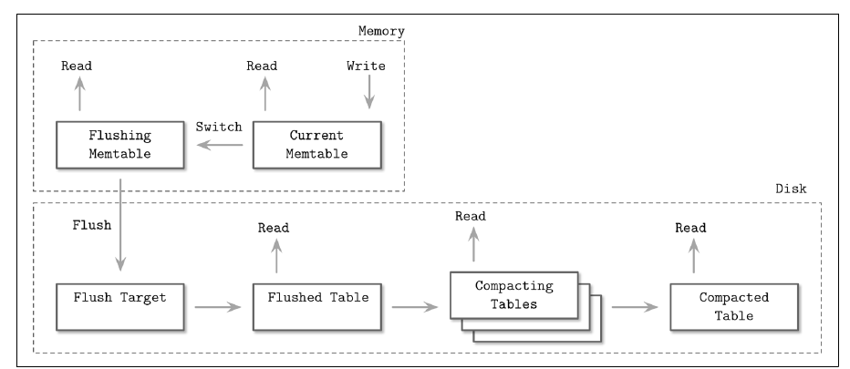
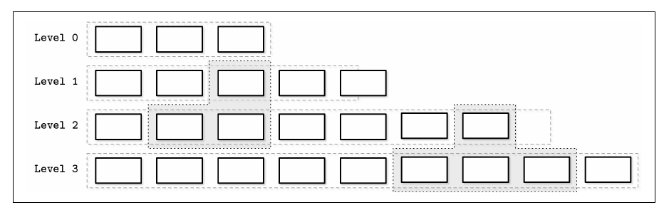
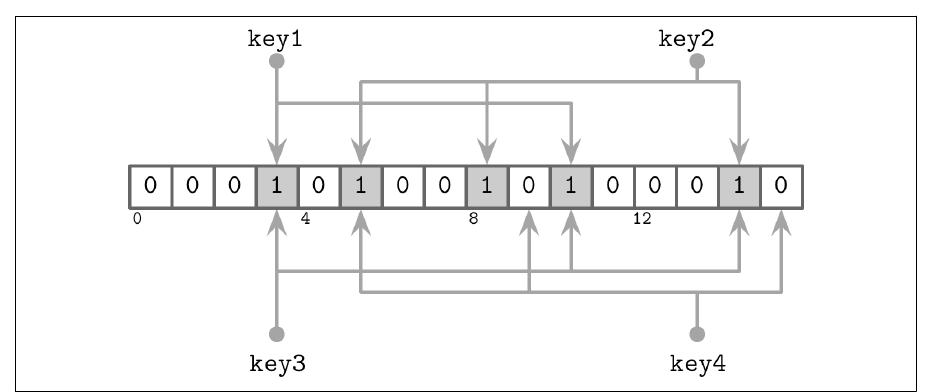
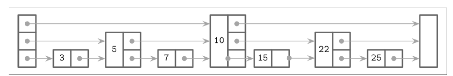
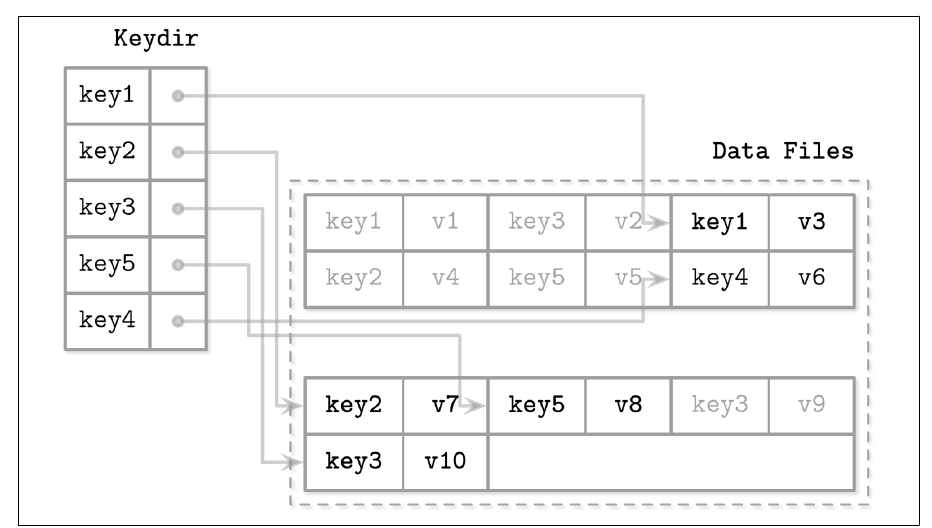
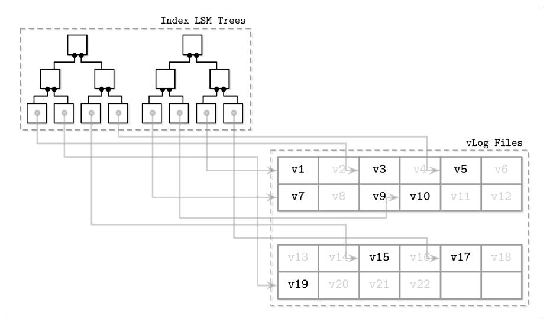

# 7. Log-Structured Storage

[← 6. B-Tree Variants](06-b-tree-variants.md) · [Book](../README.md) · [8. Introduction and Overview (Part II) →](08-introduction-and-overview.md)

## Summary

The chapter opens with Pat Helland's line that accountants don't use erasers: corrections are new records, and the bottom line is derived by going through them all (p. 129). **Immutable** storage works the same way. Files are written once, new records are appended, and the final value is reconstructed from several files. Mutable structures, by contrast, update records in place (p. 129).

**The trade-off** (p. 130): in-place structures such as B-Trees are optimized for reads; append-only structures for writes. B-Tree I/O is mostly random, nodes split and merge, space is reserved, and a single-cell change rewrites a whole page.

**LSM Trees** (O'Neil et al., 1996) (pp. 130–143):

- **Writes** go to an in-memory, mutable **memtable** backed by a WAL and are flushed as immutable, sorted disk tables. Deletes become **tombstones**.
- **Reads** merge every component with a priority-queue **merge-iteration** and **reconcile** same-key records by timestamp.
- **Compaction** (leveled, size-tiered, time-window) keeps the number of tables down.

**Costs and building blocks** (pp. 143–152):

- The trade-off between **read, write and space amplification** is captured by the **RUM Conjecture**.
- Implementation pieces: **SSTables**, **Bloom filters**, **skiplists**, page-cache access with unaligned records, and compression with an offset table.

**Variants and layering** (pp. 152–162):

- **Unordered** stores: **Bitcask** (in-memory keydir) and **WiscKey** (sorted keys, values in a vLog).
- Concurrency rules for memtable switches, flush finalization and WAL truncation.
- The problems of **log stacking** (FTL, filesystem and database each keeping a log) and how coordination (**LLAMA**) or bypassing layers (**Open-Channel SSDs**) helps.

## Key takeaways

- **LSM writes never look up old data.** Inserts and updates are upserts, and conflicts are resolved at read time (pp. 131, 140).
- **Immutable files are dense and sequential.** No space is reserved, and readers need no segment locking (p. 131).
- **Deleting from the memtable can resurrect old values.** Deletes must be explicit tombstones, or range tombstones for key ranges (pp. 136–137).
- **Merge-iteration uses O(N) memory for N sources.** A min-heap of iterator heads; same-key records from different sources meet in the heap and are reconciled (pp. 137–140).
- **Tombstones survive compaction until nothing older can exist.** RocksDB keeps them to the bottommost level; Cassandra until the GC grace period (p. 141).
- **Leveled compaction keeps key ranges disjoint** from level 1 on, with sizes growing exponentially. Size-tiered compaction groups tables by size and can starve higher levels (pp. 142–143).
- **RUM: you can optimize two of read, update and memory overheads, never all three** (p. 144).
- **A Bloom filter says "maybe" or "definitely not".** It never gives false negatives, and its size can be set exactly because an LSM table's key count is known up front (pp. 147–148).
- **Stacked logs duplicate work.** FTL, filesystem and database logs each garbage-collect and fragment, so keep partitions and writes aligned (pp. 157–160).

## Section outline

*From the book’s own table of contents (PDF bookmarks); printed page numbers.*

- LSM Trees — p. 130
  - LSM Tree Structure — p. 132
  - Updates and Deletes — p. 136
  - LSM Tree Lookups — p. 137
  - Merge-Iteration — p. 137
  - Reconciliation — p. 140
  - Maintenance in LSM Trees — p. 141
- Read, Write, and Space Amplification — p. 143
  - RUM Conjecture — p. 144
- Implementation Details — p. 145
  - Sorted String Tables — p. 145
  - Bloom Filters — p. 146
  - Skiplist — p. 148
  - Disk Access — p. 150
  - Compression — p. 151
- Unordered LSM Storage — p. 152
  - Bitcask — p. 153
  - WiscKey — p. 154
- Concurrency in LSM Trees — p. 155
- Log Stacking — p. 157
  - Flash Translation Layer — p. 157
  - Filesystem Logging — p. 159
- LLAMA and Mindful Stacking — p. 160
  - Open-Channel SSDs — p. 161
- Summary — p. 162

## Notes

Immutable structures are safe because once built they never change, so all references can be read concurrently (p. 129). Internally, immutable files may hold many copies of a record; on access, copies are reconciled and the most recent is returned (p. 129).

### LSM Trees

Buffering can be applied in two ways: to *postpone* writes to disk pages (FD-Trees, WiredTiger) or to make writes *sequential*. LSM Trees do the second (p. 130). An LSM Tree is a B-Tree-like disk structure with fully occupied nodes, optimized for sequential access, and named after log-structured filesystems (p. 130). It's common for LSM Trees to use B-Trees *internally* to index their immutable files (p. 131). "Merge" refers to the merge-sort-like combination of contents, during maintenance and during reads (p. 131).

| Property | Why (pp. 131–132) |
|---|---|
| Sequential writes | Files written in one pass, append-only. ISAM pre-allocates in one pass, but later accesses are still random |
| Higher density | No space reserved for future writes or growing records |
| Fast writes | No need to locate records; duplicates allowed and resolved on read. Suits write-heavy workloads |
| Simple concurrency | Reads and writes don't intersect; only the structures *managing* the table views need guarding |
| Housekeeping | The number of files grows, so tables are merged to keep reads touching few files |

#### LSM Tree structure

The book starts with *ordered* LSM Trees, whose files hold sorted records (p. 132).

- The **memtable** is mutable. It buffers records, serves reads and writes, and is flushed at a size threshold. Its updates cost no disk I/O.
- A separate **WAL** provides durability: records are appended to the log and committed in memory *before* the client gets an acknowledgment (p. 132).
- **Disk-resident components** ("tables" in this chapter) are only read, never modified (p. 132).

**Two-component LSM Tree** (pp. 132–134): one disk component organized as a B-Tree with 100% occupancy and read-only pages. Memory subtrees are flushed *in parts*: each one is merged with the matching disk subtree into a new segment, which replaces both (Figures 7-1, 7-2). The merge advances iterators over the two sorted sources in lockstep. Three rules apply:

1. once a flush starts, new writes go to a new memtable;
2. during the flush, both the disk subtree and the flushing memory subtree stay readable;
3. publishing the merged result and discarding the old parts happen atomically.

The author knew of no implementation, probably because merges triggered by every flush cause heavy write amplification (p. 134).

**Multicomponent LSM Tree** (pp. 134–136): the *whole* memtable is flushed in one run, creating more and more tables, so a periodic **compaction** merges them (Figure 7-3).

*Figure 7-4 (p. 136): the memtable switch is atomic; the flush target can't be read until it is complete, after which the write-ahead log up to that point can be trimmed (pp. 135–136).*

A flush is triggered periodically or by size. The memtable switch must be atomic, the flushing memtable stays readable until the new table replaces it, and once the flush completes the corresponding WAL section can be trimmed (pp. 135–136).

#### Updates and deletes

Removing a record from the memtable isn't enough: the disk table may still hold `k1 → v1`, which would be **resurrected** (p. 136). Deletes are written as **tombstones** (also called *dormant certificates*), and reconciliation filters out the values they shadow (p. 137).

| Disk table | Memtable | Read of k1 |
|---|---|---|
| k1 → v1 | k1 → v2 | v2 |
| k1 → v1 | ∅ (v2 just removed) | **v1, resurrected** ✗ |
| k1 → v1 | k1 → ⟂ tombstone | absent ✓ |

*Restates the example on pp. 136–137.*

**Predicate deletes** append a delete entry with a predicate, e.g. `DELETE FROM table WHERE key ≥ "k2" AND key < "k4"`. Cassandra calls these **range tombstones**. Overlapping ranges and table boundaries need careful resolution rules (p. 137).

#### LSM Tree lookups and merge-iteration

A read usually touches several components, which are merged with a **multiway merge-sort** (p. 137). A min-heap holds the head of each iterator. Pop the smallest element, then refill from the iterator it came from, unless that iterator is exhausted (pp. 138–140). Since each iterator holds at most one record per key, duplicate keys in the queue must come from different sources (p. 138).

The book's walk-through (pp. 139–140):

| Step | Iterator 1 | Iterator 2 | Queue | Output |
|---|---|---|---|---|
| Start | k2:v1, k4:v2 | k1:v3, k2:v4, k3:v5 | — | — |
| Fill | k4:v2 | k2:v4, k3:v5 | k1:v3, k2:v1 | — |
| Pop k1, refill from 2 | k4:v2 | k3:v5 | k2:v1, k2:v4 | k1:v3 |
| Two k2s: reconcile; refill both | — | — | k3:v5, k4:v2 | k1:v3, k2:v4 |
| Drain | — | — | — | k1:v3, k2:v4, k3:v5, k4:v2 |

Complexity matches merging sorted collections: O(N) memory for N iterators and O(log N) per step (p. 140).

#### Reconciliation

Records for the same key are reconciled by metadata, typically **timestamps**. Shadowed records are neither returned nor written during compaction. Inserts and updates are indistinguishable, so LSM writes are **upserts** by default (p. 140).

> **Try it:** [LSM merge and compaction](../widgets/07-lsm-compaction.html) — write, overwrite and delete keys, flush memtables to SSTables, step a merge-iteration through its priority queue, and compare leveled and size-tiered compaction by tables per read and bytes rewritten.

#### Maintenance in LSM Trees

**Compaction** picks several tables, merge-iterates and reconciles them, and writes a new table. Memory is bounded (only iterator heads are held), and reads and writes are sequential (p. 141). Compacting tables stay readable until the end, so there must be enough free disk space for the output. Concurrent compactions work on disjoint table sets, and a compaction can either merge tables or partition one into several (p. 141).

*Figure 7-6 (p. 142): leveled compaction merges a table with only the tables of the next level whose key ranges overlap it.*

**Tombstones and compaction** (p. 141): a tombstone is kept until no record with the same key and a smaller timestamp can exist in any table. RocksDB keeps tombstones until the bottommost level. Cassandra keeps them until the **GC grace period** has passed, so that other replicas see them, because it is eventually consistent. Dropping tombstones early resurrects data.

| Strategy | How it works | Notes (pp. 142–143) |
|---|---|---|
| **Leveled** (RocksDB) | L0 tables come from flushes and may overlap. When there are too many, they are merged into L1. From L1 on, ranges *don't overlap*; a full level merges into the overlapping tables of the next | Sizes grow exponentially per level; fresh data in low indices, old data migrates up; reads skip tables by range metadata. "Bottommost" = highest index |
| **Size-tiered** | Tables grouped by size; compacting similar-sized tables promotes the result to the tier of its size | **Table starvation**: if compacted outputs stay small, for example because tombstones shadowed records, higher levels are never compacted and must be forced |
| **Time-window** (Cassandra) | Groups by write timestamp | Drops whole files of an expired time range without rewriting them; for time series with TTLs |

### Read, write and space amplification

Reclaiming duplicate space quickly means rewriting tables continuously, which raises **write amplification**. Rewriting less raises **read amplification** (reconciling on read) and **space amplification** (redundant copies kept longer) (pp. 143–144).

| Amplification | Source in immutable storage (p. 144) |
|---|---|
| **Read** | Several tables addressed per read |
| **Write** | Continuous rewrites by compaction |
| **Space** | Multiple records per key |

> **Vault note:** the book warns that comparing B-Tree and LSM write amplification directly can mislead. In B-Trees it comes from writebacks and repeated updates to the same node; in LSM Trees, from data migrating between files during compaction (p. 144).

#### RUM Conjecture

The **RUM Conjecture** (Read, Update, Memory overheads) says that reducing two of them inevitably worsens the third (p. 144).

- **B-Trees** are read-optimized. Writes must locate the record, repeated writes to a page rewrite it, and reserved space adds overhead.
- **LSM Trees** don't locate records on write or reserve space, but redundant records cost space, and by default reads touch several tables (pp. 144–145).

The model ignores latency, access patterns, complexity, maintenance, hardware, consistency and replication, so it's a first approximation (p. 145).

### Implementation details

#### Sorted String Tables

Disk tables are often **SSTables**: records sorted by key, with an **index file** (a B-Tree for logarithmic lookups or a hashtable for constant-time ones) and a **data file** of concatenated key-value pairs (p. 145). A hash index still allows range scans: the hash finds the first key, and the rest is read sequentially (p. 145). Cells are written sequentially and never modified, data offsets must be known when the index is built, and compaction reads data files sequentially without the index (p. 146).

**SSTable-Attached Secondary Indexes (SASI)** in Cassandra create a secondary index *per SSTable*, during flush or compaction. A separate in-memory structure indexes the memtable (p. 146).

#### Bloom filters

Key-range metadata (min and max key) shows only whether a key *could* be in a table (pp. 146–147). A **Bloom filter** (Bloom, 1970) answers set membership with **false positives but no false negatives** (p. 147). Cassandra and RocksDB both use them, and tables whose filter says "no" are skipped.

The filter is a bit array plus *k* hash functions. Adding a key sets *k* bits. A lookup is positive only if all *k* bits are set; a single 0 bit means definitely absent (p. 147). A larger array and more hash functions lower the false-positive rate but cost memory and CPU. Because LSM tables are immutable, their key count is known in advance and the filter can be sized exactly (pp. 147–148).

The book's example: 16 bits, 3 hash functions (Figure 7-7, p. 148):

*Figure 7-7 (p. 148): a lookup checks the same three bit positions an insert set; any 0 means "definitely absent", all 1s means "maybe present".*

| Key | Hash positions | Result |
|---|---|---|
| key1 (added) | 3, 5, 10 | bits set |
| key2 (added) | 5, 8, 14 | bits set |
| key3 (lookup) | 3, 10, 14 | all set → **false positive** |
| key4 (lookup) | 5, 9, 15 | 9 and 15 unset → **definitely absent** |

> **Vault note:** the book's sidebar on probabilistic structures (p. 147): Bloom filters for membership, HyperLogLog for cardinality and Count-Min Sketch for frequency trade exactness for space.

#### Skiplist

A **skiplist** (Pugh) is barely more complex than a singly linked list, with probabilistic guarantees close to search trees'. It balances probabilistically, with no rotations or relocations. It's less cache-friendly than in-memory B-Trees because its nodes are small and scattered; unrolled linked lists help (pp. 148–149).

- Each node's **height** is chosen randomly at insert. Nodes of the same height form a level, each level has exponentially fewer nodes, and the maximum height is capped (p. 149).
- **Lookup:** move forward on the highest level while the next key is smaller; otherwise drop down a level from the predecessor. The book searches for 7: head → 10 (too big) → down → 5 → 10 (too big) → down → 7 (Figure 7-8) (p. 149).

*Figure 7-8 (p. 149): taller nodes act as express lanes; a search drops one level whenever the next key would overshoot.*

- **Insert:** find the insertion point, pick a random height, link predecessors on each level. **Delete:** hand the removed node's forward pointers to its predecessors (p. 150).
- **Concurrent** versions use a `fully_linked` flag set by CAS, plus reference counting or hazard pointers in unmanaged languages. They are deadlock-free because nodes are always accessed from higher levels (p. 150).
- Users: Cassandra's secondary-index memtable and parts of WiredTiger (p. 150).

#### Disk access

Page-cache techniques such as eviction and pinning still apply. The differences: in-memory contents are **immutable** and need no latches; **reference counting** keeps pages in use from being evicted and files in use from being deleted by compaction; and records need not be page-aligned, so they may be addressed by absolute offsets and may span pages (Figure 7-9) (p. 150).

#### Compression

Tables are immutable and written in one pass, but compressed pages aren't page-aligned, and zero-padding them would cancel the benefit (p. 151). An **indirection layer** stores each compressed page's offset and size. It's written to a separate file segment during flush and compaction and looked up on read (Figure 7-10) (pp. 151–152).

### Unordered LSM storage

B-Tree pages, FD-Tree runs and SSTables all keep key order, by in-place updates, merges or in-memory sorting respectively. Unordered stores keep insertion order, usually need no separate log, and make writes cheaper (p. 152).

#### Bitcask

**Bitcask**, one of Riak's engines, uses no memtable: records go straight into **logfiles** (p. 153). The **keydir**, an in-memory hashmap, points to the latest record for each key and must be rebuilt from the logfiles at startup. Writes append the record and update the keydir. Reads follow one pointer, with no merging. Compaction rewrites only live records and updates the keydir (pp. 153–154).

*Figure 7-11 (p. 153): the in-memory keydir points only at each key's newest record; the greyed older versions are garbage for compaction.*

| Pros (p. 154) | Cons (p. 154) |
|---|---|
| Simple; great point-query performance | All keys must fit in memory |
| No separate WAL, so less space overhead and write amplification | Keydir rebuilt at startup |
| | **No range scans** |

#### WiscKey

**WiscKey** decouples sorting from garbage collection: **keys** live in a sorted LSM Tree, and **values** in unordered append-only **vLogs** (p. 154). That removes Bitcask's all-keys-in-memory and startup-rebuild problems. Keys are small, so compacting them is cheap, which suits workloads with few updates and deletes (p. 154).

*Figure 7-12 (p. 155): the sorted LSM trees hold only keys and pointers; values sit unsorted in the vLog, so compaction moves keys, not values.*

- **Range scans** need random I/O into the vLog. WiscKey prefetches in parallel using SSD parallelism, but a whole page is still read for one record (p. 154).
- **vLog GC** reads sequentially, rewrites live records and updates pointers, using head and tail pointers to bound the scan. The vLog has no liveness information, so GC must consult the key tree, which traditional LSM compaction doesn't need (p. 155).

### Concurrency in LSM Trees

The main concurrency challenges are switching **table views**, the sets of memory and disk tables that change during flushes and compactions, and synchronizing the log (p. 155). During a flush (p. 156):

- the new memtable becomes readable and writable;
- the old memtable stays readable;
- the old memtable is written to disk;
- discarding the flushed memtable and publishing its disk table happen atomically;
- the WAL segment covering the flushed memtable is discarded.

Cassandra uses **operation order barriers**: a flush waits for every write already accepted (p. 156).

| Synchronization point | Risk if done wrong (pp. 156–157) |
|---|---|
| **Memtable switch** | Writes to the old memtable may land in a part already flushed: data loss |
| **Flush finalization** | Removing the old memtable before its table is ready: incomplete reads |
| **WAL truncation** | Truncating before the flush completes and then crashing: data loss |

Compaction swaps tables more simply, but old tables must stay readable until the new one is complete, and no table may take part in two concurrent compactions (p. 156).

### Log stacking

Many filesystems and SSDs are log-structured too, buffering writes and appending full segments. LSM Trees and SSDs are a natural match (p. 157). Stacking several log-structured systems, though, can bring back the problems LSS was meant to solve: write amplification, fragmentation and poor performance (p. 157).

#### Flash translation layer

SSDs batch small random writes into physical pages, and pages can be programmed only after being erased (program/erase cycles). Erasing works per **block** of typically 64–512 pages (p. 157). The FTL maps logical to physical pages and tracks their state (live, discarded, empty). When free pages run out, it **relocates live pages** out of a block and erases it (Figures 7-13, 7-14) (pp. 157–158). It also performs **wear leveling**, because cells survive only a limited number of program/erase cycles (p. 158).

#### Filesystem logging

Each layer keeps its own books, and the layer below doesn't expose enough information to avoid duplicating work (p. 159).

- **Redundant logging and differing GC patterns** between the application and filesystem logs.
- **Misaligned segments:** discarding a higher-level segment fragments and relocates its neighbours (Figure 7-15).
- **Interleaved streams:** separate sequential streams, such as the log and data records, don't stay sequential at the hardware level (Figure 7-16) (pp. 159–160).

Mitigations: some vendors recommend a separate device for the log, but aligning partitions to the hardware and writes to the page size matters more (p. 160).

### LLAMA and mindful stacking

Bw-Trees run on **LLAMA** (latch-free, log-structured, access-method aware), which handles garbage collection and page management for the tree (p. 160). Delta nodes are buffered in **4 MB flush buffers** and flushed when full. GC reclaims dead base and delta nodes and relocates live ones (p. 161). Because LLAMA is *aware* of Bw-Tree semantics, it can:

- write several deltas of one logical node contiguously;
- cancel updates that negate each other, for example persisting only the delete of an insert-then-delete;
- consolidate a node into a single base page *during GC*. This saves space and read latency; a GC that only copied the deltas would save neither, and a tree that consolidated by itself would still leave the old versions for the LSS to collect (p. 161).

Stacking can pay off when layers expose the right information (p. 161).

#### Open-Channel SSDs

The alternative is to skip the layers: **Open-Channel SSDs** expose the drive's internals and scheduling, removing at least two logs (filesystem and FTL) and giving control over wear leveling, GC, placement and scheduling (p. 161). Examples (pp. 161–162):

- **LOCS**, an LSM key-value store on Open-Channel SSDs;
- **LightNVM** in the Linux kernel;
- **Software Defined Flash (SDF)**, with asymmetric I/O where the write unit equals the erase block, and each channel exposed as a separate block device.

The parallel is `O_DIRECT`: more control, more manual work (p. 162).

### Summary

Log-structured storage is everywhere, in FTLs, filesystems and databases. It batches small random writes in memory and garbage-collects removed segments. LSM Trees bring these ideas to indexes: writes are batched and flushed, and compaction cleans up shadowed records. Stack layers carefully, or bypass them (p. 162).

## Trade-offs at a glance

| | B-Tree | LSM Tree (leveled) | LSM Tree (size-tiered) | Bitcask | WiscKey |
|---|---|---|---|---|---|
| Write path | Locate + rewrite page | Memtable + WAL, sequential flush | Same | Append + hashmap | Append value; key into LSM |
| Read path | One page per level | Memtable + few tables (disjoint ranges) + Bloom filters | More tables per read | One pointer | Key LSM + one value read |
| Write amplification | Page rewrites | Higher (rewrites per level) | Lower | Low (GC only) | Low (small keys compacted) |
| Space amplification | Reserved space | Lower | Higher (duplicates linger) | Until GC | Until vLog GC |
| Range scans | ✓ | ✓ | ✓ | ✗ | ✓ but random I/O |

## Beyond the book

- **The false-positive formula.** For *m* bits, *n* keys and *k* hash functions, p ≈ (1 − e^(−kn/m))^k, minimized at k = (m/n)·ln 2. At 10 bits per key that's about 1%. The [Bloom filter lab](../lab/07-bloom-filter/README.md) measures this on real hashes.
- **Leveled compaction's write amplification** is roughly the size ratio between levels (fanout, often 10) times the number of levels, which is why RocksDB exposes `max_bytes_for_level_multiplier`. Size-tiered compaction rewrites each byte about once per tier but can temporarily need twice the disk space.
- **RocksDB's BlobDB** follows WiscKey's key-value separation, and **Badger** (Go) is built directly on the WiscKey paper.
- For the same ideas from an application developer's angle, see [DDIA Ch. 4](../../designing-data-intensive-applications/chapters/04-storage-and-retrieval.md).

## Connections

- **Run it:** [Bloom filter false positives](../lab/07-bloom-filter/README.md) — builds Bloom filters at several bits-per-key and hash counts, measures the false-positive rate on absent keys, and compares it with the formula.
- **Related chapters:** [2. B-Tree Basics](02-b-tree-basics.md) (SSD internals), [5. Transaction Processing and Recovery](05-transaction-processing-and-recovery.md) (WAL, page cache), [6. B-Tree Variants](06-b-tree-variants.md) (FD-Trees, Bw-Trees), [12. Anti-Entropy and Dissemination](12-anti-entropy-and-dissemination.md) (tombstones and replicas).

## Check yourself

*Questions and answers are the vault's, written from the notes above; answers cite the book's pages.*

1. **Why can't an LSM Tree implement a delete by removing the key from the memtable?**

   *Answer:* An older disk table may still hold a value for the key, which would be resurrected. A tombstone must shadow it (pp. 136–137).

2. **In merge-iteration over N sources, how much memory is needed and why?**

   *Answer:* O(N): the priority queue holds only the current head of each iterator, because all sources are sorted (pp. 138–140).

3. **Two records for k2 sit in the merge queue. What do we know about them?**
   - [ ] They come from the same table
   - [x] They come from different sources and must be reconciled, e.g. by timestamp
   - [ ] One of them is always a tombstone

   *Answer:* Each iterator holds at most one record per key, so duplicates in the queue must come from different sources (pp. 138, 140).

4. **When may compaction drop a tombstone?**

   *Answer:* Only when no older record for that key can exist in any other table. RocksDB waits until the bottommost level; Cassandra waits for the GC grace period so replicas see it (p. 141).

5. **What is table starvation in size-tiered compaction?**

   *Answer:* Compacted outputs stay small, for example because tombstones shadowed most records, so higher tiers never get enough tables to compact and their tombstones are never applied. Compaction must be forced (p. 143).

6. **What does the RUM Conjecture state?**

   *Answer:* Read, update and memory overheads can't all be minimized: reducing two worsens the third (p. 144).

7. **A Bloom filter with 16 bits has bits 3, 5, 8, 10 and 14 set. A lookup hashes to 5, 9 and 15. What's the answer?**

   *Answer:* Definitely absent, because bits 9 and 15 are unset. Bloom filters have no false negatives (p. 148).

8. **What does WiscKey change compared with Bitcask, and what does it cost?**

   *Answer:* It keeps keys in a sorted LSM Tree instead of an in-memory hashmap, so range scans work and nothing has to be rebuilt at startup. Range scans then need random I/O into the vLog, and GC must consult the key tree to tell which values are live (pp. 154–155).

9. **Why is truncating the WAL before a memtable flush completes dangerous?**

   *Answer:* If the node crashes, the truncated operations can't be replayed and the memtable's data is lost (pp. 156–157).

10. **What makes LLAMA "mindful" stacking?**

    *Answer:* It knows Bw-Tree semantics, so during garbage collection it can consolidate a node's deltas into one base page and cancel opposing updates, instead of just copying deltas around (p. 161).
