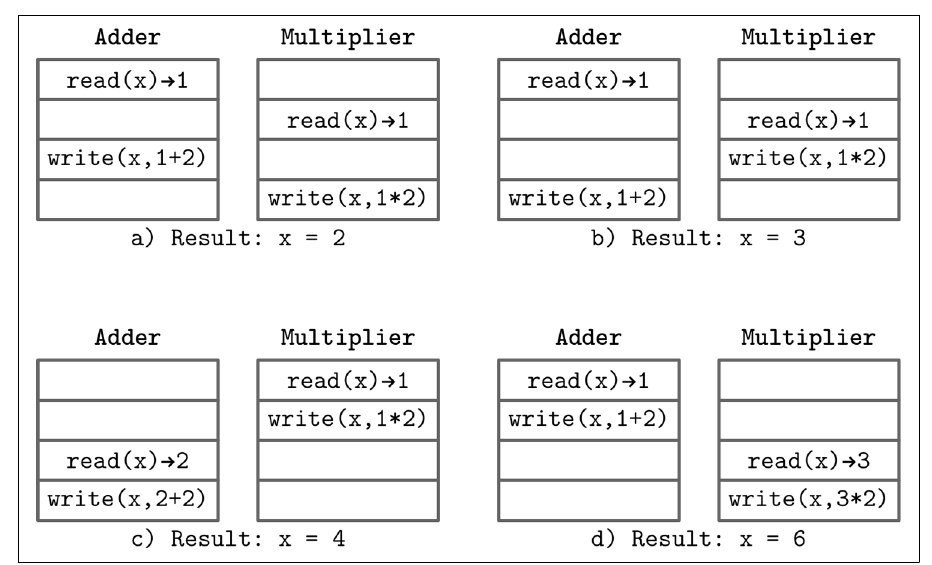
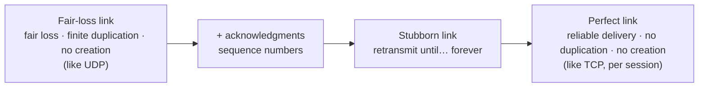

# فصل ۸: مقدمه و نمای کلی

[فصل ۷: ذخیره‌سازی log-structured →](07-log-structured-storage.md) · [کتاب](../README.md) · [فصل ۹: تشخیص شکست ←](09-failure-detection.md)

## خلاصه

بخش دو از موتورهای ذخیره‌سازی به **سیستم‌های توزیع‌شده** می‌چرخد. آغازش (pp. 167–169) واژگانی را تعریف می‌کند که در سراسرش به کار می‌رود:

- **شرکت‌کننده**ها، یعنی process و نود و replica، که هر یک حالت محلی دارند؛
- **پیوند**ها برای رد و بدل پیام؛
- **ساعت**ها، که یا منطقی‌اند، یعنی شمارنده‌ی یکنوا، یا فیزیکی، یعنی «ساعت دیواری»؛
- و **الگوریتم‌های توزیع‌شده**، که قدم‌های محلی و تعامل‌ها را به‌رغم پیوندها و processهای نامطمئن وصف می‌کنند.

هدفشان هم‌آهنگی و هم‌کاری و پخش و consensus است (p. 169).

بعد این فصل پایه‌ها را می‌سازد (pp. 171–194):

- حتی دو thread که یک متغیر را به‌روز می‌کنند **چهار برآمد ممکن** دارند (شکل ۸-۱)، پس به **consistency model** نیاز داریم.
- **مغلطه‌های محاسبات توزیع‌شده** و فرض‌های پشتشان: پردازش، ساعت، consistency حالت، فراخوانی محلی در برابر دور، شکست، پارتیشن و **شکست‌های آبشاری** (pp. 174–181).
- **پیوند**ها، که از **گم‌شدن منصفانه** از راه تأیید و بازفرست **لجباز** تا **پیوند بی‌عیب** بنا می‌شوند، با شماره‌ی ترتیب و buffer مرتب کردن دوباره و تکراری‌زدایی (pp. 182–186).
- این‌که چرا **تحویل exactly-once** واقعاً *پردازش* exactly-once است (pp. 186–187).
- دو نتیجه‌ی ناممکنی: **مسئله‌ی دو ژنرال** (pp. 187–189) و **FLP** (pp. 189–190).
- مدل‌های **concurrency**، یعنی asynchronous و هم‌زمان و نیمه‌هم‌زمان، و **مدل‌های شکست**، یعنی crash-stop و crash-recovery و omission و دل‌بخواهی یا Byzantine (pp. 190–193).

## نکته‌های کلیدی

- **مفهوم concurrency نخستین مسئله‌ی سیستم‌های توزیع‌شده است**، حتی پیش از ترک کردن نودی تنها: با `x = 1` و یک افزاینده با (+۲) و یک ضرب‌کننده با (×۲) می‌شود در ۲ یا ۳ یا ۴ یا ۶ تمام کرد (pp. 171–172).
- **هیچ timeoutی نمی‌تواند بگوید چرا نودی پاسخ نداد.** شاید بیش‌بار باشد یا از کار افتاده یا کند، یا شاید شبکه خطاکار باشد (p. 173).
- **صف‌های بزرگ‌تر throughput را بالا نمی‌برند.** latency می‌افزایند. **فشار برگشتی** تولید‌کننده‌ها را کند می‌کند (pp. 175–176).
- **برای ترتیب از timestamp به کار نبرید**، مگر منبع زمان دقتی بالا داشته باشید، که TrueTime در Spanner کران عدم قطعیت برمی‌گرداند (pp. 176–177).
- **کوشش دوباره تنها برای عملیات idempotent ایمن است**، پس در عوض تکراری‌زدایی کنید (pp. 184–185).
- **پیوند بی‌عیب برابر پیوند fair-loss به‌علاوه‌ی تأیید و بازفرست و شماره‌ی ترتیب و تکراری‌زدایی است.** تحویل قابل اطمینان و بی تکرار و بی ساختن می‌دهد. پروتکل TCP این را تنها درون یک session می‌دهد (pp. 185–186).
- **مفهوم exactly-once یعنی یک بار پردازش کردن و نادیده گرفتن تکراری‌ها.** پیوندی قابل اطمینان نمی‌تواند از فرستادن برخی پیام‌ها بیشتر از یک بار بپرهیزد (p. 187).
- **قضیه‌ی FLP:** در سیستمی تماماً ناهم‌زمان، هیچ پروتکل consensus قطعی‌ای نمی‌تواند از کار افتادن حتی یک process را درون زمانی bounded تحمل کند. سیستم‌های واقعی از راه concurrency جزئی فرار می‌کنند (pp. 189–191).

## فهرست بخش‌ها

*از فهرست مطالب خود کتاب، از bookmarkهای PDF؛ شماره‌ها صفحه‌ی چاپی‌اند.*

- اجرای هم‌زمان — ص. ۱۷۱
  - بخش shared state در سیستمی توزیع‌شده — ص. ۱۷۳
- مغلطه‌های محاسبات توزیع‌شده — ص. ۱۷۴
  - پردازش — ص. ۱۷۵
  - ساعت و زمان — ص. ۱۷۶
  - بخش consistency حالت — ص. ۱۷۷
  - اجرای محلی و دور — ص. ۱۷۸
  - نیاز به رسیدگی به شکست — ص. ۱۷۸
  - پارتیشن شبکه و شکست جزئی — ص. ۱۷۹
  - شکست آبشاری — ص. ۱۸۰
- انتزاع‌های سیستم‌های توزیع‌شده — ص. ۱۸۱
  - پیوند — ص. ۱۸۲
- مسئله‌ی دو ژنرال — ص. ۱۸۷
- ناممکنی FLP — ص. ۱۸۹
- بخش concurrency سیستم — ص. ۱۹۰
- مدل‌های شکست — ص. ۱۹۱
  - خطای از کار افتادن — ص. ۱۹۱
  - خطای omission — ص. ۱۹۲
  - خطای دل‌بخواهی — ص. ۱۹۳
  - رسیدگی به شکست — ص. ۱۹۳
  - خلاصه — ص. ۱۹۳

## یادداشت‌ها

بخش دو با این شوخی Lamport باز می‌شود که کامپیوتری که از وجودش خبر نداشتید می‌تواند مال شما را به‌کار‌نیامدنی کند (p. 167). مقیاس دادن عمودی گران و نگهداشتش سخت است، پس سیستم‌ها **افقی** مقیاس می‌گیرند، و روی ماشین‌های شبکه‌شده‌ی زیادی اجرا می‌شوند که مثل یک هستی منطقی عمل می‌کنند (p. 167). بیشتر پژوهش این حوزه از این واقعیت شروع می‌کند که هیچ چیزی تماماً قابل اطمینان نیست: پیوندها پیام را معطل و بی‌ترتیب و گم می‌کنند، و processها می‌ایستند و کند می‌شوند و از کار می‌افتند یا از کنترل در می‌روند (p. 168). پردازنده‌ها خودشان سیستم‌های توزیع‌شده‌ی ریزی‌اند، ولی اولیه‌هایشان یک‌راست بازاستفاده‌شدنی نیستند چون ارتباط دور گران و نامطمئن است (p. 168).

### اجرای هم‌زمان

یک thread تنها که `i = 1; i += 2; i *= 2` را اجرا کند همیشه ۶ می‌دهد. با دو thread که `x` را مشترک دارند، برآمد به لابه‌لا رفتن بستگی دارد (شکل ۸-۱، ص. ۱۷۲):

*Figure 8-1 (p. 172): همان دو thread بسته به این‌که کدام خواندنی کدام نوشتنی را ببیند چهار نتیجه می‌دهند.*

| حالت | لابه‌لا رفتن | نتیجه |
|---|---|---|
| الف | هر دو ۱ را می‌خوانند؛ افزاینده ۳ می‌نویسد؛ ضرب‌کننده با ۲ روی‌نویسی می‌کند | **۲** |
| ب | هر دو ۱ را می‌خوانند؛ ضرب‌کننده ۲ می‌نویسد؛ افزاینده با ۳ روی‌نویسی می‌کند | **۳** |
| ج | ضرب‌کننده اول تمام می‌کند با ۱ × ۲، بعد افزاینده با (+۲) | **۴** |
| د | افزاینده اول تمام می‌کند با ۱ + ۲، بعد ضرب‌کننده با (× ۲) | **۶** |

**مفهوم consistency modelها** تعریف می‌کنند که کدام تاریخ‌های اجرا مجازند، و مجموعه‌ی حالت‌های ممکن را مقید یا شل می‌کنند (p. 172). سیستم‌های هم‌زمان می‌توانند حافظه را مشترک داشته باشند؛ و سیستم‌های توزیع‌شده حالت محلی و **رد و بدل پیام** دارند (pp. 172–173).

> **Vault note:** کادر کناری کتاب درباره‌ی هم‌زمان در برابر موازی (p. 173). قدم‌های هم‌زمان در زمان هم‌پوشان‌اند؛ و قدم‌های موازی هم‌هنگام روی چند پردازنده اجرا می‌شوند. قیاس جو آرمسترانگ: concurrency دو صف برای یک دستگاه قهوه است، و موازی بودن دو صف برای دو دستگاه.

#### ساختار shared state در سیستمی توزیع‌شده

گذاشتن دیتابیسی تنها در مرکز processها را هم‌گام نگه نمی‌دارد. هر دسترسی‌ای پیامی است، پس پرسش این می‌شود که انتظار *طولانی* چه معنایی دارد، که مشخص کردن **concurrency** سیستم را لازم دارد (p. 173). دیتابیسی خاموش می‌توانست بیش‌بار یا نادسترس‌پذیر یا کند باشد، یا شبکه می‌توانست بشکند، پس **مدل شکست** هم لازم است (p. 173). **fault tolerance** با برداشتن نقطه‌ی شکست تنها و افزودن پشتیبانی شروع می‌شود، که مسئله‌ی بعدی را بالا می‌آورد: هم‌گام نگه داشتن کپی‌ها (pp. 173–174).

### مغلطه‌های محاسبات توزیع‌شده

اتصال‌ها می‌شکنند، پاسخ‌ها گم می‌شوند، و فراخوانی دور هیچ‌وقت مجانی نیست (p. 174). فهرست ۱۹۹۴ پیتر دویچ امنیت شبکه و دشمن و تغییر توپولوژی و هزینه‌ی انتقال و فرض تنها بودن یک مرجع روی شبکه را هم دارد (p. 175). کتاب فرض‌های بیشتری می‌افزاید که در عمل گاز می‌گیرند:

| فرض | واقعیت (pp. 175–179) |
|---|---|
| **پردازش لحظه‌ای است** | کار دور زمان می‌برد؛ پیام‌ها در صف منتظر می‌مانند؛ نودها در سخت‌افزار و نسخه فرق دارند؛ یک پخش موازی همان‌قدر کند است که کندترین سرورش |
| **صف‌ها بی‌پایان‌اند** | صف‌های بزرگ‌تر تنها latency می‌افزایند. **فشار برگشتی** تولید‌کننده‌ها را کند می‌کند و اغلب بعدتر پیچ‌و‌مهره می‌شود و نه در طرح |
| **ساعت‌ها هم‌گام‌اند** | رانش مهم است؛ بی منبع‌های زمان ویژه با timestamp مرتب نکنید. بدانید که ساعتی **یکنوا** هست یا نه |
| **حالت سازگار است** | سیستم‌های سازگار غایی واگرا می‌شوند و تعمیر. سیستم Cassandra از تغییر schema و نماهای حلقه که با زمان‌های مختلف پخش می‌شدند اشکال داشت |
| **محلی برابر دور است** | پنهان کردن فراخوانی دور پشت APIی محلی latency و consistency و صفحه‌بندی و آشتی‌دهی را پنهان می‌کند، از والدو و همکاران |
| **نودها سرپایند** | نگهداشت و کشته شدن با OOM و اشکال و سخت‌افزار می‌شکنند. heartbeat و failure detector *فرضیه*هایی درباره‌ی زنده بودن می‌سازند |

صف‌های process‌محلی سه هدف را سرویس می‌دهند (p. 176):

- **جدا کردن** گرفتن از پردازش؛
- **مفهوم pipeline کردن** مرحله‌ها؛
- **جذب رگبارهای کوتاه**، که latency می‌افزاید ولی از شکستن و دوباره‌کوشی بهتر است.

برای بارهای پایدار، اندازه‌ی صف را از زمان پردازش و انتظار اندازه‌گرفته بردارید، و برای رگبار وقتی بار پیش‌بینی‌ناپذیر است (p. 176).

#### پارتیشن شبکه و شکست جزئی

**پارتیشن شبکه** وقتی است که سرورها نمی‌توانند حرف بزنند. گیلبرت و لینچ این را که دو شرکت‌کننده نمی‌توانند حرف بزنند از این جدا می‌کنند که کل *گروه*ها منزوی می‌شوند و مستقل پیش می‌روند، که می‌تواند نتیجه‌های متعارض بسازد (p. 179). پیوندها می‌توانند **نامتقارن** هم بشکنند، و تنها در یک جهت تحویل بدهند (p. 179). برای شکست جزئی طراحی کنید، مثلاً وقتی داده تکرار شده بود ولی تأییدی نرسید. بهترین راه طراحی برای شکست **آزمودن** آن است: پارتیشن و پوسیدن بیت و latency و کجی ساعت تزریق کنید (pp. 179–180).

> **Vault note:** فهرست ابزارهای کتاب (p. 180): Toxiproxy برای خطای شبکه، Chaos Monkey برای خواباندن تصادفی در production، CharybdeFS برای خطای فایل‌سیستم و CrashMonkey برای آزمودن consistency فایل‌سیستم.

#### شکست آبشاری

نودی بیش‌بار که از پا بیفتد بارش را به بقیه جابه‌جا می‌کند. حتی نیت خوب هم می‌تواند آبشار شود: همتاهایی که نودی را که همین حالا برگشته با به‌روزرسانی‌های از قلم افتاده سیل می‌کنند می‌توانند بازهم بخوابانندش (p. 180).

| دفاع | چه می‌کند (pp. 180–181) |
|---|---|
| **circuit breaker** | شکست‌ها را تشخیص می‌دهد، فراخوانی‌ها را از سرویسی که می‌شکند دور می‌کند و وقت می‌دهد تا بازیابی شود |
| **عقب‌نشینی** | میان کوشش‌های دوباره‌ی یک کلاینت بیشتر و بیشتر منتظر می‌ماند |
| **jitter** | تصادفی بودن می‌افزاید تا کلاینت‌ها همه در یک لحظه دوباره نکوشند |
| **checksum و اعتبارسنجی** | جلو تکرار شدن داده‌ی خراب روی کپی‌های خوب را می‌گیرند |
| **هم‌آهنگی** | یک coordinator اجرا را از منبع‌های موجود و بار گذشته برنامه‌ریزی می‌کند، و از نقطه‌ی داغ می‌پرهیزد |

> **In practice:** Kubernetes شبکه را ساده نشان می‌دهد ولی قابل اطمینانش نمی‌کند: pod loader و ClickHouse روی شبکه حرف می‌زنند.
>
> **Your turn:** insert loader به ClickHouse با timeout تمام می‌شود. ردیف‌ها نوشته شده‌اند؟
>
> *Answer:* نمی‌دانید: ممکن است insert رسیده و پاسخ گم شده باشد. retry فقط وقتی امن است که insert idempotent باشد، مثلاً با deduplication بلوک در جدول‌های Replicated یا `insert_deduplication_token`. timeout فرق شکست درخواست و شکست پاسخ را نمی‌گوید (pp. 174–181).

### انتزاع‌های سیستم‌های توزیع‌شده

واژگان مشترک از ابهام می‌پرهیزد (pp. 181–182).

#### پیوند

هر لایه‌ای تضمینی می‌افزاید (pp. 182–186):

- **پیوند fair-loss** (pp. 182–183). پیامی که فرستاده شده یا هنوز تحویل نشده یا جبران‌ناپذیر گم شده یا تحویل شده، و فرستنده نمی‌تواند بگوید کدام. خاصیت‌ها:
  - *گم‌شدن منصفانه*: بازفرست بی‌نهایت‌بار به گیرنده‌ای درست در غایت پیام را تحویل‌شده می‌کند؛
  - *تکرار متناهی*؛
  - *بی ساختن*.
- **تأیید** (pp. 183–184). پیام M(n) عددی یکتا و یکنوا‌افزایشی حمل می‌کند، و گیرنده ACK(n) پاسخ می‌دهد. تأییدی هم می‌تواند گم شود. همین که گرفته شود، تحویل را اثبات می‌کند. هر شناسه‌ی یکتایی کار می‌کند؛ hashها رسیدگی به برخورد لازم دارند.
- **پیوند لجباز** (p. 184). پس از timeout T دوباره بفرست، بی‌پایان، تا پیامی نتواند جبران‌ناپذیر گم شود. این بی تأیید ناعملی است.
- **مسئله‌ی بازفرست** (pp. 184–185). تا رسیدن تأیید، شاید پیام پردازش شده باشد، شاید قرار است پردازش شود، شاید گم شده، یا شاید گیرنده از کار افتاده. فرستادن دوباره می‌تواند **تکراری** بسازد، که تنها برای عملیات **idempotent** بی‌آزار است. خواباندن سروری idempotent است؛ و شارژ کردن کارت اعتباری نه. چون همه چیز idempotent نیست، در عوض **تکراری‌زدایی** کنید.
- **ترتیب پیام** (p. 185). گیرنده دو شمارنده را پی می‌گیرد:
  - **مفهوم n_consecutive**، یعنی بالاترین شماره‌ی ترتیبی که تا آن هر پیامی رسیده؛
  - **مفهوم n_processed**، یعنی بالاترین شماره‌ای که سر جا برگردانده و پردازش شده، که برای تکراری‌زدایی به کار می‌رود.

  پیام‌های بی‌ترتیب در **buffer مرتب کردن دوباره** منتظر می‌مانند: گرفتن ۵ پس از ۳ یعنی نگه داشتن ۵ تا رسیدن ۴. هر چیزی ≤ n_consecutive که بازهم برسد انداختنی است.
- **پیوند بی‌عیب** (p. 186): تحویل قابل اطمینان، بی تکرار، بی ساختن. پروتکل TCP به آن می‌ماند، ولی با تأییدهای گروهی و گزینشی و کنترل جریان و شلوغی، و تنها درون یک session.

> **Try it:** [از fair-loss تا پیوند بی‌عیب](../widgets/08-perfect-link.html)؛ پیام‌های شماره‌دار را روی پیوندی بفرستید که گم و بی‌ترتیب و تکراری می‌کند، بعد تأیید و بازفرست و buffer مرتب کردن دوباره و تکراری‌زدایی را یکی‌یکی روشن کنید، و n_consecutive و n_processed را ببینید.

#### تحویل exactly-once

کتاب این شوخی ماتیاس وراس را نقل می‌کند که تحویل exactly-once یکی از آن دو مسئله‌ی سخت است، و دو بار فهرستش می‌کند (p. 186). سیستم‌های واقعی تحویل **حداقل‌یک‌بار**، یعنی دوباره بکوش تا تأیید شود، یا **at-most-once**، یعنی بی تأیید بفرست، به کار می‌برند (p. 186). پروتکل TCP بسته‌ها را درون یک session تکراری‌زدایی می‌کند. ولی اگر اتصال پس از پردازش و پیش از رسیدن تأیید بشکند، برنامه می‌تواند دوباره بفرستد (pp. 186–187). آن چیزی که مهم است **پردازش exactly-once** است. exactly-once واقعی **دانش مشترک** لازم می‌داشت: همه واقعیتی را می‌دانند، و همه می‌دانند که همه می‌دانند. در نظر ناممکن است، چنان‌که بخش بعد نشان می‌دهد، پس سیستم‌ها آن توهم را با **یک بار پردازش کردن و نادیده گرفتن تکراری‌ها** می‌سازند (p. 187).

### مسئله‌ی دو ژنرال

دو ارتش از دو سوی مقابل به شهری حمله می‌کنند و تنها وقتی می‌برند که با هم حمله کنند. از راه قاصدهایی حرف می‌زنند که می‌توانند اسیر شوند (p. 188). ژنرال A پیام MSG(N) را می‌فرستد. ژنرال B نمی‌داند که A تأییدش یعنی ACK(MSG(N)) را گرفته یا نه، پس B به ACK(ACK(MSG(N))) نیاز دارد، و همین‌طور: همیشه **یک تأیید دور** از قطعیت‌اند (شکل ۸-۴) (pp. 188–189). ارتباط این‌جا تماماً asynchronous است، بی کران زمانی (p. 189). درس: توافق روی پیوندی asynchronous که می‌تواند بشکند ناممکن است. پیوندهای بی‌عیب تنها به انتقال می‌پردازند؛ تحویل بی‌عیب یا زنده ماندن شرکت‌کننده‌ها را تضمین نمی‌کنند (p. 187).

### ناممکنی FLP

فیشر و لینچ و پترسون در ۱۹۸۵ processهایی را در نظر می‌گیرند که با مقدارهای آغازین شروع می‌کنند و باید روی یکی توافق کنند (p. 189). پروتکل **consensus** درست این‌ها را لازم دارد (p. 189):

| خاصیت | معنا |
|---|---|
| **توافق** | هر processی همان مقدار را تصمیم می‌گیرد |
| **اعتبار** | مقدار تصمیم‌شده را شرکت‌کننده‌ای پیشنهاد داده؛ ناـبدیهی است و نه پیش‌فرضی ثابت |
| **پایان** | هر process نشکسته‌ای در غایت تصمیم می‌گیرد |

در مدلی **تماماً asynchronous** timeoutی نیست، و processی از کار افتاده از کندی تشخیص‌ناپذیر است. قضیه‌ی FLP نشان می‌دهد که **هیچ پروتکل قطعی‌ای consensus را در زمانی bounded تضمین نمی‌کند اگر حتی یک process بتواند بی خبر دادن از کار بیفتد** (p. 189). این consensus را در عمل ناممکن نمی‌کند: تنها یعنی asynchronous *همیشه* در زمانی bounded نمی‌شود به آن رسید، و سیستم‌های واقعی کمی concurrency دارند (p. 190).

### مفهوم concurrency سیستم

| مدل | فرض‌ها (pp. 190–191) | پیامد |
|---|---|---|
| **asynchronous** | سرعت‌های نسبی نامعلوم؛ بی کران بر زمان یا ترتیب تحویل | شکست‌ها قابل اطمینان تشخیص‌دادنی نیستند؛ قضیه‌ی FLP به کار می‌آید |
| **هم‌زمان** | سرعت processهای مقایسه‌پذیر، latencyهای کران‌دار، تفاوت ساعت bounded | timeout کار می‌کند، که انتخاب leader و consensus و تشخیص شکست را ممکن می‌کند، ولی نقض زمان‌بندی شکست می‌سازد: دو leader در Raft، یا processی زنده که مرده گمان می‌رود |
| **نیمه‌هم‌زمان** از دورک و همکاران | کران‌ها بیشتر وقت‌ها برقرارند، ولی دقیق نیستند | همان میانه‌ی عملی |

مفهوم concurrency روی کارایی و مقیاس‌پذیری و حتی حل‌شدنی بودن اثر می‌گذارد (p. 191).

### مدل‌های شکست

**مدل شکست** دقیقاً می‌گوید processها چطور مجازند بشکنند، و الگوریتم‌ها گردش طراحی می‌شوند (p. 191).

| مدل | رفتار (pp. 191–193) |
|---|---|
| **crash-stop** | process از برداشتن قدم و فرستادن پیام می‌ایستد، و *تا جایی که به الگوریتم مربوط است* ایستاده می‌ماند. می‌تواند بازیابی شود و به دوری بعدی بپیوندد، ولی نمی‌تواند به دور جاری دوباره بپیوندد؛ و هویتی تازه آن را crash-recovery نمی‌کند |
| **crash-recovery** | process می‌ایستد و بعدتر از سر می‌گیرد. حالت پایا و پروتکل بازیابی لازم دارد، و الگوریتم باید به هر حالت بازیابی‌ای رسیدگی کند. بقیه نمی‌توانند آن را از processی دست‌نیافتنی تشخیص بدهند، پس حالتی ویژه از omission است |
| **omission** | قدم‌ها جا می‌افتند، یا نادیدنی‌اند، یا پیام‌ها فرستاده یا گرفته نمی‌شوند: پارتیشن و شکست switch و شلوغی و صف پر و پیامی گم‌شده که فرستنده غلط فرض می‌گیرد تحویل شده. نودی خیلی کند *فراموش‌کار* به نظر می‌رسد. از کار افتادن برابر omission همه‌ی پیام‌هاست |
| **دل‌بخواهی یعنی Byzantine** | process همین‌طور اجرا می‌کند ولی الگوریتم را نقض، مثلاً مقداری را تصمیم می‌گیرد که هیچ‌کس پیشنهادش نداده. از اشکال و نسخه‌های قاطی یا بازیگر بدخواه می‌آید. به هوافضا با اعتبارسنجی متقابل و رمزارزها مربوط است |

#### رسیدگی به شکست

شکست‌ها با گروه process و redundancy **پوشانده** می‌شوند، به بهای مسیرهای جانشین کندتر. خیلی از شکست‌ها در نرم‌افزار با بازبینی و آزمودن و timeout و کوشش دوباره و قدم‌های محلی‌مرتب جلوگیری می‌شوند (p. 193). بیشتر الگوریتم‌های کتاب **شکست از کار افتادن** را فرض می‌گیرند و به redundancy تکیه می‌کنند (p. 193).

> **In practice:** pod loader crash-stop نیست: Kubernetes آن را restart می‌کند، پس مدل درستش crash-recovery است.
>
> **Your turn:** چرا این تفاوت در طراحی loader مهم است؟
>
> *Answer:* در crash-recovery، process برمی‌گردد ولی state درون حافظه‌اش را از دست داده؛ پس cursor و هر state دیگری باید جایی durable باشد، نه در حافظه‌ی pod، و کار نیمه‌تمام باید بی‌خطر تکرارشدنی باشد (pp. 191–193).

## بده‌بستان‌ها در یک نگاه

| معناشناسی تحویل | رفتار فرستنده | ریسک | برای «دقیقاً یک بار» چه لازم است |
|---|---|---|---|
| at-most-once | بفرست، هیچ‌وقت دوباره نکوش | گم شدن | — |
| حداقل‌یک‌بار | تا تأیید دوباره بکوش | تکراری | idempotence یا تکراری‌زدایی در گیرنده |
| «exactly-once» | حداقل‌یک‌بار به‌علاوه‌ی تکراری‌زدایی | حالت تکراری‌زدایی باید از از کار افتادن جان به در ببرد | دانش مشترک ناممکن است؛ یک بار پردازش کنید |

| مدل شکست | آسان‌ترین تا سخت‌ترین برای تحمل |
|---|---|
| crash-stop ← crash-recovery ← omission ← Byzantine | هر یک از آن یکی پیشین کلی‌تر است |

## فراتر از کتاب

- **هشت مغلطه‌ی دویچ**، که معمولاً این‌طور فهرست می‌شوند: شبکه قابل اطمینان است؛ latency صفر است؛ پهنای باند بی‌نهایت است؛ شبکه ایمن است؛ توپولوژی عوض نمی‌شود؛ یک مدیر هست؛ هزینه‌ی انتقال صفر است؛ شبکه همگن است. کتاب بیشترشان را به بیان دیگر می‌گوید (pp. 174–175).
- **عقب‌نشینی نمایی با «jitter کامل»**، یعنی sleep = random(0, min(cap, base·2ⁿ))، که AWS همه‌گیرش کرد، کوشش‌های دوباره را از میان گونه‌های رایج بهتر پخش می‌کند. همان الگوی عقب‌نشینی‌به‌علاوه‌ی‌jitter ص. ۱۸۱ است.
- **کلیدهای idempotency**، یعنی شناسه‌ای یکتا که کلاینت برای هر درخواستی می‌سازد و با نتیجه ذخیره می‌شود، همان راهی است که APIهای پرداخت با آن تحویل حداقل‌یک‌باری را که کتاب وصف می‌کند به *پردازش* exactly-once تبدیل می‌کنند.
- [فصل ۹ کتاب DDIA](../../designing-data-intensive-applications/chapters/09-the-trouble-with-distributed-systems.md) همان حالت‌های شکست را از سمت برنامه می‌پوشاند، با بیشتر درباره‌ی ایستادن process و بازه‌ی اطمینان ساعت.

## پیوندها

- **فصل‌های مرتبط:** [فصل ۹: تشخیص شکست](09-failure-detection.md) که timeout را به گمان بردن تبدیل می‌کند، [فصل ۱۱: replication و consistency](11-replication-and-consistency.md) که consistency model و CAP را دارد، [فصل ۱۴: consensus](14-consensus.md) که چطور Paxos و Raft با قضیه‌ی FLP زندگی می‌کنند را دارد، و [فصل ۵: پردازش تراکنش و بازیابی](05-transaction-processing-and-recovery.md) که concurrency روی یک نود را دارد.

## خودتان را بسنجید

*پرسش‌ها و پاسخ‌ها مال vault است و از روی یادداشت‌های بالا نوشته شده؛ پاسخ‌ها به صفحه‌های کتاب ارجاع می‌دهند.*

1. **دو thread `x += 2` و `x *= 2` را روی x = 1 بی synchronization اجرا می‌کنند. کدام نتیجه‌ها ممکن‌اند؟**

   *Answer:* دو و ۳ و ۴ و ۶، بسته به این‌که کدام خواندن‌ها و نوشتن‌ها لابه‌لای هم بروند (شکل ۸-۱، ص. ۱۷۲).

2. **چرا صفی بزرگ‌تر throughput را بالا نمی‌برد؟**

   *Answer:* نرخ پردازش را عوض نمی‌کند؛ پیام‌ها تنها بیشتر منتظر می‌مانند. فشار برگشتی، که تولید‌کننده‌ها را کند می‌کند، در عوض به بیش‌باری می‌پردازد (pp. 175–176).

3. **پیوند fair-loss چه خاصیت‌هایی دارد؟**
   - [x] گم‌شدن منصفانه، تکرار متناهی، بی ساختن
   - [ ] تحویل قابل اطمینان، بی تکرار، بی ساختن
   - [ ] ترتیب FIFO و تحویل exactly-once

   *Answer:* آن پایه‌ی از جنس UDP است. تحویل قابل اطمینان و بی تکرار تضمین‌های پیوند بی‌عیب‌اند (pp. 182–183, 186).

4. **گیرنده‌ای n_consecutive = 3 دارد و پیام ۵ را می‌گیرد. چه می‌کند؟**

   *Answer:* پیام ۵ را در buffer مرتب کردن دوباره می‌گذارد تا ۴ برسد. تکرار هر پیامی ≤ ۳ به‌شکل تکراری انداختنی است (p. 185).

5. **چرا «تحویل exactly-once» واقعاً درباره‌ی پردازش است؟**

   *Answer:* پیوندی قابل اطمینان نمی‌تواند از فرستادن برخی پیام‌ها بیشتر از یک بار بپرهیزد. آن چیزی که تضمین‌شدنی است یک بار پردازش کردن هر پیامی و نادیده گرفتن تکراری‌ها است. توافق واقعی روی پایا شدنش دانش مشترک لازم می‌داشت، که ناممکن است (pp. 186–187).

6. **قضیه‌ی FLP چه چیزی را اثبات می‌کند، و چه چیزی را اثبات *نمی‌کند*؟**

   *Answer:* در سیستمی تماماً ناهم‌زمان، هیچ پروتکل consensus قطعی‌ای تضمین نمی‌شود در زمانی bounded تمام شود اگر حتی یک process بتواند از کار بیفتد. *نمی‌گوید* که consensus در عمل ناممکن است: سیستم‌های نیمه‌هم‌زمان به آن می‌رسند (pp. 189–190).

7. **چرا crash-recovery حالتی ویژه از شکست omission دیدنی است؟**

   *Answer:* از دید processهای دیگر، نودی که از کار افتاده و بازیابی شده همان‌قدر شبیه نودی است که دست‌نیافتنی بود و پیام‌ها را از قلم انداخت (p. 192).

8. **کدام دو دفاع جلو این را می‌گیرند که کلاینت‌های زیادی سروری در حال بازیابی را با کوشش دوباره زیر بار ببرند؟**

   *Answer:* عقب‌نشینی، که کوشش‌های دوباره‌ی هر کلاینتی را فاصله می‌دهد، و jitter، که تصادفی‌شان می‌کند تا کلاینت‌ها با هم دوباره نکوشند (p. 181).
