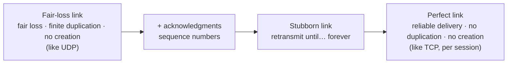

# 8. Introduction and Overview

[← 7. Log-Structured Storage](07-log-structured-storage.md) · [Book](../README.md) · [9. Failure Detection →](09-failure-detection.md)

## Summary

Part II turns from storage engines to **distributed systems**. Its opener (pp. 167–169) defines the vocabulary used throughout:

- **participants** (processes, nodes, replicas), each with local state;
- **links** for message passing;
- **clocks**, either logical (monotonic counters) or physical ("wall clocks");
- **distributed algorithms**, which describe local steps and interactions despite unreliable links and processes.

Their purposes are coordination, cooperation, dissemination and consensus (p. 169).

This chapter then builds the foundations (pp. 171–194):

- Even two threads updating one variable have **four possible outcomes** (Figure 8-1), so we need **consistency models**.
- The **fallacies of distributed computing** and the assumptions behind them: processing, clocks, state consistency, local versus remote calls, failures, partitions and **cascading failures** (pp. 174–181).
- **Links**, built up from **fair-loss** through acknowledgments and **stubborn** retransmits to the **perfect link**, with sequence numbers, a reorder buffer and deduplication (pp. 182–186).
- Why **exactly-once *delivery*** is really exactly-once *processing* (pp. 186–187).
- Two impossibility results: the **Two Generals' Problem** (pp. 187–189) and **FLP** (pp. 189–190).
- **Synchrony** models (asynchronous, synchronous, partially synchronous) and **failure models** (crash-stop, crash-recovery, omission, arbitrary or Byzantine) (pp. 190–193).

## Key takeaways

- **Concurrency is the first distributed-systems problem,** even before leaving a single node: `x = 1` with an adder (+2) and a multiplier (×2) can end at 2, 3, 4 or 6 (pp. 171–172).
- **A timeout can't tell you why a node didn't reply.** It might be overloaded, crashed, slow, or the network might be at fault (p. 173).
- **Bigger queues don't raise throughput.** They add latency. **Backpressure** slows down producers (pp. 175–176).
- **Don't use timestamps for ordering** unless you have high-precision time sources (Spanner's TrueTime returns uncertainty bounds) (pp. 176–177).
- **Retries are safe only for idempotent operations,** so deduplicate instead (pp. 184–185).
- **A perfect link = fair-loss link + acknowledgments + retransmits + sequence numbers + dedup.** It gives reliable delivery, no duplication and no creation. TCP gives this only within one session (pp. 185–186).
- **Exactly-once means processing once and ignoring duplicates.** A reliable link can't avoid sending some messages more than once (p. 187).
- **FLP:** in a fully asynchronous system, no deterministic consensus protocol can tolerate the crash of even one process within bounded time. Real systems escape through partial synchrony (pp. 189–191).

## Section outline

*From the book’s own table of contents (PDF bookmarks); printed page numbers.*

- Concurrent Execution — p. 171
  - Shared State in a Distributed System — p. 173
- Fallacies of Distributed Computing — p. 174
  - Processing — p. 175
  - Clocks and Time — p. 176
  - State Consistency — p. 177
  - Local and Remote Execution — p. 178
  - Need to Handle Failures — p. 178
  - Network Partitions and Partial Failures — p. 179
  - Cascading Failures — p. 180
- Distributed Systems Abstractions — p. 181
  - Links — p. 182
- Two Generals’ Problem — p. 187
- FLP Impossibility — p. 189
- System Synchrony — p. 190
- Failure Models — p. 191
  - Crash Faults — p. 191
  - Omission Faults — p. 192
  - Arbitrary Faults — p. 193
  - Handling Failures — p. 193
  - Summary — p. 193

## Notes

Part II opens with Lamport's quip that a computer you didn't know existed can make yours unusable (p. 167). Vertical scaling is expensive and hard to maintain, so systems scale **horizontally**, running on many networked machines that act as one logical entity (p. 167). Most research in the field starts from the fact that nothing is entirely reliable: links delay, reorder and drop messages, and processes pause, slow down, crash or go out of control (p. 168). CPUs are tiny distributed systems themselves, but their primitives can't be reused directly because remote communication is expensive and unreliable (p. 168).

### Concurrent execution

A single thread running `i = 1; i += 2; i *= 2` always produces 6. With two threads sharing `x`, the outcome depends on the interleaving (Figure 8-1, p. 172):

| Case | Interleaving | Result |
|---|---|---|
| a | Both read 1; adder writes 3; multiplier overwrites with 2 | **2** |
| b | Both read 1; multiplier writes 2; adder overwrites with 3 | **3** |
| c | Multiplier finishes first (1 × 2), then adder (+2) | **4** |
| d | Adder finishes first (1 + 2), then multiplier (× 2) | **6** |

**Consistency models** define which execution histories are allowed, constraining or relaxing the set of possible states (p. 172). Concurrent systems may share memory; distributed systems have local state and **message passing** (pp. 172–173).

> **Vault note:** the book's sidebar on concurrent versus parallel (p. 173). Concurrent steps overlap in time; parallel steps run simultaneously on several processors. Joe Armstrong's analogy: concurrency is two queues for one coffee machine, parallelism is two queues for two machines.

#### Shared state in a distributed system

Putting a single database at the centre doesn't keep processes in sync. Every access is a message, so the question becomes what a *long* wait means, which requires stating the system's **synchrony** (p. 173). A silent database could be overloaded, unavailable or slow, or the network could be failing, so a **failure model** is needed too (p. 173). **Fault tolerance** starts with removing the single point of failure by adding a backup, which raises the next problem: keeping the copies in sync (pp. 173–174).

### Fallacies of distributed computing

Connections fail, responses get lost, and remote calls are never free (p. 174). Peter Deutsch's 1994 list also includes network security, adversaries, topology changes, transport cost and the assumption of a single authority over the network (p. 175). The book adds more assumptions that bite in practice:

| Assumption | Reality (pp. 175–179) |
|---|---|
| **Processing is instantaneous** | Remote work takes time; messages wait in queues; nodes differ in hardware and versions; a parallel fan-out is as slow as its slowest server |
| **Queues are infinite** | Bigger queues only add latency. **Backpressure** slows producers and is often bolted on afterwards rather than designed in |
| **Clocks are in sync** | Drift matters; don't order by timestamps without special time sources. Know whether a clock is **monotonic** |
| **State is consistent** | Eventually consistent systems diverge and repair. Cassandra had bugs from schema changes and ring views that propagated at different times |
| **Local = remote** | Hiding a remote call behind a local API hides latency, consistency, paging and reconciliation (Waldo et al.) |
| **Nodes are up** | Maintenance, OOM kills, bugs and hardware fail. Heartbeats and failure detectors form *hypotheses* about liveness |

Process-local queues serve three goals (p. 176):

- **decoupling** receipt from processing;
- **pipelining** stages;
- **absorbing short bursts**, which adds latency but beats failing and retrying.

Size queues by measured processing and wait times for stable loads, and for bursts when load is unpredictable (p. 176).

#### Network partitions and partial failures

A **network partition** is when servers can't communicate. Gilbert and Lynch distinguish two participants being unable to talk from whole *groups* being isolated and proceeding independently, which can produce conflicting results (p. 179). Links can also fail **asymmetrically**, delivering in one direction only (p. 179). Design for partial failures, for example when data was replicated but no acknowledgment arrived. The best way to design for failures is to **test** for them: inject partitions, bit rot, latency and clock skew (pp. 179–180).

> **Vault note:** the book's tool list (p. 180): Toxiproxy (network faults), Chaos Monkey (random production shutdowns), CharybdeFS (filesystem errors) and CrashMonkey (filesystem consistency testing).

#### Cascading failures

An overloaded node that tips over shifts its load onto the others. Even good intentions can cascade: peers flooding a node that has just come back with missed updates can bring it down again (p. 180).

| Defence | What it does (pp. 180–181) |
|---|---|
| **Circuit breaker** | Detects failures, steers calls away from a failing service and gives it time to recover |
| **Backoff** | Waits longer and longer between one client's retries |
| **Jitter** | Adds randomness so clients don't all retry at the same moment |
| **Checksums and validation** | Stop corrupted data from replicating over good copies |
| **Coordination** | A coordinator plans execution from available resources and past load, avoiding hotspots |

### Distributed systems abstractions

A shared vocabulary avoids ambiguity (pp. 181–182).

#### Links

Each layer adds a guarantee (pp. 182–186):

- **Fair-loss link** (pp. 182–183). A sent message is either not yet delivered, irrecoverably lost or delivered, and the sender can't tell which. Properties:
  - *fair loss*: retransmitting infinitely often to a correct receiver eventually gets the message delivered;
  - *finite duplication*;
  - *no creation*.
- **Acknowledgments** (pp. 183–184). M(n) carries a unique, monotonically increasing number, and the receiver replies ACK(n). An ACK can be lost too. Once received, it proves delivery. Any unique identifier works; hashes need collision handling.
- **Stubborn link** (p. 184). Resend after a timeout T, indefinitely, so a message can't be irrecoverably lost. That's impractical without acknowledgments.
- **The problem with retransmits** (pp. 184–185). Until the ACK arrives, the message may have been processed, may be about to be processed, may be lost, or the receiver may have crashed. Resending can create **duplicates**, which are harmless only for **idempotent** operations. Shutting down a server is idempotent; charging a credit card isn't. Since not everything is idempotent, **deduplicate** instead.
- **Message order** (p. 185). The receiver tracks two counters:
  - **n_consecutive**, the highest sequence number up to which every message has arrived;
  - **n_processed**, the highest number put back in order and processed, which is used for dedup.

  Out-of-order messages wait in a **reorder buffer**: receiving 5 after 3 means holding 5 until 4 arrives. Anything ≤ n_consecutive that arrives again can be discarded.
- **Perfect link** (p. 186): reliable delivery, no duplication, no creation. TCP resembles it, but with grouped and selective acknowledgments, flow and congestion control, and only within a single session.

> **Try it:** [From fair-loss to perfect links](../widgets/08-perfect-link.html) — send numbered messages over a lossy, reordering, duplicating link, then switch on acknowledgments, retransmits, the reorder buffer and dedup one at a time, and watch n_consecutive and n_processed.

#### Exactly-once delivery

The book quotes Mathias Verraes' joke that exactly-once delivery is one of the two hard problems, and lists it twice (p. 186). Real systems use **at-least-once** delivery (retry until acknowledged) or **at-most-once** (send without confirmation) (p. 186). TCP dedups packets within a session. If the connection breaks after processing but before the ACK arrives, though, the application may resend (pp. 186–187). What matters is **exactly-once processing**. True exactly-once would require **common knowledge**: everyone knows a fact, and everyone knows that everyone knows it. That's impossible in theory, as the next section shows, so systems create the illusion by **processing once and ignoring duplicates** (p. 187).

### Two Generals' Problem

Two armies attack a city from opposite sides and win only if they attack together. They communicate through messengers who may be captured (p. 188). General A sends MSG(N). B doesn't know if A received its ACK(MSG(N)), so B needs ACK(ACK(MSG(N))), and so on: they are always **one ACK away** from certainty (Figure 8-4) (pp. 188–189). Communication here is fully asynchronous, with no time bound (p. 189). Lesson: agreement is impossible over an asynchronous link that can fail. Perfect links concern transport only; they don't guarantee perfect delivery or that participants stay alive (p. 187).

### FLP Impossibility

Fischer, Lynch and Paterson (1985) consider processes that start with initial values and must agree on one (p. 189). A correct **consensus** protocol needs (p. 189):

| Property | Meaning |
|---|---|
| **Agreement** | Every process decides the same value |
| **Validity** | The decided value was proposed by a participant; nontrivial, not a fixed default |
| **Termination** | Every nonfaulty process eventually decides |

In a **fully asynchronous** model there are no timeouts, and a crashed process is indistinguishable from a slow one. FLP shows that **no deterministic protocol guarantees consensus in bounded time if even one process may crash unannounced** (p. 189). That doesn't make consensus impossible in practice: it only can't *always* be reached in bounded time asynchronously, and real systems have some synchrony (p. 190).

### System synchrony

| Model | Assumptions (pp. 190–191) | Consequence |
|---|---|---|
| **Asynchronous** | Unknown relative speeds; no bound on delivery time or order | Failures can't be reliably detected; FLP applies |
| **Synchronous** | Comparable process speeds, bounded delays, bounded clock difference | Timeouts work, enabling leader election, consensus and failure detection, but timing violations cause failures: two Raft leaders, a live process suspected dead |
| **Partially synchronous** (Dwork et al.) | Bounds hold most of the time, but aren't exact | The practical middle ground |

Synchrony affects performance, scalability and even solvability (p. 191).

### Failure models

A **failure model** states exactly how processes may fail, and algorithms are designed around it (p. 191).

| Model | Behaviour (pp. 191–193) |
|---|---|
| **Crash-stop** | The process stops executing steps and sending messages, and stays stopped *as far as the algorithm is concerned*. It may recover and join a later round, but can't rejoin the current one; a new identity doesn't make it crash-recovery |
| **Crash-recovery** | The process stops and later resumes. Requires durable state and a recovery protocol, and the algorithm must handle every recovery state. Others can't tell it from an unreachable process, so it's a special case of omission |
| **Omission** | Steps are skipped, invisible, or messages aren't sent or received: partitions, switch failures, congestion, full queues, a lost message the sender wrongly assumes was delivered. A very slow node looks *forgetful*. A crash = omitting all messages |
| **Arbitrary (Byzantine)** | The process keeps executing but contradicts the algorithm, for example deciding a value nobody proposed. Caused by bugs, mixed versions or malicious actors. Relevant to aerospace (cross-validation) and cryptocurrencies |

#### Handling failures

Failures are **masked** with process groups and redundancy, at the cost of slower fallback paths. Many failures are prevented in software with reviews, testing, timeouts, retries and locally ordered steps (p. 193). Most algorithms in the book assume **crash failures** and rely on redundancy (p. 193).

## Trade-offs at a glance

| Delivery semantics | Sender behaviour | Risk | Needed for "exactly once" |
|---|---|---|---|
| At-most-once | Send, never retry | Loss | — |
| At-least-once | Retry until ACK | Duplicates | Idempotence or dedup at the receiver |
| "Exactly-once" | At-least-once + dedup | Dedup state must survive crashes | Common knowledge is impossible; process once |

| Failure model | Easiest to tolerate → hardest |
|---|---|
| Crash-stop → crash-recovery → omission → Byzantine | Each one is more general than the last |

## Beyond the book

- **Deutsch's eight fallacies**, commonly listed as: the network is reliable; latency is zero; bandwidth is infinite; the network is secure; topology doesn't change; there is one administrator; transport cost is zero; the network is homogeneous. The book paraphrases most of them (pp. 174–175).
- **Exponential backoff with "full jitter"** (sleep = random(0, min(cap, base·2ⁿ))), popularized by AWS, spreads retries best among the common variants. It's the backoff-plus-jitter pattern from p. 181.
- **Idempotency keys**, a client-generated unique ID per request stored with the result, are how payment APIs turn the at-least-once delivery the book describes into exactly-once *processing*.
- [DDIA Ch. 9](../../designing-data-intensive-applications/chapters/09-the-trouble-with-distributed-systems.md) covers the same failure modes from the application side, with more on process pauses and clock confidence intervals.

## Connections

- **Related chapters:** [9. Failure Detection](09-failure-detection.md) (turning timeouts into suspicion), [11. Replication and Consistency](11-replication-and-consistency.md) (consistency models, CAP), [14. Consensus](14-consensus.md) (how Paxos and Raft live with FLP), [5. Transaction Processing and Recovery](05-transaction-processing-and-recovery.md) (concurrency on one node).

## Check yourself

*Questions and answers are the vault's, written from the notes above; answers cite the book's pages.*

1. **Two threads run `x += 2` and `x *= 2` on x = 1 without synchronization. Which results are possible?**

   *Answer:* 2, 3, 4 and 6, depending on which reads and writes interleave (Figure 8-1, p. 172).

2. **Why doesn't a larger queue increase throughput?**

   *Answer:* It doesn't change the processing rate; messages just wait longer. Backpressure, which slows producers, addresses overload instead (pp. 175–176).

3. **What properties does a fair-loss link have?**
   - [x] Fair loss, finite duplication, no creation
   - [ ] Reliable delivery, no duplication, no creation
   - [ ] FIFO order and exactly-once delivery

   *Answer:* That's the UDP-like base. Reliable delivery and no duplication are the perfect link's guarantees (pp. 182–183, 186).

4. **A receiver has n_consecutive = 3 and receives message 5. What does it do?**

   *Answer:* It puts 5 in the reorder buffer until 4 arrives. A repeat of any message ≤ 3 can be discarded as a duplicate (p. 185).

5. **Why is "exactly-once delivery" really about processing?**

   *Answer:* A reliable link can't avoid sending some messages more than once. What can be guaranteed is processing each message once and ignoring duplicates. True agreement on whether it was persisted would need common knowledge, which is impossible (pp. 186–187).

6. **What does FLP prove, and what does it *not* prove?**

   *Answer:* In a fully asynchronous system, no deterministic consensus protocol is guaranteed to terminate in bounded time if even one process may crash. It does *not* say consensus is impossible in practice: partially synchronous systems reach it (pp. 189–190).

7. **Why can crash-recovery be seen as a special case of omission failure?**

   *Answer:* To other processes, a node that crashed and recovered looks the same as one that was unreachable and missed messages (p. 192).

8. **Which two defences keep many clients from overwhelming a recovering server with retries?**

   *Answer:* Backoff, which spaces out each client's retries, and jitter, which randomizes them so clients don't retry together (p. 181).
