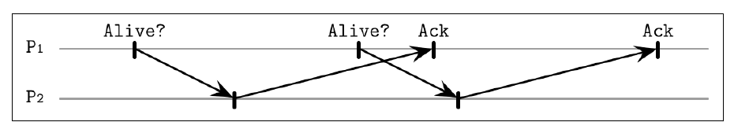
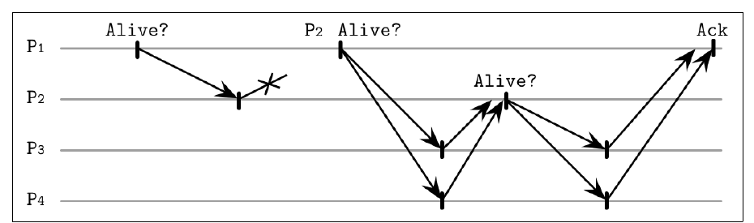
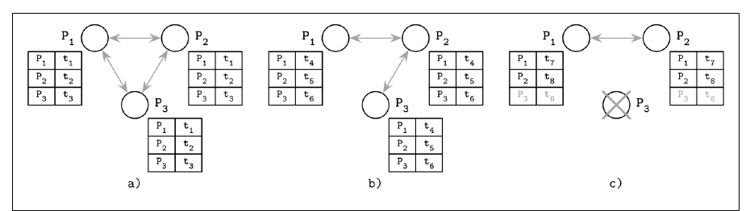

# 9. Failure Detection

[← 8. Introduction and Overview](08-introduction-and-overview.md) · [Book](../README.md) · [10. Leader Election →](10-leader-election.md)

## Summary

A failed process that keeps getting contacted raises latency and lowers availability, so failures must be detected in time (p. 195). Without timing assumptions, though, a crashed process can't be told apart from a slow one: this is FLP again (p. 195). A **failure detector** is a local subsystem that identifies failed or unreachable processes, so they can be excluded to guarantee **liveness** while preserving **safety** (p. 195). Every detector trades **false positives** (live processes suspected) against **false negatives** (dead processes given the benefit of the doubt), and **efficiency** against **accuracy**. No detector can be both accurate and efficient (pp. 195–196).

The chapter surveys several approaches:

| Detector | Idea |
|---|---|
| **Pings and heartbeats** with a deadline (Akka) | Mark a peer suspected after a fixed silence |
| **Heartbeat** (Aguilera et al.) | Timeout-free; counts heartbeats propagated along paths |
| **SWIM** outsourced heartbeats | Ask random peers to probe on your behalf |
| **φ-accrual** (Cassandra, Akka) | A continuous suspicion level computed from the distribution of past arrival times |
| **Gossip-style** | Replicated heartbeat tables |
| **FUSE** | Turns any single failure into a *group* failure by going silent |

## Key takeaways

- **Liveness:** something good eventually happens, e.g. a failure gets detected. **Safety:** nothing bad happens, e.g. only dead processes are marked dead (pp. 195–196).
- **Completeness:** every nonfaulty member eventually notices the failure. **Efficiency:** how fast. **Accuracy:** how precisely (p. 196).
- **Fixed deadlines depend on tuning** and only reflect one process's view of the network (p. 197).
- **Indirect probes beat direct ones.** SWIM's outsourced pings and gossip tables keep a live node "alive" even when one direct link is broken (pp. 198–201).
- **φ-accrual adapts to the network.** It isn't up/down: it's a suspicion level computed from the mean and variance of recent inter-arrival times (pp. 199–200).
- **Consensus is solvable even with a failure detector that makes infinitely many mistakes** (Chandra and Toueg) (p. 202).

## Section outline

*From the book’s own table of contents (PDF bookmarks); printed page numbers.*

- Heartbeats and Pings — p. 196
  - Timeout-Free Failure Detector — p. 197
  - Outsourced Heartbeats — p. 198
- Phi-Accural Failure Detector — p. 199
- Gossip and Failure Detection — p. 200
- Reversing Failure Detection Problem Statement — p. 201
- Summary — p. 202

## Notes

**Dead**, **failed** and **crashed** describe a process that has stopped completely. **Unresponsive**, **faulty** and **slow** describe *suspected* processes, which may or may not be dead (p. 195). Failures happen at the link level (lost or slow messages) or at the process level (crashes or slowness), and slowness isn't always distinguishable from failure (p. 195).

| Property | Meaning (pp. 195–196) |
|---|---|
| **Liveness** | An intended event must occur: if a process fails, it *will* be detected |
| **Safety** | Unintended events won't occur: a process marked dead *was* dead |
| **Completeness** | Every nonfaulty member eventually notices the failure; the algorithm makes progress |
| **Efficiency** | How fast failures are identified |
| **Accuracy** | No false accusations and no missed failures |

Excluding failed processes avoids wasted work and stops error propagation and cascading failures, but excluding a live suspect reduces availability (p. 196). Efficiency and accuracy behave like a tunable parameter, and detectors are allowed to make mistakes (Chandra and Toueg). Failure detectors underpin consensus and atomic broadcast. The chapter assumes **no Byzantine failures** (p. 196).

### Heartbeats and pings

| Mechanism | Who initiates (p. 196) |
|---|---|
| **Ping** | The monitor sends a message and expects a response within a time period |
| **Heartbeat** | The monitored process notifies its peers that it's alive |

Each process keeps a list of alive, dead and suspected peers with their last response times, and suspects a peer that doesn't respond for too long (p. 197). Delayed acknowledgments that arrive after the next ping can get a live process marked down (Figures 9-1, 9-2). Akka's **deadline failure detector** reports a failure if a heartbeat isn't registered within a fixed interval (p. 197). Downsides: precision depends on carefully chosen ping frequency and timeout, and the detector doesn't capture how *other* processes see the peer (p. 197).

*Figure 9-2 (p. 197): when responses lag behind the ping interval, the detector must decide whether "late" means "dead".*

#### Timeout-free failure detector

Aguilera et al.'s **Heartbeat** algorithm only *counts* heartbeats, so it works under asynchronous assumptions (p. 197). It assumes fair paths between correct processes and that every process knows all the others (pp. 197–198).

- A heartbeat message carries the **path** it has travelled plus a unique ID.
- A receiver increments the counters of every process on the path, appends itself, and forwards the message to processes not yet on it. Propagation stops once every known process appears in the path (p. 198).
- Because heartbeats take many routes, a process can correctly be marked alive even when the direct link to it is faulty (p. 198).
- The counters form a global, normalized view, but choosing a threshold to interpret them is tricky. A bad threshold still produces false suspicions (p. 198).

#### Outsourced heartbeats

**SWIM** (Scalable Weakly Consistent Infection-style Process Group Membership) checks liveness from neighbours' perspectives, and each process needs to know only a subset of peers (p. 198).

*Figure 9-3 (p. 199): when a direct ping fails, neighbours probe the suspect, so a single bad link doesn't cause a false suspicion.*

This accounts for both direct and indirect reachability, spreads the decision across members, avoids broad broadcasts, and gathers information quickly because the probes run in parallel (p. 199).

### Phi-accrual failure detector

Instead of a binary up/down, the **φ-accrual** detector (Hayashibara et al., 2004) uses a **continuous** scale of crash likelihood (p. 199).

- It keeps a **sliding window** of recent heartbeat arrival times, assumed to be normally distributed, and estimates their **mean and variance** (pp. 199–200).
- From these it computes how likely a heartbeat is to arrive *t* time units after the last one, and from that **φ**, the suspicion level: how likely we are to be wrong if we declare the node dead now (p. 200).
- When φ reaches a **threshold**, the node is marked down. The scale adapts to changing network conditions (p. 199).

| Subsystem | Role (pp. 199–200) |
|---|---|
| **Monitoring** | Collect liveness samples via pings, heartbeats or request-response sampling |
| **Interpretation** | Decide whether to suspect the process |
| **Action** | A callback when it's suspected |

It comes from the Japan Advanced Institute of Science and Technology and is used in Cassandra and Akka, alongside Akka's deadline detector (p. 200).

> **Try it:** [φ-accrual failure detector](../widgets/09-phi-accrual.html) — feed a node heartbeats with adjustable jitter, pause or kill it, and watch φ climb against a threshold, next to a fixed-deadline detector on the same stream.

### Gossip and failure detection

A **gossip-style** failure detection service (van Renesse et al.) avoids relying on a single node's view (p. 200).

- Each member keeps a list of members, their **heartbeat counters** and the local timestamp of each counter's last increase.
- Periodically, a member increments its own counter and sends its list to a **random neighbour**, which merges it with its own (p. 200).
- A member whose counter hasn't increased for long enough is considered failed. Choose that timeout carefully to keep false positives down (p. 200).
- Worst-case bandwidth is capped and grows at most **linearly** with the number of processes (p. 200).

Figure 9-4 (p. 201):

*Figure 9-4 (p. 201): every process keeps the whole heartbeat table and merges its neighbours' copies, so a stale row reveals a failure.*

1. All three processes communicate and update their timestamps.
2. P3 can't reach P1, but its timestamp t6 still reaches P1 **through P2**.
3. P3 crashes, stops sending updates and is detected as failed.

The view aggregates many nodes, so decisions are reliable. Gossip costs more messages but spreads information more reliably (p. 201).

### Reversing the failure detection problem statement

**FUSE** (failure notification service) focuses on cheap, reliable failure *propagation*, even across partitions (p. 201). Active processes are arranged in **groups**. When a member can't get a response, because of a crash, partition or link failure, the member that pinged it **stops responding to pings itself**, so the silence spreads until the whole group detects the failure (Figure 9-5) (pp. 201–202).

| Step (p. 202) | State |
|---|---|
| a | All alive and communicating |
| b | P2 crashes and stops answering pings |
| c | P4 detects it and goes silent too |
| d | P1 and P3 see the silence; the failure propagates to the whole group |

Every member is guaranteed to learn of the group failure. On the downside, a link failure isolating one process also becomes a group failure, which may or may not be desirable (p. 202).

### Summary

FLP says consensus can't be guaranteed asynchronously, and failure detectors augment the model by trading accuracy for completeness. Chandra and Toueg showed consensus is solvable even with a detector that makes infinitely many mistakes (p. 202). The approaches differ: direct communication, broadcast or gossip, or quiescence (silence) as the propagation mechanism, using hard deadlines or continuous scales (pp. 202–203).

## Trade-offs at a glance

| Detector | Timeouts? | View | Strength | Weakness |
|---|---|---|---|---|
| Deadline (ping/heartbeat) | Fixed | One process | Simple | Tuning; one perspective |
| Heartbeat (path counting) | None | Global counters | Works asynchronously; survives a bad link | Threshold hard to choose |
| SWIM outsourced pings | Yes | Random subset | Indirect reachability; no broadcast | Extra probe round |
| φ-accrual | Adaptive | One process + statistics | Adapts to jitter; tunable φ | Assumes a distribution |
| Gossip heartbeat table | Yes | Aggregated | Reliable; survives link failures | More messages |
| FUSE | Yes | Group | Everyone learns of failures | One link failure becomes a group failure |

## Beyond the book

- **The φ formula.** With mean μ and standard deviation σ of inter-arrival times and Δ the time since the last heartbeat, φ(Δ) = −log₁₀(1 − F(Δ)), where F is the normal CDF. φ = 1 means about a 10% chance of a mistake if you suspect now, φ = 2 about 1%, φ = 3 about 0.1%. Cassandra's default `phi_convict_threshold` is 8. The widget computes exactly this.
- **SWIM's suspicion sub-protocol** (and HashiCorp's Lifeguard extensions used in Consul and Serf) adds a "suspect" state that other members can refute before declaring death. This cuts false positives from a temporarily slow prober.
- **Kubernetes node leases** are a deadline detector in the book's sense: a kubelet renews its Lease object every 10 s by default, and the node controller marks the node *Unknown* after `node-monitor-grace-period`.

## Connections

- **Related chapters:** [8. Introduction and Overview](08-introduction-and-overview.md) (FLP, synchrony), [10. Leader Election](10-leader-election.md) (detectors trigger elections), [12. Anti-Entropy and Dissemination](12-anti-entropy-and-dissemination.md) (gossip), [14. Consensus](14-consensus.md) (failure detectors in Paxos and Raft).

## Check yourself

*Questions and answers are the vault's, written from the notes above; answers cite the book's pages.*

1. **A failure detector marks a live but slow process as dead. Which property did it violate?**
   - [ ] Liveness
   - [x] Safety (accuracy)
   - [ ] Completeness

   *Answer:* Safety requires that a process marked dead was actually dead. Mistakes like this are false positives (pp. 195–196).

2. **What are the two main weaknesses of a fixed-deadline detector?**

   *Answer:* Its precision depends on the chosen ping frequency and timeout, and it reflects only one process's view, not how others see the peer (p. 197).

3. **How can the timeout-free Heartbeat algorithm mark a process alive even when the direct link to it is broken?**

   *Answer:* Heartbeats travel along many paths, and each receiver increments the counters of every process on the path. Liveness information arrives indirectly (p. 198).

4. **In SWIM, what does P1 do when P2 doesn't answer a ping?**

   *Answer:* It asks several random members to ping P2 on its behalf. If P2 answers any of them, they forward the acknowledgment to P1 (pp. 198–199).

5. **What does the φ-accrual detector estimate from its sliding window?**

   *Answer:* The mean and variance of heartbeat inter-arrival times. From these it computes the probability of a heartbeat arriving after the current silence, giving the suspicion level φ (pp. 199–200).

6. **How does FUSE propagate a failure?**

   *Answer:* Through silence. A member that can't reach another stops answering pings itself, so the failure spreads until the whole group knows (pp. 201–202).

7. **What did Chandra and Toueg show about failure detectors and consensus?**

   *Answer:* Consensus can be solved even with a failure detector that makes an infinite number of mistakes (p. 202).
