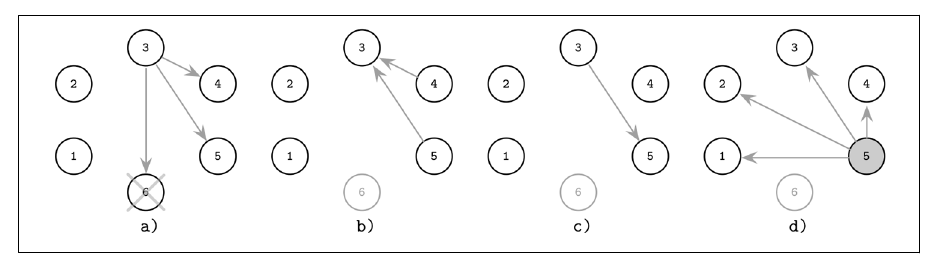
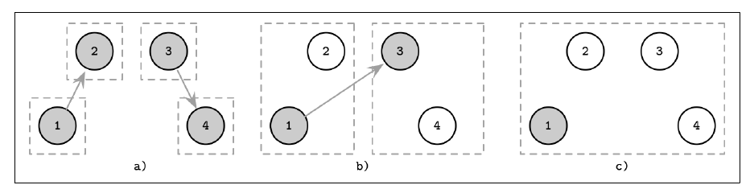
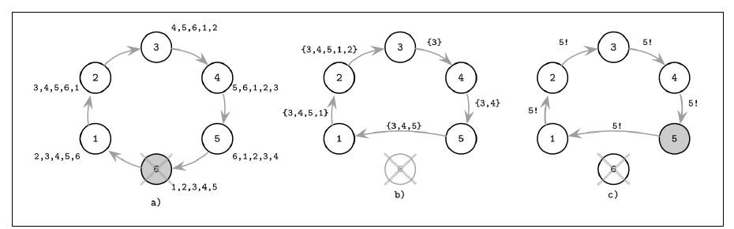

# فصل ۱۰: انتخاب leader

[فصل ۹: تشخیص شکست →](09-failure-detection.md) · [کتاب](../README.md) · [فصل ۱۱: replication و consistency ←](11-replication-and-consistency.md)

## خلاصه

تماس گرفتن با هر شرکت‌کننده‌ای در هر قدمی گران است، به‌ویژه در شبکه‌های بزرگ یا جغرافیایی‌توزیع‌شده. پس خیلی از الگوریتم‌ها به یک **leader**، که coordinator است، تکیه می‌کنند تا اجرا را براند یا هم‌آهنگ کند (p. 205). هر processی می‌تواند leader شود. معمولاً تا از کار افتادنش leader می‌ماند، و بعد **انتخاب**ی تازه جانشینی برمی‌دارد (p. 205).

- **مفهوم liveness:** بیشتر وقت‌ها leaderی هست، و انتخاب‌ها در غایت تمام می‌شوند.
- **ایمنی:** در هر زمانی حداکثر یک leader، بی **split brain**. خیلی از الگوریتم‌های انتخاب در عمل این را نقض می‌کنند (p. 205).

فصل چند الگوریتم را می‌پوشاند:

- **الگوریتم Bully** که انتخابی پادشاهی است: بالاترین رتبه می‌برد.
- دو بهینه‌سازی Bully: فهرست‌های **failover نفر بعدی** و جدایی **نامزد و عادی** با تساوی‌شکن δ.
- الگوریتم **دعوت**، که به‌جای رتبه زدن *گروه‌ها را merge می‌کند*.
- الگوریتم **حلقه**، که مجموعه‌ی زنده‌ها را گرد حلقه جمع می‌کند.

نتیجه‌گیری‌اش: هر یک از آن‌ها بی **اکثریت** cluster‌سراسری به split brain گرایش دارد، و انتخاب leader *خودش* مسئله‌ای از جنس consensus است. الگوریتم‌های Multi-Paxos و Raft می‌گذارند leaderها کوتاه‌مدت تعارض کنند و تعارض‌ها را ایمن حل (pp. 207–213).

## نکته‌های کلیدی

- **انتخاب باید قطعی باشد:** دقیقاً یک leader بیرون می‌آید، و هر شرکت‌کننده‌ای می‌فهمد چه کسی (p. 206).
- **انتخاب leader قفل توزیع‌شده نیست.** لازم نیست دارنده‌های قفل معلوم باشند، و قفلی که برخی processها را ترجیح بدهد بقیه را گرسنه می‌گذارد. leader باید *معلوم* باشد، و leaderهای دیرزیست *ترجیح داده می‌شوند* (p. 206).
- **نقش leader می‌تواند گلوگاه شود.** داده را پارتیشن کنید و به هر مجموعه‌ی replicaیی leader خودش را بدهید، چنان‌که Spanner می‌کند (p. 206).
- **الگوریتم Bully زیر پارتیشن split brain می‌سازد** و می‌تواند نودی ناپایدار و رتبه‌بالا را بار‌به‌بار دوباره انتخاب کند. برای پرهیز، سنجه‌های کیفیت میزبان را پخش کنید (p. 208).
- **فهرست‌های failover و مجموعه‌های نامزد پیام را می‌برند**؛ و latency δ برای هر نودی تساوی میان انتخاب‌های هم‌هنگام را می‌شکند (pp. 208–209).
- **الگوریتم حلقه می‌تواند تنها بیشینه‌ی جاری را حمل کند**، چون max commutative است (p. 212).
- **مجاز کردن چند leader به‌طور موقت بهینه‌سازی کارایی است.** ایمنی از تشخیص و حل تعارض می‌آید، با quorumهای Paxos یا termهای Raft (p. 213).

## فهرست بخش‌ها

*از فهرست مطالب خود کتاب، از bookmarkهای PDF؛ شماره‌ها صفحه‌ی چاپی‌اند.*

- الگوریتم Bully — ص. ۲۰۷
- بخش failover نفر بعدی — ص. ۲۰۸
- بهینه‌سازی نامزد و عادی — ص. ۲۰۹
- الگوریتم دعوت — ص. ۲۱۰
- الگوریتم حلقه — ص. ۲۱۱
- خلاصه — ص. ۲۱۲

## یادداشت‌ها

همه‌ی leaderها مثلاً برای برپا کردن **ترتیب کلی** پیام‌ها در پخشی به کار می‌روند: leader حالت جهانی را دارد، پیام‌ها را می‌گیرد و پخششان می‌کند. همچنین سازمان دوباره را پس از شکست و سر راه‌اندازی و سر تغییرهای مهم حالت هم‌آهنگ می‌کنند (p. 205). انتخاب‌ها سر راه‌اندازی و وقتی leader از کار بیفتد یا حرف زدن را بس کند برانگیخته می‌شوند (p. 206). leaderی پایدار از synchronization حالت میان همتاها می‌پرهیزد، پیام را می‌برد، و اجرا را از یک جا می‌راند (p. 206). الگوریتم‌های ZAB و Multi-Paxos و Raft leaderهای موقت با انتخاب و تشخیص شکست و حل تعارض الگوریتم‌ویژه‌ی خودشان به کار می‌برند (p. 206).

| | انتخاب leader | قفل توزیع‌شده |
|---|---|---|
| بقیه باید دارنده را بدانند؟ | بله؛ leader تازه خودش را اعلام می‌کند | نه |
| ترجیح برخی processها | اشکالی ندارد؛ leaderهای دیرزیست ترجیح داده می‌شوند | بقیه را گرسنه می‌گذارد، که liveness را نقض می‌کند |
| دارنده نقش را نگه می‌دارد | تا بس کند یا از کار بیفتد | باید در غایت رهایش کند |

*از ص. ۲۰۶.*

### الگوریتم Bully

هر processی **رتبه**ای یکتا دارد، و بالاترین‌رتبه‌ی زنده leader می‌شود، از گارسیا-مولینا. نام از این می‌آید که نود سر بقیه را «زورگویانه» وا می‌دارد قبولش کنند؛ انتخاب **پادشاهی** هم نامیده می‌شود (p. 207). کتاب گونه‌ی تغییریافته‌ی جمع‌و‌جور را وصف می‌کند، از کردافشاری و همکاران، یادداشت ۱ (p. 207):

1. پیام‌های **Election** را به هر processی با ID بالاتر بفرست.
2. منتظر پاسخ بمان. اگر هیچ process رتبه‌بالاتری پاسخ ندهد، به قدم ۳ برو. وگرنه به بالاترین‌رتبه‌ای که پاسخ داده خبر بده و بگذار او قدم ۳ را بکند.
3. فرض بگیر هیچ process رتبه‌بالاتری زنده نیست و خودت را به همه‌ی processهای رتبه‌پایین‌تر اعلام کن.

شکل ۱۰-۱ (pp. 207–208):

*Figure 10-1 (p. 208): process ۳ آن شکست را می‌بیند، بالاترین process زنده یعنی ۵ پاسخ می‌دهد، و ۵ پخش می‌کند که leader تازه است.*

| مسئله | علت و درمان (p. 208) |
|---|---|
| **split brain** | پارتیشنی نودها را به گروه می‌شکند، و هر گروهی leaderی انتخاب می‌کند |
| **انتخاب دوباره‌ی بی‌پایان** | نودی ناپایدار و رتبه‌بالا می‌برد، می‌شکند، بازهم می‌برد… درمان: سنجه‌های کیفیت میزبان را پخش کنید و در انتخاب در نظر بگیرید |

> **Try it:** [انتخاب Bully](../widgets/10-bully-election.html)؛ leader را از کار بیندازید، بردارید که چه کسی می‌بیند، و پیام‌های Election و Alive و Elected را قدم‌به‌قدم بگذرانید. failover نفر بعدی را روشن کنید تا آن کوتاه‌راه را ببینید، یا cluster را پارتیشن کنید تا split brain بسازید.

> **In practice:** در stack ما چند جزء برای «فقط یک نمونه کار کند» به هماهنگی نیاز دارند: scheduler در Airflow، controllerهای Kubernetes، Argo CD.
>
> **Your turn:** دو scheduler در Airflow اجرا می‌کنید. چه چیزی نمی‌گذارد یک task دو بار برنامه‌ریزی شود؟
>
> *Answer:* Airflow leader انتخاب نمی‌کند؛ هر scheduler با `SELECT … FOR UPDATE SKIP LOCKED` ردیف‌ها را در دیتابیس metadata قفل می‌کند و دیتابیس نقش coordinator را دارد. انتخاب leader راه دیگری است که هماهنگی هر عمل را به یک بار انتخاب تبدیل می‌کند، به بهای خطر split brain (p. 207).

### عمل failover نفر بعدی

هر leaderی فهرستی از نودهای **failover** منتشر می‌کند، از غلی‌پور و همکاران (p. 208). processی که شکست leader را تشخیص بدهد با بالاترین‌رتبه‌ی **جانشین** در آن فهرست تماس می‌گیرد. اگر زنده باشد، بی دور انتخاب کامل leader می‌شود. اگر خود process detector سر‌جانشین باشد، فوری خودش را اعلام می‌کند (p. 208). در شکل ۱۰-۲، leader یعنی ۶ با جانشین‌های {5, 4} از کار می‌افتد؛ process ۳ با ۵ تماس می‌گیرد؛ process ۵ پاسخ می‌دهد که زنده است، که جلو تماس گرفتن ۳ با بقیه را می‌گیرد؛ و ۵ leadershipاش را اعلام می‌کند (pp. 208–209).

> **In practice:** controllerهای Kubernetes leader را با یک Lease انتخاب می‌کنند که مدت دارد و باید مدام تمدید شود.
>
> **Your turn:** چرا lease مدت‌دار است، و چه خطری باز هم می‌ماند؟
>
> *Answer:* اگر leader بمیرد و lease را رها نکند، lease منقضی می‌شود و نمونه‌ی دیگری جایش را می‌گیرد. ولی leader قدیمی که فقط کند شده ممکن است هنوز خودش را leader بداند؛ پس هر نوشتن باید با fencing یا بررسی lease همراه باشد (pp. 208–212).

### بهینه‌سازی نامزد و عادی

نودها به **نامزد**، که می‌توانند leadership کنند، و نودهای **عادی** جدا می‌شوند، از مرشد و آلن (p. 209). processی عادی انتخاب را با تماس گرفتن با نامزدها شروع می‌کند، بالاترین‌رتبه‌ی زنده را برمی‌دارد و نتیجه را اعلام. انتخاب‌های هم‌هنگام با **تساوی‌شکن δ** پرهیز می‌شوند: latencyی process‌ویژه، که معمولاً از یک رفت‌و‌برگشت پیام بلندتر است، و برای نودهای اولویت‌بالاتر کم‌تر، تا یک نود اول شروع کند (p. 209). در شکل ۱۰-۳، process عادی ۴ می‌بیند که ۶ شکسته، با نامزدها تماس می‌گیرد، و leader یعنی **۲** را اعلام می‌کند (pp. 209–210).

### الگوریتم دعوت

همه‌ی processها به‌جای رتبه زدن بقیه را به پیوستن به گروهشان **دعوت** می‌کنند. چند leader بنا به طرح وجود دارند، یکی برای هر گروهی (p. 210).

- هر processی به‌شکل leader گروهی یک‌نفره شروع می‌کند.
- یک leader همتاهای بیرون گروهش را دعوت می‌کند. اگر آن همتا هم leader باشد، آن دو گروه merge می‌شوند. وگرنه همتا با ID مربوط به leaderش پاسخ می‌دهد، تا آن دو leader بتوانند یک‌راست merge کنند (p. 210).
- مهم نیست کدام leader آخر سر مسئول می‌شود. برداشتن leader گروه **بزرگ‌تر** پیام را کمینه می‌کند، چون تنها به گروه کوچک‌تر لازم است گفته شود (p. 211).

در شکل ۱۰-۴، process ۱ به ۲ دعوت می‌دهد و ۳ به ۴؛ بعد ۱ با ۳ تماس می‌گیرد، و به ۴ از leader تازه گفته می‌شود؛ leader گروه merge‌شده ۱ است (p. 210). گروه‌ها بی شروع کردن انتخاب‌های تازه از صفر merge می‌شوند (p. 211).

*Figure 10-4 (p. 210): گروه‌ها با دعوت merge می‌شوند، و گروه merge‌شده یک leader نگه می‌دارد.*

### الگوریتم حلقه

نودها حلقه‌ای می‌سازند و پیشین‌ها و پسین‌هایشان را می‌شناسند، از چنگ و رابرتس (p. 211).

- نودی که شکست را تشخیص بدهد پیامی انتخاب به پسینش می‌فرستد، و از نودهای دست‌نیافتنی **می‌پرد** تا یکی پاسخ بدهد.
- هر نودی پیش از دادن پیام به بعدی خودش را به **مجموعه‌ی زنده** می‌افزاید، شبیه آن detector بی timeout که به مسیرش می‌چسباند (p. 211).
- وقتی پیام به آغازگر برگردد، بالاترین‌رتبه‌ی مجموعه‌ی زنده leader می‌شود، و سفری دوم گرد حلقه اعلامش می‌کند (p. 211).

در شکل ۱۰-۵، process ۶ شکسته و ۳ پیمایش را شروع می‌کند. process ۵ نمی‌تواند به ۶ برسد، پس به ۱ می‌پرد. چون ۵ بالاترین رتبه را دارد، ۳ دور دومی می‌فرستد و اعلامش می‌کند (pp. 211–212). گونه‌ای فضا‌صرفه‌جو تنها **بیشینه‌ی جاری** از ID را حمل می‌کند، که کار می‌کند چون max commutative است (p. 212). حلقه‌ای که به بخش‌ها بشکند می‌تواند برای هر بخشی leaderی انتخاب کند، پس این‌جا هم تضمین ایمنی‌ای نیست (p. 212).

*Figure 10-5 (p. 212): آن پیام سر راه رتبه‌ی processهای زنده را جمع می‌کند؛ بالاترین می‌برد و در گذری دیگر اعلام می‌شود.*

### خلاصه

یک leader برگزیده سرریز هم‌آهنگی را کم می‌کند. انتخاب‌ها گران‌اند ولی کمیاب، و leader برای هر پارتیشنی، یا leaderهای مختلف برای کنش‌های مختلف، از گلوگاه می‌پرهیزند (p. 212). **هر الگوریتمی در این فصل به split brain گرایش دارد**؛ و پرهیز از آن **اکثریت** رأی cluster‌سراسری لازم دارد (p. 212).

آیا انتخاب leader همان consensus است؟ توافق روی هویت leaderی *خودش* consensus است، و با آن می‌شد روی هر چیزی توافق کرد، از ابراهام و مالکی (pp. 212–213). leader می‌تواند بی آن‌که processی ببیند عوض شود، پس انتخاب باید با **تشخیص شکست** ترکیب شود. مثلاً الگوریتم *انتخاب leader پایدار* دورهایی با leader پایدار یکتا و timeout به کار می‌برد، تا leaderی تا زنده و دست‌یافتنی است نقشش را نگه دارد (p. 213).

| الگوریتم | leaderهای متعارض چطور حل می‌شوند (p. 213) |
|---|---|
| **Multi-Paxos** | از دو proposer متعارض تنها یکی می‌تواند پیش برود؛ quorumی دوم جلو پذیرفته شدن هر دو مقدار را می‌گیرد |
| **Raft** | leaderی که بفهمد termش کهنه است به term تازه‌تر پایین می‌آید |

نقش leader **liveness** را تأمین می‌کند. موقت وا دادن ایمنی با مجاز کردن چند leader **بهینه‌سازی کارایی** است، چون ایمنی با تشخیص و حل تعارض بازگردانده می‌شود. فصل ۱۴ موضوع را ادامه می‌دهد (p. 213).

## بده‌بستان‌ها در یک نگاه

| الگوریتم | پیام | چه کسی را برمی‌دارد | ضعف |
|---|---|---|---|
| Bully | در بدترین حالت تا مرتبه‌ی O(n²) | بالاترین رتبه‌ی زنده | split brain؛ انتخاب دوباره‌ی نودهای سر ناپایدار |
| failover نفر بعدی | کم، اگر جانشین زنده باشد | جانشینی که leader تعیین کرده | فهرست کهنه اگر جانشین‌ها مرده باشند |
| نامزد و عادی | تنها با نامزدها تماس گرفته می‌شود | بالاترین نامزد زنده | δ تنظیم‌شده لازم دارد |
| دعوت | پیام‌های merge | leader گروهی merge‌شده | چند leader بنا به طرح |
| حلقه | ۲ پیمایش، هر یک از مرتبه‌ی O(n) | بالاترین در مجموعه‌ی زنده | حلقه‌ی پارتیشن‌شده چندتا انتخاب می‌کند |

## فراتر از کتاب

- **شمار پیام الگوریتم Bully.** اگر پایین‌ترین‌رتبه از *n* process انتخاب را شروع کند، هر processی می‌تواند دور خودش را شروع کند، که در بدترین حالت پیام از مرتبه‌ی O(n²) می‌دهد. اگر دومین‌بالاترین ببیند، تنها O(n) می‌برد. آن widget پیام هر صحنه‌ای را می‌شمارد.
- **پروتکل lease و توکن حصار.** در عمل، split brain با دادن *lease*ی زمان‌کران‌دار به leader و مُهر زدن نوشتن‌هایش با *توکن حصار* یکنوا‌افزایشی، یعنی یک دوره یا term، مهار می‌شود، تا ذخیره‌سازی نوشتن‌های leader برکنارشده را رد کند. termهای Raft و دوره‌های zxid در ZooKeeper همین نقش را بازی می‌کنند. [فصل ۹ کتاب DDIA](../../designing-data-intensive-applications/chapters/09-the-trouble-with-distributed-systems.md) را هم ببینید.

## پیوندها

- **فصل‌های مرتبط:** [فصل ۹: تشخیص شکست](09-failure-detection.md) که آن چیزی را دارد که انتخابی را برمی‌انگیزد، [فصل ۱۴: consensus](14-consensus.md) که انتخاب‌های Multi-Paxos و Raft و ZAB را دارد، و [فصل ۱۳: تراکنش توزیع‌شده](13-distributed-transactions.md) که leader برای هر پارتیشنی در Spanner را دارد.

## خودتان را بسنجید

*پرسش‌ها و پاسخ‌ها مال vault است و از روی یادداشت‌های بالا نوشته شده؛ پاسخ‌ها به صفحه‌های کتاب ارجاع می‌دهند.*

1. **چرا leader باید خودش را اعلام کند در حالی که دارنده‌ی قفلی لازم ندارد؟**

   *Answer:* leader وظیفه‌های ویژه دارد و باید برای همه‌ی شرکت‌کننده‌ها معلوم باشد. برای قفل، تنها مهم است که در غایت رها شود (p. 206).

2. **در الگوریتم Bully تغییریافته، process ۳ پیام Election را به ۴ و ۵ و ۶ می‌فرستد؛ processهای ۴ و ۵ پاسخ Alive می‌دهند. بعد چه می‌شود؟**

   *Answer:* process ۳ به ۵ خبر می‌دهد، که بالاترین‌رتبه‌ای است که پاسخ داده، و ۵ پیام Elected را به processهای رتبه‌پایین‌تر پخش می‌کند (pp. 207–208).

3. **پارتیشن شبکه برای الگوریتم Bully چه مسئله‌ای می‌سازد؟**
   - [ ] انتخاب دوباره‌ی بی‌پایان
   - [x] مفهوم split brain: هر سویی leader خودش را انتخاب می‌کند
   - [ ] تکرار پیام

   *Answer:* الگوریتم هیچ نیازمندی اکثریتی ندارد، پس هر گروه منزوی بالاترین‌رتبه‌ی خودش را انتخاب می‌کند (p. 208).

4. **روش failover نفر بعدی انتخابی را چطور کوتاه می‌کند؟**

   *Answer:* آن leader شکسته فهرستی از جانشین‌ها منتشر کرده بود. process detector با بالاترین‌رتبه تماس می‌گیرد، که اگر زنده باشد بی دور انتخاب کامل تحویل می‌گیرد (p. 208).

5. **مقدار δ در الگوریتم نامزد و عادی چیست؟**

   *Answer:* latencyی تساوی‌شکن و process‌ویژه، که معمولاً از یک رفت‌و‌برگشت بلندتر است و برای نودهای اولویت‌بالاتر کم‌تر، تا یک نود انتخابش را پیش از بقیه شروع کند (p. 209).

6. **چرا الگوریتم حلقه می‌تواند به‌جای مجموعه‌ی زنده تنها یک ID را حمل کند؟**

   *Answer:* تنها بیشینه را لازم دارد، و max commutative است، پس هر نودی می‌تواند مقایسه کند و ID بزرگ‌تر را بدهد (p. 212).

7. **الگوریتم Raft وجود دو leader را چطور حل می‌کند؟**

   *Answer:* leaderی که بفهمد termش کهنه است می‌فهمد leaderی تازه‌تر هست و به term تازه‌تر به‌روز می‌شود (p. 213).
