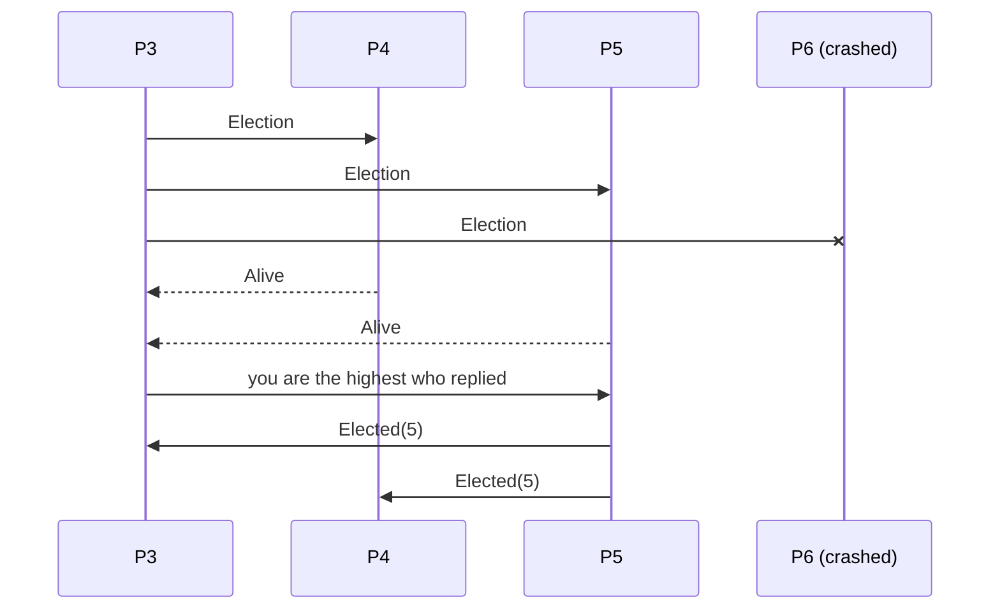

# 10. Leader Election

[← 9. Failure Detection](09-failure-detection.md) · [Book](../README.md) · [11. Replication and Consistency →](11-replication-and-consistency.md)

## Summary

Contacting every participant at every step is expensive, especially in large or geographically distributed networks. Many algorithms therefore rely on a **leader** (coordinator) to drive or coordinate execution (p. 205). Any process can become leader. It usually stays leader until it crashes, and then a new **election** picks a replacement (p. 205).

- **Liveness:** there's a leader most of the time, and elections eventually finish.
- **Safety:** at most one leader at a time, with no **split brain**. Many election algorithms violate this in practice (p. 205).

The chapter covers several algorithms:

- **Bully** (monarchial election): the highest rank wins.
- Two bully optimizations: **next-in-line failover** lists and the **candidate/ordinary** split with a tiebreaker δ.
- The **invitation** algorithm, which *merges groups* instead of outranking.
- The **ring** algorithm, which collects the live set around the ring.

Its conclusion: every one of them is prone to split brain without a cluster-wide **majority**, and electing a leader *is* a consensus problem. Multi-Paxos and Raft let leaders conflict briefly and resolve the conflicts safely (pp. 207–213).

## Key takeaways

- **Election must be deterministic:** exactly one leader emerges, and every participant learns who (p. 206).
- **Leader election isn't distributed locking.** Lock holders needn't be known, and a lock that favours some processes starves others. A leader must be *known*, and long-lived leaders are *preferred* (p. 206).
- **A leader can become a bottleneck.** Partition the data and give each replica set its own leader, as Spanner does (p. 206).
- **The bully algorithm splits brains under partitions** and can re-elect an unstable high-ranked node again and again. Spread host-quality metrics to avoid that (p. 208).
- **Failover lists and candidate sets cut messages;** a per-node delay δ breaks ties between simultaneous elections (pp. 208–209).
- **The ring algorithm can carry just the current maximum,** because max is commutative (p. 212).
- **Allowing several leaders temporarily is a performance optimization.** Safety comes from detecting and resolving conflicts, through Paxos quorums or Raft terms (p. 213).

## Section outline

*From the book’s own table of contents (PDF bookmarks); printed page numbers.*

- Bully Algorithm — p. 207
- Next-In-Line Failover — p. 208
- Candidate/Ordinary Optimization — p. 209
- Invitation Algorithm — p. 210
- Ring Algorithm — p. 211
- Summary — p. 212

## Notes

Leaders are used, for example, to establish a **total order** of messages in a broadcast: the leader holds global state, receives messages and disseminates them. They also coordinate reorganization after failures, at initialization and on important state changes (p. 205). Elections are triggered at initialization and when the leader crashes or stops communicating (p. 206). A stable leader avoids state synchronization between peers, cuts messages, and drives execution from one place (p. 206). ZAB, Multi-Paxos and Raft use temporary leaders with their own algorithm-specific election, failure detection and conflict resolution (p. 206).

| | Leader election | Distributed lock |
|---|---|---|
| Must others know the holder? | Yes; the new leader announces itself | No |
| Preference for some process | Fine; long-lived leaders preferred | Starves the others, violating liveness |
| Holder keeps the role | Until it stops or crashes | Must eventually release |

*From p. 206.*

### Bully algorithm

Each process has a unique **rank**, and the highest-ranked live process becomes leader (Garcia-Molina). The name comes from the top node "bullying" the others into accepting it; it's also called **monarchial** election (p. 207). The book describes the compact modified version (Kordafshari et al., note 1) (p. 207):

1. Send **Election** messages to every process with a higher ID.
2. Wait for responses. If no higher-ranked process responds, go to step 3. Otherwise notify the highest-ranked process that responded and let it do step 3.
3. Assume no higher-ranked process is alive and announce yourself to all lower-ranked processes.

Figure 10-1 (pp. 207–208):

| Problem | Cause and fix (p. 208) |
|---|---|
| **Split brain** | A partition splits the nodes into groups, and each group elects a leader |
| **Endless re-election** | An unstable high-ranked node wins, fails, wins again… Fix: distribute host-quality metrics and consider them during the election |

> **Try it:** [Bully election](../widgets/10-bully-election.html) — crash the leader, pick who notices, and step through Election, Alive and Elected messages. Toggle next-in-line failover to see the shortcut, or partition the cluster to produce a split brain.

### Next-in-line failover

Each leader publishes a list of **failover** nodes (Gholipour et al.) (p. 208). A process that detects the leader's failure contacts the highest-ranked **alternative** on that list. If it's alive, it becomes leader without a full election round. If the detecting process is itself the top alternative, it announces itself straight away (p. 208). In Figure 10-2, leader 6 with alternatives {5, 4} crashes; 3 contacts 5; 5 replies that it's alive, which stops 3 from contacting others; and 5 announces its leadership (pp. 208–209).

### Candidate/ordinary optimization

The nodes are split into **candidates**, which may lead, and **ordinary** nodes (Murshed and Allen) (p. 209). An ordinary process starts the election by contacting the candidates, picks the highest-ranked live one and announces the result. Simultaneous elections are avoided with a **tiebreaker δ**: a process-specific delay, usually longer than a message round trip, that is lower for higher-priority nodes, so one node starts first (p. 209). In Figure 10-3, ordinary process 4 notices that 6 has failed, contacts the candidates, and announces leader **2** (pp. 209–210).

### Invitation algorithm

Processes **invite** others to join their group instead of outranking them. Multiple leaders exist by design, one per group (p. 210).

- Each process starts as the leader of a group of one.
- A leader invites peers outside its group. If the peer is a leader too, the two groups merge. Otherwise the peer replies with its leader's ID, so the two leaders can merge directly (p. 210).
- It doesn't matter which leader ends up in charge. Picking the leader of the **larger** group minimizes messages, because only the smaller group needs to be told (p. 211).

In Figure 10-4, 1 invites 2 and 3 invites 4; then 1 contacts 3, and 4 is told about the new leader; the merged group's leader is 1 (p. 210). Groups merge without starting new elections from scratch (p. 211).

### Ring algorithm

The nodes form a ring and know their predecessors and successors (Chang and Roberts) (p. 211).

- The node that detects the failure sends an election message to its successor, **skipping** unreachable nodes until one responds.
- Each node adds itself to the **live set** before passing the message on, much like the timeout-free detector appends to its path (p. 211).
- When the message returns to the initiator, the highest-ranked node in the live set becomes leader, and a second trip around the ring announces it (p. 211).

In Figure 10-5, 6 has failed and 3 starts the traversal. 5 can't reach 6, so it skips to 1. Since 5 has the highest rank, 3 sends a second round announcing it (pp. 211–212). A space-saving variant carries only the **current maximum** ID, which works because max is commutative (p. 212). A ring that splits into parts can elect a leader per part, so there's no safety guarantee here either (p. 212).

### Summary

A designated leader reduces coordination overhead. Elections are costly but rare, and per-partition leaders, or different leaders for different actions, avoid the bottleneck (p. 212). **Every algorithm in this chapter is prone to split brain**; avoiding it requires a cluster-wide **majority** of votes (p. 212).

Is leader election the same as consensus? Agreeing on a leader's identity *is* consensus, and with it you could agree on anything (Abraham and Malkhi) (pp. 212–213). The leader may change without a process noticing, so election must be combined with **failure detection**. The *stable leader election* algorithm, for example, uses rounds with a unique stable leader and timeouts, so a leader keeps its role while it's alive and reachable (p. 213).

| Algorithm | How conflicting leaders are resolved (p. 213) |
|---|---|
| **Multi-Paxos** | Only one of two conflicting proposers can proceed; a second quorum keeps both values from being accepted |
| **Raft** | A leader that discovers its term is out of date steps down to the newer term |

A leader ensures **liveness**. Temporarily giving up safety by allowing several leaders is a **performance optimization**, since safety is restored by detecting and resolving conflicts. Ch. 14 continues the topic (p. 213).

## Trade-offs at a glance

| Algorithm | Messages | Picks | Weakness |
|---|---|---|---|
| Bully | Up to O(n²) in the worst case | Highest live rank | Split brain; re-electing unstable top nodes |
| Next-in-line failover | Few if the alternative is alive | Leader-designated alternative | Stale list if alternatives died |
| Candidate/ordinary | Only candidates contacted | Highest live candidate | Needs a tuned δ |
| Invitation | Merge messages | Leader of a merged group | Several leaders by design |
| Ring | 2 traversals, O(n) each | Highest in the live set | Partitioned ring elects several |

## Beyond the book

- **The bully algorithm's message count.** If the lowest-ranked of *n* processes starts the election, every process may start its own round, giving O(n²) messages in the worst case. If the second-highest notices, it takes only O(n). The widget counts messages per scenario.
- **Leases and fencing tokens.** In practice, split brain is contained by giving the leader a time-bounded *lease* and stamping its writes with a monotonically increasing *fencing token* (an epoch or term), so storage rejects writes from a deposed leader. Raft terms and ZooKeeper's zxid epochs play this role. See also [DDIA Ch. 9](../../designing-data-intensive-applications/chapters/09-the-trouble-with-distributed-systems.md).

## Connections

- **Related chapters:** [9. Failure Detection](09-failure-detection.md) (what triggers an election), [14. Consensus](14-consensus.md) (Multi-Paxos, Raft and ZAB elections), [13. Distributed Transactions](13-distributed-transactions.md) (per-partition leaders in Spanner).

## Check yourself

*Questions and answers are the vault's, written from the notes above; answers cite the book's pages.*

1. **Why must a leader announce itself when a lock holder doesn't need to?**

   *Answer:* A leader has special duties and must be known to all participants. For a lock, it only matters that it is eventually released (p. 206).

2. **In the modified bully algorithm, process 3 sends Election to 4, 5 and 6; 4 and 5 reply Alive. What happens next?**

   *Answer:* 3 notifies 5, the highest-ranked process that responded, and 5 broadcasts Elected to the lower-ranked processes (pp. 207–208).

3. **Which problem does a network partition cause for the bully algorithm?**
   - [ ] Endless re-election
   - [x] Split brain: each side elects its own leader
   - [ ] Message duplication

   *Answer:* The algorithm has no majority requirement, so each isolated group elects its own highest-ranked node (p. 208).

4. **How does next-in-line failover shorten an election?**

   *Answer:* The failed leader had published a list of alternatives. The detecting process contacts the highest-ranked one, which takes over without a full election round if it's alive (p. 208).

5. **What is δ in the candidate/ordinary algorithm?**

   *Answer:* A process-specific tiebreaker delay, usually longer than a round trip and lower for higher-priority nodes, so one node starts its election before the others (p. 209).

6. **Why can the ring algorithm carry just one ID instead of the live set?**

   *Answer:* It only needs the maximum, and max is commutative, so each node can compare and pass on the larger ID (p. 212).

7. **How does Raft resolve the existence of two leaders?**

   *Answer:* A leader that discovers its term is out of date learns there's a newer leader and updates to the newer term (p. 213).
