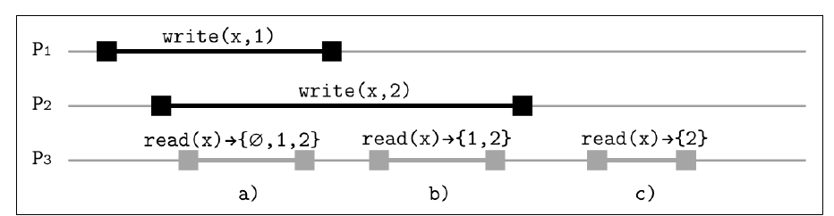
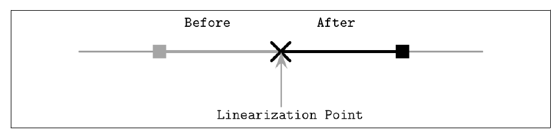
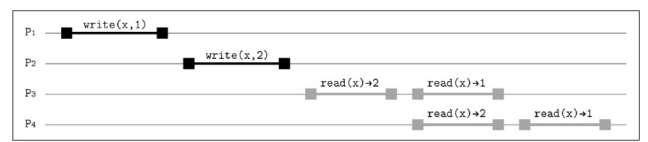
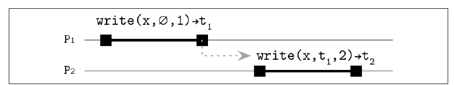
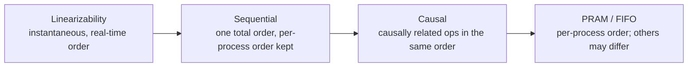

# 11. Replication and Consistency

[← 10. Leader Election](10-leader-election.md) · [Book](../README.md) · [12. Anti-Entropy and Dissemination →](12-anti-entropy-and-dissemination.md)

## Summary

**Fault tolerance** means continuing to operate correctly when components fail. Its first step is removing single points of failure through **redundancy**, which users normally don't see (p. 215). **Replication** keeps multiple copies of the data. Updating all copies atomically is equivalent to consensus and is expensive, so systems look for cheaper ways to make data *look* consistent while allowing some divergence (p. 215). In multi-datacenter deployments, **geo-replication** also lowers latency by keeping copies near clients (pp. 215–216).

The chapter covers:

- **Availability and CAP:** CP versus AP, PACELC, the pitfalls of CAP, and **harvest and yield** as a softer alternative (pp. 216–219).
- **Shared-memory foundations:** registers (safe, regular, atomic) and the ordering of concurrent operations (pp. 219–222).
- **Consistency models**, from strongest to weakest (pp. 223–234):
  - strict (impossible);
  - **linearizability**, with linearization points, its cost, composability and **RIFL**;
  - **sequential**;
  - **causal**, with COPS, Eiger and **vector clocks**;
  - the **session models**, which combine into PRAM.
- **Eventual consistency** and **tunable consistency** (N, W, R; quorums; witness replicas) (pp. 234–237).
- **Strong eventual consistency** with **CRDTs:** G-Counter, PN-Counter, LWW and multivalue registers, G-Set and two-phase sets, and JSON CRDTs (pp. 238–240).

## Key takeaways

- **CAP:** during a partition you can't have both availability (every nonfailing node responds) and linearizability. Partition tolerance isn't a knob you can turn (pp. 217–218).
- **CAP's C and A aren't ACID's C or everyday "high availability".** CAP availability has no latency bound and requires *every* nonfailed node to respond (p. 218).
- **Harvest** = completeness of the answer; **yield** = fraction of requests that succeed. Trading them is often better than failing outright (p. 219).
- **Linearizability:** each operation takes effect at a single point between invocation and completion, so there are no stale reads after a completed write. It composes across objects but needs coordination, typically consensus (pp. 223–226).
- **Sequential consistency** keeps each process's order and gives all readers the *same* order, but no real-time bound, and it doesn't compose (pp. 227–229).
- **Causal consistency** orders only causally related operations; vector clocks detect concurrency but can't resolve it, which is why Cassandra uses last-write-wins (pp. 229–233).
- **R + W > N guarantees overlap**, but quorum reads aren't monotonic after an incomplete write unless read repair blocks (pp. 235–236).
- **n copy + m witness replicas give the availability of n + m copies,** as long as every majority includes at least one copy (p. 237).
- **CRDTs merge commutatively**, so replicas can diverge freely and still converge without losing operations (pp. 238–240).

## Section outline

*From the book’s own table of contents (PDF bookmarks); printed page numbers.*

- Achieving Availability — p. 216
- Infamous CAP — p. 216
  - Use CAP Carefully — p. 217
  - Harvest and Yield — p. 218
- Shared Memory — p. 219
- Ordering — p. 221
- Consistency Models — p. 222
  - Strict Consistency — p. 223
  - Linearizability — p. 223
  - Sequential Consistency — p. 227
  - Causal Consistency — p. 229
  - Session Models — p. 233
  - Eventual Consistency — p. 234
- Tunable Consistency — p. 235
- Witness Replicas — p. 236
- Strong Eventual Consistency and CRDTs — p. 238
- Summary — p. 240

## Notes

Systems with a single source of truth fail over **explicitly** by promoting a replica. Others need no reconfiguration and stay consistent by collecting responses from several participants (p. 215). Replication involves three events: **write**, **replica update** and **read**. Even if replicas update after the client's write returns, the client must still observe operations in a particular order (p. 216).

### Achieving availability

Intermittent failures shouldn't affect availability: to users, the system should keep working as if nothing happened (p. 216). Software underpins banking, communication and travel, so downtime costs customers and money (p. 216). Availability requires redundancy, which in turn creates the problem of synchronizing copies and recovering them (p. 216).

### Infamous CAP

**Availability**: every request eventually gets a successful response. **Consistency** here means **linearizability** (p. 216). Brewer's **CAP conjecture**, proved by Gilbert and Lynch, states that under network partitions a system can't guarantee both. Systems pick strong consistency with best-effort availability, or availability with best-effort consistency. "Best effort" means guarantees hold when nothing fails and may weaken during partitions (p. 217).

| Choice | Behaviour (p. 217) | Example |
|---|---|---|
| **CP** | Fails requests rather than serving possibly inconsistent data | Consensus requiring a majority |
| **AP** | Serves possibly inconsistent values | A database that accepts writes while any replica is up; may lose data |

**PACELC** (Abadi) extends this: with a Partition, choose Availability or Consistency; Else, choose Latency or Consistency (p. 217).

#### Use CAP carefully

- CAP is about **partitions**, not crashes. A partitioned node can serve inconsistent data; a crashed node serves nothing. So consistency problems can occur with every node up (pp. 217–218).
- The triangle picture misleads. You can trade C for A, but **partition tolerance can't be tuned** (p. 218).
- CAP's **C** isn't ACID's C (preserving invariants), and its **A** isn't high availability: CAP puts no bound on latency and demands that *every* nonfailed node respond (p. 218).
- So-called AP databases still serve consistent results when enough replicas are alive and they're used correctly, for example with quorums. CAP is a rule of thumb (p. 218, note 1).

#### Harvest and yield

Fox and Brewer relax both properties into tunable metrics (p. 219):

| Metric | Meaning |
|---|---|
| **Harvest** | How complete the answer is: returning 99 of 100 rows can beat failing |
| **Yield** | Successful requests ÷ attempted requests. Not the same as uptime: a busy node is up but can still fail requests |

Raise yield by answering from the available partitions only, so other users keep being served when some nodes are down. Alternatively, demand full harvest only for critical data (p. 219).

### Shared memory

To clients, a distributed store looks like shared memory, an array of **registers**. Each operation has an **invocation** and a **completion** event, and fails if its process crashes before completion (p. 219). Two operations are **sequential** if one completes before the other is invoked, and **concurrent** otherwise, including when one starts after and ends before the other (Figure 11-1) (pp. 219–220).

| Register | During a concurrent write, a read may return (p. 220) |
|---|---|
| **Safe** | Any value in the register's range: a binary register can "flicker" |
| **Regular** | The last completed write's value or the overlapping write's value; not visible to all readers at once (like a primary with read replicas) |
| **Atomic** | Linearizable: one moment splits old from new for everyone |

### Ordering

Each process executes its operations sequentially, and together they form a **global history** in which operations may run concurrently (p. 221). With P1 doing `write(x, 1); read(x)` and P2 doing `read(x)`, the write may complete before both reads, interleave with them, or follow both (p. 221). There are two difficulties: operations may **overlap**, and the effects of nonoverlapping operations may not be **visible** immediately. Consistency models resolve the ambiguity (pp. 221–222).

### Consistency models

A **consistency model** is a contract between participants: what replicas must do, and what clients can expect from reads and writes (p. 222). It separates "all possible histories" from "histories allowed under model X." Models can be **state-centric** (which invariants hold between copies) or **operation-centric** (constraints on the order of operations) (p. 222). Without a global clock, every participant has its own view of state and time, like special relativity for data. Synchronization costs latency, CPU, disk and network I/O, and waiting (pp. 222–223).

#### Strict consistency

Any write is instantly visible to every later read, measured by a global clock. It's impossible to implement because of physics (p. 223).

#### Linearizability

The strongest **single-object, single-operation** model (p. 223).

- A write's effect becomes visible to all readers **exactly once**, at some point between its start and end. No one sees partial or incomplete writes (p. 223).
- Overlapping operations may take effect in either order. Once a read returns a value, every later read returns that value or a newer one (p. 223).
- Effects can't appear before an operation starts, which would need an oracle, and must appear before it completes (pp. 223–224).
- It respects both each process's order and real-time order across processes, giving a **total order**. Linearizable writes imply mutual exclusion (p. 224).

Figure 11-2: P1 runs `write(x, 1)`, P2 runs `write(x, 2)`, P3 runs three reads, and x starts as ∅ (p. 224):

*Figure 11-2 (p. 224): what a read may return depends on which writes it overlaps; once both writes finish, only 2 is valid.*

| Read | Overlaps | May return |
|---|---|---|
| 1st | both writes in flight | ∅, 1 or 2 |
| 2nd | write 1 done, write 2 in flight | 1 or 2 |
| 3rd | both done; write 2 ordered after write 1 | 2 |

**Linearization point** (pp. 225–226): operations aren't instantaneous, but their effects appear so. After the point, every process sees the new value or a later one, so there are no stale reads, reads are monotonic, and values don't alternate. The operation's effects must become visible between t₁ (request issued) and t₂ (response received) (Figures 11-3, 11-4). Locks, atomic read/write or read-modify-write primitives implement the point (p. 225).

*Figure 11-4 (p. 226): the operation takes effect at one instant inside its interval; reads after it must see the new value.*

> **Vault note:** the book's sidebar on CAS (p. 225). Compare-and-swap changes a value only if it's unchanged. Beware the **ABA problem**: if two other writes change A to B and back to A, a CAS expecting A still succeeds.

**Cost** (p. 226):

- Even CPUs don't give linearizable memory access by default, because synchronization instructions are slow and cause cross-core traffic and cache invalidations.
- Concurrent code achieves it by preparing a result and publishing it with CAS, as in a lock-free queue.
- Distributed systems need **consensus**: a consensus module ensures that operations are applied identically across the cluster.
- Linearizability is **local** (composable): if every object is linearizable, the system is too. Multi-object operations still need extra synchronization (p. 226).

**RIFL** (Reusable Infrastructure for Linearizability) makes RPCs linearizable (p. 227):

- Each message is identified by a **client ID** plus a client-local sequence number. IDs come from **leases** issued by a system-wide service, and an operation sent with an expired lease isn't committed.
- Without RIFL, C1's write V1 times out, C2 writes V2, and C1's retry of V1 overwrites V2, losing C2's write. With RIFL, the retry returns the stored **completion object** instead of re-executing.
- Completion objects are stored durably and created **atomically** with the data mutation. They live until the client promises not to retry or is detected as crashed.
- Clients renew leases to signal liveness. Expired leases get garbage-collected.
- Guaranteeing at most one execution, plus atomic visibility, makes the operation linearizable, mostly independently of the storage system (p. 227).

#### Sequential consistency

Operations are ordered as if run in *some* sequence that preserves each process's program order. A process's view may be arbitrarily stale globally (pp. 227–228). Lamport introduced it for multiprocessors: requests to one memory cell are FIFO-ordered, there's no global order across independent cells, and reads may come from the cell or from the latest queued write (p. 228). The key point: **all processes observe the same order** (p. 228).

> **Vault note:** the book's comparison (p. 228). Both models require a global order, but linearizability also respects **real time**. Under sequential consistency, order is guaranteed only for writes from the same origin. Linearizable histories compose; sequentially consistent ones don't.

Figure 11-5 shows `write(x, 1)` happening before `write(x, 2)` in wall-clock time, yet both P3 and P4 observe 2 and then 1. Either order is valid as long as every reader sees the same one. Stale reads can come from replicas receiving the same order at different times (pp. 228–229). CPUs don't guarantee sequential consistency either and need **memory barriers** (fences) (p. 229).

*Figure 11-5 (p. 229): both readers see the writes in the same order — the reverse of real time — which sequential consistency allows.*

#### Causal consistency

Causally related operations are seen in the same order by everyone; concurrent ones may be seen in different orders (p. 229).

- Without causality (Figure 11-6), P3 may see 1 then 2 while P4 sees 2 then 1 (p. 230).
- With causality (Figure 11-7), a write carries its **dependencies**: `write(x, ∅, 1) → t1`, then `write(x, t1, 2)`. A write that arrives early is held until its dependencies arrive, so a **happened-before** relationship is established logically, without physical clocks (pp. 230–231).

*Figure 11-7 (p. 230): the second write carries the timestamp of the one it depends on, so no replica can apply it first.*

- The analogy is a forum thread: replies follow what they reply to, and threads can branch (p. 231).
- Causal systems provide the **session guarantees** listed below (p. 231).
- Implementation: logical clocks plus context metadata in every message. A server applies an operation only after all its predecessors and buffers anything that arrives too early (p. 231).

| System | Tracks | Conflicts (p. 231) |
|---|---|---|
| **COPS** | Dependencies through key versions | Key order plus application-specific functions |
| **Eiger** | Operation order, including across nodes (multipartition transactions) | Last-write-wins |

**Vector clocks** (pp. 232–233):

- Messages {M1(∅, t1), M2(M1, t2), M3(M2, t3)} that arrive out of order are buffered until their dependencies arrive. Dynamo and Riak use vector clocks for this.
- Each process keeps **one logical clock per process**. It increments its own on each event, and on receipt takes the **element-wise maximum**.
- On a write, if a value already exists locally, a new version is appended to the version vector, linking the two causally. Otherwise a new chain starts.
- To improve availability, replicas may accept *conflicting* writes, creating **divergent histories**. Figure 11-9 shows one replica seeing 1, 5, 7, 8 and another 1, 5, 3. Riak exposes these to users (p. 232).
- Vector clocks **detect** conflicts but don't resolve them. Resolution is application-specific and needs stored causal history plus garbage collection, so Cassandra chose **last-write-wins** instead (p. 233).

> **Try it:** [Vector clocks and causal delivery](../widgets/11-vector-clocks.html) — send messages between three processes, deliver them out of order, and watch the receiver buffer what isn't causally ready. Compare two clocks to see "before", "after" or "concurrent".

#### Session models

**Session** (client-centric) models describe what *one* client observes as it talks to possibly different replicas. Each client's operations are sequential, and nothing is assumed about incomplete operations (p. 233).

| Model | Guarantee (pp. 233–234) |
|---|---|
| **Read-own-writes** | A read after `write(x, V)`, on any replica, returns V or later |
| **Monotonic reads** | After observing V, later reads return V or something newer |
| **Monotonic writes** | A client's writes become visible to everyone in its order; otherwise old data can be "resurrected" |
| **Writes-follow-reads** (session causality) | A write is ordered after the writes its earlier reads observed |

These say nothing about *other* clients, but they must hold for every client (p. 234). **PRAM (FIFO) consistency** = monotonic reads + monotonic writes + read-own-writes: one process's writes propagate in order, while different processes' writes may be seen in different orders (p. 234).

#### Eventual consistency

Updates propagate **asynchronously**. If no new updates arrive, eventually all accesses return the latest value (Vogels). Conflicts are reconciled by last-write-wins or vector clocks, which may change what counts as "latest" (p. 234). "Eventually" has no time bound, but it works well in practice (pp. 234–235).

### Tunable consistency

Eventually consistent systems usually let you tune consistency with three variables (p. 235):

| Variable | Meaning |
|---|---|
| **N**, replication factor | Nodes storing a copy |
| **W**, write consistency | Acknowledgments needed for a write to succeed |
| **R**, read consistency | Responses needed for a read to succeed |

- **R + W > N** guarantees that read and write sets overlap, so a read sees the latest write. N = 3, W = 2, R = 2 tolerates one failure. The third replica is updated asynchronously or by anti-entropy (Ch. 12) (p. 235).
- The coordinator submits writes to N nodes and waits for W, or W − 1 if it's a replica itself. It collects R read responses. **Speculative execution** sends extra read requests and counts whichever answer first (p. 235).
- W = 1, R = N suits write-heavy systems but needs every replica for reads. W = N, R = 1 lets any node serve the latest value (pp. 235–236).
- Higher levels mean more latency and stricter availability requirements; lower levels mean more availability and less consistency (p. 236).

**Quorums** (p. 236): ⌊N/2⌋ + 1 nodes form a majority. With 2f + 1 nodes, up to f can fail. A quorum system can't survive losing a majority: with 3 replicas and 2 down, nothing proceeds. **Quorums aren't monotonic after incomplete writes**: a write that reached 1 of 3 replicas may or may not be returned, depending on which replicas a read contacts, so values can alternate. Monotonic reads need *blocking* read repair, at a cost in availability (Ch. 12) (p. 236).

> **Try it:** [Quorums and witness replicas](../widgets/11-quorum-witness.html) — set N, W and R, mark some replicas as witnesses, fail nodes, and see which reads and writes still succeed and whether a read is guaranteed to see the latest write.

### Witness replicas

Majorities guarantee overlap, but every replica stores a full copy, so RF = 5 means five copies (p. 236). **Witness replicas** normally store only the *fact* that a write happened. When copy replicas time out or fail, a witness is upgraded to hold the record temporarily, and it reverts once repair brings the copies back up to date (pp. 236–237).

The book's example, [1c, 2c, 3w] (p. 237):

- **Write while 2c is down:** store the record temporarily on 3w, repair 2c later, then drop the witness's copy.
- **Read when the record is on 1c and 3w but not on 2c:** any two nodes form a quorum. With [1c, 2c], fetch from 1c and repair 2c. With [2c, 3w], fetch from 3w.

*n* copy + *m* witness replicas give the same availability as *n* + *m* copies if (p. 237):

- reads and writes use majorities (N/2 + 1);
- every quorum includes at least one copy replica.

Spanner and Cassandra implement witnesses (p. 237).

### Strong eventual consistency and CRDTs

**Strong eventual consistency (SEC)** sits between strong and eventual consistency. Updates may arrive late or out of order, but once all of them arrive, replicas **merge to the same valid state** (p. 238). **Conflict-free replicated data types** (CRDTs, Shapiro et al.; used in Redis) can apply operations in any order with the same result. Replicated counters, for example, can be incremented independently during a partition and merged afterwards without losing anything (p. 238).

Operation-based **CmRDTs** require operations to be (p. 238):

- **side-effect free**;
- **commutative** (x • y = y • x);
- **causally ordered**: delivered only once the state they need has been reached.

**G-Counter** (grow-only counter): each node keeps a vector of last-known counts and updates only its own slot. Merge takes the element-wise **max**, and the value is the **sum** (p. 239):

| Step | Node 1 | Node 2 | Node 3 |
|---|---|---|---|
| Initial | [0, 0, 0] | [0, 0, 0] | [0, 0, 0] |
| Increment on 1 and 3 | [1, 0, 0] | [0, 0, 0] | [0, 0, 1] |
| After merges | [1, 0, 1] | [1, 0, 1] | [1, 0, 1] → sum = 2 |

| CRDT | How (pp. 239–240) |
|---|---|
| **PN-Counter** | Two vectors: P for increments, N for decrements. **Super-peers** avoid propagating huge vectors |
| **LWW register** | Keep the value with the largest globally ordered timestamp; the merge is commutative |
| **Multivalue register** | Keep all concurrent values; the application picks one |
| **G-Set** | Grow-only set; union is commutative |
| **Two-set (add/remove)** | Only elements in the add-set can enter the remove-set; value = add-set − remove-set |
| **JSON CRDT** | Insertions, deletions and assignments on nested lists and maps, merged on the client in any order (Kleppmann) |

> **Try it:** [CRDT counters and sets](../widgets/11-crdt.html) — partition three replicas, increment, decrement, add and remove on each side, heal the partition, and watch G-Counter, PN-Counter and two-phase-set states merge to the same value in any order.

### Summary

Replication improves availability but needs coordination (p. 240). The single-operation models, from most to fewest guarantees (pp. 240–241):

Session models: read-own-writes, monotonic reads, monotonic writes and writes-follow-reads (p. 241). Stacking weaker systems on stronger ones, or ignoring the consistency of underlying systems, can cause unrecoverable inconsistencies and data loss (p. 241).

## Trade-offs at a glance

| Model | Real-time order | Same order for all | Composable | Coordination cost |
|---|---|---|---|---|
| Linearizable | ✓ | ✓ | ✓ | Highest (consensus) |
| Sequential | ✗ | ✓ | ✗ | High |
| Causal | ✗ | Only causally related | — | Dependency metadata |
| PRAM | ✗ | Only per writer | — | Low |
| Eventual | ✗ | ✗, converges eventually | — | Lowest |
| Strong eventual (CRDT) | ✗ | Converges deterministically | — | Merge metadata |

| N, W, R | Tolerates | Note |
|---|---|---|
| 3, 2, 2 | 1 failure for reads and writes | Overlap guaranteed |
| 3, 1, 3 | Write: 2 failures; read: none | Write-heavy |
| 3, 3, 1 | Write: none; read: 2 failures | Read-heavy |
| 3, 1, 1 | Many | R + W ≤ N: stale reads possible |

## Beyond the book

- **Jepsen's consistency map** (jepsen.io/consistency) arranges these models, and transactional ones such as serializability and snapshot isolation, in one hierarchy. It shows *strict serializability* as linearizability plus serializability.
- **Delta-state CRDTs** ship only the recent change to the state rather than the whole state or every operation. They're the practical form behind many production CRDT systems, and Riak's data types are an early example.
- [DDIA Ch. 10](../../designing-data-intensive-applications/chapters/10-consistency-and-consensus.md) gives the application developer's view of linearizability, with real-world examples (uniqueness constraints, leader locks).

## Connections

- **Related chapters:** [5. Transaction Processing and Recovery](05-transaction-processing-and-recovery.md) (serializability versus linearizability), [12. Anti-Entropy and Dissemination](12-anti-entropy-and-dissemination.md) (read repair, hinted handoff, Merkle trees), [14. Consensus](14-consensus.md) (implementing linearizability).
- **Run it:** [Quorum overlap and stale reads](../lab/11-quorum-staleness/README.md) — simulates writes and reads against N replicas under random failures for several (W, R) choices, and counts stale reads when R + W ≤ N against R + W > N.

## Check yourself

*Questions and answers are the vault's, written from the notes above; answers cite the book's pages.*

1. **Why is partition tolerance not a real choice in CAP?**

   *Answer:* Partitions happen whether you choose them or not. What you can trade is consistency against availability *during* a partition (p. 218).

2. **How does CAP availability differ from "high availability"?**

   *Answer:* CAP availability puts no bound on latency and requires every nonfailed node to answer every request. High availability means neither (p. 218).

3. **What's the difference between harvest and yield?**

   *Answer:* Harvest is how complete an answer is (99 of 100 rows); yield is the fraction of requests that succeed (p. 219).

4. **In Figure 11-2, why can the third read only return 2?**

   *Answer:* Both writes have completed and write 2 is ordered after write 1. After a linearization point, reads can't return an older value (p. 224).

5. **What distinguishes sequential consistency from linearizability?**
   - [ ] Sequential consistency allows different readers to see different orders
   - [x] Linearizability also respects real-time order and composes; sequential consistency does neither
   - [ ] They're identical for single objects

   *Answer:* Both have a global order, but only linearizability ties it to wall-clock time, and sequentially consistent schedules aren't composable (p. 228).

6. **What problem does RIFL's completion object solve?**

   *Answer:* A retried RPC that was already applied would re-execute and could overwrite a later write from another client. RIFL returns the stored completion result instead of re-executing (p. 227).

7. **What can vector clocks tell you, and what can't they?**

   *Answer:* They tell you whether two versions are causally ordered or concurrent, i.e. whether there's a conflict. They don't say how to resolve it, which is application-specific (pp. 232–233).

8. **N = 3, W = 2, R = 2. A write reached only one replica before failing. Is a later quorum read guaranteed to return it?**

   *Answer:* No. Depending on which two replicas it contacts, it may return the new or the old value, and successive reads may alternate. Monotonic reads need blocking read repair (p. 236).

9. **With replicas [1c, 2c, 3w], which pairs can serve a consistent read?**

   *Answer:* Any pair: [1c, 2c], [1c, 3w] or [2c, 3w]. Every majority contains at least one copy replica or a witness temporarily holding the record (p. 237).

10. **Why can a G-Counter be incremented on both sides of a partition without losing increments?**

    *Answer:* Each node updates only its own slot, and merge takes the element-wise maximum, which is commutative. After healing, every node's increments are kept, and the value is the sum (pp. 238–239).
