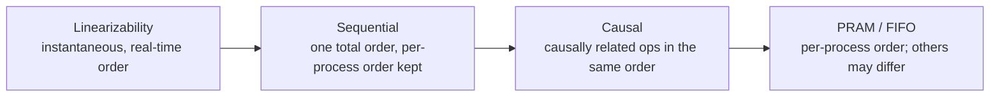

# فصل ۱۱: replication و consistency

[فصل ۱۰: انتخاب leader →](10-leader-election.md) · [کتاب](../README.md) · [فصل ۱۲: anti-entropy و پخش ←](12-anti-entropy-and-dissemination.md)

## خلاصه

**مفهوم fault tolerance** یعنی ادامه دادن درست به کار وقتی مؤلفه‌ها می‌شکنند. نخستین قدمش برداشتن نقطه‌های شکست تنها از راه **redundancy** است، که کاربرها معمولاً نمی‌بینندش (p. 215). **replication** چند کپی از داده نگه می‌دارد. به‌روز کردن اتمی همه‌ی کپی‌ها با consensus هم‌ارز و گران است، پس سیستم‌ها راه‌های ارزان‌تری می‌جویند تا داده سازگار *به نظر برسد* و در همان حال کمی واگرایی مجاز باشد (p. 215). در deploymentهای چند‌دیتاسنتری، **replication جغرافیایی** با نگه داشتن کپی‌ها نزدیک کلاینت‌ها latency را هم پایین می‌آورد (pp. 215–216).

فصل این‌ها را می‌پوشاند:

- **مفهوم availability و CAP:** حالت CP در برابر AP، قاعده‌ی PACELC، دام‌های CAP، و **برداشت و بازده** به‌شکل جایگزینی نرم‌تر (pp. 216–219).
- **پایه‌های حافظه‌ی مشترک:** register، یعنی ایمن و منظم و اتمی، و ترتیب‌دهی عملیات هم‌زمان (pp. 219–222).
- **مفهوم consistency modelها**، از قوی‌ترین تا ضعیف‌ترین (pp. 223–234):
  - سخت‌گیرانه، که ناممکن است؛
  - **مفهوم linearizability**، با نقطه‌های خطی‌سازی و هزینه‌اش و ترکیب‌پذیری‌اش و **RIFL**؛
  - **ترتیبی**؛
  - **علّی**، با COPS و Eiger و **ساعت برداری**؛
  - و **مدل‌های session**، که در PRAM ترکیب می‌شوند.
- **مفهوم eventual consistency** و **consistency قابل تنظیم** با N و W و R و quorum و replicaهای شاهد (pp. 234–237).
- **مفهوم eventual consistency قوی** با **CRDT**: شمارنده‌ی G-Counter و PN-Counter، register از جنس LWW و چند‌مقداری، مجموعه‌ی G-Set و مجموعه‌های دو‌فازی، و CRDTهای JSON (pp. 238–240).

## نکته‌های کلیدی

- **قاعده‌ی CAP:** در میانه‌ی پارتیشنی نمی‌شود هم دسترس‌پذیری، یعنی پاسخ هر نود نشکسته‌ای، و هم linearizability را داشت. partition tolerance پیچی نیست که بچرخانید (pp. 217–218).
- **مفهوم C و A در CAP نه C در ACID‌اند و نه «availability بالا»ی روزمره.** availability CAP کران latencyی ندارد و می‌خواهد *هر* نود نشکسته‌ای پاسخ بدهد (p. 218).
- **برداشت** یعنی تمامیت پاسخ؛ و **بازده** یعنی سهم درخواست‌هایی که موفق می‌شوند. بده‌بستانشان اغلب از یک‌سر شکستن بهتر است (p. 219).
- **مفهوم linearizability:** هر عملیاتی در یک نقطه میان فراخوانی و تمام شدن اثر می‌کند، پس پس از نوشتنی تمام‌شده خواندن کهنه‌ای نیست. بین objectها ترکیب می‌شود ولی هم‌آهنگی لازم دارد، که معمولاً consensus است (pp. 223–226).
- **مفهوم consistency ترتیبی** ترتیب هر processی را نگه می‌دارد و به همه‌ی خواننده‌ها *همان* ترتیب را می‌دهد، ولی کران real-time نه، و ترکیب نمی‌شود (pp. 227–229).
- **مفهوم consistency علّی** تنها عملیات علّیت‌دار را مرتب می‌کند؛ ساعت‌های برداری concurrency را تشخیص می‌دهند ولی نمی‌توانند حلش کنند، که از همین‌جاست که Cassandra آخرین‌نوشتن‌می‌برد به کار می‌برد (pp. 229–233).
- **شرط R + W > N هم‌پوشانی را تضمین می‌کند**، ولی خواندن‌های quorum پس از نوشتنی ناتمام یکنوا نیستند مگر read repair بند بیاورد (pp. 235–236).
- **مفهوم n کپی به‌علاوه‌ی m replica شاهد availability n + m کپی را می‌دهند**، تا وقتی هر اکثریتی دست‌کم یک کپی داشته باشد (p. 237).
- **همه‌ی CRDTها commutative merge می‌کنند**، پس replicaها می‌توانند آزاد واگرا شوند و باز هم بی گم کردن عملیات هم‌گرا (pp. 238–240).

## فهرست بخش‌ها

*از فهرست مطالب خود کتاب، از bookmarkهای PDF؛ شماره‌ها صفحه‌ی چاپی‌اند.*

- رسیدن به availability — ص. ۲۱۶
- بخش CAP بدنام — ص. ۲۱۶
  - بخش CAP را با دقت به کار ببرید — ص. ۲۱۷
  - برداشت و بازده — ص. ۲۱۸
- حافظه‌ی مشترک — ص. ۲۱۹
- ترتیب‌دهی — ص. ۲۲۱
- بخش consistency modelها — ص. ۲۲۲
  - بخش consistency سخت‌گیرانه — ص. ۲۲۳
  - بخش linearizability — ص. ۲۲۳
  - بخش consistency ترتیبی — ص. ۲۲۷
  - بخش consistency علّی — ص. ۲۲۹
  - مدل‌های session — ص. ۲۳۳
  - بخش eventual consistency — ص. ۲۳۴
- بخش consistency قابل تنظیم — ص. ۲۳۵
- بخش replicaهای شاهد — ص. ۲۳۶
- بخش eventual consistency قوی و CRDT — ص. ۲۳۸
- خلاصه — ص. ۲۴۰

## یادداشت‌ها

سیستم‌هایی که یک سرچشمه‌ی حقیقت دارند **صریح** failover می‌کنند، با ارتقای replicaیی. بقیه چیدمان دوباره لازم ندارند و با جمع کردن پاسخ از چند شرکت‌کننده سازگار می‌مانند (p. 215). replication سه رویداد را در بر دارد: **نوشتن** و **به‌روزرسانی replica** و **خواندن**. حتی اگر replicaها پس از برگشتن نوشتن کلاینت به‌روز شوند، کلاینت باز هم باید عملیات را به ترتیبی معین مشاهده کند (p. 216).

### رسیدن به availability

شکست‌های متناوب نباید روی availability اثر بگذارند: از دید کاربرها، سیستم باید همین‌طور انگار چیزی رخ نداده کار کند (p. 216). نرم‌افزار زیر بانک‌داری و ارتباط و سفر را گرفته، پس از دسترس خارج بودن مشتری و پول خرج دارد (p. 216). availability redundancy لازم دارد، که به‌نوبت مسئله‌ی هم‌گام کردن کپی‌ها و بازیابی‌شان را می‌سازد (p. 216).

### قاعده‌ی بدنام CAP

**مفهوم availability**: هر درخواستی در غایت پاسخی موفق می‌گیرد. **consistency** این‌جا یعنی **linearizability** (p. 216). **حدس CAP** بروئر، که گیلبرت و لینچ اثباتش کردند، می‌گوید که زیر پارتیشن شبکه سیستمی نمی‌تواند هر دو را تضمین کند. سیستم‌ها یا consistency قوی با availability بهترین‌تلاش را برمی‌دارند، یا availability با consistency بهترین‌تلاش. «بهترین تلاش» یعنی تضمین‌ها وقتی چیزی نمی‌شکند برقرارند و می‌توانند در پارتیشن ضعیف شوند (p. 217).

| انتخاب | رفتار (p. 217) | نمونه |
|---|---|---|
| **CP** | به‌جای سرویس دادن داده‌ی شاید ناسازگار درخواست‌ها را می‌شکند | consensus که اکثریتی می‌خواهد |
| **AP** | مقدارهای شاید ناسازگار سرویس می‌دهد | دیتابیسی که تا هر replicaیی سرپاست نوشتن می‌پذیرد؛ می‌تواند داده گم کند |

قاعده‌ی **PACELC** از ابادی این را گسترش می‌دهد: با پارتیشنی، availability یا consistency را بردارید؛ وگرنه، latency یا consistency را (p. 217).

#### قاعده‌ی CAP را با دقت به کار ببرید

- قاعده‌ی CAP درباره‌ی **پارتیشن** است و نه از کار افتادن. نودی پارتیشن‌شده می‌تواند داده‌ی ناسازگار سرویس بدهد؛ و نودی از کار افتاده چیزی سرویس نمی‌دهد. پس مسئله‌های consistency می‌توانند با همه‌ی نودها سرپا رخ بدهند (pp. 217–218).
- آن تصویر مثلثی گمراه می‌کند. می‌شود C را با A بده‌بستان کرد، ولی **partition tolerance تنظیم‌شدنی نیست** (p. 218).
- حرف **C** در CAP نه C در ACID است، یعنی نگه داشتن ناوردا، و **A**ش نه availability بالا: CAP هیچ کرانی روی latency نمی‌گذارد و می‌خواهد *هر* نود نشکسته‌ای پاسخ بدهد (p. 218).
- دیتابیس‌هایی که AP نامیده می‌شوند باز هم وقتی replicaهای کافی زنده باشند و درست به کار بروند، مثلاً با quorum، نتیجه‌های سازگار سرویس می‌دهند. قاعده‌ی CAP یک سرانگشتی است (p. 218).

#### برداشت و بازده

فاکس و بروئر هر دو خاصیت را به سنجه‌هایی تنظیم‌پذیر شل می‌کنند (p. 219):

| سنجه | معنا |
|---|---|
| **برداشت** | پاسخ چقدر کامل است: برگرداندن ۹۹ ردیف از ۱۰۰ می‌تواند از شکستن بهتر باشد |
| **بازده** | درخواست‌های موفق تقسیم بر درخواست‌های کوشیده. مثل بالا بودن نیست: نودی مشغول بالاست ولی باز هم می‌تواند درخواست را بشکند |

بازده را با پاسخ دادن تنها از پارتیشن‌های موجود بالا ببرید، تا وقتی برخی نودها خواب‌اند کاربرهای دیگر همین‌طور سرویس بگیرند. یا برداشت کامل را تنها برای داده‌ی حیاتی بخواهید (p. 219).

### حافظه‌ی مشترک

از دید کلاینت‌ها، انباره‌ای توزیع‌شده مثل حافظه‌ی مشترک به نظر می‌رسد، یعنی آرایه‌ای از **register**. هر عملیاتی رویدادی **فراخوانی** و **تمام شدن** دارد، و اگر processاش پیش از تمام شدن از کار بیفتد می‌شکند (p. 219). دو عملیات **ترتیبی**اند اگر یکی پیش از فرا خوانده شدن آن یکی تمام شود، و در غیر این صورت **هم‌زمان**، از جمله وقتی یکی دیرتر شروع و زودتر تمام شود (شکل ۱۱-۱) (pp. 219–220).

| register | در میانه‌ی نوشتنی هم‌زمان، خواندنی می‌تواند … برگرداند (p. 220) |
|---|---|
| **ایمن** | هر مقداری در بازه‌ی register: registerی دوگانی می‌تواند «سوسو» بزند |
| **منظم** | مقدار آخرین نوشتن تمام‌شده یا مقدار آن نوشتن هم‌پوشان؛ یک‌جا برای همه‌ی خواننده‌ها دیدنی نیست، مثل یک اصلی با replicaهای خواندن |
| **اتمی** | linearizable: لحظه‌ای قدیم را برای همه از تازه جدا می‌کند |

### ترتیب‌دهی

هر processی عملیاتش را ترتیبی اجرا می‌کند، و با هم یک **تاریخ جهانی** می‌سازند که در آن عملیات می‌توانند هم‌زمان اجرا شوند (p. 221). با P1 که `write(x, 1); read(x)` می‌کند و P2 که `read(x)`، آن نوشتن می‌تواند پیش از هر دو خواندن تمام شود، یا لابه‌لایشان برود، یا پس از هر دو بیاید (p. 221). دو دشواری هست: عملیات می‌توانند **هم‌پوشان** باشند، و اثر عملیات ناهم‌پوشان می‌تواند فوری **دیدنی** نباشد. consistency modelها آن ابهام را حل می‌کنند (pp. 221–222).

### مفهوم consistency modelها

**مفهوم consistency model** قراردادی میان شرکت‌کننده‌هاست: این‌که replicaها چه باید بکنند، و کلاینت‌ها از خواندن و نوشتن چه می‌توانند چشم داشته باشند (p. 222). «همه‌ی تاریخ‌های ممکن» را از «تاریخ‌های مجاز زیر مدل X» جدا می‌کند. مدل‌ها می‌توانند **state-based** باشند، یعنی کدام ناوردا میان کپی‌ها برقرار است، یا **عملیات‌محور**، یعنی قید روی ترتیب عملیات (p. 222). بی ساعتی جهانی، هر شرکت‌کننده‌ای نمای خودش از حالت و زمان دارد، مثل نسبیت خاص برای داده. synchronization latency و CPU و I/O دیسک و شبکه و انتظار خرج دارد (pp. 222–223).

#### مفهوم consistency سخت‌گیرانه

هر نوشتنی فوری برای هر خواندن بعدی دیدنی است، که با ساعتی جهانی سنجیده می‌شود. به‌خاطر فیزیک پیاده‌کردنی نیست (p. 223).

#### linearizability

قوی‌ترین مدل **تک‌objectی و تک‌عملیاتی** (p. 223).

- اثر نوشتنی **دقیقاً یک بار** برای همه‌ی خواننده‌ها دیدنی می‌شود، در نقطه‌ای میان شروع و پایانش. هیچ‌کس نوشتن جزئی یا ناتمام نمی‌بیند (p. 223).
- عملیات هم‌پوشان می‌توانند به هر ترتیبی اثر کنند. همین که خواندنی مقداری برگرداند، هر خواندن بعدی همان مقدار یا تازه‌تر را برمی‌گرداند (p. 223).
- اثرها نمی‌توانند پیش از شروع عملیاتی پیدا شوند، که غیب‌گویی لازم می‌داشت، و باید پیش از تمام شدنش پیدا شوند (pp. 223–224).
- هم ترتیب هر processی و هم ترتیب real-time بین processها را محترم می‌شمارد، که **ترتیبی کلی** می‌دهد. نوشتن‌های linearizable طرد متقابل را می‌رسانند (p. 224).

شکل ۱۱-۲: process P1 عملیات `write(x, 1)` را اجرا می‌کند، P2 عملیات `write(x, 2)` را، P3 سه خواندن، و x از ∅ شروع می‌کند (p. 224):

*Figure 11-2 (p. 224): این‌که خواندنی چه می‌تواند برگرداند به این بستگی دارد که با کدام نوشتن‌ها هم‌پوشان است؛ همین که هر دو نوشتن تمام شوند، تنها ۲ معتبر است.*

| خواندن | با چه هم‌پوشان است | چه می‌تواند برگرداند |
|---|---|---|
| اول | هر دو نوشتن در پرواز | ∅ یا ۱ یا ۲ |
| دوم | نوشتن ۱ تمام، نوشتن ۲ در پرواز | ۱ یا ۲ |
| سوم | هر دو تمام؛ نوشتن ۲ پس از نوشتن ۱ مرتب شده | ۲ |

**نقطه‌ی خطی‌سازی** (pp. 225–226): عملیات لحظه‌ای نیستند، ولی اثرشان لحظه‌ای به نظر می‌رسد. پس از آن نقطه، هر processی مقدار تازه یا بعدتر را می‌بیند، پس خواندن کهنه‌ای نیست، خواندن‌ها یکنوا هستند، و مقدارها در میان نمی‌روند. اثر عملیات باید میان t₁، یعنی فرستادن درخواست، و t₂، یعنی گرفتن پاسخ، دیدنی شود (شکل‌های ۱۱-۳ و ۱۱-۴). قفل یا اولیه‌های خواندن و نوشتن اتمی یا خواندن‌تغییر‌نوشتن آن نقطه را پیاده می‌کنند (p. 225).

*Figure 11-4 (p. 226): عملیات در لحظه‌ای درون بازه‌اش اثر می‌کند؛ خواندن‌های پس از آن باید مقدار تازه را ببینند.*

> **Vault note:** کادر کناری کتاب درباره‌ی CAS (p. 225). عبارت compare-and-swap مقداری را تنها وقتی عوض می‌کند که عوض نشده باشد. مراقب **مسئله‌ی ABA** باشید: اگر دو نوشتن دیگر A را به B و برگردانند به A، CASی که چشم A دارد باز هم موفق می‌شود.

**هزینه** (p. 226):

- حتی پردازنده‌ها پیش‌فرض دسترسی linearizable به حافظه نمی‌دهند، چون دستورهای synchronization کند‌اند و ترافیک بین‌هسته‌ای و بی‌اعتبار شدن cache می‌سازند.
- کد هم‌زمان به آن می‌رسد با آماده کردن نتیجه‌ای و منتشر کردنش با CAS، چنان‌که در queueی بی‌قفل.
- سیستم‌های توزیع‌شده **consensus** لازم دارند: یک ماژول consensus تأمین می‌کند که عملیات یکسان در کل cluster اعمال شوند.
- مفهوم linearizability **محلی** یعنی ترکیب‌پذیر است: اگر هر objectی linearizable باشد، سیستم هم هست. عملیات چند‌objectی باز هم synchronization اضافه لازم دارند (p. 226).

روش **RIFL**، یعنی Reusable Infrastructure for Linearizability، RPCها را linearizable می‌کند (p. 227):

- هر پیامی با یک **ID کلاینت** به‌علاوه‌ی شماره‌ی ترتیب کلاینت‌محلی شناسایی می‌شود. IDها از **lease**هایی می‌آیند که سرویسی سیستم‌سراسری صادر می‌کند، و عملیاتی که با lease منقضی فرستاده شود commit نمی‌شود.
- بی RIFL، نوشتن V1 از C1 وقتش سر می‌رود، C2 مقدار V2 را می‌نویسد، و کوشش دوباره‌ی C1 برای V1 روی V2 می‌نویسد، و نوشتن C2 گم می‌شود. با RIFL، کوشش دوباره به‌جای اجرای دوباره همان **object تمام شدن** ذخیره‌شده را برمی‌گرداند.
- همه‌ی objectهای تمام شدن پایا ذخیره می‌شوند و **اتمی** با تغییر داده ساخته. تا وقتی کلاینت قول بدهد دوباره نکوشد یا از کار افتاده تشخیص داده شود زندگی می‌کنند.
- کلاینت‌ها leaseها را تمدید می‌کنند تا زنده بودن را خبر بدهند. leaseهای منقضی garbage collectorی می‌شوند.
- تضمین حداکثر یک اجرا، به‌علاوه‌ی دیدنی بودن اتمی، عملیات را linearizable می‌کند، بیشتر مستقل از سیستم ذخیره‌سازی (p. 227).

#### مفهوم consistency ترتیبی

عملیات چنان مرتب می‌شوند که انگار در *یک* دنباله اجرا شده‌اند که ترتیب برنامه‌ی هر processی را نگه می‌دارد. نمای processی می‌تواند جهانی هر قدر کهنه باشد (pp. 227–228). Lamport این را برای چندپردازنده‌ها معرفی کرد: درخواست‌ها به یک خانه‌ی حافظه FIFO مرتب می‌شوند، ترتیب جهانی‌ای بین خانه‌های مستقل نیست، و خواندن‌ها می‌توانند از آن خانه یا از تازه‌ترین نوشتن در صف بیایند (p. 228). نکته‌ی مغزی: **همه‌ی processها همان ترتیب را مشاهده می‌کنند** (p. 228).

> **Vault note:** مقایسه‌ی کتاب (p. 228). هر دو مدل ترتیبی جهانی می‌خواهند، ولی linearizability **زمان واقعی** را هم محترم می‌شمارد. زیر consistency ترتیبی، ترتیب تنها برای نوشتن‌های یک خاستگاه تضمین می‌شود. تاریخ‌های linearizable ترکیب می‌شوند؛ و ترتیبی‌سازگارها نه.

شکل ۱۱-۵ نشان می‌دهد که `write(x, 1)` به ساعت دیواری پیش از `write(x, 2)` رخ می‌دهد، ولی هم P3 و هم P4 اول ۲ و بعد ۱ را مشاهده می‌کنند. هر ترتیبی معتبر است تا وقتی هر خواننده‌ای همان را ببیند. خواندن کهنه می‌تواند از replicaهایی بیاید که همان ترتیب را در زمان‌های مختلف می‌گیرند (pp. 228–229). پردازنده‌ها هم consistency ترتیبی را تضمین نمی‌کنند و **سد حافظه**، یعنی fence، لازم دارند (p. 229).

*Figure 11-5 (p. 229): هر دو خواننده نوشتن‌ها را به همان ترتیب می‌بینند، یعنی وارون زمان واقعی، که consistency ترتیبی مجازش می‌کند.*

#### مفهوم consistency علّی

عملیات علّیت‌دار به همان ترتیب به دید همه می‌رسند؛ و هم‌زمان‌ها می‌توانند به ترتیب‌های مختلف دیده شوند (p. 229).

- بی علیت (شکل ۱۱-۶)، process P3 می‌تواند اول ۱ و بعد ۲ را ببیند در حالی که P4 اول ۲ و بعد ۱ (p. 230).
- با علیت (شکل ۱۱-۷)، نوشتنی **وابستگی‌هایش** را حمل می‌کند: `write(x, ∅, 1) → t1`، بعد `write(x, t1, 2)`. نوشتنی که زود برسد تا رسیدن وابستگی‌هایش نگه داشته می‌شود، پس رابطه‌ی **پیش‌از‌رخ‌دادن** منطقی و بی ساعت فیزیکی برپا می‌شود (pp. 230–231).

*Figure 11-7 (p. 230): نوشتن دوم timestamp آن یکی را که به آن وابسته است حمل می‌کند، پس هیچ replicaیی نمی‌تواند اول اعمالش کند.*

- قیاسش رشته‌ای در انجمن است: پاسخ‌ها از آن چیزی که پاسخش می‌دهند پی می‌گیرند، و رشته‌ها می‌توانند شاخه بزنند (p. 231).
- سیستم‌های علّی **تضمین‌های session** را که زیر فهرست شده‌اند می‌دهند (p. 231).
- پیاده‌سازی: ساعت منطقی به‌علاوه‌ی metadata بافتار در هر پیامی. سروری عملیاتی را تنها پس از همه‌ی پیشین‌هایش اعمال می‌کند و هر چیزی را که زیادی زود برسد buffer می‌کند (p. 231).

| سیستم | چه چیزی را پی می‌گیرد | تعارض‌ها (p. 231) |
|---|---|---|
| **COPS** | وابستگی‌ها از راه نسخه‌ی کلید | ترتیب کلید به‌علاوه‌ی تابع‌های برنامه‌ویژه |
| **Eiger** | ترتیب عملیات، از جمله بین نودها، یعنی تراکنش‌های چند‌پارتیشنی | آخرین‌نوشتن‌می‌برد |

**ساعت‌های برداری** (pp. 232–233):

- پیام‌های {M1(∅, t1), M2(M1, t2), M3(M2, t3)} که بی‌ترتیب برسند تا رسیدن وابستگی‌هایشان buffer می‌شوند. سیستم‌های Dynamo و Riak برای این ساعت برداری به کار می‌برند.
- هر processی **یک ساعت منطقی برای هر processی** نگه می‌دارد. مال خودش را سر هر رویدادی می‌افزاید، و سر گرفتن **بیشینه‌ی عنصر‌به‌عنصر** را برمی‌دارد.
- سر نوشتنی، اگر مقداری از قبل محلی وجود داشته باشد، نسخه‌ای تازه به بردار نسخه افزوده می‌شود، که آن دو را علّی پیوند می‌دهد. وگرنه زنجیره‌ای تازه شروع می‌شود.
- برای بهتر کردن دسترس‌پذیری، replicaها می‌توانند نوشتن‌های *متعارض* بپذیرند، که **تاریخ‌های واگرا** می‌سازد. شکل ۱۱-۹ نشان می‌دهد که یک replica ۱ و ۵ و ۷ و ۸ را می‌بیند و دیگری ۱ و ۵ و ۳. سیستم Riak این‌ها را به کاربرها عرضه می‌کند (p. 232).
- ساعت‌های برداری تعارض را **تشخیص می‌دهند** ولی حلشان نمی‌کنند. حل برنامه‌ویژه است و تاریخ علّی ذخیره‌شده به‌علاوه‌ی garbage collectorی لازم دارد، پس Cassandra در عوض **آخرین‌نوشتن‌می‌برد** را برداشت (p. 233).

> **Try it:** [ساعت برداری و تحویل علّی](../widgets/11-vector-clocks.html)؛ میان سه process پیام بفرستید، بی‌ترتیب تحویلشان بدهید، و ببینید گیرنده آن چیزی را که علّی آماده نیست buffer می‌کند. دو ساعت را مقایسه کنید تا «پیش» یا «پس» یا «هم‌زمان» را ببینید.

#### مدل‌های session

مدل‌های **session**، که کلاینت‌محورند، وصف می‌کنند که *یک* کلاینت در حال حرف زدن با replicaهای شاید مختلف چه مشاهده می‌کند. عملیات هر کلاینتی ترتیبی است، و درباره‌ی عملیات ناتمام چیزی فرض نمی‌شود (p. 233).

| مدل | تضمین (pp. 233–234) |
|---|---|
| **خواندن نوشته‌های خود** | خواندنی پس از `write(x, V)`، روی هر replicaیی، مقدار V یا بعدتر را برمی‌گرداند |
| **خواندن یکنوا** | پس از مشاهده‌ی V، خواندن‌های بعدی V یا چیزی تازه‌تر را برمی‌گردانند |
| **نوشتن یکنوا** | نوشتن‌های کلاینتی به ترتیب خودش برای همه دیدنی می‌شوند؛ وگرنه داده‌ی قدیم می‌تواند «رستاخیز» کند |
| **نوشتن از خواندن پی می‌گیرد** که علیت session است | نوشتنی پس از آن نوشتن‌هایی مرتب می‌شود که خواندن‌های پیشینش مشاهده کرده بودند |

این‌ها درباره‌ی کلاینت‌های *دیگر* چیزی نمی‌گویند، ولی باید برای هر کلاینتی برقرار باشند (p. 234). **consistency PRAM** که FIFO هم است برابر خواندن یکنوا به‌علاوه‌ی نوشتن یکنوا به‌علاوه‌ی خواندن نوشته‌های خود است: نوشتن‌های یک process به ترتیب پخش می‌شوند، در حالی که نوشتن‌های processهای مختلف می‌توانند به ترتیب‌های مختلف دیده شوند (p. 234).

#### eventual consistency

به‌روزرسانی‌ها **asynchronous** پخش می‌شوند. اگر به‌روزرسانی تازه‌ای نرسد، در غایت همه‌ی دسترسی‌ها تازه‌ترین مقدار را برمی‌گردانند، از وگلز. تعارض‌ها با آخرین‌نوشتن‌می‌برد یا ساعت برداری آشتی داده می‌شوند، که می‌تواند عوض کند چه چیزی «تازه‌ترین» به حساب می‌آید (p. 234). واژه‌ی «در غایت» کران زمانی ندارد، ولی در عمل خوب کار می‌کند (pp. 234–235).

> **In practice:** warehouse ما دو replica دارد: insert به یکی می‌رود و از راه ClickHouse Keeper به دیگری replicate می‌شود.
>
> **Your turn:** داشبوردی بلافاصله بعد از load از replica دیگر می‌خواند و ردیف‌های تازه را نمی‌بیند. این چه مدلی است و چطور درستش می‌کنید؟
>
> *Answer:* replication asynchronous است و آن replica هنوز part را fetch نکرده؛ این eventual consistency است و read-your-writes نیست. یا insert را با `insert_quorum` بنویسید، یا خواندن‌های حساس را با `select_sequential_consistency` به replica به‌روز بفرستید (pp. 222–235).

### مفهوم consistency قابل تنظیم

سیستم‌های سازگار غایی معمولاً می‌گذارند consistency را با سه متغیر تنظیم کنید (p. 235):

| متغیر | معنا |
|---|---|
| **N** که ضریب replication است | نودهایی که کپی‌ای ذخیره می‌کنند |
| **W** که consistency نوشتن است | تأییدهایی که برای موفق شدن نوشتنی لازم است |
| **R** که consistency خواندن است | پاسخ‌هایی که برای موفق شدن خواندنی لازم است |

- شرط **R + W > N** تضمین می‌کند که مجموعه‌های خواندن و نوشتن هم‌پوشان‌اند، پس خواندنی تازه‌ترین نوشتن را می‌بیند. با N = 3 و W = 2 و R = 2 یک شکست تحمل می‌شود. replica سوم asynchronous یا با anti-entropy از فصل ۱۲ به‌روز می‌شود (p. 235).
- آن coordinator نوشتن‌ها را به N نود می‌دهد و منتظر W می‌ماند، یا W − 1 اگر خودش replicaیی باشد. مقدار R پاسخ خواندن را جمع می‌کند. **اجرای حدسی** درخواست خواندن اضافه می‌فرستد و هر پاسخی را که اول بیاید به حساب می‌آورد (p. 235).
- حالت W = 1 و R = N به سیستم‌های پرنوشتن می‌خورد ولی برای خواندن هر replicaیی لازم است. حالت W = N و R = 1 می‌گذارد هر نودی تازه‌ترین مقدار را سرویس بدهد (pp. 235–236).
- سطح‌های بالاتر یعنی latency بیشتر و نیازمندی availability سخت‌گیرانه‌تر؛ و سطح‌های پایین‌تر یعنی availability بیشتر و consistency کم‌تر (p. 236).

**مفهوم quorum**ها (p. 236): تعداد ⌊N/2⌋ + 1 نود اکثریتی می‌سازند. با 2f + 1 نود، تا f تا می‌توانند بشکنند. سیستمی quorumی نمی‌تواند از دست دادن اکثریتی را جان به در ببرد: با ۳ replica و ۲ خواب، چیزی پیش نمی‌رود. **quorumها پس از نوشتن‌های ناتمام یکنوا نیستند**: نوشتنی که به ۱ از ۳ replica رسیده می‌تواند برگردانده شود یا نه، بسته به این‌که خواندنی با کدام replicaها تماس می‌گیرد، پس مقدارها می‌توانند در میان بروند. خواندن یکنوا read repair *بند‌آور* لازم دارد، به بهای دسترس‌پذیری، از فصل ۱۲ (p. 236).

> **Try it:** [quorum و replicaهای شاهد](../widgets/11-quorum-witness.html)؛ مقدار N و W و R را بگذارید، برخی replicaها را شاهد علامت بزنید، نودها را بشکنید، و ببینید کدام خواندن‌ها و نوشتن‌ها باز هم موفق می‌شوند و خواندنی تضمین می‌شود تازه‌ترین نوشتن را ببیند یا نه.

> **In practice:** `insert_quorum` همان W کتاب است: چند replica باید نوشتن را تأیید کنند.
>
> **Your turn:** با دو replica `insert_quorum=2` گذاشته‌اید و یکی برای ارتقا down است. چه می‌شود؟
>
> *Answer:* insert fail می‌شود: availability را با consistency عوض کرده‌اید. با N=2 و W=2 هر نوشتن به همه‌ی replicaها نیاز دارد؛ برای ارتقا یا W را موقتاً کم کنید یا loadها را عقب بیندازید (pp. 235–236).

### نقش replicaهای شاهد

اکثریت‌ها هم‌پوشانی را تضمین می‌کنند، ولی هر replicaیی کپی کامل ذخیره می‌کند، پس RF = 5 یعنی پنج کپی (p. 236). **replicaهای شاهد** معمولاً تنها *این واقعیت* را ذخیره می‌کنند که نوشتنی رخ داده. وقتی replicaهای کپی وقتشان سر برود یا بشکنند، شاهدی ارتقا می‌یابد تا موقت آن رکورد را داشته باشد، و همین که تعمیر کپی‌ها را به‌روز کند برمی‌گردد (pp. 236–237).

نمونه‌ی کتاب با [1c, 2c, 3w] (p. 237):

- **نوشتن در حالی که 2c خواب است:** رکورد را موقت روی 3w ذخیره کن، بعدتر 2c را تعمیر کن، بعد کپی آن شاهد را بینداز.
- **خواندن وقتی رکورد روی 1c و 3w است ولی روی 2c نه:** هر دو نودی quorumی می‌سازند. با [1c, 2c]، از 1c بگیر و 2c را تعمیر کن. با [2c, 3w]، از 3w بگیر.

تعداد *n* کپی به‌علاوه‌ی *m* replica شاهد همان availability *n* + *m* کپی را می‌دهند اگر (p. 237):

- خواندن و نوشتن اکثریت، یعنی N/2 + 1، به کار ببرند؛
- هر quorumی دست‌کم یک replica کپی داشته باشد.

سیستم‌های Spanner و Cassandra شاهد پیاده می‌کنند (p. 237).

### مفهوم eventual consistency قوی و CRDT

**مفهوم eventual consistency قوی** که SEC است میان consistency قوی و غایی می‌نشیند. به‌روزرسانی‌ها می‌توانند دیر یا بی‌ترتیب برسند، ولی همین که همه‌شان برسند، replicaها **در همان حالت معتبر merge می‌شوند** (p. 238). **نوع داده‌های تکرارشده‌ی بی‌تعارض**، یعنی CRDT از شاپیرو و همکاران که در Redis به کار می‌رود، می‌توانند عملیات را به هر ترتیبی با همان نتیجه اعمال کنند. مثلاً شمارنده‌های تکرارشده می‌توانند در میانه‌ی پارتیشنی مستقل افزوده شوند و بعد بی گم کردن چیزی merge (p. 238).

عملیات‌محورها، یعنی **CmRDT**، لازم دارند که عملیات (p. 238):

- **بی‌اثر جانبی** باشند؛
- **مفهوم commutative** باشند، یعنی x • y = y • x؛
- **علّی مرتب** باشند: تنها وقتی تحویل شوند که آن حالتی که لازم دارند رسیده باشد.

**ساختار G-Counter**، یعنی شمارنده‌ی فقط‌رشدی: هر نودی برداری از آخرین شمارش‌های معلوم نگه می‌دارد و تنها خانه‌ی خودش را به‌روز می‌کند. merge بیشینه‌ی **عنصر‌به‌عنصر** را برمی‌دارد، و مقدار **جمع** است (p. 239):

| قدم | نود ۱ | نود ۲ | نود ۳ |
|---|---|---|---|
| آغازین | [0, 0, 0] | [0, 0, 0] | [0, 0, 0] |
| افزودن روی ۱ و ۳ | [1, 0, 0] | [0, 0, 0] | [0, 0, 1] |
| پس از mergeها | [1, 0, 1] | [1, 0, 1] | [1, 0, 1] ← جمع برابر ۲ |

| CRDT | چطور (pp. 239–240) |
|---|---|
| **PN-Counter** | دو بردار: P برای افزودن و N برای کاستن. **ابرهمتا**ها از پخش شدن بردارهای غول‌آسا می‌پرهیزند |
| **register از جنس LWW** | مقداری را با بزرگ‌ترین timestamp جهانی‌مرتب نگه دار؛ آن merge commutative است |
| **register چند‌مقداری** | همه‌ی مقدارهای هم‌زمان را نگه دار؛ برنامه یکی را برمی‌دارد |
| **G-Set** | مجموعه‌ی فقط‌رشدی؛ اجتماع commutative است |
| **مجموعه‌ی دو‌تایی با افزودن و برداشتن** | تنها عنصرهای مجموعه‌ی افزودن می‌توانند به مجموعه‌ی برداشتن وارد شوند؛ مقدار برابر مجموعه‌ی افزودن منهای مجموعه‌ی برداشتن |
| **CRDT از جنس JSON** | درج و حذف و انتساب روی فهرست‌ها و نقشه‌های تو‌در‌تو، که روی کلاینت به هر ترتیبی merge می‌شوند، از کلپمان |

> **Try it:** [شمارنده‌ها و مجموعه‌های CRDT](../widgets/11-crdt.html)؛ سه replica را پارتیشن کنید، در هر سو بیفزایید و بکاهید و اضافه و برداشته کنید، پارتیشن را ترمیم کنید، و ببینید حالت‌های G-Counter و PN-Counter و مجموعه‌ی دو‌فازی به هر ترتیبی به همان مقدار merge می‌شوند.

### خلاصه

مفهوم replication availability را بهتر می‌کند ولی هم‌آهنگی لازم دارد (p. 240). مدل‌های تک‌عملیاتی، از پرتضمین‌ترین تا کم‌تضمین‌ترین (pp. 240–241):

مدل‌های session: خواندن نوشته‌های خود، خواندن یکنوا، نوشتن یکنوا و نوشتن از خواندن پی می‌گیرد (p. 241). روی هم چیدن سیستم‌های ضعیف‌تر روی قوی‌ترها، یا نادیده گرفتن consistency سیستم‌های زیرین، می‌تواند ناسازگاری جبران‌نشدنی و گم شدن داده بسازد (p. 241).

## بده‌بستان‌ها در یک نگاه

| مدل | ترتیب real-time | همان ترتیب برای همه | ترکیب‌پذیر | هزینه‌ی هم‌آهنگی |
|---|---|---|---|---|
| linearizable | ✓ | ✓ | ✓ | بالاترین، یعنی consensus |
| ترتیبی | ✗ | ✓ | ✗ | بالا |
| علّی | ✗ | تنها علّیت‌دارها | — | metadata وابستگی |
| PRAM | ✗ | تنها برای هر نویسنده‌ای | — | کم |
| غایی | ✗ | ✗، در غایت هم‌گرا می‌شود | — | کم‌ترین |
| غایی قوی با CRDT | ✗ | قطعی هم‌گرا می‌شود | — | metadata مربوط به merge |

| N و W و R | چه تحمل می‌شود | یادداشت |
|---|---|---|
| ۳ و ۲ و ۲ | یک شکست برای خواندن و نوشتن | هم‌پوشانی تضمین‌شده |
| ۳ و ۱ و ۳ | نوشتن: ۲ شکست؛ خواندن: هیچ | پرنوشتن |
| ۳ و ۳ و ۱ | نوشتن: هیچ؛ خواندن: ۲ شکست | پرخواندن |
| ۳ و ۱ و ۱ | زیاد | شرط R + W ≤ N: خواندن کهنه ممکن است |

## فراتر از کتاب

- **نقشه‌ی consistency Jepsen** در jepsen.io/consistency این مدل‌ها، و تراکنشی‌هایی مثل serializable بودن و isolationی snapshot، را در یک سلسله‌مراتب می‌چیند. عبارت *strict serializability* را linearizability به‌علاوه‌ی serializable بودن نشان می‌دهد.
- **همه‌ی CRDTهای حالت‌دلتایی** تنها تغییر تازه‌ی حالت را می‌فرستند و نه کل حالت یا هر عملیاتی. شکل عملی پشت خیلی از سیستم‌های CRDT در production‌اند، و نوع داده‌های Riak نمونه‌ای اولیه.
- [فصل ۱۰ کتاب DDIA](../../designing-data-intensive-applications/chapters/10-consistency-and-consensus.md) نمای توسعه‌دهنده‌ی برنامه از linearizability را می‌دهد، با نمونه‌های دنیای واقعی مثل قید یکتایی و قفل leader.

## پیوندها

- **فصل‌های مرتبط:** [فصل ۵: پردازش تراکنش و بازیابی](05-transaction-processing-and-recovery.md) که serializable بودن در برابر linearizability را دارد، [فصل ۱۲: anti-entropy و پخش](12-anti-entropy-and-dissemination.md) که read repair و hinted handoff و درخت Merkle را دارد، و [فصل ۱۴: consensus](14-consensus.md) که پیاده کردن linearizability را دارد.
- **Run it:** [هم‌پوشانی quorum و خواندن کهنه](../lab/11-quorum-staleness/README.md)؛ نوشتن و خواندن در برابر N replica را زیر شکست تصادفی برای چند انتخاب (W, R) شبیه‌سازی می‌کند، و خواندن‌های کهنه را وقتی R + W ≤ N در برابر R + W > N می‌شمارد.

## خودتان را بسنجید

*پرسش‌ها و پاسخ‌ها مال vault است و از روی یادداشت‌های بالا نوشته شده؛ پاسخ‌ها به صفحه‌های کتاب ارجاع می‌دهند.*

1. **چرا partition tolerance در CAP انتخابی واقعی نیست؟**

   *Answer:* پارتیشن‌ها رخ می‌دهند، برداریدشان یا نه. آن چیزی که بده‌بستان‌شدنی است consistency در برابر availability *در میانه‌ی* پارتیشنی است (p. 218).

2. **مفهوم availability CAP با «availability بالا» چه تفاوتی دارد؟**

   *Answer:* availability CAP هیچ کرانی روی latency نمی‌گذارد و می‌خواهد هر نود نشکسته‌ای به هر درخواستی پاسخ بدهد. availability بالا هیچ‌کدام را نمی‌خواهد (p. 218).

3. **تفاوت برداشت و بازده چیست؟**

   *Answer:* برداشت یعنی پاسخی چقدر کامل است، مثل ۹۹ ردیف از ۱۰۰؛ و بازده یعنی سهم درخواست‌هایی که موفق می‌شوند (p. 219).

4. **در شکل ۱۱-۲، چرا خواندن سوم تنها می‌تواند ۲ برگرداند؟**

   *Answer:* هر دو نوشتن تمام شده‌اند و نوشتن ۲ پس از نوشتن ۱ مرتب شده. پس از نقطه‌ی خطی‌سازی، خواندن‌ها نمی‌توانند مقداری قدیمی‌تر برگردانند (p. 224).

5. **چه چیزی consistency ترتیبی را از linearizability جدا می‌کند؟**
   - [ ] مفهوم consistency ترتیبی می‌گذارد خواننده‌های مختلف ترتیب‌های مختلفی ببینند
   - [x] مفهوم linearizability ترتیب real-time را هم محترم می‌شمارد و ترکیب می‌شود؛ و consistency ترتیبی هیچ‌کدام
   - [ ] برای objectهای تنها یکسان‌اند

   *Answer:* هر دو ترتیبی جهانی دارند، ولی تنها linearizability آن را به ساعت دیواری node می‌زند، و زمان‌بندی‌های ترتیبی‌سازگار ترکیب‌پذیر نیستند (p. 228).

6. **ساختار object تمام شدن در RIFL چه مسئله‌ای را حل می‌کند؟**

   *Answer:* یک RPC دوباره‌کوشیده که از قبل اعمال شده بود دوباره اجرا می‌شد و می‌توانست روی نوشتن دیرتر کلاینتی دیگر بنویسد. روش RIFL به‌جای اجرای دوباره همان نتیجه‌ی تمام شدن ذخیره‌شده را برمی‌گرداند (p. 227).

7. **ساعت‌های برداری چه چیزی را می‌توانند بگویند، و چه چیزی را نه؟**

   *Answer:* می‌گویند که دو نسخه علّی مرتب‌اند یا هم‌زمان، یعنی تعارضی هست یا نه. نمی‌گویند چطور حلش کنید، که برنامه‌ویژه است (pp. 232–233).

8. **با N = 3 و W = 2 و R = 2، نوشتنی پیش از شکستن تنها به یک replica رسید. آیا تضمین می‌شود خواندنی quorumی بعدتر برش گرداند؟**

   *Answer:* نه. بسته به این‌که با کدام دو replica تماس بگیرد، می‌تواند مقدار تازه یا قدیم را برگرداند، و خواندن‌های پیاپی می‌توانند در میان بروند. خواندن یکنوا read repair بند‌آور لازم دارد (p. 236).

9. **با replicaهای [1c, 2c, 3w]، کدام زوج‌ها می‌توانند خواندنی سازگار سرویس بدهند؟**

   *Answer:* هر زوجی: [1c, 2c] یا [1c, 3w] یا [2c, 3w]. هر اکثریتی دست‌کم یک replica کپی دارد یا شاهدی که موقت آن رکورد را دارد (p. 237).

10. **چرا G-Counter می‌تواند در هر دو سوی پارتیشنی افزوده شود بی گم شدن افزودن‌ها؟**

    *Answer:* هر نودی تنها خانه‌ی خودش را به‌روز می‌کند، و merge بیشینه‌ی عنصر‌به‌عنصر را برمی‌دارد، که commutative است. پس از ترمیم، افزودن‌های هر نودی نگه داشته می‌شوند، و مقدار همان جمع است (pp. 238–239).
