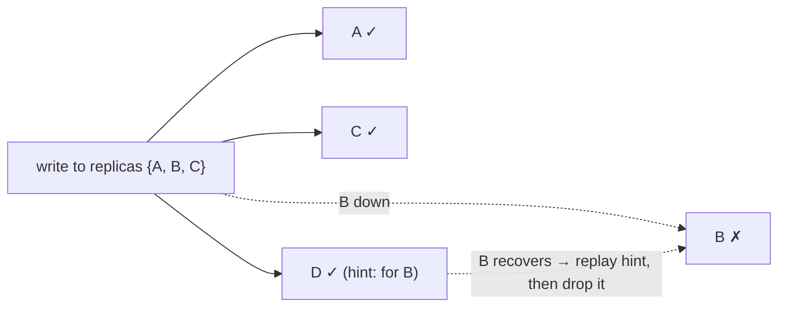
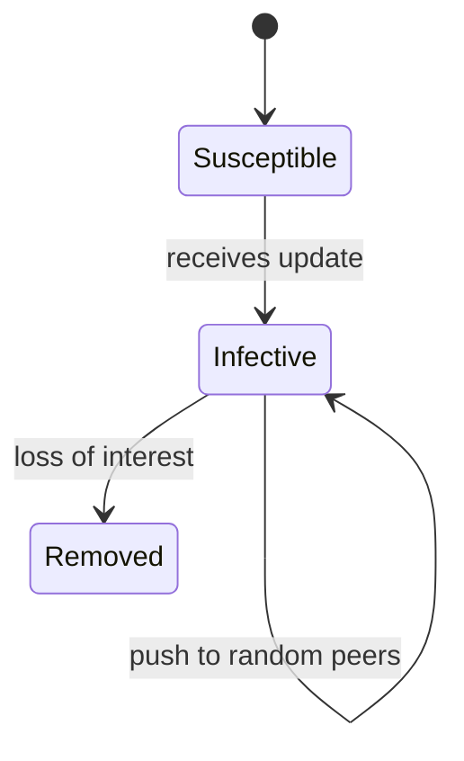

# 12. Anti-Entropy and Dissemination

[← 11. Replication and Consistency](11-replication-and-consistency.md) · [Book](../README.md) · [13. Distributed Transactions →](13-distributed-transactions.md)

## Summary

Peer-to-peer and coordinator-to-replica messaging depends on the sender being available, and its throughput is limited to one machine (p. 243). Cluster-wide **metadata** has to spread quickly and reliably: membership (nodes joining and leaving), node states, failures, schema changes. Such messages are small and infrequent (p. 243). Demers et al. describe three ways to propagate them (Figure 12-1, pp. 243–244):

| Approach | How |
|---|---|
| **Broadcast** | One process notifies all the others |
| **Anti-entropy** | Peers periodically exchange information pairwise |
| **Gossip** | Recipients rebroadcast cooperatively |

Here **entropy** means how far node states have diverged. **Anti-entropy** brings nodes back in sync when primary delivery has failed, which shortens convergence in eventually consistent systems (p. 244). The chapter covers foreground mechanisms (**read repair** with **digest reads**, and **hinted handoff** with **sloppy quorums**) and background ones (**Merkle trees**, **bitmap version vectors**) (pp. 245–249). It then turns to **gossip**: the epidemic model, fanout, redundancy, latency and interest loss, plus **overlay networks**, **Plumtree** hybrid gossip and **HyParView** partial views (pp. 250–255).

## Key takeaways

- **Delivery happens in two steps:** best-effort primary delivery, then periodic sync. Responsibility is shared, so the system keeps working if the coordinator fails (p. 244).
- **Read repair fixes only what is read.** Blocking read repair gives quorum reads monotonicity at a cost in availability; asynchronous repair doesn't wait (p. 245).
- **Digest reads** send one full read and hashes from the other replicas. Full reads follow only when digests disagree (p. 246).
- **Hints aren't replicas.** In Cassandra, hinted writes don't count toward the replication factor unless the consistency level is `ANY`. Sloppy quorums improve availability at the cost of consistency (pp. 246–247).
- **Merkle trees localize divergence.** Compare roots, then descend into the differing subtrees. Smaller leaf ranges are more precise but make the tree bigger (pp. 247–248).
- **Bitmap version vectors** pinpoint missing writes as dots (i, n), but a node that stays down for a long time keeps peers from truncating their logs (pp. 248–249).
- **Gossip reaches everyone in about log N rounds,** paying for robustness with redundant messages. Interest loss decides when propagation stops (pp. 250–251).
- **Hybrid gossip** uses a cheap spanning tree in steady state and falls back to gossip for repair (Plumtree, HyParView) (pp. 252–255).

## Section outline

*From the book’s own table of contents (PDF bookmarks); printed page numbers.*

- Read Repair — p. 245
- Digest Reads — p. 246
- Hinted Handoff — p. 246
- Merkle Trees — p. 247
- Bitmap Version Vectors — p. 248
- Gossip Dissemination — p. 250
  - Gossip Mechanics — p. 251
  - Overlay Networks — p. 251
  - Hybrid Gossip — p. 253
  - Partial Views — p. 254
- Summary — p. 255

## Notes

Broadcast suits small clusters. In large ones it gets **expensive** (many nodes) and **unreliable**, because it depends on one process that may not know every node and must be up at the same time as each recipient (p. 244). Relaxing the requirement means the coordinator delivers to everyone available, and anti-entropy fixes the rest (p. 244).

| Anti-entropy | Uses | Examples (p. 244) |
|---|---|---|
| **Foreground** | Piggybacks on read or write requests | Hinted handoff, read repair |
| **Background** | Auxiliary structures that identify divergence | Merkle trees, update logs |

Comparing whole replicas pairwise means reading the whole dataset on both nodes, which is very costly. It pays to consider *how* replicas fall behind and how data is accessed (pp. 244–245).

### Read repair

Divergence is easiest to detect during a read, and only for the data requested (p. 245). The coordinator reads from replicas, optimistically assuming they're in sync. If their responses differ, it sends the missing updates to the replicas that lack them (Dynamo) (p. 245). Dynamo-style databases with tunable consistency only contact and repair as many replicas as the consistency level needs, so quorum results are consistent even though some replicas may still miss writes (p. 245).

| Mode | Behaviour (p. 245) |
|---|---|
| **Blocking** | The client waits until the replicas are repaired. Gives **monotonic reads** for quorum reads; costs availability, because repairs must be acknowledged |
| **Asynchronous** | Schedules the repair after responding |

Cassandra uses iterators with **merge listeners** to compute the difference between the merged result and each replica's input (p. 245). Read repair assumes replicas are *mostly* in sync, so blocking repairs should be rare (p. 246).

#### Digest reads

The coordinator sends **one full read** and **digest** requests to the other replicas. A digest is a hash of the replica's local result (p. 246). If all digests match the hash of the full read, the replicas are in sync. If not, the coordinator doesn't know who is ahead, so it issues full reads to the mismatching replicas, reconciles, and updates the laggards (p. 246). Digests use fast noncryptographic hashes; the book cites MD5. Collisions are negligible, and other anti-entropy mechanisms would catch one anyway (p. 246).

### Hinted handoff

Hinted handoff is a **write-side** repair (Dynamo). If the target node doesn't acknowledge a write, the coordinator or another replica stores a **hint** and replays it when the target comes back (p. 246). In Cassandra, hinted writes **don't count toward the replication factor**, because the hint log isn't readable, unless the consistency level is `ANY` (p. 246).

**Sloppy quorums** (Riak): when replicas fail, writes can use other healthy nodes (pp. 246–247).

*The vault's diagram of the five-node example {A, B, C, D, E} on p. 247.*

The catch: if {B, C} are partitioned off and a sloppy-quorum write goes to {A, D, E}, an immediate read from {B, C} misses it. Sloppy quorums trade **consistency for availability** (p. 247).

### Merkle trees

Read repair can't fix data that isn't being read, and comparing records pairwise is impractical (p. 247). **Merkle trees** build a compact tree of hashes: leaves hash **ranges of records** found by scanning the table, and each parent hashes its children (Figure 12-2) (pp. 247–248).

- If the **roots** match, the replicas are in sync. Otherwise compare top-down to find the differing ranges, exchanging subtrees level by level or whole trees (pp. 247–248).
- A data change recomputes the subtree above it (p. 248).
- Tree size (message size) trades against precision (range size) (p. 248).

> **Try it:** [Merkle tree repair](../widgets/12-merkle-tree.html) — diverge two replicas by editing a few keys, compare root hashes, and descend only into mismatching subtrees. Change the leaf range size to see how many hashes are exchanged and how much data must be streamed.

### Bitmap version vectors

Gonçalves et al.: each node keeps a **per-peer log** of operations it executed or received. During anti-entropy, logs are compared and missing data is replicated (p. 248).

- Each write is a **dot (i, n)**: the *i*-th write coordinated by node *n*, with *i* starting at 1 (p. 248).
- A node's **logical clock** is the set of dots it has seen, directly or transitively. Its own dots have no gaps; **gaps** in other nodes' dots are missing writes (pp. 248–249).
- Nodes exchange clocks, identify the missing dots and replicate their records. A **dotted causal container (DCC)** maps dots to causal information per key, so conflict resolution preserves causality (p. 249).
- **Compact form:** node → (latest consecutive index, bitmap of later dots). The book's example, (3, 01101₂), means "consecutive through 3, and also seen 5, 6 and 8" (Figure 12-3, p. 249).
- Once every node has seen everything up to *i*, the vectors are **truncated** to *i* (p. 249).

| Pro (p. 249) | Con (p. 249) |
|---|---|
| Captures causality and pinpoints exactly the missing writes | A node down for a long time blocks truncation, because peers must keep its missing data |

### Gossip dissemination

**Gossip** combines broadcast's reach with anti-entropy's reliability. It's probabilistic, modelled on how rumours and epidemics spread (p. 250). The chapter opens with a Carl Jung epigraph about psychic epidemics (p. 250).

*The epidemic states (Demers et al.) on p. 250.*

- **Infective** processes hold an update and spread it. **Susceptible** ones haven't received it. **Removed** ones have stopped spreading it (p. 250).
- Completeness is modelled with a **loss-of-interest function** instead of a global recipient list. Efficiency means infecting as many nodes as possible with as few redundant messages as possible (p. 250).
- Gossip suits homogeneous decentralized systems without long-term membership or topology, flexible membership and mesh networks. It's very robust: random relays find alternative paths around failures (p. 250).

#### Gossip mechanics

| Term | Meaning (p. 251) |
|---|---|
| **Fanout f** | Number of random peers contacted per round |
| **Redundancy** | Overhead from repeated deliveries; inherent and necessary |
| **Latency** | Time to converge, i.e. for gossip to stop, slightly longer than delivering to everyone |
| **Interest loss** | Probabilistic (stop with some probability each step) or by threshold (stop after too many duplicates). Counting duplicates improves latency and reduces redundancy |

Larger systems need a bigger fanout or must accept higher latency (p. 251). Gossip gives **convergent consistency**: nodes are more likely to agree about events further in the past (p. 251).

> **Try it:** [Gossip dissemination](../widgets/12-gossip.html) — seed one rumour in a cluster, set fanout and the interest-loss rule, and watch susceptible, infective and removed counts per round, plus total messages and nodes never reached.

#### Overlay networks

Gossip is applied to a narrow set of problems. Nonepidemic approaches deliver with certainty and less redundancy (p. 251). Gossip spreads a message in about **log N rounds** but pays in duplicates, and random peer selection is robust because indirect links get around partitions, though it isn't message-optimal (pp. 251–252).

The middle ground is a **temporary fixed topology**: nodes sample peers and pick the best contacts by proximity (latency), forming **spanning trees**, loop-free graphs that cover the network, so delivery takes a fixed number of steps (p. 252). In Figure 12-4, full connectivity needs only some edges, but a single broken link cuts off a whole subtree (p. 252). Spanning trees can also form **islands** of peers that prefer one another. Use trees in steady state and gossip for failover and recovery (p. 252).

#### Hybrid gossip

**Plumtree** (push/lazy-push multicast trees, Leitão et al.) (pp. 253–254):

- **Eager push:** full messages go to a small subset of peers along a spanning tree.
- **Lazy push:** only message IDs go to everyone else. A node that sees an unknown ID requests the message, which also **heals the tree**.
- On failures the protocol falls back to gossip through the lazy links and repairs the overlay (Figure 12-5).
- Under constant load the tree tends to minimize latency, because the first nodes to respond join it (pp. 253–254).

#### Partial views

Full membership views are costly under high **churn** (nodes joining and leaving), so a **peer sampling service** keeps a **partial view**, refreshed by gossip, with some overlap for redundancy (p. 254). **HyParView** (Leitão et al.) keeps a small **active view** for dissemination and a larger **passive view** of replacement candidates (p. 254).

- Nodes periodically **shuffle**, exchanging views and adding received members to their passive views, while dropping the oldest entries to cap the size (p. 254).
- If P1 suspects P2 in its active view, it replaces P2 with P3 from its passive view, dropping P3 if the connection fails. P3 may decline if its active view is full, unless P1's view is *empty*, in which case P3 must accept and evict someone. This lets bootstrapping nodes join quickly (p. 254).
- HyParView converges quickly to a stable overlay after reorganization, partly because it prioritizes bootstrapping processes (p. 254).

Neither Plumtree nor HyParView needs a global view of all peers (pp. 254–255).

### Summary

| Mechanism | Optimizes for (p. 255) | What it does |
|---|---|---|
| **Read repair** | Scope reduction | Reconcile what is being read |
| **Hinted handoff** | Scope reduction | Replay individual missed writes |
| **Bitmap version vectors** | Recency | Log recent divergent events; know exactly what to sync after a short failure |
| **Merkle trees** | Completeness | Compare whole datasets cheaply by hashing |

Gossip distributes information reliably at scale, and hybrid gossip cuts messages while staying partition-resistant (p. 255). Many systems use gossip for failure detection and membership. HyParView is used in **Partisan**, and Plumtree was used in **Riak core** for cluster-wide information (pp. 255–256).

## Trade-offs at a glance

| | Read repair | Hinted handoff | Merkle trees | Bitmap version vectors |
|---|---|---|---|---|
| Trigger | Reads | Failed writes | Background | Background |
| Covers cold data | ✗ | Only missed writes | ✓ | ✓ (recent) |
| Cost | Extra replica reads; blocking adds latency | Hint storage | Full scan to build; hashes | Per-peer logs; truncation blocked by long outages |

| Dissemination | Messages | Reliability | Latency |
|---|---|---|---|
| Broadcast | N − 1 from one node | Single point of failure | One hop |
| Gossip | Redundant, about N·f per round | Very high | ~log N rounds |
| Spanning tree | N − 1 | One link can cut a subtree | Tree depth |
| Plumtree | Tree + lazy IDs | High (self-healing) | Near tree depth |

## Beyond the book

- **Push-pull gossip** (exchanging digests both ways) converges in O(log log N) rounds once most nodes are infected, against O(log N) for push alone. Cassandra's gossiper does a three-message SYN/ACK/ACK2 exchange of this kind every second. The [gossip lab](../lab/12-gossip-convergence/README.md) measures push-only rounds against the log N estimate.
- **Cassandra repair** builds Merkle trees per token range (`nodetool repair`). Incremental repair marks already-repaired SSTables so later runs hash only new data, which reduces the "full scan to build" cost in the table above.
- **Dynamo's legacy:** read repair, hinted handoff, sloppy quorums and Merkle-tree anti-entropy all come from the 2007 Dynamo paper the book cites [DECANDIA07]. [DDIA Ch. 6](../../designing-data-intensive-applications/chapters/06-replication.md) covers leaderless replication from the application side.

## Connections

- **Run it:** [Gossip convergence](../lab/12-gossip-convergence/README.md) — simulates push gossip with several fanouts and cluster sizes, and reports rounds to full infection, total messages and redundancy, compared with log N.
- **Related chapters:** [9. Failure Detection](09-failure-detection.md) (gossip-style failure detection, SWIM), [11. Replication and Consistency](11-replication-and-consistency.md) (tunable consistency, quorums, vector clocks), [7. Log-Structured Storage](07-log-structured-storage.md) (tombstones and the GC grace period).

## Check yourself

*Questions and answers are the vault's, written from the notes above; answers cite the book's pages.*

1. **What's the difference between foreground and background anti-entropy?**

   *Answer:* Foreground mechanisms ride on client requests (read repair, hinted handoff). Background ones use auxiliary structures such as Merkle trees and update logs to find divergence independently of requests (p. 244).

2. **Why does blocking read repair give quorum reads monotonicity?**

   *Answer:* The read doesn't return until the lagging replicas are repaired, so any later quorum read sees at least the value just returned (p. 245).

3. **Digests from three replicas don't all match. What does the coordinator do next?**
   - [ ] Returns the full read anyway
   - [x] Issues full reads to the mismatching replicas, reconciles, and updates the laggards
   - [ ] Picks the majority digest

   *Answer:* A mismatch doesn't reveal which replica is ahead, so full data is needed to reconcile (p. 246).

4. **Replicas are {A, B, C} and B is down. With a sloppy quorum, where does the write go, and what happens when B returns?**

   *Answer:* To A, C and a stand-in, D, which stores the record with a hint for B. When B recovers, D replays the hint and drops its copy (p. 247).

5. **Two replicas' Merkle roots differ. How is the divergence located?**

   *Answer:* Compare child hashes top-down and descend only into mismatching subtrees until reaching the leaf ranges that differ, then repair those records (pp. 247–248).

6. **What does (3, 01101₂) mean in a bitmap version vector?**

   *Answer:* The node has seen that peer's writes consecutively up to 3, and also writes 5, 6 and 8 (p. 249).

7. **In gossip, what makes a node move from infective to removed?**

   *Answer:* Loss of interest: either a per-step probability of stopping, or too many duplicate receipts, counting toward a threshold (pp. 250–251).

8. **How does Plumtree repair its broadcast tree?**

   *Answer:* Nodes lazily push message IDs to non-tree peers. A node that sees an ID it doesn't have requests the message, and that link is used to heal the tree (p. 253).
