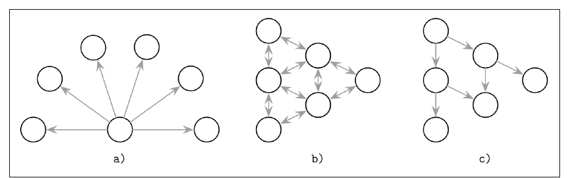
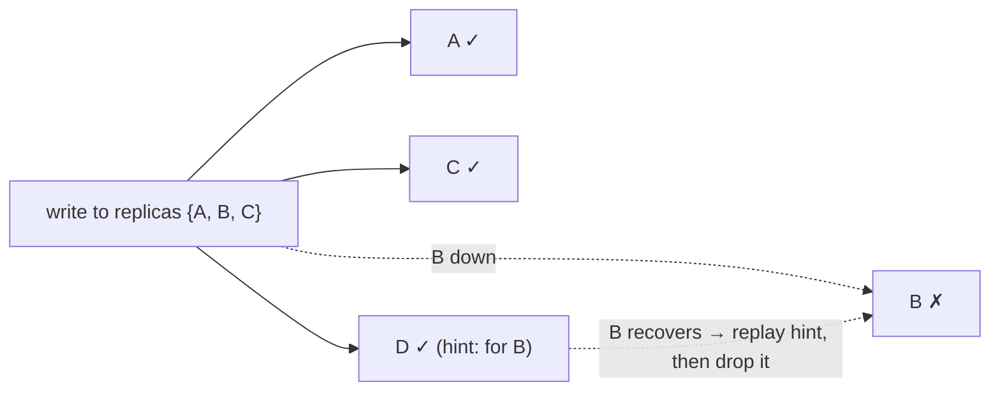
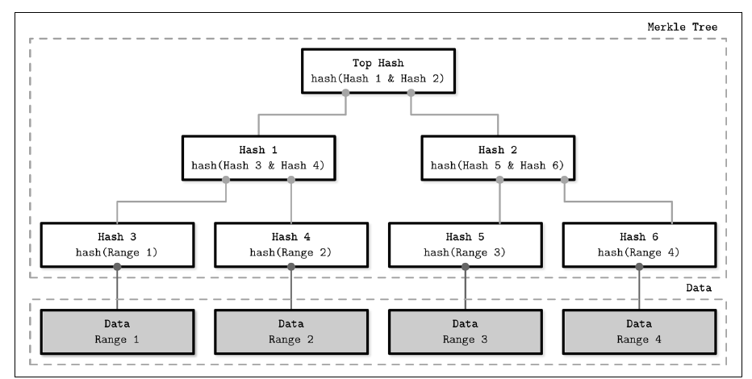
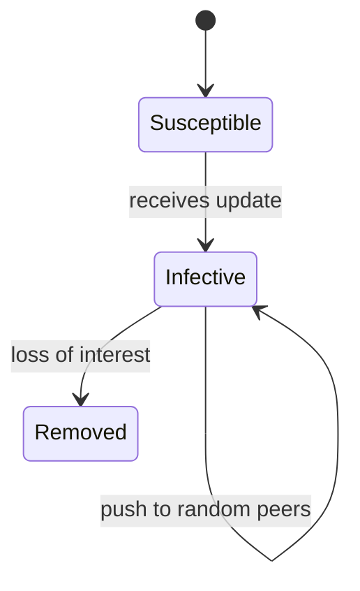
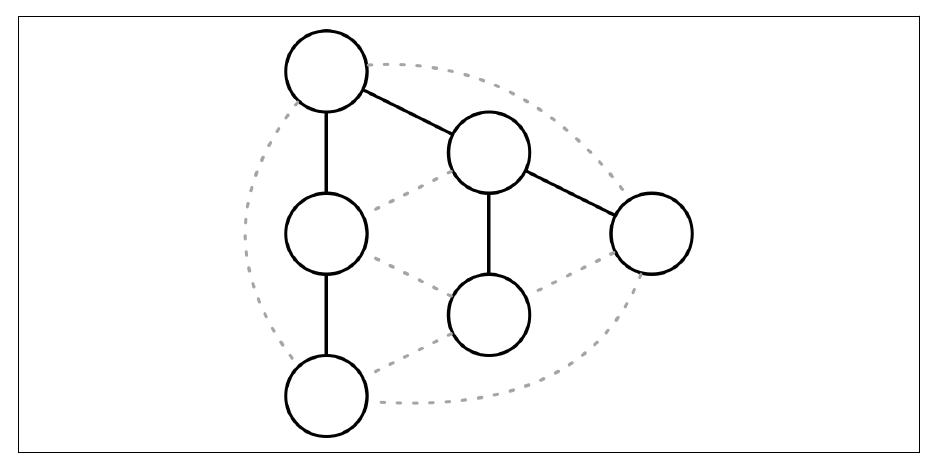

# فصل ۱۲: anti-entropy و پخش

[فصل ۱۱: replication و consistency →](11-replication-and-consistency.md) · [کتاب](../README.md) · [فصل ۱۳: تراکنش توزیع‌شده ←](13-distributed-transactions.md)

## خلاصه

پیام‌رسانی همتا‌به‌همتا و coordinator‌به‌replica به available بودن فرستنده وابسته است، و throughputاش به یک ماشین حد خورده (p. 243). **metadata** cluster‌سراسری باید زود و قابل اطمینان پخش شود: عضویت، یعنی پیوستن و رفتن نودها، و حالت نودها و شکست‌ها و تغییرهای schema. چنین پیام‌هایی کوچک و کم‌تکرارند (p. 243). دمرس و همکاران سه راه برای پخششان وصف می‌کنند (شکل ۱۲-۱، صص. ۲۴۳–۲۴۴):

| رویکرد | چطور |
|---|---|
| **پخش فراگیر** | یک process به همه‌ی بقیه خبر می‌دهد |
| **anti-entropy** | همتاها دوره‌ای دو‌به‌دو اطلاع رد و بدل می‌کنند |
| **gossip** | گیرنده‌ها هم‌کارانه دوباره پخش می‌کنند |

این‌جا **انتروپی** یعنی حالت نودها چقدر واگرا شده. **anti-entropy** وقتی تحویل اصلی باز مانده نودها را دوباره هم‌گام می‌کند، که در سیستم‌های سازگار غایی هم‌گرایی را کوتاه می‌کند (p. 244). فصل مکانیزم‌های پیش‌زمینه، یعنی **read repair** با **خواندن digest** و **hinted handoff** با **quorumهای شلخته**، و پس‌زمینه، یعنی **درخت Merkle** و **بردار نسخه‌ی bitmapی**، را می‌پوشاند (pp. 245–249). بعد به **gossip** می‌چرخد: مدل همه‌گیری و fanout و redundancy و latency و از دست دادن علاقه، به‌علاوه‌ی **شبکه‌های روپوش** و gossip دوگانه‌ی **Plumtree** و نماهای جزئی **HyParView** (pp. 250–255).

## نکته‌های کلیدی

- **تحویل در دو قدم رخ می‌دهد:** تحویل اصلی با بهترین تلاش، بعد synchronization دوره‌ای. مسئولیت مشترک است، پس اگر coordinator بشکند سیستم همین‌طور کار می‌کند (p. 244).
- **عمل read repair تنها آن چیزی را درست می‌کند که خوانده می‌شود.** read repair بند‌آور به خواندن‌های quorum یکنوایی می‌دهد به بهای دسترس‌پذیری؛ و تعمیر asynchronous منتظر نمی‌ماند (p. 245).
- **خواندن‌های digest** یک خواندن کامل و hash از بقیه‌ی replicaها می‌فرستند. خواندن کامل تنها وقتی پی می‌آید که digestها نخوانند (p. 246).
- **مفهوم hint، replica نیست.** در Cassandra، نوشتن‌های hint‌خورده به ضریب replication حساب نمی‌شوند مگر سطح consistency `ANY` باشد. quorumهای شلخته availability را به بهای consistency بهتر می‌کنند (pp. 246–247).
- **درخت‌های Merkle واگرایی را محلی می‌کنند.** ریشه‌ها را مقایسه کنید، بعد به زیردرخت‌های متفاوت پایین بروید. بازه‌های برگ کوچک‌تر دقیق‌ترند ولی درخت را بزرگ‌تر می‌کنند (pp. 247–248).
- **بردارهای نسخه‌ی bitmapی** نوشتن‌های گم‌شده را به‌شکل نقطه‌ی (i, n) انگشت می‌گذارند، ولی نودی که مدت طولانی خواب بماند جلو بریدن log همتاها را می‌گیرد (pp. 248–249).
- **پروتکل gossip در تقریباً log N دور به همه می‌رسد**، و بهای استواری را با پیام‌های زائد می‌دهد. از دست دادن علاقه تصمیم می‌گیرد پخش شدن کِی بس شود (pp. 250–251).
- **پروتکل gossip دوگانه** در حالت پایدار درختی پوشا و ارزان به کار می‌برد و برای تعمیر به gossip برمی‌گردد، یعنی Plumtree و HyParView (pp. 252–255).

## فهرست بخش‌ها

*از فهرست مطالب خود کتاب، از bookmarkهای PDF؛ شماره‌ها صفحه‌ی چاپی‌اند.*

- بخش read repair — ص. ۲۴۵
- خواندن digest — ص. ۲۴۶
- بخش hinted handoff — ص. ۲۴۶
- درخت Merkle — ص. ۲۴۷
- بردار نسخه‌ی bitmapی — ص. ۲۴۸
- پخش با gossip — ص. ۲۵۰
  - مکانیک gossip — ص. ۲۵۱
  - شبکه‌ی روپوش — ص. ۲۵۱
  - بخش gossip دوگانه — ص. ۲۵۳
  - نمای جزئی — ص. ۲۵۴
- خلاصه — ص. ۲۵۵

## یادداشت‌ها

پخش فراگیر به clusterهای کوچک می‌خورد. در بزرگ‌ها **گران** می‌شود، چون نودها زیادند، و **نامطمئن**، چون به یک process وابسته است که می‌تواند هر نودی را نشناسد و باید هم‌هنگام با هر گیرنده‌ای سرپا باشد (p. 244). شل کردن این نیازمندی یعنی coordinator به همه‌ی موجودها تحویل می‌دهد، و anti-entropy بقیه را درست می‌کند (p. 244).

*Figure 12-1 (p. 244): پخش فراگیر در (الف) به یک فرستنده تکیه می‌کند، anti-entropy در (ب) به synchronization دوره‌ای دو‌به‌دو، و gossip در (ج) به فرستادن همتا‌به‌همتا.*

| anti-entropy | چه چیزی به کار می‌برد | نمونه‌ها (p. 244) |
|---|---|---|
| **پیش‌زمینه** | سوار درخواست‌های خواندن یا نوشتن می‌شود | hinted handoff و read repair |
| **پس‌زمینه** | ساختارهای کمکی که واگرایی را شناسایی می‌کنند | درخت Merkle و log به‌روزرسانی |

مقایسه‌ی دو‌به‌دوی کل replicaها یعنی خواندن کل مجموعه‌داده روی هر دو نود، که خیلی گران است. به‌صرفه است که در نظر بگیریم replicaها *چطور* عقب می‌افتند و داده چطور دسترسی می‌شود (pp. 244–245).

### read repair

واگرایی را سر خواندنی راحت‌تر از همه می‌شود تشخیص داد، و تنها برای داده‌ی خواسته‌شده (p. 245). آن coordinator از replicaها می‌خواند، و خوش‌بینانه فرض می‌گیرد هم‌گام‌اند. اگر پاسخ‌هایشان فرق داشته باشد، به‌روزرسانی‌های گم‌شده را به آن replicaهایی می‌فرستد که ندارندشان، از Dynamo (p. 245). دیتابیس‌های از جنس Dynamo با consistency قابل تنظیم تنها به آن‌قدر replica تماس می‌گیرند و تعمیرشان می‌کنند که سطح consistency لازم دارد، پس نتیجه‌های quorum سازگارند هرچند برخی replicaها می‌توانند باز هم نوشتن‌هایی را نداشته باشند (p. 245).

| حالت | رفتار (p. 245) |
|---|---|
| **بند‌آور** | کلاینت تا تعمیر شدن replicaها منتظر می‌ماند. برای خواندن‌های quorum **خواندن یکنوا** می‌دهد؛ availability خرج دارد، چون تعمیرها باید تأیید شوند |
| **asynchronous** | تعمیر را پس از پاسخ دادن زمان‌بندی می‌کند |

سیستم Cassandra iteratorهایی با **شنونده‌ی merge** به کار می‌برد تا تفاوت میان نتیجه‌ی merge‌شده و ورودی هر replicaیی را حساب کند (p. 245). روش read repair فرض می‌گیرد که replicaها *بیشتر* هم‌گام‌اند، پس تعمیرهای بند‌آور باید کمیاب باشند (p. 246).

#### خواندن digest

آن coordinator **یک خواندن کامل** و درخواست‌های **digest** را به بقیه‌ی replicaها می‌فرستد. digest یک hash از نتیجه‌ی محلی replica است (p. 246). اگر همه‌ی digestها با hash آن خواندن کامل بخوانند، replicaها هم‌گام‌اند. اگر نه، coordinator نمی‌داند کی جلوتر است، پس به replicaهای نخوان خواندن کامل می‌دهد، آشتی می‌دهد، و عقب‌مانده‌ها را به‌روز (p. 246). digestها hashهای سریع و ناـرمزنگاری به کار می‌برند؛ کتاب MD5 را می‌آورد. برخورد ناچیز است، و هر طور که باشد مکانیزم‌های دیگر anti-entropy می‌گیرندش (p. 246).

### hinted handoff

روش hinted handoff تعمیری **سمت نوشتن** است، از Dynamo. اگر نود هدف نوشتنی را تأیید نکند، coordinator یا replicaیی دیگر یک **hint** ذخیره می‌کند و همین که هدف برگردد replayش می‌کند (p. 246). در Cassandra، نوشتن‌های hint‌خورده **به ضریب replication حساب نمی‌شوند**، چون log مربوط به hint خواندنی نیست، مگر سطح consistency `ANY` باشد (p. 246).

**همه‌ی quorumهای شلخته** در Riak: وقتی replicaها بشکنند، نوشتن‌ها می‌توانند نودهای سالم دیگری به کار ببرند (pp. 246–247).

*نمودار vault از نمونه‌ی پنج‌نودی {A, B, C, D, E} در ص. ۲۴۷.*

گیرش: اگر {B, C} پارتیشن شوند و نوشتنی با quorum شلخته به {A, D, E} برود، خواندنی فوری از {B, C} از قلمش می‌اندازد. quorumهای شلخته **consistency را با availability** بده‌بستان می‌کنند (p. 247).

### درخت Merkle

روش read repair نمی‌تواند داده‌ای را که خوانده نمی‌شود درست کند، و مقایسه‌ی دو‌به‌دوی رکوردها ناعملی است (p. 247). **درخت‌های Merkle** درختی جمع‌و‌جور از hash می‌سازند: برگ‌ها **بازه‌هایی از رکورد** را hash می‌کنند که با اسکن کردن جدول پیدا شده‌اند، و هر پدری فرزندهایش را hash (شکل ۱۲-۲) (pp. 247–248).

*Figure 12-2 (p. 248): hashهای سر برابر یعنی داده‌ی برابر؛ نخواندنی تنها در آن زیردرخت‌هایی تعقیب می‌شود که hashشان فرق دارد.*

- اگر **ریشه**ها بخوانند، replicaها هم‌گام‌اند. وگرنه از بالا به پایین مقایسه کنید تا بازه‌های متفاوت پیدا شوند، و زیردرخت‌ها را سطح‌به‌سطح یا کل درخت‌ها را رد و بدل (pp. 247–248).
- تغییر داده‌ای زیردرخت بالایش را دوباره حساب می‌کند (p. 248).
- اندازه‌ی درخت، یعنی اندازه‌ی پیام، با دقت، یعنی اندازه‌ی بازه، بده‌بستان می‌شود (p. 248).

> **Try it:** [تعمیر با درخت Merkle](../widgets/12-merkle-tree.html)؛ دو replica را با ویرایش چند کلید واگرا کنید، hashهای ریشه را مقایسه، و تنها به زیردرخت‌های نخوان پایین بروید. اندازه‌ی بازه‌ی برگ را عوض کنید تا ببینید چند hash رد و بدل می‌شود و چقدر داده باید جاری شود.

> **In practice:** replicaهای ClickHouse با anti-entropy هم‌گرا نمی‌شوند، با یک log مشترک در Keeper.
>
> **Your turn:** یک replica چند ساعت down بوده. وقتی برمی‌گردد چطور داده‌ی جاافتاده را می‌گیرد؟
>
> *Answer:* replication queue خودش را از Keeper می‌خواند و partهای جاافتاده را از replica دیگر fetch می‌کند. این بیشتر شبیه log replication است تا read repair یا درخت Merkle، که کتاب برای سیستم‌های بی leader و بی log مشترک می‌آورد (pp. 245–248).

### بردار نسخه‌ی bitmapی

گونسالوس و همکاران: هر نودی **logی به‌تفکیک همتا** از عملیاتی نگه می‌دارد که اجرا یا گرفته. در anti-entropy، logها مقایسه می‌شوند و داده‌ی گم‌شده تکرار (p. 248).

- هر نوشتنی یک **نقطه‌ی (i, n)** است: نوشتن *i*ام که نود *n* هم‌آهنگش کرده، با *i* که از ۱ شروع می‌شود (p. 248).
- **ساعت منطقی** نودی همان مجموعه‌ی نقطه‌هایی است که دیده، مستقیم یا ترایا. نقطه‌های خودش شکافی ندارند؛ و **شکاف** در نقطه‌های نودهای دیگر نوشتن‌های گم‌شده‌اند (pp. 248–249).
- نودها ساعت‌ها را رد و بدل می‌کنند، نقطه‌های گم‌شده را شناسایی و رکوردهایشان را تکرار. یک **ظرف علّی نقطه‌دار**، یعنی DCC، نقطه‌ها را به اطلاع علّی برای هر کلیدی map می‌کند، تا حل تعارض علیت را نگه دارد (p. 249).
- **شکل جمع‌و‌جور:** نود ← (آخرین index پیاپی، bitmap نقطه‌های بعدی). نمونه‌ی کتاب، یعنی (3, 01101₂)، یعنی «پیاپی تا ۳، و همچنین ۵ و ۶ و ۸ دیده شده‌اند» (شکل ۱۲-۳، ص. ۲۴۹).
- همین که هر نودی هر چیزی را تا *i* دیده باشد، بردارها تا *i* **بریده می‌شوند** (p. 249).

| خوبی (p. 249) | بدی (p. 249) |
|---|---|
| علیت را می‌گیرد و دقیقاً نوشتن‌های گم‌شده را انگشت می‌گذارد | نودی که مدت طولانی خواب باشد بریدن را بند می‌آورد، چون همتاها باید داده‌ی گم‌شده‌اش را نگه دارند |

### پخش با gossip

**پروتکل gossip** گستره‌ی پخش فراگیر را با قابلیت اطمینان anti-entropy ترکیب می‌کند. احتمالاتی است، و از پخش شدن شایعه و همه‌گیری مدل گرفته (p. 250). فصل با سرلوحه‌ای از کارل یونگ درباره‌ی همه‌گیری‌های روانی باز می‌شود (p. 250).

*حالت‌های همه‌گیری از دمرس و همکاران در ص. ۲۵۰.*

- همه‌ی processهای **واگیر** به‌روزرسانی‌ای دارند و پخشش می‌کنند. **مستعد**ها نگرفته‌اندش. **برداشته**ها پخش کردنش را بس کرده‌اند (p. 250).
- تمامیت به‌جای فهرستی جهانی از گیرنده با یک **تابع از دست دادن علاقه** مدل می‌شود. کارایی یعنی واگیر کردن تا جای ممکن نود بیشتر با تا جای ممکن پیام زائد کم‌تر (p. 250).
- پروتکل gossip به سیستم‌های همگن و نامرکزی بی عضویت یا توپولوژی بلند‌مدت و به عضویت انعطاف‌پذیر و شبکه‌های مش می‌خورد. خیلی استوار است: replay‌کننده‌های تصادفی گرد شکست‌ها مسیرهای جانشین پیدا می‌کنند (p. 250).

#### مکانیک gossip

| اصطلاح | معنا (p. 251) |
|---|---|
| **fanout یعنی f** | شمار همتاهای تصادفی که در هر دوری تماس گرفته می‌شوند |
| **redundancy** | سرریز تحویل‌های تکراری؛ ذاتی و لازم است |
| **latency** | زمان هم‌گرا شدن، یعنی بس شدن gossip، که کمی از تحویل به همه بلندتر است |
| **از دست دادن علاقه** | احتمالاتی، یعنی با احتمالی در هر قدمی بس کن، یا با آستانه، یعنی پس از تکراری‌های زیادی بس کن. شمردن تکراری‌ها latency را بهتر و redundancy را کم می‌کند |

سیستم‌های بزرگ‌تر fanout بزرگ‌تر لازم دارند یا باید latency بالاتری را بپذیرند (p. 251). gossip **consistency هم‌گرا** می‌دهد: احتمال توافق نودها درباره‌ی رویدادهای دورتر در گذشته بیشتر است (p. 251).

> **Try it:** [پخش با gossip](../widgets/12-gossip.html)؛ شایعه‌ای را در clusterی بکارید، fanout و قاعده‌ی از دست دادن علاقه را بگذارید، و شمار مستعد و واگیر و برداشته را برای هر دوری ببینید، به‌علاوه‌ی کل پیام‌ها و نودهایی که هیچ‌وقت نرسیدند.

#### شبکه‌ی روپوش

پروتکل gossip به مجموعه‌ی تنگی از مسئله‌ها به کار بسته می‌شود. رویکردهای ناهمه‌گیری با قطعیت و با redundancy کم‌تر تحویل می‌دهند (p. 251). gossip پیامی را در تقریباً **log N دور** پخش می‌کند ولی بهایش را با تکراری می‌دهد، و برداشتن تصادفی همتا استوار است چون پیوندهای غیرمستقیم گرد پارتیشن‌ها می‌پیچند، هرچند پیام‌بهینه نیست (pp. 251–252).

میانه‌ی راه **توپولوژی ثابت موقت** است: نودها از همتاها نمونه می‌گیرند و بهترین تماس‌ها را بر حسب نزدیکی، یعنی تأخیر، برمی‌دارند، و **درخت‌های پوشا** می‌سازند، یعنی گراف‌هایی بی‌حلقه که شبکه را می‌پوشانند، پس تحویل شمار ثابتی قدم می‌برد (p. 252). در شکل ۱۲-۴، اتصال کامل تنها برخی یال‌ها را لازم دارد، ولی یک پیوند شکسته کل زیردرختی را می‌برد (p. 252). درخت‌های پوشا می‌توانند **جزیره**هایی از همتاها هم بسازند که هم را ترجیح می‌دهند. در حالت پایدار درخت به کار ببرید و برای failover و بازیابی gossip (p. 252).

#### پروتکل gossip دوگانه

**الگوریتم Plumtree**، یعنی درخت‌های multicast با push و push تنبل، از لیتائو و همکاران (pp. 253–254):

- **الگوی push مشتاق:** پیام‌های کامل روی درختی پوشا به زیرمجموعه‌ی کوچکی از همتاها می‌روند.
- **الگوی push تنبل:** تنها ID پیام به بقیه می‌رود. نودی که IDیی ناشناس ببیند آن پیام را می‌خواهد، که **درخت را هم ترمیم می‌کند**.
- سر شکست پروتکل از راه پیوندهای تنبل به gossip برمی‌گردد و آن روپوش را تعمیر (شکل ۱۲-۵).

*Figure 12-5 (p. 253): به‌روزرسانی‌ها مشتاق روی آن درخت پر سفر می‌کنند؛ و پیوندهای تنبل خط‌چین تنها ID پیام رد و بدل می‌کنند و وقتی درخت بشکند تحویل می‌گیرند.*

- زیر بار پیوسته آن درخت گرایش دارد latency را کمینه کند، چون نخستین نودهایی که پاسخ می‌دهند به آن می‌پیوندند (pp. 253–254).

#### نمای جزئی

نماهای عضویت کامل زیر **تلاطم** بالا، یعنی پیوستن و رفتن نودها، گران‌اند، پس یک **سرویس نمونه‌گیری همتا** یک **نمای جزئی** نگه می‌دارد که با gossip تازه می‌شود، با کمی هم‌پوشانی برای redundancy (p. 254). روش **HyParView** از لیتائو و همکاران یک **نمای فعال** کوچک برای پخش و یک **نمای غیرفعال** بزرگ‌تر از نامزدهای جانشینی نگه می‌دارد (p. 254).

- نودها دوره‌ای **بر هم می‌زنند**، نماها را رد و بدل می‌کنند و اعضای گرفته‌شده را به نمای غیرفعالشان می‌افزایند، و در همان حال قدیمی‌ترین entryها را می‌اندازند تا اندازه سقف‌دار بماند (p. 254).
- اگر P1 در نمای فعالش به P2 گمان ببرد، P2 را با P3 از نمای غیرفعالش عوض می‌کند، و P3 را می‌اندازد اگر اتصال باز بماند. process P3 می‌تواند رد کند اگر نمای فعالش پر باشد، مگر نمای P1 *خالی* باشد، که آن‌وقت P3 باید قبول کند و کسی را بیرون بیندازد. این می‌گذارد نودهای در حال راه افتادن زود بپیوندند (p. 254).
- روش HyParView پس از سازمان دوباره زود به روپوشی پایدار هم‌گرا می‌شود، تا حدی چون processهای در حال راه افتادن را اولویت می‌دهد (p. 254).

نه Plumtree و نه HyParView نمایی جهانی از همه‌ی همتاها لازم ندارند (pp. 254–255).

> **In practice:** Alertmanager در حالت HA با gossip وضعیت silenceها و notificationها را بین نمونه‌ها پخش می‌کند.
>
> **Your turn:** دو نمونه‌ی Alertmanager دارید و یک alert دو بار به کانال تیم می‌رسد. چه چیزی شکسته است؟
>
> *Answer:* احتمالاً gossip بین دو نمونه، مثلاً port cluster بسته است، پس هیچ‌کدام نمی‌داند دیگری notification را فرستاده. gossip سریع ولی احتمالاتی پخش می‌کند و به شبکه‌ی سالم بین اعضا نیاز دارد (pp. 250–255).

### خلاصه

| مکانیزم | برای چه بهینه است (p. 255) | چه می‌کند |
|---|---|---|
| **read repair** | کم کردن گستره | آن چیزی را که خوانده می‌شود آشتی می‌دهد |
| **hinted handoff** | کم کردن گستره | نوشتن‌های از قلم افتاده را یکی‌یکی replay می‌کند |
| **بردار نسخه‌ی bitmapی** | تازگی | رویدادهای واگرای تازه را log می‌کند؛ پس از شکستی کوتاه دقیقاً می‌داند چه چیزی را هم‌گام کند |
| **درخت Merkle** | تمامیت | کل مجموعه‌داده‌ها را با hash ارزان مقایسه می‌کند |

پروتکل gossip اطلاع را در مقیاس قابل اطمینان پخش می‌کند، و gossip دوگانه پیام را می‌برد و در همان حال پارتیشن‌مقاوم می‌ماند (p. 255). خیلی از سیستم‌ها gossip را برای تشخیص شکست و عضویت به کار می‌برند. روش HyParView در **Partisan** به کار می‌رود، و Plumtree در **Riak core** برای اطلاع cluster‌سراسری به کار می‌رفت (pp. 255–256).

## بده‌بستان‌ها در یک نگاه

| | read repair | hinted handoff | درخت Merkle | بردار نسخه‌ی bitmapی |
|---|---|---|---|---|
| برانگیزنده | خواندن | نوشتن‌های شکسته | پس‌زمینه | پس‌زمینه |
| داده‌ی سرد را می‌پوشاند | ✗ | تنها نوشتن‌های از قلم افتاده | ✓ | ✓ برای تازه‌ها |
| هزینه | خواندن اضافه‌ی replica؛ بند‌آور latency می‌افزاید | ذخیره‌ی hint | اسکن کامل برای ساختن؛ hash | logهای به‌تفکیک همتا؛ بریدن با شکست‌های طولانی بند می‌آید |

| پخش | پیام | قابلیت اطمینان | latency |
|---|---|---|---|
| پخش فراگیر | N − 1 از یک نود | نقطه‌ی شکست تنها | یک پرش |
| gossip | زائد، تقریباً N·f در هر دوری | خیلی بالا | حدود log N دور |
| درخت پوشا | N − 1 | یک پیوند می‌تواند زیردرختی را ببرد | عمق درخت |
| Plumtree | درخت به‌علاوه‌ی IDهای تنبل | بالا، چون خودتعمیر است | نزدیک عمق درخت |

## فراتر از کتاب

- **پروتکل gossip با push و pull**، یعنی رد و بدل digest در هر دو جهت، همین که بیشتر نودها واگیر شوند در O(log log N) دور هم‌گرا می‌شود، در برابر O(log N) برای تنها push. gossiper در Cassandra هر ثانیه رد و بدلی سه‌پیامی از جنس SYN و ACK و ACK2 می‌کند. [آزمایش gossip](../lab/12-gossip-convergence/README.md) دورهای تنها‌push را در برابر برآورد log N اندازه می‌گیرد.
- **تعمیر در Cassandra** برای هر بازه‌ی token درختی Merkle می‌سازد، با `nodetool repair`. تعمیر افزایشی SSTableهای از قبل تعمیر‌شده را علامت می‌زند تا اجراهای بعدی تنها داده‌ی تازه را hash کنند، که هزینه‌ی «اسکن کامل برای ساختن» در جدول بالا را کم می‌کند.
- **میراث Dynamo:** روش‌های read repair و hinted handoff و quorum شلخته و anti-entropy با درخت Merkle همه از مقاله‌ی ۲۰۰۷ Dynamo می‌آیند که کتاب با [DECANDIA07] آوردش. [فصل ۶ کتاب DDIA](../../designing-data-intensive-applications/chapters/06-replication.md) replication بی‌leader را از سمت برنامه می‌پوشاند.

## پیوندها

- **Run it:** [هم‌گرایی gossip](../lab/12-gossip-convergence/README.md)؛ gossip از جنس push را با چند fanout و اندازه‌ی cluster شبیه‌سازی می‌کند، و دورهای لازم برای واگیری کامل و کل پیام‌ها و redundancy را در مقایسه با log N گزارش می‌دهد.
- **فصل‌های مرتبط:** [فصل ۹: تشخیص شکست](09-failure-detection.md) که تشخیص شکست از جنس gossip و SWIM را دارد، [فصل ۱۱: replication و consistency](11-replication-and-consistency.md) که consistency قابل تنظیم و quorum و ساعت برداری را دارد، و [فصل ۷: ذخیره‌سازی log-structured](07-log-structured-storage.md) که tombstone و دوره‌ی مهلت GC را دارد.

## خودتان را بسنجید

*پرسش‌ها و پاسخ‌ها مال vault است و از روی یادداشت‌های بالا نوشته شده؛ پاسخ‌ها به صفحه‌های کتاب ارجاع می‌دهند.*

1. **تفاوت anti-entropy پیش‌زمینه و پس‌زمینه چیست؟**

   *Answer:* مکانیزم‌های پیش‌زمینه سوار درخواست‌های کلاینت می‌شوند، یعنی read repair و hinted handoff. پس‌زمینه‌ای‌ها ساختارهای کمکی مثل درخت Merkle و log به‌روزرسانی به کار می‌برند تا واگرایی را مستقل از درخواست‌ها پیدا کنند (p. 244).

2. **چرا read repair بند‌آور به خواندن‌های quorum یکنوایی می‌دهد؟**

   *Answer:* خواندن تا تعمیر شدن replicaهای عقب‌مانده برنمی‌گردد، پس هر خواندن quorum بعدی دست‌کم همان مقداری را می‌بیند که همین حالا برگردانده شد (p. 245).

3. **همه‌ی digestهای سه replica همه نمی‌خوانند. آن coordinator بعد چه می‌کند؟**
   - [ ] هر طور که باشد آن خواندن کامل را برمی‌گرداند
   - [x] به replicaهای نخوان خواندن کامل می‌دهد، آشتی می‌دهد، و عقب‌مانده‌ها را به‌روز می‌کند
   - [ ] ساختار digest اکثریت را برمی‌دارد

   *Answer:* نخواندن آشکار نمی‌کند کدام replica جلوتر است، پس داده‌ی کامل برای آشتی لازم است (p. 246).

4. **همه‌ی replicaها {A, B, C} هستند و B خواب است. با quorum شلخته، نوشتن کجا می‌رود، و وقتی B برگردد چه می‌شود؟**

   *Answer:* به A و C و جانشینی مثل D، که رکورد را با hintی برای B ذخیره می‌کند. وقتی B بازیابی شود، D آن hint را replay می‌کند و کپی‌اش را می‌اندازد (p. 247).

5. **ریشه‌ی Merkle دو replica فرق دارد. آن واگرایی چطور محلی می‌شود؟**

   *Answer:* hashهای فرزند را از بالا به پایین مقایسه کنید و تنها به زیردرخت‌های نخوان پایین بروید تا به آن بازه‌های برگی برسید که فرق دارند، بعد آن رکوردها را تعمیر کنید (pp. 247–248).

6. **عبارت (3, 01101₂) در بردار نسخه‌ی bitmapی چه معنایی دارد؟**

   *Answer:* آن نود نوشتن‌های آن همتا را پیاپی تا ۳ دیده، و همچنین نوشتن‌های ۵ و ۶ و ۸ را (p. 249).

7. **در gossip، چه چیزی نودی را از واگیر به برداشته می‌برد؟**

   *Answer:* از دست دادن علاقه: یا احتمالی برای بس کردن در هر قدمی، یا تکراری‌های زیادی که به آستانه‌ای حساب می‌شوند (pp. 250–251).

8. **روش Plumtree درخت پخشش را چطور تعمیر می‌کند؟**

   *Answer:* نودها تنبل IDهای پیام را به همتاهای غیر‌درختی push می‌کنند. نودی که IDیی ببیند که ندارد آن پیام را می‌خواهد، و همان پیوند برای ترمیم درخت به کار می‌رود (p. 253).
