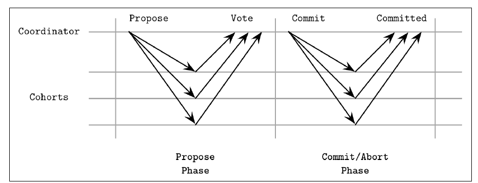
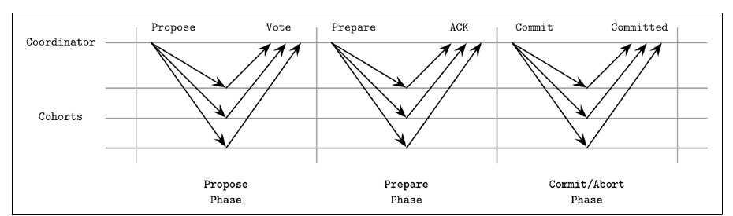
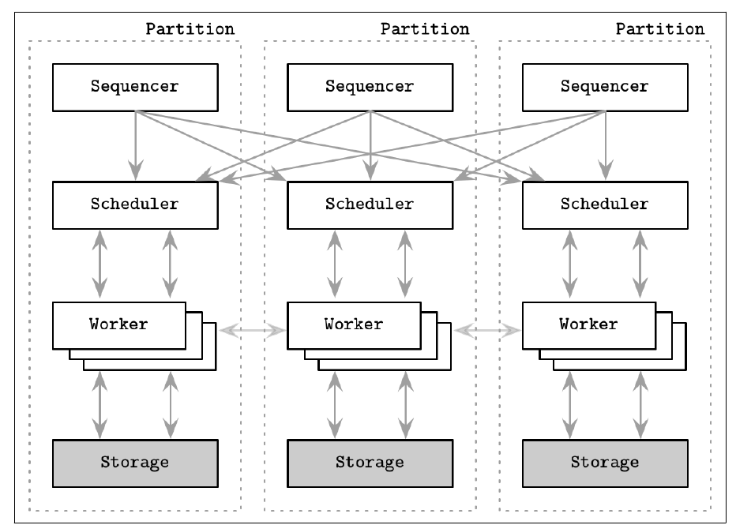
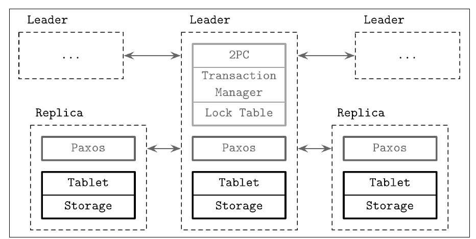

# فصل ۱۳: تراکنش توزیع‌شده

[فصل ۱۲: anti-entropy و پخش →](12-anti-entropy-and-dissemination.md) · [کتاب](../README.md) · [فصل ۱۴: consensus ←](14-consensus.md)

## خلاصه

مفهوم consistency modelها فصل ۱۱ عملیات تنها را می‌پوشانند، ولی دیتابیس‌ها اغلب لازم دارند چند عملیات **اتمی** رخ بدهند، بین پارتیشن‌ها و نودها (p. 257). این فصل همتای توزیع‌شده‌ی فصل ۵ است. concurrency control نود‌محلی نمی‌تواند تراکنش‌های **چند‌پارتیشنی** را حل کند، که هم‌آهنگی میان سرورها و commit و واگردان توزیع‌شده لازم دارند (p. 257). تراکنشی باید **بازیابی‌شدنی** باشد: اگر بشکند یا abort شود یا وقتش سر برود، تماماً واگردانده می‌شود، *روی هر نود درگیری* (p. 258).

فصل این‌ها را می‌پوشاند:

- **پروتکل commitment اتمی**:
  - **پروتکل two-phase commit** یعنی 2PC، که اگر coordinator پس از جمع کردن رأی‌ها بشکند **بند می‌آید**؛
  - **پروتکل three-phase commit** یعنی 3PC، که زیر فرض‌های هم‌زمان از بند آمدن می‌پرهیزد ولی زیر پارتیشن می‌تواند **split brain** بسازد (pp. 258–266).
- دو طرح امروزی (pp. 266–270):
  - **سیستم Calvin** که FaunaDB است: یک **sequencer** پیش از اجرا ترتیبی قطعی از دسته‌های تراکنش را ثابت می‌کند؛
  - **سیستم Spanner** که CockroachDB و YugaByte DB هستند: **2PC روی گروه‌های Paxos**، که با **TrueTime** مرتب می‌شود و **external consistency** می‌دهد.
- **پارتیشن‌بندی**: sharding بازه‌ای و hash moduleی و **consistent hashing** (pp. 270–271).
- **سیستم Percolator** که TiDB است: isolationی snapshot روی Bigtable با 2PC کلاینت‌محور (pp. 272–274).
- **پرهیز از هم‌آهنگی**: هم‌جوشی ناوردا و تراکنش‌های **RAMP** با isolationی خواندن اتمی (pp. 275–277).

## نکته‌های کلیدی

- **پروتکل commitment اتمی unanimous است.** یک رأی «نه» تراکنش را abort می‌کند، پس این پروتکل‌ها نمی‌توانند شرکت‌کننده‌های Byzantine را تحمل کنند (p. 258).
- **دسته‌ها تنها رأی می‌دهند.** نمی‌توانند تراکنش را عوض کنند یا جایگزینی پیشنهاد بدهند (p. 258).
- **قول مغزی 2PC:** همین که دسته‌ای رأی مثبت بدهد، نمی‌تواند پس بکشد. تنها coordinator می‌تواند abort کند (p. 262).
- **روش 2PC سر شکست coordinator بند می‌آید.** دسته‌هایی که رأی مثبت داده‌اند اگر coordinator پیش از اعلام برآمد بمیرد نمی‌توانند تنها تصمیم بگیرند (p. 263).
- **روش 3PC دوری آماده‌سازی و timeout برای دسته‌ها می‌افزاید**، ولی پارتیشنی در میانه‌ی آماده‌سازی می‌گذارد برخی دسته‌ها commit کنند و بقیه abort (pp. 264–266).
- **سیستم Calvin هم‌آهنگی را در حین اجرا برمی‌دارد.** هر replicaیی همان ورودی‌های مرتب را می‌گیرد و همان خروجی‌ها را می‌سازد؛ مجموعه‌ی خواندن و نوشتن را از پیش معلوم لازم دارد (pp. 266–267).
- **سیستم Spanner عدم قطعیت ساعت را به انتظار می‌نشیند** پیش از آشکار کردن commitی، پس اگر T1 پیش از شروع T2 commit کند، داریم ts(T1) < ts(T2) (pp. 268–270).
- **روش consistent hashing وقتی n نود عوض شود تقریباً K/n کلید جابه‌جا می‌کند**، در برابر تقریباً همه‌ی کلیدها با hash moduleی (p. 271).
- **یک isolation خواندن اتمی در RAMP:** همه‌ی نوشتن‌های تراکنشی دیدنی‌اند، یا هیچ‌کدام، که خواندن‌های شکسته را رد می‌کند، بی طرد متقابل (p. 276).

## فهرست بخش‌ها

*از فهرست مطالب خود کتاب، از bookmarkهای PDF؛ شماره‌ها صفحه‌ی چاپی‌اند.*

- اتمی به نظر رساندن عملیات — ص. ۲۵۸
- بخش two-phase commit — ص. ۲۵۹
  - شکست دسته‌ها در 2PC — ص. ۲۶۱
  - شکست coordinator در 2PC — ص. ۲۶۲
- بخش three-phase commit — ص. ۲۶۴
  - شکست coordinator در 3PC — ص. ۲۶۵
- تراکنش توزیع‌شده با Calvin — ص. ۲۶۶
- تراکنش توزیع‌شده با Spanner — ص. ۲۶۸
- پارتیشن‌بندی دیتابیس — ص. ۲۷۰
  - بخش consistent hashing — ص. ۲۷۱
- تراکنش توزیع‌شده با Percolator — ص. ۲۷۲
- پرهیز از هم‌آهنگی — ص. ۲۷۵
- خلاصه — ص. ۲۷۷

## یادداشت‌ها

تراکنش‌ها گذار حالت از A به B هستند بی حالتی پیش‌تعیین‌شده که به‌شان چسبیده، پس مرتب‌شدنی و دوباره‌کوشیدنی‌اند (p. 257). تاریخی **serializable** است اگر گراف وابستگی‌اش با گراف تاریخی سری برابر باشد (p. 257). حتی انتقال پولی صدها قدم کوچک است، پس تراکنشی باید اول اجرا شود و تنها پس از آن دیدنی (p. 258). نودها مستقل می‌شکنند و بازیابی می‌شوند، با این حال اتمی بودن باید روی همه‌شان برقرار باشد: تغییرها پایا به هر نود درگیری می‌رسند، یا هیچ‌کدام، از لمپسون (p. 258).

### اتمی به نظر رساندن عملیات

الگوریتم‌های **commitment اتمی** هیچ اختلافی را مجاز نمی‌کنند. یک رأی «نه» جلو commit را می‌گیرد، و processهای شکسته باید به همان نتیجه‌ی بقیه برسند. از همین‌جاست که با شکست‌های **Byzantine** کار نمی‌کنند (p. 258). پرسش تنها این است که آیا تراکنش پیشنهادشده اجرا شود: دسته‌ها نمی‌توانند روی آن اثر بگذارند یا عوضش کنند (p. 258).

الگوریتم‌ها معناشناسی آماده‌سازی و commit و واگردان را به پیاده‌کننده‌ها می‌سپارند (p. 259):

- داده کِی آماده‌ی commit است، یعنی یک عوض کردن اشاره‌گر دور از عمومی شدن؛
- چطور commit کنیم تا نتیجه‌ها تا جای ممکن زود دیدنی شوند؛
- چطور واگردان کنیم وقتی تصمیم abort است.

به‌کار‌برندگان شامل MySQL برای تراکنش توزیع‌شده و Kafka برای تعامل تولید‌کننده و consumerاند (p. 259). **مدیر تراکنش** تراکنش‌ها را زمان‌بندی و هم‌آهنگ و اجرا و پی می‌گیرد، و تأمین می‌کند که commitها در همه‌ی پارتیشن‌ها و برای همه‌ی replicaها رخ بدهند (p. 259).

### two-phase commit

یک **coordinator**، که leader است و حالت را دارد و رأی‌ها را جمع می‌کند و نقطه‌ی مرجع است، و **دسته**ها هستند، که معمولاً پارتیشن‌هایی روی مجموعه‌داده‌های مجزایند. همه logی محلی از هر قدمی نگه می‌دارند (p. 260). آن coordinator می‌تواند نودی باشد که درخواست را گرفته، یا تصادفی برداشته شود یا انتخاب شود یا دستی تخصیص داده شود یا ثابت باشد، و آن نقش انتقال‌پذیر است (p. 260).

*Figure 13-1 (p. 261): دو رفت‌و‌برگشت؛ رأی‌ها پیش از تصمیم coordinator پایا می‌شوند، و تصمیم پیش از فرستادنش log می‌شود.*

| فاز | چه رخ می‌دهد (pp. 260–261) |
|---|---|
| **آماده‌سازی** | آن coordinator پیام **Propose** را می‌فرستد. هر دسته‌ای تصمیم می‌گیرد که می‌تواند بخشش را commit کند یا نه، تراکنش را محلی تا حالتی **پیش‌commit‌شده** اجرا می‌کند، و رأی مثبت یا منفی می‌دهد. رأی‌ها در log آن coordinator پایا می‌شوند، و هر دسته‌ای کپی‌ای از تصمیم خودش نگه می‌دارد |
| **commit یا abort** | اگر *هر* دسته‌ای رأی منفی بدهد، همه پیام **Abort** می‌گیرند. تنها اگر همه رأی مثبت داده باشند همه پیام **Commit** می‌گیرند |

هر قدمی روی ذخیره‌سازی پایا نوشته می‌شود تا حالت پس از شکست‌های محلی دوباره ساختنی و برای بقیه replay‌شدنی باشد. سر زمان commit، محتوای تراکنش از قبل روی هر نودی پایاست (p. 261).

#### شکست دسته‌ها در 2PC

- **دسته‌ای در میانه‌ی آماده‌سازی می‌شکند:** آن coordinator نمی‌تواند رأی مثبت unanimous جمع کند و abort می‌کند. شکست یک نود تراکنش‌ها را بند می‌آورد، که به availability صدمه می‌زند. سیستم Spanner برای درستش کردن 2PC را به‌جای نودهای تک‌تک روی **گروه‌های Paxos** اجرا می‌کند (pp. 261–262).
- **دسته‌ای پس از رأی مثبت می‌شکند:** سر بازیابی باید تصمیم واقعی را بفهمد، که معمولاً از log تصمیم پایا‌شده‌ی coordinator است، پیش از سرویس دادن به درخواست‌ها، چون بقیه می‌توانند abortی را باعث شده باشند (p. 262).
- **پیام‌های گم‌شده:** انتظارها می‌توانستند تا ابد بکشند، پس coordinator در میانه‌ی آماده‌سازی وقتش سر می‌رود و abort می‌کند (p. 262).

#### شکست coordinator در 2PC

- **دسته‌ای تصمیم را از قلم می‌اندازد:** می‌تواند از log همتاها یا از coordinatorی پشتیبان بفهمدش. تکرار کردن آن تصمیم ایمن است چون unanimous است: commit روی یک دسته یعنی همه commit می‌کنند (pp. 262–263).
- **نقش coordinator پس از جمع کردن رأی‌ها و پیش از پخش برآمد می‌شکند:** دسته‌ها *قول داده‌اند* منتظر فرمانش بمانند و **نامطمئن** می‌مانند (شکل ۱۳-۴). اگر هیچ‌وقت بازیابی نشود، جانشینی باید رأی‌ها را دوباره جمع کند. **روش 2PC الگوریتم commitment اتمی بند‌آوری است** (p. 263).

سیستم‌های MySQL و PostgreSQL و MongoDB از 2PC به کار می‌برند؛ مستند MongoDB تا نسخه‌ی ۳.۶ تنها معناشناسی از جنس تراکنش را وصف می‌کند، یادداشت ۲. همه‌گیر است چون ساده است و رفت‌و‌برگشت کمی دارد، ولی بازیابی خوب و coordinatorهای پشتیبان لازم دارد (pp. 263–264).

> **In practice:** بار Bronze در ClickHouse و ذخیره‌ی cursor در dlt دو نوشتن در دو سیستم‌اند، بدون 2PC.
>
> **Your turn:** insert موفق شد و pod پیش از ذخیره‌ی cursor مرد. چه می‌شود، و چرا 2PC این‌جا راه معقولی نیست؟
>
> *Answer:* اجرای بعدی همان ردیف‌ها را دوباره می‌آورد و چون Silver dedup می‌کند، امن است. 2PC به participantهایی نیاز دارد که prepare را پشتیبانی کنند و اگر coordinator بیفتد بند می‌آید؛ at-least-once به‌علاوه‌ی dedup ساده‌تر و مقاوم‌تر است (pp. 260–264).

### three-phase commit

روش 3PC قدمی به‌علاوه‌ی **timeout در هر دو سو** می‌افزاید، تا دسته‌ها بتوانند بی coordinator commit یا abort کنند. مدلی **هم‌زمان** با **بی شکست ارتباط** را فرض می‌گیرد، از اسکین و باباوغلو و توگ؛ ریزنوشته‌اش شبکه‌ای به‌شدت قابل اطمینان و بی پارتیشن را فرض می‌گیرد (pp. 259, 264).

*Figure 13-5 (p. 264): آن دور آماده‌سازی اضافه یعنی هر دسته‌ای پیش از commit کردن هر کسی تصمیم را می‌فهمد، پس دسته‌ها می‌توانند timeout تمام کنند.*

| فاز | چه رخ می‌دهد (pp. 264–265) |
|---|---|
| **پیشنهاد** | مقدار را بفرست و رأی‌ها را جمع کن. از کار افتادن coordinator با timeout، یا هر «نه»ای، یعنی abort |
| **آماده‌سازی** | نتیجه‌ی رأی را به دسته‌ها بگو: پیام **Prepare** اگر همه رأی مثبت داده باشند، وگرنه **Abort**. دسته‌هایی که به حالت آماده نرسند timeout abort می‌کنند |
| **commit** | همین که همه‌ی دسته‌ها آماده و تأییدکرده باشند، تراکنش **commit می‌کند حتی اگر هر یک از دو سو بشکند**، چون همه همان نما را مشترک دارند. پیام commit timeout‌ها را صفر و دور را تمام می‌کند |

#### شکست coordinator در 3PC

گذارها هم‌آهنگ‌اند: هیچ‌کس جلو نمی‌رود تا همه فاز پیشین را تمام کنند. دسته‌ای که *پیش از* گذراندن فاز آماده‌سازی چیزی نشنود timeout abort می‌کند؛ و *پس از* آن، commit (p. 265). این از بند آمدن 2PC می‌پرهیزد (p. 265). بدترین حالت **پارتیشن شبکه** در میانه‌ی آماده‌سازی است (شکل ۱۳-۶): دسته‌های آماده پس از timeoutشان commit می‌کنند در حالی که بریده‌شده‌ها abort، که **split brain**ی است که در آن همه از پروتکل پی گرفتند (pp. 265–266). سرریز پیام بالاتر و تناقض ممکن و رفتار ضعیف زیر پارتیشن احتمالاً علت این است که 3PC کم به کار می‌رود (p. 266).

> **Try it:** [مقایسه‌ی 2PC و 3PC زیر شکست](../widgets/13-commit-protocols.html)؛ دوری از commit را با سه دسته اجرا کنید، coordinator را از کار بیندازید یا دسته‌ای را در هر قدمی پارتیشن کنید، و برآمدها را مقایسه کنید: 2PC با دسته‌های نامطمئن بند می‌آید، در حالی که 3PC تمام می‌کند ولی می‌تواند به commit و abort بشکند.

### تراکنش توزیع‌شده با Calvin

بگذارید replicaها **پیش از** گرفتن قفل‌ها روی ترتیب اجرا و مرزهای تراکنش توافق کنند. آن‌وقت شکست نودها تراکنش‌ها را abort نمی‌کند، چون replicaهای دیگر همان تراکنش‌ها را اجرا می‌کنند (p. 266). روش‌های 2PL و OCC ترتیبی قطعی ندارند، پس اجرا هم‌آهنگی لازم دارد. با ترتیب قطعی، همه‌ی replicaها ورودی یکسان می‌گیرند و خروجی هم‌ارز می‌سازند، از تامسون و همکاران و FaunaDB (p. 266).

*Figure 13-7 (p. 268): sequencerها همان دسته‌های مرتب را به همه‌ی schedulerها می‌خورانند؛ workerها تنها آن خواندن‌های دوری را مشترک می‌کنند که لازم دارند.*

آن sequencer تراکنش‌ها را در دوره‌های ۱۰ میلی‌ثانیه‌ای جمع می‌کند و دسته‌ها را تکرار، با Paxos یا leaderی؛ scheduler قطعی اجرایشان می‌کند، و هر جا ایمن باشد موازی؛ هر workerی (۱) مجموعه‌ی خواندن و نوشتن را تحلیل می‌کند، (۲) داده‌ی محلی را می‌خواند و می‌فرستد، (۳) خواندن‌های دور را می‌گیرد، و (۴) اجرا و پایا می‌کند (pp. 266–267).

- آن **sequencer** نقطه‌ی ورود همه‌ی تراکنش‌هاست و ترتیبی جهانی از ورودی را ثابت می‌کند. زمان به **دوره** بخش می‌شود، که در مقاله دسته‌های تقریباً ۱۰ میلی‌ثانیه‌ای‌اند، و یکای replication هم هستند (pp. 266–267).
- آن **scheduler** بخش‌هایی از تراکنش‌ها را موازی اجرا می‌کند و در همان حال ترتیب سری sequencer را نگه می‌دارد. replicaها هیچ‌وقت دوباره با sequencer حرف نمی‌زنند (p. 267).
- هر تراکنشی یک **مجموعه‌ی خواندن** و یک **مجموعه‌ی نوشتن** اعلام می‌کند. Calvin بومی از تراکنش‌هایی پشتیبانی نمی‌کند که برای تعیین آن مجموعه‌ها خواندن اضافه لازم دارند (p. 267).
- چهار قدم worker: (۱) رکوردهای مجموعه‌ی خواندن محلی و **شرکت‌کننده‌های فعال** را پیدا کن، که رکوردهای مجموعه‌ی نوشتن را دارند؛ (۲) رکوردهای محلی را بخوان و به شرکت‌کننده‌های فعال بفرست؛ (۳) شرکت‌کننده‌های فعال خواندن‌های دور را می‌گیرند؛ (۴) محلی اجرا و پایا کن. نتیجه‌ها فرستاده نمی‌شوند، چون هر شرکت‌کننده‌ای حسابشان می‌کند (p. 267).
- همه‌ی sequencerها روی هر دسته‌ای از راه **Paxos** توافق می‌کنند، یا از راه replication asynchronous با leaderی، که latency کم‌تری دارد ولی بازیابی گران‌تری (p. 267).

### تراکنش توزیع‌شده با Spanner

سیستم Spanner اغلب در برابر Calvin گذاشته می‌شود. Calvin روی *sequencer*ها به consensus می‌رسد؛ و Spanner **2PC روی گروه‌های consensus به‌تفکیک shard** اجرا می‌کند. برگرفته‌ها شامل CockroachDB و YugaByte DB‌اند (p. 268). **TrueTime** یک API ساعت دیواری پردقت است که **کران عدم قطعیت** برمی‌گرداند، پس عملیات می‌توانند عمداً به انتظارش بنشینند (p. 268).

| عملیات | چطور (pp. 268–269) |
|---|---|
| **تراکنش خواندن‌نوشتن** | قفل، concurrency control بدبینانه، یک replica از جنس leader |
| **تراکنش فقط‌خواندن** | بی‌قفل، روی هر replicaیی. leader تنها برای خواندن در *تازه‌ترین* timestamp لازم است |
| **خواندن snapshot** | در timestampی سازگار؛ رکوردها بر حسب زمان commit نسخه‌دار می‌شوند |

**معماری** (شکل ۱۳-۸، ص. ۲۶۹):

*Figure 13-8 (p. 269): روش Paxos هر گروهی را تکرار می‌کند؛ leaderها جدول قفل و مدیر تراکنش 2PC را برای تراکنش‌های بین‌گروهی می‌افزایند.*

- یک **spanserver** tabletها را دارد، که هر یک state machine Paxosی دارد. مجموعه‌های replica **گروه‌های Paxos** می‌سازند، که یکای جای‌دهی و replication‌اند و هر یک leaderی دیرزیست دارد، با Multi-Paxos.
- نوشتن‌ها از leader گروه رد می‌شوند؛ و خواندن‌ها را هر replica به‌روزی می‌تواند سرویس بدهد.
- آن leader یک **جدول قفل** برای 2PL و یک **مدیر تراکنش** برای تراکنش‌های چند‌shardی دارد. خواندن‌های snapshot از قفل‌ها می‌پرند.

**عمل commit چند‌shardی** (pp. 269–270):

۱. همه‌ی leaderهای گروه یک 2PC را برای consistency هم‌آهنگ می‌کنند و 2PL را برای isolation به کار می‌برند. به کار بردن گروه‌های Paxos به‌شکل دسته 2PC را وقتی برخی اعضا خواب‌اند available نگه می‌دارد؛ و درون گروهی، تنها با leader تماس گرفته می‌شود.
۲. هر leader شرکت‌کننده‌ای قفل نوشتن می‌گیرد، یک **timestamp آماده‌سازی** بزرگ‌تر از هر تراکنش پیشینی برمی‌دارد، و entryی آماده‌سازی را از راه Paxos log می‌کند.
۳. آن coordinator یک **timestamp commit** بزرگ‌تر از هر timestamp آماده‌سازی برمی‌دارد و از راه Paxos logش می‌کند. بعد **منتظر می‌ماند تا آن timestamp در گذشته باشد**، که انتظار commit است، تا کلاینت‌ها هیچ‌وقت نتیجه‌هایی با timestamp گذشته نبینند.
۴. آن timestamp را به کلاینت و به leaderها می‌فرستد، که commit را در گروه‌هایشان log می‌کنند و قفل‌هایشان را رها.

تراکنش‌های تک‌shardی از مدیر تراکنش می‌پرند: گروه Paxos و جدول قفل کافی‌اند (p. 270). نتیجه **external consistency** است، با خاصیت‌های real-time هم‌ارز linearizability: اگر T1 پیش از شروع T2 commit کند، داریم ts(T1) < ts(T2) (p. 270). تراکنش‌های چند‌پارتیشنی در مقایسه با Calvin دور 2PC اضافه‌ای خرج دارند، از ابادی (p. 270).

### پارتیشن‌بندی دیتابیس

**پارتیشن‌بندی** داده را به قطعه‌های گرداندنی بخش می‌کند. ساده‌ترین طرح آن را به **بازه**هایی می‌شکند که هر یک را مجموعه‌ی replicaیی مالک است، و کلاینت‌ها یا coordinatorها درخواست‌ها را با **کلید مسیریابی** مسیر می‌دهند. این همان **sharding** است (p. 270).

- اندازه‌ی پارتیشن را از بار و توزیع مقدار بردارید: بازه‌های داغ و بازه‌های چگال را بشکنید. مثلاً کد پستی‌ها ناهموار جمعیت دارند (pp. 270–271).
- وقتی نودها بپیوندند یا بروند، **پیش از به‌روز کردن metadata cluster داده را جابه‌جا کنید** و بعد مسیر بدهید. برخی سیستم‌ها با الگوریتم‌های جای‌دهی که بار و اندازه‌ی داده می‌رانندشان خودکار shard می‌کنند (p. 271).
- **عمل hash کردن** کلیدها نقطه‌ی داغ بازه‌ای را کم می‌کند، چون کلیدهای همسایه روی مجموعه‌های replica مختلف می‌نشینند (p. 271).
- عبارت **hash(v) mod N** ساده است، ولی عوض کردن N به N′ بیشتر کلیدها را دوباره map می‌کند، پس بیشتر داده جابه‌جا می‌شود (p. 271).

#### روش consistent hashing

سیستم‌های Cassandra و Riak مقدارهای hash را روی **حلقه**ای map می‌کنند که دور می‌زند. هر نودی در جایی می‌نشیند و بازه‌ی از جای پیشینش تا جای خودش را مالک است (p. 271). پیوستن یا رفتنی تنها روی **همسایه‌های بی‌واسطه**اش اثر می‌گذارد. با K کلید و n نود، به‌طور میانگین تنها تقریباً **K/n** کلید جابه‌جا می‌شود، از کارگر و همکاران (p. 271).

> **In practice:** warehouse ما امروز shard ندارد، ولی اگر روزی داشته باشد، انتخاب sharding key همین بحث است.
>
> **Your turn:** چرا `cityHash64(customer_id) % N` برای sharding key وقتی N عوض می‌شود دردسر دارد؟
>
> *Answer:* با mod N، افزودن یک shard تقریباً همه‌ی کلیدها را جابه‌جا می‌کند، و ClickHouse resharding خودکار ندارد؛ معمولاً shard تازه با weight بیشتر فقط داده‌ی تازه می‌گیرد. consistent hashing فقط حدود K/n کلید را جابه‌جا می‌کند (pp. 270–271).

### تراکنش توزیع‌شده با Percolator

**یک isolation snapshot** که SI است (p. 272):

- هر خواندنی در تراکنشی از snapshotی از هر چیزی می‌آید که پیش از timestamp شروعش commit شده بود.
- سر تعارض نوشتن‌نوشتن روی همان cell، **اولین commit‌کننده می‌برد**.
- یک isolation SI جلو **کجی خواندن** را می‌گیرد: با x + y = 100، تراکنش T1 مقدار x = 70 را می‌خواند؛ T2 مقدارهای x = 50 و y = 50 را می‌نویسد و commit می‌کند؛ بعد T1 مقدار y را می‌خواند. زیر SI آن y قدیم را می‌بیند و نه ۵۰، پس مقدارهایش سازگار می‌مانند، از برنسون و همکاران.
- خاصیت‌هایش: خواندن تکرارپذیر داده‌ی commit‌شده، مقدارهای سازگار در timestampی، و نوشتن‌های متعارض abort و دوباره‌کوشیده. خواندن‌ها قفل لازم ندارند (p. 272).
- مفهوم serializable **نیست**: تراکنش‌هایی که cellهای مجزا می‌نویسند باز هم می‌توانند **write skew** بسازند (p. 272).

**سیستم Percolator** کتابخانه‌ای تراکنشی روی **Bigtable** است (pp. 272–273).

- داده و metadata نوشتن، یعنی جای داده‌ی commit‌شده، و قفل‌ها در **ستون‌های جدا** زندگی می‌کنند. تغییرهای شرطی Bigtable هر خواندن‌تغییر‌نوشتنی را یک RPC تنها می‌کنند (pp. 272–273).
- یک **غیب‌گوی timestamp** timestampهای یکنوای cluster‌سراسری صادر می‌کند، که دو بار پرسیده می‌شود: سر شروع و سر commit. نوشتن‌ها buffer می‌شوند و با **2PC کلاینت‌محور** commit (p. 273).

| قدم | شکل ۱۳-۹ (pp. 273–274): واریز ۱۵۰ دلار از Account2 به Account1 |
|---|---|
| الف. آغازین | مقدار TS1 تازه‌ترین داده برای هر دو حساب است؛ قفلی نیست |
| ب. **پیش‌نوشتن** | هر cell نوشته‌شده‌ای را قفل کن و یکی را **اصلی** علامت بزن، که برای بازیابی به کار می‌رود. اگر نوشتنی دیرتر وجود داشته باشد یا قفلی نگه داشته شده باشد abort کن |
| ج. **commit** | قفل‌ها را اول‌اصلی رها کن، و هر قفلی را با یک **رکورد نوشتن** عوض کن که به timestamp داده‌ی تازه اشاره می‌کند |

اگر کلاینت در میانه‌ی commit بمیرد، تراکنشی دیرتر که حالتی ناتمام پیدا کند قفل اصلی را رها می‌کند و commit، یا اگر قفل اصلی از قبل رها شده بود محتوا را commit می‌کند. قفل‌ها انحصاری و گذارها اتمی‌اند (p. 273). سیستم **TiDB** از مدل Percolator پی می‌گیرد و با MySQL سازگار است (p. 274).

### پرهیز از هم‌آهنگی

بیلیس و همکاران: عملیاتی که **هم‌جوش ناوردا**، یعنی I-confluent، باشند هم‌آهنگی لازم ندارند. هر دو حالت ناورداـمعتبر ولی واگرا در حالتی معتبر **merge‌شدنی**اند، پس کنار هر عملیاتی تابع mergeی تعریف می‌کنید (p. 275). تراکنش‌ها در برابر snapshotهای محلی اجرا می‌شوند، و هر حالتی از پارتیشن‌های دیگر محلی در دسترس می‌شود. تغییرهای commit‌شده مهاجرت و در snapshot نودهای دیگر merge می‌شوند (p. 275).

| خاصیت لازم | معنا (p. 275) |
|---|---|
| **اعتبار جهانی** | ناوردا برای حالت‌های commit‌شده‌ی merge‌شده و واگرا برقرار است؛ هیچ تراکنشی حالتی نامعتبر مشاهده نمی‌کند |
| **availability** | اگر همه‌ی نودهایی که حالت را دارند دست‌یافتنی باشند، تراکنشی commit می‌کند، یا abort اگر commit کردن ناوردایی را نقض می‌کرد |
| **هم‌گرایی** | بی تراکنش‌های بیشتر یا پارتیشن‌های بی‌پایان، نودها به همان حالت می‌رسند |
| **آزادی از هم‌آهنگی** | اجرای محلی به عملیاتی که نودهای دیگر می‌کنند وابسته نیست |

تراکنش‌های **RAMP**، یعنی Read-Atomic Multi-Partition (pp. 275–277):

- روش **MVCC** به‌علاوه‌ی metadata درباره‌ی نوشتن‌های در پرواز. خواننده‌ای که با نویسنده‌ای هم‌پوشان باشد می‌تواند تشخیصش بدهد و نسخه‌های گم‌شده را در دوری اضافه بگیرد.
- **استقلال از synchronization:** تراکنش‌های یک کلاینت هیچ‌وقت تراکنش‌های دیگری را معطل یا abort نمی‌کنند یا به انتظار وا نمی‌دارند. **استقلال از پارتیشن:** کلاینت‌ها تنها با آن پارتیشن‌هایی تماس می‌گیرند که تراکنششان درگیرشان می‌کند (p. 276).
- **یک isolation خواندن اتمی:** هیچ تغییر در پرواز یا commit‌نشده یا abort‌شده‌ای دیدنی نیست؛ به‌روزرسانی‌های تراکنشی کامل دیده می‌شوند یا هیچ، که **خواندن‌های شکسته** را رد می‌کند. دیدنی بودن اتمی را *بی* طرد متقابل می‌دهد (p. 276).
- تصمیم‌های commit محلی باید جهانی معتبر باشند: تا وقتی نوشتنی روی پارتیشنی دیدنی شود، نوشتن‌های همان تراکنش روی هر پارتیشن درگیری دیدنی‌اند (p. 276).
- نوشتن‌ها با دو فاز نصب می‌شوند: **آماده‌سازی** که نوشتن‌ها را نادیدنی جای می‌دهد، و **commit یا abort** که اتمی بین پارتیشن‌ها منتشرشان می‌کند (p. 276).
- چند نسخه با هم زندگی می‌کنند: تازه‌ترین و در پرواز و کهنه. نسخه‌های کهنه تنها برای خواندن‌های در جریان نگه داشته می‌شوند (p. 277).

### خلاصه

روش‌های 2PC و 3PC ساده‌اند ولی محدود. روش 2PC لازم دارد coordinator، یا جانشینی، در کل commit زنده باشد. روش 3PC آن را شل می‌کند ولی زیر پارتیشن split brain می‌سازد (p. 277). سیستم‌های امروزی تراکنش توزیع‌شده را روی **consensus** بنا می‌کنند: Calvin و Spanner هر دو Paxos به کار می‌برند. consensus درگیرکننده‌تر ولی خطا‌تحمل‌تر است، و تصمیم‌ها را از آغازگرشان جدا می‌کند، و می‌گذارد شرکت‌کننده‌ها *روی مقداری* تصمیم بگیرند و نه این‌که آیا یکی را بپذیرند، از گری و Lamport (p. 277).

## بده‌بستان‌ها در یک نگاه

| | 2PC | 3PC | Calvin | Spanner | Percolator |
|---|---|---|---|---|---|
| ترتیب‌دهی | coordinator | coordinator | دوره‌های sequencer | timestampهای TrueTime | غیب‌گوی timestamp |
| بند آمدن سر شکست coordinator | ✓ بند می‌آید | ✗ چون بی پارتیشن فرض می‌گیرد | ✗ چون sequencer تکرارشده | ✗ چون گروه‌های Paxos | بازیابی کلاینت از راه قفل اصلی |
| رفتار زیر پارتیشن | بند می‌آید | split brain ممکن است | consensus روی دسته‌ها | consensus برای هر shardی | وابسته به Bigtable |
| هزینه | ۲ دور | ۳ دور | مجموعه‌ی خواندن و نوشتن از پیش | انتظار commit به‌علاوه‌ی 2PC بین shardها | ۲ فراخوانی غیب‌گو به‌علاوه‌ی 2PC |
| isolation | به concurrency control محلی بستگی دارد | — | serializable و قطعی | external consistency | isolationی snapshot |

| پارتیشن‌بندی | کلیدهای جابه‌جا‌شده وقتی n عوض شود | نقطه‌ی داغ |
|---|---|---|
| بازه | شکستن و merge بازه‌ها | کلیدهای ترتیبی cluster می‌شوند |
| hash moduleی | تقریباً همه | پخش‌شده |
| consistent hashing | ≈ K/n | پخش‌شده؛ نودهای مجازی بار را هموار می‌کنند |

## فراتر از کتاب

- **انتظار commit در عدد.** مقاله‌ی Spanner عدم قطعیت TrueTime یعنی ε را معمولاً میان ۱ و ۷ میلی‌ثانیه گزارش می‌دهد، پس انتظار commit تقریباً 2ε به هر تراکنش خواندن‌نوشتنی می‌افزاید. سیستم CockroachDB در عوض ساعت‌های منطقی دوگانه‌ی NTP‌کران‌دار به کار می‌برد و عدم قطعیت را با شروع دوباره‌ی خواندن‌ها رسیدگی می‌کند و نه با همیشه منتظر ماندن.
- **نودهای مجازی.** با یک جای تنها برای هر نودی، consistent hashing مالکیت را ناهموار می‌گذارد. پارامتر `num_tokens` در Cassandra هر نودی را در جاهای زیادی روی حلقه می‌گذارد، پس آن خاصیت K/n برای بار هم برقرار است. [آزمایش consistent hashing](../lab/13-consistent-hashing/README.md) کلیدهای جابه‌جا‌شده و توازن را با و بی نود مجازی اندازه می‌گیرد.
- **مسئله‌ی coordinator در 2PC در عمل.** استاندارد XA و `PREPARE TRANSACTION` در PostgreSQL تراکنش‌های «در شک» را می‌گذارند که قفل نگه می‌دارند تا گرداننده‌ای یا مدیر تراکنشی حلشان کند: همان حالت بند آمدن ص. ۲۶۳. [فصل ۸ کتاب DDIA](../../designing-data-intensive-applications/chapters/08-transactions.md) را ببینید.

## پیوندها

- **Run it:** [consistent hashing در برابر moduleی](../lab/13-consistent-hashing/README.md)؛ صد هزار کلید را به ۱۰ نود تخصیص می‌دهد، یازدهمی را می‌افزاید، و می‌شمارد چند کلید زیر `hash mod N` و حلقه‌ی ساده و حلقه‌ای با نودهای مجازی جابه‌جا می‌شوند، به‌علاوه‌ی پخش بار برای هر نودی.
- **فصل‌های مرتبط:** [فصل ۵: پردازش تراکنش و بازیابی](05-transaction-processing-and-recovery.md) که 2PL و isolationی snapshot و MVCC را دارد، [فصل ۱۱: replication و consistency](11-replication-and-consistency.md) که linearizability و external consistency را دارد، [فصل ۱۴: consensus](14-consensus.md) که Paxos زیر Calvin و Spanner را دارد، و [فصل ۱۰: انتخاب leader](10-leader-election.md) که leader برای هر پارتیشنی را دارد.

## خودتان را بسنجید

*پرسش‌ها و پاسخ‌ها مال vault است و از روی یادداشت‌های بالا نوشته شده؛ پاسخ‌ها به صفحه‌های کتاب ارجاع می‌دهند.*

1. **چرا پروتکل‌های commitment اتمی نمی‌توانند شرکت‌کننده‌های Byzantine را تحمل کنند؟**

   *Answer:* unanimousی می‌خواهند. شرکت‌کننده‌ای که درباره‌ی رأیش دروغ بگوید یا دل‌بخواهی تصمیم بگیرد آن unanimousی را نقض می‌کند (p. 258).

2. **قول مغزی‌ای که دسته‌ای در 2PC می‌دهد چیست؟**

   *Answer:* همین که رأی مثبت بدهد، از آن تصمیم پس نمی‌کشد. از آن پس تنها coordinator می‌تواند تراکنش را abort کند (p. 262).

3. **نقش coordinator پس از جمع کردن همه‌ی رأی‌های مثبت و پیش از فرستادن هر تصمیمی از کار می‌افتد. دسته‌ها در چه حالتی‌اند؟**
   - [ ] پس از timeout abort می‌کنند
   - [x] نامطمئن: قول داده‌اند منتظر بمانند و نمی‌توانند تنها تصمیم بگیرند، پس 2PC بند می‌آید
   - [ ] همه commit می‌کنند، چون همه رأی مثبت دادند

   *Answer:* نمی‌دانند که coordinator تصمیم گرفته یا نه، یا این‌که به کسی گفته شده یا نه (p. 263).

4. **روش 3PC چطور می‌تواند در split brain تمام شود؟**

   *Answer:* در میانه‌ی پارتیشنی در فاز آماده‌سازی، دسته‌های آماده پس از timeoutشان commit می‌کنند در حالی که دسته‌های بریده‌شده‌ای که هیچ‌وقت Prepare نگرفتند پس از مال خودشان abort، و همه بنا به پروتکل (pp. 265–266).

5. **چرا replicaهای Calvin لازم نیست نتیجه‌های اجرا را رد و بدل کنند؟**

   *Answer:* آن sequencer به هر replicaیی همان دسته‌های ورودی مرتب را می‌دهد، و اجرا قطعی است، پس هر کدام همان نتیجه‌ها را محلی حساب و پایا می‌کند (p. 267).

6. **انتظار commit در Spanner به چه چیزی می‌رسد؟**

   *Answer:* آن coordinator، با توجه به عدم قطعیت TrueTime، منتظر می‌ماند تا timestamp commit برداشته‌شده گذشته باشد، پیش از آشکار کردنش. پس کلاینت‌ها هیچ‌وقت نتیجه‌هایی با timestamp آینده نمی‌بینند، که external consistency می‌دهد (p. 270).

7. **ده نود یازده می‌شوند. تقریباً چه سهمی از کلیدها زیر hash moduleی جابه‌جا می‌شود، و زیر consistent hashing؟**

   *Answer:* زیر module‌ای، بیشتر کلیدها، یعنی تقریباً ۱۰/۱۱، مالکشان عوض می‌شود. زیر consistent hashing، تنها تقریباً K/n، یعنی کلیدهای آن بازه‌ای که نود تازه تحویل می‌گیرد (p. 271).

8. **نقش قفل اصلی در Percolator چیست؟**

   *Answer:* نقطه‌ی commit است که برای بازیابی به کار می‌رود. اگر کلاینتی در میانه‌ی commit بمیرد، تراکنشی دیرتر آن قفل اصلی را می‌سنجد: اگر رها شده باشد، تراکنش commit کرده و قفل‌های باقی‌مانده‌اش رو‌به‌جلو برده می‌شوند؛ وگرنه می‌شود تمیزش کرد (p. 273).

9. **یک isolation خواندن اتمی در RAMP کدام ناهنجاری را رد می‌کند؟**

   *Answer:* خواندن‌های شکسته: دیدن تنها بخشی از نوشتن‌های تراکنشی دیگر. همه‌ی به‌روزرسانی‌های تراکنشی با هم دیدنی می‌شوند یا هیچ (p. 276).
