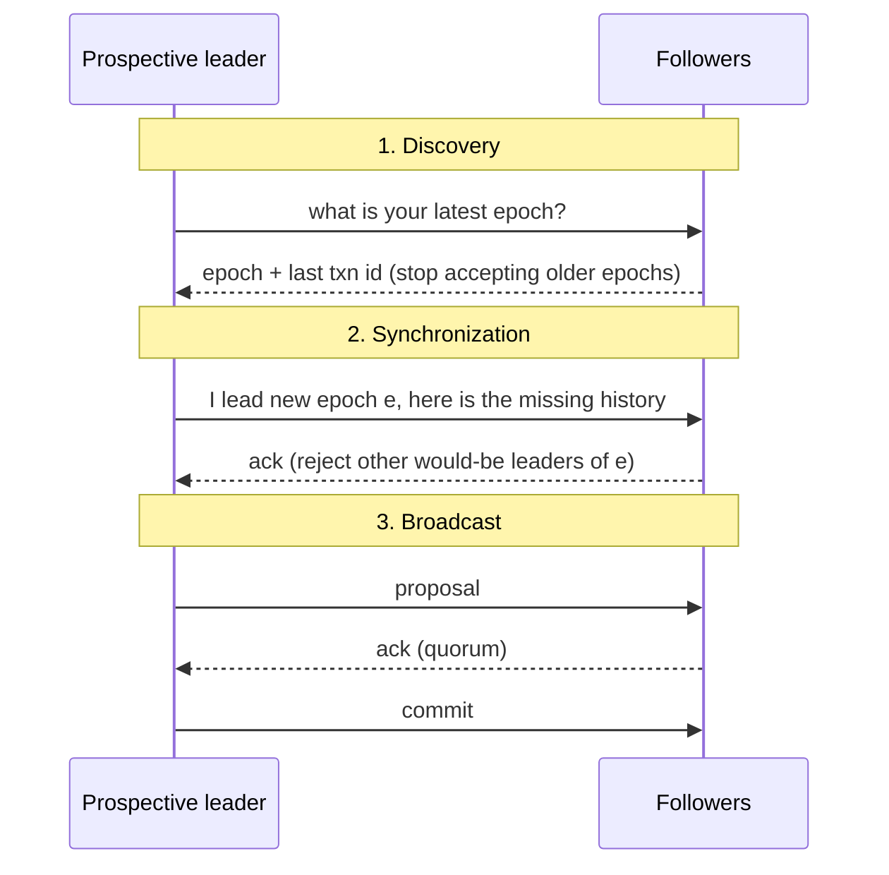

# فصل ۱۴: consensus

[فصل ۱۳: تراکنش توزیع‌شده →](13-distributed-transactions.md) · [کتاب](../README.md)

## خلاصه

فصل آخر پیوند و مدل شکست و failure detector و انتخاب leader و consistency را در **consensus توزیع‌شده** ترکیب می‌کند: processها روی مقداری توافق می‌کنند که یکی‌شان پیشنهادش داده، حتی وقتی برخی از کار بیفتند (p. 279). قضیه‌ی FLP consensus تضمین‌شده در زمانی bounded را در سیستمی تماماً asynchronous رد می‌کند. پس الگوریتم‌های consensus asynchronousی را فرض می‌گیرند و **ایمنی** را تضمین، در حالی که failure detectorی بیرونی **liveness** می‌دهد. تشخیص نادقیق یعنی منتظر ماندن، یا شروع دوباره پس از گمانی کاذب (p. 279).

فصل از این‌ها می‌گذرد:

- **پخش**: بهترین تلاش، بعد سیل قابل اطمینان، بعد **پخش اتمی**، که تحویل قابل اطمینان در ترتیبی کلی است. concurrency مجازی و **ZAB**، یعنی پروتکل ZooKeeper، را می‌پوشاند (pp. 280–285).
- **الگوریتم Paxos**: الگوریتم کلاسیک و quorumها و صحنه‌های شکست (pp. 285–291).
- **گونه‌های Paxos:** Multi-Paxos و Fast Paxos و EPaxos و Flexible Paxos و آن حل تعمیم‌یافته با registerهای یک‌بار‌نوشتنی (pp. 291–300).
- **الگوریتم Raft** (pp. 300–305).
- **مفهوم consensus از جنس Byzantine** با **PBFT** (pp. 305–309).

## نکته‌های کلیدی

- **سه خاصیت: توافق و اعتبار و پایان.** اعتبار آن الگوریتم بدیهی «همیشه پیش‌فرضی را تصمیم بگیر» را رد می‌کند (p. 280).
- **پخش اتمی با consensus هم‌ارز است** در سیستمی asynchronous با شکست از کار افتادن (p. 285).
- **الگوریتم ZAB دوره و سه فاز به کار می‌برد:** کشف و synchronization و پخش. پخش مثل 2PC بی abort است (pp. 283–284).
- **همه‌ی proposerهای Paxos باید آن مقدار پذیرفته‌ی بالاترین‌شماره را بردارند** که در فاز ۱ می‌شنوند. همین‌طور است که مقداری که حتی یک acceptor پذیرفته می‌تواند از کار افتادن proposerاش را جان به در ببرد (pp. 286–289).
- **الگوریتم Paxos زیر هر شمار شکستی ایمن است و با f شکست از 2f + 1 زنده** (p. 288).
- **الگوریتم Multi-Paxos زیر leaderی پایدار از فاز ۱ می‌پرد.** leaseها می‌گذارند محلی بخواند، ولی بهینه‌سازی کارایی‌اند که به رانش ساعت bounded تکیه می‌کنند و نه تضمین درستی (p. 291).
- **الگوریتم Flexible Paxos تنها Q₁ + Q₂ > N را لازم دارد:** quorumهای انتخاب و replication باید اشتراک داشته باشند و نه هر زوج quorumی (pp. 296–297).
- **الگوریتم Raft تنها نامزدهایی را انتخاب می‌کند که هر entry commit‌شده‌ای را دارند**، پس entryهای log تنها از leader به followerها جاری می‌شوند (pp. 302–303).
- **الگوریتم PBFT تعداد n = 3f + 1 replica لازم دارد**، با quorum آماده‌سازی 2f و quorum commit 2f + 1؛ و کلاینت‌ها منتظر f + 1 پاسخ خوان می‌مانند (pp. 306–308).

## فهرست بخش‌ها

*از فهرست مطالب خود کتاب، از bookmarkهای PDF؛ شماره‌ها صفحه‌ی چاپی‌اند.*

- پخش — ص. ۲۸۰
- پخش اتمی — ص. ۲۸۱
  - بخش concurrency مجازی — ص. ۲۸۲
  - پخش اتمی ZooKeeper که ZAB است — ص. ۲۸۳
- بخش Paxos — ص. ۲۸۵
  - الگوریتم Paxos — ص. ۲۸۶
  - بخش quorum در Paxos — ص. ۲۸۷
  - صحنه‌های شکست — ص. ۲۸۸
  - بخش Multi-Paxos — ص. ۲۹۱
  - بخش Fast Paxos — ص. ۲۹۲
  - بخش Egalitarian Paxos — ص. ۲۹۳
  - بخش Flexible Paxos — ص. ۲۹۶
  - حل تعمیم‌یافته‌ی consensus — ص. ۲۹۷
- بخش Raft — ص. ۳۰۰
  - نقش leader در Raft — ص. ۳۰۲
  - صحنه‌های شکست — ص. ۳۰۴
- بخش consensus از جنس Byzantine — ص. ۳۰۵
  - الگوریتم PBFT — ص. ۳۰۶
  - بازیابی و checkpoint گرفتن — ص. ۳۰۹
- خلاصه — ص. ۳۰۹

## یادداشت‌ها

یک process **درست** است اگر از کار نیفتاده باشد و همین‌طور قدم‌های الگوریتم را اجرا کند. consensus برای مرتب کردن رویدادها و سازگار نگه داشتن شرکت‌کننده‌ها به کار می‌آید: سیستم از مقداری به مقدار بعدی می‌رود بی گم کردن قطعیت درباره‌ی آن چیزی که کلاینت‌ها مشاهده کردند (p. 279).

| خاصیت | معنا (p. 280) |
|---|---|
| **توافق** | همه‌ی processهای درست همان مقدار را تصمیم می‌گیرند |
| **اعتبار** | مقدار تصمیم‌شده را یکی از processها پیشنهاد داده |
| **پایان** | همه‌ی processهای درست در غایت تصمیم می‌گیرند |

### پخش

پخش اطلاع را میان processها پخش می‌کند؛ gossip از فصل ۱۲ یک شکلش است. برای replication به کار می‌رود، وقتی coordinatorی داده را به همه‌ی شرکت‌کننده‌ها پخش می‌کند (p. 280).

- **پخش بهترین‌تلاش:** تنها فرستنده مطمئن می‌شود که پیام‌ها تحویل می‌شوند. اگر نیمه‌راه از کار بیفتد، پخش بی‌صدا باز می‌ماند و برخی نودها را با آن پیام و بقیه را بی آن می‌گذارد (pp. 280–281).
- **پخش قابل اطمینان:** همه‌ی processهای درست همان پیام‌ها را می‌گیرند حتی اگر فرستنده از کار بیفتد. گونه‌ی ساده‌دل failure detectorی به‌علاوه‌ی جانشینی به کار می‌برد که در آن هر گیرنده‌ای به همه می‌فرستد، و شبکه را با **N²** پیام سیل می‌کند (شکل ۱۴-۱) (p. 281).

### پخش اتمی

سیل تحویل را تضمین می‌کند و نه ترتیب را. **پخش اتمی**، که multicast ترتیب‌کلی هم نامیده می‌شود، هر دو را تضمین می‌کند (p. 281):

- **اتمی بودن:** همه‌ی processهای نشکسته پیامی را تحویل می‌دهند، یا هیچ‌کدام.
- **ترتیب:** همه‌ی processهای نشکسته پیام‌ها را به همان ترتیب تحویل می‌دهند (p. 282).

#### مفهوم concurrency مجازی

پخش اتمی روی گروهی ایستا کار می‌کند؛ و **concurrency مجازی** پیام‌های تماماً مرتب را به گروهی **پویا** تحویل می‌دهد، از برمن (p. 282).

- هر پیامی به آن **نمای گروه**ی تعلق دارد که در آن فرستاده شده. پیوستن و رفتن و شکست نما را عوض می‌کنند، و آن تغییر به همه‌ی اعضا اعلام می‌شود (p. 282).
- **گرفتن**، یعنی وقتی یک عضو پیامی را بگیرد، از **تحویل** فرق دارد، یعنی وقتی همه‌ی اعضا دارندش. پیامی که در نمایی فرستاده شده تنها در همان نما تحویل‌شدنی است، پس نماها مثل سدهایی عمل می‌کنند که پخش‌ها نمی‌توانند از آن‌ها رد شوند (p. 282).
- برخی الگوریتم‌های ترتیب‌کلی یک **sequencer** تنها به کار می‌برند: ساده‌تر و سریع‌تر، ولی liveness به تشخیص شکستش وابسته است (pp. 282–283).
- به‌رغم استواری‌اش، concurrency مجازی در سیستم‌های تجاری پرکاربرد نیست (p. 283).

#### پخش اتمی ZooKeeper که ZAB است

سیستم ZooKeeper، که انباره‌ی key-value سلسله‌مراتبی و توزیع‌شده است، **ZAB** را برای ترتیب کلی و تحویل اتمی به کار می‌برد (p. 283). processها یا **leader** موقت‌اند یا **follower**؛ و غیر‌leaderها درخواست‌های کلاینت را به leader می‌فرستند (p. 283). زمان به **دوره**هایی با شماره‌های یکتا و یکنوا‌افزایشی بخش می‌شود، و هر دوره‌ای حداکثر یک leader دارد. هر الگوریتم انتخابی می‌تواند leaderی *احتمالی* بردارد، چون قدم‌های بعدی ایمنی را تضمین می‌کنند (p. 283).

*روایت vault از شکل ۱۴-۲ (pp. 283–284).*

- در **synchronization**، آن leader followerها را به همان تاریخ می‌رساند و پیشنهادهای commit‌شده‌ی دوره‌های پیشین را پیش از هر تازه‌ای تحویل می‌دهد (pp. 283–284).
- **پخش** مثل 2PC بی abort است: رأی‌ها تنها تأییدند، و پیشنهادهای leaderهای دوره‌های غلط تأیید نمی‌شوند. ادامه می‌دهد تا آن leader از کار بیفتد یا پارتیشن شود یا گمان‌برده (p. 284).
- همه‌ی heartbeatها در هر دو جهت اجرا می‌شوند. leaderی بی heartbeat از quorumی پایین می‌آید، و followerی که به leader گمان ببرد انتخابی شروع می‌کند (p. 284).
- آن leader پیام بعدی را تنها پس از تأیید شدن پیشین می‌فرستد، و تحویل دوباره به ترتیب هیچ اثر جانبی اضافه‌ای ندارد (p. 284).
- بازیابی کاراست: followerها بالاترین پیشنهاد commit‌شده‌شان را گزارش می‌دهند، و leader از تنها نود به‌روزترین کپی می‌کند. پخش دو دور پیام می‌برد (pp. 284–285).

### Paxos

پخش اتمی در سیستمی asynchronous با شکست از کار افتادن با consensus هم‌ارز است، از چاندرا و توگ (p. 285). Lamport **Paxos** را در «The Part-Time Parliament» در ۱۹۹۸ معرفی کرد، بعد در «Paxos Made Simple» در ۲۰۰۱ از نو گفتش (p. 285).

| نقش | کار (p. 285) |
|---|---|
| **proposer** | مقدارهای کلاینت را می‌گیرد، پیشنهاد می‌سازد، رأی جمع می‌کند |
| **acceptor** | به پذیرفتن یا رد کردن رأی می‌دهد. چندتا برای fault tolerance هست؛ و **اکثریتی** برای liveness کافی است |
| **یادگیرنده** | replicaیی که برآمدهای پذیرفته‌شده را ذخیره می‌کند |

پیاده‌سازی‌ها معمولاً نقش‌ها را در یک process **هم‌جا** می‌کنند. هر پیشنهادی یک مقدار کلاینت و یک **شماره‌ی پیشنهاد** یکتا و یکنوا‌افزایشی دارد، که اغلب زوجی (id, timestamp) است و در آن IDهای نود تساوی را می‌شکنند (p. 285).

#### الگوریتم Paxos

دو فاز هست: **رأی‌گیری**، یعنی پیشنهاد، که در آن proposerها برای leadership رقابت می‌کنند، و **replication**، که در آن برنده مقدار را پخش می‌کند (p. 286). رأی‌ها می‌توانند میان proposerها شقه شوند، که شروع دوباره را وا می‌دارد (p. 286).

*Figure 14-3 (p. 287): یک دور برای بردن حق پیشنهاد، یک دور برای پذیرفته شدن مقدار؛ یادگیرنده‌ها آن مقدار پذیرفته را یک‌راست می‌شنوند.*

| پیام | قاعده‌ی acceptor (pp. 286–287) |
|---|---|
| **Prepare(n)** | اگر به هیچ Prepare بالاتر‌شماره‌ای پاسخ داده نشده، قول بده چیزی پایین‌تر از n نپذیری. اگر پیشنهادی از قبل پذیرفته شده، پاسخ **Promise(m, v_accepted)** بده. اگر به Prepare بالاتری پاسخ داده شده، به proposer بگو. به Prepare بعدی می‌شود پاسخ داد اگر شماره‌اش بالاتر باشد |
| **Accept!(n, v)** | بپذیر مگر به Prepare(m)ی با m > n پاسخ داده شده باشد. سر رد کردن، بالاترین شماره‌ی دیده‌شده را پس بفرست تا proposer خودش را برساند |

در فاز ۲، proposer باید مقدار آن پیشنهاد **بالاترین‌شماره** میان پاسخ‌ها را به کار ببرد، یا مال خودش را اگر هیچ‌کدام پذیرفته نشده بود (p. 286). همین که مقداری حتی یک acceptor بپذیردش، proposerهای بعدی باید روی آن هم‌گرا شوند؛ از همین‌جاست که acceptorها گزارش می‌دهند چه چیزی را پذیرفته‌اند (p. 287). یادگیرنده‌ها پس از شنیدن از اکثریتی از acceptorها تصمیم را می‌دانند، و acceptorها می‌توانند همین که بپذیرند به‌شان خبر بدهند (p. 287).

#### مفهوم quorum در Paxos

**مفهوم quorum** کمینه شمار رأی برای عملیاتی است، که معمولاً اکثریتی است. هر دو اکثریتی دست‌کم یک شرکت‌کننده را مشترک دارند، که مثل داوری عمل می‌کند (pp. 287–288).

- **ایمنی** زیر هر شمار شکستی برقرار است.
- **مفهوم liveness** با **f** شکست برقرار است اگر **2f + 1** process باشد (p. 288).
- همه‌ی quorumها خاصیت‌های *بند آمدن* را وصف می‌کنند. می‌شود به نودهای بیشتری فرستاد، از جمله query زائد حدسی، ولی تنها لازم است منتظر quorumی بمانید (p. 288).

#### صحنه‌های شکست

| شکل | چه رخ می‌دهد (pp. 288–290) |
|---|---|
| **۱۴-۴** | proposer P1 مقدار V1 را تنها به A1 می‌فرستد و از کار می‌افتد. proposer P2 با شماره‌ی ۲ به quorum {A1, A2} می‌رسد، V1 را می‌بیند و **V1** را commit می‌کند. آن proposer اصلی، و کلاینتش، می‌توانند هیچ‌وقت نتیجه را نفهمند، یادداشت ۱ |
| **۱۴-۵** | همان شروع، ولی quorum proposer P2 برابر {A2, A3} است. هیچ‌وقت V1 را نمی‌بیند و **مقدار خودش** را commit می‌کند، هرچند A1 مقدار V1 را دارد |
| **۱۴-۶** | acceptor A1 مقدار V1 را می‌پذیرد و بعد می‌شکند. quorum proposer P2 با A1 هم‌پوشان نیست، پس P2 مقدار خودش را commit می‌کند. proposerهای بعدی که به A1 برسند آن پیشنهاد پذیرفته‌ی تازه‌تر را ترجیح می‌دهند |
| **proposerهای دوئل‌کننده** | پیام‌های Prepare رقیب همین‌طور هم را بی‌اعتبار می‌کنند. با **عقب‌نشینی تصادفی** درست کنید |

الگوریتم Paxos شکست acceptorها را تنها تا وقتی تحمل می‌کند که آن‌قدری بمانند که اکثریتی بسازند (p. 291).

> **Try it:** [Paxos، دور به دور](../widgets/14-paxos.html)؛ پنج acceptor و دو proposer. proposer اول را پس از رسیدنش به یک acceptor از کار بیندازید، بردارید که proposer دوم به کدام acceptorها می‌رسد، و ببینید کدام مقدار برداشته می‌شود: شکل‌های ۱۴-۴ تا ۱۴-۶ کتاب، به‌علاوه‌ی حالت proposerهای دوئل‌کننده.

#### Multi-Paxos

الگوریتم Paxos کلاسیک برای هر مقداری دوری پیشنهاد اجرا می‌کند. **Multi-Paxos** یک **proposer ممتاز**، یعنی leader، می‌افزاید که جایش را نگه می‌دارد و یک‌راست به replication می‌رود (p. 291).

- **خواندن:** Paxos کلاسیک با اجرای دوری می‌خواند، چون آخرین proposer معلوم می‌تواند کهنه باشد. Multi-Paxos اگر leaderی تازه وجود داشته باشد همان ریسک را دارد، پس برخی پیاده‌سازی‌ها **lease** به کار می‌برند. آن leader دوره‌ای تمدیدشان می‌کند، و شرکت‌کننده‌ها قول می‌دهند در طول lease پیشنهادهای leaderهای دیگر را نپذیرند، از چاندرا و همکاران (p. 291).
- همه‌ی leaseها بهینه‌سازی کارایی‌اند که به **concurrency bounded ساعت** تکیه می‌کنند. اگر ساعت‌ها زیادی رانش کنند، linearizability گم می‌شود (p. 291).
- الگوریتم Multi-Paxos یک **log تکرارشده** است. logی پایا از کار افتادن‌ها جان به در می‌برد، و پس از snapshot گرفتن بریده می‌شود، با snapshot و بریدن که اتمی اعمال می‌شوند (pp. 291–292).
- الگوریتم Paxos تک‌فرمانی یک **register یک‌بار‌نوشتنی** است؛ و Multi-Paxos یک **log append-only** از چنان registerهایی، از ریستسوف. روش‌های Active Disk Paxos و **CASPaxos** در عوض registerهای خواندن‌تغییر‌نوشتن می‌دهند (p. 292).

#### Fast Paxos

هر proposerی می‌تواند یک‌راست با acceptorها تماس بگیرد، که یک رفت‌و‌برگشت صرفه‌جویی می‌کند. هزینه‌اش quorumی از **2f + 1** به‌جای f + 1، و **3f + 1** acceptor است، از ژونکوئرا و همکاران و Lamport (p. 292).

- در **دوری سریع**، coordinatorی که می‌توانست هر مقداری بردارد پیام **Any** می‌فرستد، و acceptorها مقدارهای proposerها را چنان می‌گیرند که انگار از coordinator آمده‌اند (p. 292).
- دو proposer که هم‌هنگام سریع بروند **برخورد** می‌سازند: acceptorها مقدارهای مختلفی برمی‌دارند، و coordinator باید دوری بازیابی شروع کند (p. 293).
- زیر نرخ درخواست بالا، برخورد و مجموعه‌ی replica بزرگ‌تر می‌توانند Fast Paxos را از Paxos کلاسیک *کندتر* کنند (p. 293).

#### Egalitarian Paxos

یک leader تنها وقتی بشکند باید دوباره انتخاب شود و می‌تواند گلوگاه شود. **پارتیشن‌بندی** کمک می‌کند، ولی آن‌وقت عملیات چند‌پارتیشنی commitment اتمی لازم دارند (pp. 293–294). **EPaxos** از مورارو و همکاران برای هر فرمانی leaderی دارد و فرمان‌ها را از راه **وابستگی** مرتب می‌کند. نخستین پیاده‌سازی **Generalized Paxos** Lamport است، که در آن نوشتن‌های نامتعارض مستقل commit می‌کنند (p. 294).

- یک **Pre-Accept** آن وابستگی‌ها، یعنی فرمان‌هایی که می‌توانند تداخل کنند، و یک **شماره‌ی ترتیب** بزرگ‌تر از هر وابستگی معلومی را حمل می‌کند (p. 294).
- به یک **quorum سریع** از ⌈3f/4⌉ replica می‌رود، که وابستگی‌ها را از logهای خودشان به‌روز می‌کنند (p. 294).
- **مسیر سریع:** فهرست‌های وابستگی می‌خوانند، پس commit کن. **مسیر کند:** فرق دارند، پس وابستگی‌ها را merge کن، شماره‌ی ترتیب را بالا ببر و **Accept** را پیش از commit به ⌊f/2⌋ + 1 replica بفرست (pp. 294–295).
- در شکل ۱۴-۸، proposer P1 روی مسیر سریع commit می‌کند؛ و P5 از P3 درباره‌ی فرمان ۱ خبردار می‌شود و Accept(2, {1}) را اجرا می‌کند (p. 295).

*Figure 14-8 (p. 295): فرمان‌های نامتعارض در یک دور commit می‌کنند؛ و وابستگی‌ای که کشف شود دور Accept دومی برای P5 خرج دارد.*

فرمان‌ها **تداخل** می‌کنند اگر ترتیب اجرایشان مهم باشد. replicaها گراف وابستگی می‌سازند و به ترتیب معکوس وابستگی اجرا می‌کنند، که برای بیشتر بارها کمیاب است (p. 296). شماره‌های ترتیب یک **دوره**ی چیدمان و شمارنده‌ای نود‌محلی و ID مربوط به replica را ترکیب می‌کنند. پیشنهادهای کهنه با حالت تازه‌تر nack می‌شوند (p. 296).

#### Flexible Paxos

آیا همه‌ی quorumها باید اشتراک داشته باشند؟ در Paxos، تنها quorum **فاز ۱**، یعنی انتخاب، باید با quorum **فاز ۲**، یعنی پذیرش، هم‌پوشان باشد: **Q₁ + Q₂ > N**، از هاوارد و همکاران (pp. 296–297). چون فاز ۲ خیلی رایج‌تر است، Q₂ می‌تواند تا N/2 کوچک باشد اگر Q₁ = N − Q₂ + 1 (p. 297).

- با پنج پذیرنده، quorum انتخاب ۴ quorumهای replication **۲**ی را مجاز می‌کند، حتی روی زوج‌های *مجزا*. هر leader تازه‌ای دست‌کم به یک acceptor در هر زوجی معلوم است (p. 297).
- این availability را با latency بده‌بستان می‌کند. انتخاب‌ها نودهای زنده‌ی بیشتری لازم دارند، ولی leaderی پایدار از راه تا **N − Q₂** شکست همین‌طور تکرار می‌کند (p. 297).
- **الگوریتم Vertical Paxos** یک quorum خواندن کوچک‌تر برای پیشنهادهای پایین‌تر‌شماره را از quorum نوشتن بزرگ‌تر جدا می‌کند؛ و quorumهای out و decision لمپسون شبیه‌اند (p. 297).

#### حل تعمیم‌یافته‌ی consensus

هاوارد و مورتیه Paxos تک‌فرمانی را به‌شکل **registerهای یک‌بار‌نوشتنی** از نو می‌گویند. کتاب می‌گوید که هنوز هیچ پیاده‌سازی معلومی نبود (pp. 297–298).

- یک register می‌تواند نانوشته باشد، یا مقداری داشته باشد، یا **nil** داشته باشد. registerهایی با همان index روی سرورهای مختلف یک **مجموعه‌ی register** با یک quorum یا بیشتر می‌سازند (p. 298).
- حالت quorumی برابر **Any** یا **Maybe v** یعنی تصمیم‌نشده، یا **None** یا **Decided v** یعنی تصمیم‌شده است (p. 298).
- **قاعده‌ها:** مقداری را تنها پس از خواندنش از quorumی در همان مجموعه‌ی register بیرون بده؛ تنها مقدارهایی را بنویس که به‌شکل ورودی گرفته‌ای یا از registerی خوانده‌ای؛ هیچ‌وقت نگذار دو quorum مقدارهای مختلفی تصمیم بگیرند؛ هیچ‌وقت تصمیم‌های مجموعه‌های register پیشین را روی‌نویسی نکن (p. 298).
- **فاز ۱:** عبارت P1A(register). سرورها registerهای پایین‌تر نانوشته را nil می‌گذارند و آن چیزی را که نوشته شده برمی‌گردانند. با اکثریتی، مقدار را از بالاترین‌شاخص register ناخالی بردارید، یا مال خودتان را. **فاز ۲:** عبارت P2A(register, value) به همه‌ی سرورها؛ اکثریتی از پاسخ‌ها یعنی تصمیم‌شده (pp. 298–299).
- مفهوم nil گذاشتن registerهای پایین‌تر نقش شماره‌های پیشنهاد بالاتر Paxos را بازی می‌کند. استدلال درباره‌اش ساده‌تر است چون به‌جای تعامل بازیگرها آخرین حالت معلوم را به کار می‌برد (p. 300).

> **In practice:** اندازه‌ی cluster در Keeper و etcd را quorum تعیین می‌کند، نه فقط ظرفیت.
>
> **Your turn:** چرا Keeper یا etcd را با دو node نمی‌سازیم؟
>
> *Answer:* quorum دو از دو است، پس از کار افتادن هر کدام کل cluster را می‌خواباند؛ دو node از یکی هم شکننده‌تر است. quorumها باید هم‌پوشانی داشته باشند، پس برای تحمل f شکست 2f+1 node لازم است، یعنی سه node برای یک شکست (pp. 285–288).

### Raft

الگوریتم Raft از آنگارو و آسترهات در ۲۰۱۴ راه افتاد که فهم‌پذیر باشد و با پیاده‌سازی مرجعی به نام **LogCabin** آمد (p. 300). logهای یکسان که به همان ترتیب اعمال شوند همان حالت را می‌دهند. Raft **leader را شهروند درجه‌یک** می‌کند، همان‌طور که پخش اتمی و Multi-Paxos می‌کنند (p. 300).

| نقش | (p. 301) |
|---|---|
| **نامزد** | می‌کوشد اکثریتی از رأی جمع کند. رأی شقه term تازه و انتخابی تازه شروع می‌کند |
| **leader** | برای یک **term**، یعنی دوره‌ای شماره‌دار و یکنوا با هر طولی، درخواست‌های کلاینت را رسیدگی می‌کند |
| **follower** | entryها را پایا می‌کند و به leader و نامزدها پاسخ می‌دهد، مثل acceptor و یادگیرنده‌ی Paxos. هر processی از این‌جا شروع می‌کند |

همه‌ی termها، یعنی دوره‌ها، ترتیبی جزئی و جهانی بی ساعت‌های هم‌گام می‌دهند. فرمانی با termش و شماره‌ی پیامش درون آن term شناسایی می‌شود. شرکت‌کننده‌ای که term بالاتری ببیند به آن به‌روز می‌شود، و term بالاتر تعارض‌ها را می‌برد (p. 301).

- **انتخاب leader:** پیام RequestVote مقدار term نامزد و آخرین term معلومش و ID آخرین entry logش را حمل می‌کند. هر processی حداکثر به یک نامزد رأی می‌دهد (p. 302).
- **پروتکل heartbeat:** followerی که برای یک **مدت انتخاب** چیزی نشنود انتخابی شروع می‌کند (p. 302).
- **پروتکل AppendEntries:** مقدار term آن leader و index و term entry پیشین و entryهای تازه را حمل می‌کند (p. 302).

#### نقش leader در Raft

یک follower **رأیش را رد می‌کند** به نامزدی که logش کم‌تر به‌روز است: term آخر پایین‌تر، یا logی کوتاه‌تر وقتی termها برابرند. پس leaderی هر entry commit‌شده‌ای را دارد. چون entryها به ترتیب تکرار می‌شوند، مقایسه‌ی entryهای آخر کافی است (p. 302). آن leader به log خودش می‌افزاید و موازی به followerها می‌فرستد. همین که followerهای کافی تأیید کنند، entry **commit** می‌شود (pp. 302–303). در شکل ۱۴-۱۱، مقدار x = 8 افزوده، به اکثریتی تکرار، محلی commit، و بعد آن commit پخش می‌شود (p. 303). commit کردن entryی هر چیزی را پیش از آن commit می‌کند، و تنها leader درباره‌ی commit شدن تصمیم می‌گیرد (p. 303).

*Figure 14-12 (p. 304): entryی همین که اکثریتی داشته باشدش commit می‌شود؛ و commit کردن entry ۳ هر چیزی را پیش از آن هم commit می‌کند.*

#### صحنه‌های شکست

- **رأی شقه** با **تایمرهای تصادفی** کم‌احتمال می‌شود: یک نامزد زودتر شروع می‌کند و می‌برد (p. 304).
- آن leader پیام‌های تأیید‌نشده را دوباره می‌کوشد و می‌تواند موازی بفرستد. followerها با ID ترتیب تکراری‌زدایی می‌کنند (p. 304).
- یک follower entryهایی را رد می‌کند که زوج (شاخص، term) پیشینشان با logش نمی‌خواند. خاصیت **خوردن log** از این پی می‌گیرد: همان term و index یعنی همان فرمان و پیشوندهای یکسان (p. 304).
- همه‌ی entryهای commit‌شده باز هم می‌توانند از دید کلاینتی در جریان *به نظر برسند*، که بی‌آزار است؛ تا commit شدن دوباره بکوشید (p. 304).
- یک leader تازه بالاترین entryی را پیدا می‌کند که با هر followerی مشترک دارد، آن follower را وا می‌دارد entryهای commit‌نشده‌ی پس از آن را بیندازد، و با مال خودش روی‌نویسی‌شان می‌کند. log آن leader هیچ‌وقت دوباره نوشته نمی‌شود، تنها به آن افزوده (p. 305).

| تضمین Raft (p. 305) |
|---|
| برای هر termی حداکثر یک leader |
| leader تنها می‌افزاید؛ هیچ‌وقت برنمی‌دارد یا مرتب دوباره نمی‌کند |
| entryهای commit‌شده در log همه‌ی leaderهای بعدی پیدا می‌شوند |
| زوج‌های (term, message) هیچ‌وقت برای entryی دیگر بازاستفاده نمی‌شوند |

الگوریتم Raft در CockroachDB و etcd و Consul به کار می‌رود (p. 305).

> **In practice:** etcd زیر Kubernetes و ClickHouse Keeper زیر replication warehouse هر دو Raft اجرا می‌کنند.
>
> **Your turn:** Keeper سه node دارد و دو تا down می‌شوند. چه کار می‌کند و چه نه؟
>
> *Answer:* یک node از سه اکثریت ندارد، پس leaderی انتخاب نمی‌شود و Keeper نوشتن نمی‌پذیرد؛ جدول‌های Replicated در ClickHouse read-only می‌شوند ولی خواندن کار می‌کند. Raft ایمنی را بر availability مقدم می‌دارد: بدون quorum تصمیمی گرفته نمی‌شود (pp. 300–305).

### مفهوم consensus از جنس Byzantine

الگوریتم‌های تا این‌جا فرض می‌گیرند نودها با نیت خوب عمل می‌کنند، که شرکت‌کننده‌ی کم‌تر و رفت‌و‌برگشت کم‌تر را مجاز می‌کند (p. 305). deploymentهای خصمانه، ولی همچنین اشکال و config غلط و خطای سخت‌افزار و خرابی، تحمل **Byzantine** را می‌خواهند. بیشتر چنین الگوریتم‌هایی برای هر قدمی **N²** پیام لازم دارند، چون هر نودی هر نود دیگری را اعتبارسنجی متقابل می‌کند (pp. 305–306). **PBFT** از کاسترو و لیسکوف شکست‌های مستقل و **concurrency ضعیف** را فرض می‌گیرد. ارتباط encryption می‌شود، و replicaها کلید عمومی هم را می‌دانند (p. 306).

#### الگوریتم PBFT

ایمنی و liveness حداکثر (n − 1)/3 replica عیب‌دار را لازم دارند، پس **n = 3f + 1**. می‌تواند f مؤلفه‌ی replica عیب‌دار به‌علاوه‌ی f بی‌پاسخ ولی صادق باشد، و پاسخ‌های replicaهای ناـعیب‌دار باید باز هم از عیب‌دارها بیشتر باشند (p. 306).

- **نما:** اصلی همان replica شماره‌ی **v mod N** است، و بقیه پشتیبان‌اند. کلاینتی منتظر **f + 1** پاسخ خوان می‌ماند (p. 306).

*Figure 14-13 (p. 308): پیام pre-prepare آن digest امضا‌شده‌ی اصلی را حمل می‌کند؛ prepare تعداد 2f پیام خوان لازم دارد، commit تعداد 2f + 1، و کلاینت منتظر f + 1 پاسخ خوان می‌ماند (pp. 306–308).*

- **ساختار digest**ها پیام‌های prepare را کوچک نگه می‌دارند؛ و مقاومت در برابر برخورد و امضاها قابل اعتمادشان می‌کنند (p. 307).
- **عوض شدن نما:** replicaهایی که به اصلی گمان ببرند پاسخ دادن را بس می‌کنند، جز به پیام‌های checkpoint و عوض شدن نما، و عوض شدن نما را پخش می‌کنند. اصلی تازه نما را پس از **2f** رویداد عوض شدن نما شروع می‌کند (p. 308).
- **بهینه‌سازی‌ها:** کلاینت‌ها می‌توانند **2f + 1** پاسخ *آزمایشی* خوان را بپذیرند، و به f + 1 ناـآزمایشی برگردند. عملیات read-only یک رفت‌و‌برگشت با 2f + 1 پاسخ خوان می‌برند (p. 308).

#### بازیابی و checkpoint گرفتن

پیام‌ها در logی پایدار می‌مانند تا دست‌کم f + 1 نود اجراشان کنند. replicaهای در حال بازیابی باید حالتی را که می‌گیرند اعتبارسنجی کنند، چون وگرنه بازیابی می‌توانست مجرای حمله باشد (p. 309). هر N درخواست، اصلی یک **checkpoint پایدار** پخش می‌کند: تازه‌ترین شماره‌ی ترتیب و digestی از حالت. تعداد **2f + 1** پاسخ اثباتش می‌کند، و همه‌ی پیام‌های قدیمی‌تر انداختنی‌اند (p. 309). معمولاً پیوندهای احراز‌شده و encryption‌شده کافی‌اند؛ الگوریتم‌های از جنس PBFT وقتی لازم‌اند که میان بخش‌های سیستمی اعتمادی نیست (p. 309).

### خلاصه

| گونه | چه چیزی را بهتر می‌کند (pp. 309–310) |
|---|---|
| Multi-Paxos | proposer را نگه می‌دارد و مقدارهای زیادی را تکرار می‌کند |
| Fast Paxos | پیام کم‌تر از راه دورهای سریع از هر proposerی |
| EPaxos | با حل کردن وابستگی میان فرمان‌ها مرتب می‌کند |
| Flexible Paxos | تنها quorumهای فاز ۱ و فاز ۲ باید اشتراک داشته باشند |
| Raft | leadership درجه‌یک است؛ replication لاگ و انتخاب leader و ایمنی را جدا می‌کند |
| PBFT | اعتبارسنجی متقابل برای محیط‌های خصمانه |

## بده‌بستان‌ها در یک نگاه

| | نود برای f خطا | quorum | leader | پیام برای هر تصمیمی |
|---|---|---|---|---|
| Paxos کلاسیک | 2f + 1 | اکثریت یعنی f + 1 | برای هر دوری | ۲ رفت‌و‌برگشت |
| Multi-Paxos و Raft و ZAB | 2f + 1 | اکثریت | دیرزیست | ۱ رفت‌و‌برگشت زیر leaderی پایدار |
| Fast Paxos | 3f + 1 | 2f + 1 | coordinator، که در دورهای سریع دور زده می‌شود | قدم کم‌تر؛ برخورد اضافه خرج دارد |
| EPaxos | 2f + 1 | سریع ⌈3f/4⌉، کند ⌊f/2⌋ + 1 | برای هر فرمانی | مسیر سریع ۱ رفت‌و‌برگشت |
| Flexible Paxos | N | Q₁ + Q₂ > N | دیرزیست | Q₂ کوچک latency replication را می‌برد |
| PBFT | 3f + 1 | اول 2f، بعد 2f + 1 | اصلی برای هر نمایی | از مرتبه‌ی O(N²) |

## فراتر از کتاب

- **اندازه‌ی quorum سریع.** آن quorum سریع EPaxos در کتاب، یعنی ⌈3f/4⌉، همان‌طور است که در ص. ۲۹۴ پیدا می‌شود. مقاله‌ی EPaxos آن را F + ⌊(F + 1)/2⌋ replica می‌گوید، *با احتساب* leader فرمان، برای N = 2F + 1. پیش از تکیه به هر یک از آن عددها مقاله را بسنجید.
- **الگوریتم Flexible Paxos با برشماری.** [آزمایش اشتراک quorum](../lab/14-flexible-paxos/README.md) هر زیرمجموعه‌ی به اندازه‌ی Q₁ و Q₂ از N acceptor را فهرست می‌کند و تأیید می‌کند که هر زوجی دقیقاً وقتی اشتراک دارد که Q₁ + Q₂ > N. همچنین همین که آن نامساوی باز بماند زوجی مجزا پیدا می‌کند.
- **الگوریتم Raft در عمل.** Raft در production روش **PreVote** را می‌افزاید، که جلو این را می‌گیرد که نودی پارتیشن‌شده cluster را با termهای بالاتر و بالاتر بر هم بزند، و **consensus مشترک** یا تغییرهای تک‌سروری را برای عضویت. هر دو از رساله‌ی آنگارو می‌آیند و در etcd/raft پیدا می‌شوند. برای شبیه‌سازی انتخاب و log در Raft، [فصل ۱۰ کتاب DDIA](../../designing-data-intensive-applications/chapters/10-consistency-and-consensus.md) را ببینید.

## پیوندها

- **Run it:** [اشتراک quorum در Flexible Paxos](../lab/14-flexible-paxos/README.md)؛ زوج‌های quorum را برای N از ۳ تا ۷ و هر (Q₁, Q₂)ی برمی‌شمارد، و چاپ می‌کند کدام چیدمان‌ها ایمن‌اند، هر فازی چند شکست را تحمل می‌کند، و حساب 3f + 1 مربوط به PBFT.
- **فصل‌های مرتبط:** [فصل ۸: مقدمه و نمای کلی](08-introduction-and-overview.md) که قضیه‌ی FLP و مدل‌های شکست و خطای Byzantine را دارد، [فصل ۹: تشخیص شکست](09-failure-detection.md) که liveness از راه detectorها را دارد، [فصل ۱۰: انتخاب leader](10-leader-election.md) که چرا انتخاب همان consensus است را دارد، [فصل ۱۱: replication و consistency](11-replication-and-consistency.md) که R + W > N و linearizability را دارد، و [فصل ۱۳: تراکنش توزیع‌شده](13-distributed-transactions.md) که گروه‌های Paxos در Spanner و Calvin را دارد.

## خودتان را بسنجید

*پرسش‌ها و پاسخ‌ها مال vault است و از روی یادداشت‌های بالا نوشته شده؛ پاسخ‌ها به صفحه‌های کتاب ارجاع می‌دهند.*

1. **چرا اعتبار در کنار توافق لازم است؟**

   *Answer:* بی آن، هر processی می‌توانست همیشه مقداری پیش‌فرض و ثابت را تصمیم بگیرد: unanimous ولی بی‌فایده (p. 280).

2. **پخش قابل اطمینان ساده‌دل چند پیام به کار می‌برد، و چرا؟**

   *Answer:* تقریباً N²: هر processی که پیام را بگیرد به هر process دیگری می‌فرستدش، پس تحویل از کار افتادن فرستنده را جان به در می‌برد (p. 281).

3. **نقش proposer P1 مقدار V1 را تنها به دست A1 پذیرفته‌شده کرد، بعد از کار افتاد. proposer P2 فاز ۱ را با quorum {A1, A2} اجرا می‌کند. کدام مقدار را باید پیشنهاد بدهد؟**
   - [x] مقدار V1، که بالاترین‌شماره مقدار پذیرفته‌ای است که درباره‌اش شنیده
   - [ ] مقدار خودش، چون V1 هیچ‌وقت به اکثریتی نرسید
   - [ ] هر کدام؛ Paxos به proposer می‌سپاردش

   *Answer:* proposerی باید مقدار آن پیشنهاد پذیرفته‌ی بالاترین‌شماره میان پاسخ‌ها را به کار ببرد (pp. 286, 289).

4. **چرا leaseهای Multi-Paxos تضمین درستی نیستند؟**

   *Answer:* به رانش ساعت bounded وابسته‌اند. اگر ساعت‌ها زیادی رانش کنند، leaderی می‌تواند leaseش را معتبر بپندارد پس از آن‌که بقیه منقضی به حسابش می‌آورند، و linearizability می‌شکند (p. 291).

5. **پنج پذیرنده؛ replication باید تنها دو تأیید لازم داشته باشد. quorum انتخاب در Flexible Paxos باید چقدر بزرگ باشد؟**

   *Answer:* داریم Q₁ ≥ N − Q₂ + 1 = 4، پس Q₁ + Q₂ > N (p. 297).

6. **برخورد در Fast Paxos چه خرجی دارد؟**

   *Answer:* acceptorها مقدارهای مختلفی برمی‌دارند، پس coordinator باید دوری تازه شروع کند تا هم‌گراشان کند، که latency را بالا می‌برد، به‌ویژه زیر نرخ درخواست بالا (p. 293).

7. **نقش leader در EPaxos کِی مسیر کند را برمی‌دارد؟**

   *Answer:* وقتی پاسخ‌های quorum سریع گم باشند یا فهرست‌های وابستگی‌شان نخوانند. وابستگی‌ها را merge می‌کند، شماره‌ی ترتیب را بالا می‌برد و Accept را روی ⌊f/2⌋ + 1 replica اجرا می‌کند (pp. 294–295).

8. **چرا entryهای log در Raft تنها از leader به followerها جاری می‌شوند؟**

   *Answer:* followerها از رأی دادن به نامزدهایی با log کم‌تر‌به‌روز پرهیز می‌کنند، پس هر leader انتخاب‌شده‌ای از قبل هر entry commit‌شده‌ای را دارد (pp. 302–303).

9. **چرا PBFT تعداد 3f + 1 replica لازم دارد؟**

   *Answer:* تا f تا می‌توانند عیب‌دار باشند و f تای دیگر بی‌پاسخ ولی صادق. پاسخ‌های replicaهای صادق باید باز هم از عیب‌دارها بیشتر باشند (p. 306).
