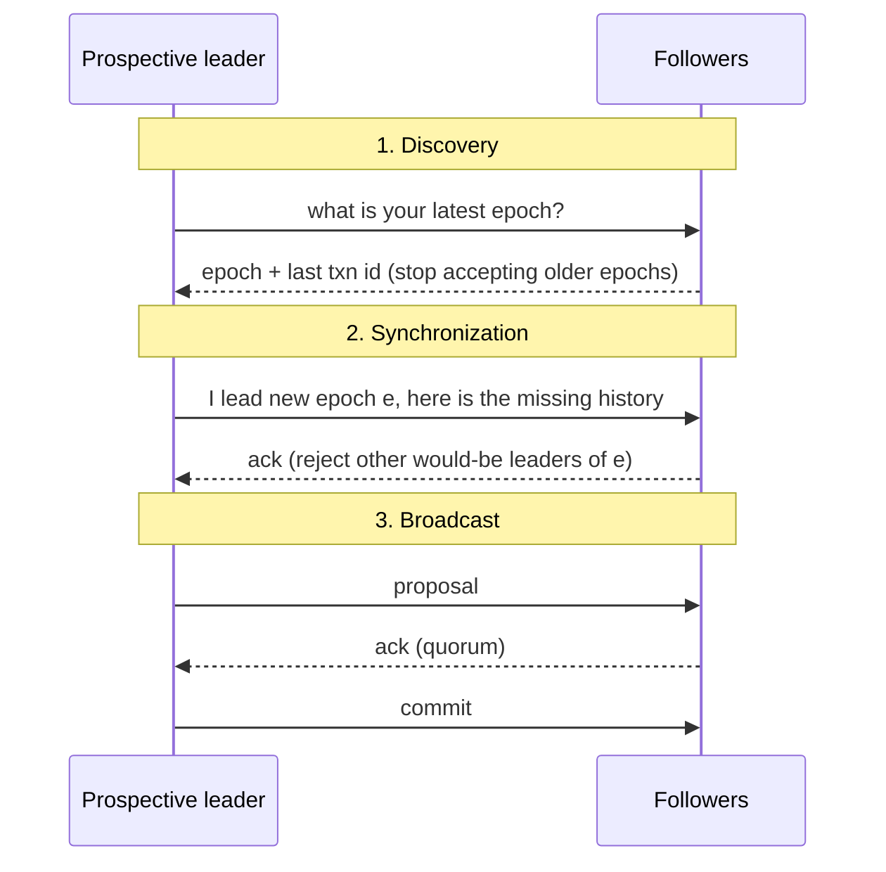
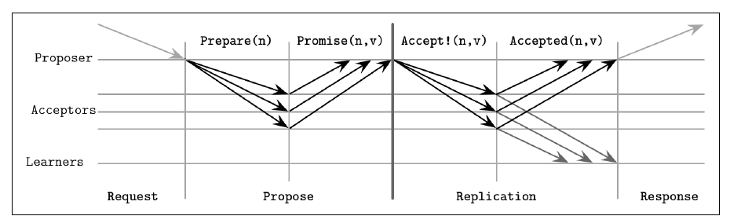
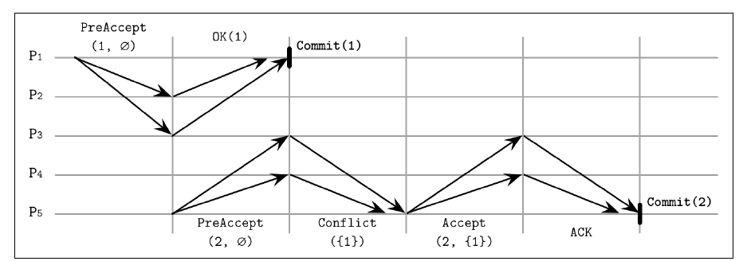
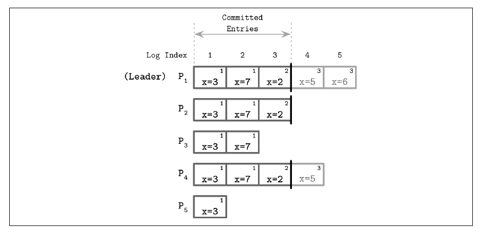
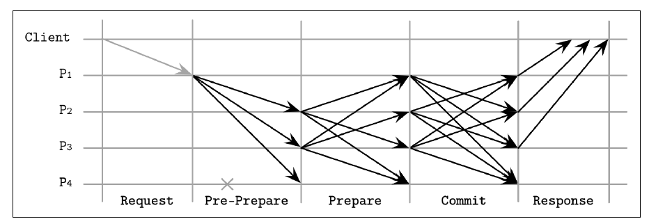

# 14. Consensus

[← 13. Distributed Transactions](13-distributed-transactions.md) · [Book](../README.md)

## Summary

The final chapter combines links, failure models, failure detectors, leader election and consistency into **distributed consensus**: processes agreeing on a value proposed by one of them, even when some crash (p. 279). FLP rules out guaranteed consensus in bounded time in a fully asynchronous system. Consensus algorithms therefore assume asynchrony and guarantee **safety**, while an external failure detector provides **liveness**. Inaccurate detection means waiting, or restarting after a false suspicion (p. 279).

The chapter moves through:

- **Broadcast**: best effort, then reliable flooding, then **atomic broadcast**, which is reliable delivery in total order. It covers virtual synchrony and **ZAB**, ZooKeeper's protocol (pp. 280–285).
- **Paxos**: the classic algorithm, quorums and failure scenarios (pp. 285–291).
- **Paxos variants:** Multi-Paxos, Fast Paxos, EPaxos, Flexible Paxos and the generalized solution with write-once registers (pp. 291–300).
- **Raft** (pp. 300–305).
- **Byzantine consensus** with **PBFT** (pp. 305–309).

## Key takeaways

- **Three properties: agreement, validity, termination.** Validity rules out the trivial "always decide a default" algorithm (p. 280).
- **Atomic broadcast is equivalent to consensus** in an asynchronous system with crash failures (p. 285).
- **ZAB uses epochs and three phases:** discovery, synchronization, broadcast. Broadcast is like 2PC without aborts (pp. 283–284).
- **Paxos proposers must adopt the highest-numbered accepted value** they hear about in phase 1. That's how a value accepted by even one acceptor can survive its proposer's crash (pp. 286–289).
- **Paxos is safe under any number of failures and live with f failures out of 2f + 1** (p. 288).
- **Multi-Paxos skips phase 1 under a stable leader.** Leases let it read locally, but they are a performance optimization relying on bounded clock drift, not a correctness guarantee (p. 291).
- **Flexible Paxos needs only Q₁ + Q₂ > N:** the election and replication quorums must intersect, not every pair of quorums (pp. 296–297).
- **Raft elects only candidates with every committed entry,** so log entries flow only from leader to followers (pp. 302–303).
- **PBFT needs n = 3f + 1 replicas,** a 2f prepare quorum and a 2f + 1 commit quorum; clients wait for f + 1 matching replies (pp. 306–308).

## Section outline

*From the book’s own table of contents (PDF bookmarks); printed page numbers.*

- Broadcast — p. 280
- Atomic Broadcast — p. 281
  - Virtual Synchrony — p. 282
  - Zookeeper Atomic Broadcast (ZAB) — p. 283
- Paxos — p. 285
  - Paxos Algorithm — p. 286
  - Quorums in Paxos — p. 287
  - Failure Scenarios — p. 288
  - Multi-Paxos — p. 291
  - Fast Paxos — p. 292
  - Egalitarian Paxos — p. 293
  - Flexible Paxos — p. 296
  - Generalized Solution to Consensus — p. 297
- Raft — p. 300
  - Leader Role in Raft — p. 302
  - Failure Scenarios — p. 304
- Byzantine Consensus — p. 305
  - PBFT Algorithm — p. 306
  - Recovery and Checkpointing — p. 309
- Summary — p. 309

## Notes

A process is **correct** if it hasn't crashed and keeps executing algorithm steps. Consensus is useful for ordering events and keeping participants consistent: the system moves from one value to the next without losing certainty about what clients observed (p. 279).

| Property | Meaning (p. 280) |
|---|---|
| **Agreement** | All correct processes decide the same value |
| **Validity** | The decided value was proposed by one of the processes |
| **Termination** | All correct processes eventually decide |

### Broadcast

Broadcast disseminates information among processes; gossip (Ch. 12) is one form. It's used for replication when a coordinator distributes data to all participants (p. 280).

- **Best-effort broadcast:** the sender alone makes sure messages are delivered. If it crashes partway, the broadcast fails silently and leaves some nodes with the message and others without (pp. 280–281).
- **Reliable broadcast:** all correct processes receive the same messages even if the sender crashes. The naive version uses a failure detector plus a fallback where every receiver forwards to everyone, flooding the network with **N²** messages (Figure 14-1) (p. 281).

### Atomic broadcast

Flooding guarantees delivery, not order. **Atomic broadcast**, also called **total order multicast**, guarantees both (p. 281):

- **Atomicity:** all non-failed processes deliver a message, or none do.
- **Order:** all non-failed processes deliver messages in the same order (p. 282).

#### Virtual synchrony

Atomic broadcast works on a static group; **virtual synchrony** delivers totally ordered messages to a **dynamic** group (Birman) (p. 282).

- Every message belongs to the **group view** it was sent in. Joins, leaves and failures change the view, and the change is announced to all members (p. 282).
- **Receipt**, when one member gets a message, differs from **delivery**, when all members have it. A message sent in one view can only be delivered in that view, so views act as barriers that broadcasts can't cross (p. 282).
- Some total-order algorithms use a single **sequencer**: simpler and faster, but liveness depends on detecting its failure (pp. 282–283).
- Despite its soundness, virtual synchrony isn't widely used in commercial systems (p. 283).

#### ZooKeeper Atomic Broadcast (ZAB)

ZooKeeper, a hierarchical distributed key-value store, uses **ZAB** for total order and atomic delivery (p. 283). Processes are a temporary **leader** or **followers**; non-leaders forward client requests to the leader (p. 283). Time is split into **epochs** with unique, monotonically increasing numbers, and each epoch has at most one leader. Any election algorithm can pick a *prospective* leader, because the later steps guarantee safety (p. 283).

*The vault's version of Figure 14-2 (pp. 283–284).*

- In **synchronization**, the leader brings followers to the same history and delivers committed proposals from earlier epochs before any new ones (pp. 283–284).
- **Broadcast** is like 2PC without aborts: votes are just acknowledgments, and proposals from leaders of wrong epochs aren't acknowledged. It continues until the leader crashes, is partitioned, or is suspected (p. 284).
- Heartbeats run in both directions. A leader without heartbeats from a quorum steps down, and a follower that suspects the leader starts an election (p. 284).
- The leader sends the next message only after the previous one is acknowledged, and re-delivery in order has no extra side effects (p. 284).
- Recovery is efficient: followers report their highest committed proposal, and the leader copies from the single most up-to-date node. Broadcast takes two message rounds (pp. 284–285).

### Paxos

Atomic broadcast is equivalent to consensus in an asynchronous system with crash failures (Chandra and Toueg) (p. 285). Lamport introduced **Paxos** in "The Part-Time Parliament" (1998), then restated it in "Paxos Made Simple" (2001) (p. 285).

| Role | Job (p. 285) |
|---|---|
| **Proposer** | Takes client values, creates proposals, collects votes |
| **Acceptor** | Votes to accept or reject. Several exist for fault tolerance; a **majority** is enough for liveness |
| **Learner** | A replica storing accepted outcomes |

Implementations usually **colocate** the roles in one process. Every proposal has a client value and a unique, monotonically increasing **proposal number**, often an (id, timestamp) pair where node IDs break ties (p. 285).

#### Paxos algorithm

There are two phases: **voting** (propose), where proposers compete for leadership, and **replication**, where the winner distributes the value (p. 286). Votes can split between proposers, forcing a restart (p. 286).

*Figure 14-3 (p. 287): one round to win the right to propose, one to get the value accepted; learners hear the accepted value directly.*

| Message | Acceptor rule (pp. 286–287) |
|---|---|
| **Prepare(n)** | If no higher-numbered Prepare has been answered, promise not to accept anything lower than n. If a proposal was already accepted, reply **Promise(m, v_accepted)**. If a higher Prepare was answered, tell the proposer. A later Prepare may be answered if its number is higher |
| **Accept!(n, v)** | Accept unless a Prepare(m) with m > n has been answered. On rejection, send back the highest number seen so the proposer can catch up |

In phase 2, the proposer must use the value of the **highest-numbered** proposal among the replies, or its own if none was accepted (p. 286). Once a value is accepted by even one acceptor, later proposers have to converge on it; that's why acceptors report what they've accepted (p. 287). Learners know the decision after hearing from a majority of acceptors, and acceptors can notify them as soon as they accept (p. 287).

#### Quorums in Paxos

A **quorum** is the minimum number of votes for an operation, usually a majority. Any two majorities share at least one participant, which acts as an arbiter (pp. 287–288).

- **Safety** holds under any number of failures.
- **Liveness** holds with **f** failures if there are **2f + 1** processes (p. 288).
- Quorums describe *blocking* properties. You can send to more nodes, including speculative redundant queries, but you only need to wait for a quorum (p. 288).

#### Failure scenarios

| Figure | What happens (pp. 288–290) |
|---|---|
| **14-4** | P1 sends V1 only to A1 and crashes. P2 with number 2 reaches quorum {A1, A2}, sees V1 and commits **V1**. The original proposer, and its client, may never learn the result (note 1) |
| **14-5** | Same start, but P2's quorum is {A2, A3}. It never sees V1 and commits **its own value**, even though A1 holds V1 |
| **14-6** | A1 accepts V1 and then fails. P2's quorum doesn't overlap A1, so P2 commits its value. Later proposers that do reach A1 prefer the more recent accepted proposal |
| **Dueling proposers** | Competing Prepares keep invalidating each other. Fix with **random backoff** |

Paxos tolerates acceptor failures only while enough remain to form a majority (p. 291).

> **Try it:** [Paxos, round by round](../widgets/14-paxos.html) — five acceptors, two proposers. Crash the first proposer after it has reached one acceptor, choose which acceptors the second proposer reaches, and watch which value is chosen: the book's Figures 14-4 to 14-6, plus a dueling-proposers mode.

#### Multi-Paxos

Classic Paxos runs a propose round for every value. **Multi-Paxos** adds a **distinguished proposer** (leader) that keeps its position and goes straight to replication (p. 291).

- **Reads:** classic Paxos reads by running a round, because the last known proposer may be stale. Multi-Paxos has the same risk if a new leader exists, so some implementations use **leases**. The leader renews them periodically, and participants promise not to accept other leaders' proposals during the lease (Chandra et al.) (p. 291).
- Leases are a performance optimization that relies on **bounded clock synchrony**. If clocks drift too far, linearizability is lost (p. 291).
- Multi-Paxos is a **replicated log**. A durable log survives crashes, and it is truncated after snapshotting, with snapshot and truncation applied atomically (pp. 291–292).
- Single-decree Paxos is a **write-once register**; Multi-Paxos is an **append-only log** of such registers (Rystsov). Active Disk Paxos and **CASPaxos** offer read-modify-write registers instead (p. 292).

#### Fast Paxos

Any proposer can contact acceptors directly, saving a round trip. The cost is a quorum of **2f + 1** instead of f + 1, and **3f + 1** acceptors (Junqueira et al.; Lamport) (p. 292).

- In a **fast round**, a coordinator that could pick any value sends **Any**, and acceptors treat proposers' values as if they came from the coordinator (p. 292).
- Two proposers going fast at once cause a **collision**: acceptors take different values, and the coordinator has to start a recovery round (p. 293).
- Under high request rates, collisions and the larger replica set can make Fast Paxos *slower* than classic Paxos (p. 293).

#### Egalitarian Paxos

A single leader must be re-elected when it fails and can become a bottleneck. **Partitioning** helps, but multipartition operations then need atomic commitment (pp. 293–294). **EPaxos** (Moraru et al.) has a per-command leader and orders commands through **dependencies**. It is the first implementation of Lamport's **Generalized Paxos**, where non-conflicting writes commit independently (p. 294).

- A **Pre-Accept** carries the dependencies (potentially interfering commands) and a **sequence number** larger than any known dependency's (p. 294).
- It goes to a **fast quorum** of ⌈3f/4⌉ replicas, which update the dependencies from their own logs (p. 294).
- **Fast path:** the dependency lists agree, so commit. **Slow path:** they differ, so merge the dependencies, raise the sequence number and send **Accept** to ⌊f/2⌋ + 1 replicas before committing (pp. 294–295).
- In Figure 14-8, P1 commits on the fast path; P5 learns about command 1 from P3 and runs Accept(2, {1}) (p. 295).

*Figure 14-8 (p. 295): non-conflicting commands commit in one round; a discovered dependency costs P5 a second Accept round.*

Commands **interfere** if their execution order matters. Replicas build a dependency graph and execute in reverse dependency order, which is rare for most workloads (p. 296). Sequence numbers combine a configuration **epoch**, a node-local counter and the replica ID. Stale proposals are nacked with the newer state (p. 296).

#### Flexible Paxos

Do all quorums have to intersect? In Paxos, only the **phase 1** (election) quorum has to overlap the **phase 2** (accept) quorum: **Q₁ + Q₂ > N** (Howard et al.) (pp. 296–297). Since phase 2 is far more common, Q₂ can be as small as N/2 if Q₁ = N − Q₂ + 1 (p. 297).

- With five acceptors, an election quorum of 4 allows replication quorums of **2**, even on *disjoint* pairs. Any new leader is known to at least one acceptor in each pair (p. 297).
- This trades availability for latency. Elections need more live nodes, but a stable leader keeps replicating through up to **N − Q₂** failures (p. 297).
- **Vertical Paxos** separates a smaller read quorum for lower-numbered proposals from a larger write quorum; Lampson's out and decision quorums are similar (p. 297).

#### Generalized solution to consensus

Howard and Mortier restate single-decree Paxos as **write-once registers**. The book notes there were no known implementations yet (pp. 297–298).

- A register can be unwritten, hold a value, or hold **nil**. Registers with the same index on different servers form a **register set** with one or more quorums (p. 298).
- A quorum's state is **Any** or **Maybe v** (undecided), or **None** or **Decided v** (decided) (p. 298).
- **Rules:** output a value only after reading it from a quorum in the same register set; write only values received as input or read from a register; never let two quorums decide different values; never override earlier register sets' decisions (p. 298).
- **Phase 1:** P1A(register). Servers set lower unwritten registers to nil and return what's written. With a majority, take the value from the highest-indexed non-empty register, or your own. **Phase 2:** P2A(register, value) to all servers; a majority of responses means decided (pp. 298–299).
- Setting lower registers to nil plays the role of Paxos's higher proposal numbers. It's simpler to reason about because it uses the last known state instead of actor interactions (p. 300).

### Raft

Raft (Ongaro and Ousterhout, 2014) set out to be understandable and came with a reference implementation, **LogCabin** (p. 300). Identical logs applied in the same order give the same state. Raft makes the **leader a first-class citizen**, much as atomic broadcast and Multi-Paxos do (p. 300).

| Role | (p. 301) |
|---|---|
| **Candidate** | Tries to collect a majority of votes. A split vote starts a new term and a new election |
| **Leader** | Handles client requests for a **term**, a monotonically numbered period of any length |
| **Follower** | Persists entries and answers the leader and candidates, like a Paxos acceptor and learner. Every process starts here |

Terms (epochs) give a global partial order without synchronized clocks. A command is identified by its term and its message number within the term. A participant that sees a higher term updates to it, and the higher term wins conflicts (p. 301).

- **Leader election:** RequestVote carries the candidate's term, its last known term and its last log entry ID. Each process votes for at most one candidate (p. 302).
- **Heartbeats:** a follower that hears nothing for an **election timeout** starts an election (p. 302).
- **AppendEntries:** carries the leader's term, the index and term of the preceding entry, and new entries (p. 302).

#### Leader role in Raft

A follower **denies its vote** to a candidate whose log is less up to date: a lower last term, or a shorter log when the terms are equal. A leader therefore holds every committed entry. Because entries are replicated in order, comparing the last entries is enough (p. 302). The leader appends to its own log and sends to followers in parallel. Once enough followers acknowledge, the entry is **committed** (pp. 302–303). In Figure 14-11, x = 8 is appended, replicated to a majority, committed locally, and then the commit is propagated (p. 303). Committing an entry commits everything before it, and only the leader decides commitment (p. 303).

*Figure 14-12 (p. 304): an entry is committed once a majority holds it; committing entry 3 also commits everything before it.*

#### Failure scenarios

- **Split votes** are made unlikely by **randomized timers**: one candidate starts earlier and wins (p. 304).
- The leader retries unacknowledged messages and may send in parallel. Followers deduplicate by sequence ID (p. 304).
- A follower rejects entries whose preceding (index, term) doesn't match its log. The **Log Matching** property follows: same term and index means same command and identical prefixes (p. 304).
- Committed entries may still *look* in progress to a client, which is harmless; retry until committed (p. 304).
- A new leader finds the highest entry it shares with each follower, has the follower discard uncommitted entries after it, and overwrites them with its own. The leader's log is never rewritten, only appended to (p. 305).

| Raft guarantee (p. 305) |
|---|
| At most one leader per term |
| A leader only appends; it never removes or reorders |
| Committed entries appear in all later leaders' logs |
| (term, message) IDs are never reused for a different entry |

Raft is used by CockroachDB, etcd and Consul (p. 305).

### Byzantine consensus

The algorithms so far assume nodes act in good faith, which allows fewer participants and fewer round trips (p. 305). Adversarial deployments, but also bugs, misconfiguration, hardware faults and corruption, call for **Byzantine** tolerance. Most such algorithms need **N²** messages per step, because every node cross-validates every other (pp. 305–306). **PBFT** (Castro and Liskov) assumes independent failures and **weak synchrony**. Communication is encrypted, and replicas know each other's public keys (p. 306).

#### PBFT algorithm

Safety and liveness need at most (n − 1)/3 faulty replicas, so **n = 3f + 1**. There may be f faulty replicas plus f unresponsive but honest ones, and the responses from non-faulty replicas must still outnumber the faulty ones (p. 306).

- **Views:** the primary is replica **v mod N**, and the rest are backups. A client waits for **f + 1** matching replies (p. 306).

*Figure 14-13 (p. 308): pre-prepare carries the primary's signed digest; prepare needs 2f matching messages, commit 2f + 1, and the client waits for f + 1 matching replies (pp. 306–308).*

- **Digests** keep prepare messages small; collision resistance and signatures make them trustworthy (p. 307).
- **View change:** replicas that suspect the primary stop responding, except to checkpoint and view-change messages, and broadcast a view change. The new primary starts the view after **2f** view-change events (p. 308).
- **Optimizations:** clients can accept **2f + 1** matching *tentative* replies, falling back to f + 1 non-tentative ones. Read-only operations take one round trip with 2f + 1 matching responses (p. 308).

#### Recovery and checkpointing

Messages stay in a stable log until at least f + 1 nodes have executed them. Recovering replicas must verify the state they receive, because recovery could otherwise be an attack vector (p. 309). Every N requests, the primary broadcasts a **stable checkpoint**: the latest sequence number and a state digest. **2f + 1** responses prove it, and all older messages can be discarded (p. 309). Usually authenticated, encrypted links are enough; PBFT-style algorithms are needed when there's no trust between the parts of a system (p. 309).

### Summary

| Variant | Improves (pp. 309–310) |
|---|---|
| Multi-Paxos | Keeps the proposer and replicates many values |
| Fast Paxos | Fewer messages through fast rounds from any proposer |
| EPaxos | Orders by resolving dependencies between commands |
| Flexible Paxos | Only the phase 1 and phase 2 quorums must intersect |
| Raft | Leadership is first-class; separates log replication, leader election and safety |
| PBFT | Cross-validation for adversarial environments |

## Trade-offs at a glance

| | Nodes for f faults | Quorum | Leader | Messages per decision |
|---|---|---|---|---|
| Classic Paxos | 2f + 1 | Majority (f + 1) | Per round | 2 round trips |
| Multi-Paxos / Raft / ZAB | 2f + 1 | Majority | Long-lived | 1 round trip under a stable leader |
| Fast Paxos | 3f + 1 | 2f + 1 | Coordinator, bypassed in fast rounds | Fewer steps; collisions cost extra |
| EPaxos | 2f + 1 | Fast ⌈3f/4⌉, slow ⌊f/2⌋ + 1 | Per command | Fast path 1 round trip |
| Flexible Paxos | N | Q₁ + Q₂ > N | Long-lived | Small Q₂ cuts replication latency |
| PBFT | 3f + 1 | 2f, then 2f + 1 | Primary per view | O(N²) |

## Beyond the book

- **Fast quorum sizes.** The book's EPaxos fast quorum, ⌈3f/4⌉, is how it appears on p. 294. The EPaxos paper states it as F + ⌊(F + 1)/2⌋ replicas, *including* the command leader, for N = 2F + 1. Check the paper before relying on either number.
- **Flexible Paxos by enumeration.** The [quorum-intersection lab](../lab/14-flexible-paxos/README.md) lists every Q₁-sized and Q₂-sized subset of N acceptors and confirms that every pair intersects exactly when Q₁ + Q₂ > N. It also finds a disjoint pair as soon as the inequality fails.
- **Raft in practice.** Production Raft adds **PreVote**, which stops a partitioned node from disrupting the cluster with ever-higher terms, and **joint consensus** or single-server changes for membership. Both come from Ongaro's dissertation and appear in etcd/raft. For a Raft election-and-log simulation, see [DDIA Ch. 10](../../designing-data-intensive-applications/chapters/10-consistency-and-consensus.md).

## Connections

- **Run it:** [Flexible Paxos quorum intersection](../lab/14-flexible-paxos/README.md) — enumerates quorum pairs for N = 3…7 and every (Q₁, Q₂), printing which configurations are safe, how many failures each phase tolerates, and the PBFT 3f + 1 arithmetic.
- **Related chapters:** [8. Introduction and Overview](08-introduction-and-overview.md) (FLP, failure models, Byzantine faults), [9. Failure Detection](09-failure-detection.md) (liveness via detectors), [10. Leader Election](10-leader-election.md) (why election is consensus), [11. Replication and Consistency](11-replication-and-consistency.md) (R + W > N, linearizability), [13. Distributed Transactions](13-distributed-transactions.md) (Paxos groups in Spanner and Calvin).

## Check yourself

*Questions and answers are the vault's, written from the notes above; answers cite the book's pages.*

1. **Why is validity needed alongside agreement?**

   *Answer:* Without it, every process could always decide a fixed default value: unanimous but useless (p. 280).

2. **How many messages does naive reliable broadcast use, and why?**

   *Answer:* About N²: every process that receives the message forwards it to every other process, so delivery survives a sender crash (p. 281).

3. **P1 got V1 accepted only by A1, then crashed. P2 runs phase 1 with quorum {A1, A2}. Which value must P2 propose?**
   - [x] V1, the highest-numbered accepted value it heard about
   - [ ] Its own value, because V1 never reached a majority
   - [ ] Either; Paxos leaves it to the proposer

   *Answer:* A proposer must use the value of the highest-numbered accepted proposal among the replies (pp. 286, 289).

4. **Why are Multi-Paxos leases not a correctness guarantee?**

   *Answer:* They depend on bounded clock drift. If clocks drift too far, a leader may think its lease is valid after others consider it expired, and linearizability breaks (p. 291).

5. **Five acceptors; replication should need only two acknowledgments. How big must the election quorum be in Flexible Paxos?**

   *Answer:* Q₁ ≥ N − Q₂ + 1 = 4, so Q₁ + Q₂ > N (p. 297).

6. **What does a Fast Paxos collision cost?**

   *Answer:* Acceptors take different values, so the coordinator must start a new round to make them converge, which raises latency, especially under high request rates (p. 293).

7. **When does an EPaxos leader take the slow path?**

   *Answer:* When fast-quorum replies are missing or their dependency lists disagree. It merges the dependencies, raises the sequence number and runs Accept on ⌊f/2⌋ + 1 replicas (pp. 294–295).

8. **Why do Raft log entries only flow from leader to followers?**

   *Answer:* Followers refuse to vote for candidates with less up-to-date logs, so any elected leader already holds every committed entry (pp. 302–303).

9. **Why does PBFT need 3f + 1 replicas?**

   *Answer:* Up to f may be faulty and another f may be unresponsive though honest. The responses from honest replicas must still outnumber the faulty ones (p. 306).
