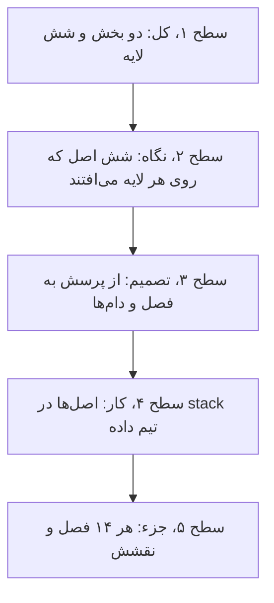
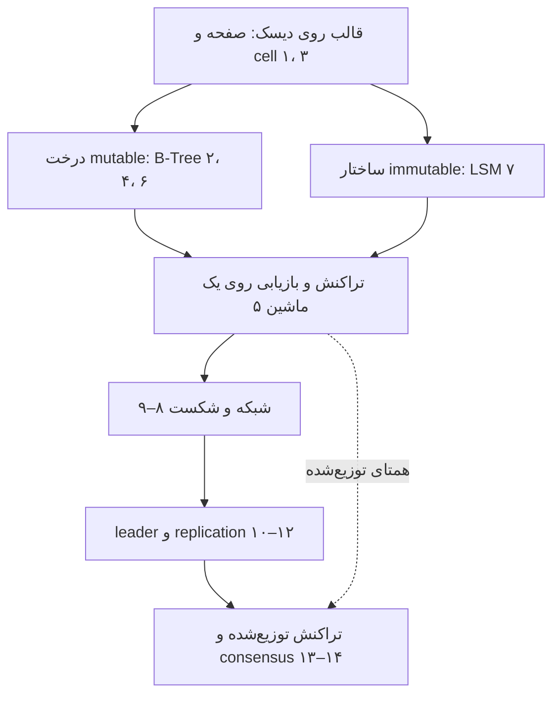
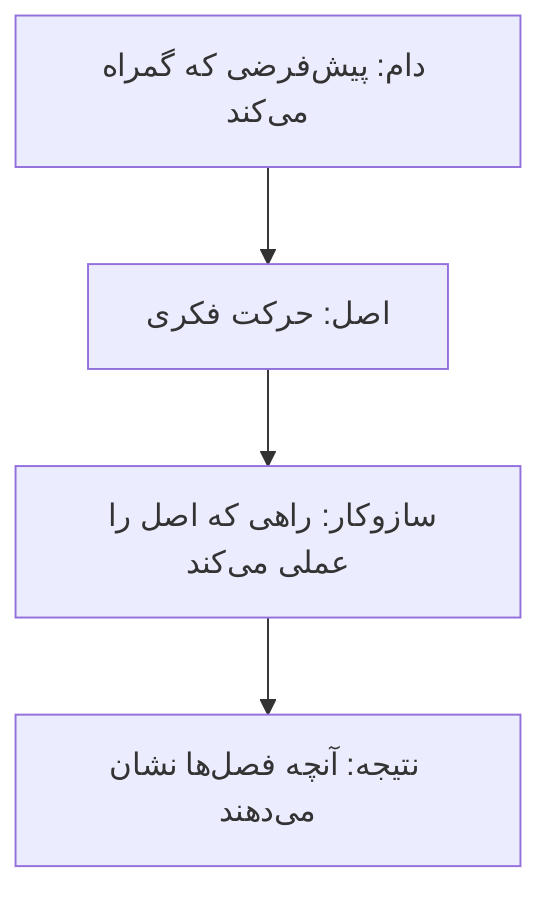
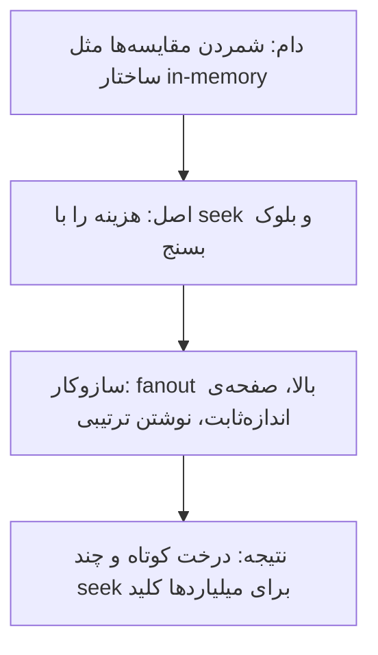
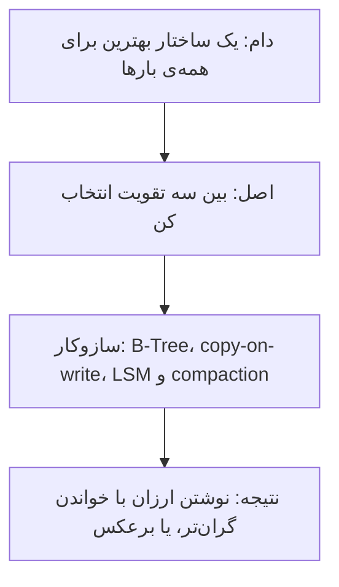
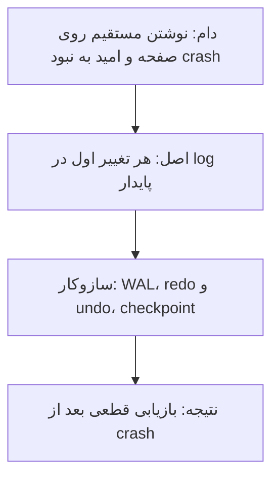
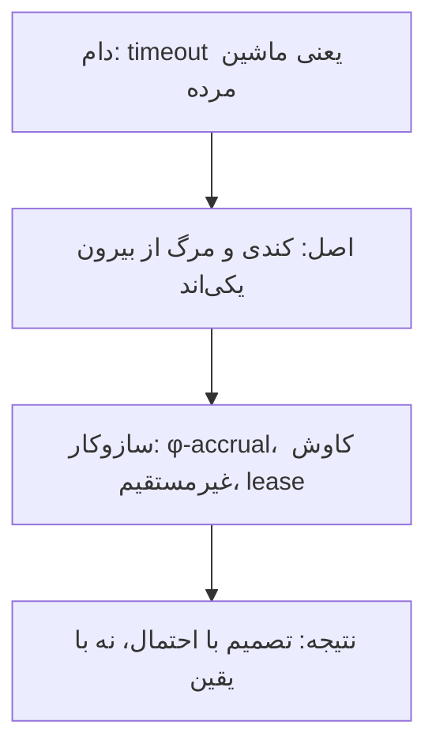
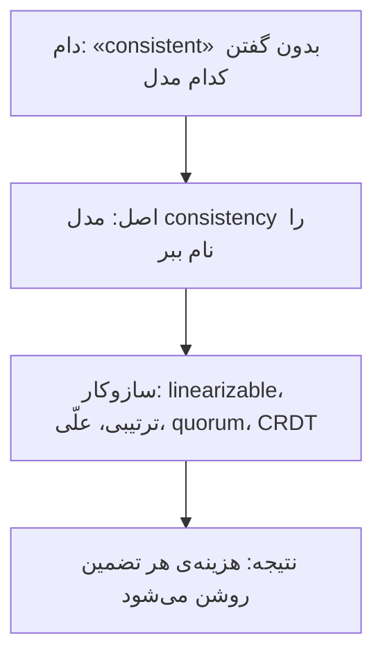
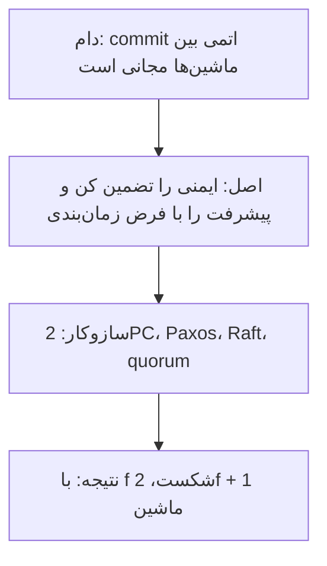

# چارچوب کتاب: از یک صفحه روی دیسک تا توافق بین ماشین‌ها

[کتاب](README.md) · [فصل ۱ ←](chapters/01-introduction-and-overview.md)

این صفحه **سنتز خود vault** است، نه بخشی از کتاب. کتاب دو بخش دارد: storage engine، یعنی این‌که یک دیتابیس داده را روی یک ماشین چطور نگه می‌دارد، و سیستم‌های توزیع‌شده، یعنی این‌که چند ماشین چطور با هم کنار می‌آیند. این‌جا هر دو بخش در یک ساختار کنار هم می‌نشینند تا ببینید فصل‌های دو بخش چطور به هم جواب می‌دهند.

چارچوب سه لایه دارد. **نقشه‌ی کتاب** می‌گوید دیتابیس از چه لایه‌هایی ساخته شده است. **شش اصل** می‌گوید کدام بده‌بستان در هر لایه تکرار می‌شود. **راهنمای تصمیم و stack** می‌گوید برای هر پرسش کدام فصل را باز کنید و هر اصل در stack تیم داده کجا می‌نشیند. همه‌ی ادعاها به فصل‌ها ارجاع می‌دهند؛ نام‌گذاری اصل‌ها مال vault است.

## تصویر کل

### کل کتاب در سه جمله

خوانش vault از کتاب، پیش از هر جزئی:

1. **هر storage engine بین تغییر دادن در جا و افزودن immutable انتخاب می‌کند.** B-Tree صفحه را بازنویسی می‌کند و LSM هیچ‌وقت فایل را عوض نمی‌کند؛ بقیه‌ی تفاوت‌ها از همین انتخاب می‌آیند ([۲](chapters/02-b-tree-basics.md)، [۶](chapters/06-b-tree-variants.md)، [۷](chapters/07-log-structured-storage.md)).
2. **درستی روی یک ماشین از log و قفل می‌آید و روی چند ماشین از توافق.** WAL و isolation در فصل ۵ همان کاری را می‌کنند که 2PC و consensus در فصل‌های ۱۳ و ۱۴ ([۵](chapters/05-transaction-processing-and-recovery.md)، [۱۳](chapters/13-distributed-transactions.md)، [۱۴](chapters/14-consensus.md)).
3. **در سیستم توزیع‌شده هیچ timeoutی نمی‌گوید چرا پاسخی نیامد.** failure detector و leader و replication همه با این عدم قطعیت کنار می‌آیند ([۸](chapters/08-introduction-and-overview.md)–[۱۱](chapters/11-replication-and-consistency.md)).

### از کل به جزء

## نقشه‌ی کتاب

### دو بخش و شش لایه

*سطح ۱ از ۵: کل.*

بخش یک از دیسک بالا می‌رود: بایت و صفحه، بعد درخت، بعد تراکنش. بخش دو از شبکه بالا می‌رود: پیوند و شکست، بعد leader و replication، بعد تراکنش توزیع‌شده و consensus. دو بخش آینه‌ی هم‌اند؛ فصل ۱۳ صریحاً همتای توزیع‌شده‌ی فصل ۵ است ([۱۳](chapters/13-distributed-transactions.md)).

### لایه‌ها و پرسش‌هایشان

| لایه | پرسش اصلی | سازوکارهای کلیدی | بده‌بستان اصلی | فصل‌ها |
|---|---|---|---|---|
| قالب روی دیسک | بایت‌ها چطور روی دیسک چیده می‌شوند؟ | slotted page، checksum، چیدمان ردیفی یا ستونی | فشردگی در برابر سادگی به‌روزرسانی | [۱](chapters/01-introduction-and-overview.md)، [۳](chapters/03-file-formats.md) |
| درخت mutable | چطور با کمترین seek پیدا کنیم؟ | fanout، split و merge، پیوند sibling، copy-on-write | تقویت نوشتن در برابر خواندن سریع | [۲](chapters/02-b-tree-basics.md)، [۴](chapters/04-implementing-b-trees.md)، [۶](chapters/06-b-tree-variants.md) |
| ساختار immutable | چطور نوشتن را ترتیبی کنیم؟ | memtable، SSTable، compaction، tombstone، Bloom filter | تقویت خواندن و فضا در برابر نوشتن ارزان | [۷](chapters/07-log-structured-storage.md) |
| تراکنش محلی | با crash و concurrency چه کنیم؟ | page cache، WAL، steal و force، قفل و latch | durability در برابر سرعت | [۵](chapters/05-transaction-processing-and-recovery.md) |
| شبکه و شکست | از کجا بفهمیم ماشینی مرده؟ | پیوند fair-loss، heartbeat، φ-accrual، کاوش غیرمستقیم | تشخیص سریع در برابر هشدار کاذب | [۸](chapters/08-introduction-and-overview.md)، [۹](chapters/09-failure-detection.md) |
| هماهنگی | چه کسی تصمیم می‌گیرد و کپی‌ها چطور هم‌گام می‌مانند؟ | انتخاب leader، quorum، CRDT، read repair، gossip | consistency در برابر availability | [۱۰](chapters/10-leader-election.md)–[۱۲](chapters/12-anti-entropy-and-dissemination.md) |
| توافق | چطور چند ماشین روی یک مقدار توافق کنند؟ | 2PC، 3PC، Calvin، Spanner، Paxos، Raft | ایمنی در برابر پیشرفت | [۱۳](chapters/13-distributed-transactions.md)، [۱۴](chapters/14-consensus.md) |

## شش اصل

*سطح ۲ از ۵: نگاه.*

شش بده‌بستان در هر دو بخش تکرار می‌شوند. هر اصل با یک زنجیره‌ی چهارتایی شروع می‌شود: **دام** رایج، **اصلی** که آن را می‌بندد، **سازوکاری** که اصل را عملی می‌کند و **نتیجه**.

### اصل ۱: هزینه‌ی واقعی I/O است

- **روی دیسک هزینه seek است، نه مقایسه**، و fanout با ارتفاع رابطه‌ی عکس دارد ([۲](chapters/02-b-tree-basics.md)).
- **همه‌ی SSDها صفحه می‌نویسند ولی بلوک پاک می‌کنند** ([۲](chapters/02-b-tree-basics.md))؛ برای همین LSM نوشتن را ترتیبی می‌کند ([۷](chapters/07-log-structured-storage.md)).
- **دیتابیس in-memory دیتابیس دیسکی با cache بزرگ نیست** ([۱](chapters/01-introduction-and-overview.md)).

### اصل ۲: تغییر در جا یا افزودن immutable

- **ساختار B-Tree صفحه را در جا بازنویسی می‌کند** و حذف فقط offsetها را جابه‌جا می‌کند ([۴](chapters/04-implementing-b-trees.md)).
- **الگوریتم copy-on-write فضا و CPU را با سادگی معامله می‌کند** ([۶](chapters/06-b-tree-variants.md)).
- **نوشتن‌های LSM هیچ‌وقت داده‌ی قدیم را جست‌وجو نمی‌کنند** و tombstone تا وقتی چیز قدیمی‌تری ممکن است باشد زنده می‌ماند ([۷](chapters/07-log-structured-storage.md)).

### اصل ۳: پیش از تغییر، log کن

- **پیش از عوض کردن، log کنید**؛ steal به undo نیاز دارد و no-force به redo ([۵](chapters/05-transaction-processing-and-recovery.md)).
- **انباره‌ی in-memory با log و snapshot روی دیسک پایا می‌ماند** ([۱](chapters/01-introduction-and-overview.md)).
- **همین ایده در بخش دو برمی‌گردد**: پخش اتمی با consensus هم‌ارز است و log تکثیرشده هسته‌ی Raft و ZAB است ([۱۴](chapters/14-consensus.md)).

### اصل ۴: تشخیص شکست همیشه حدس است

- **هیچ timeoutی نمی‌تواند بگوید چرا نودی پاسخ نداد** ([۸](chapters/08-introduction-and-overview.md)).
- **کاوش غیرمستقیم از مستقیم بهتر است** و φ-accrual با شبکه وفق می‌یابد ([۹](chapters/09-failure-detection.md)).
- **انتخاب leader قفل توزیع‌شده نیست**؛ Bully زیر پارتیشن split brain می‌سازد ([۱۰](chapters/10-leader-election.md)).

### اصل ۵: consistency یک طیف است

- **حرف C و A در CAP نه C در ACID‌اند و نه availability روزمره** ([۱۱](chapters/11-replication-and-consistency.md)).
- **شرط R + W > N هم‌پوشانی را تضمین می‌کند** و CRDT با merge جابه‌جاپذیر هم‌گرا می‌شود ([۱۱](chapters/11-replication-and-consistency.md)).
- **عمل read repair فقط آنچه خوانده می‌شود را درست می‌کند**؛ درخت Merkle واگرایی را محلی می‌کند ([۱۲](chapters/12-anti-entropy-and-dissemination.md)).

### اصل ۶: توافق یعنی ایمنی همیشه، پیشرفت گاهی

- **روش 2PC سر شکست coordinator بند می‌آید** ([۱۳](chapters/13-distributed-transactions.md)).
- **قضیه‌ی FLP consensus تضمین‌شده در زمان bounded را رد می‌کند**، پس الگوریتم‌ها ایمنی را همیشه و پیشرفت را با فرض زمان‌بندی تضمین می‌کنند ([۱۴](chapters/14-consensus.md)).
- **الگوریتم Paxos زیر هر تعداد شکست ایمن است و با f شکست از 2f + 1 زنده** ([۱۴](chapters/14-consensus.md)).

## از پرسش به فصل

*سطح ۳ از ۵: تصمیم.*

| پرسش | اول بخوانید | بعد |
|---|---|---|
| چرا نوشتن روی این دیتابیس کند است؟ | [۷](chapters/07-log-structured-storage.md) | [۲](chapters/02-b-tree-basics.md) |
| چرا خواندن نقطه‌ای کند شده؟ | [۲](chapters/02-b-tree-basics.md) | [۷](chapters/07-log-structured-storage.md) |
| بعد از crash چه داده‌ای می‌ماند؟ | [۵](chapters/05-transaction-processing-and-recovery.md) | [۳](chapters/03-file-formats.md) |
| فایل خراب روی دیسک | [۳](chapters/03-file-formats.md) | [۵](chapters/05-transaction-processing-and-recovery.md) |
| ماشینی کند است یا مرده؟ | [۹](chapters/09-failure-detection.md) | [۸](chapters/08-introduction-and-overview.md) |
| بعد از failover دو leader داریم | [۱۰](chapters/10-leader-election.md) | [۱۴](chapters/14-consensus.md) |
| replicaها عدد متفاوت می‌دهند | [۱۱](chapters/11-replication-and-consistency.md) | [۱۲](chapters/12-anti-entropy-and-dissemination.md) |
| نوشتن اتمی روی دو shard | [۱۳](chapters/13-distributed-transactions.md) | [۱۴](chapters/14-consensus.md) |
| چرا cluster با دو ماشین کار نمی‌کند؟ | [۱۴](chapters/14-consensus.md) | [۱۱](chapters/11-replication-and-consistency.md) |

## دام‌ها

1. **یکی دانستن ساختار wide column و ذخیره‌سازی ستونی** ([۱](chapters/01-introduction-and-overview.md)).
2. **دیتابیس in-memory را دیسکی با cache بزرگ دانستن** ([۱](chapters/01-introduction-and-overview.md)).
3. **گرفتن checksum برای کل فایل** به‌جای هر صفحه ([۳](chapters/03-file-formats.md)).
4. **فرض این‌که cache بزرگ‌تر همیشه miss کمتر می‌دهد** ([۵](chapters/05-transaction-processing-and-recovery.md)).
5. **حذف از memtable بدون tombstone**، که مقدار قدیم را برمی‌گرداند ([۷](chapters/07-log-structured-storage.md)).
6. **استفاده از timestamp برای ترتیب** بین ماشین‌ها ([۸](chapters/08-introduction-and-overview.md)).
7. **مهلت ثابت تشخیص شکست** که به تنظیم دستی وابسته است ([۹](chapters/09-failure-detection.md)).
8. **یکی دانستن انتخاب leader و قفل توزیع‌شده** ([۱۰](chapters/10-leader-election.md)).
9. **یکی دانستن hint و replica** ([۱۲](chapters/12-anti-entropy-and-dissemination.md)).
10. **اعتماد به 2PC** وقتی coordinator ممکن است بیفتد ([۱۳](chapters/13-distributed-transactions.md)).

## در stack شما

*سطح ۴ از ۵: کار.*

هر اصل در [stack مرجع](../../practice/reference-stack.md) یک جای مشخص دارد. کادرهای *In practice* هر فصل جزئیاتش را می‌دهند.

| بخش stack | اصل | فصل‌ها | یادآوری |
|---|---|---|---|
| ClickHouse با MergeTree | ۲ | [۷](chapters/07-log-structured-storage.md) | partهای immutable و merge پس‌زمینه همان ایده‌ی LSM است؛ insertهای ریز partهای زیاد می‌سازند |
| کلید مرتب‌سازی و sparse index | ۱ | [۲](chapters/02-b-tree-basics.md)، [۴](chapters/04-implementing-b-trees.md) | سرعت خواندن از پریدن از granuleها می‌آید، نه از مقایسه |
| فایل‌های Parquet در staging | ۱، ۲ | [۱](chapters/01-introduction-and-overview.md)، [۳](chapters/03-file-formats.md) | چیدمان ستونی و checksum در سطح صفحه |
| دو replica با ClickHouse Keeper | ۵، ۶ | [۱۱](chapters/11-replication-and-consistency.md)، [۱۴](chapters/14-consensus.md) | Keeper همان consensus است؛ با دو ماشین Keeper شکست یکی همه را می‌ایستاند |
| controllerهای Kubernetes | ۴ | [۹](chapters/09-failure-detection.md)، [۱۰](chapters/10-leader-election.md) | Lease یعنی leader با مهلت؛ fencing را فراموش نکنید |
| liveness و readiness probe | ۴ | [۹](chapters/09-failure-detection.md) | probe کند را با مرده یکی نگیرید |
| Prometheus و Grafana | ۴ | [۹](chapters/09-failure-detection.md) | هشدار بر پایه‌ی چند نمونه، نه یک timeout |

> **In practice:** سه اصل «تغییر در جا یا immutable»، «log پیش از تغییر» و «توافق» در یک insert ساده‌ی ClickHouse به هم می‌رسند.
>
> **Your turn:** loader هر ثانیه چند ردیف در یک جدول replicated insert می‌کند و بعد از چند ساعت خطای «too many parts» می‌آید. چه اتفاقی افتاده و چه می‌کنید؟
>
> *Answer:* هر insert یک part immutable تازه می‌سازد و merge پس‌زمینه عقب می‌ماند، همان فشار compaction در LSM ([۷](chapters/07-log-structured-storage.md))؛ هر part تازه هم باید در log مشترک Keeper ثبت شود، پس هزینه‌ی توافق هم بالا می‌رود ([۱۴](chapters/14-consensus.md)). insertها را دسته‌ای کنید، مثلاً در staging جمع کنید و چند دقیقه یک بار بنویسید.

## نقشه‌ی فصل‌ها

*سطح ۵ از ۵: جزء.*

| فصل | لایه | اصل | نقش در چارچوب |
|---|---|---|---|
| [۱](chapters/01-introduction-and-overview.md) | قالب روی دیسک | ۱، ۳ | معماری DBMS، in-memory در برابر دیسکی، ردیفی در برابر ستونی |
| [۲](chapters/02-b-tree-basics.md) | درخت mutable | ۱ | چرا B-Tree: seek، fanout و ارتفاع |
| [۳](chapters/03-file-formats.md) | قالب روی دیسک | ۱ | قالب دودویی، slotted page، checksum |
| [۴](chapters/04-implementing-b-trees.md) | درخت mutable | ۲ | پیاده‌سازی واقعی: header، sibling، سرریز، نگهداشت |
| [۵](chapters/05-transaction-processing-and-recovery.md) | تراکنش محلی | ۳ | ساختار page cache، WAL، بازیابی و concurrency control |
| [۶](chapters/06-b-tree-variants.md) | درخت mutable | ۲ | گونه‌ها: copy-on-write، lazy، FD-Tree، Bw-Tree |
| [۷](chapters/07-log-structured-storage.md) | ساختار immutable | ۲ | ساختار LSM، compaction، tombstone و Bloom filter |
| [۸](chapters/08-introduction-and-overview.md) | شبکه و شکست | ۴ | واژگان توزیع‌شده، پیوند و مدل شکست |
| [۹](chapters/09-failure-detection.md) | شبکه و شکست | ۴ | تشخیص شکست: heartbeat، φ-accrual، gossip |
| [۱۰](chapters/10-leader-election.md) | هماهنگی | ۴ | انتخاب leader و split brain |
| [۱۱](chapters/11-replication-and-consistency.md) | هماهنگی | ۵ | قاعده‌ی CAP، مدل‌های consistency، quorum و CRDT |
| [۱۲](chapters/12-anti-entropy-and-dissemination.md) | هماهنگی | ۵ | پخش metadata، read repair، Merkle و gossip |
| [۱۳](chapters/13-distributed-transactions.md) | توافق | ۶ | تراکنش توزیع‌شده: 2PC، 3PC، Calvin، Spanner |
| [۱۴](chapters/14-consensus.md) | توافق | ۳، ۶ | الگوریتم‌های consensus: FLP، ZAB، Paxos، Raft |
