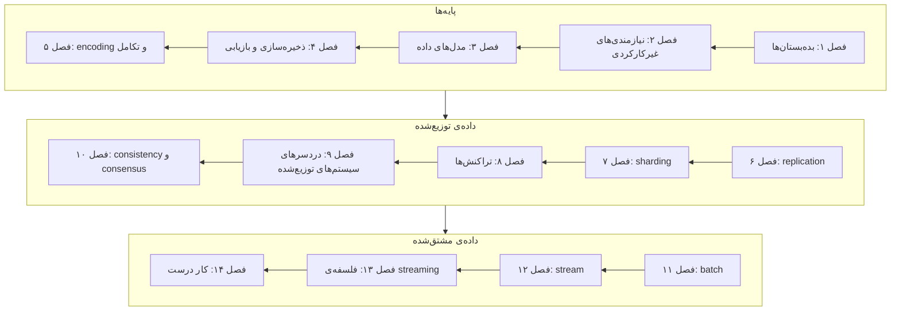

# Designing Data-Intensive Applications, 2nd Edition

**فایل [`index.html`](index.html) را در مرورگر باز کنید** تا نسخه‌ی تعاملی را ببینید: برای هر فصل یک درس اسلاید به اسلاید، با شبیه‌سازی‌های جاسازی‌شده و پرسش‌های خودسنجی. همه‌ی این فایل‌ها روی GitHub هم خوانا هستند.

## درباره‌ی کتاب

گشتی از پایه در اینکه سیستم‌های داده چطور کار می‌کنند: مدل‌های داده، موتورهای ذخیره‌سازی، encoding، replication، sharding، تراکنش‌ها، انواع خرابی در سیستم‌های توزیع‌شده، consensus، و پردازش batch و stream. کتاب حول بده‌بستان‌هایی که هر سیستم داده‌ای با آن‌ها روبه‌روست چیده شده و با اخلاقِ ساختن این سیستم‌ها تمام می‌شود.

## محتوای این پوشه

| مسیر | چیست |
|---|---|
| [`chapters/NN-*.md`](chapters/01-trade-offs-in-data-systems-architecture.md) | یادداشت‌های فصل‌ها، یعنی **منبع حقیقت**. کنار هر فایل `.md` یک درس `.html` ساخته‌شده هست. |
| [`widgets/`](widgets/04-lsm-tree.html) | شبیه‌سازی‌های دست‌ساز که در درس‌ها جاسازی شده‌اند؛ هر کدام را جداگانه هم می‌شود باز کرد |
| [`lab/`](lab/04-lsm-tree/README.md) | آزمایش‌های اجراشدنی Python با خروجی مورد انتظار |
| `index.html` | صفحه‌ی کتاب، که از همین README و فصل‌ها ساخته می‌شود |

## کتاب چطور به هم وصل است

ویراست دوم بخش‌بندی ندارد؛ این گروه‌بندی **نقشه‌ی مطالعه‌ی خود vault** است که از ارجاع‌های فصل‌ها به هم ساخته شده.

رشته‌هایی که از گروه‌ها می‌گذرند: logها و فایل‌های مرتب موتورهای ذخیره‌سازی در فصل ۴، در پردازش batch در فصل ۱۱ برمی‌گردند؛ replication log در فصل ۶ به change data capture در فصل ۱۲ تبدیل می‌شود؛ و consensus و log مشترک در فصل ۱۰ پایه‌ی brokerهای مبتنی بر log در فصل ۱۲ است.

## فصل‌ها

| # | فصل | صفحه‌ها |
|---:|---|---|
| ۱ | [بده‌بستان‌ها در معماری سیستم‌های داده](chapters/01-trade-offs-in-data-systems-architecture.md) | ۱–۳۲ |
| ۲ | [تعریف نیازمندی‌های غیرکارکردی](chapters/02-defining-nonfunctional-requirements.md) | ۳۳–۶۴ |
| ۳ | [مدل‌های داده و زبان‌های کوئری](chapters/03-data-models-and-query-languages.md) | ۶۵–۱۱۴ |
| ۴ | [ذخیره‌سازی و بازیابی](chapters/04-storage-and-retrieval.md) | ۱۱۵–۱۶۰ |
| ۵ | [قالب‌های encoding و تکامل](chapters/05-encoding-and-evolution.md) | ۱۶۱–۱۹۶ |
| ۶ | [مفهوم replication](chapters/06-replication.md) | ۱۹۷–۲۵۰ |
| ۷ | [مفهوم sharding](chapters/07-sharding.md) | ۲۵۱–۲۷۶ |
| ۸ | [تراکنش‌ها](chapters/08-transactions.md) | ۲۷۷–۳۴۴ |
| ۹ | [دردسرهای سیستم‌های توزیع‌شده](chapters/09-the-trouble-with-distributed-systems.md) | ۳۴۵–۴۰۰ |
| ۱۰ | [مفهوم consistency و consensus](chapters/10-consistency-and-consensus.md) | ۴۰۱–۴۵۰ |
| ۱۱ | [پردازش batch](chapters/11-batch-processing.md) | ۴۵۱–۴۸۶ |
| ۱۲ | [پردازش stream](chapters/12-stream-processing.md) | ۴۸۷–۵۳۸ |
| ۱۳ | [فلسفه‌ی سیستم‌های streaming](chapters/13-a-philosophy-of-streaming-systems.md) | ۵۳۹–۵۸۴ |
| ۱۴ | [کار درست را انجام دادن](chapters/14-doing-the-right-thing.md) | ۵۸۵–۶۰۲ |

بازه‌ی صفحه‌ها شماره‌ی صفحه‌های چاپی است و فهرست مرجع‌های هر فصل را هم در بر می‌گیرد.

## مفهوم‌های کلیدی

ایده‌هایی که در چند فصل تکرار می‌شوند، همراه با فصل‌هایی که درباره‌شان حرف می‌زنند. تعریف‌ها خلاصه‌ی خود vault از توضیح‌های کتاب‌اند.

| مفهوم | تعریف | فصل‌ها |
|---|---|---|
| ACID | چهار تضمین ایمنی که تراکنش‌های دیتابیس به طور سنتی وعده می‌دهند، یعنی atomicity، consistency، isolation و durability؛ معنای واقعی‌شان محدودتر و ناهموارتر از چیزی است که این سرواژه القا می‌کند. | [۸](chapters/08-transactions.md) · [۱۳](chapters/13-a-philosophy-of-streaming-systems.md) |
| B-tree | درختی متوازن از pageهای با اندازه‌ی ثابت که درجا بازنویسی می‌شوند؛ کلیدها را مرتب نگه می‌دارد و هر کلید را با O(log n) خواندن page پیدا می‌کند. index استاندارد دیتابیس‌های relational است. | [۴](chapters/04-storage-and-retrieval.md) · [۸](chapters/08-transactions.md) |
| Change data capture | دیدن هر نوشتنی که در یک دیتابیس commit می‌شود و انتشارش، به ترتیب commit، به شکل یک stream که سیستم‌های دیگر مصرفش می‌کنند تا نسخه‌های مشتق‌شده را synchronous نگه دارند. | [۶](chapters/06-replication.md) · [۱۲](chapters/12-stream-processing.md) · [۱۳](chapters/13-a-philosophy-of-streaming-systems.md) |
| Column-oriented storage | نگه داشتن همه‌ی مقدارهای هر ستون کنار هم، به جای همه‌ی مقدارهای هر ردیف، تا کوئری‌های تحلیلی فقط ستون‌هایی را بخوانند که لازم دارند و داده خیلی بهتر فشرده شود. | [۴](chapters/04-storage-and-retrieval.md) · [۱۱](chapters/11-batch-processing.md) |
| Conflict resolution | تشخیص اینکه replicaها نوشتن‌های هم‌زمان روی یک داده را پذیرفته‌اند، و mergeشان طوری که همه‌ی replicaها به یک state برسند. | [۶](chapters/06-replication.md) · [۹](chapters/09-the-trouble-with-distributed-systems.md) · [۱۰](chapters/10-consistency-and-consensus.md) |
| Consensus | رساندن گروهی از nodeها به توافقی برگشت‌ناپذیر روی یک مقدار، یا روی دنباله‌ای از مقدارها، یعنی یک log مشترک، با وجود crash و مشکل شبکه، تا وقتی اکثریت کار می‌کند. | [۷](chapters/07-sharding.md) · [۱۰](chapters/10-consistency-and-consensus.md) · [۱۲](chapters/12-stream-processing.md) · [۱۳](chapters/13-a-philosophy-of-streaming-systems.md) |
| داده‌ی مشتق‌شده | داده‌ای که از تبدیل داده‌ی جای دیگری ساخته می‌شود و برای همین می‌شود دوباره از آن حسابش کرد؛ در برابر **system of record** که نسخه‌ی معتبر هر واقعیت را نگه می‌دارد. | [۱](chapters/01-trade-offs-in-data-systems-architecture.md) · [۲](chapters/02-defining-nonfunctional-requirements.md) · [۳](chapters/03-data-models-and-query-languages.md) · [۴](chapters/04-storage-and-retrieval.md) · [۱۱](chapters/11-batch-processing.md) · [۱۲](chapters/12-stream-processing.md) · [۱۳](chapters/13-a-philosophy-of-streaming-systems.md) · [۱۴](chapters/14-doing-the-right-thing.md) |
| Event sourcing | ذخیره‌ی هر تغییر state اپلیکیشن به شکل یک رویداد immutable در یک log append-only که منبع حقیقت می‌شود؛ viewهای بهینه برای خواندن از آن مشتق می‌شوند، یعنی CQRS. | [۳](chapters/03-data-models-and-query-languages.md) · [۱۲](chapters/12-stream-processing.md) · [۱۳](chapters/13-a-philosophy-of-streaming-systems.md) · [۱۴](chapters/14-doing-the-right-thing.md) |
| Event time و window | گروه کردن رویدادهای stream در windowهای زمانی بر اساس زمانی که *رخ داده‌اند*، یعنی event time، نه زمانی که *پردازش شده‌اند*؛ و تصمیم درباره‌ی رویدادهایی که بعد از کامل اعلام شدن windowشان می‌رسند. | [۹](chapters/09-the-trouble-with-distributed-systems.md) · [۱۲](chapters/12-stream-processing.md) · [۱۳](chapters/13-a-philosophy-of-streaming-systems.md) |
| Fencing token | عددی که با هر واگذاری lock یا lease بزرگ‌تر می‌شود و clientها باید آن را به منبع محافظت‌شده نشان دهند؛ منبع هر درخواستی را که عددش از بزرگ‌ترین عدد دیده‌شده کوچک‌تر باشد رد می‌کند. | [۹](chapters/09-the-trouble-with-distributed-systems.md) · [۱۰](chapters/10-consistency-and-consensus.md) |
| Idempotence | عملیاتی idempotent است که اگر چند بار انجامش دهید همان اثر یک بار را داشته باشد؛ این retry را امن می‌کند و تحویل at-least-once را به *اثر* exactly-once تبدیل می‌کند. | [۵](chapters/05-encoding-and-evolution.md) · [۸](chapters/08-transactions.md) · [۱۱](chapters/11-batch-processing.md) · [۱۲](chapters/12-stream-processing.md) · [۱۳](chapters/13-a-philosophy-of-streaming-systems.md) |
| سطح‌های isolation | میزانی که دیتابیس تراکنش‌های هم‌زمان را از هم محافظت می‌کند، که با race conditionهایی، یعنی ناهنجاری‌هایی، که اجازه می‌دهد تعریف می‌شود. | [۸](chapters/08-transactions.md) · [۱۰](chapters/10-consistency-and-consensus.md) |
| Leader-based replication | یک replica، یعنی leader، همه‌ی نوشتن‌ها را می‌پذیرد و آن‌ها را به ترتیب برای followerهایی می‌فرستد که همان تغییرها را اعمال می‌کنند؛ خواندن را هر replicaای می‌تواند جواب دهد. | [۶](chapters/06-replication.md) · [۱۰](chapters/10-consistency-and-consensus.md) |
| Linearizability | تضمینی از consistency که در آن یک شیء replicate‌شده طوری رفتار می‌کند که انگار فقط یک نسخه دارد و هر عملیات در لحظه‌ای بین شروع و پایانش به طور اتمی اثر کرده است. | [۶](chapters/06-replication.md) · [۱۰](chapters/10-consistency-and-consensus.md) · [۱۳](chapters/13-a-philosophy-of-streaming-systems.md) |
| Message broker مبتنی بر log | نوعی message broker که هر stream را به شکل یک log append-only و shardشده روی دیسک نگه می‌دارد؛ consumerها پشت سر هم می‌خوانند و جای خودشان، یعنی offset، را دنبال می‌کنند، به جای ack و حذف تک‌تک پیام‌ها. | [۵](chapters/05-encoding-and-evolution.md) · [۱۰](chapters/10-consistency-and-consensus.md) · [۱۲](chapters/12-stream-processing.md) · [۱۳](chapters/13-a-philosophy-of-streaming-systems.md) |
| Logical clock | الگوریتم‌هایی که timestamp را با شمردن رویدادها می‌دهند، نه با اندازه گرفتن زمان، تا ترتیب timestampها حتی وقتی ساعت‌های فیزیکی با هم نمی‌خوانند با causality سازگار باشد. | [۶](chapters/06-replication.md) · [۹](chapters/09-the-trouble-with-distributed-systems.md) · [۱۰](chapters/10-consistency-and-consensus.md) |
| LSM-tree | موتور ذخیره‌سازی log-structured که نوشتن‌ها را در یک جدول مرتب در حافظه buffer می‌کند، آن‌ها را به شکل فایل‌های مرتب تغییرناپذیر، یعنی SSTable، روی دیسک می‌ریزد و این فایل‌ها را در پس‌زمینه merge می‌کند. | [۴](chapters/04-storage-and-retrieval.md) · [۱۱](chapters/11-batch-processing.md) |
| OLTP در برابر OLAP | دو خانواده‌ی بار کاری داده: **online transaction processing**، یعنی خواندن و نوشتن‌های کوچک و کم‌تأخیر زیاد روی تک‌رکوردها، و **online analytical processing**، یعنی کوئری‌هایی که تعداد زیادی رکورد را scan و تجمیع می‌کنند. | [۱](chapters/01-trade-offs-in-data-systems-architecture.md) · [۳](chapters/03-data-models-and-query-languages.md) · [۴](chapters/04-storage-and-retrieval.md) · [۱۱](chapters/11-batch-processing.md) |
| Partial failure | در یک سیستم توزیع‌شده بعضی اجزا ممکن است خراب شوند و بقیه کار کنند، و یک node اغلب نمی‌تواند بفهمد کدام، چون نرسیدن پاسخ مبهم است. | [۱](chapters/01-trade-offs-in-data-systems-architecture.md) · [۲](chapters/02-defining-nonfunctional-requirements.md) · [۹](chapters/09-the-trouble-with-distributed-systems.md) |
| Quorum | کمترین تعداد nodeهایی که باید در یک عملیات شرکت کنند تا حساب شود؛ طوری انتخاب می‌شود که هر دو quorum هم‌پوشانی داشته باشند، و این اجازه می‌دهد سیستم حتی وقتی بعضی nodeها در دسترس نیستند امن تصمیم بگیرد. | [۶](chapters/06-replication.md) · [۹](chapters/09-the-trouble-with-distributed-systems.md) · [۱۰](chapters/10-consistency-and-consensus.md) |
| Replication lag | فاصله‌ی زمانی بین یک نوشتن روی leader و اعمالش روی یک follower؛ خواندن از replicaهای عقب‌افتاده ناهنجاری‌هایی می‌سازد که تضمین‌های consistency مشخصی منتفی‌شان می‌کنند. | [۶](chapters/06-replication.md) · [۱۰](chapters/10-consistency-and-consensus.md) · [۱۳](chapters/13-a-philosophy-of-streaming-systems.md) |
| Percentileهای زمان پاسخ | توصیف latency به شکل یک توزیع، یعنی میانه یا p50، و p95، p99 و p999، نه میانگین؛ چون کاربران تک‌تک درخواست‌ها را تجربه می‌کنند و کندترین‌ها بیشترین اهمیت را دارند. | [۲](chapters/02-defining-nonfunctional-requirements.md) · [۷](chapters/07-sharding.md) |
| Schema evolution | تغییر ساختار داده در طول زمان، در حالی که کد قدیم و جدید همچنان داده‌ی همدیگر را می‌خوانند: **backward compatibility**، یعنی کد جدید داده‌ی قدیمی را بخواند، و **forward compatibility**، یعنی کد قدیمی داده‌ی جدید را بخواند. | [۳](chapters/03-data-models-and-query-languages.md) · [۵](chapters/05-encoding-and-evolution.md) |
| Sharding | تقسیم یک dataset به زیرمجموعه‌هایی، یعنی shard یا partition، که روی nodeهای مختلف ذخیره می‌شوند تا حجم داده و بار بتواند از ظرفیت یک ماشین فراتر برود. | [۲](chapters/02-defining-nonfunctional-requirements.md) · [۷](chapters/07-sharding.md) · [۱۳](chapters/13-a-philosophy-of-streaming-systems.md) |
| Shuffle | مرتب‌سازی توزیع‌شده در قلب پردازش batch: هر رکورد بر اساس کلیدش به taskی می‌رود که مسئول آن کلید است، تا همه‌ی رکوردهای یک کلید کنار هم و مرتب قرار بگیرند. | [۴](chapters/04-storage-and-retrieval.md) · [۱۱](chapters/11-batch-processing.md) |
| Two-phase commit | پروتکلی برای commit اتمی یک تراکنش روی چند node: یک coordinator از هر participant می‌خواهد *prepare* کند، و فقط اگر همه قول commit بدهند، تصمیم commit را ثبت و برای همه اعلام می‌کند. | [۸](chapters/08-transactions.md) · [۱۰](chapters/10-consistency-and-consensus.md) · [۱۳](chapters/13-a-philosophy-of-streaming-systems.md) |
| Write skew | نوعی race که در آن دو تراکنش یک داده را می‌خوانند، هر کدام بر اساس آنچه خوانده تصمیمی می‌گیرد و هر کدام شیء *متفاوتی* را می‌نویسد؛ پس هیچ نوشتنی با دیگری تعارض ندارد، اما با هم یک invariant را می‌شکنند. | [۶](chapters/06-replication.md) · [۸](chapters/08-transactions.md) · [۱۳](chapters/13-a-philosophy-of-streaming-systems.md) |

## منابع همراه

- **[خوانش ویراست اول، فهرست پخش YouTube](https://www.youtube.com/playlist?list=PLhgFs9q2EVg_rB-XT1zaJ3k9z0KVGrR2h)**: مرور مکمل خیلی خوبی از کتاب که فصل به فصل بلند خوانده می‌شود. این مجموعه **ویراست اول**، یعنی نسخه‌ی ۲۰۱۷، را پوشش می‌دهد که فصل‌هایش با ویراست دوم فرق دارد؛ پس قسمت‌هایش یک‌به‌یک با درس‌های اینجا جور نیست، اما ایده‌های اصلی همان‌اند.

## این یادداشت‌ها چطور نوشته شده‌اند

- **در هر یادداشت فصل، هر چیزی بالای *فراتر از کتاب* بازگویی خود کتاب است** و ارجاع به صفحه‌ی چاپی دارد. مطالب مکمل، یعنی منابع بیرونی و برداشت خود vault، زیر *فراتر از کتاب* یا در callout نوع `> **Vault note:**` می‌آیند.
- عددها، مثال‌ها، شکل‌ها و نام سیستم‌ها بعد از نوشتن با متن منبع تطبیق داده شده‌اند؛ نقل‌قول‌ها کم، کوتاه و با ارجاع صفحه‌اند.
- فهرست بخش‌های هر فصل همان فهرست مطالب تودرتوی خود کتاب است که از bookmarkهای PDF ساخته شده.
- پرسش‌ها و پاسخ‌های *خودتان را بسنجید* را خود vault از روی یادداشت‌ها نوشته است؛ پاسخ‌ها به صفحه‌ها ارجاع می‌دهند.
- شبیه‌سازی‌ها و آزمایش‌ها پیاده‌سازی خود vault از سازوکارهایی‌اند که کتاب شرح می‌دهد؛ هر کدام می‌گوید کدام صفحه‌ها را نشان می‌دهد و چه چیزی را ساده کرده است.

## منبع

- **منبع اصلی:** فایل PDF ناشر از ویراست دوم، با ۶۷۳ صفحه‌ی PDF؛ شماره‌ی صفحه‌ی چاپی برابر شماره‌ی صفحه‌ی PDF منهای ۲۴ است. فایل PDF بیرون از version control نگه داشته می‌شود؛ `.gitignore` را ببینید.
- **فهرست مطالب:** از bookmarkهای PDF گرفته شده که کل سلسله‌مراتب دوسطحی بخش‌ها را با شماره‌ی صفحه می‌دهد؛ عنوان فصل‌ها با [صفحه‌ی کتاب در کاتالوگ O'Reilly](https://www.oreilly.com/library/view/designing-data-intensive-applications/9781098119058/) یکی است.
- **ساختار:** ۱۴ فصل به‌علاوه‌ی پیشگفتار، واژه‌نامه، index و زندگی‌نامه‌ی نویسنده‌ها؛ ویراست دوم **بخش‌بندی ندارد**.
- **پوشش:** هر ۱۴ فصل در دسترس بوده و پوشش داده شده‌اند. فهرست مرجع‌های هر فصل، که در بازه‌ی صفحه‌ها آمده، فقط برای بررسی منبع گفته‌ها خوانده شده است.
