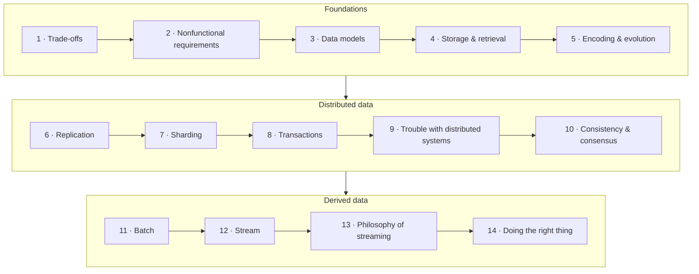

# Designing Data-Intensive Applications, 2nd Edition

**Open [`index.html`](index.html) in a browser** for the interactive version: one slide-by-slide lesson per chapter with embedded simulations and self-checks. Everything here also reads fine on GitHub.

## About

A first-principles tour of how data systems work — data models, storage engines, encoding, replication, sharding, transactions, the failure modes of distributed systems, consensus, and batch and stream processing — organized around the trade-offs every data system makes, and closing with the ethics of building them.

## What's in this folder

| Path | What it is |
|---|---|
| [`chapters/NN-*.md`](chapters/01-trade-offs-in-data-systems-architecture.md) | Chapter notes — **the source of truth**. Each `.md` has a generated `.html` lesson next to it. |
| [`widgets/`](widgets/04-lsm-tree.html) | Hand-built simulations, embedded in the lessons (open any of them on its own too) |
| [`lab/`](lab/04-lsm-tree/README.md) | Runnable Python experiments with expected output |
| `index.html` | The book hub — generated from this README and the chapters |

## How the book fits together

The second edition has no part divisions; this grouping is **the vault's own reading map**, built from the chapters' cross-references.

Threads that cross the groups: storage engines' logs and sorted files (4) return in batch processing (11); replication logs (6) become change data capture (12); consensus and shared logs (10) underpin log-based brokers (12).

## Chapters

| # | Chapter | Pages |
|---:|---|---|
| 1 | [Trade-Offs in Data Systems Architecture](chapters/01-trade-offs-in-data-systems-architecture.md) | 1–32 |
| 2 | [Defining Nonfunctional Requirements](chapters/02-defining-nonfunctional-requirements.md) | 33–64 |
| 3 | [Data Models and Query Languages](chapters/03-data-models-and-query-languages.md) | 65–114 |
| 4 | [Storage and Retrieval](chapters/04-storage-and-retrieval.md) | 115–160 |
| 5 | [Encoding and Evolution](chapters/05-encoding-and-evolution.md) | 161–196 |
| 6 | [Replication](chapters/06-replication.md) | 197–250 |
| 7 | [Sharding](chapters/07-sharding.md) | 251–276 |
| 8 | [Transactions](chapters/08-transactions.md) | 277–344 |
| 9 | [The Trouble with Distributed Systems](chapters/09-the-trouble-with-distributed-systems.md) | 345–400 |
| 10 | [Consistency and Consensus](chapters/10-consistency-and-consensus.md) | 401–450 |
| 11 | [Batch Processing](chapters/11-batch-processing.md) | 451–486 |
| 12 | [Stream Processing](chapters/12-stream-processing.md) | 487–538 |
| 13 | [A Philosophy of Streaming Systems](chapters/13-a-philosophy-of-streaming-systems.md) | 539–584 |
| 14 | [Doing the Right Thing](chapters/14-doing-the-right-thing.md) | 585–602 |

Page ranges are printed pages and include each chapter's reference list.

## Key concepts

Ideas that recur across chapters, with the chapters that discuss them. Definitions are the vault's summaries of the book's explanations.

| Concept | Definition | Chapters |
|---|---|---|
| ACID | The four safety guarantees traditionally promised by database transactions — atomicity, consistency, isolation, durability — whose actual meanings are narrower and more uneven than the acronym suggests. | [8](chapters/08-transactions.md) · [13](chapters/13-a-philosophy-of-streaming-systems.md) |
| B-tree | A balanced tree of fixed-size pages, overwritten in place, that keeps keys sorted and finds any key in O(log n) page reads — the standard index of relational databases. | [4](chapters/04-storage-and-retrieval.md) · [8](chapters/08-transactions.md) |
| Change data capture | Observing every write committed to a database and publishing it, in commit order, as a stream that other systems consume to keep derived copies in sync. | [6](chapters/06-replication.md) · [12](chapters/12-stream-processing.md) · [13](chapters/13-a-philosophy-of-streaming-systems.md) |
| Column-oriented storage | Storing all values of each column together, instead of all values of each row together, so analytical queries read only the columns they need and data compresses far better. | [4](chapters/04-storage-and-retrieval.md) · [11](chapters/11-batch-processing.md) |
| Conflict resolution | Detecting when replicas accepted concurrent writes to the same data, and merging them so that all replicas converge to the same state. | [6](chapters/06-replication.md) · [9](chapters/09-the-trouble-with-distributed-systems.md) · [10](chapters/10-consistency-and-consensus.md) |
| Consensus | Getting a group of nodes to agree irrevocably on a value — or on a sequence of values (a shared log) — despite crashes and network problems, as long as a majority is working. | [7](chapters/07-sharding.md) · [10](chapters/10-consistency-and-consensus.md) · [12](chapters/12-stream-processing.md) · [13](chapters/13-a-philosophy-of-streaming-systems.md) |
| Derived data | Data that is produced by transforming data held elsewhere — and can therefore be recomputed from it — as opposed to a **system of record**, which holds the authoritative version of each fact. | [1](chapters/01-trade-offs-in-data-systems-architecture.md) · [2](chapters/02-defining-nonfunctional-requirements.md) · [3](chapters/03-data-models-and-query-languages.md) · [4](chapters/04-storage-and-retrieval.md) · [11](chapters/11-batch-processing.md) · [12](chapters/12-stream-processing.md) · [13](chapters/13-a-philosophy-of-streaming-systems.md) · [14](chapters/14-doing-the-right-thing.md) |
| Event sourcing | Storing every change to application state as an immutable event in an append-only log, which becomes the source of truth; read-optimized views are derived from it (CQRS). | [3](chapters/03-data-models-and-query-languages.md) · [12](chapters/12-stream-processing.md) · [13](chapters/13-a-philosophy-of-streaming-systems.md) · [14](chapters/14-doing-the-right-thing.md) |
| Event time and windows | Grouping stream events into time windows by when they *happened* (event time) rather than when they were *processed* — and deciding what to do about events that arrive after their window was considered complete. | [9](chapters/09-the-trouble-with-distributed-systems.md) · [12](chapters/12-stream-processing.md) · [13](chapters/13-a-philosophy-of-streaming-systems.md) |
| Fencing token | A number, increasing with every grant of a lock or lease, that clients must present to the protected resource — which rejects any request carrying a lower number than it has already seen. | [9](chapters/09-the-trouble-with-distributed-systems.md) · [10](chapters/10-consistency-and-consensus.md) |
| Idempotence | An operation is idempotent if performing it several times has the same effect as performing it once — which makes retries safe and turns at-least-once delivery into exactly-once *effects*. | [5](chapters/05-encoding-and-evolution.md) · [8](chapters/08-transactions.md) · [11](chapters/11-batch-processing.md) · [12](chapters/12-stream-processing.md) · [13](chapters/13-a-philosophy-of-streaming-systems.md) |
| Isolation levels | The degree to which a database protects concurrent transactions from each other, defined by which race conditions (anomalies) it allows. | [8](chapters/08-transactions.md) · [10](chapters/10-consistency-and-consensus.md) |
| Leader-based replication | One replica (the leader) accepts all writes and streams them, in order, to followers that apply the same changes; reads may be served by any replica. | [6](chapters/06-replication.md) · [10](chapters/10-consistency-and-consensus.md) |
| Linearizability | A consistency guarantee under which a replicated object behaves as if there were a single copy and every operation took effect atomically at some instant between its start and its end. | [6](chapters/06-replication.md) · [10](chapters/10-consistency-and-consensus.md) · [13](chapters/13-a-philosophy-of-streaming-systems.md) |
| Log-based message broker | A message broker that stores each stream as an append-only, sharded log retained on disk; consumers read sequentially and track their own position (offset) instead of acknowledging and deleting individual messages. | [5](chapters/05-encoding-and-evolution.md) · [10](chapters/10-consistency-and-consensus.md) · [12](chapters/12-stream-processing.md) · [13](chapters/13-a-philosophy-of-streaming-systems.md) |
| Logical clocks | Algorithms that assign timestamps by counting events rather than measuring time, so that timestamp order is consistent with causality even when physical clocks disagree. | [6](chapters/06-replication.md) · [9](chapters/09-the-trouble-with-distributed-systems.md) · [10](chapters/10-consistency-and-consensus.md) |
| LSM-tree | A log-structured storage engine that buffers writes in a sorted in-memory table, flushes them as immutable sorted files (SSTables), and merges those files in the background. | [4](chapters/04-storage-and-retrieval.md) · [11](chapters/11-batch-processing.md) |
| OLTP vs OLAP | Two families of data workload: **online transaction processing** (many small, low-latency reads and writes of individual records) and **online analytical processing** (queries that scan and aggregate large numbers of records). | [1](chapters/01-trade-offs-in-data-systems-architecture.md) · [3](chapters/03-data-models-and-query-languages.md) · [4](chapters/04-storage-and-retrieval.md) · [11](chapters/11-batch-processing.md) |
| Partial failure | In a distributed system, some components can fail while others keep working — and a node often cannot tell which, because a missing response is ambiguous. | [1](chapters/01-trade-offs-in-data-systems-architecture.md) · [2](chapters/02-defining-nonfunctional-requirements.md) · [9](chapters/09-the-trouble-with-distributed-systems.md) |
| Quorum | A minimum number of nodes that must take part in an operation for it to count — chosen so that any two quorums overlap, which lets the system decide safely even when some nodes are unreachable. | [6](chapters/06-replication.md) · [9](chapters/09-the-trouble-with-distributed-systems.md) · [10](chapters/10-consistency-and-consensus.md) |
| Replication lag | The delay between a write on the leader and its application on a follower; reads from lagging replicas produce anomalies that specific consistency guarantees rule out. | [6](chapters/06-replication.md) · [10](chapters/10-consistency-and-consensus.md) · [13](chapters/13-a-philosophy-of-streaming-systems.md) |
| Response-time percentiles | Describing latency as a distribution — median (p50), p95, p99, p999 — rather than an average, because users experience individual requests and the slowest ones matter most. | [2](chapters/02-defining-nonfunctional-requirements.md) · [7](chapters/07-sharding.md) |
| Schema evolution | Changing the structure of data over time while old and new code continue to read each other's data: **backward compatibility** (new code reads old data) and **forward compatibility** (old code reads new data). | [3](chapters/03-data-models-and-query-languages.md) · [5](chapters/05-encoding-and-evolution.md) |
| Sharding | Splitting a dataset into subsets (shards, partitions) stored on different nodes, so data volume and load can grow beyond one machine. | [2](chapters/02-defining-nonfunctional-requirements.md) · [7](chapters/07-sharding.md) · [13](chapters/13-a-philosophy-of-streaming-systems.md) |
| Shuffle | The distributed sort at the heart of batch processing: every record is routed by key to the task responsible for that key, so all records with the same key end up together, in sorted order. | [4](chapters/04-storage-and-retrieval.md) · [11](chapters/11-batch-processing.md) |
| Two-phase commit | A protocol for committing a transaction atomically across several nodes: a coordinator asks every participant to *prepare*, and only if all promise to commit does it record and broadcast the decision to commit. | [8](chapters/08-transactions.md) · [10](chapters/10-consistency-and-consensus.md) · [13](chapters/13-a-philosophy-of-streaming-systems.md) |
| Write skew | A race in which two transactions read the same data, each makes a decision based on what it read, and each writes a *different* object — so neither write conflicts with the other, yet together they violate an invariant. | [6](chapters/06-replication.md) · [8](chapters/08-transactions.md) · [13](chapters/13-a-philosophy-of-streaming-systems.md) |

## Companion resources

- **[Reading of the first edition (YouTube playlist)](https://www.youtube.com/playlist?list=PLhgFs9q2EVg_rB-XT1zaJ3k9z0KVGrR2h)** — an excellent supplementary walkthrough of the book, read aloud chapter by chapter. It covers the **first edition** (2017), whose chapters are organised differently from the second edition's, so its episodes don't map one-to-one onto the lessons here; the core ideas carry over.

## How these notes work

- **Everything above *Beyond the book* in a chapter note restates the book**, with printed page references. Supplementary material — outside sources, the vault's interpretation — lives under *Beyond the book* or in `> **Vault note:**` callouts.
- Specific figures, numbers, examples and named systems were checked against the source text after writing; quotations are rare, short and page-referenced.
- Section outlines are the book's own nested table of contents, generated from the PDF's bookmarks.
- *Check yourself* questions and answers are the vault's, written from the notes; answers cite pages.
- Simulations and experiments are the vault's own implementations of mechanisms the book describes; each says which pages it illustrates and what it simplifies.

## Source

- **Primary source:** the publisher's PDF of the second edition (673 PDF pages; the printed page number is the PDF page number minus 24). The PDF is kept outside version control (see `.gitignore`).
- **Table of contents:** taken from the PDF's bookmark outline, which gives the full two-level section hierarchy with page numbers; chapter titles match the [O'Reilly catalog page](https://www.oreilly.com/library/view/designing-data-intensive-applications/9781098119058/).
- **Structure:** 14 chapters plus preface, glossary, index, and author biographies; the second edition has **no part divisions**.
- **Coverage:** all 14 chapters were available and are covered. The chapter reference lists (included in the page ranges) were consulted only to check attributions.
