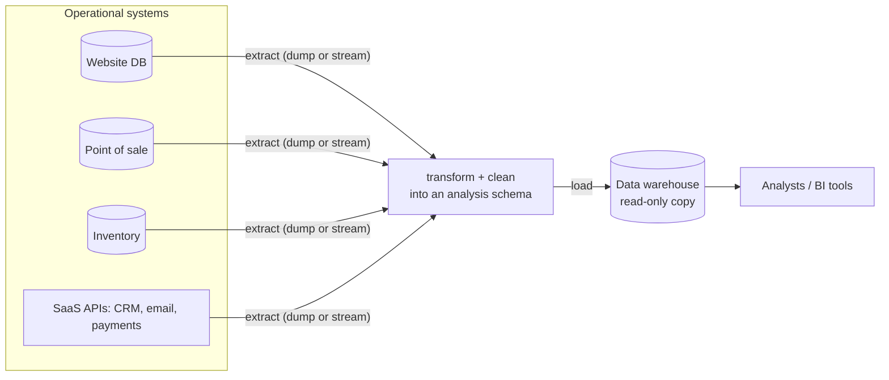
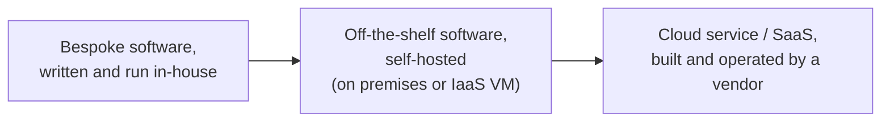
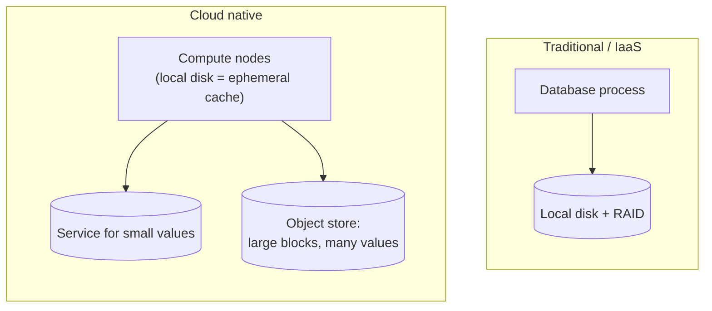

# 1. Trade-Offs in Data Systems Architecture

[Book](../README.md) · [2. Defining Nonfunctional Requirements →](02-defining-nonfunctional-requirements.md)

## Summary

The opening chapter sets the book's method: data-system architecture is a series of trade-offs with no universally right answer, so the useful skill is recognizing the choices and their consequences. It frames four of the biggest ones — operational versus analytical systems, cloud services versus self-hosting, distributed versus single-node systems, and the business's needs versus the rights of the people whose data is processed — and introduces vocabulary the rest of the book relies on: OLTP/OLAP, data warehouse and data lake, ETL, systems of record versus derived data, and cloud-native separation of storage and compute.

## Key takeaways

- **Operational (OLTP) and analytical (OLAP) systems differ in access pattern *and* audience**: point reads/writes by key for users and services versus large scans and aggregates for analysts. Mixing them on one database tends to hurt both, which is why data warehouses exist (pp. 3–9).
- **Systems of record hold the authoritative version of each fact; derived systems (caches, indexes, materialized views, models) can be rebuilt from them.** Knowing which is which clarifies the dataflow of an entire architecture (pp. 10–11).
- **Cloud versus self-hosting is a business decision as much as a technical one** — a "build or buy" judgment about core competency, cost predictability, control, and lock-in (pp. 12–14).
- **Cloud-native systems separate storage from compute**, typically building on object storage, which changes how databases are designed (pp. 14–17).
- **Don't go distributed before you need to.** Distribution buys fault tolerance, scale, and latency, but every network call can fail ambiguously; a single machine can do a great deal (pp. 19–23).
- **Law and ethics shape architecture.** Regulations like the GDPR (e.g. the right to erasure) clash with append-only and derived-data designs, and engineers tend to overlook this (pp. 24–25).

## Section outline

*From the book’s own table of contents (PDF bookmarks); printed page numbers.*

- Operational Versus Analytical Systems — p. 3
  - Characterizing Transaction Processing and Analytics — p. 5
  - Data Warehousing — p. 7
  - Systems of Record and Derived Data — p. 10
- Cloud Versus Self-Hosting — p. 12
  - Pros and Cons of Cloud Services — p. 13
  - Cloud Native System Architecture — p. 14
  - Operations in the Cloud Era — p. 17
- Distributed Versus Single-Node Systems — p. 19
  - Problems with Distributed Systems — p. 20
  - Microservices and Serverless — p. 21
  - Cloud Computing Versus Supercomputing — p. 23
- Data Systems, Law, and Society — p. 24
- Summary — p. 25

## Notes

### Operational versus analytical systems

Data-intensive applications are those where *data management* — volume, change, consistency under failures and concurrency, availability — is a primary challenge, as opposed to compute-intensive ones (p. 1). They are assembled from standard building blocks: databases, caches, search indexes, stream processing and batch processing (p. 2). The first contrast is between the people and systems that use data (pp. 3–4):

| Role | What they do with data |
|---|---|
| Backend engineers | Build services that read and update data for users and other services |
| Business analysts | Reports for management decisions — business intelligence (BI) |
| Data scientists | Novel insights and data-driven features: recommendations, risk scoring, spam filtering, search ranking (ML/AI) |
| Data engineers | Integrate operational and analytical systems; own the data infrastructure |
| Analytics engineers | Model and transform data so analysts and scientists can use it |

- **Operational systems**: backend services and data infrastructure where data is *created*; application code both reads and modifies it (p. 4).
- **Analytical systems**: a *read-only copy* of operational data, optimized for analytics (p. 4).
- Backends are usually reached over HTTP; application code is often **stateless**, so anything that must persist between requests lives on the client or in the data infrastructure (p. 3).

#### Characterizing transaction processing and analytics (pp. 5–7)

"Transaction" stuck from the days of commercial sales; here it loosely means low-latency reads and writes. The interactive pattern — look up a few records by key (a **point query**), insert/update/delete from user input — became **OLTP**; scanning huge numbers of records to compute aggregates became **OLAP**. The book’s supermarket examples of analytical questions: total revenue per store in January; extra bananas sold during a promotion; which baby-food brand is bought with brand X diapers (p. 5).

*Table 1-1 (p. 6):*

| Property | Operational systems (OLTP) | Analytical systems (OLAP) |
|---|---|---|
| Main read pattern | Point queries (fetch individual records by key) | Aggregate over a large number of records |
| Main write pattern | Create, update, delete individual records | Bulk import (ETL) or event stream |
| Human user example | End user of a web/mobile app | Internal analyst, for decision support |
| Machine use example | Checking if an action is authorized | Detecting fraud/abuse patterns |
| Type of queries | Fixed, predefined by the application | Arbitrary, ad hoc exploration |
| Query volume | Lots of small queries | Few queries, each complex |
| Data represents | Latest state (current point in time) | History of events over time |
| Dataset size | Gigabytes to terabytes | Terabytes to petabytes |

- OLTP users don’t get to write their own SQL (permissions, and expensive queries would hurt others); analysts do, by hand or via tools like Tableau, Looker or Power BI (p. 6).
- **Product (real-time) analytics** — Pinot, Druid, ClickHouse — is analytical querying embedded in user-facing products: real-time ingestion and low-latency answers, versus batch ingestion and high-throughput queries in traditional OLAP (p. 6).

#### Data warehousing (pp. 7–10)

From the late 1980s, companies moved analytics off their OLTP systems into a separate **data warehouse** (p. 7). Querying the OLTP systems directly is undesirable because (p. 7):

1. data of interest is spread across many systems (**data silos**);
2. OLTP schemas and layouts suit analytics poorly;
3. expensive analytical queries would hurt other users’ performance;
4. OLTP systems may sit in networks analysts may not access (security, compliance).

*After Figure 1-1 (p. 8): extract–transform–load. Swapping the last two steps — load first, transform inside the warehouse — gives **ELT** (p. 7). Connectors such as Fivetran, Singer or Airbyte pull from SaaS APIs (p. 8).*

- **HTAP** (hybrid transactional/analytical processing) promises both in one system, but is often an OLTP and an analytical engine behind one interface; it suits apps that need both kinds of query on the same data, such as fraud detection — it doesn’t replace the warehouse, since an enterprise has many operational databases but usually one warehouse (pp. 8–9).
- **Data lake**: a central repository of *files* in any format — records in Avro or Parquet, but also text, images, video, sensor readings, feature vectors, genomes — usually on cheap object storage. It serves data scientists whose work (feature engineering, NLP, computer vision) is awkward in SQL and who prefer Pandas, scikit-learn, R or Spark. Keeping the raw form lets each consumer transform it their own way: the **“sushi principle — raw data is better”** (pp. 9–10).
- **Beyond the lake** (p. 10): DataOps practices driven by governance and regulation (GDPR, CCPA); analytics on **event streams** reacting in seconds (e.g. to block fraud); and **reverse ETL** — pushing analytical outputs such as a trained recommendation model back into operational systems (TFX, Kubeflow, MLflow).

#### Systems of record and derived data (pp. 10–12)

| | System of record (source of truth) | Derived data system |
|---|---|---|
| Holds | The authoritative version; new data is written here first | Data taken from another system and transformed |
| Representation | Each fact exactly once, typically normalized | Redundant copies shaped for reads |
| If lost | Lost | Re-create it from the source |
| Examples | Primary database | Caches, indexes, denormalized values, materialized views, trained models |

The distinction is about *how you use* a tool, not the tool itself; analytical systems are usually derived, operational services mix both. Whenever data is derived, you need a process to update it when the source changes — and most databases assume they are your only database, which makes that integration hard (Chapter 11’s data pipelines) (p. 11).

> **Try it:** [Sort the workloads](../widgets/01-workloads.html) — classify queries as OLTP or OLAP, and datasets as systems of record or derived data.

### Cloud versus self-hosting

“Build or buy?” is a question of business priorities: do in-house what is a core competency or competitive advantage, leave routine things to a vendor — most companies don’t fabricate their own CPUs (p. 12).

*After Figure 1-2 (p. 12): who builds the software and who runs it. Deployment tooling such as Kubernetes is out of the book’s scope.*

#### Pros and cons of cloud services (pp. 13–14)

| Cloud tends to win when… | Self-hosting tends to win when… |
|---|---|
| You don’t know how to operate the system and hiring/training would be expensive | You already have the skills and your load is predictable — then your own machines are often cheaper |
| Load varies a lot (e.g. bursty interactive analytics): return idle resources instead of provisioning for peak | You need to configure and tune for your particular workload |
| A specialist provider’s operational experience gives better service | You need full control of the hardware (e.g. high-frequency trading) |

The biggest downside is **lack of control** (p. 14): you can’t add a missing feature, can only wait out an outage, can’t see internals to debug, are at the vendor’s mercy if they change, shut down or reprice the service (**vendor lock-in**, worse without standard APIs), can be locked out by sanctions in a political conflict, and must trust the provider with your data’s security.

#### Cloud native system architecture (pp. 14–17)

*Table 1-2 (p. 15):*

| Category | Self-hosted | Cloud native |
|---|---|---|
| Operational / OLTP | MySQL, PostgreSQL, MongoDB | AWS Aurora, Azure SQL DB Hyperscale, Google Cloud Spanner |
| Analytical / OLAP | Teradata, ClickHouse, Spark | Snowflake, Google BigQuery, Azure Synapse Analytics |

Cloud-native systems show better performance on the same hardware, faster recovery, quick scaling and support for larger datasets (p. 15). Their key idea is **layering**: build higher-level services on lower-level cloud services — e.g. object storage (S3, Azure Blob, Cloudflare R2) hides machines and disks; Snowflake is built on S3; other services build on Snowflake (p. 15).

*The vault’s sketch of “Separation of storage and compute” (pp. 16–17).*

- Local disks vanish when an instance fails or is resized, so cloud-native systems treat them as **ephemeral caches** (p. 16).
- **Virtual block devices** (EBS and similar) let disk-based software run in the cloud, but every I/O becomes a network call — overhead and sensitivity to network glitches (p. 16).
- **Object stores** suit files from hundreds of KB to several GB; databases keep small values in a separate service and store large blocks in the object store (p. 16).
- Storage and compute become **disaggregated** — analysing data in S3 means moving it over the network — and services are often **multitenant**, which improves utilization but needs careful isolation of performance and security (p. 17).

#### Operations in the cloud era (pp. 17–18)

DBAs and sysadmins gave way to **DevOps** and **SRE**, which emphasize automation over one-off manual jobs, ephemeral VMs and services, frequent updates, learning from incidents, and preserving organizational knowledge (p. 18). Cloud customers still need operations, but the focus shifts:

| Traditional operations | Operations as a cloud customer |
|---|---|
| Capacity planning: add disks before they fill | Financial planning: know what you pay for |
| Performance optimization | Cost optimization |
| Provisioning machines, OS patches | Choosing services, integrating them, migrating between them, respecting quotas |

Security of your code and libraries, interactions between your services, monitoring and incident diagnosis cannot be outsourced: “the need for operations is as great as ever” (p. 18).

### Distributed versus single-node systems

A **distributed system** is several machines (**nodes**) communicating over a network (p. 19). Reasons to use one (pp. 19–20):

| Reason | Why it forces several machines |
|---|---|
| Inherent distribution | Users on their own devices must communicate over a network |
| Requests between cloud services | Data stored in one service, processed in another |
| Fault tolerance / high availability | Another machine takes over when one fails |
| Scalability | Load bigger than one machine |
| Latency | Servers near users around the world |
| Elasticity | Scale up and down with demand instead of provisioning for peak |
| Specialized hardware | Disk-heavy storage nodes, CPU/RAM-heavy analytics, GPUs for ML |
| Legal compliance | Data-residency laws keep data in its country |
| Sustainability | Run jobs where and when renewable power is plentiful |

#### Problems with distributed systems (pp. 20–21)

- Any request can **time out**, and then you don’t know whether it was processed — so retrying may not be safe (Chapter 9).
- A call to another service is vastly slower than a function call; it can be faster to bring computation to the data. More nodes aren’t always faster — a single-threaded program can beat a 100-core cluster (p. 20).
- Troubleshooting needs **observability**: tracing tools such as OpenTelemetry, Zipkin and Jaeger record which service called which and how long it took (pp. 20–21).
- With a database per service, **consistency across services** becomes the application’s problem; distributed transactions are rarely used with microservices (p. 21).

Hence: if a task fits on one machine — and with DuckDB, SQLite or KùzuDB many now do — that is usually simpler and cheaper (p. 21).

#### Microservices and serverless (pp. 21–23)

| | Microservices | Serverless (FaaS) |
|---|---|---|
| Idea | One well-defined purpose per service, its own API, its own team and database | The cloud vendor allocates and frees resources per request; pay only while code runs |
| Gains | Independent releases and resources; implementation hidden behind an API | Metered billing for execution, no provisioning |
| Costs | Testing needs dependent services; each service needs deploy/monitor/alert infrastructure (often Kubernetes); API evolution breaks clients late (OpenAPI, gRPC help) | Execution time limits, restricted runtimes, slow cold starts; “serverless” still runs on servers |

Sharing a database between services would make its whole schema part of the API. Microservices are “primarily a technical solution to a people problem” — valuable in large companies, unnecessary overhead in small ones (pp. 21–22).

#### Cloud computing versus supercomputing (pp. 23–24)

| | High-performance computing | Cloud / enterprise datacenters |
|---|---|---|
| Workloads | Scientific batch jobs: weather, climate, molecular dynamics, PDEs | Online services that must stay available |
| On node failure | Stop the cluster, repair, restart from the last checkpoint | Keep serving with minimal interruption |
| Interconnect | Shared memory, RDMA; meshes and toruses; trusted users | IP/Ethernet in Clos topologies; mutually untrusting tenants need isolation, encryption, authentication |
| Geography | Nodes close together | Possibly several regions |

### Data systems, law, and society

Engineers carry responsibility beyond their own business (p. 24): GDPR (since 2018), CCPA and the EU AI Act regulate personal data; automated systems decide on loans, insurance, interviews and suspicion of crime. A basic grasp of law and ethics is as important as foundational distributed-systems knowledge.

- **Right to be forgotten vs immutability**: how do you delete data in the middle of an append-only log, or from derived datasets such as ML training data? The GDPR deliberately prescribes principles, not technologies (p. 24).
- **The true cost of storing data** includes liability, reputational damage, fines — and real safety risks to users when data could reveal criminalized behaviour (e.g. location data revealing a visit to an abortion clinic) (p. 25).
- **Data minimization** (*Datensparsamkeit*) — collect only for a specified, explicit purpose, don’t reuse it for other purposes, don’t keep it longer than needed — runs against the “store everything” big-data philosophy and fits the GDPR (p. 25).
- Industry standards add audits: **PCI** for card payments, **SOC 2 Type 2** for software vendors (p. 25).

## Trade-offs at a glance

| Choice | Option A gains | Option B gains |
|---|---|---|
| OLTP vs OLAP | Low-latency point access for users | Efficient scans and aggregates for analysts |
| Cloud vs self-host | Less operational work, elasticity | Control, predictable cost, no lock-in |
| Distributed vs single node | Fault tolerance, scale, locality | Simplicity, no partial failures, lower latency per call |

## Beyond the book

- The "build or buy" heuristic generalizes Simon Wardley's evolution model: commodity components should be bought, differentiating ones built.
- A practical test for "do we need to distribute?": estimate peak load and data volume, then check them against what one large cloud instance can do — the result is often surprising.

## Connections

- **Related chapters:** [4. Storage and Retrieval](04-storage-and-retrieval.md) (OLTP vs OLAP storage), [9. The Trouble with Distributed Systems](09-the-trouble-with-distributed-systems.md), [11. Batch Processing](11-batch-processing.md) (ETL), [14. Doing the Right Thing](14-doing-the-right-thing.md) (law and ethics).

## Check yourself

*Questions and answers are the vault's, written from the notes above; answers cite the book's pages.*

1. **Why does running analytical queries on the production OLTP database tend to hurt both workloads?**
   - [ ] Analytical queries need a different SQL dialect that OLTP databases cannot parse
   - [x] Large scans compete for resources with latency-sensitive transactions, and OLTP storage layouts are poor at scanning many rows
   - [ ] OLTP databases do not allow read-only queries while writes are in progress
   - [ ] Analysts must be given write access to production data

   *Answer:* Analytical queries scan huge numbers of records, which slows the small, latency-critical reads and writes that users are waiting for — and storage tuned for looking up individual records is inefficient for such scans. That is why analytics moved to a separate data warehouse fed by ETL (pp. 5–9).

2. **A search index loses all its data. Why is that an inconvenience rather than a disaster — and what has to be true of your architecture for that to hold?**

   *Answer:* A search index is **derived data**: it can be rebuilt by reprocessing the **system of record**. That holds only if the authoritative data lives somewhere else and the transformation that produced the index can be run again (pp. 10–11).

3. **What does separating storage from compute buy a cloud data warehouse, and what new costs does it introduce?**

   *Answer:* Storage (object storage) and compute can scale independently, and compute can be added or removed on demand without moving data. The cost is that data must travel over the network instead of being read from local disks, so systems rely on caching and careful data layout (pp. 14–17).

4. **Which of these is a reason to build a distributed system that has nothing to do with scale?**
   - [ ] Fitting more data than one disk can hold
   - [ ] Handling more requests per second than one machine can serve
   - [x] Tolerating the failure of a machine, or keeping data close to users in several regions
   - [ ] Making queries simpler to write

   *Answer:* The book lists fault tolerance/high availability, latency (placing data near users), and legal requirements on where data is stored among the reasons to distribute, alongside scalability and elasticity (pp. 19–20).

5. **Why is the GDPR right to erasure hard to honour in a system built on immutable logs?**

   *Answer:* Immutable, append-only data is designed never to be deleted or rewritten, and the same data is copied into many derived systems and backups. Erasing one person's data means finding and removing every copy — which conflicts with the idea of an immutable log (pp. 24–25).
