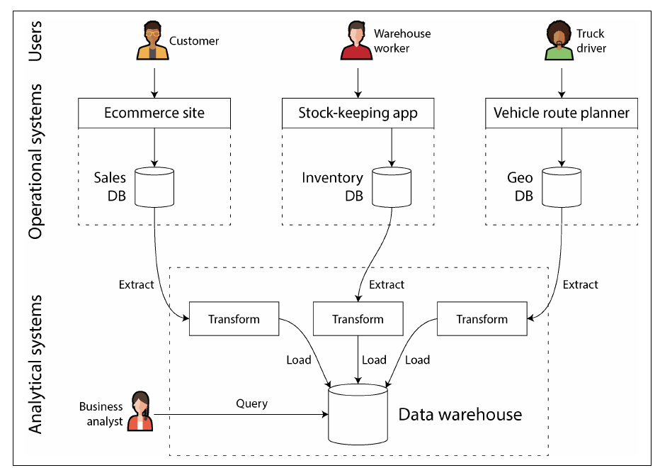
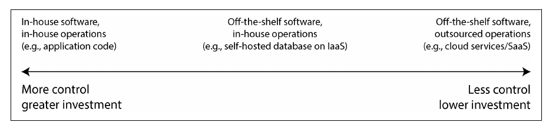
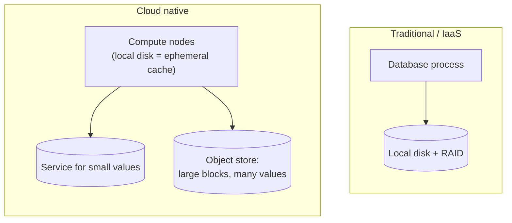

# فصل ۱: بده‌بستان‌ها در معماری سیستم‌های داده

[کتاب](../README.md) · [فصل ۲: تعریف نیازمندی‌های غیرکارکردی ←](02-defining-nonfunctional-requirements.md)

## خلاصه

فصل اول روش کتاب را مشخص می‌کند: معماری سیستم‌های داده مجموعه‌ای از بده‌بستان‌هاست و هیچ پاسخی همه‌جا درست نیست، پس مهارت اصلی این است که انتخاب‌ها و پیامدهایشان را بشناسید. چهار انتخاب بزرگ در این فصل مطرح می‌شود: سیستم‌های عملیاتی در برابر تحلیلی، cloud در برابر self-hosting، سیستم توزیع‌شده در برابر تک‌ماشین، و نیاز کسب‌وکار در برابر حقوق کسانی که داده‌شان پردازش می‌شود. واژه‌هایی هم که بقیه‌ی کتاب به آن‌ها تکیه می‌کند همین‌جا معرفی می‌شوند: OLTP و OLAP، data warehouse و data lake، ETL، system of record در برابر derived data، و جدا کردن storage از compute در سیستم‌های cloud-native.

## نکته‌های کلیدی

- **سیستم‌های OLTP و OLAP هم در الگوی دسترسی فرق دارند و هم در مخاطب.** اولی برای کاربران و سرویس‌ها چند رکورد را با کلید می‌خواند و می‌نویسد؛ دومی برای تحلیلگرها تعداد زیادی رکورد را اسکن و تجمیع می‌کند. اجرای هر دو روی یک دیتابیس معمولاً به هر دو آسیب می‌زند و data warehouse برای همین به وجود آمد (pp. 3–9).
- **نسخه‌ی معتبر هر واقعیت در system of record است؛ سیستم‌های derived مثل cache، index، materialized view و مدل را می‌شود از روی آن دوباره ساخت.** دانستن این‌که کدام کدام است، جریان داده‌ی کل معماری را روشن می‌کند (pp. 10–11).
- **انتخاب بین cloud و self-hosting به همان اندازه که فنی است، تصمیمی تجاری است:** قضاوتی از نوع «بسازیم یا بخریم» درباره‌ی مزیت اصلی سازمان، پیش‌بینی‌پذیری هزینه، کنترل و vendor lock-in (pp. 12–14).
- **سیستم‌های cloud-native فضای storage را از compute جدا می‌کنند** و معمولاً روی object storage ساخته می‌شوند؛ همین، طراحی دیتابیس‌ها را عوض می‌کند (pp. 14–17).
- **پیش از نیاز سراغ سیستم توزیع‌شده نروید.** توزیع، fault tolerance و scalability و latency کمتر می‌دهد، اما هر فراخوانی شبکه ممکن است طوری شکست بخورد که ندانید چه شده؛ یک ماشین هم کار زیادی از پسش برمی‌آید (pp. 19–23).
- **قانون و اخلاق معماری را شکل می‌دهند.** مقرراتی مثل GDPR و حق پاک شدن داده‌ای که می‌دهد، با طراحی‌های append-only و derived در تضادند و مهندس‌ها اغلب این را از قلم می‌اندازند (pp. 24–25).

## فهرست بخش‌ها

*از فهرست مطالب خود کتاب، یعنی bookmarkهای PDF، با شماره‌ی صفحه‌های چاپی.*

- سیستم‌های عملیاتی در برابر تحلیلی (p. 3)
  - مشخصه‌های پردازش تراکنش و تحلیل (p. 5)
  - مفهوم data warehousing (p. 7)
  - مفهوم system of record و derived data (p. 10)
- انتخاب بین cloud و self-hosting (p. 12)
  - مزایا و معایب سرویس‌های cloud (p. 13)
  - معماری سیستم cloud-native (p. 14)
  - عملیات در دوران cloud (p. 17)
- سیستم توزیع‌شده در برابر تک‌ماشین (p. 19)
  - مشکلات سیستم‌های توزیع‌شده (p. 20)
  - میکروسرویس‌ها و serverless (p. 21)
  - مقایسه‌ی cloud computing و supercomputing (p. 23)
- سیستم‌های داده، قانون و جامعه (p. 24)
- جمع‌بندی (p. 25)

## یادداشت‌ها

هر بده‌بستانِ این فصل جایی در یک pipeline داده‌ی معمولی اتفاق می‌افتد. پیش از خواندن بخش‌ها، مسیر داده را از دیتابیس منبع تا داشبورد دنبال کنید و ببینید هر انتخاب کجا خودش را نشان می‌دهد.

> **Try it:** [فصل ۱ در طول یک pipeline داده](../widgets/01-pipeline-map.html): یکی از lensها را انتخاب کنید، مثلاً نوع workload یا داده‌ی شخصی، و مرحله‌به‌مرحله در pipeline جلو بروید.

### سیستم‌های عملیاتی در برابر تحلیلی

اپلیکیشن‌های data-intensive آن‌هایی هستند که چالش اصلی‌شان *مدیریت داده* است: حجم، تغییر، سازگاری در برابر خرابی و concurrency، و در دسترس بودن. در مقابلشان اپلیکیشن‌های compute-intensive قرار دارند (p. 1). این سیستم‌ها از قطعه‌های استاندارد ساخته می‌شوند: database، cache، search index، stream processing و batch processing (p. 2). اولین تقابل فصل بین آدم‌ها و سیستم‌هایی است که از داده استفاده می‌کنند (pp. 3–4):

| نقش | با داده چه می‌کند |
|---|---|
| Backend engineers | سرویس‌هایی می‌سازند که داده را برای کاربران و سرویس‌های دیگر می‌خوانند و به‌روز می‌کنند |
| Business analysts | گزارش برای تصمیم‌های مدیریتی: business intelligence (BI) |
| Data scientists | بینش تازه و قابلیت‌های ML/AI مثل recommendation، risk scoring، فیلتر spam و رتبه‌بندی جست‌وجو |
| Data engineers | سیستم‌های عملیاتی و تحلیلی را به هم وصل می‌کنند و صاحب زیرساخت داده‌اند |
| Analytics engineers | داده را مدل و transform می‌کنند تا تحلیلگرها و data scientistها بتوانند از آن استفاده کنند |

- **سیستم‌های عملیاتی:** سرویس‌های backend و زیرساخت داده، جایی که داده *ساخته می‌شود*؛ کد اپلیکیشن هم آن را می‌خواند و هم تغییر می‌دهد (p. 4).
- **سیستم‌های تحلیلی:** یک *نسخه‌ی read-only* از داده‌ی عملیاتی که برای تحلیل بهینه شده است (p. 4).
- معمولاً از راه HTTP به backend دسترسی دارند. کد اپلیکیشن اغلب **stateless** است، پس هر چیزی که باید بین درخواست‌ها بماند یا سمت client نگه داشته می‌شود یا در زیرساخت داده (p. 3).

> **In practice:** در یک تیم داده، backend و دیتابیس محصول سمت عملیاتی‌اند و warehouse با لایه‌های Bronze و Silver و Gold سمت تحلیلی. data engineer و analytics engineer دقیقاً روی مرز این دو کار می‌کنند.
>
> **Your turn:** مدیر محصول می‌خواهد «تعداد وام‌های تأییدشده‌ی امروز» به‌صورت زنده داخل اپلیکیشن نمایش داده شود. این کار OLTP است، OLAP، یا چیز دیگری؟
>
> *Answer:* کتاب به این می‌گوید product analytics یا real-time analytics، یعنی پرسش تحلیلی‌ای که داخل محصولی رو به کاربر نشسته و پاسخش باید سریع و تازه باشد (p. 6). اجرای مستقیمش روی دیتابیس اصلی محصول همان آسیبی را می‌زند که فصل درباره‌اش هشدار می‌دهد. یک شمارنده‌ی از پیش محاسبه‌شده یا موتوری که برای همین کار ساخته شده انتخاب امن‌تری است.

#### مشخصه‌های پردازش تراکنش و تحلیل (pp. 5–7)

واژه‌ی «transaction» از دوران فروش تجاری باقی مانده و این‌جا به‌طور کلی یعنی خواندن و نوشتنِ low-latency. الگوی تعاملی، یعنی **point query** برای پیدا کردن چند رکورد با کلید و درج یا به‌روزرسانی یا حذف بر اساس ورودی کاربر، اسم **OLTP** گرفت. اسکن کردن تعداد خیلی زیادی رکورد برای محاسبه‌ی مقادیر تجمیعی اسم **OLAP** گرفت. نمونه‌های کتاب از پرسش‌های تحلیلی در یک سوپرمارکت: درآمد کل هر فروشگاه در ژانویه؛ این‌که در یک تخفیف چقدر موز بیشتر فروخته شد؛ و این‌که کدام برند غذای کودک بیشتر همراه پوشک برند X خریده می‌شود (p. 5).

*جدول ۱-۱ در کتاب (p. 6):*

| ویژگی | OLTP | OLAP |
|---|---|---|
| الگوی اصلی خواندن | Point query: خواندن تک‌رکوردها با کلید | تجمیع روی تعداد زیادی رکورد |
| الگوی اصلی نوشتن | ساخت، به‌روزرسانی و حذف تک‌رکوردها | Bulk import (ETL) یا event stream |
| نمونه‌ی کاربر انسانی | کاربر نهایی اپلیکیشن وب یا موبایل | تحلیلگر داخلی، برای پشتیبانی از تصمیم |
| نمونه‌ی استفاده‌ی ماشینی | بررسی این‌که یک کار مجاز است یا نه | کشف الگوهای تقلب یا سوءاستفاده |
| نوع کوئری‌ها | ثابت، از پیش تعریف‌شده در اپلیکیشن | دلخواه، کاوش ad hoc |
| حجم کوئری | تعداد زیادی کوئری کوچک | تعداد کمی کوئری، هر کدام پیچیده |
| داده چه چیزی را نشان می‌دهد | آخرین وضعیت، همین لحظه | تاریخچه‌ی رویدادها در طول زمان |
| اندازه‌ی داده | گیگابایت تا ترابایت | ترابایت تا پتابایت |

- کاربران OLTP اجازه ندارند SQL خودشان را بنویسند؛ هم به خاطر دسترسی‌ها و هم چون یک کوئری سنگین کار بقیه را کند می‌کند. تحلیلگرها اجازه دارند، دستی یا با ابزارهایی مثل Tableau و Looker و Power BI (p. 6).
- مفهوم **product analytics** یا **real-time analytics**، با موتورهایی مثل Pinot و Druid و ClickHouse، یعنی کوئری تحلیلی‌ای که داخل محصول رو به کاربر جا گرفته است: داده real-time وارد می‌شود و پاسخ با latency کم برمی‌گردد. در OLAP سنتی داده دسته‌ای وارد می‌شود و تمرکز روی throughput بالای کوئری‌هاست (p. 6).

> **In practice:** فرق این دو الگو را می‌شود شمرد. در lab همین فصل، point query با کلید فقط ۱ ردیف را لمس می‌کند و پرسش «درآمد هر فروشگاه در ژانویه» هر ۲۰٬۰۰۰ ردیف را.
>
> **Your turn:** یک تحلیلگر برای «فقط یک گزارش» دسترسی مستقیم به دیتابیس production می‌خواهد. چه جوابی می‌دهید؟
>
> *Answer:* کوئری تحلیلی تعداد زیادی رکورد را اسکن می‌کند و منابعی را می‌گیرد که کاربرانِ منتظرِ OLTP لازم دارند؛ چیدمان ذخیره‌سازی OLTP هم برای چنین اسکنی مناسب نیست (pp. 6–7). پاسخ درست، همان داده در warehouse است، یا دست‌کم یک read replica که ترافیک محصول به آن نمی‌رسد.

#### مفهوم data warehousing (pp. 7–10)

از اواخر دهه‌ی ۱۹۸۰، شرکت‌ها تحلیل را از سیستم‌های OLTP بیرون بردند و به یک **data warehouse** جدا منتقل کردند (p. 7). کوئری زدن مستقیم روی سیستم‌های OLTP به چهار دلیل مطلوب نیست (p. 7):

1. داده‌ی مورد نیاز در سیستم‌های زیادی پخش است و **data silo** می‌سازد؛
2. چیدمان و schema سیستم‌های OLTP برای تحلیل مناسب نیست؛
3. کوئری‌های تحلیلی سنگین کارایی را برای کاربران دیگر پایین می‌آورند؛
4. سیستم‌های OLTP ممکن است در شبکه‌ای باشند که تحلیلگرها به دلیل امنیت یا الزامات قانونی به آن دسترسی ندارند.

*Figure 1-1 (p. 8): سیستم‌های عملیاتی بالا هستند و تحلیلی پایین؛ ETL پلی است که داده را بین این دو کپی می‌کند و شکلش را تغییر می‌دهد.*

اگر جای دو مرحله‌ی آخر عوض شود، یعنی اول load و بعد transform داخل خود warehouse، اسمش **ELT** می‌شود (p. 7). connectorهایی مثل Fivetran و Singer و Airbyte داده را از APIهای سرویس‌های SaaS می‌کشند (p. 8).

- سیستم‌های **HTAP**، یعنی hybrid transactional/analytical processing، وعده می‌دهند هر دو کار را یک سیستم انجام دهد، اما اغلب یک موتور OLTP و یک موتور تحلیلی است پشت یک interface. برای اپلیکیشن‌هایی مناسب است که روی همان داده به هر دو نوع کوئری نیاز دارند، مثل تشخیص تقلب. جای warehouse را نمی‌گیرد، چون یک سازمان دیتابیس عملیاتی زیادی دارد ولی معمولاً یک warehouse (pp. 8–9).
- **مفهوم data lake:** repositoryی مرکزی از *فایل‌ها* با هر فرمتی: رکوردها در Avro یا Parquet، و همچنین متن، تصویر، ویدئو، داده‌ی حسگر، feature vector و ژنوم. معمولاً روی object storage ارزان قرار دارد. مخاطبش data scientistها هستند که کارهایی مثل feature engineering، NLP و computer vision برایشان در SQL دست‌وپاگیر است و Pandas و scikit-learn و R یا Spark را ترجیح می‌دهند. نگه داشتن شکل خام داده به هر consumer اجازه می‌دهد آن را به روش خودش transform کند: **«sushi principle»، یعنی داده‌ی خام بهتر است** (pp. 9–10).
- **فراتر از lake** (p. 10): روش‌های DataOps که از الزامات governance و مقرراتی مثل GDPR و CCPA می‌آیند؛ تحلیل روی **event stream** که در چند ثانیه واکنش نشان می‌دهد، مثلاً برای جلوگیری از تقلب؛ و **reverse ETL**، یعنی برگرداندن خروجی تحلیل به سیستم‌های عملیاتی، مثلاً یک مدل recommendation آموزش‌دیده با ابزارهایی مثل TFX، Kubeflow و MLflow.

> **In practice:** در تیم‌های داده‌ی امروزی، pipelineها معمولاً ELT هستند: loader ستون‌ها را همان‌طور که هست کپی می‌کند و همه‌ی transformها با SQL داخل warehouse انجام می‌شود. API پیش‌بینی که روی خروجی یک مدل سوار است همان reverse ETL کتاب است.
>
> **Your turn:** فایل‌های Parquet مرحله‌ی staging روی object storage هستند. یعنی ما data lake داریم؟
>
> *Answer:* نه. lake repository مرکزی و durable داده‌ی خام است که consumerهای مختلف هر کدام به روش خودشان از آن استفاده می‌کنند (pp. 9–10). فایل staging بعد از load بعدی پاک می‌شود. نقش «داده‌ی خام بهتر است» را در این pipeline لایه‌ی Bronze بازی می‌کند.

#### مفهوم system of record و derived data (pp. 10–12)

| | System of record | Derived data system |
|---|---|---|
| چه چیزی نگه می‌دارد | نسخه‌ی معتبر؛ داده‌ی تازه اول این‌جا نوشته می‌شود | داده‌ای که از سیستم دیگری گرفته و transform شده |
| شکل نمایش | هر واقعیت دقیقاً یک بار، معمولاً normalized | کپی‌های تکراری که برای خواندن شکل گرفته‌اند |
| اگر از دست برود | از دست رفته است | از روی منبع دوباره ساخته می‌شود |
| نمونه‌ها | دیتابیس اصلی | cache، index، مقادیر denormalized، materialized view، مدل‌های آموزش‌دیده |

این تمایز به *نحوه‌ی استفاده* از یک ابزار برمی‌گردد، نه به خود ابزار. سیستم‌های تحلیلی معمولاً derived هستند و سرویس‌های عملیاتی ترکیبی از هر دو. هر جا داده derived باشد، فرایندی لازم است که با تغییر منبع آن را به‌روز کند؛ و چون بیشتر دیتابیس‌ها فرض می‌کنند تنها دیتابیس شما هستند، این یکپارچه‌سازی سخت است؛ موضوع data pipelineها در فصل ۱۱ (p. 11).

> **Try it:** [دسته‌بندی workloadها](../widgets/01-workloads.html): کوئری‌ها را به OLTP یا OLAP، و مجموعه‌داده‌ها را به system of record یا derived data دسته‌بندی کنید.

> **In practice:** دیتابیس منبع تنها system of record واقعی است، اما داخل warehouse نقش آن را Bronze بازی می‌کند، چون همه‌ی جدول‌های Silver و Gold از روی آن ساخته می‌شوند. lab این فصل یک جدول derived را حذف و دوباره می‌سازد و نشان می‌دهد که نتیجه دقیقاً همان است.
>
> **Your turn:** کسی پیشنهاد می‌دهد برای صرفه‌جویی در فضا، تاریخچه‌ی Bronze قدیمی‌تر از سه ماه پاک شود: «Silver که هست.» مشکل کجاست؟
>
> *Answer:* جدول‌های Silver و Gold داده‌ی derived هستند و فقط تا وقتی ارزان درست می‌شوند که منبعشان باقی باشد (p. 11). بدون تاریخچه‌ی Bronze، هر باگ در SQL یا هر تغییر منطق دیگر با اجرای دوباره درست نمی‌شود. اگر فضا مشکل است، compression یا انتقال داده‌ی قدیمی به storage ارزان‌تر بده‌بستان بهتری است.

### انتخاب بین cloud و self-hosting

«بسازیم یا بخریم؟» پرسشی درباره‌ی اولویت‌های کسب‌وکار است: کاری را که مزیت اصلی یا رقابتی سازمان است خودتان انجام دهید و کارهای روزمره را به فروشنده بسپارید. بیشتر شرکت‌ها CPU خودشان را نمی‌سازند (p. 12).

*Figure 1-2 (p. 12): چه کسی نرم‌افزار را می‌سازد و چه کسی اجرایش می‌کند؛ هرچه به راست بروید کنترل را با سرمایه‌گذاری کمتر عوض می‌کنید. ابزارهای deployment مثل Kubernetes خارج از دامنه‌ی کتاب‌اند.*

#### مزایا و معایب سرویس‌های cloud (pp. 13–14)

| گزینه‌ی cloud معمولاً برنده است وقتی… | گزینه‌ی self-hosting معمولاً برنده است وقتی… |
|---|---|
| بلد نیستید سیستم را اداره کنید و استخدام یا آموزش گران است | مهارتش را دارید و بارتان قابل پیش‌بینی است؛ در این حالت ماشین‌های خودتان اغلب ارزان‌ترند |
| بار خیلی تغییر می‌کند؛ مثلاً تحلیل تعاملی با بار ناگهانی. منابع بیکار را پس بدهید به جای این‌که برای اوج آماده بمانید | باید سیستم را برای workload خاص خودتان config و تنظیم کنید |
| تجربه‌ی عملیاتی یک فروشنده‌ی متخصص سرویس بهتری می‌دهد | کنترل کامل سخت‌افزار لازم دارید؛ مثلاً برای معاملات high-frequency |

بزرگ‌ترین عیب، **نداشتن کنترل** است (p. 14): نمی‌توانید قابلیتی را که ندارد اضافه کنید؛ هنگام قطعی فقط می‌توانید صبر کنید؛ داخل سیستم را برای debug نمی‌بینید؛ اگر فروشنده سرویس را تغییر دهد، تعطیل کند یا قیمتش را بالا ببرد دستتان بسته است، یعنی **vendor lock-in** که بدون API استاندارد بدتر هم می‌شود؛ ممکن است در یک درگیری سیاسی به خاطر تحریم دسترسی‌تان قطع شود؛ و باید امنیت داده‌تان را به فروشنده بسپارید.

> **In practice:** بار warehouse در یک تیم داده معمولاً موجی است: صبح‌ها loadها و داشبوردها با هم شلوغ می‌کنند و شب‌ها سیستم تقریباً بیکار است.
>
> **Your turn:** این الگوی بار به نفع کدام ستون جدول بالاست؟ چه چیزی ممکن است تصمیم را برگرداند؟
>
> *Answer:* باری که زیاد تغییر می‌کند به نفع cloud است، چون منابع بیکار را پس می‌دهید (p. 13). اگر تیم مهارت اداره‌ی سیستم را داشته باشد و بار کلی قابل پیش‌بینی باشد، سرورهای self-hosted اغلب ارزان‌ترند؛ و تحریم یا محدودیت قانونی روی محل نگهداری داده ممکن است انتخاب را از اول محدود کند (pp. 13–14).

#### معماری سیستم cloud-native (pp. 14–17)

*جدول ۱-۲ در کتاب (p. 15):*

| دسته | Self-hosted | Cloud native |
|---|---|---|
| Operational / OLTP | MySQL، PostgreSQL، MongoDB | AWS Aurora، Azure SQL DB Hyperscale، Google Cloud Spanner |
| Analytical / OLAP | Teradata، ClickHouse، Spark | Snowflake، Google BigQuery، Azure Synapse Analytics |

سیستم‌های cloud-native روی سخت‌افزار یکسان کارایی بهتری دارند، سریع‌تر بازیابی می‌شوند، سریع scale می‌شوند و مجموعه‌داده‌های بزرگ‌تری را پشتیبانی می‌کنند (p. 15). ایده‌ی کلیدی‌شان **لایه‌بندی** است: سرویس‌های سطح بالاتر را روی سرویس‌های cloud سطح پایین‌تر بسازید. مثلاً object storageهایی مثل S3، Azure Blob و Cloudflare R2 ماشین و دیسک را پنهان می‌کنند، Snowflake روی S3 ساخته شده و سرویس‌های دیگر روی Snowflake (p. 15).

*طرح خود vault از «جدایی ذخیره‌سازی و محاسبه» (pp. 16–17).*

- دیسک‌های محلی با خراب شدن یا تغییر اندازه‌ی instance از بین می‌روند، پس سیستم‌های cloud-native با آن‌ها مثل **ephemeral cache** رفتار می‌کنند (p. 16).
- دیسک‌های **virtual block device** مثل EBS اجازه می‌دهند نرم‌افزار دیسک‌محور روی cloud اجرا شود، اما هر عمل I/O به یک فراخوانی شبکه تبدیل می‌شود: سربار دارد و به اختلال شبکه حساس است (p. 16).
- سرویس‌های **object store** برای فایل‌هایی از چند صد کیلوبایت تا چند گیگابایت مناسب‌اند. دیتابیس‌ها مقادیر کوچک را در یک سرویس جدا نگه می‌دارند و بلوک‌های بزرگ را در object store (p. 16).
- لایه‌های storage و compute از هم **disaggregated** می‌شوند، یعنی تحلیل داده‌ای که در S3 است یعنی جابه‌جا کردنش روی شبکه. سرویس‌ها هم اغلب **multitenant** هستند: بهره‌وری بالاتر می‌رود، اما کارایی و امنیت مشتری‌ها باید با دقت از هم جدا شود (p. 17).

> **In practice:** مرحله‌ی staging همین الگوست: loader فایل Parquet روی object storage می‌نویسد و warehouse آن را با یک bulk INSERT می‌خواند. warehouse ستونی هم داده را در part‌های بزرگ نگه می‌دارد، نه ردیف‌به‌ردیف.
>
> **Your turn:** فرض کنید loader هر دقیقه برای هر ۱۰۰ ردیف یک فایل Parquet کوچک می‌نویسد. چرا این برای object storage انتخاب بدی است؟
>
> *Answer:* سرویس‌های object storage برای فایل‌هایی از چند صد کیلوبایت تا چند گیگابایت طراحی شده‌اند (p. 16). هزاران فایل خیلی کوچک یعنی هزاران درخواست شبکه برای مقدار کمی داده. ردیف‌ها را دسته‌ای کنید تا هر فایل اندازه‌ی معقولی داشته باشد.

#### عملیات در دوران cloud (pp. 17–18)

نقش DBA و sysadmin جایش را به **DevOps** و **SRE** داد که روی این‌ها تأکید دارند: خودکارسازی به جای کارهای دستی یک‌باره، ماشین‌ها و سرویس‌های کوتاه‌عمر، به‌روزرسانی مکرر، یاد گرفتن از رخدادها، و حفظ دانش سازمانی (p. 18). مشتری cloud هم هنوز به عملیات نیاز دارد، اما تمرکزش جابه‌جا می‌شود:

| عملیات سنتی | عملیات برای مشتری cloud |
|---|---|
| برنامه‌ریزی ظرفیت: پیش از پر شدن دیسک‌ها دیسک اضافه کنید | برنامه‌ریزی مالی: بدانید پول چه چیزی را می‌دهید |
| بهینه‌سازی کارایی | بهینه‌سازی هزینه |
| آماده کردن ماشین، patch سیستم‌عامل | انتخاب سرویس‌ها، یکپارچه کردنشان، مهاجرت بین آن‌ها، رعایت quotaها |

امنیت کد و کتابخانه‌های خودتان، تعامل بین سرویس‌هایتان، و monitoring و تشخیص رخدادها را نمی‌شود برون‌سپاری کرد؛ به تعبیر کتاب، نیاز به عملیات به اندازه‌ی همیشه زیاد است (p. 18).

> **In practice:** وقتی warehouse به ازای داده‌ی اسکن‌شده یا زمان پردازش هزینه می‌گیرد، یک داشبورد بد طراحی‌شده مستقیم روی صورت‌حساب دیده می‌شود.
>
> **Your turn:** بعد از راه افتادن یک داشبورد تازه، صورت‌حساب cloud دو برابر شده است. این مشکل کیست؟
>
> *Answer:* مشکل تیم خودتان است: در عصر cloud، بهینه‌سازی هزینه و دانستن این‌که پول بابت چه چیزی می‌رود جای برنامه‌ریزی ظرفیت را گرفته است (p. 18). اول ببینید کدام کوئری‌های داشبورد بیشترین داده را اسکن می‌کنند؛ فصل ۲ نشان می‌دهد چطور از پیش محاسبه کردن نتیجه این کار را ارزان می‌کند.

### سیستم توزیع‌شده در برابر تک‌ماشین

**سیستم توزیع‌شده** چند ماشین یا **node** است که از راه شبکه با هم حرف می‌زنند (p. 19). دلیل‌های استفاده از آن (pp. 19–20):

| دلیل | چرا به چند ماشین نیاز دارد |
|---|---|
| Inherent distribution | کاربران روی دستگاه‌های خودشان باید از راه شبکه با هم ارتباط داشته باشند |
| Requests between cloud services | داده در یک سرویس ذخیره و در سرویس دیگری پردازش می‌شود |
| Fault tolerance / high availability | وقتی یک ماشین خراب شود ماشین دیگری کار را ادامه می‌دهد |
| Scalability | بار از توان یک ماشین بیشتر است |
| Latency | سرورها نزدیک کاربران در نقاط مختلف دنیا باشند |
| Elasticity | به جای آماده ماندن برای اوج، منابع با تقاضا کم و زیاد شوند |
| Specialized hardware | node ذخیره‌سازی با دیسک زیاد، node تحلیلی با CPU و RAM زیاد، GPU برای ML |
| Legal compliance | قانون data residency داده را در کشور خودش نگه می‌دارد |
| Sustainability | کارها را جایی و زمانی اجرا کنید که برق تجدیدپذیر فراوان است |

#### مشکلات سیستم‌های توزیع‌شده (pp. 20–21)

- هر درخواستی ممکن است **time out** شود و آن‌وقت نمی‌دانید پردازش شده یا نه؛ پس تکرار درخواست ممکن است امن نباشد؛ جزئیاتش در فصل ۹ آمده.
- فراخوانی یک سرویس دیگر بسیار کندتر از فراخوانی یک تابع است؛ گاهی سریع‌تر است پردازش را نزد داده ببرید. node بیشتر همیشه سریع‌تر نیست: یک برنامه‌ی single-threaded ممکن است از یک cluster صدهسته‌ای جلو بزند (p. 20).
- عیب‌یابی به **observability** نیاز دارد: ابزارهای tracing مثل OpenTelemetry و Zipkin و Jaeger ثبت می‌کنند کدام سرویس کدام را صدا زد و چقدر طول کشید (pp. 20–21).
- وقتی هر سرویس دیتابیس خودش را دارد، **سازگاری بین سرویس‌ها** مشکل اپلیکیشن می‌شود؛ distributed transaction در microserviceها به‌ندرت استفاده می‌شود (p. 21).

نتیجه این‌که اگر کاری روی یک ماشین جا می‌شود، و با DuckDB و SQLite و KùzuDB حالا بسیاری از کارها جا می‌شوند، معمولاً ساده‌تر و ارزان‌تر است (p. 21).

> **In practice:** در این pipeline، loader با سه سیستم از راه شبکه حرف می‌زند: دیتابیس منبع، object storage و warehouse. هر کدام از این فراخوانی‌ها ممکن است بی‌جواب بماند.
>
> **Your turn:** دستور INSERT نهایی loader به warehouse با time out تمام شد. دوباره اجرایش کنید؟
>
> *Answer:* نمی‌دانید درخواست اجرا شده یا نه، پس تکرار کورکورانه ممکن است ردیف‌ها را دو بار بنویسد (p. 20). تکرار وقتی امن است که نوشتن idempotent باشد: مثلاً کل partition جایگزین شود، یا Silver ردیف‌های تکراری را با کلید حذف کند. اگر هیچ‌کدام نیست، اول بشمارید چه چیزی رسیده است.

#### میکروسرویس‌ها و serverless (pp. 21–23)

| | Microservices | Serverless (FaaS) |
|---|---|---|
| ایده | هر سرویس یک هدف مشخص، API خودش، تیم خودش و دیتابیس خودش | فروشنده‌ی cloud به ازای هر درخواست منابع را می‌دهد و پس می‌گیرد؛ فقط وقتی کد اجرا می‌شود پول می‌دهید |
| دستاورد | انتشار و منابع مستقل؛ پیاده‌سازی پشت API پنهان است | پرداخت به اندازه‌ی اجرا، بدون آماده کردن منابع |
| هزینه | تست به سرویس‌های وابسته نیاز دارد؛ هر سرویس زیرساخت deployment، monitoring و alerting می‌خواهد که اغلب Kubernetes است؛ تغییر API کلاینت‌ها را دیر می‌شکند و OpenAPI و gRPC کمک می‌کنند | محدودیت زمان اجرا، محیط اجرای محدود، cold start کند؛ «serverless» هم در نهایت روی سرور اجرا می‌شود |

اشتراک یک دیتابیس بین چند سرویس کل schema آن را بخشی از API می‌کند. به تعبیر کتاب، microservice پیش از هر چیز راه‌حلی فنی برای یک مسئله‌ی انسانی است: در شرکت‌های بزرگ ارزشمند است و در شرکت‌های کوچک سربار غیرضروری (pp. 21–22).

#### مقایسه‌ی cloud computing و supercomputing (pp. 23–24)

| | High-performance computing | Cloud و دیتاسنترهای سازمانی |
|---|---|---|
| نوع کار | کارهای علمی دسته‌ای: هواشناسی، اقلیم، دینامیک مولکولی، معادلات دیفرانسیل جزئی | سرویس‌های آنلاینی که باید همیشه در دسترس بمانند |
| وقتی یک node خراب می‌شود | cluster را متوقف کنید، تعمیر کنید، از آخرین checkpoint دوباره شروع کنید | با کمترین وقفه به سرویس ادامه دهید |
| ارتباط بین nodeها | shared memory و RDMA؛ توپولوژی mesh و torus؛ کاربران مورد اعتماد | IP و Ethernet در توپولوژی Clos؛ مشتری‌هایی که به هم اعتماد ندارند و به جداسازی، رمزنگاری و احراز هویت نیاز دارند |
| جغرافیا | nodeها نزدیک هم | احتمالاً در چند region |

### سیستم‌های داده، قانون و جامعه

مسئولیت مهندس‌ها از کسب‌وکار خودشان فراتر می‌رود (p. 24): قانون GDPR از ۲۰۱۸، CCPA و EU AI Act داده‌ی شخصی را قانون‌مند می‌کنند و سیستم‌های خودکار درباره‌ی وام، بیمه، مصاحبه‌ی شغلی و مظنون شدن به جرم تصمیم می‌گیرند. فهم پایه‌ای از قانون و اخلاق به اندازه‌ی دانش بنیادی سیستم‌های توزیع‌شده مهم است.

- **حق فراموش شدن در برابر immutability:** چطور داده‌ای را از وسط یک log از نوع append-only پاک کنید، یا از مجموعه‌داده‌های derived مثل داده‌ی آموزش ML؟ GDPR عمداً اصول را تعیین می‌کند، نه فناوری را (p. 24).
- **هزینه‌ی واقعی نگهداری داده** شامل مسئولیت حقوقی، آسیب به اعتبار و جریمه است، و خطر واقعی برای کاربرانی که داده‌شان ممکن است رفتاری جرم‌انگاری‌شده را آشکار کند؛ مثلاً داده‌ی موقعیتی که مراجعه به یک کلینیک سقط جنین را نشان می‌دهد (p. 25).
- **اصل data minimization**، به آلمانی *Datensparsamkeit*: فقط برای هدفی مشخص و صریح جمع کنید، برای هدف دیگری به کار نبرید و بیشتر از لازم نگه ندارید. این اصل با فلسفه‌ی «همه‌چیز را نگه دار» در big data در تضاد است و با GDPR جور درمی‌آید (p. 25).
- استانداردهای صنعتی هم الزام‌های audit اضافه می‌کنند: **PCI** برای پرداخت با کارت و **SOC 2 Type 2** برای فروشندگان نرم‌افزار (p. 25).

> **In practice:** وقتی مشتری‌ای درخواست پاک شدن می‌دهد، حذف ردیفش از دیتابیس منبع ساده‌ترین بخش کار است. Bronze که append-only است، Silver و Gold که از آن ساخته می‌شوند، یک فایل CSV که تحلیلگری ماه پیش گرفته و داده‌ی آموزش مدل همه کپی دارند.

> **Try it:** [پاک کردن داده‌ی یک مشتری](../widgets/01-erasure.html): داده‌ی یک نفر را از system of record پاک کنید، داده‌ی derived را دوباره بسازید و هر کپی‌ای را که زنده می‌ماند پیدا کنید.

## بده‌بستان‌ها در یک نگاه

| انتخاب | گزینه‌ی اول چه می‌دهد | گزینه‌ی دوم چه می‌دهد |
|---|---|---|
| OLTP در برابر OLAP | دسترسی سریع به تک‌رکورد برای کاربران | اسکن و تجمیع کارآمد برای تحلیلگرها |
| انتخاب cloud یا self-hosting | کار عملیاتی کمتر، elasticity | کنترل، هزینه‌ی قابل پیش‌بینی، بدون lock-in |
| توزیع‌شده در برابر تک‌ماشین | fault tolerance، scalability، نزدیکی به کاربر | سادگی، بدون partial failure، latency کمتر در هر فراخوانی |

## فراتر از کتاب

- قاعده‌ی «بسازیم یا بخریم» حالت کلی مدل تکامل Simon Wardley است: قطعه‌هایی که کالای عمومی شده‌اند را بخرید و قطعه‌هایی که شما را متمایز می‌کنند بسازید.
- یک آزمون عملی برای «آیا لازم است توزیع کنیم؟»: بار اوج و حجم داده را تخمین بزنید و با توان یک instance بزرگ روی cloud مقایسه کنید. نتیجه اغلب غافلگیرکننده است.

## پیوندها

- **Run it:** [داده‌ی منبع و مشتق‌شده با SQL واقعی](../lab/01-record-and-derived/README.md): شمردن ردیف‌هایی که point query و کوئری تحلیلی لمس می‌کنند، ساختن دوباره‌ی داده‌ی derived، و پاک کردن یک مشتری از همه‌ی کپی‌ها.
- **فصل‌های مرتبط:** [فصل ۴: ذخیره‌سازی و بازیابی](04-storage-and-retrieval.md) برای storage در OLTP و OLAP، [فصل ۹: دردسرهای سیستم‌های توزیع‌شده](09-the-trouble-with-distributed-systems.md)، [فصل ۱۱: پردازش batch](11-batch-processing.md) برای ETL، و [فصل ۱۴: کار درست را انجام دادن](14-doing-the-right-thing.md) برای قانون و اخلاق.

## خودتان را بسنجید

*پرسش‌ها و پاسخ‌ها را خود vault از روی یادداشت‌های بالا نوشته است؛ پاسخ‌ها به صفحه‌های کتاب ارجاع می‌دهند.*

1. **چرا اجرای کوئری‌های تحلیلی روی دیتابیس OLTP در production معمولاً به هر دو نوع کار آسیب می‌زند؟**
   - [ ] کوئری تحلیلی گویش SQL دیگری لازم دارد که دیتابیس OLTP نمی‌فهمد
   - [x] اسکن‌های بزرگ با تراکنش‌های حساس به latency سر منابع رقابت می‌کنند و چیدمان ذخیره‌سازی OLTP برای اسکن ردیف‌های زیاد مناسب نیست
   - [ ] دیتابیس OLTP اجازه‌ی کوئری read-only را هنگام نوشتن نمی‌دهد
   - [ ] تحلیلگرها باید اجازه‌ی نوشتن روی داده‌ی production داشته باشند

   *Answer:* کوئری تحلیلی تعداد خیلی زیادی رکورد را اسکن می‌کند و خواندن و نوشتن‌های کوچک و حساس به latency را که کاربران منتظرشان هستند کند می‌کند؛ ذخیره‌سازی‌ای هم که برای پیدا کردن تک‌رکورد تنظیم شده برای چنین اسکنی کارآمد نیست. به همین دلیل تحلیل به data warehouse جدایی منتقل شد که با ETL پر می‌شود (pp. 5–9).

2. **یک search index همه‌ی داده‌اش را از دست می‌دهد. چرا این یک دردسر است و نه فاجعه، و برای این‌که چنین بماند معماری شما باید چه ویژگی‌ای داشته باشد؟**

   *Answer:* این index داده‌ی **derived** است و با پردازش دوباره‌ی **system of record** ساخته می‌شود. این فقط وقتی درست است که داده‌ی معتبر جای دیگری نگه داشته شود و transform سازنده‌ی index را بشود دوباره اجرا کرد (pp. 10–11).

3. **جدا کردن storage از compute برای یک data warehouse روی cloud چه چیزی به دست می‌دهد و چه هزینه‌ی تازه‌ای می‌آورد؟**

   *Answer:* لایه‌ی storage که object storage است و لایه‌ی compute مستقل از هم scale می‌شوند و می‌شود compute را بدون جابه‌جا کردن داده کم و زیاد کرد. هزینه‌اش این است که داده به جای دیسک محلی باید از روی شبکه خوانده شود، پس سیستم‌ها به cache و چیدمان دقیق داده تکیه می‌کنند (pp. 14–17).

4. **کدام‌یک دلیلی برای ساختن سیستم توزیع‌شده است که ربطی به scale ندارد؟**
   - [ ] جا دادن داده‌ای بیشتر از ظرفیت یک دیسک
   - [ ] پاسخ دادن به درخواست‌هایی بیشتر از توان یک ماشین در ثانیه
   - [x] تحمل خرابی یک ماشین، یا نگه داشتن داده نزدیک کاربران در چند region
   - [ ] ساده‌تر کردن نوشتن کوئری‌ها

   *Answer:* کتاب در کنار scalability و elasticity، fault tolerance و high availability، latency کمتر با نگه داشتن داده نزدیک کاربر، و الزامات قانونی درباره‌ی محل نگهداری داده را هم از دلیل‌های توزیع می‌شمارد (pp. 19–20).

5. **چرا رعایت حق پاک شدن در GDPR در سیستمی که روی logهای immutable ساخته شده سخت است؟**

   *Answer:* داده‌ی append-only طوری طراحی شده که هیچ‌وقت پاک یا بازنویسی نشود، و همان داده در سیستم‌های derived و backupهای زیادی کپی می‌شود. پاک کردن داده‌ی یک نفر یعنی پیدا کردن و حذف همه‌ی این کپی‌ها، که با ایده‌ی log immutable در تضاد است (pp. 24–25).

6. **یک مشتری درخواست پاک شدن داده می‌دهد. تیم محصول ردیفش را از دیتابیس منبع حذف می‌کند و شب همه‌ی جدول‌های Silver و Gold از روی Bronze دوباره ساخته می‌شوند. فردا صبح داده‌ی این مشتری کجا هنوز هست؟**

   *Answer:* در Bronze، چون append-only است و loader افزایشی اصلاً حذف را نمی‌بیند؛ در Silver و Gold، چون از روی Bronze دوباره ساخته شده‌اند؛ و در هر snapshotی مثل فایل export یا داده‌ی آموزش مدل که هیچ rebuildی به آن نمی‌رسد. حذف باید از ریشه‌ای شروع شود که rebuild از آن می‌خواند، یعنی همان log (pp. 11, 24–25).
