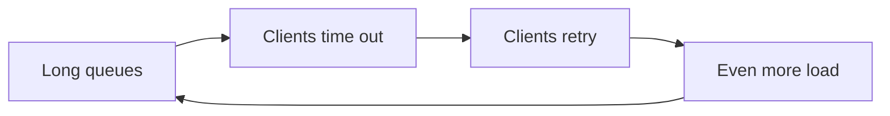

# فصل ۲: تعریف نیازمندی‌های غیرکارکردی

[فصل ۱: بده‌بستان‌ها در معماری سیستم‌های داده →](01-trade-offs-in-data-systems-architecture.md) · [کتاب](../README.md) · [فصل ۳: مدل‌های داده و زبان‌های کوئری ←](03-data-models-and-query-languages.md)

## خلاصه

اپلیکیشن جدا از این‌که چه کاری انجام می‌دهد، باید به‌اندازه‌ی کافی سریع باشد، وقتی بخشی از آن خراب می‌شود به کار ادامه دهد، با رشد کنار بیاید و تغییر دادنش آسان بماند. این فصل این نیازمندی‌های غیرکارکردی را دقیق می‌کند: **performance، reliability، scalability و maintainability**. نقطه‌ی شروع، یک مطالعه‌ی موردی درباره‌ی home timeline در شبکه‌ی اجتماعی است که نشان می‌دهد قابلیتی با خواندن سنگین را چطور می‌شود با جابه‌جا کردن کار از زمان خواندن به زمان نوشتن دوباره طراحی کرد. کتاب استدلال می‌کند که response time را باید به شکل توزیع و با percentile اندازه گرفت، نه با میانگین؛ fault را از failure جدا می‌کند، و scalability را نه ویژگی بله‌یا‌خیر، بلکه این پرسش می‌داند: «اگر بار به شکل مشخصی رشد کند، چه گزینه‌هایی داریم؟»

## نکته‌های کلیدی

- **جابه‌جا کردن کار از زمان خواندن به زمان نوشتن**، یعنی materialize کردن timelineها، می‌تواند بار خواندنی را که شدنی نیست به بار نوشتنی قابل‌مدیریت تبدیل کند؛ هزینه‌اش کار بیشتر برای هر نوشتن و حالت‌های خاصی مثل سلبریتی‌هاست (pp. 34–37).
- **مقدار response time یک توزیع است.** میانه را برای تجربه‌ی معمول و percentileهای بالا مثل p95، p99 و p999 را برای tail به کار ببرید؛ میانگین outlierها را پنهان می‌کند (pp. 40–41).
- **پدیده‌ی fan-out، tail را بزرگ‌تر می‌کند:** درخواستی که منتظر چند فراخوانی backend است به‌اندازه‌ی کندترینشان کند است (p. 41). percentileها را نمی‌شود میانگین گرفت؛ به جایش histogramها را با هم merge کنید (p. 42).
- **مفهوم fault یعنی یک جزء از مشخصاتش منحرف شود؛ failure یعنی کل سیستم از ارائه‌ی سرویس بازبماند.** fault tolerance جلوی تبدیل fault به failure را می‌گیرد؛ faultهای نرم‌افزاری همبسته از faultهای مستقل سخت‌افزاری سخت‌ترند (pp. 43–47).
- **انسان‌ها عامل بسیاری از قطعی‌ها هستند**، و تغییر config بیش از همه؛ پس سیستم را برای خطا طراحی کنید و با postmortemهای بدون سرزنش یاد بگیرید (pp. 47–49).
- **مفهوم scalability یعنی بار را توصیف کنید و بپرسید با رشدش کارایی چطور تغییر می‌کند.** scale-out از نوع shared-nothing رایج است ولی رایگان نیست؛ کار را به بخش‌های مستقل بشکنید (pp. 49–52).
- **مفهوم maintainability یعنی operability و simplicity و evolvability**، و abstractionهای خوب به هر سه کمک می‌کنند (pp. 52–56).

## فهرست بخش‌ها

*از فهرست مطالب خود کتاب، یعنی bookmarkهای PDF، با شماره‌ی صفحه‌های چاپی.*

- مطالعه‌ی موردی: home timeline در شبکه‌ی اجتماعی (p. 34)
  - نمایش کاربرها، پست‌ها و دنبال کردن‌ها (p. 34)
  - ساختن و به‌روز کردن timelineها (p. 35)
- توصیف performance (p. 37)
  - مفهوم latency و response time (p. 38)
  - میانگین، میانه و percentileها (p. 40)
  - استفاده از متریک‌های response time (p. 41)
- مفهوم reliability و fault tolerance (p. 43)
  - مفهوم fault tolerance (p. 43)
  - انواع faultهای سخت‌افزاری و نرم‌افزاری (p. 44)
  - انسان‌ها و reliability (p. 47)
- مفهوم scalability (p. 49)
  - شناختن بار (p. 50)
  - معماری‌های shared-memory، shared-disk و shared-nothing (p. 51)
  - اصول scalability (p. 52)
- مفهوم maintainability (p. 52)
  - اصل operability: آسان کردن کار تیم عملیات (p. 53)
  - اصل simplicity: مدیریت پیچیدگی (p. 54)
  - اصل evolvability: آسان کردن تغییر (p. 55)
- جمع‌بندی (p. 56)

## یادداشت‌ها

**نیازمندی‌های کارکردی** می‌گویند اپلیکیشن چه کاری انجام می‌دهد. **نیازمندی‌های غیرکارکردی**، یعنی سریع، قابل‌اعتماد، امن، مطابق قانون و قابل‌نگهداری بودن، اغلب جایی نوشته نمی‌شوند ولی همان‌قدر مهم‌اند: به تعبیر کتاب، اپلیکیشنی که به‌طرز غیرقابل‌تحملی کند یا ناپایدار باشد انگار اصلاً وجود ندارد (p. 33). این فصل چهار مورد را بررسی می‌کند: performance، reliability، scalability و maintainability.

> **Try it:** [فصل ۲ در طول یک pipeline داده](../widgets/02-pipeline-map.html): یکی از lensها را انتخاب کنید، مثلاً کار در زمان خواندن یا نوشتن یا faultها، و ببینید هر نیازمندی در هر مرحله‌ی pipeline چه معنایی دارد.

### مطالعه‌ی موردی: home timeline در شبکه‌ی اجتماعی

یک شبکه‌ی اجتماعی شبیه X/Twitter (pp. 34–36). فرض‌ها: **۵۰۰ میلیون پست در روز، یعنی حدود ۵٬۸۰۰ پست در ثانیه**، با اوج‌هایی تا **۱۵۰٬۰۰۰ در ثانیه**. کاربر متوسط ۲۰۰ نفر را دنبال می‌کند و ۲۰۰ follower دارد، اما چند سلبریتی بیش از ۱۰۰ میلیون follower دارند. داده در سه جدول relational نگه داشته می‌شود: `users` و `posts` و `follows`؛ شکل ۲-۱ همین را نشان می‌دهد.

```sql
SELECT posts.*, users.* FROM posts
  JOIN follows ON posts.sender_id = follows.followee_id
  JOIN users   ON posts.sender_id = users.id
  WHERE follows.follower_id = current_user
  ORDER BY posts.timestamp DESC
  LIMIT 1000
```

*کوئری home timeline در کتاب (p. 35).*

#### دو راه برای ساختن timeline (pp. 35–36)

| | Query on read (polling) | Materialized timelines (fan-out on write) |
|---|---|---|
| روش | هر client آنلاین هر ۵ ثانیه join را دوباره اجرا می‌کند | با هر پست، آن را در timeline کش‌شده‌ی همه‌ی followerها درج کنید، مثل صندوق نامه |
| بار | ۱۰ میلیون کاربر آنلاین ← **۲ میلیون کوئری در ثانیه**، ضرب در ۲۰۰ followee = **۴۰۰ میلیون lookup در ثانیه** | ۵٬۸۰۰ پست در ثانیه ضرب در fan-out ۲۰۰ ← **کمی بیش از ۱ میلیون نوشتن timeline در ثانیه** |
| خواندن | گران؛ برای کسی که ده‌ها هزار نفر را دنبال می‌کند از همه بدتر | از cache خوانده می‌شود؛ clientها مشترک ورودی‌های تازه می‌شوند |
| اوج‌ها | به همه‌ی خواننده‌ها ضربه می‌زند | تحویل‌ها در صف می‌روند؛ پست‌ها کمی دیرتر ظاهر می‌شوند و خواندن سریع می‌ماند |

اصطلاح **fan-out** یعنی ضریبی که یک درخواست با آن به درخواست‌های downstream پخش می‌شود. cache مربوط به timeline یک **materialized view** است: نتیجه‌ی از پیش محاسبه‌شده‌ی کوئری که خواندن را ارزان می‌کند و در عوض کار نوشتن را بیشتر (p. 36). حالت‌های حدی (p. 36):

- کسی که تعداد خیلی زیادی حساب پرکار را دنبال می‌کند: بخشی از نوشتن‌ها را کنار بگذارید و نمونه‌ای نشان دهید؛ او که همه را نمی‌خواند.
- پست گذاشتن یک **سلبریتی**: کنار گذاشتن نوشتن‌ها قابل قبول نیست؛ پست‌های سلبریتی‌ها را جدا ذخیره کنید و **هنگام خواندن با timeline merge کنید**.


*Figure 2-2 (p. 36): در fan-out on write هر پست به ازای هر follower یک نوشتن در timeline می‌شود، پس خواندن home timeline یک lookup ساده است.*

> **Try it:** [محاسبه هنگام خواندن یا هنگام نوشتن؟](../widgets/02-materialize.html): اول با عددهای خود کتاب polling و fan-out و حالت سلبریتی را مقایسه کنید، بعد همان حساب را روی داشبوردی که هر روز صدها بار باز می‌شود امتحان کنید.

> **In practice:** جدول Gold همان cache مربوط به timeline در یک پلتفرم داده است: داشبوردی که روزی ۴۰۰ بار باز می‌شود نباید هر بار کل تراکنش‌ها را اسکن کند. نسخه‌ی داده‌ای «سلبریتی» هم اصلاحیه‌ای است که برای ماه‌های قدیمی می‌رسد و جدول افزایشی را بی‌صدا غلط می‌کند.

### توصیف performance

| معیار | تعریف | در مطالعه‌ی موردی |
|---|---|---|
| **Response time** | از درخواست کاربر تا رسیدن پاسخ به او، به ثانیه یا میلی‌ثانیه یا میکروثانیه | زمان load شدن timeline؛ زمان رسیدن پست به followerها |
| **Throughput** | تعداد درخواست یا حجم داده در ثانیه؛ سخت‌افزار سقفی دارد | پست در ثانیه، نوشتن timeline در ثانیه |

چیزی که برای کاربر مهم است response time است؛ throughput منابع لازم و در نتیجه هزینه را تعیین می‌کند. سیستمی **scalable** است که بشود throughput بیشینه‌اش را با اضافه کردن منابع به‌طور قابل‌توجهی بالا برد (p. 38). نزدیک throughput بیشینه، **صف‌ها** باعث می‌شوند response time تند بالا برود؛ شکل ۲-۳ را ببینید (p. 37).


*Figure 2-3 (p. 37): نزدیک ظرفیت، صف‌ها پر می‌شوند و response time خیلی پیش از رسیدن throughput به سقفش اوج می‌گیرد.*

#### وقتی سیستمِ زیر بار سنگین دیگر برنمی‌گردد (p. 38)

صف طولانی باعث می‌شود clientها time out شوند و درخواست را دوباره بفرستند، که بار را باز هم بیشتر می‌کند. این **retry storm** است و ممکن است سیستم حتی بعد از کم شدن بار هم در حالت overload بماند؛ اسمش **metastable failure** است.



*طرح خود vault از حلقه‌ی retry storm (p. 38).*

| سمت | روش دفاع |
|---|---|
| Client | **Exponential backoff** برای بیشتر و تصادفی کردن فاصله‌ی retryها؛ **circuit breaker** یا **token bucket** برای قطع فراخوانی سرویسی که دارد شکست می‌خورد |
| Server | **Load shedding** برای رد کردن زودهنگام درخواست‌ها نزدیک overload؛ **backpressure** برای این‌که clientها آرام‌تر بفرستند |
| هر دو | انتخاب الگوریتم‌های صف و load balancing |

> **Try it:** [صف، اضافه‌بار و retry storm](../widgets/02-queueing.html): سرور را به سمت ظرفیتش هل بدهید، بعد یک اوج بار و retry سمت client اضافه کنید و ببینید چطور بازنمی‌گردد.

> **In practice:** در یک pipeline، «client» همان taskهای orchestrator هستند که به warehouse وصل می‌شوند و retry تنظیم‌شده دارند.
>
> **Your turn:** سرعت warehouse ده دقیقه پایین آمد و هر چهل DAG مربوط به loader دقیقه‌ای یک بار retry کردند. بعد از برگشتن سرعت هم هنوز همه‌چیز کند است. چه اتفاقی افتاده و چه چیزی را عوض می‌کنید؟
>
> *Answer:* این retry storm است: تلاش‌های دوباره بار را بالا نگه داشته‌اند و سیستم در حالت metastable گیر کرده است (p. 38). فاصله‌ی retry را نمایی و تصادفی کنید و تعداد taskهای همزمان را محدود کنید تا warehouse بتواند صفش را خالی کند.

#### مفهوم latency و response time (pp. 38–39)


*Figure 2-4 (p. 39): زمان سرویس فقط بخش میانی است؛ response time سمت client هر دو مسیر شبکه و همه‌ی انتظارها در صف را هم شامل می‌شود.*

- واژه‌ی **latency** اسم کلی زمانی است که درخواست *معطل* است، یعنی پردازش نمی‌شود (p. 39).
- مقدارهای تصادفی latency از این‌ها می‌آیند: context switch، از دست رفتن packet و ارسال دوباره‌ی TCP، توقف garbage collection، page fault، و حتی لرزش‌های rack (p. 39).
- وقتی فقط چند هسته دارید، چند درخواست کند همه‌ی درخواست‌های پشت سرشان در صف را معطل می‌کنند: **head-of-line blocking**. به همین دلیل response time را باید **سمت client** اندازه گرفت (p. 39).

> **In practice:** لاگ warehouse فقط زمان سرویس را نشان می‌دهد. proxy جلوی warehouse که برای هر نفر محدودیت دارد، صف خودش را اضافه می‌کند.
>
> **Your turn:** لاگ warehouse می‌گوید کوئری داشبورد ۰٫۸ ثانیه طول کشیده، اما کاربرها از load شش‌ثانیه‌ای صفحه شکایت دارند. بقیه‌ی زمان کجا رفته؟
>
> *Answer:* مقدار response time سمت کاربر، شبکه و هر انتظاری در صف را هم شامل می‌شود (p. 39): صف proxy، کوئری‌های دیگر همان داشبورد که جلوتر در صف‌اند و head-of-line blocking می‌سازند، و رندر شدن در مرورگر. زمان را همان‌جایی اندازه بگیرید که کاربر منتظر است.

#### میانگین، میانه و percentileها (pp. 40–41)

| آماره | معنی | کاربرد |
|---|---|---|
| Mean | جمع تقسیم بر تعداد | تخمین سقف throughput، نه تجربه‌ی «معمول» |
| Median (p50) | نیمی از درخواست‌ها سریع‌ترند | معمولاً کاربر چقدر منتظر می‌ماند |
| p95، p99، p999 | ۹۵ یا ۹۹ یا ۹۹٫۹ درصد سریع‌ترند | **tail**: outlierها چقدر بدند |

به نوسان latency شبکه **jitter** می‌گویند (p. 40). آمازون سرویس‌های داخلی‌اش را بر اساس **p999** تعریف می‌کند، چون کندترین درخواست‌ها اغلب مال مشتری‌هایی است که بیشترین داده را دارند، یعنی باارزش‌ترین مشتری‌ها؛ بهینه کردن p9999 برای فایده‌ی کمش زیادی گران ارزیابی شد (pp. 40–41).


*Figure 2-5 (p. 40): میانگین بالاتر از میانه است، و چند درخواست کند که p95 و p99 را تعیین می‌کنند در هیچ‌کدام دیده نمی‌شوند.*

**اثر response time بر کاربر** (p. 41) به‌طرز غافلگیرکننده‌ای سخت اندازه‌گیری می‌شود:

| مطالعه | تغییر | نتیجه‌ی گزارش‌شده |
|---|---|---|
| Google، ۲۰۰۶ | از ۴۰۰ به ۹۰۰ میلی‌ثانیه | ۲۰٪ ترافیک کمتر |
| Google، ۲۰۰۹ | ۴۰۰ میلی‌ثانیه بیشتر | فقط ۰٫۶٪ جست‌وجوی کمتر |
| Bing، ۲۰۰۹ | ۲ ثانیه بیشتر | ۴٫۳٪ درآمد تبلیغات کمتر |
| مطالعه‌ی Akamai | | صفحه‌های ۴۰۴ که سریع load می‌شدند نتیجه را مخدوش کردند |
| Yahoo | جست‌وجوهای دست‌کم ۱٫۲۵ ثانیه سریع‌تر، با کنترل کیفیت نتایج | ۲۰ تا ۳۰ درصد کلیک بیشتر |

> **In practice:** زمان تمام شدن pipeline شبانه هم یک توزیع است. بیشتر روزها ساعت ۶ صبح تمام می‌شود و چند روز در ماه ساعت ۹.
>
> **Your turn:** میانگین زمان تمام شدن ۶:۲۰ است. چه عددی به ذی‌نفعانی گزارش می‌دهید که ساعت ۸ جلسه دارند؟
>
> *Answer:* میانگین روزهای دیر را پنهان می‌کند (pp. 40–41). درصد روزهایی را که بعد از ۸ تمام شده‌اند، یا p95 زمان تمام شدن را گزارش کنید. همان چند روز دیر، روزهایی‌اند که مردم به خاطرشان شکایت می‌کنند.

#### استفاده از متریک‌های response time (pp. 41–42)

- **پدیده‌ی tail latency amplification:** وقتی یک درخواست به‌صورت موازی به چند backend پخش می‌شود، باید منتظر کندترینشان بماند؛ پس سهم کوچکی از فراخوانی‌های کند، سهم بزرگی از درخواست‌های کاربر را کند می‌کند؛ شکل ۲-۶ همین را نشان می‌دهد.
- هدف را **SLO** می‌نامند؛ مثلاً میانه زیر ۲۰۰ میلی‌ثانیه، p99 زیر ۱ ثانیه و دست‌کم ۹۹٫۹٪ پاسخ بدون خطا. **SLA** قراردادی است که می‌گوید اگر SLO برآورده نشد چه می‌شود، مثلاً بازپرداخت (p. 42).
- **محاسبه‌ی percentile** روی یک پنجره‌ی متحرک: پنجره را مرتب کنید، یا از تقریب‌هایی مثل HdrHistogram، t-digest، OpenHistogram و DDSketch استفاده کنید. **میانگین گرفتن از percentileها بی‌معناست؛ histogramها را جمع کنید** (p. 42).


*Figure 2-6 (p. 42): یک فراخوانی کند backend کل درخواست کاربر را کند می‌کند؛ این tail latency amplification است.*

> **Try it:** [percentileها و tail latency](../widgets/02-tail-latency.html): یک توزیع latency بسازید، ببینید p99 چطور از میانگین فاصله می‌گیرد، بعد یک صفحه را به چند backend پخش کنید.

> **In practice:** داشبوردی با دوازده کاشی، منتظر کندترین کاشی‌اش می‌ماند؛ همان fan-out شکل ۲-۶.
>
> **Your turn:** برای هر روز p95 زمان کوئری داشبوردها را دارید. p95 کل ماه را چطور حساب می‌کنید؟
>
> *Answer:* از p95های روزانه میانگین نگیرید؛ این کار از نظر ریاضی بی‌معناست (p. 42). p95 را از داده‌ی خام کل ماه حساب کنید، یا histogramهای روزانه را با هم جمع کنید و percentile را از توزیع merge‌شده بخوانید.

### مفهوم reliability و fault tolerance

قابل‌اعتماد بودن تقریباً یعنی **«ادامه دادن به کار درست، حتی وقتی چیزها خراب می‌شوند»**. «درست» یعنی همان کارکرد مورد انتظار، تحمل اشتباه کاربر، کارایی کافی، و جلوگیری از دسترسی غیرمجاز (p. 43).

| اصطلاح | معنی در کتاب (p. 43) |
|---|---|
| **Fault** | یک بخش درست کار نمی‌کند؛ مثلاً یک دیسک، یک ماشین یا یک سرویس بیرونی |
| **Failure** | کل سیستم از ارائه‌ی سرویس لازم بازمی‌ماند؛ SLO برآورده نمی‌شود |
| **Fault-tolerant** | با وجود faultهای *مشخصی* سرویس را ادامه می‌دهد؛ مثلاً خرابی تا ۲ دیسک یا ۱ node از ۳ |
| **Single point of failure** | بخشی که fault آن به failure کل سیستم تبدیل می‌شود |

- دو مفهوم fault و failure یک چیزند در دو سطح مختلف: دیسک خراب برای سیستمی که کپی داده را جای دیگری دارد فقط یک fault است (p. 43).
- در مطالعه‌ی موردی، اگر ماشینی که fan-out را انجام می‌دهد crash کند، ماشین دیگری باید کار را بدون جا انداختن یا تکرار پست‌ها ادامه دهد: **exactly-once semantics**، فصل ۱۲ (p. 44).
- کشتن عمدی processها، یعنی **fault injection** یا **chaos engineering**، مسیرهای بازیابی را تمرین‌شده نگه می‌دارد، چون بسیاری از باگ‌های حیاتی در مدیریت ضعیف خطا هستند (p. 44).
- جایی که درمانی وجود ندارد، مثل نشت امنیتی، پیشگیری از درمان بهتر است (p. 44).

> **In practice:** وقتی warehouse دو replica دارد، خرابی یک node فقط یک fault است. failure وقتی است که داشبورد صبح آماده نباشد یا عدد غلط نشان دهد.
>
> **Your turn:** شب یکی از replicaهای warehouse از کار افتاد و هیچ داشبوردی خراب نشد. باید رخداد ثبت کنید؟
>
> *Answer:* این fault بوده که سیستم تحملش کرده، نه failure (p. 43). ثبتش کنید و replica را برگردانید، چون تا برگردد سیستم دیگر fault-tolerant نیست و replica باقی‌مانده single point of failure شده است.

#### انواع faultهای سخت‌افزاری و نرم‌افزاری (pp. 44–47)

| Fault سخت‌افزاری | نرخی که کتاب نقل می‌کند |
|---|---|
| هارددیسک مغناطیسی | سالانه ۲ تا ۵ درصد خراب می‌شوند، یعنی حدود یک خرابی در روز در clusterی با ۱۰٬۰۰۰ دیسک |
| SSD | سالانه ۰٫۵ تا ۱ درصد خراب می‌شوند؛ خطای اصلاح‌نشدنی حدود یک بار در سال برای هر درایو |
| هسته‌ی CPU که نتیجه‌ی غلط حساب می‌کند | حدود ۱ در ۱٬۰۰۰ ماشین |
| RAM | بیش از ۱٪ ماشین‌ها در سال، حتی با ECC، خطای اصلاح‌نشدنی می‌خورند؛ الگوهای دسترسی می‌توانند بیت را برگردانند |
| کل دیتاسنتر | برق، config غلط، آتش، سیل، زلزله، طوفان خورشیدی: نادر اما فاجعه‌بار |

مفهوم **redundancy**، مثل RAID، منبع تغذیه‌ی دوگانه، CPU قابل تعویض در حال کار، باتری و ژنراتور، وقتی بهتر کار می‌کند که faultها مستقل باشند، و اغلب همبسته‌اند. برای همین سیستم‌های cloud از دست رفتن کل ماشین، rack یا **availability zone** را در نرم‌افزار تحمل می‌کنند؛ همین امکان **rolling upgrade** بدون توقف را هم می‌دهد (pp. 45–46).

**انواع software fault** به‌شدت همبسته‌اند، چون همه‌ی nodeها همان کد را اجرا می‌کنند (pp. 46–47):

- یک باگ همه‌ی nodeها را با هم زمین می‌زند: **leap second روز ۳۰ ژوئن ۲۰۱۲** که از راه یک باگ در kernel لینوکس بسیاری از اپلیکیشن‌های Java را هنگ کرد؛ SSDهایی که firmwareشان دقیقاً بعد از **۳۲٬۷۶۸ ساعت** از کار می‌افتد؛
- یک process که از کنترل خارج می‌شود و CPU، حافظه، دیسک، پهنای باند یا threadها را تمام می‌کند؛
- وابستگی‌ای که کند می‌شود، هنگ می‌کند یا پاسخ خراب برمی‌گرداند؛
- رفتار پیش‌بینی‌نشده‌ی ناشی از تعامل سیستم‌ها؛ **cascading failure**.

این باگ‌ها خاموش می‌مانند تا روزی که یک فرض درباره‌ی محیط دیگر درست نباشد. راه‌حل سریعی ندارند، فقط کارهای کوچک زیاد: درباره‌ی فرض‌ها فکر کنید، دقیق تست کنید، processها را از هم جدا کنید، بگذارید crash کنند و دوباره شروع شوند، از حلقه‌های بازخوردی مثل retry storm دوری کنید، و production را monitoring کنید (p. 47).

> **In practice:** ارتقای نسخه‌ی کتابخانه‌ی loader، یا تغییر یک macro مشترک در SQL، همان باگ را هم‌زمان به همه‌ی جدول‌ها می‌برد.
>
> **Your turn:** بعد از ارتقای loader، timestampها در همه‌ی جدول‌ها با منطقه‌ی زمانی اشتباه load شدند. اگر دو container موازی برای loader داشتید جلویش گرفته می‌شد؟
>
> *Answer:* نه. این fault نرم‌افزاری همبسته است و هر کپی همان کد را اجرا می‌کند و همان اشتباه را می‌کند (pp. 46–47). چیزی که کمک می‌کند تست روی داده‌ی واقعی، rollout تدریجی جدول‌به‌جدول، مقایسه با منبع و امکان rollback سریع است.

#### انسان‌ها و reliability (pp. 47–49)

- در یک مطالعه، تغییرات config توسط اپراتورها **عامل اصلی قطعی‌ها** بود و سخت‌افزار فقط در ۱۰ تا ۲۵ درصد نقش داشت (p. 47).
- «خطای انسانی» نشانه‌ی سیستم اجتماعی‌فنی است، نه علت آن (p. 47).
- اقدام‌های مفید: تست، از جمله property testing؛ rollback سریع، rollout تدریجی، monitoring و observability، و interfaceهایی که کار درست را تشویق می‌کنند. اما سازمان‌ها اغلب قابلیت تازه را به resilience ترجیح می‌دهند (pp. 47–48).
- **گزارش‌های postmortem بدون سرزنش** به آدم‌ها اجازه می‌دهند جزئیات کامل را بگویند. به پاسخ‌های ساده‌انگارانه در هر دو جهت شک کنید: «Bob باید بیشتر دقت می‌کرد» یا «backend را با Haskell بازنویسی کنیم» (p. 48).

**مفهوم reliability چقدر مهم است؟** چند ساعت قطعی ممکن است قابل‌تحمل باشد؛ از دست رفتن یا خراب شدن دائمی داده، مثل عکس‌هایی که پدر یا مادری از بچه‌هایش دارد، نه. **رسوایی Post Office Horizon** از ۱۹۹۹ تا ۲۰۱۹ هزینه‌ی انسانی را نشان می‌دهد: صدها مسئول شعبه‌ی پست محکوم شدند، چون نرم‌افزار حسابداری پرباگ کسری نشان می‌داد، و این با پیش‌فرضی حقوقی ممکن شد که کامپیوتر درست کار می‌کند. کم گذاشتن از reliability برای یک prototype می‌تواند درست باشد، به شرط این‌که آگاهانه باشد (pp. 48–49).

> **In practice:** هر جدولی که loader load می‌کند با یک فایل YAML تعریف می‌شود. یعنی هر تغییر config یک تغییر در production است.
>
> **Your turn:** کسی ستونی را از YAML یک جدول حذف کرد و داشبورد صبح خالی بالا آمد. از این فصل چه درسی برمی‌دارید؟
>
> *Answer:* تغییر config عامل اصلی قطعی‌ها در مطالعه‌ی کتاب است (p. 47). فایل‌ها را مثل کد در Git و CI بررسی کنید، امکان rollback سریع داشته باشید، و یک بررسی schema drift بین لایه‌ها بگذارید. postmortem را بدون سرزنش بنویسید: پرسش این است که چرا سیستم اجازه داد این تغییر بی‌صدا به داشبورد برسد (p. 48).

### مفهوم scalability

مفهوم scalability یعنی توانایی سیستم برای کنار آمدن با بار بیشتر. برچسبی مثل «X scalable است» نیست، بلکه مجموعه‌ای از پرسش است: اگر سیستم *به شکل مشخصی* رشد کند، چه گزینه‌هایی داریم، چطور منابع اضافه می‌کنیم، و کی به سقف معماری فعلی می‌رسیم؟ برای یک startup در روزهای اول، کار زودهنگام روی scale در بهترین حالت هدر می‌رود و در بدترین حالت قالبی انعطاف‌ناپذیر می‌شود (pp. 49–50).

#### شناختن بار (pp. 50–51)

- بار را با عددهایی توصیف کنید که برای اپلیکیشن شما مهم‌اند: درخواست در ثانیه، گیگابایت داده‌ی تازه در روز، تعداد خرید در ساعت، بیشترین تعداد کاربر همزمان (p. 50).
- توزیع‌ها را هم اضافه کنید: نسبت خواندن به نوشتن، hit rate مربوط به cache، تعداد follower به ازای هر کاربر (p. 50).
- بعد یکی از این دو پرسش را بپرسید: *«بار بیشتر شود و منابع ثابت بماند، کارایی چه می‌شود؟»* یا *«بار بیشتر شود، چقدر منبع لازم است تا کارایی ثابت بماند؟»* (p. 50).
- مفهوم **linear scalability**، یعنی دو برابر منابع برای دو برابر بار، خوب است؛ هزینه‌ها معمولاً سریع‌تر از این رشد می‌کنند (p. 51).

> **In practice:** جمله‌ی «warehouse کند است» توصیف بار نیست.
>
> **Your turn:** بار warehouse را با عدد توصیف کنید. چه چیزهایی را می‌شمارید؟
>
> *Answer:* چیزهایی که برای همین سیستم مهم است (p. 50): ردیف‌های loadشده در روز به تفکیک جدول، تعداد کوئری در ساعت اوج، بایت‌های اسکن‌شده به ازای هر کوئری، و تعداد کاربران همزمان داشبورد؛ به‌اضافه‌ی توزیع‌ها، مثل سهم کوئری‌هایی که کل تاریخچه را اسکن می‌کنند. بعد بپرسید اگر هر کدام دو برابر شود، چه چیزی اول می‌شکند.

#### معماری‌های shared-memory، shared-disk و shared-nothing (pp. 51–52)

| معماری | چه چیزی مشترک است | نقطه‌ی قوت | محدودیت |
|---|---|---|---|
| Shared-memory، یعنی **vertical scaling** یا scaling up | RAM یک ماشین بین threadها | ساده | هزینه سریع‌تر از خطی رشد می‌کند؛ گلوگاه‌ها باعث می‌شوند ۲ برابر سخت‌افزار ۲ برابر بار نکشد |
| Shared-disk | آرایه‌ی دیسک NAS یا SAN بین ماشین‌ها | data warehouse سنتی on-premises | رقابت سر منابع و سربار lock |
| Shared-nothing، یعنی **horizontal scaling** یا scaling out | هیچ؛ هماهنگی از راه شبکه‌ی معمولی | بالقوه خطی، بهترین نسبت قیمت به performance، elastic، fault tolerance در چند region | sharding صریح در فصل ۷ و همه‌ی پیچیدگی سیستم توزیع‌شده در فصل ۹ |

دیتابیس‌های cloud-native که سرویس ذخیره‌سازی جدا دارند شبیه shared-disk هستند، اما API ذخیره‌سازی‌شان برای دیتابیس طراحی شده، نه برای filesystem یا block device، و همین مشکلات قدیمی scale را دور می‌زند (p. 51).

#### اصول scalability (p. 52)

- **«سس جادویی scale»** وجود ندارد: ۱۰۰٬۰۰۰ درخواست ۱ کیلوبایتی در ثانیه و ۳ درخواست ۲ گیگابایتی در دقیقه هر دو ۱۰۰ مگابایت در ثانیه‌اند، اما طراحی‌های کاملاً متفاوتی می‌خواهند.
- انتظار داشته باشید با هر **مرتبه‌ی بزرگی** رشد، معماری را از نو بسنجید؛ بیشتر از آن جلوتر را برنامه‌ریزی نکنید.
- **سیستم را به بخش‌های تا حد زیادی مستقل بشکنید**؛ این ایده‌ی پشت microservice، sharding، stream processing و shared-nothing است.
- **بی‌جهت پیچیده‌اش نکنید**: دیتابیس تک‌ماشین را به توزیع‌شده، scale دستی را وقتی بار قابل پیش‌بینی است، و ۵ سرویس را به ۵۰ سرویس ترجیح دهید.

> **In practice:** یک join در notebook روی ۵ گیگابایت داده کند است.
>
> **Your turn:** کسی پیشنهاد می‌دهد یک cluster مربوط به Spark راه بیندازید. موافقید؟
>
> *Answer:* معمولاً نه. ۵ گیگابایت روی یک ماشین جا می‌شود و قاعده‌ی کتاب این است که پیچیدگی اضافه نکنید و فقط برای مرتبه‌ی بزرگی بعدی برنامه بریزید (p. 52). اول کار را به warehouse بسپارید یا با DuckDB روی همان ماشین اجرا کنید؛ فصل ۱ هم همین را می‌گوید (p. 21).

### مفهوم maintainability

بیشتر هزینه‌ی نرم‌افزار نگهداری است: رفع باگ، سرپا نگه داشتن، بررسی خرابی‌ها، انتقال به پلتفرم دیگر، کاربردهای تازه، بازپرداخت technical debt و قابلیت‌های تازه. سیستم‌های legacy، با mainframe و COBOL و دانش سازمانی از دست‌رفته، این را به همان اندازه که فنی است مسئله‌ای انسانی می‌کنند؛ هر سیستم ارزشمندی یک روز legacy می‌شود (pp. 52–53).

| اصل | هدف | سیستم‌های داده چطور کمک می‌کنند |
|---|---|---|
| **Operability** (pp. 53–54) | سرپا نگه داشتن سیستم برای سازمان آسان باشد | monitoring و observability؛ وابسته نبودن به یک ماشین خاص؛ مستندات و مدل روشن «اگر X کنم، Y می‌شود»؛ پیش‌فرض‌های خوب که بشود عوضشان کرد؛ خودترمیمی همراه با کنترل دستی؛ رفتار قابل پیش‌بینی |
| **Simplicity** (pp. 54–55) | مهندس تازه‌وارد بتواند سیستم را بفهمد | دوری از **big ball of mud**؛ تفکیک پیچیدگی ذاتی از عارضی، که مرزش جابه‌جا می‌شود؛ و بیش از همه **abstraction**، مثل SQL که ساختار storage، concurrency و بازیابی از crash را پنهان می‌کند |
| **Evolvability** (pp. 55–56) | تغییر برای نیازهای پیش‌بینی‌نشده آسان باشد | coupling کم، سادگی، abstraction خوب؛ کم کردن **irreversibility**؛ مثلاً آیا بعد از مهاجرت دیتابیس می‌شود برگشت؟ |

- به تعبیر کتاب، عملیات خوب اغلب می‌تواند محدودیت‌های نرم‌افزار بد یا ناقص را دور بزند، اما نرم‌افزار خوب با عملیات بد قابل‌اعتماد اجرا نمی‌شود (p. 53).
- خودکارسازی شمشیر دولبه است: حالت‌های دستی باقی‌مانده سخت‌ترین‌ها هستند و debug کردن سیستم خودکاری که خراب شده سخت‌تر است (pp. 53–54).
- موضوع کتاب abstractionهای همه‌منظوره است، مثل transaction و index و event log، که abstractionهای سطح اپلیکیشن مثل domain-driven design را می‌شود رویشان ساخت (p. 55).

> **In practice:** ستون‌های جدول Gold قراردادی با داشبوردهاست؛ لایه‌ی Silver جایی است که پیچیدگی عارضی در آن جمع می‌شود.
>
> **Your turn:** باید ستونی از Gold را که سی داشبورد از آن استفاده می‌کنند تغییر نام بدهید. چطور این کار را قابل برگشت نگه می‌دارید؟
>
> *Answer:* اصل evolvability یعنی کم کردن irreversibility (p. 56). ستون تازه را کنار ستون قدیمی اضافه کنید، داشبوردها را یکی‌یکی منتقل کنید و ستون قدیمی را فقط وقتی حذف کنید که دیگر کسی آن را نمی‌خواند. اگر چیزی خراب شد، برگشت فقط یعنی برگرداندن یک داشبورد.

## بده‌بستان‌ها در یک نگاه

| راهبرد timeline | هزینه‌ی خواندن | هزینه‌ی نوشتن | کجا می‌شکند |
|---|---|---|---|
| کوئری با join در زمان خواندن | زیاد: یک کوئری برای هر بار load شدن timeline | کم | تعداد زیادی خواندن timeline در ثانیه |
| Materialize با fan-out در زمان نوشتن | کم: خواندن یک فهرست از پیش محاسبه‌شده | زیاد: یک نوشتن برای هر follower | حساب‌های سلبریتی با میلیون‌ها follower |
| ترکیبی، راهی که کتاب شرح می‌دهد | کم، به‌اضافه‌ی merge برای سلبریتی‌ها | محدود | تقریباً هیچ‌جا در این مقیاس |

## فراتر از کتاب

- فرمول 1 − (1 − p)<sup>k</sup> برای احتمال این‌که یک درخواست fan-out دست‌کم به یک فراخوانی کند بخورد، روش استاندارد اندازه‌گیری tail latency amplification است. مقاله‌ی «The Tail at Scale» از Dean و Barroso در CACM سال ۲۰۱۳ درخواست‌های hedged و tied را به‌عنوان راه مقابله رایج کرد.
- فرمت‌های histogram قابل ادغام، مثل HdrHistogram، t-digest و DDSketch، همان راهی است که سیستم‌های monitoring «جمع کردن histogramها» را پیاده می‌کنند.

## پیوندها

- **Run it:** [تشدید tail latency](../lab/02-tail-latency/README.md): شبیه‌سازی fan-out و اشتباه میانگین گرفتن از percentileها.
- **فصل‌های مرتبط:** [فصل ۷: مفهوم sharding](07-sharding.md) که hot spot سلبریتی‌ها را دوباره می‌بیند، [فصل ۹: دردسرهای سیستم‌های توزیع‌شده](09-the-trouble-with-distributed-systems.md) با جزئیات faultها، و [فصل ۱۲: پردازش stream](12-stream-processing.md) برای نگهداری materialized viewها.

## خودتان را بسنجید

*پرسش‌ها و پاسخ‌ها را خود vault از روی یادداشت‌های بالا نوشته است؛ پاسخ‌ها به صفحه‌های کتاب ارجاع می‌دهند.*

1. **چرا در مطالعه‌ی موردی، fan-out on write کل کار را کم می‌کند، با این‌که هر پست حالا حدود ۲۰۰ نوشتن می‌سازد؟**
   - [ ] چون در هر دیتابیسی نوشتن از خواندن ارزان‌تر است
   - [x] چون timelineها خیلی بیشتر از نوشته شدن پست‌ها خوانده می‌شوند، پس پیش‌محاسبه کار را از عمل پرتکرار به عمل کم‌تکرار منتقل می‌کند
   - [ ] چون هر کاربر فقط یک کاربر دیگر را دنبال می‌کند
   - [ ] چون cache مربوط به timeline هیچ‌وقت به‌روزرسانی لازم ندارد

   *Answer:* خواندن home timeline با کوئری روی همه‌ی followeeها در هر بار مشاهده گران است و تعداد مشاهده‌ها خیلی بیشتر از تعداد پست‌هاست. materialize کردن timeline هر کاربر هنگام پست شدن، خواندن را ارزان می‌کند و نوشتن‌های اضافه بده‌بستان خوبی است (pp. 35–37).

2. **مقدار p50 شما عالی است اما p99 ضعیف. احتمالاً کدام کاربران آسیب می‌بینند و چرا ممکن است مهم‌ترین‌ها باشند؟**

   *Answer:* یکی از هر صد درخواست کند است و بعضی کاربران بیشتر از بقیه به tail می‌خورند؛ اغلب همان‌هایی که بیشترین داده را دارند، مثل مشتری‌هایی که خرید زیادی کرده‌اند و برای همین جزو باارزش‌ترین‌ها هستند (pp. 40–42).

3. **از ده سرور p99 latency دارید. p99 کل سرویس را چطور به دست می‌آورید؟**
   - [ ] از ده مقدار p99 میانگین بگیرید
   - [ ] بزرگ‌ترین p99 را بردارید
   - [x] همه‌ی histogramهای زیربنایی را merge کنید و percentile را از توزیع merge‌شده حساب کنید
   - [ ] میانه‌ی ده مقدار p99 را بردارید

   *Answer:* میانگین گرفتن از percentileها از نظر ریاضی بی‌معناست؛ راه درست تجمیع داده‌ی response time جمع کردن histogramهاست (pp. 42–43).

4. **یک نمونه از fault نرم‌افزاری همبسته بزنید و توضیح دهید چرا replication به‌تنهایی در برابرش محافظت نمی‌کند.**

   *Answer:* باگی که با ورودی یا تاریخ خاصی فعال می‌شود، processی که منبعی مشترک را تمام می‌کند، یا cascading failure: هر replica همان نرم‌افزار را اجرا می‌کند و هم‌زمان به همان شکل شکست می‌خورد، پس کپی‌ها کمکی نمی‌کنند؛ برخلاف faultهای مستقل سخت‌افزاری (pp. 44–47).

5. **دو سیستم هر دو ۱۰۰ مگابایت در ثانیه جابه‌جا می‌کنند. چرا ممکن است معماری‌شان هیچ شباهتی به هم نداشته باشد؟**

   *Answer:* بار را باید با پارامترهایی توصیف کرد که برای همان سیستم مهم‌اند: ۱۰۰٬۰۰۰ درخواست ۱ کیلوبایتی در ثانیه مسئله‌ای کاملاً متفاوت از ۳ درخواست ۲ گیگابایتی در دقیقه است، با این‌که throughput یکی است (pp. 50–51).

6. **داشبوردی روزی ۴۰۰ بار باز می‌شود و هر بار ۵۰ میلیون تراکنش را اسکن می‌کند. هر شب یک جدول Gold ساخته می‌شود که همان عددها را از پیش حساب می‌کند. چه چیزی به دست می‌آورید و چه چیزی را از دست می‌دهید؟**

   *Answer:* کار از ۴۰۰ اسکن کامل در روز به یک اسکن شبانه و ۴۰۰ خواندن کوچک می‌رسد: همان جابه‌جایی کار از خواندن به نوشتن در مطالعه‌ی timeline (pp. 35–36). در عوض داشبورد تا یک روز کهنه است، و جدول Gold داده‌ی derived است که هر وقت ورودی‌اش تغییر کند، از جمله با اصلاحیه برای ماه‌های قدیمی، باید دوباره ساخته شود (p. 36).
