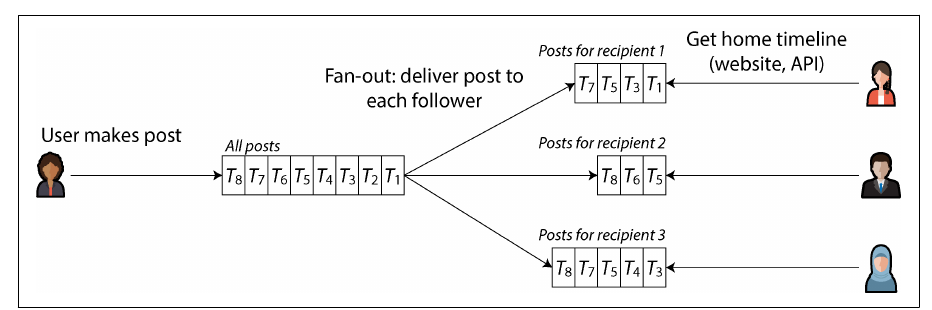
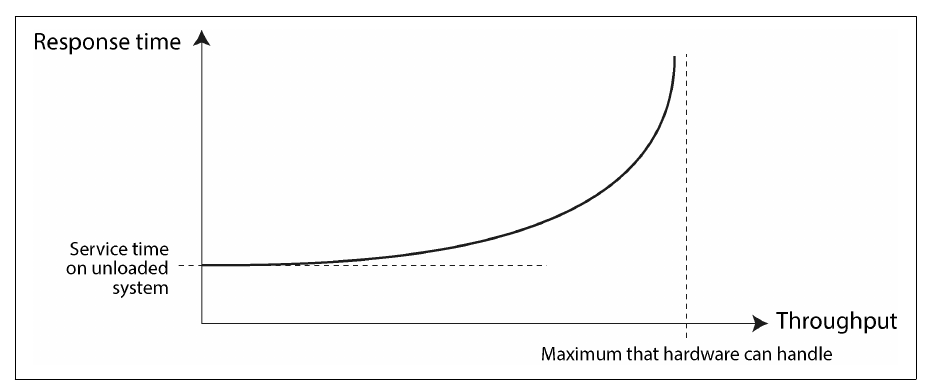
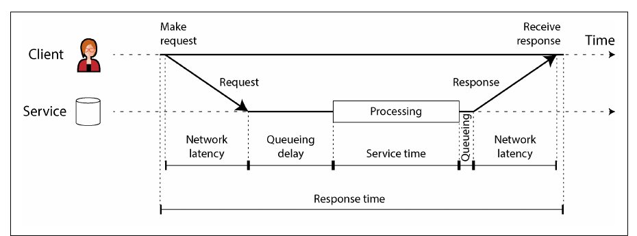
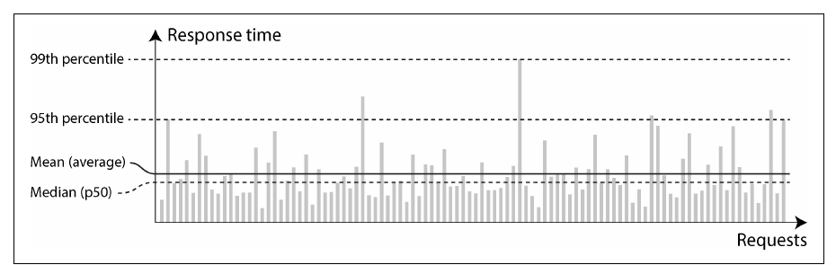
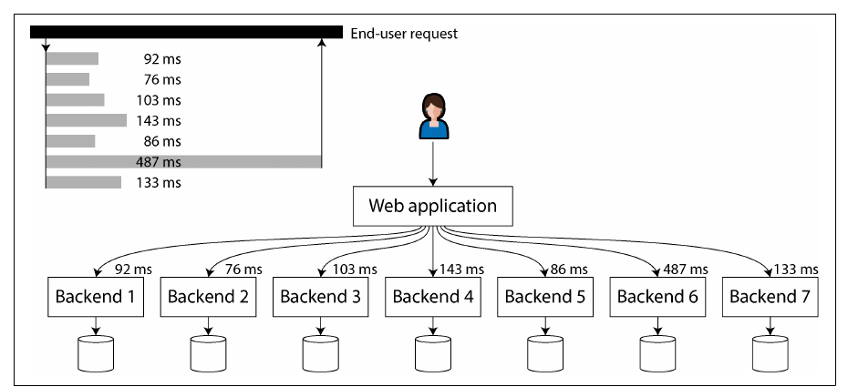

# 2. Defining Nonfunctional Requirements

[← 1. Trade-Offs in Data Systems Architecture](01-trade-offs-in-data-systems-architecture.md) · [Book](../README.md) · [3. Data Models and Query Languages →](03-data-models-and-query-languages.md)

## Summary

Beyond what an application does, it must be fast enough, keep working when parts break, cope with growth, and stay easy to change. The chapter makes these nonfunctional requirements precise — **performance, reliability, scalability, maintainability** — starting from a case study of social-network home timelines that shows how a read-heavy feature can be redesigned by moving work from reads to writes. It argues for measuring response time as a distribution (percentiles, not averages), distinguishes faults from failures, and treats scalability as the question "if load grows in a particular way, what are our options?" rather than a yes/no property.

## Key takeaways

- **Moving work from read time to write time** (materializing timelines) can turn an infeasible read load into a manageable write load — at the cost of extra work per write and special cases such as celebrities (pp. 34–37).
- **Response time is a distribution.** Use the median for the typical experience and high percentiles (p95, p99, p999) for the tail; averages hide outliers (pp. 40–41).
- **Fan-out amplifies tails:** a request that waits on many backend calls is as slow as the slowest one (p. 41). Percentiles cannot be averaged; merge histograms instead (p. 42).
- **A fault is a component deviating from spec; a failure is the whole system stopping service.** Fault tolerance prevents faults becoming failures; correlated software faults are harder than independent hardware faults (pp. 43–47).
- **Humans cause many outages** — configuration changes chief among them — so design for mistakes and learn with blameless postmortems (pp. 47–49).
- **Scalability means describing load and asking how performance changes as it grows.** Shared-nothing scale-out is common but not free; break work into independent parts (pp. 49–52).
- **Maintainability = operability + simplicity + evolvability**, served by good abstractions (pp. 52–56).

## Section outline

*From the book’s own table of contents (PDF bookmarks); printed page numbers.*

- Case Study: Social Network Home Timelines — p. 34
  - Representing Users, Posts, and Follows — p. 34
  - Materializing and Updating Timelines — p. 35
- Describing Performance — p. 37
  - Latency and Response Time — p. 38
  - Average, Median, and Percentiles — p. 40
  - Use of Response Time Metrics — p. 41
- Reliability and Fault Tolerance — p. 43
  - Fault Tolerance — p. 43
  - Hardware and Software Faults — p. 44
  - Humans and Reliability — p. 47
- Scalability — p. 49
  - Understanding Load — p. 50
  - Shared-Memory, Shared-Disk, and Shared-Nothing Architectures — p. 51
  - Principles for Scalability — p. 52
- Maintainability — p. 52
  - Operability: Making Life Easy for Operations — p. 53
  - Simplicity: Managing Complexity — p. 54
  - Evolvability: Making Change Easy — p. 55
- Summary — p. 56

## Notes

**Functional requirements** say what the app does; **nonfunctional requirements** — fast, reliable, secure, compliant, maintainable — are often unwritten but just as important: an unbearably slow or unreliable app “might as well not exist” (p. 33). This chapter covers performance, reliability, scalability and maintainability.

### Case study: social network home timelines

An X/Twitter-style network (pp. 34–36). Assumptions: **500 million posts/day ≈ 5,800 posts/s**, spiking to **150,000/s**; the average user follows 200 and has 200 followers — but a few celebrities have over 100 million. Data lives in three relational tables: `users`, `posts`, `follows` (Figure 2-1).

```sql
SELECT posts.*, users.* FROM posts
  JOIN follows ON posts.sender_id = follows.followee_id
  JOIN users   ON posts.sender_id = users.id
  WHERE follows.follower_id = current_user
  ORDER BY posts.timestamp DESC
  LIMIT 1000
```

*The home-timeline query (p. 35).*

#### Two ways to serve the timeline (pp. 35–36)

| | Query on read (polling) | Materialized timelines (fan-out on write) |
|---|---|---|
| How | Each online client re-runs the join every 5 s | On each post, insert it into every follower’s cached timeline — like a mailbox |
| Load | 10 M online users → **2 M queries/s**, × 200 followees = **400 M lookups/s** | 5,800 posts/s × fan-out 200 ≈ **just over 1 M timeline writes/s** |
| Reads | Expensive, worst for users following tens of thousands | Served from a cache; clients subscribe to new entries |
| Spikes | Hit every reader | Enqueue deliveries; posts appear a bit later, reads stay fast |

**Fan-out** is the factor by which one request multiplies into downstream requests. The timeline cache is a **materialized view** — precomputed query results that make reads cheap at the cost of more work on writes (p. 36). Extreme cases (p. 36):

- Someone following a huge number of busy accounts: drop some writes and show a sample — they don’t read everything anyway.
- A **celebrity** posting: dropping writes isn’t OK; store celebrity posts separately and **merge them in at read time**.



*Figure 2-2 (p. 36): fan-out on write — one post becomes one timeline write per follower, so reading a home timeline is a simple lookup.*

### Describing performance

| Metric | Definition | In the case study |
|---|---|---|
| **Response time** | From the user’s request until they receive the answer (seconds, ms, µs) | Time to load the timeline; time until a post reaches followers |
| **Throughput** | Requests or data volume per second; hardware has a maximum | Posts/s, timeline writes/s |

Response time is what users care about; throughput determines the resources needed and so the cost. A system is **scalable** if its maximum throughput can be raised significantly by adding resources (p. 38). Near maximum throughput, **queueing** makes response time rise sharply (Figure 2-3, p. 37).



*Figure 2-3 (p. 37): close to capacity, queues build up and response time shoots up long before throughput reaches its limit.*

#### When an overloaded system won’t recover (p. 38)

Long queues → clients time out and resend → even more load: a **retry storm**, which can leave the system overloaded even after load drops — a **metastable failure**. Defences:

| Side | Technique |
|---|---|
| Client | **Exponential backoff** (increase and randomize the wait between retries); **circuit breaker** or **token bucket** to stop calling a failing service |
| Server | **Load shedding** (reject requests early when near overload); **backpressure** (tell clients to slow down) |
| Both | The choice of queueing and load-balancing algorithms |

> **Try it:** [Queueing, overload, and retry storms](../widgets/02-queueing.html) — push a server towards capacity, then add a load spike and client retries and watch it fail to recover.

#### Latency and response time (pp. 38–39)



*Figure 2-4 (p. 39): service time is only the middle; the client's response time also includes both network trips and every wait in a queue.*

**Latency** is the catch-all for time a request is *latent* — not being processed. Random delays come from context switches, packet loss and TCP retransmission, garbage-collection pauses, page faults, even vibrations in the rack (p. 39). With only a few cores, a few slow requests delay all those queued behind them — **head-of-line blocking** — which is why response time must be measured **on the client side** (p. 39).

#### Average, median, and percentiles (pp. 40–41)

| Statistic | Meaning | Use |
|---|---|---|
| Mean | Sum ÷ count | Estimating throughput limits — not “typical” experience |
| Median (p50) | Half the requests are faster | How long users typically wait |
| p95, p99, p999 | 95/99/99.9% are faster | The **tail**: how bad the outliers are |

Variation in network delay is called **jitter** (p. 40). Amazon specifies internal services at **p999** because the slowest requests often belong to customers with the most data — the most valuable ones; optimizing p9999 was judged too expensive for too little benefit (pp. 40–41).



*Figure 2-5 (p. 40): the mean sits above the median, and the few slow outliers that set p95 and p99 are invisible in either.*

**The user impact of response times** (p. 41) is surprisingly hard to quantify: Google 2006 (400 → 900 ms ⇒ 20% less traffic), Google 2009 (+400 ms ⇒ only 0.6% fewer searches), Bing 2009 (+2 s ⇒ 4.3% less ad revenue), an Akamai study confounded by fast-loading 404 pages, and Yahoo (20–30% more clicks on searches faster by ≥ 1.25 s, controlling for result quality).

#### Use of response time metrics (pp. 41–42)

- **Tail latency amplification**: when a request fans out to several backends in parallel, it waits for the slowest — so a small share of slow calls makes a large share of user requests slow (Figure 2-6).
- **SLO** = target (e.g. median < 200 ms, p99 < 1 s, ≥ 99.9% non-error responses); **SLA** = contract saying what happens if the SLO is missed (e.g. refunds) (p. 42).
- **Computing percentiles** over a rolling window: sort the window, or use approximations — HdrHistogram, t-digest, OpenHistogram, DDSketch. **Averaging percentiles is meaningless; add the histograms** (p. 42).



*Figure 2-6 (p. 42): one slow backend call makes the whole user request slow — tail latency amplification.*

> **Try it:** [Percentiles and tail latency](../widgets/02-tail-latency.html) — shape a latency distribution, watch p99 pull away from the mean, then fan one page out to many backends.

### Reliability and fault tolerance

Reliable ≈ **“continuing to work correctly, even when things go wrong”** — where *correctly* means the expected function, tolerance of user mistakes, good-enough performance, and no unauthorized access (p. 43).

| Term | Meaning (p. 43) |
|---|---|
| **Fault** | One part stops working correctly (a disk, a machine, an external service) |
| **Failure** | The whole system stops providing the required service — it misses the SLO |
| **Fault-tolerant** | Keeps providing the service despite *certain* faults (e.g. up to 2 disks, 1 of 3 nodes) |
| **Single point of failure** | A part whose fault escalates into a system failure |

Fault and failure are the same thing at different levels: a failed disk is only a fault for a system holding copies elsewhere (p. 43). In the case study, a fan-out machine crashing must be taken over without missing or duplicating posts — **exactly-once semantics**, Chapter 12 (p. 44). Deliberately killing processes — **fault injection**, **chaos engineering** — keeps the recovery paths exercised, since many critical bugs live in poor error handling. Prevention beats cure where no cure exists, as with security breaches (p. 44).

#### Hardware and software faults (pp. 44–47)

| Hardware fault | Rate cited by the book |
|---|---|
| Magnetic hard drives | 2–5% fail per year → ~1 failure/day in a 10,000-disk cluster |
| SSDs | 0.5–1% fail per year; uncorrectable errors ~once per drive per year |
| CPU cores computing wrong results | ~1 in 1,000 machines |
| RAM | >1% of machines/year hit an uncorrectable error even with ECC; access patterns can flip bits |
| Whole datacenter | Power, misconfiguration, fire, flood, earthquake, solar storms — rare but catastrophic |

**Redundancy** (RAID, dual power supplies, hot-swappable CPUs, batteries and generators) works best when faults are independent — and they are often correlated. Cloud systems therefore tolerate the loss of whole machines, racks or **availability zones** in software, which also enables **rolling upgrades** without downtime (pp. 45–46).

**Software faults** are highly correlated because every node runs the same code (pp. 46–47):

- one bug fells every node at once — the **leap second of June 30, 2012** that hung many Java apps via a Linux kernel bug; SSDs whose firmware dies after exactly **32,768 hours**;
- a runaway process exhausting CPU, memory, disk, bandwidth or threads;
- a dependency that slows down, hangs or returns corrupted responses;
- emergent behaviour between systems; **cascading failures**.

Such bugs lie dormant until an assumption about the environment stops being true. No quick fix — many small things: think about assumptions, test thoroughly, isolate processes, crash and restart, avoid retry-storm feedback loops, monitor production (p. 47).

#### Humans and reliability (pp. 47–49)

Configuration changes by operators were the **leading cause of outages** in one study; hardware played a role in only 10–25% (p. 47). “Human error” is a symptom of the sociotechnical system, not the cause. Helpful measures: testing (including property testing), quick rollback, gradual rollouts, monitoring and observability, interfaces that encourage the right thing — but organizations often choose features over resilience. **Blameless postmortems** let people share full details; be suspicious of simplistic answers in both directions (“Bob should have been more careful” vs “rewrite the backend in Haskell”) (pp. 47–48).

**How important is reliability?** A few hours of outage may be tolerable; permanent loss or corruption (a parent’s photos of their children) is not. The **Post Office Horizon scandal** (1999–2019) — hundreds of sub-postmasters convicted because buggy accounting software showed shortfalls, enabled by a legal presumption that computers work correctly — shows the human cost. Cutting reliability for a prototype can be fine, if done consciously (pp. 48–49).

### Scalability

Scalability is a system’s ability to cope with increased load — not a label (“X is scalable”) but questions: if the system grows *in a particular way*, what are our options, how do we add resources, and when do we hit the current architecture’s limits? For an early startup, premature scaling work is wasted at best and an inflexible straitjacket at worst (pp. 49–50).

#### Understanding load (pp. 50–51)

Describe load with numbers that matter for your app — requests/s, GB of new data per day, checkouts per hour, peak simultaneous users — plus distributions such as read/write ratio, cache hit rate or followers per user. Then ask either *“load grows, resources fixed: what happens to performance?”* or *“load grows: how many resources keep performance unchanged?”* **Linear scalability** — twice the resources for twice the load — is good; costs usually grow faster (pp. 50–51).

#### Shared-memory, shared-disk, and shared-nothing (pp. 51–52)

| Architecture | What is shared | Strength | Limit |
|---|---|---|---|
| Shared-memory (**vertical scaling**, scaling up) | One machine’s RAM across threads | Simple | Cost grows faster than linearly; bottlenecks mean 2× hardware ≠ 2× load |
| Shared-disk | Disk array (NAS/SAN) across machines | Traditional on-premises warehousing | Contention and locking overhead |
| Shared-nothing (**horizontal scaling**, scaling out) | Nothing; coordination over a normal network | Potentially linear, best price/performance, elastic, multi-region fault tolerance | Explicit sharding (Ch. 7) and all the complexity of distribution (Ch. 9) |

Cloud-native databases with a separate storage service resemble shared-disk, but the storage API is designed for the database rather than a filesystem or block device, avoiding the old scalability problems (p. 51).

#### Principles for scalability (p. 52)

- There is no **“magic scaling sauce”**: 100,000 requests/s of 1 kB and 3 requests/minute of 2 GB are both 100 MB/s, yet need very different designs.
- Expect to rethink the architecture at every **order of magnitude**; don’t plan further ahead than that.
- **Break the system into largely independent parts** — the idea behind microservices, sharding, stream processing and shared-nothing.
- **Don’t over-complicate**: a single-machine database over a distributed one, manual scaling if load is predictable, 5 services rather than 50.

### Maintainability

Most of software’s cost is maintenance — fixing bugs, keeping it running, investigating failures, porting, new use cases, repaying technical debt, new features. Legacy systems (mainframes, COBOL, lost institutional knowledge) make it as much a people problem as a technical one; every valuable system becomes legacy one day (pp. 52–53).

| Principle | Goal | How data systems help |
|---|---|---|
| **Operability** (pp. 53–54) | Easy for the organization to keep it running | Monitoring and observability; no dependence on single machines; documentation and a clear “if I do X, Y happens” model; good defaults that can be overridden; self-healing with manual control; predictable behaviour |
| **Simplicity** (pp. 54–55) | Easy for new engineers to understand | Avoid the **big ball of mud**; essential vs accidental complexity (a shifting boundary); above all **abstraction** — e.g. SQL hiding storage structures, concurrency and crash recovery |
| **Evolvability** (pp. 55–56) | Easy to change for unanticipated needs | Loose coupling, simplicity, good abstractions; minimize **irreversibility** (can you switch back after a database migration?) |

“Good operations can often work around the limitations of bad (or incomplete) software, but good software cannot run reliably with bad operations” (p. 53). Automation is a two-edged sword: the leftover manual cases are the hardest, and an automated system gone wrong is harder to debug (pp. 53–54). The book’s subject is general-purpose abstractions — transactions, indexes, event logs — on which application-level ones such as domain-driven design can be built (p. 55).

## Trade-offs at a glance

| Timeline strategy | Read cost | Write cost | Breaks down when |
|---|---|---|---|
| Query at read time (join) | High: one query per timeline load | Low | Many timeline reads per second |
| Materialize on write (fan-out) | Low: read a precomputed list | High: one write per follower | Celebrity accounts with millions of followers |
| Hybrid | Low, plus a merge for celebrities | Bounded | — (the approach the book describes) |

## Beyond the book

- The 1 − (1 − p)<sup>k</sup> formula for the probability that a fan-out request hits at least one slow call is the standard way to quantify tail-latency amplification; Dean and Barroso's "The Tail at Scale" (CACM, 2013) popularized hedged and tied requests as mitigations.
- Mergeable histogram formats (HdrHistogram, t-digest, DDSketch) are how monitoring systems implement "add the histograms".

## Connections

- **Run it:** [Tail latency amplification](../lab/02-tail-latency/README.md) — fan-out simulation and the averaging-percentiles mistake.
- **Related chapters:** [7. Sharding](07-sharding.md) (celebrity hot spots again), [9. The Trouble with Distributed Systems](09-the-trouble-with-distributed-systems.md) (faults in depth), [12. Stream Processing](12-stream-processing.md) (maintaining materialized views).

## Check yourself

*Questions and answers are the vault's, written from the notes above; answers cite the book's pages.*

1. **Why does fan-out on write reduce total work in the timeline case study, even though each post now causes ~200 writes?**
   - [ ] Because writes are cheaper than reads on every database
   - [x] Because timelines are read far more often than posts are written, so precomputing them moves work from the frequent operation to the rare one
   - [ ] Because each user follows only one other user
   - [ ] Because the timeline cache never needs to be updated

   *Answer:* Reading a home timeline by querying all followed accounts on every view is expensive, and views vastly outnumber posts. Materializing each user's timeline when a post is made makes reads cheap; the extra writes are a good trade (pp. 35–37).

2. **Your p50 is excellent but p99 is poor. Which users are likely affected, and why might they matter most?**

   *Answer:* One in a hundred requests is slow, and some users hit the tail more often — often those with the most data, for example the customers who have made many purchases and are therefore among the most valuable (pp. 40–42).

3. **You have p99 latencies from ten servers. How should you get the p99 of the whole service?**
   - [ ] Average the ten p99 values
   - [ ] Take the largest of the ten p99 values
   - [x] Combine the underlying histograms and compute the percentile from the combined distribution
   - [ ] Take the median of the ten p99 values

   *Answer:* Averaging percentiles is mathematically meaningless; the right way to aggregate response-time data is to add the histograms (pp. 42–43).

4. **Give an example of a correlated software fault, and explain why replication alone does not protect against it.**

   *Answer:* A bug triggered by a particular input or date, a runaway process exhausting a shared resource, or a cascading failure: every replica runs the same software and fails in the same way at the same time, so copies don't help — unlike independent hardware faults (pp. 44–47).

5. **Two systems both move 100 MB/s. Why might their architectures have nothing in common?**

   *Answer:* Load must be described by the parameters that matter for the system: 100,000 requests of 1 KB each per second is a very different problem from 3 requests of 2 GB each per minute, even though the throughput is the same (pp. 50–51).
