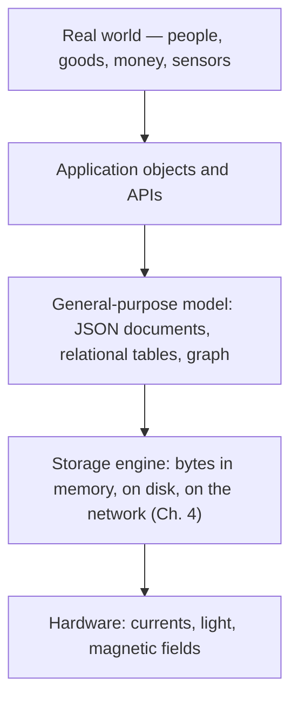
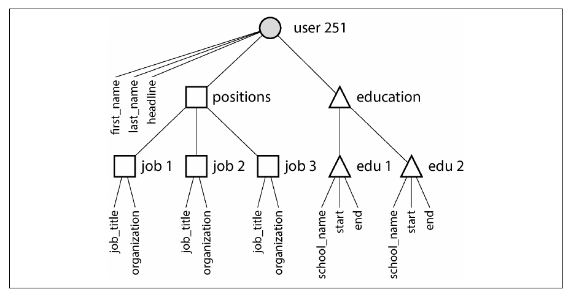
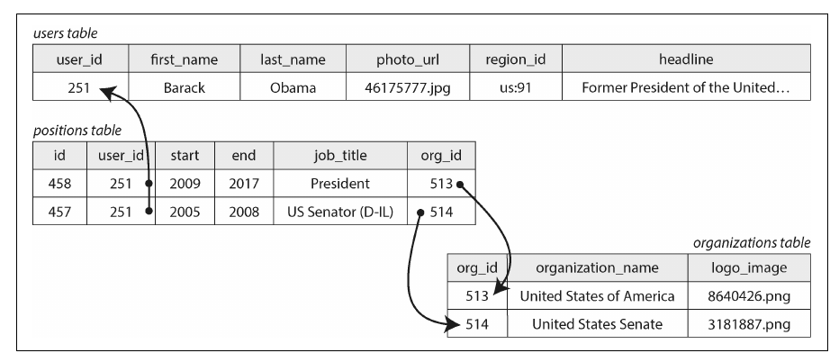
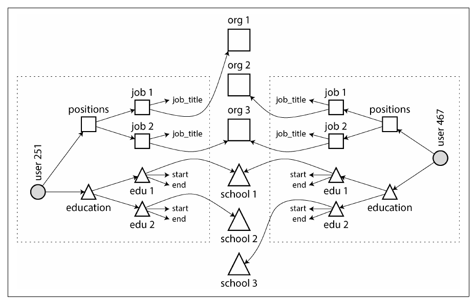
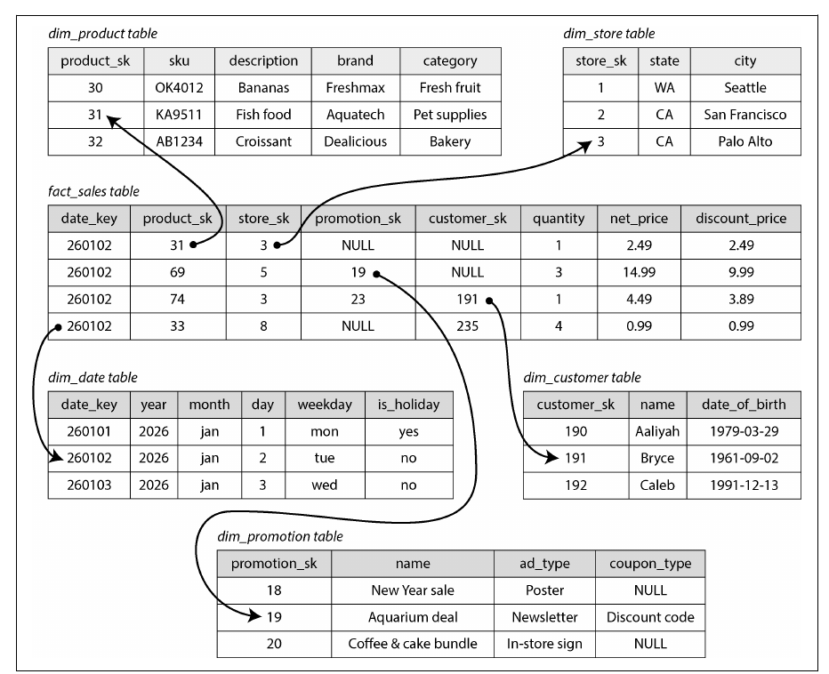
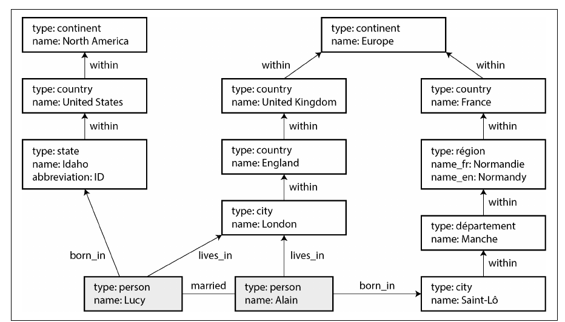
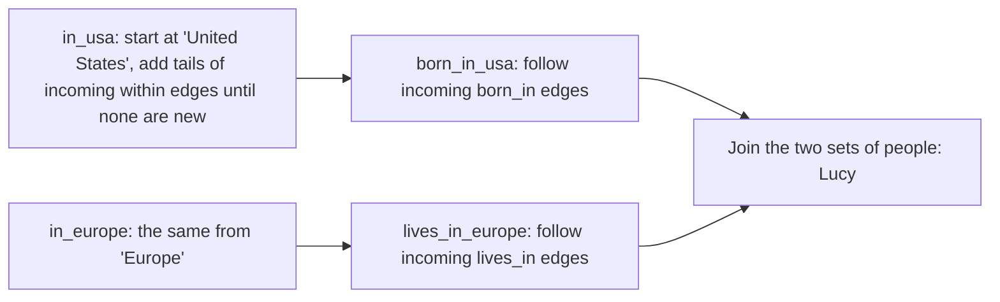
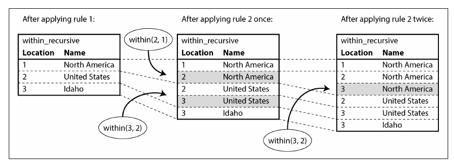
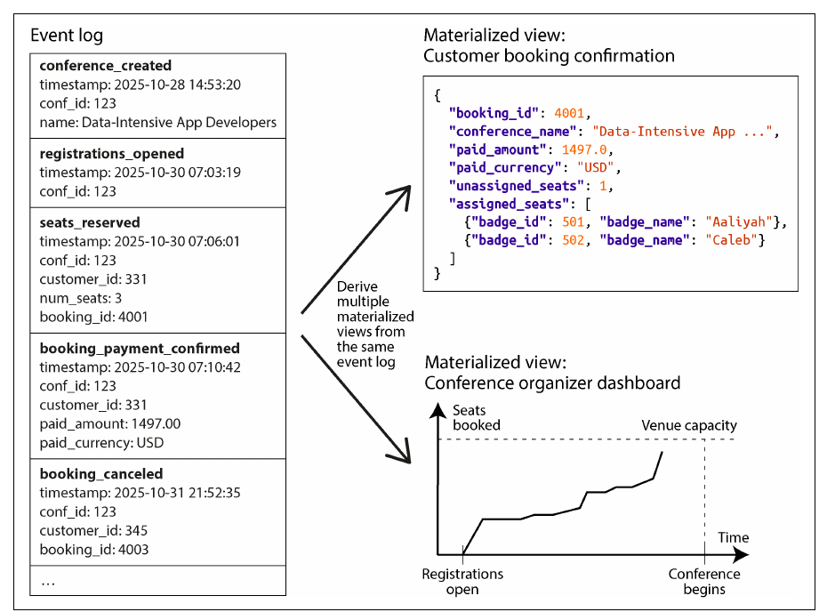
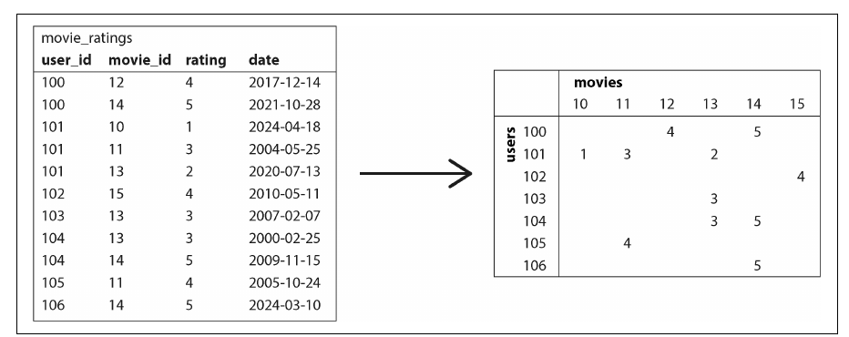

# فصل ۳: مدل‌های داده و زبان‌های کوئری

[فصل ۲: تعریف نیازمندی‌های غیرکارکردی →](02-defining-nonfunctional-requirements.md) · [کتاب](../README.md) · [فصل ۴: ذخیره‌سازی و بازیابی ←](04-storage-and-retrieval.md)

## خلاصه

مدل داده فقط شکل نوشتن نرم‌افزار را تعیین نمی‌کند؛ شکل فکر کردن ما به مسئله را هم تعیین می‌کند. این فصل مدل **relational** و مدل **document** را مقایسه می‌کند، بیشتر از این زاویه که هر کدام با رابطه‌ها چه می‌کنند: درخت‌های one-to-many در برابر ارجاع‌های many-to-one و many-to-many. بعد سراغ مدل‌های **graph** برای داده‌ی خیلی به‌هم‌پیوسته می‌رود و زبان‌های کوئری‌شان را مرور می‌کند: Cypher، SQL بازگشتی، SPARQL، Datalog، و GraphQL که عمداً محدود است. فصل با دو مدل تمام می‌شود که شکل نوشتن داده را از شکل خواندنش جدا می‌کنند: **event sourcing همراه با CQRS**، و **DataFrame و آرایه** برای تحلیل و machine learning. هر مدل می‌تواند بقیه را شبیه‌سازی کند، ولی با زحمت؛ انتخاب درست از شکل رابطه‌های داده‌ی شما بیرون می‌آید.

## نکته‌های کلیدی

- **شکل رابطه‌ها مدل را تعیین می‌کند.** داده‌ی درختی و خودبسنده که یک‌جا load می‌شود به document می‌خورد؛ ارجاع‌های many-to-one و many-to-many به join در مدل relational؛ و داده‌ای که به هر شکلی به هم وصل است به گراف (pp. 67–84).
- **انتخاب بین normalization و denormalization یک بده‌بستان خواندن و نوشتن است:** داده‌ی normalized سازگار است و به‌روزرسانی‌اش ارزان، اما join لازم دارد؛ داده‌ی denormalized سریع خوانده می‌شود، اما باید هماهنگ نگهش داشت (pp. 72–75).
- **«بدون schema» در واقع یعنی schema-on-read:** ساختار ضمنی است و به جای دیتابیس، کدی که داده را می‌خواند آن را اعمال می‌کند (pp. 81–82).
- **طرح‌های star و snowflake** یک data warehouse را حول یک fact table مرکزی می‌چینند که به dimension tableها ارجاع می‌دهد (pp. 77–80).
- **کوئری گرافی تعداد متغیری edge را طی می‌کند** و به recursion نیاز دارد؛ در Cypher و SPARQL و Datalog طبیعی است و در `WITH RECURSIVE` زبان SQL دست‌وپاگیر (pp. 84–100).
- **در event sourcing رویدادهای immutable ذخیره می‌شوند و CQRS از آن‌ها viewهای بهینه برای خواندن می‌سازد:** برای audit و تکامل مدل‌های خواندن عالی است، به قیمت eventual consistency و سخت‌تر شدن حذف (pp. 101–105).
- **مفهوم DataFrame رابطه را به تعداد زیادی ستون تعمیم می‌دهد** و پلی است بین دیتابیس‌ها و ماتریس‌های machine learning و محاسبات علمی (pp. 105–107).

## فهرست بخش‌ها

*از فهرست مطالب خود کتاب، یعنی bookmarkهای PDF، با شماره‌ی صفحه‌های چاپی.*

- مدل relational در برابر مدل document (p. 67)
  - مسئله‌ی object-relational mismatch (p. 68)
  - مفهوم normalization، denormalization و join (p. 72)
  - رابطه‌های many-to-one و many-to-many (p. 75)
  - طرح‌های star و snowflake: schemaهای تحلیلی (p. 77)
  - کدام مدل را کی به کار ببریم (p. 80)
- مدل‌های داده‌ی گراف‌مانند (p. 84)
  - گراف‌های property graph (p. 86)
  - زبان کوئری Cypher (p. 88)
  - کوئری گراف در SQL (p. 90)
  - مفهوم triple store و SPARQL (p. 92)
  - زبان Datalog: کوئری‌های recursive رابطه‌ای (p. 96)
  - زبان GraphQL (p. 98)
- الگوی event sourcing و CQRS (p. 101)
- ساختارهای DataFrame، ماتریس و آرایه (p. 105)
- جمع‌بندی (p. 107)

## یادداشت‌ها

مدل داده فقط شکل نوشتن نرم‌افزار را تعیین نمی‌کند، شکل فکر کردن ما به مسئله را هم تعیین می‌کند (p. 65). اپلیکیشن‌ها مدل‌ها را **لایه‌لایه** روی هم می‌گذارند و هر لایه پیچیدگی لایه‌ی زیرین را پنهان می‌کند:



*برگرفته از چهار لایه‌ی صفحه‌ی ۶۵ کتاب.* بیشتر زبان‌های کوئری این فصل، یعنی SQL، Cypher، SPARQL و Datalog، **declarative** هستند: الگوی داده‌ای را که می‌خواهید بیان می‌کنید، نه الگوریتم را؛ پس optimizer می‌تواند بدون تغییر کوئری شما index، ترتیب joinها و حتی اجرای موازی را انتخاب کند (p. 66).

> **In practice:** تحلیلگرها و داشبوردها به زبان SQL حرف می‌زنند؛ زیر آن، warehouse تصمیم می‌گیرد کدام partitionها را باز کند و از کدام بلوک‌ها بگذرد.
>
> **Your turn:** تیم پلتفرم sort key و partitioning یک جدول بزرگ را عوض می‌کند. صاحبان داشبوردها باید SQLشان را بازنویسی کنند؟
>
> *Answer:* نه. کوئری‌ها declarative هستند، پس موتور plan تازه‌ای انتخاب می‌کند (p. 66). نتیجه همان می‌ماند؛ فقط سرعت تغییر می‌کند.

> **Try it:** [فصل ۳ در طول یک pipeline داده](../widgets/03-pipeline-map.html): از دیتابیس منبع تا داشبورد را با چهار lens طی کنید و ببینید داده کجا تغییر شکل می‌دهد.

### مدل relational در برابر مدل document

| زمان | چه اتفاقی افتاد (p. 67) |
|---|---|
| ۱۹۷۰ | پیشنهاد **مدل relational** از سوی Edgar Codd: جدول‌هایی به اسم **relation** که **tuple**های بی‌ترتیب دارند. خیلی‌ها شک داشتند بشود آن را کارآمد پیاده کرد. |
| از میانه‌ی دهه‌ی ۱۹۸۰ | دیتابیس‌های relational غالب می‌شوند و از مدل‌های شبکه‌ای و سلسله‌مراتبی، دیتابیس‌های شیء‌گرا و دیتابیس‌های XML بیشتر عمر می‌کنند. |
| دهه‌ی ۲۰۱۰ | جنبش **NoSQL**: مجموعه‌ای شل از ایده‌ها مثل مدل‌های داده‌ی تازه، انعطاف schema، scalability و open source. **NewSQL**: scalability به سبک NoSQL همراه با تضمین‌های relational. |
| اثر durable | **مدل document** با JSON که MongoDB و Couchbase رایجش کردند و حالا بیشتر دیتابیس‌های relational هم از آن پشتیبانی می‌کنند. |

#### مسئله‌ی object-relational mismatch (pp. 68–71)

به ترجمه‌ی بین شیءهای داخل کد و جدول‌ها و ردیف‌ها و ستون‌ها **impedance mismatch** می‌گویند؛ اصطلاحی از الکترونیک. ابزارهای **ORM** مثل ActiveRecord و Hibernate کد تکراری را کم می‌کنند:

| مشکلات ORM | مزایای ORM |
|---|---|
| نمی‌تواند تفاوت دو مدل را کامل پنهان کند | کد تکراری کمتر برای ترجمه‌ای که به هر حال لازم است |
| تحلیل همچنان روی schema relational زیرین انجام می‌شود | cache کردن نتیجه‌ی کوئری‌ها |
| اغلب فقط برای OLTP و دیتابیس relational است | کمک به migration مربوط به schema و کارهای مدیریتی |
| schemaهای تولیدشده ممکن است ناشیانه یا ناکارآمد باشند | |
| نوشتن کوئری ناکارآمد آسان است؛ **مسئله‌ی N+1**: یک کوئری برای N کامنت، و بعد N کوئری برای نویسنده‌هایشان به جای یک join | |

**مدل document برای رابطه‌ی one-to-many** (pp. 69–71). یک رزومه را دو جور می‌شود ذخیره کرد؛ مثال ۳-۱ کتاب پروفایل LinkedIn کاربر ۲۵۱، Barack Obama، است:

| مدل relational، شکل ۳-۱ | یک document JSON، مثال ۳-۱ |
|---|---|
| جدول‌های `users` و `positions` و `education` و `contact_info`، که هر ردیف فرزند به `users` اشاره می‌کند | یک شیء با `positions` و `education` و `contact_info` تودرتو |
| چند کوئری یا یک join چندطرفه‌ی درهم برای ساختن دوباره‌ی پروفایل | یک بار خواندن: **locality** بهتر |
| برای هر تعداد فرزند مناسب است | به درد «one-to-few» می‌خورد؛ هزاران کامنت روی پست یک سلبریتی بهتر است ردیف‌های جدا باشند |

رابطه‌های one-to-many یک **درخت** می‌سازند که JSON آن را صریح نشان می‌دهد؛ شکل ۳-۲.



*Figure 3-2 (p. 71): داده‌ی one-to-many یک درخت می‌سازد که یک document JSON می‌تواند آن را یک‌تکه نگه دارد.*

> **In practice:** مسئله‌ی N+1 در notebookها زنده است: حلقه‌ای که برای هر مشتری یک کوئری به warehouse می‌فرستد.
>
> **Your turn:** یک notebook دستور `sum(amount)` را برای هر مشتری جدا اجرا می‌کند، ۲۰٬۰۰۰ بار. راه درست چیست؟
>
> *Answer:* یک کوئری با `GROUP BY customer_id` به جای N کوئری (p. 69). در warehouse ستونی هر کوئری بلوک‌ها را اسکن می‌کند، پس این حلقه از OLTP هم گران‌تر تمام می‌شود.

#### مفهوم normalization، denormalization و join (pp. 72–75)

چرا به جای متن «Washington, DC, United States» مقدار `region_id: "us:91"` را ذخیره کنیم؟ یک فهرست استاندارد املای یکسان، رفع ابهام بین DC و ایالت، یک جا برای به‌روزرسانی، localization و جست‌وجوی بهتر می‌دهد؛ مثلاً دانستن این‌که Washington در ساحل شرقی است (p. 72).

| | Normalized: ذخیره‌ی ID | Denormalized: کپی متن |
|---|---|---|
| داده‌ی معنادار برای انسان | یک بار ذخیره می‌شود؛ IDها هیچ‌وقت لازم نیست عوض شوند | در هر رکورد تکرار می‌شود |
| نوشتن | سریع‌تر، چون یک کپی است | کد و نوشتن و دیسک بیشتر؛ خطر ناسازگاری کپی‌ها |
| خواندن | برای تبدیل IDها به **join** نیاز دارد | سریع‌تر، با join کمتر |
| کاربرد معمول | OLTP؛ scale کوچک تا متوسط | تحلیل با به‌روزرسانی دسته‌ای و خواندن سنگین؛ scale خیلی بزرگ |

داده‌ی denormalized نوعی **derived data** است: برای سازگار نگه داشتن کپی‌ها فرایندی مثل یک atomic transaction یا stream processing لازم است (p. 74). دیتابیس‌های document به سمت denormalization می‌روند، چون joinشان اغلب ضعیف است؛ MongoDB می‌تواند با `$lookup` در یک aggregation pipeline هم join بزند (p. 73).

**دوباره شبکه‌ی اجتماعی** (pp. 74–75):

- در timelineهای materialized شبکه‌ی X فقط ID پست و ID فرستنده و کمی اطلاعات reply و repost ذخیره می‌شود، نه متن پست.
- هر خواندن IDها را **hydrate** می‌کند: محتوای پست، تعداد like و پروفایل‌ها را می‌آورد. این یک join در کد اپلیکیشن است.
- تعداد likeها و عکس پروفایل سریع‌تر از آن عوض می‌شوند که کپی کردنشان معقول باشد، و کپی هم فضا می‌گیرد.
- انجام join در زمان خواندن مانع scale نیست: hydration موازی می‌شود و هزینه‌اش به تعداد followerها بستگی ندارد.
- طراحی‌ای که بهتر از همه scale می‌شود ممکن است بعضی چیزها را denormalize و بعضی را normalize کند.

> **Try it:** [نرمال کنیم یا denormalize؟](../widgets/03-normalization.html): یک region را که یک بار ذخیره شده، یا در همه‌ی پروفایل‌ها کپی شده، تغییر نام بدهید و ببینید هزینه بین خواندن و نوشتن جابه‌جا می‌شود.

> **In practice:** لایه‌ی Bronze normalized می‌ماند، Silver join می‌زند و Gold denormalize می‌کند. هر قدم به راست، داده‌ی derived است که باید دوباره ساخته شود (p. 74).
>
> **Your turn:** جدول Gold مقدار segment هر مشتری را روی همه‌ی تراکنش‌هایش کپی می‌کند. تیم بازاریابی ۳٬۰۰۰ مشتری را به segment تازه‌ای می‌برد. داشبوردها چه نشان می‌دهند؟
>
> *Answer:* تا Gold دوباره ساخته نشود، segment قدیمی را؛ و بعد از rebuild، تاریخچه هم جابه‌جا می‌شود. برای «segment امروز» با یک dimension جوین کنید؛ برای «segment در آن زمان» آن را همراه تراکنش ذخیره کنید و هرگز به‌روزش نکنید.

#### رابطه‌های many-to-one و many-to-many (pp. 75–77)

| رابطه | نمونه | Relational | Document |
|---|---|---|---|
| One-to-many یا one-to-few | رزومه ← شغل‌ها | جدول فرزند با foreign key | آرایه‌ی تودرتو داخل document |
| Many-to-one | آدم‌های زیاد ← یک region | Foreign key | ارجاع با ID |
| Many-to-many | آدم‌ها ↔ سازمان‌ها | یک **associative table** یا join table، شکل ۳-۳ | ارجاع بین سندها، مثل `org_id: 513` در مثال ۳-۲ |

رابطه‌های many-to-many از هر دو طرف کوئری می‌شوند. ذخیره‌ی ارجاع در هر دو طرف denormalized است و ممکن است ناهمخوان شود؛ روش normalized رابطه را یک بار ذخیره می‌کند و روی هر دو ستون **secondary index** می‌گذارد. بسیاری از document storeها هم می‌توانند فیلدهای داخل آرایه را index کنند (pp. 76–77).



*Figure 3-3 (p. 76): جدول positions آدم‌ها را به سازمان‌ها وصل می‌کند، پس رابطه را از هر دو طرف می‌شود کوئری کرد.*



*Figure 3-4 (p. 77): در مدل document، هر document نقطه‌چین درخت خودش را نگه می‌دارد و پیوندهای many-to-many ارجاع به موجودیت‌هایی بیرون از آن هستند.*

> **In practice:** رابطه‌ی مشتری و حساب many-to-many است؛ مثلاً حساب مشترک یا حساب شرکتی با چند امضادار. پس جمع زدن به ازای هر مشتری، تراکنش‌های حساب مشترک را بیش از یک بار می‌شمارد.

> **Try it:** [چرا جمع کل بزرگ‌تر می‌شود؟](../widgets/03-join-fanout.html): تراکنش‌ها را از راه جدول صاحبان حساب join کنید، replication ردیف‌ها را ببینید و قاعده‌ای انتخاب کنید که جمعش درست درمی‌آید.

#### طرح‌های star و snowflake: schemaهای تحلیلی (pp. 77–80)



*Figure 3-5 (p. 78): هر فروش یک ردیف fact است و foreign keyهایش به dimension tableهایی اشاره می‌کنند که چه کسی، چه چیزی، کجا، کی و چطور را توصیف می‌کنند.*

- جدول **fact** برای هر رویداد، مثل خرید یا بازدید صفحه یا کلیک، یک ردیف دارد و ممکن است به پتابایت برسد؛ ستون‌هایش یا attributeاند، مثل قیمت و هزینه، یا foreign key به **dimension table**هایی که چه کسی، چه چیزی، کجا، کی، چطور و چرا را توصیف می‌کنند (pp. 77–78).
- حتی تاریخ‌ها هم dimension هستند، تا بشود تعطیلات را encryption کرد (p. 79).
- در طرح **snowflake** dimensionها به sub-dimensionهایی مثل برند و دسته‌بندی شکسته می‌شوند: normalizedتر است، اما تحلیلگرها معمولاً star ساده‌تر را ترجیح می‌دهند (p. 79).
- جدول‌ها پهن‌اند: fact tableها اغلب بیش از ۱۰۰ ستون دارند؛ `dim_store` ممکن است ثبت کند فروشگاه نانوایی دارد یا نه، چند متر مربع است و فاصله‌اش تا نزدیک‌ترین بزرگراه چقدر است (p. 79).
- در روش **one big table** یا OBT، dimensionها داخل fact table merge می‌شوند: یک join از پیش محاسبه‌شده، با فضای بیشتر و گاهی کوئری سریع‌تر. این‌جا denormalization مشکلی ندارد، چون داده‌ی تاریخی تغییر نمی‌کند (p. 79).

> **In practice:** لایه‌ی Gold یک star است: برای هر posting یک ردیف fact، با dimensionهای مشتری، حساب، دسته‌بندی و تاریخ. موتورهای ستونی خواندن یک one-big-table پهن را ارزان می‌کنند.
>
> **Your turn:** برای «گردش ماهانه‌ی هر حساب» star می‌سازید یا one big table؟
>
> *Answer:* اول grain را ثابت کنید: حساب × ماه. وقتی چند ویژگی پایدار باید سریع خوانده شوند one big table را انتخاب کنید؛ وقتی dimensionها تغییر می‌کنند یا گزارش‌های زیادی از آن‌ها استفاده می‌کنند star را (p. 79).

#### کدام مدل را کی به کار ببریم (pp. 80–84)

| مدل document را انتخاب کنید وقتی… | مدل relational را انتخاب کنید وقتی… |
|---|---|
| داده درختی از رابطه‌های one-to-many است که یک‌جا load می‌شود؛ از **shredding** آن به جدول‌های زیاد پرهیز کنید | رابطه‌های many-to-one و many-to-many دارید و به join نیاز دارید |
| کاربران ترتیب آیتم‌ها را عوض می‌کنند، مثل فهرست کارها به شکل آرایه‌ی JSON؛ مدل relational به شماره‌گذاری دوباره، linked list یا fractional indexing نیاز دارد | باید مستقیم با ID به آیتم‌های تودرتو ارجاع دهید |
| رکوردها ناهمگن‌اند، یا ساختارشان را سیستم‌های بیرونی تعیین می‌کنند | همه‌ی رکوردها ساختار مشترکی دارند که ارزش مستندسازی و اعمال دارد |

**تفاوت schema-on-read و schema-on-write** (pp. 80–82). واژه‌ی «schemaless» گمراه‌کننده است: کدی که داده را می‌خواند همچنان ساختاری را فرض می‌کند.

| | Schema-on-read در document | Schema-on-write در relational |
|---|---|---|
| شبیه | dynamic type checking در زمان اجرا | static type checking در زمان کامپایل |
| شکستن `name` به `first_name` | documentهای تازه را با فیلد تازه بنویسید؛ هر خواننده documentهای قدیمی را مدیریت می‌کند: `if (user.name && !user.first_name) …` | دستور سریع `ALTER TABLE … ADD COLUMN first_name`، بعد `UPDATE` که روی جدول بزرگ کند است چون هر ردیف بازنویسی می‌شود، یا پر کردن lazy در زمان خواندن |
| کجا می‌درخشد | رکوردها ناهمگن‌اند: انواع زیاد object، یا ساختاری که سیستم بیرونی تعیین می‌کند | همه‌ی رکوردها ساختار مشترکی دارند که ارزش مستندسازی و اعمال دارد |

هیچ‌کدام مطلقاً برنده نیست؛ این بحث آینه‌ی بحث static typing در برابر dynamic typing است (p. 81).

**ویژگی locality** (p. 82): document به شکل یک رشته‌ی JSON، XML یا BSON ذخیره می‌شود.

| کمک می‌کند | ضرر می‌زند |
|---|---|
| بیشتر document را یک‌جا لازم دارید | بخش کوچکی از یک document بزرگ را لازم دارید |
| یک بار خواندن، به جای چند index lookup و disk seek روی جدول‌های مختلف | به‌روزرسانی معمولاً کل document را بازنویسی می‌کند، پس documentها را کوچک نگه دارید |

سیستم‌های relational هم locality دارند: interleaved table در Spanner، multi-table index cluster table در Oracle، و column family در Bigtable و HBase.

> **Try it:** [یک پروفایل، دو مدل](../widgets/03-two-models.html): هفت عملیات روزمره را روی یک رزومه، یک بار به شکل document و یک بار به شکل جدول، اجرا کنید و ببینید هر کدام به نفع کدام مدل است.

**زبان‌های کوئری برای documentها** (pp. 82–83): فقط دسترسی key-value، secondary index، یا زبان‌های غنی مثل XQuery و XPath برای XML، JSON Pointer و JSONPath، و aggregation pipeline در MongoDB. گزارش کتاب از تعداد کوسه‌های دیده‌شده در هر ماه، یک بار با SQL و یک بار با pipeline:

```sql
SELECT date_trunc('month', observation_timestamp) AS observation_month,
       sum(num_animals) AS total_animals
FROM observations
WHERE family = 'Sharks'
GROUP BY observation_month;
```

```js
db.observations.aggregate([
  { $match: { family: "Sharks" } },
  { $group: {
      _id: { year:  { $year:  "$observationTimestamp" },
             month: { $month: "$observationTimestamp" } },
      totalAnimals: { $sum: "$numAnimals" } } }
]);
```

**همگرایی** (pp. 83–84): دیتابیس‌های relational نوع داده و عملگر و index برای JSON گرفتند؛ MongoDB و Couchbase و RethinkDB هم join، secondary index و کوئری declarative. ترکیب این دو قدرتمند است، و مقاله‌ی اصلی Codd هم از اول relationهای تودرتو را با اسم «nonsimple domains» مجاز می‌دانست.

> **In practice:** در این pipeline، loader از نوع schema-on-write است، چون ستون‌هایش را فهرست می‌کند، و SQL لایه‌ی Silver از نوع schema-on-read.
>
> **Your turn:** منبع ستون `full_name` را به `first_name` و `last_name` می‌شکند. این تغییر را کجا مدیریت می‌کنید؟
>
> *Answer:* ستون‌های تازه را به loader اضافه کنید، بعد در Silver بنویسید: `coalesce(nullif(full_name, ''), concat(first_name, ' ', last_name))`. این همان `if (user.name && !user.first_name)` کتاب است، به زبان SQL (p. 81).

### مدل‌های داده‌ی گراف‌مانند

وقتی رابطه‌های many-to-many غالب‌اند، داده را به شکل **vertex**ها، یعنی node یا entity، و **edge**ها، یعنی رابطه یا arc، مدل کنید (pp. 84–85):

| گراف | vertexها | edgeها | الگوریتم معمول |
|---|---|---|---|
| اجتماعی | آدم‌ها | چه کسی چه کسی را می‌شناسد | — |
| وب | صفحه‌ها | لینک‌ها | PageRank |
| جاده یا راه‌آهن | تقاطع‌ها، ایستگاه‌ها | جاده‌ها، خط‌ها | کوتاه‌ترین مسیر |
| ترکیبی، مثل Facebook، knowledge graph و Wikidata | آدم‌ها، مکان‌ها، رویدادها، check-inها، کامنت‌ها… | چند نوع با هم | — |

ذخیره‌سازی: **adjacency list** که برای traversal مناسب است، یا **adjacency matrix** که برای machine learning (p. 85).



*Figure 3-6 (p. 86): هر vertex نوع و property دارد؛ edgeهای برچسب‌دار مثل born_in، lives_in، within و married اجازه می‌دهند یک کوئری زنجیره‌هایی با هر طولی را دنبال کند.*

#### گراف‌های property graph (pp. 86–88)

| Vertex | Edge |
|---|---|
| شناسه‌ی یکتا | شناسه‌ی یکتا |
| برچسب، یعنی نوع object | یک tail vertex در شروع و یک head vertex در پایان |
| edgeهای خروجی و ورودی | برچسب، یعنی نوع رابطه |
| propertyها: جفت‌های key-value | propertyها: جفت‌های key-value |

این مدل به دو جدول map می‌شود، `vertices(vertex_id, label, properties jsonb)` و `edges(edge_id, tail_vertex, head_vertex, label, properties jsonb)`، با index روی هر دو سر edge؛ مثال ۳-۳ (p. 87). چیزهایی که به دست می‌آید:

- **هر vertex می‌تواند به هر vertex دیگری وصل شود:** هیچ schemaی محدود نمی‌کند چه نوع چیزهایی به هم مرتبط باشند.
- **پیمایش یا traversal رو به جلو و رو به عقب:** دو index edgeهای ورودی و خروجی را پیدا می‌کنند.
- **انواع زیاد داده در یک مدل تمیز:** برچسب‌ها vertexها و رابطه‌ها را از هم جدا می‌کنند.
- **جدول edgeها همان join table تعمیم‌یافته است،** اما هر edge فقط دو vertex را به هم وصل می‌کند؛ رابطه‌ی سه‌طرفه به یک vertex اضافه یا یک hypergraph نیاز دارد (pp. 87–88).
- **داده‌ی نامنظم هم جا می‌شود** (p. 88): département و région در فرانسه کنار county و state در آمریکا، کشوری داخل کشور دیگر، محل سکونتی که تا سطح شهر معلوم است و محل تولدی که فقط تا سطح ایالت.
- **تکامل آسان:** آلرژن‌ها و غذاها را به شکل vertex اضافه کنید و بپرسید هر کس چه چیزی را بی‌خطر می‌تواند بخورد (p. 88).

پیاده‌سازی‌ها: Neo4j، Memgraph، KùzuDB و دیگران (p. 85).

#### زبان کوئری Cypher (pp. 88–90)

زبانی که برای Neo4j ساخته شد و حالا openCypher است و در Memgraph و KùzuDB و Neptune و Apache AGE هم هست؛ اسمش از یکی از شخصیت‌های فیلم *The Matrix* آمده (p. 88).

```cypher
MATCH
  (person) -[:BORN_IN]->  () -[:WITHIN*0..]-> (:Location {name:'United States'}),
  (person) -[:LIVES_IN]-> () -[:WITHIN*0..]-> (:Location {name:'Europe'})
RETURN person.name
```

*مثال ۳-۵ کتاب: آدم‌هایی که از آمریکا به اروپا مهاجرت کرده‌اند.* عبارت `:WITHIN*0..` یعنی «edge از نوع WITHIN را صفر یا چند بار دنبال کن»، مثل `*` در regular expression. چون کوئری declarative است، موتور ممکن است همه‌ی آدم‌ها را اسکن کند، یا با index روی `name` از دو مکان نام‌برده شروع کند و edgeهای ورودی را دنبال کند (pp. 89–90).

#### کوئری گراف در SQL (pp. 90–92)

هر edgeی که پیموده می‌شود یک join است و تعداد joinها از پیش معلوم نیست (p. 90). زبان SQL مسیرهای با طول متغیر را با یک **recursive common table expression**، یعنی `WITH RECURSIVE`، بیان می‌کند. مثال ۳-۶ در پنج قدم اجرا می‌شود (p. 91):



**یک کوئری ۴ خطی در Cypher در SQL به ۳۱ خط می‌رسد**، و cycleها و انتخاب بین traversal از نوع breadth-first و depth-first باز هم جزئیات اضافه می‌کنند (p. 92). گویش‌های دیگر: کوئری‌های «hierarchical» در Oracle، زبان GSQL در TigerGraph، PGQL، و استاندارد ISO به اسم **GQL** که بر پایه‌ی Cypher است و در ۲۰۲۴ منتشر شد (p. 92).

> **Try it:** [دنبال کردن edgeها](../widgets/03-graph-traversal.html): کوئری آمریکا به اروپا را iteration به iteration در Cypher، SQL، SPARQL یا Datalog جلو ببرید، بعد پول را از یک حساب مشکوک از میان یک cycle دنبال کنید.

> **In practice:** انتقال پول بین حساب‌ها یک گراف می‌سازد: پرسش «پول این حساب مشکوک کجاها ممکن است رفته باشد؟» همین کوئری بازگشتی است، با سقف تعداد hop و `UNION` تا cycleها آن را متوقف نکنند.

#### مفهوم triple store و SPARQL (pp. 92–96)

در عمل همان مدل property graph است با واژه‌های دیگر (p. 92). همه‌چیز یک triple به شکل **(subject, predicate, object)** است، مثل (Jim, likes, bananas):

| اگر object… | آن‌وقت triple… | نمونه |
|---|---|---|
| یک مقدار ساده مثل رشته یا عدد باشد | یک **property** از vertex مربوط به subject است | (lucy, birthYear, 1989) ≈ `{"birthYear": 1989}` |
| vertex دیگری باشد | یک **edge** است | (lucy, marriedTo, alain) |

- سیستم‌های واقعی metadata اضافه می‌کنند: Neptune از quad استفاده می‌کند که ID گراف هم دارد، و Datomic از پنج‌تایی‌ای با ID تراکنش و پرچم حذف (p. 92).
- داده را می‌شود با **Turtle**، که زیرمجموعه‌ای از N3 است، یا با RDF/XML نوشت؛ RDF برای نام‌ها از URI استفاده می‌کند تا «within» ناشرهای مختلف با هم برخورد نکنند (pp. 93–95).
- پروژه‌ی **Semantic Web** آن‌طور که تصور می‌شد موفق نشد، اما میراثش در JSON-LD، ontologyهای زیست‌پزشکی، Open Graph فیس‌بوک برای پیش‌نمایش لینک‌ها، Wikidata و Schema.org زنده است (p. 94).

```sparql
PREFIX : <urn:example:>
SELECT ?personName WHERE {
  ?person :name ?personName.
  ?person :bornIn  / :within* / :name "United States".
  ?person :livesIn / :within* / :name "Europe".
}
```

*مثال ۳-۱۰ کتاب: همان کوئری در SPARQL، که «sparkle» تلفظ می‌شود و Cypher الگویابی‌اش را از آن وام گرفته است (p. 95).*

#### زبان Datalog: کوئری‌های recursive رابطه‌ای (pp. 96–98)

زبانی دانشگاهی از دهه‌ی ۱۹۸۰ و زیرمجموعه‌ای از Prolog، که Datomic و LogicBlox و CozoDB و LIquid در LinkedIn از آن استفاده می‌کنند. relational است، اما recursion آن را برای گراف قوی می‌کند. factها ردیف‌اند، مثل `location(2, "United States", "country")` و `within(3, 2)` و `born_in(100, 3)`، و **rule**ها جدول‌های مجازی می‌سازند، شبیه view:

| قاعده‌های مثال ۳-۱۲ | چه چیزی می‌سازد |
|---|---|
| ۱ · `within_recursive(Loc, Name) :- location(Loc, Name, _).` | هر مکان داخل خودش است |
| ۲ · `within_recursive(Loc, Name) :- within(Loc, Via), within_recursive(Via, Name).` | مرحله‌ی recursive: Idaho ← US ← North America، شکل ۳-۷ |
| ۳ · `migrated(PName, BornIn, LivingIn) :- person(…), born_in(…), within_recursive(…), lives_in(…), within_recursive(…).` | نام محل تولد و محل سکونت برای هر نفر |
| ۴ · `us_to_europe(Person) :- migrated(Person, "United States", "Europe").` | پاسخ: «Lucy» |



*Figure 3-7 (p. 98): هر بار اجرای قاعده‌ی ۲ یک قدم WITHIN دیگر اضافه می‌کند؛ همان iterationهایی که یک recursive CTE اجرا می‌کند.*

کوئری‌های پیچیده قاعده به قاعده ساخته می‌شوند، مثل تابع‌هایی که یکدیگر را صدا می‌زنند (p. 98).

#### زبان GraphQL (pp. 98–101)

| پرسش | پاسخ GraphQL (pp. 98–101) |
|---|---|
| چه کسی کوئری می‌زند؟ | clientهای OLTP مثل اپلیکیشن موبایل و frontend وب، که **مورد اعتماد نیستند** |
| چه چیزی می‌گیرند؟ | documentی JSON دقیقاً به همان شکلی که UI لازم دارد؛ مثلاً کانال‌های یک اپلیکیشن چت با ۵۰ پیام آخر، فرستنده‌ها و پیام‌هایی که به آن‌ها پاسخ داده شده؛ مثال‌های ۳-۱۳ و ۳-۱۴ |
| چه چیزی ممنوع است؟ | **مفهوم recursion و شرط‌های جست‌وجوی دلخواه**؛ فقط joinهایی که در schema تعریف شده‌اند |
| چرا داده تکرار می‌شود؟ | نام فرستنده در هر پیام می‌آید، که رندر کردن را ساده نگه می‌دارد |
| هزینه‌اش چیست؟ | ترجمه‌ی کوئری‌ها به سرویس‌های داخلی REST یا gRPC، authorization، rate limiting |
| دیتابیس گرافی است؟ | نه: با وجود اسمش، روی هر دیتابیسی می‌تواند بنشیند |

| زبان | مدل داده | پیمایش با طول متغیر | جای معمول |
|---|---|---|---|
| SQL | Relational | `WITH RECURSIVE`، پرحرف | تقریباً همه‌جا |
| Cypher / GQL | Property graph | `-[:WITHIN*0..]->` | Neo4j، Memgraph، KùzuDB، Neptune |
| SPARQL | Tripleهای RDF | `:within*` | Neptune، AllegroGraph، Jena، Virtuoso |
| Datalog | factهای relational + ruleها | ruleهای recursive | Datomic، CozoDB، LIquid |
| GraphQL | هر مدلی، از راه یک schema | مجاز نیست | APIهای client و server |

> **In practice:** تحلیلگرها SQL را پشت یک proxy با محدودیت به ازای هر نفر می‌گیرند؛ اپلیکیشن‌ها یک API باریک. این همان منطق GraphQL برای clientهای غیرقابل‌اعتماد است (p. 99).
>
> **Your turn:** تیم اپلیکیشن برای صفحه‌ی «خرج‌های من» داخل اپ، دسترسی مستقیم SQL به warehouse می‌خواهد. چرا جواب منفی است؟
>
> *Answer:* تعداد زیادی client غیرقابل‌اعتماد با SQL دلخواه یعنی هزینه‌ی غیرقابل پیش‌بینی (p. 99). یک جدول Gold به ازای هر مشتری از پیش محاسبه کنید و آن را از راه یک API کوچک و ثابت ارائه دهید.

### الگوی event sourcing و CQRS

به یک شکل بنویسید و به شکل‌های دیگر بخوانید (p. 101). ساده‌ترین، سریع‌ترین و گویاترین راه نوشتن یک **log از نوع append-only شامل رویدادهای immutable** است. در مثال کتاب درباره‌ی مدیریت کنفرانس در شکل ۳-۸، با رزرو فردی و گروهی، فاکتور، صندلی رزروشده، لغو و تغییر سالن، حتی پرسش «چند صندلی مانده؟» هم سخت است. هر تغییر به شکل یک رویداد ذخیره می‌شود و **materialized view**ها، که projection یا read model هم نام دارند، از روی آن به‌روز می‌شوند: وضعیت رزرو، داشبورد برگزارکننده، چاپ کارت ورود (pp. 101–102).



*Figure 3-8 (p. 102): همین log immutable رویدادها source of truth است؛ هر view از آن محاسبه می‌شود و می‌شود دوباره ساخت یا جایگزینش کرد.*

- در **event sourcing** رویدادها source of truth هستند؛ در **CQRS** نمایش‌های جدای بهینه برای خواندن از نمایش بهینه برای نوشتن ساخته می‌شوند. هر دو از domain-driven design آمده‌اند و ایده‌شان، یعنی state machine replication، قدیمی است (p. 102).
- یک **command** اول اعتبارسنجی می‌شود و فقط بعد از آن به یک واقعیت در log تبدیل می‌شود. consumerها حق ندارند رویداد را رد کنند. رویدادها را به **زمان گذشته** نام‌گذاری کنید؛ مثلاً «صندلی‌ها رزرو شدند» (pp. 102–103).
- این log هم مثل fact table رویدادهای گذشته را ثبت می‌کند، اما رویدادها نوع و ویژگی‌های متفاوتی دارند و **ترتیبشان مهم است** (p. 103).

| مزایا (pp. 103–104) | معایب (p. 104) |
|---|---|
| رویدادها *چرا* را منتقل می‌کنند: «رزرو لغو شد» در برابر انبوهی از تغییر ردیف‌ها | **داده‌ی بیرونی**، مثلاً نرخ ارز، باید داخل رویداد باشد یا به وقت timestamp رویداد کوئری شود، وگرنه اجرای دوباره نتیجه‌ی دیگری می‌دهد |
| viewها تکرارپذیرند: باگ را رفع کنید، view را پاک کنید، دوباره اجرا کنید | **immutability در برابر حذف** در GDPR: logهای جدا برای هر کاربر را می‌شود پاک کرد؛ وگرنه داده‌ی شخصی را بیرون از رویدادها نگه دارید یا با **crypto-shredding** آن را از بین ببرید |
| viewهای زیاد، با هر مدل داده‌ای، حتی فقط در حافظه | **مسئله‌ی side effect** هنگام اجرای دوباره؛ ایمیل تأیید را دوباره نفرستید |
| view و قابلیت تازه از روی log موجود؛ زنجیره کردن رفتارها؛ مثلاً صندلی لغوشده را به فهرست انتظار پیشنهاد دهید | |
| اشتباه‌ها با یک رویداد حذف بعدی جبران می‌شوند؛ کارهای برگشت‌ناپذیر کمتر | |
| audit log برای صنایع تحت نظارت؛ نوشتن ترتیبی اوج‌های بار را جذب می‌کند | |

روی هر دیتابیسی ساخته می‌شود، یا روی EventStoreDB، MartenDB، Axon، یا Kafka به‌اضافه‌ی یک stream processor که موضوع فصل ۱۲ است. یک شرط سخت دارد: **همه‌ی viewها رویدادها را به یک ترتیب پردازش کنند**، که در سیستم توزیع‌شده آسان نیست؛ فصل ۱۰ به آن می‌پردازد (p. 105).

> **Try it:** [الگوی event sourcing و CQRS](../widgets/03-event-sourcing.html): هر command را اعتبارسنجی و به رویداد تبدیل کنید، viewها را بسازید، بعد viewی باگ‌دار را با اجرای دوباره‌ی log درست کنید.

> **In practice:** لایه‌ی Bronze یک log از نوع append-only از نسخه‌های ردیف‌هاست و Silver view آن است که با اجرای دوباره ساخته می‌شود (pp. 102–103). اما ردیف‌ها را ثبت می‌کند، نه رویدادها را: *چرا* گم می‌شود و ممکن است یک حذف هیچ‌وقت نرسد.

> **Try it:** [حذفی که هیچ‌وقت نمی‌رسد](../widgets/03-incremental-delete.html): یک loader افزایشی را اجرا کنید، ردیفی را در منبع به‌طور کامل حذف کنید و ببینید در Silver زنده می‌ماند؛ بعد دو راه‌حل را امتحان کنید.

### ساختارهای DataFrame، ماتریس و آرایه

مدل‌هایی از دنیای تحلیل و محاسبات علمی که در OLTP به‌ندرت دیده می‌شوند (p. 105):

- ساختار **DataFrame** در R، Pandas، Spark، ArcticDB و Dask شبیه جدول است و عملیات دسته‌ای شبیه relational می‌دهد، مثل apply، filter، group-and-aggregate و *merge* که همان join است. اما با دنباله‌ای از دستورها کار می‌کند، نه یک کوئری declarative؛ همان‌طور که یک data scientist کپی خصوصی از داده را قدم‌به‌قدم **wrangle** می‌کند (p. 105).
- اغلب داده‌ی relational را به یک **ماتریس** تبدیل می‌کنند: ردیف‌های امتیاز فیلم، با کاربر و فیلم و امتیاز ۱ تا ۵، به یک sparse matrix کاربر × فیلم با هزاران ستون pivot می‌شوند؛ شکل ۳-۹. مقدارهای غیرعددی encode می‌شوند: تاریخ به عدد اعشاری scaleشده، و دسته‌هایی مثل کمدی و درام و وحشت با **one-hot encoding**. آن‌وقت جبر خطی، که پایه‌ی بسیاری از الگوریتم‌های machine learning است، به کار می‌آید (p. 106).
- **دیتابیس‌های آرایه‌ای** مثل TileDB آرایه‌های بزرگ چندبعدی را ذخیره می‌کنند: rasterهای جغرافیایی، تصویربرداری پزشکی، داده‌ی تلسکوپ؛ DataFrameها سری‌های زمانی مالی را هم نمایش می‌دهند (p. 107).



*Figure 3-9 (p. 106): یک pivot ردیف‌ها را به sparse matrix تبدیل می‌کند؛ ۱۱ امتیاز ۱۱ خانه از ۴۲ خانه را پر می‌کنند.*

> **Try it:** [از ردیف‌ها تا ماتریس](../widgets/03-dataframe-pivot.html): یک notebook را سلول به سلول اجرا کنید: pivot، one-hot encoding و مقیاس کردن تاریخ؛ بعد یک ماتریس خرج بسازید و مقایسه کنید چند ردیف کشیده‌اید.

> **In practice:** در notebookها نتیجه‌ی warehouse را به ماتریس feature تبدیل می‌کنند. اول در warehouse گروه‌بندی کنید و بعد نتیجه‌ی کوچک را pivot کنید؛ هیچ‌وقت postingهای خام را بیرون نکشید (p. 106).

**مدل‌هایی که پوشش داده نشده‌اند** (p. 108): جست‌وجوی شباهت توالی ژنوم مثل GenBank، دفترهای حسابداری double-entry مثل TigerBeetle و blockchainها، و full-text search.

## بده‌بستان‌ها در یک نگاه

| | Relational | Document | Graph | Event sourcing |
|---|---|---|---|---|
| بهترین کاربرد | Many-to-one و many-to-many | درخت‌های خودبسنده | داده‌ی خیلی به‌هم‌پیوسته | دامنه‌های پیچیده، نیاز به ممیزی |
| Join | شهروند درجه‌یک | ضعیف، اغلب در کد اپلیکیشن | traversal اصل ماجراست | از پیش در viewها محاسبه می‌شود |
| Schema | در زمان نوشتن | در زمان خواندن | معمولاً در زمان خواندن | schema رویدادها باید سازگار تکامل پیدا کند |
| هزینه‌ی اصلی | ناهمخوانی با شیءها | ارجاع ضعیف، نوشتن کل document | ابزارهای بالغ کمتر | eventual consistency، حذف |

## فراتر از کتاب

- یک قاعده‌ی سرانگشتی از تجربه: با مدل relational و ستون‌های JSON برای بخش‌هایی که واقعاً متغیرند شروع کنید، مگر این‌که الگوی دسترسی شما تقریباً همیشه «یک aggregate را با ID بیاور» باشد.
- مقاله‌های «Event Sourcing» و «CQRS» از Martin Fowler مقدمه‌های استاندارد این دو موضوع‌اند و هشدار می‌دهند که CQRS اگر روی کل سیستم به جای یک bounded context اعمال شود، پیچیدگی پرخطری اضافه می‌کند.

## پیوندها

- **فصل‌های مرتبط:** [فصل ۴: ذخیره‌سازی و بازیابی](04-storage-and-retrieval.md) برای این‌که هر مدل چطور ذخیره می‌شود، [فصل ۵: قالب‌های encoding و تکامل](05-encoding-and-evolution.md) برای schema evolution، [فصل ۱۱: پردازش batch](11-batch-processing.md) برای DataFrame در scale بزرگ، و [فصل ۱۲: پردازش stream](12-stream-processing.md) برای event log و CDC.
- **Run it:** [مدل‌های relational، document و گراف با SQL واقعی](../lab/03-sql-models/README.md): مسئله‌ی N+1 در برابر یک join، fan-outی که جمع را بزرگ می‌کند، کوئری گرافی کتاب به شکل recursive CTE، و cycleی که `UNION ALL` را از کنترل خارج می‌کند؛ همه در SQLite.

## خودتان را بسنجید

*پرسش‌ها و پاسخ‌ها را خود vault از روی یادداشت‌های بالا نوشته است؛ پاسخ‌ها به صفحه‌های کتاب ارجاع می‌دهند.*

1. **یک پروفایل شغل‌ها، تحصیلات و یک region دارد. کدام رابطه‌ها one-to-many و کدام many-to-one هستند، و این برای انتخاب مدل document چه اهمیتی دارد؟**

   *Answer:* شغل‌ها و تحصیلات one-to-many هستند، درختی که مال پروفایل است، و طبیعتاً در یک document جا می‌شوند. region رابطه‌ی many-to-one است، چون پروفایل‌های زیادی به یک region اشاره می‌کنند؛ بهتر است normalized باشد و با ID به آن ارجاع داده شود، و ارجاع join لازم دارد، چیزی که دیتابیس‌های document در گذشته کمتر از آن پشتیبانی می‌کردند (pp. 68–77).

2. **دیتابیس «schemaless» از چه نظر بدون schema نیست؟**
   - [ ] سندهایی را که با یک schema اعلام‌شده نمی‌خوانند رد می‌کند
   - [x] کدی که داده را می‌خواند همچنان ساختاری را فرض می‌کند؛ schema ضمنی است و هنگام خواندن تفسیر می‌شود، یعنی schema-on-read
   - [ ] کنار هر document یک schema ذخیره می‌کند
   - [ ] هر document را در داخل خودش به جدول‌های relational تبدیل می‌کند

   *Answer:* دیتابیس‌های document هنگام نوشتن schemaی اعمال نمی‌کنند، اما کد اپلیکیشن همچنان انتظار فیلدهای مشخصی را دارد: «schema-on-read»، شبیه dynamic type checking، در برابر schema-on-write در دیتابیس‌های relational (pp. 80–83).

3. **چرا traversal گرافی با طول متغیر در SQL دست‌وپاگیر و در Cypher یا Datalog طبیعی است؟**

   *Answer:* در Cypher مسیری با طول نامعلوم یک الگوی کوتاه مثل `-[:WITHIN*0..]->` است؛ در SQL به یک recursive common table expression نیاز دارد که خیلی بلندتر و سخت‌خوان‌تر است. Datalog چنین کوئری‌هایی را از قاعده‌هایی می‌سازد که می‌توانند به خودشان ارجاع دهند (pp. 88–98).

4. **چرا GraphQL عمداً کوئری recursive را ممنوع می‌کند؟**

   *Answer:* کوئری‌های GraphQL از clientهای غیرقابل‌اعتماد می‌آیند؛ محدود کردن زبان هزینه‌ی کوئری را قابل پیش‌بینی نگه می‌دارد تا هیچ clientی نتواند سرور را به اجرای traversal گران دلخواهی وادار کند (pp. 98–101).

5. **در سیستمی با event sourcing، source of truth چیست؟**
   - [ ] همان viewهای materialized بهینه برای خواندن
   - [x] همان log از نوع append-only شامل رویدادهای immutable
   - [ ] یک جدول relational که درجا به‌روز می‌شود
   - [ ] لایه‌ی cache جلوی viewها

   *Answer:* رویدادها یک بار نوشته می‌شوند و هرگز تغییر نمی‌کنند؛ viewهای بهینه برای خواندن از آن‌ها ساخته می‌شوند و قابل بازسازی‌اند؛ CQRS نمایش نوشتن و خواندن را جدا می‌کند. برای همین حذف داده‌ی یک نفر هم سخت است: راه‌های ممکن crypto-shredding یا بازنویسی log است (pp. 101–105).

6. **یک کوئری recursive روی انتقال‌های پول هیچ‌وقت تمام نمی‌شود. چه خبر است و دو راه متوقف کردنش چیست؟**

   *Answer:* انتقال‌ها یک cycle دارند و `UNION ALL` همه‌ی مسیرها را نگه می‌دارد، پس هر بار چرخیدن cycle ردیف‌های تازه اضافه می‌کند. از `UNION` استفاده کنید که ردیف‌های تکراری را کنار می‌گذارد، یا شمارنده‌ی hop نگه دارید و در یک سقف متوقف شوید. رسیدگی به cycleها یکی از جزئیات اضافه‌ای است که به گفته‌ی کتاب traversal در SQL لازم دارد (p. 92).

7. **یک API منبع تنظیمات هر مشتری را به شکل یک شیء JSON تودرتو برمی‌گرداند؛ اپلیکیشن همیشه کل آن را load می‌کند و تحلیلگرها دو فیلدش را لازم دارند. pipeline باید آن را چطور ذخیره کند؟**
   - [ ] هنگام load هر سطح تودرتو را shred کند و به جدول جدایی در warehouse ببرد
   - [x] متن خام JSON را در یک ستون load کند و دو فیلد را در لایه‌ی بعدی استخراج کند
   - [ ] تا وقتی API ردیف تخت برنگرداند آن را نپذیرد
   - [ ] آن را به شکل گراف ذخیره کند

   *Answer:* این یک درخت خودبسنده است که یک‌جا load می‌شود، یعنی همان موردی که مدل document برایش ساخته شده، و shred کردنش schemaهای دست‌وپاگیر می‌سازد (p. 80). نگه داشتن JSON خام یعنی schema-on-read: کوئری خواننده ساختار را تعیین می‌کند و فیلدهای تازه loader را نمی‌شکنند (pp. 80–81).
