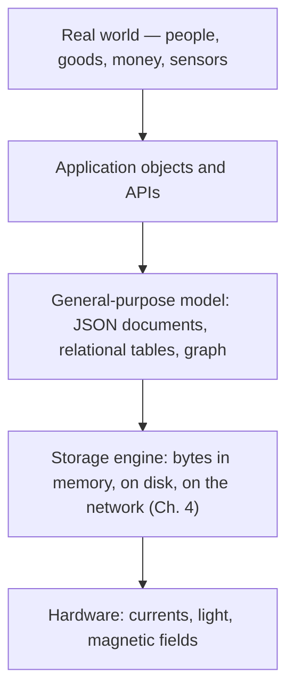
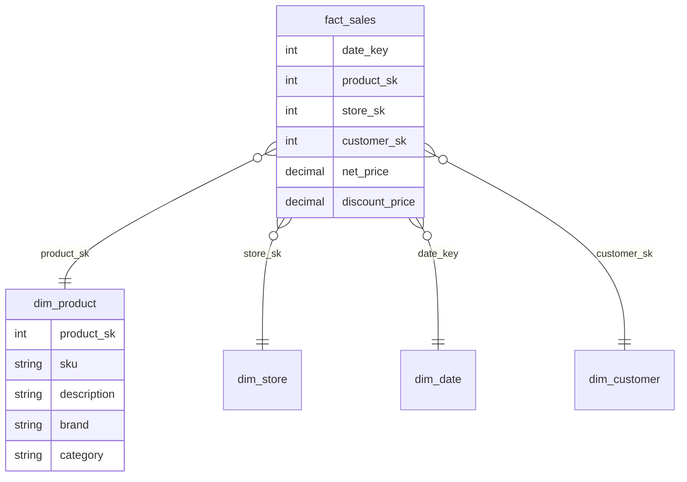
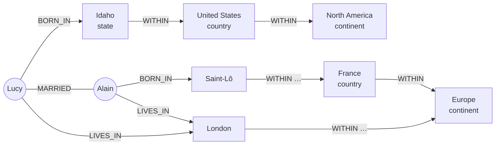
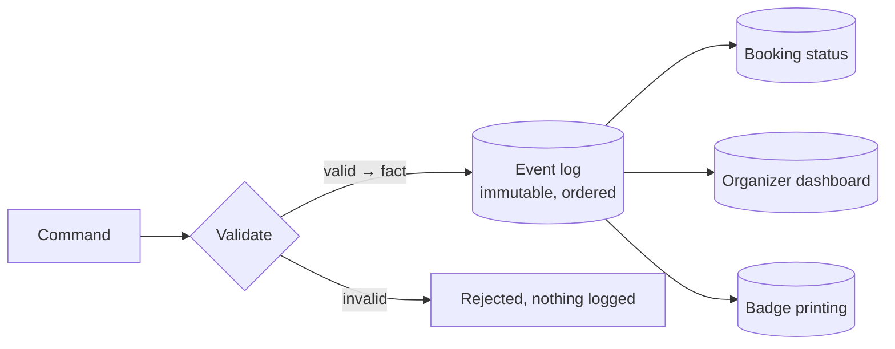

# 3. Data Models and Query Languages

[← 2. Defining Nonfunctional Requirements](02-defining-nonfunctional-requirements.md) · [Book](../README.md) · [4. Storage and Retrieval →](04-storage-and-retrieval.md)

## Summary

A data model shapes not only how software is written but how we think about the problem. The chapter compares the **relational** and **document** models — mainly through how they handle relationships (one-to-many trees versus many-to-one and many-to-many references) — then turns to **graph** models for highly connected data and surveys their query languages (Cypher, recursive SQL, SPARQL, Datalog, and the deliberately restrictive GraphQL). It closes with two models that separate how data is written from how it is read: **event sourcing with CQRS**, and **DataFrames and arrays** for analytics and machine learning. Each model can emulate the others, but awkwardly; the right choice follows from the shape of the relationships in your data.

## Key takeaways

- **The shape of relationships decides the model.** Tree-shaped, self-contained data loaded as a whole fits documents; many-to-one and many-to-many references favour relational joins; arbitrarily connected data favours graphs (pp. 67–84).
- **Normalization vs denormalization is a read/write trade-off**: normalized data is consistent and cheap to update but needs joins; denormalized data is fast to read but must be kept in sync (pp. 72–75).
- **"Schemaless" really means schema-on-read**: the structure is implicit and enforced by the reading code rather than by the database (pp. 81–82).
- **Star and snowflake schemas** organize warehouses around a central fact table referencing dimension tables (pp. 77–80).
- **Graph queries traverse a variable number of edges**, which needs recursion — natural in Cypher, SPARQL, and Datalog, clumsy in SQL's `WITH RECURSIVE` (pp. 84–100).
- **Event sourcing stores immutable events and derives read-optimized views (CQRS)**: great for auditability and evolving read models, at the cost of eventual consistency and harder deletion (pp. 101–105).
- **DataFrames generalize relations to many columns**, bridging databases and the matrices of ML and scientific computing (pp. 105–107).

## Section outline

*From the book’s own table of contents (PDF bookmarks); printed page numbers.*

- Relational Versus Document Models — p. 67
  - The Object-Relational Mismatch — p. 68
  - Normalization, Denormalization, and Joins — p. 72
  - Many-to-One and Many-to-Many Relationships — p. 75
  - Stars and Snowflakes: Schemas for Analytics — p. 77
  - When to Use Which Model — p. 80
- Graph-Like Data Models — p. 84
  - Property Graphs — p. 86
  - The Cypher Query Language — p. 88
  - Graph Queries in SQL — p. 90
  - Triple Stores and SPARQL — p. 92
  - Datalog: Recursive Relational Queries — p. 96
  - GraphQL — p. 98
- Event Sourcing and CQRS — p. 101
- DataFrames, Matrices, and Arrays — p. 105
- Summary — p. 107

## Notes

Data models shape not only how software is written but how we think about the problem (p. 65). Applications **layer** one model on another, each hiding the complexity below it:



*After the four layers on p. 65.* Most query languages here (SQL, Cypher, SPARQL, Datalog) are **declarative**: you state the pattern of data you want, not the algorithm, so the optimizer can choose indexes, join order and even parallel execution without changing your query (p. 66).

### Relational versus document models

The relational model (Codd, 1970) organizes data into **relations** (tables) of unordered **tuples** (rows); doubted at first, it dominated by the mid-1980s and outlasted every challenger — network and hierarchical models, object databases, XML databases (p. 67). **NoSQL** in the 2010s was a loose set of ideas (new models, schema flexibility, scalability, open source); **NewSQL** aimed for NoSQL scalability with relational guarantees. Its lasting effect is the **document model** (JSON), popularized by MongoDB and Couchbase and now supported by most relational databases too (p. 67).

#### The object-relational mismatch (pp. 68–71)

The translation between objects in code and tables, rows and columns is called the **impedance mismatch** (a term from electronics). **ORMs** (ActiveRecord, Hibernate) cut boilerplate:

| ORM problems | ORM benefits |
|---|---|
| Can’t fully hide the two models’ differences | Less boilerplate for the inevitable translation |
| Analytics still works on the underlying relational schema | Caching of query results |
| Often OLTP- and relational-only | Help with schema migrations and admin |
| Generated schemas can be awkward or inefficient | |
| Easy to write inefficient queries — the **N+1 problem**: 1 query for N comments, then N queries for their authors instead of one join | |

**Documents for one-to-many.** A résumé (LinkedIn profile, Example 3-1: user 251, Barack Obama, with positions, education and contact info) can be split across `users`, `positions`, `education` and `contact_info` tables (Figure 3-1) — or stored as one JSON document. The one-to-many relationships form a **tree** (Figure 3-2) that the JSON makes explicit, with better **locality**: one fetch instead of several queries or a messy multiway join. This suits “one-to-few”; thousands of comments on a celebrity’s post are better as separate rows (p. 71).

#### Normalization, denormalization, and joins (pp. 72–75)

Why store `region_id: "us:91"` rather than the text “Washington, DC, United States”? A standardized list gives consistent spelling, no ambiguity (DC or the state?), one place to update, localization, and better search (e.g. knowing Washington is on the East Coast) (p. 72).

| | Normalized (store an ID) | Denormalized (copy the text) |
|---|---|---|
| Human-meaningful data | Stored once; IDs never need to change | Duplicated in every record |
| Writes | Faster — one copy | More code, writes and disk; risk of inconsistent copies |
| Reads | Need a **join** to resolve IDs | Faster — fewer joins |
| Typical fit | OLTP; small-to-moderate scale | Analytics (bulk updates, read-heavy); very large scale |

Denormalized data is a form of **derived data** — you need a process (atomic transactions or stream processing) to keep copies consistent (p. 74). Document databases lean towards denormalization because joins are often weak; MongoDB can join with `$lookup` in an aggregation pipeline (p. 73).

**The social network again** (pp. 74–75). X’s materialized timelines store only post IDs and sender IDs (plus a little reply/repost info), not text. Each read **hydrates** the IDs — fetching post content, like counts and profiles — a join in application code. Like counts and profile photos change too fast to copy, and copying would cost storage. Joins on read are not an impediment to scale: hydration parallelizes and its cost doesn’t depend on follower counts. The most scalable design may denormalize some things and normalize others.

> **Try it:** [Normalize or denormalize?](../widgets/03-normalization.html) — rename a region stored once or copied into every profile, and see the cost move between reads and writes.

#### Many-to-one and many-to-many relationships (pp. 75–77)

| Relationship | Example | Relational | Document |
|---|---|---|---|
| One-to-many (one-to-few) | Résumé → positions | Child table with foreign key | Nested array in the document |
| Many-to-one | Many people → one region | Foreign key | Reference by ID |
| Many-to-many | People ↔ organizations | **Associative (join) table** (Figure 3-3) | References between documents (Example 3-2, `org_id: 513`) |

Many-to-many relationships are queried in both directions. Storing references on both sides is denormalized and can diverge; the normalized approach stores the relationship once and uses **secondary indexes** on both columns — and many document stores can index fields inside arrays (pp. 76–77).

#### Stars and snowflakes: schemas for analytics (pp. 77–80)



*A trimmed version of the grocery-retailer star schema in Figure 3-5 (p. 78); the vault drew only some columns.*

- The **fact table** holds one row per event (a purchase, a page view, a click) — potentially petabytes; columns are attributes (price, cost) or foreign keys into **dimension tables** describing the who, what, where, when, how and why (pp. 77–78).
- Even dates are dimensions, so holidays can be encoded (p. 79).
- **Snowflake**: dimensions split into subdimensions (brands, categories) — more normalized, but analysts usually prefer the simpler star (p. 79).
- Tables are wide: fact tables often have 100+ columns; `dim_store` can record bakeries, square footage, distance to the nearest highway (p. 79).
- **One big table (OBT)** folds dimensions into the fact table — a precomputed join, more storage, sometimes faster queries. Denormalization is unproblematic here because historical data doesn’t change (p. 79).

#### When to use which model (pp. 80–84)

| Choose documents when… | Choose relational when… |
|---|---|
| Data is a tree of one-to-many relationships, loaded as a whole (avoid **shredding** it into many tables) | You have many-to-one and many-to-many relationships and need joins |
| Users reorder items (a to-do list as a JSON array) — relational needs integer renumbering, linked lists or fractional indexing | You need to refer to nested items directly by ID |
| Records are heterogeneous, or their structure is dictated by external systems | All records share a structure worth documenting and enforcing |

**Schema-on-read vs schema-on-write** (pp. 80–82). “Schemaless” is misleading: readers assume an implicit structure. Schema-on-read ≈ dynamic typing; schema-on-write ≈ static typing; neither wins outright. Splitting `name` into `first_name`: a document app handles old documents in code (`if (user.name && !user.first_name) …`); a relational app runs `ALTER TABLE … ADD COLUMN first_name` (fast) and an `UPDATE` (slow on big tables — every row rewritten), or fills the column lazily at read time.

**Locality** (p. 82): a document is stored as one string (JSON, XML, BSON) — great when you need most of it, wasteful for small parts, and updates usually rewrite it all, so keep documents small. Relational systems offer locality too: Spanner’s interleaved tables, Oracle’s multi-table index cluster tables, Bigtable/HBase column families.

**Query languages for documents** (pp. 82–83): key-value access only, secondary indexes, or rich languages — XQuery/XPath for XML, JSON Pointer/JSONPath, MongoDB’s aggregation pipeline. The book’s shark-sightings-per-month report as SQL and as a pipeline:

```sql
SELECT date_trunc('month', observation_timestamp) AS observation_month,
       sum(num_animals) AS total_animals
FROM observations
WHERE family = 'Sharks'
GROUP BY observation_month;
```

```js
db.observations.aggregate([
  { $match: { family: "Sharks" } },
  { $group: {
      _id: { year:  { $year:  "$observationTimestamp" },
             month: { $month: "$observationTimestamp" } },
      totalAnimals: { $sum: "$numAnimals" } } }
]);
```

**Convergence** (pp. 83–84): relational databases gained JSON types, operators and indexes; MongoDB, Couchbase and RethinkDB gained joins, secondary indexes and declarative queries. Hybrids are powerful — and Codd’s original paper already allowed nested relations (“nonsimple domains”).

### Graph-like data models

When many-to-many relationships dominate, model data as **vertices** (nodes, entities) and **edges** (relationships, arcs) (p. 84): social graphs, the web graph (PageRank), road and rail networks (shortest paths). Graphs can be stored as **adjacency lists** (good for traversal) or **adjacency matrices** (good for ML), and can mix many types in one store — Facebook’s single graph of people, places, events, check-ins and comments; search engines’ knowledge graphs; Wikidata (p. 85).



*The vault’s simplified sketch of the running example, Figure 3-6 (p. 86): Lucy from Idaho and Alain from Saint-Lô, married and living in London. The figure itself has more intermediate regions.*

#### Property graphs (pp. 86–88)

| Vertex | Edge |
|---|---|
| Unique ID | Unique ID |
| Label (type of object) | Tail vertex (start) and head vertex (end) |
| Outgoing and incoming edges | Label (kind of relationship) |
| Properties (key-value pairs) | Properties (key-value pairs) |

It maps onto two tables — `vertices(vertex_id, label, properties jsonb)` and `edges(edge_id, tail_vertex, head_vertex, label, properties jsonb)` with indexes on both ends (Example 3-3). Any vertex may connect to any other; you can traverse forwards and backwards; labels keep many kinds of data in one clean model. The edges table is a generalized join table — but an edge joins only two vertices, so three-way relationships need an extra vertex or a hypergraph (pp. 87–88). Graphs absorb irregular data well: départements and régions in France vs counties and states in the US, a country within a country, residence known to a city but birthplace only to a state — and they **evolve** easily (e.g. adding allergens and foods to find what is safe to eat) (p. 88). Implemented by Neo4j, Memgraph, KùzuDB and others (p. 85).

#### The Cypher query language (pp. 88–90)

Created for Neo4j, now openCypher, also in Memgraph, KùzuDB, Neptune and Apache AGE; named after a character in *The Matrix* (p. 88).

```cypher
MATCH
  (person) -[:BORN_IN]->  () -[:WITHIN*0..]-> (:Location {name:'United States'}),
  (person) -[:LIVES_IN]-> () -[:WITHIN*0..]-> (:Location {name:'Europe'})
RETURN person.name
```

*Example 3-5: people who emigrated from the US to Europe.* `:WITHIN*0..` means “follow a WITHIN edge zero or more times”, like `*` in a regular expression. Being declarative, the engine may scan all people, or start from the two named locations (via an index on `name`) and walk incoming edges (pp. 89–90).

#### Graph queries in SQL (pp. 90–92)

Each traversed edge is a join, and the number of joins isn’t known in advance. SQL expresses variable-length paths with **recursive common table expressions** (`WITH RECURSIVE`): Example 3-6 builds `in_usa`, `in_europe`, `born_in_usa` and `lives_in_europe`, then intersects them. **A 4-line Cypher query needs 31 lines of SQL** — and cycles and BFS-vs-DFS add more. Oracle has “hierarchical” queries; TigerGraph has GSQL, there is PGQL, and the ISO **GQL** standard based on Cypher was published in 2024 (p. 92).

#### Triple stores and SPARQL (pp. 92–96)

Everything is a **(subject, predicate, object)** triple — (Jim, likes, bananas). The object is either a primitive value — then predicate + object are a property, as in (lucy, birthYear, 1989) — or another vertex — then the predicate is an edge, as in (lucy, marriedTo, alain). Real systems add metadata: Neptune uses quads (graph ID), Datomic 5-tuples (transaction ID, deletion flag) (p. 92). Data can be written in **Turtle** (a subset of N3) or RDF/XML; RDF uses URIs as names so different publishers’ “within” don’t collide (pp. 93–95). The **Semantic Web** didn’t succeed as envisioned, but its legacy lives on in JSON-LD, biomedical ontologies, Facebook’s Open Graph (link unfurling), Wikidata and Schema.org (p. 94).

```sparql
PREFIX : <urn:example:>
SELECT ?personName WHERE {
  ?person :name ?personName.
  ?person :bornIn  / :within* / :name "United States".
  ?person :livesIn / :within* / :name "Europe".
}
```

*Example 3-10: the same query in SPARQL (“sparkle”), whose pattern matching Cypher borrowed (p. 95).*

#### Datalog: recursive relational queries (pp. 96–98)

An academic language from the 1980s, a subset of Prolog, used by Datomic, LogicBlox, CozoDB and LinkedIn’s LIquid. It is relational, but recursion makes it strong for graphs. Facts are rows — `location(2, "United States", "country")`, `within(3, 2)`, `born_in(100, 3)` — and **rules** derive virtual tables, like views:

| Rule (Example 3-12) | Derives |
|---|---|
| 1 · `within_recursive(Loc, Name) :- location(Loc, Name, _).` | Every location is within itself |
| 2 · `within_recursive(Loc, Name) :- within(Loc, Via), within_recursive(Via, Name).` | Recursion: Idaho → US → North America (Figure 3-7) |
| 3 · `migrated(PName, BornIn, LivingIn) :- person(…), born_in(…), within_recursive(…), lives_in(…), within_recursive(…).` | Birthplace and residence names for every person |
| 4 · `us_to_europe(Person) :- migrated(Person, "United States", "Europe").` | The answer: “Lucy” |

Complex queries are built rule by rule, like functions calling each other (p. 98).

#### GraphQL (pp. 98–101)

Designed for OLTP clients (mobile apps, web frontends) to request a JSON document shaped exactly like the UI needs — e.g. a chat app’s channels with their 50 latest messages, senders and replied-to messages (Examples 3-13/3-14). It is deliberately restrictive because queries come from untrusted clients: **no recursion and no arbitrary search conditions**, only joins declared in the schema. Responses repeat data (a sender’s name in every message) to keep rendering simple. Costs: translating queries to internal REST/gRPC services, authorization, rate limiting. Despite the name it can sit on any database (pp. 98–101).

| Language | Data model | Variable-length traversal | Typical home |
|---|---|---|---|
| SQL | Relational | `WITH RECURSIVE` (verbose) | Almost everywhere |
| Cypher / GQL | Property graph | `-[:WITHIN*0..]->` | Neo4j, Memgraph, KùzuDB, Neptune |
| SPARQL | Triples (RDF) | `:within*` | Neptune, AllegroGraph, Jena, Virtuoso |
| Datalog | Relational facts + rules | Recursive rules | Datomic, CozoDB, LIquid |
| GraphQL | Any, via a schema | Not allowed | Client–server APIs |

### Event sourcing and CQRS

Write in one form, read in others (p. 101). The simplest, fastest, most expressive way to write is an **append-only log of immutable events**. In the book’s conference-management example (Figure 3-8) — individual and bulk bookings, invoices, reserved seats, cancellations, room changes — even “how many seats are left?” is hard. Each change is stored as an event, and **materialized views** (projections, read models) are updated from it: booking status, the organizer’s dashboard, badge printing (pp. 101–102).



- **Event sourcing**: events are the source of truth; **CQRS**: separate read-optimized representations derived from the write-optimized one. Both come from domain-driven design; the idea is old (state machine replication) (p. 102).
- A **command** is validated first; only then does it become a fact in the log. Consumers may not reject events. Name events in the **past tense** (“the seats were booked”) (pp. 102–103).
- Like a fact table, the log records past events — but events vary in type and properties, and **order matters** (p. 103).

| Advantages (pp. 103–104) | Downsides (p. 104) |
|---|---|
| Events communicate *why* — “booking cancelled” vs a pile of row changes | **External data** (e.g. exchange rates) must be in the event or queried as of the event’s timestamp, or replays differ |
| Views are reproducible: fix a bug, delete the view, replay | **Immutability vs deletion** (GDPR): per-user logs can be deleted; otherwise keep personal data outside events or **crypto-shred** it |
| Many views, any data model, even in memory only | **Side effects** on replay — don’t resend confirmation emails |
| New views and features from the existing log; chain behaviours (offer a cancelled seat to the waiting list) | |
| Mistakes reversed by a later deletion event — fewer irreversible actions | |
| Audit log for regulated industries; sequential writes absorb bursts | |

Built on any database, or EventStoreDB, MartenDB, Axon, Kafka plus stream processors (Ch. 12). The one hard requirement: **every view processes events in the same order** — not easy in a distributed system (Ch. 10) (p. 105).

> **Try it:** [Event sourcing and CQRS](../widgets/03-event-sourcing.html) — validate commands into events, derive views, then fix a buggy view by replaying the log.

### DataFrames, matrices, and arrays

Models of the analytical and scientific world that rarely appear in OLTP (p. 105):

- **DataFrames** (R, Pandas, Spark, ArcticDB, Dask) look like tables and offer relational-like bulk operations — apply, filter, group-and-aggregate, *merge* (join) — but are driven by a sequence of commands rather than a declarative query, matching how data scientists incrementally **wrangle** a private copy (p. 105).
- They often turn relational data into a **matrix**: movie ratings (user, movie, 1–5) pivoted into a sparse user × movie matrix with thousands of columns (Figure 3-9). Non-numbers are encoded — dates scaled to floats, categories **one-hot encoded** (comedy, drama, horror…). Then linear algebra, the basis of many ML algorithms, applies (p. 106).
- **Array databases** such as TileDB store large multidimensional arrays: geospatial rasters, medical imaging, telescope data; DataFrames also represent financial time series (p. 107).

**Models not covered** (p. 108): genome sequence-similarity search (GenBank), double-entry ledgers (TigerBeetle; blockchains), and full-text search.

## Trade-offs at a glance

| | Relational | Document | Graph | Event sourcing |
|---|---|---|---|---|
| Best fit | Many-to-one / many-to-many | Self-contained trees | Densely connected data | Complex domains, audit needs |
| Joins | First-class | Weak, often in app code | Traversals are the point | Precomputed in views |
| Schema | On write | On read | Usually on read | Event schema must evolve compatibly |
| Main cost | Mismatch with objects | Poor references, whole-document writes | Fewer mature tools | Eventual consistency, deletion |

## Beyond the book

- A useful rule of thumb from practice: start relational (with JSON columns for genuinely variable parts) unless your access pattern is overwhelmingly "fetch one aggregate by ID".
- Martin Fowler's articles "Event Sourcing" and "CQRS" are the standard introductions and warn that CQRS adds risky complexity when applied to a whole system rather than a bounded context.

## Connections

- **Related chapters:** [4. Storage and Retrieval](04-storage-and-retrieval.md) (how each model is stored), [5. Encoding and Evolution](05-encoding-and-evolution.md) (schema evolution), [12. Stream Processing](12-stream-processing.md) (event logs and CDC), [11. Batch Processing](11-batch-processing.md) (DataFrames at scale).

## Check yourself

*Questions and answers are the vault's, written from the notes above; answers cite the book's pages.*

1. **A profile has positions, education and a region. Which relationships are one-to-many and which many-to-one, and why does it matter for choosing a document model?**

   *Answer:* Positions and education are one-to-many (a tree owned by the profile) and fit naturally in one document. Region is many-to-one (many profiles refer to one region), which is better normalized and referenced by ID — and references need joins, which document databases have historically supported less well (pp. 68–77).

2. **In what sense is a "schemaless" database not schemaless?**
   - [ ] It rejects documents that don't match a declared schema
   - [x] The code that reads the data still assumes a structure; the schema is implicit and interpreted on read (schema-on-read)
   - [ ] It stores a schema alongside every document
   - [ ] It converts every document into relational tables internally

   *Answer:* Document databases don't enforce a schema on write, but application code still expects certain fields — "schema-on-read", analogous to dynamic type checking, versus schema-on-write in relational databases (pp. 80–83).

3. **Why is a variable-length graph traversal awkward in SQL but natural in Cypher or Datalog?**

   *Answer:* In Cypher a path of unknown length is one pattern (e.g. `-[:WITHIN*0..]->`); in SQL it needs a recursive common table expression, which is much longer and harder to read. Datalog builds such queries from rules that can refer to themselves (pp. 88–98).

4. **Why does GraphQL deliberately forbid recursive queries?**

   *Answer:* GraphQL queries come from untrusted clients; restricting the language keeps the cost of a query predictable so a client can't make the server run an arbitrarily expensive traversal (pp. 98–101).

5. **What is the source of truth in an event-sourced system?**
   - [ ] The read-optimized materialized views
   - [x] The append-only log of immutable events
   - [ ] A relational table updated in place
   - [ ] The cache in front of the views

   *Answer:* Events are written once and never changed; read-optimized views are derived from them and can be rebuilt (CQRS separates the write and read representations). This is also why deleting a person's data is hard: possible approaches include crypto-shredding or rewriting the log (pp. 101–105).
