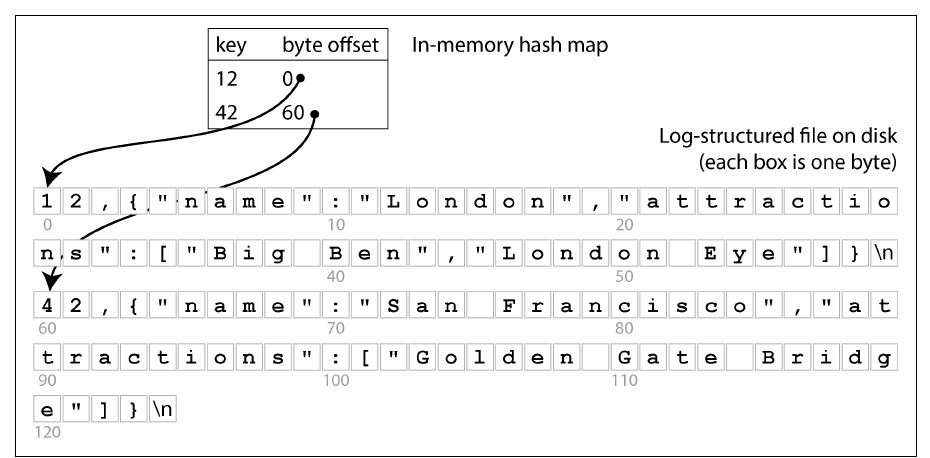
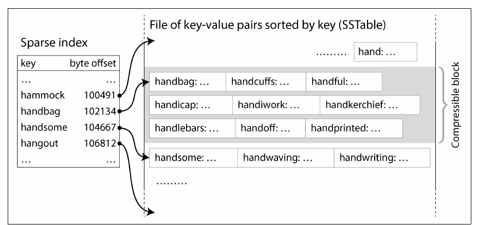
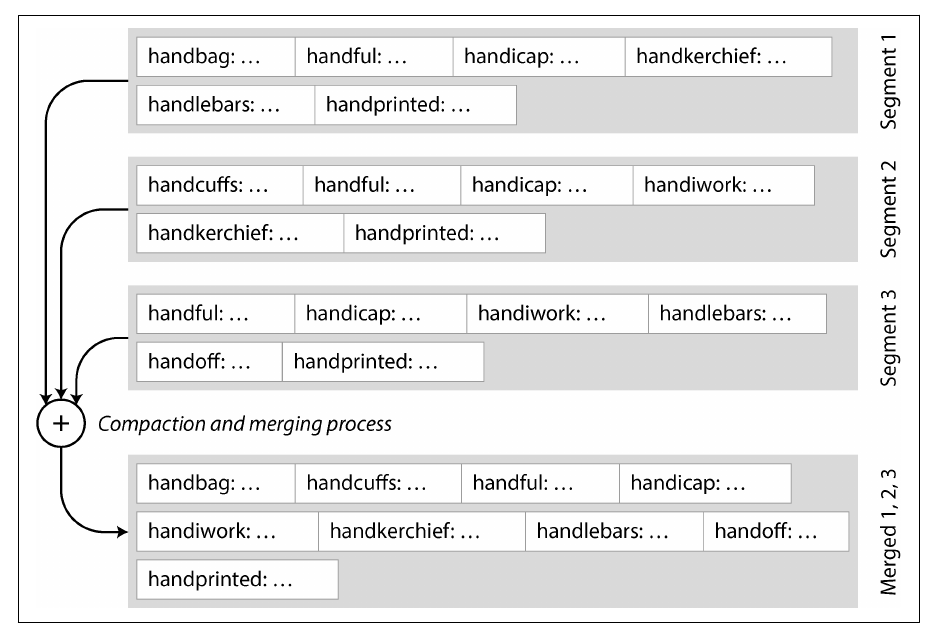
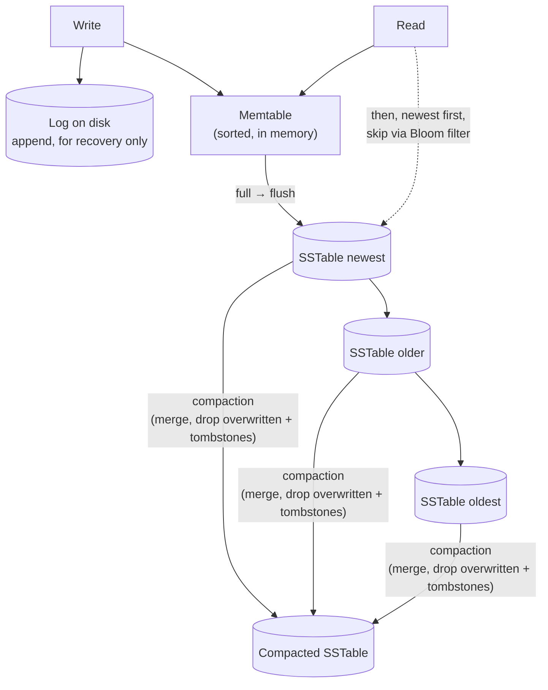
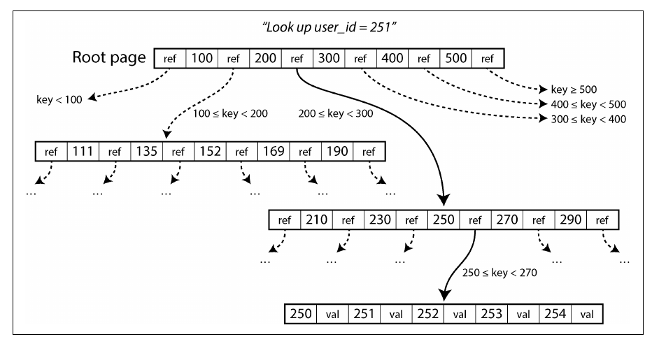
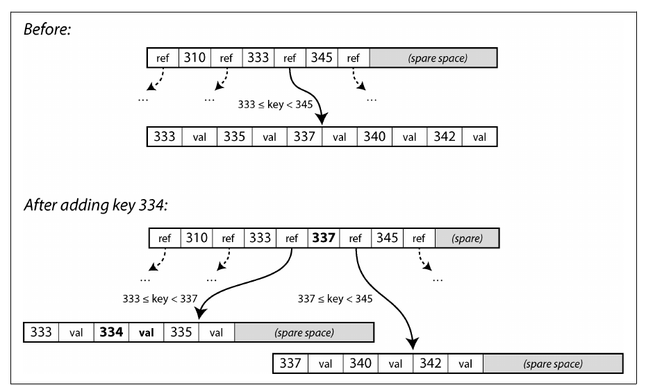
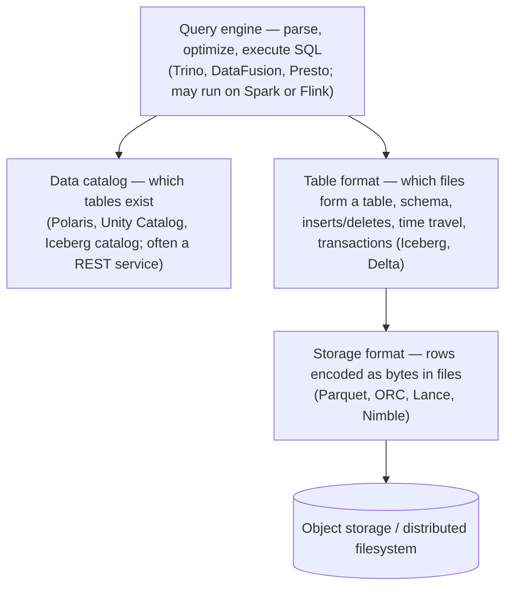
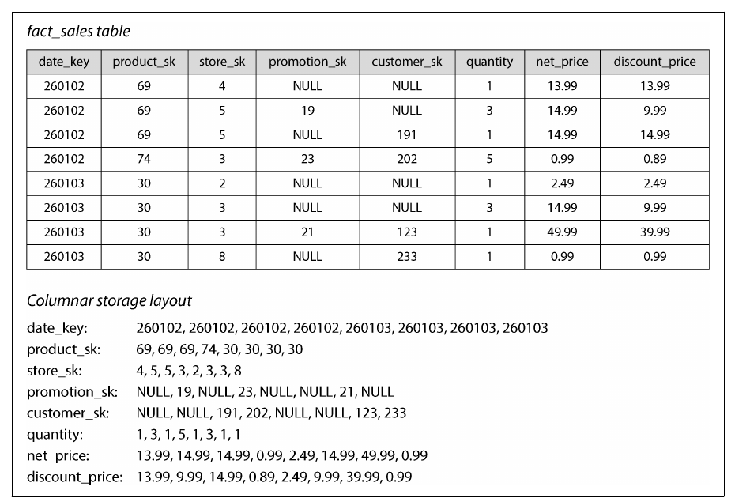
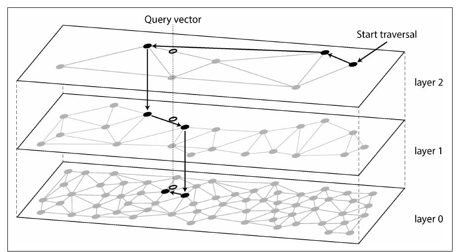

# 4. Storage and Retrieval

[← 3. Data Models and Query Languages](03-data-models-and-query-languages.md) · [Book](../README.md) · [5. Encoding and Evolution →](05-encoding-and-evolution.md)

## Summary

What actually happens when a database stores your data and finds it again? The chapter builds storage engines from the simplest possible one — an append-only file — up to the two schools of OLTP storage: **log-structured** engines (SSTables, LSM-trees) that never modify files in place, and **update-in-place** engines (B-trees) that overwrite fixed-size pages. It then shows why analytics needs a different layout entirely — **column-oriented storage** with compression, vectorized or compiled query execution, and materialized aggregates — and finishes with indexes for multiple dimensions, full-text search, and vector embeddings for semantic search. Understanding these internals lets you choose and tune a database for your workload instead of treating it as a black box.

## Key takeaways

- **An index is extra structure derived from the data**: it speeds reads but slows writes, so databases don't index everything by default (pp. 116–117).
- **LSM-trees turn random writes into sequential ones**: buffer in a sorted memtable (protected by a WAL), flush immutable sorted SSTables, merge them in the background. High write throughput; reads may check several files, helped by Bloom filters (pp. 118–125).
- **B-trees overwrite fixed-size pages in place**, keep a balanced tree of depth O(log n), and use a WAL for crash safety. Rule of thumb: better for reads, LSM-trees better for writes — but test your workload (pp. 125–132).
- **Write amplification, read amplification, and space amplification** are the axes on which storage engines trade off (pp. 129–132).
- **Analytics wants columns, not rows**: store each column separately, compress it (bitmaps, run-length encoding), and process it in vectorized batches (pp. 134–143).
- **Cloud data warehouses separate storage and compute** and build on open file formats and table formats over object storage (pp. 135–136).
- **Beyond one-dimensional keys**: R-trees for multidimensional ranges, inverted indexes for full-text search, and approximate nearest-neighbour indexes (e.g. HNSW, IVF) over vector embeddings (pp. 145–150).

## Section outline

*From the book’s own table of contents (PDF bookmarks); printed page numbers.*

- Storage and Indexing for OLTP — p. 116
  - Log-Structured Storage — p. 118
  - B-Trees — p. 125
  - Comparing B-Trees and LSM-Trees — p. 129
  - Multicolumn and Secondary Indexes — p. 132
  - Storing Values Within the Index — p. 133
  - Keeping Everything in Memory — p. 133
- Data Storage for Analytics — p. 134
  - Cloud Data Warehouses — p. 135
  - Column-Oriented Storage — p. 136
  - Query Execution: Compilation and Vectorization — p. 142
  - Materialized Views and Data Cubes — p. 143
- Multidimensional and Full-Text Indexes — p. 145
  - Full-Text Search — p. 146
  - Vector Embeddings — p. 147
- Summary — p. 150

## Notes

A database does two things: store the data you give it and give it back later. You won’t write a storage engine, but you must pick and tune one — and engines for OLTP and for analytics differ enormously (p. 115).

### Storage and indexing for OLTP

“The world’s simplest database” is two bash functions (p. 116):

```sh
db_set () { echo "$1,$2" >> database; }
db_get () { grep "^$1," database | sed -e "s/^$1,//" | tail -n 1; }
```

`db_set` appends — very fast; updates leave old versions behind, so `db_get` takes the last match. Many databases use exactly this structure, a **log**: an append-only sequence of records (not application logs). But `db_get` scans everything: **O(n)** (p. 117). An **index** is extra structure *derived* from the data; adding or dropping one changes only performance, not contents. Every index speeds some reads and **slows every write**, which is why you choose indexes yourself (p. 117).

#### Log-structured storage (pp. 118–125)

**Step 1 — a hash index over the log** (Figure 4-1): an in-memory hash map from key to the byte offset of its latest value. Fast, but (pp. 118–119): old entries never free disk space; the map must be rebuilt by scanning the log on restart; all keys must fit in memory (on-disk hash maps perform poorly); range queries are inefficient.



*Figure 4-1 (p. 118): the map stores only where each key's latest value starts; one seek reads it.*

**Step 2 — SSTables** (Sorted String Tables, Figure 4-2): key-value pairs **sorted by key**, each key once. Then a **sparse index** suffices — the first key of each few-KB block: to find `handiwork`, seek to block `handbag` (the next starts at `handsome`) and scan. Blocks can be **compressed**, saving disk and I/O bandwidth for a little CPU (p. 119).



*Figure 4-2 (p. 119): because keys are sorted, one index entry per block suffices — look up the nearest key before and scan from there.*

**Step 3 — the LSM-tree** (pp. 120–121):

1. Writes go into an in-memory ordered map — the **memtable** (red-black tree, skip list or trie).
2. When it exceeds a few MB, write it out as a new SSTable **segment**; keep accepting writes in a fresh memtable.
3. Reads check the memtable, then segments **from newest to oldest**.
4. In the background, **merge and compact** segments — like mergesort, keeping only the newest value per key, using little memory (Figure 4-3).



*Figure 4-3 (p. 121): merging works like mergesort over sorted files; for a key in several segments, the newest value wins.*

A separate unsorted **log** of every write (discarded after each flush) protects the memtable from crashes; a **tombstone** marks a deletion and is dropped once merged into the oldest segment (pp. 120–121). This is the algorithm of RocksDB, Cassandra, ScyllaDB and HBase, inspired by Bigtable (which coined *SSTable* and *memtable*), from the 1996 **Log-Structured Merge-tree** paper (p. 121). Segments are immutable — reads keep using old segments during a merge, unfinished files are simply deleted after a crash, checksums catch torn log records, and segments suit object storage (SlateDB, Delta Lake) (pp. 121–122).



**Bloom filters** (pp. 122–123, Figure 4-4): each SSTable carries a bit array; a key sets the bits its hashes point to (`handbag` → 2, 9, 4). A query for `handheld` → (6, 11, 2): any 0 bit ⇒ **definitely absent**, skip the file; all 1s ⇒ *probably* present (a false positive costs one wasted block read). Rule of thumb: **10 bits per key ≈ 1% false positives, and every 5 more bits per key cuts that tenfold** (p. 123).

**Compaction strategies** (p. 124):

| | Size-tiered | Leveled |
|---|---|---|
| How | Merge newer, smaller SSTables into older, larger ones — e.g. four 256 MB files → one **898 MB** file (deletes, overwrites, TTLs) | Fixed-size SSTables in levels L0, L1, …; beyond L0 each level is key-range-partitioned (L1: a–m, n–z); overflow merges into the next level |
| Strength | Very high write throughput: data rewritten only a few times, in big sequential merges | Incremental, less disk space, fewer SSTables to check per read |
| Weakness | Huge old SSTables; lots of temporary disk during merges | More rewriting |
| Rule of thumb | Mostly writes, few reads | Read-dominated; or a few hot keys written often and many rarely |

**Embedded storage engines** — RocksDB, SQLite, LMDB, DuckDB, KùzuDB — are libraries in the application process, common in mobile apps and an option per tenant when tenants are small and separate (p. 125).

> **Try it:** [Inside an LSM-tree](../widgets/04-lsm-tree.html) — write, flush, compact and read; watch Bloom filters skip files, tombstones shadow values, and the WAL rebuild a crashed memtable.

#### B-trees (pp. 125–129)

Introduced in 1970 and “ubiquitous” within ten years, B-trees remain the standard index of almost all relational databases (p. 125). Like SSTables they keep keys sorted; unlike them they split the database into **fixed-size pages** — traditionally 4 KiB; PostgreSQL uses 8 KiB, MySQL 16 KiB — and **overwrite pages in place** (p. 125).

- **Lookup** (Figure 4-5): start at the root; each page holds keys and child references splitting the key range (looking up 251: the 200–300 child, then 250–270) down to a **leaf** holding values or references. Children per page = **branching factor** (6 in the figure, several hundred in practice) (p. 126).
- **Insert** (Figure 4-6): a full page **splits** — inserting 334 into full page 333–345 gives 333–337 and 337–345, with boundary 337 added to the parent; splits may cascade up to a **new root**. Depth stays **O(log n)**: three or four levels suffice for most databases; **four levels of 4 KiB pages with branching factor 500 hold up to 250 TB** (p. 127).
- **Reliability** (pp. 127–128): a split overwrites several pages; a crash midway can leave an **orphan page**, and non-atomic page writes a **torn page**. Hence a **write-ahead log** written (and `fsync`ed) before pages change — journaling in filesystems. Pages are buffered in memory; the WAL keeps them durable.
- **Variants** (p. 128): **copy-on-write** pages instead of a WAL (LMDB), also useful for snapshot isolation; abbreviated keys in interior pages (higher branching factor); leaf pages laid out sequentially on disk; sibling pointers between leaves for range scans.



*Figure 4-5 (p. 126): each page narrows the key range; the lookup follows one reference per level.*



*Figure 4-6 (p. 127): the full page splits on boundary key 337, and the parent gets a new key and reference.*

> **Try it:** [B-tree pages, lookups and splits](../widgets/04-btree.html) — follow page references from the root, split a full page as in Figure 4-6, and crash mid-split with and without a WAL.

#### Comparing B-trees and LSM-trees (pp. 129–132)

Rule of thumb: **LSM-trees for write-heavy, B-trees faster for reads** — but benchmarks are workload-sensitive, test your own, and engines blend both (p. 129).

| Aspect | LSM-tree | B-tree |
|---|---|---|
| Point reads | May check several SSTables; Bloom filters cut I/O | One page per level — fast and predictable |
| Range queries | Scan all segments in parallel and merge; Bloom filters useless | Simple and fast on the sorted tree |
| Write latency | Spikes when the memtable fills faster than compaction drains it — RocksDB applies **backpressure**, suspending reads and writes | — |
| Write pattern | **Sequential**: whole segments at a time | **Random**: scattered page overwrites |
| Write amplification | Log + flush + every compaction (can store large values separately); usually **lower** — no whole-page writes, compressed blocks | At least twice (WAL + page), sometimes a whole page for a few bytes |
| Disk space | Compresses better, no half-empty pages; overwritten data lingers until compaction (low with leveled, high with size-tiered) | **Fragmentation** after deletes; free pages can’t return to the OS — needs a background **vacuum** (PostgreSQL) |
| Deleting for real | A deleted record lingers until its tombstone reaches every level | — |
| Snapshots | Easy: flush the memtable and keep the current immutable files | Harder with overwritten pages |

**Why sequential writes win even on SSDs** (p. 130): flash is written in pages (~4 KiB) but erased in blocks (~512 KiB). Random writes leave blocks mixing valid and stale pages, so the controller’s **garbage collection** must copy data before erasing — stealing bandwidth and wearing the drive. Large sequential files tend to fill and free whole blocks. **Write amplification** = bytes written to disk ÷ bytes an index-free log would write; it limits throughput in write-heavy apps and wears SSDs, and only shows up in long benchmarks once compaction competes with new writes (pp. 130–131). NVMe SSDs serve many reads in parallel; engines must be designed to exploit that (p. 129).

#### Secondary indexes, values in the index, and memory (pp. 132–134)

- **Secondary indexes** (`CREATE INDEX`) don’t have unique keys: store a list of row IDs per entry (a postings list) or append the row ID to make entries unique. Both B-trees and LSM-trees can implement them (p. 132).

| Where the indexed value lives (p. 133) | Example |
|---|---|
| **Clustered index** — the row itself inside the index | InnoDB primary key; one per table in SQL Server |
| Reference to the primary key | InnoDB secondary indexes |
| Reference into a **heap file** (rows in no particular order) | PostgreSQL |
| **Covering index** / included columns — some columns copied into the index | Answers some queries from the index alone; costs space and write speed |

A heap row that grows must move, requiring every index to be updated or a forwarding pointer left behind (p. 133).

- **Keeping everything in memory** (pp. 133–134): disks are durable and cheaper per GB; as RAM gets cheaper, many datasets fit in memory. Memcached is a cache (loss is fine); VoltDB, SingleStore, Oracle TimesTen, RAMCloud aim for durability via logs, snapshots or replication; Redis and Couchbase write to disk asynchronously (weak durability). They are fast **not because they avoid disk reads** — the OS caches disk blocks anyway — but because they avoid **encoding in-memory structures for disk**. They also enable structures awkward on disk, such as Redis’s priority queues and sets.

### Data storage for analytics

Warehouses are usually relational (SQL suits analytics), but their internals differ from OLTP databases; HTAP products (SQL Server, SAP HANA, SingleStore) are increasingly two engines behind one SQL interface (pp. 134–135).

#### Cloud data warehouses (pp. 135–136)

Teradata, Vertica and SAP HANA came from on-premises licensing; BigQuery, Redshift and Snowflake are cloud-only — elastic because compute is decoupled from object storage, and integrated with cloud ingestion (Dataflow, Kinesis). Open-source warehouses (Hive, Trino, Spark) broke apart into layers:



*The vault’s layering of the four components on pp. 135–136.*

#### Column-oriented storage (pp. 136–142)

Fact tables may have trillions of rows and 100+ columns, yet a typical query touches **four or five** of them — Example 4-1 (fruit vs candy sales by weekday in 2024) needs only `date_key`, `product_sk` and `quantity` (pp. 136–137). Row-oriented storage must load and parse every 100-column row; **columnar** storage reads only the columns used (Figure 4-7). Every column keeps the **same row order**, so row 23 is entry 23 of each column. Real engines store columns per **block** of thousands to millions of rows, often one block per time range (p. 138). Used almost everywhere in analytics: Snowflake, DuckDB, Pinot, Druid; Parquet (with Dremel-style shredding for documents), ORC, Lance, Nimble; Arrow, Pandas/NumPy; InfluxDB IOx, TimescaleDB (pp. 137–138).



*Figure 4-7 (p. 138): each column is stored separately in the same row order, so a query reads only the columns it names.*

- **Compression — bitmaps and run-length encoding** (pp. 139–140): few distinct values (billions of sales, 100,000 products) → one bitmap per value, one bit per row; sparse bitmaps run-length encode; **roaring bitmaps** pick the more compact form. `IN (31, 68, 69)` = OR of three bitmaps; `product_sk = 30 AND store_sk = 3` = AND, valid because bit k is row k everywhere. Bitmaps even answer graph questions (followed by X and following Y). Not to be confused with **wide-column** (column-family) stores like Bigtable, Accumulo, HBase — those are row-oriented.
- **Sort order** (pp. 140–141): sort whole rows (never columns independently) by keys chosen for common queries — e.g. `date_key` first (scan only last month), then `product_sk`. The first sort key compresses into a few KB even for billions of rows; later keys compress less.
- **Writing** (p. 141): inserting into the middle of sorted, compressed columns is hopeless; instead buffer writes in a row-oriented sorted in-memory store and merge into new column files in bulk — LSM-style, immutable files that suit object storage. Queries combine both transparently (Snowflake, Vertica, Pinot, Druid).

> **Try it:** [Column storage and bitmap indexes](../widgets/04-column-bitmaps.html) — turn a column into bitmaps, run-length encode them, and answer IN and AND filters with bitwise operations.

#### Query execution: compilation and vectorization (pp. 142–143)

A query plan is a tree of **operators**, possibly spread over machines. An interpreter that consults the query for every row is too slow, so:

| | Query compilation | Vectorized processing |
|---|---|---|
| Idea | Generate code for this query and compile it to machine code (often LLVM), like a JIT | Interpret, but run built-in operators on **batches** of column values |
| Example | Generated loop over rows checking conditions | `product_sk = bananas` → bitmap; `store_sk = X` → bitmap; bitwise AND (Figure 4-9) |

Both exploit modern CPUs: sequential memory access (fewer cache misses), tight inner loops without function calls or branch mispredictions, threads and **SIMD**, and operating directly on compressed data (p. 143).

#### Materialized views and data cubes (pp. 143–145)

A **materialized view** stores a query’s results on disk (a virtual view is just a query shortcut) and must be updated when inputs change — automatically by some databases, or by systems such as Materialize. A **data cube** (OLAP cube) is a grid of materialized aggregates by dimension — e.g. `SUM(net_price)` per (date, product), with row and column totals (Figure 4-10); with five dimensions it is a hypercube. “Total sales per store yesterday” becomes a lookup, but questions on non-dimensions (share of sales from items over $100) can’t be answered — so warehouses keep raw data and use cubes only as a boost (pp. 143–145).

### Multidimensional and full-text indexes

A **concatenated index** (last name, first name) is like a phone book: it finds a last name, or a full name, but not a first name alone (p. 145). A map viewport needs a two-dimensional range query:

```sql
SELECT * FROM restaurants
WHERE latitude  > 51.4946 AND latitude  < 51.5079
  AND longitude > -0.1162 AND longitude < -0.1004;
```

A concatenated (lat, long) index gives one range or the other, not both. Options: map 2-D to 1-D with a **space-filling curve** and use a B-tree; or **R-trees** / Bkd-trees that group nearby points in the same subtree (PostGIS on PostgreSQL’s GiST); or grids of triangles, squares or hexagons. Other dimensions work too: (red, green, blue) for product colours, (date, temperature) for weather observations between 25 °C and 30 °C (pp. 145–146).

#### Full-text search (pp. 146–147)

Think of each term as a dimension (a document has 1 in dimension “red” if it contains it). An **inverted index** maps each term to its **postings list** of document IDs — or a sparse bitmap — so “red apples” is a bitwise AND, even on run-length-encoded bitmaps. Lucene (Elasticsearch, Solr) keeps term → postings in SSTable-like files merged log-structured; PostgreSQL’s GIN indexes do similar for text and JSON. **n-gram** (trigram) indexes support arbitrary substrings and even regular expressions, at a large size cost; typo tolerance uses **Levenshtein automata** to find terms within an edit distance (p. 147).

#### Vector embeddings (pp. 147–150)

**Semantic search** finds “canceling your subscription” for the query “how to close my account” — important for retrieval-augmented generation. An **embedding model** (Word2Vec, BERT, GPT; now multimodal) maps a document to a vector of floats; similar meanings land close together. The book’s 3-D illustration: agriculture `[0.38, 0.83, 0.41]`, vegetables `[0.36, 0.64, 0.67]` (near), star schemas `[0.85, 0.10, -0.52]` (far); real embeddings have 1,000+ dimensions. Distance: **cosine similarity** (angle) or **Euclidean distance**. (Not the “vector” of vectorized processing.) R-trees fail at that many dimensions, so (pp. 148–149):

| Vector index | How | Accuracy / speed |
|---|---|---|
| Flat | Compare the query with every vector | Exact, slow |
| IVF (inverted file) | Cluster vectors around centroids; search a number of **probes** (partitions) | Approximate; more probes = more accurate, slower |
| HNSW | Layers of proximity graphs; greedy search from a sparse top layer down to dense lower layers (Figure 4-11) | Approximate, fast |

Faiss and pgvector implement both IVF and HNSW (p. 149).



*Figure 4-11 (p. 149): each layer refines the position found in the sparser layer above.*

## Trade-offs at a glance

| Workload | Storage layout | Example structure |
|---|---|---|
| High write throughput, point/range reads | Log-structured | LSM-tree (RocksDB, Cassandra) |
| Read-heavy OLTP, predictable latency | Update-in-place pages | B-tree (PostgreSQL, MySQL) |
| Scans and aggregates over few columns | Column-oriented, compressed | Parquet, cloud warehouses |
| Geospatial / multi-attribute ranges | Multidimensional | R-tree |
| Keyword search | Inverted index | Lucene |
| Semantic similarity | Approximate nearest neighbour | HNSW, IVF |

## Beyond the book

- The "RUM conjecture" (Athanassoulis et al., 2016) formalizes the trade-off between **R**ead, **U**pdate, and **M**emory (space) amplification that underlies the LSM vs B-tree comparison.
- The Bloom filter false-positive rate is approximately (1 − e<sup>−kn/m</sup>)<sup>k</sup>; with 10 bits per key and 7 hash functions it is about 0.8% — the vault's [LSM experiment](../lab/04-lsm-tree/README.md) measures ≈0.9%.

## Connections

- **Run it:** [A minimal LSM-tree](../lab/04-lsm-tree/README.md) — measures write amplification and Bloom-filter savings.
- **Related chapters:** [3. Data Models and Query Languages](03-data-models-and-query-languages.md), [6. Replication](06-replication.md) (replication logs), [8. Transactions](08-transactions.md) (durability, WAL), [11. Batch Processing](11-batch-processing.md) (columnar files, object stores), [12. Stream Processing](12-stream-processing.md) (log-structured brokers).

## Check yourself

*Questions and answers are the vault's, written from the notes above; answers cite the book's pages.*

1. **Why does sorting the keys in a segment file make a sparse index possible?**
   - [ ] Sorting compresses keys so the whole index fits in memory
   - [x] To find any key, it is enough to know the offsets of a few keys and scan the block between them
   - [ ] Sorted files never need to be merged
   - [ ] Sorting removes the need for a write-ahead log

   *Answer:* Because keys are in order, an index entry for the first key of every block of a few kilobytes is enough: look up the block whose range contains the key and scan it (p. 120).

2. **A key was last written a year ago. Walk through an LSM read for it, with and without Bloom filters.**

   *Answer:* The read checks the memtable, then SSTables from newest to oldest until it finds the key — potentially many files. A Bloom filter per SSTable answers "definitely not here" for most of them, so only the file that (probably) contains the key is read (pp. 121–123).

3. **Why can an LSM-tree have higher write amplification than a B-tree and still achieve higher write throughput?**

   *Answer:* Its writes are large and sequential (flushes and compactions), while a B-tree overwrites random pages and writes the WAL. Sequential writes make better use of the device, so throughput can be higher even when more bytes are written in total (pp. 129–131).

4. **Why do column stores compress so much better than row stores?**
   - [ ] They store fewer rows
   - [x] Each column holds values of one type, often with few distinct values and long runs, which suits bitmap and run-length encoding
   - [ ] They discard old versions of rows
   - [ ] They only store numeric data

   *Answer:* Values within one column are similar and repetitive; bitmaps plus run-length encoding make low-cardinality columns tiny, and sorting the rows makes runs longer still (pp. 136–141).

5. **Why must vector indexes be approximate, and what does HNSW trade away?**

   *Answer:* Exact nearest-neighbour search in high-dimensional spaces is expensive, so indexes like IVF and HNSW search only a promising part of the data and may miss the true nearest neighbour — trading some accuracy for speed (pp. 147–150).
