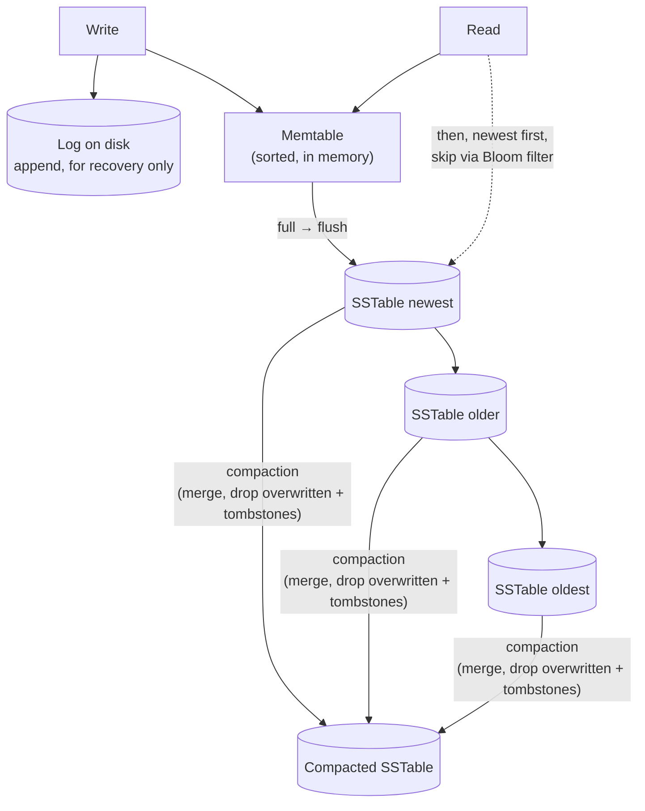
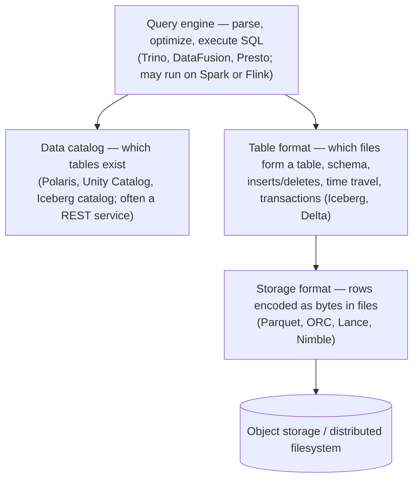

# فصل ۴: ذخیره‌سازی و بازیابی

[فصل ۳: مدل‌های داده و زبان‌های کوئری →](03-data-models-and-query-languages.md) · [کتاب](../README.md) · [فصل ۵: قالب‌های encoding و تکامل ←](05-encoding-and-evolution.md)

## خلاصه

وقتی دیتابیس داده‌ی شما را ذخیره می‌کند و دوباره پیدایش می‌کند، واقعاً چه اتفاقی می‌افتد؟ این فصل storage engine را از ساده‌ترین شکل ممکن، یعنی یک فایل append-only، می‌سازد و به دو مکتب ذخیره‌سازی OLTP می‌رسد: engineهای **log-structured** مثل SSTable و LSM-tree که هیچ‌وقت فایل را در جا عوض نمی‌کنند، و engineهای **update-in-place** مثل B-tree که pageهای اندازه‌ثابت را بازنویسی می‌کنند. بعد نشان می‌دهد چرا تحلیل چیدمان کاملاً متفاوتی می‌خواهد: **ذخیره‌سازی column-oriented** همراه با فشرده‌سازی، اجرای vectorized یا compiled کوئری و aggregateهای materialized. فصل با indexهای چندبعدی، جست‌وجوی full-text و vector embedding برای semantic search تمام می‌شود. فهم این جزئیات کمک می‌کند دیتابیس را برای workload خودتان انتخاب و تنظیم کنید، به جای این‌که با آن مثل جعبه‌ی سیاه رفتار کنید.

## نکته‌های کلیدی

- **هر index ساختاری اضافه است که از داده derive می‌شود:** خواندن را سریع و نوشتن را کند می‌کند، برای همین دیتابیس‌ها پیش‌فرض همه‌چیز را index نمی‌کنند (pp. 116–117).
- **ساختار LSM-tree نوشتن تصادفی را به نوشتن ترتیبی تبدیل می‌کند:** نوشتن‌ها در یک memtable مرتب جمع می‌شوند که با WAL محافظت می‌شود، به شکل SSTableهای مرتب و immutable flush می‌شوند و در پس‌زمینه merge می‌شوند. throughput نوشتن بالاست؛ خواندن ممکن است چند فایل را بگردد و Bloom filter کمکش می‌کند (pp. 118–125).
- **ساختار B-tree pageهای اندازه‌ثابت را در جا بازنویسی می‌کند**، درختی متوازن با عمق O(log n) نگه می‌دارد و برای ایمنی در برابر crash از WAL استفاده می‌کند. قاعده‌ی سرانگشتی: B-tree برای خواندن بهتر است و LSM-tree برای نوشتن؛ اما workload خودتان را تست کنید (pp. 125–132).
- **سه محور write amplification، read amplification و space amplification** همان جاهایی‌اند که storage engineها روی آن‌ها بده‌بستان می‌کنند (pp. 129–132).
- **تحلیل ستون می‌خواهد، نه ردیف:** هر ستون را جدا ذخیره کنید، فشرده کنید، مثلاً با bitmap و run-length encoding، و در batchهای vectorized پردازش کنید (pp. 134–143).
- **سرویس‌های cloud data warehouse ذخیره‌سازی و محاسبه را از هم جدا می‌کنند** و روی file formatها و table formatهای باز بالای object storage ساخته می‌شوند (pp. 135–136).
- **فراتر از کلیدهای یک‌بعدی:** R-tree برای بازه‌های چندبعدی، inverted index برای جست‌وجوی full-text، و indexهای approximate nearest neighbour مثل HNSW و IVF روی vector embedding (pp. 145–150).

## فهرست بخش‌ها

*از فهرست مطالب خود کتاب، یعنی bookmarkهای PDF، با شماره‌ی صفحه‌های چاپی.*

- ذخیره‌سازی و indexing برای OLTP (p. 116)
  - ذخیره‌سازی log-structured (p. 118)
  - ساختار B-tree (p. 125)
  - مقایسه‌ی B-tree و LSM-tree (p. 129)
  - مفهوم multicolumn index و secondary index (p. 132)
  - ذخیره‌ی مقدار داخل index (p. 133)
  - نگه داشتن همه‌چیز در حافظه (p. 133)
- ذخیره‌سازی داده برای تحلیل (p. 134)
  - مفهوم cloud data warehouse (p. 135)
  - ذخیره‌سازی column-oriented (p. 136)
  - اجرای کوئری: compilation و vectorization (p. 142)
  - مفهوم materialized view و data cube (p. 143)
- انواع index چندبعدی و full-text (p. 145)
  - جست‌وجوی full-text (p. 146)
  - مفهوم vector embedding (p. 147)
- جمع‌بندی (p. 150)

## یادداشت‌ها

هر دیتابیس دو کار می‌کند: داده‌ای را که به آن می‌دهید ذخیره می‌کند و بعداً پس می‌دهد. شما storage engine نمی‌نویسید، اما باید یکی را انتخاب و تنظیم کنید؛ و engineهای OLTP و تحلیلی با هم تفاوت بزرگی دارند (p. 115).

> **Try it:** [فصل ۴ در طول یک pipeline داده](../widgets/04-pipeline-map.html): از دیتابیس منبع تا داشبورد را با lensهای مسیر نوشتن، چیدمان، index و amplification طی کنید و ببینید هر مرحله کدام storage engine را به کار می‌گیرد.

### ذخیره‌سازی و indexing برای OLTP

«ساده‌ترین دیتابیس دنیا» دو تابع bash است (p. 116):

```sh
db_set () { echo "$1,$2" >> database; }
db_get () { grep "^$1," database | sed -e "s/^$1,//" | tail -n 1; }
```

تابع `db_set` فقط append می‌کند و خیلی سریع است؛ updateها نسخه‌های قدیمی را جا می‌گذارند، پس `db_get` آخرین تطابق را برمی‌دارد. خیلی از دیتابیس‌ها دقیقاً همین ساختار را به کار می‌برند: یک **log**، یعنی دنباله‌ای append-only از رکوردها، نه log اپلیکیشن. اما `db_get` همه‌چیز را اسکن می‌کند: **O(n)** (p. 117). هر **index** ساختاری اضافه است که از داده *derive* می‌شود؛ اضافه یا حذف کردنش فقط performance را عوض می‌کند، نه محتوا را. هر index بعضی خواندن‌ها را سریع‌تر و **همه‌ی نوشتن‌ها را کندتر** می‌کند، برای همین انتخاب indexها با خود شماست (p. 117).

> **In practice:** لایه‌ی Bronze در reference stack همین log است: loader هر نسخه‌ی تازه‌ی ردیف را append می‌کند و هیچ چیزی را در جا عوض نمی‌کند. لایه‌ی Silver همان `tail -n 1` است: جدیدترین نسخه‌ی هر id.
>
> **Your turn:** کوئری Silver با `ROW_NUMBER() OVER (PARTITION BY id ORDER BY update_date DESC)` جدیدترین نسخه را انتخاب می‌کند. با بزرگ شدن Bronze، این کوئری چرا هر روز کندتر می‌شود؟
>
> *Answer:* چون مثل `db_get` کل log را اسکن می‌کند و هزینه‌اش O(n) است (p. 117). راه کتاب ساختن ساختاری derived است: Silver را به شکل incremental به‌روز کنید تا فقط نسخه‌های تازه پردازش شوند، یا جدولی نگه دارید که خودش در merge نسخه‌های قدیمی را دور بریزد.

#### ذخیره‌سازی log-structured (pp. 118–125)

**قدم ۱: یک hash index روی log** (شکل ۴-۱): یک hash map در حافظه که هر کلید را به byte offset آخرین مقدارش map می‌کند. سریع است، اما (pp. 118–119): رکوردهای قدیمی هیچ‌وقت فضای دیسک را آزاد نمی‌کنند؛ بعد از restart باید map را با اسکن کل log دوباره ساخت؛ همه‌ی کلیدها باید در حافظه جا شوند، چون hash map روی دیسک performance بدی دارد؛ و range query ناکارآمد است.


*Figure 4-1 (p. 118): این map فقط جای شروع آخرین مقدار هر کلید را نگه می‌دارد؛ یک seek برای خواندنش کافی است.*

**قدم ۲: ساختار SSTable** یا Sorted String Table (شکل ۴-۲): جفت‌های key-value **مرتب بر اساس کلید**، هر کلید یک بار. در این حالت یک **sparse index** کافی است، یعنی فقط اولین کلید هر بلوک چندکیلوبایتی: برای پیدا کردن `handiwork` به بلوک `handbag` بروید، چون بلوک بعدی با `handsome` شروع می‌شود، و اسکن کنید. بلوک‌ها را می‌شود **فشرده** کرد و با کمی CPU در فضای دیسک و پهنای باند I/O صرفه‌جویی کرد (p. 119).


*Figure 4-2 (p. 119): چون کلیدها مرتب‌اند، یک ورودی index برای هر بلوک کافی است؛ نزدیک‌ترین کلید قبلی را پیدا کنید و از همان‌جا اسکن کنید.*

**قدم ۳: ساختار LSM-tree** (pp. 120–121):

1. نوشتن‌ها به یک ordered map در حافظه می‌روند که اسمش **memtable** است؛ مثلاً red-black tree، skip list یا trie.
2. وقتی از چند مگابایت بزرگ‌تر شد، به شکل یک **segment** تازه‌ی SSTable روی دیسک نوشته می‌شود و نوشتن‌ها در یک memtable تازه ادامه پیدا می‌کنند.
3. هر خواندن اول memtable را می‌گردد، بعد segmentها را **از جدید به قدیم**.
4. در پس‌زمینه segmentها **merge و compact** می‌شوند؛ مثل mergesort، فقط جدیدترین مقدار هر کلید می‌ماند و حافظه‌ی کمی لازم است (شکل ۴-۳).


*Figure 4-3 (p. 121): merge مثل mergesort روی فایل‌های مرتب کار می‌کند؛ اگر کلیدی در چند segment باشد، جدیدترین مقدار برنده است.*

یک **log** جداگانه و نامرتب از همه‌ی نوشتن‌ها، که بعد از هر flush دور ریخته می‌شود، memtable را در برابر crash محافظت می‌کند؛ هر حذف با یک **tombstone** علامت می‌خورد و وقتی به قدیمی‌ترین segment merge شد کنار گذاشته می‌شود (pp. 120–121). این الگوریتم RocksDB، Cassandra، ScyllaDB و HBase است، با الهام از Bigtable که اسم‌های *SSTable* و *memtable* را ساخت، و برگرفته از مقاله‌ی **Log-Structured Merge-tree** در ۱۹۹۶ (p. 121). segmentها تغییرناپذیرند: در حین merge خواندن‌ها از segmentهای قدیمی ادامه پیدا می‌کنند، فایل‌های نیمه‌کاره بعد از crash به‌سادگی حذف می‌شوند، checksum رکوردهای ناقص log را می‌گیرد، و segmentها به object storage می‌خورند؛ مثلاً SlateDB و Delta Lake (pp. 121–122).



**ساختار Bloom filter** (pp. 122–123): هر SSTable یک آرایه‌ی بیتی دارد؛ هر کلید بیت‌هایی را که hashهایش نشان می‌دهند روشن می‌کند؛ مثلاً `handbag` بیت‌های ۲، ۹ و ۴ را. کوئری `handheld` به بیت‌های ۶، ۱۱ و ۲ نگاه می‌کند: اگر یکی صفر باشد، کلید **قطعاً نیست** و فایل رد می‌شود؛ اگر همه یک باشند، کلید *احتمالاً* هست، و false positive فقط یک خواندن بلوک هدر می‌دهد. قاعده‌ی سرانگشتی: **۱۰ بیت برای هر کلید یعنی حدود ۱٪ false positive، و هر ۵ بیت بیشتر این عدد را ده برابر کم می‌کند** (p. 123).

**راهبردهای compaction** (p. 124):

| | Size-tiered | Leveled |
|---|---|---|
| روش | SSTableهای جدیدتر و کوچک‌تر در SSTableهای قدیمی‌تر و بزرگ‌تر merge می‌شوند؛ مثلاً چهار فایل ۲۵۶ مگابایتی به یک فایل **۸۹۸ مگابایتی** تبدیل می‌شوند، به خاطر حذف‌ها، بازنویسی‌ها و TTL | SSTableهای اندازه‌ثابت در سطح‌های L0، L1 و…؛ بعد از L0 هر سطح بر اساس بازه‌ی کلید پارتیشن شده است، مثلاً L1 از a تا m و از n تا z؛ سرریز هر سطح به سطح بعد merge می‌شود |
| نقطه‌ی قوت | throughput نوشتن خیلی بالا: داده فقط چند بار و در mergeهای بزرگ ترتیبی بازنویسی می‌شود | تدریجی است، فضای دیسک کمتری می‌گیرد و هر خواندن SSTableهای کمتری را می‌گردد |
| نقطه‌ی ضعف | SSTableهای قدیمی خیلی بزرگ؛ دیسک موقت زیاد در حین merge | بازنویسی بیشتر |
| قاعده‌ی سرانگشتی | بیشتر نوشتن، خواندن کم | خواندن غالب؛ یا چند کلید داغ که زیاد نوشته می‌شوند و کلیدهای زیادی که کم |

**انواع embedded storage engine**، مثل RocksDB، SQLite، LMDB، DuckDB و KùzuDB، کتابخانه‌هایی داخل process اپلیکیشن‌اند؛ در اپ‌های موبایل رایج‌اند و وقتی tenantها کوچک و جدا از هم باشند، می‌شود برای هر tenant یکی داشت (p. 125).

> **Try it:** [درون یک LSM-tree](../widgets/04-lsm-tree.html): بنویسید، flush و compact کنید و بخوانید؛ ببینید Bloom filter چطور از فایل‌ها می‌گذرد، tombstone چطور مقدار را می‌پوشاند و WAL چطور memtable بعد از crash را دوباره می‌سازد.

> **In practice:** جدول‌های MergeTree در warehouse ستونی reference stack یک LSM-tree هستند: هر `INSERT` یک **part** مرتب و immutable روی دیسک می‌نویسد و merge در پس‌زمینه partها را با هم یکی می‌کند. primary index همان sparse index شکل ۴-۲ است: یک ورودی برای هر چند هزار ردیف، نه برای هر ردیف.
>
> **Your turn:** یک تیم پیشنهاد می‌دهد loader به جای bulk insert ساعتی، هر چند ثانیه چند ردیف `INSERT` کند تا داشبوردها تازه‌تر باشند. چه چیزی خراب می‌شود؟
>
> *Answer:* هر `INSERT` یک part تازه می‌سازد، مثل flush شدن یک memtable کوچک. partهای کوچکِ زیاد یعنی compaction بیشتر، write amplification بالاتر و خواندن‌هایی که باید فایل‌های بیشتری را بگردند (pp. 121–124). نوشتن‌ها را در batchهای بزرگ جمع کنید؛ همان کاری که bulk `INSERT … SELECT` از staging می‌کند.

#### ساختار B-tree (pp. 125–129)

ساختار B-tree در ۱۹۷۰ معرفی شد و ظرف ده سال «همه‌جا» بود، و هنوز index استاندارد تقریباً همه‌ی دیتابیس‌های relational است (p. 125). مثل SSTable کلیدها را مرتب نگه می‌دارد؛ اما برخلاف آن، دیتابیس را به **pageهای اندازه‌ثابت** تقسیم می‌کند، که به‌طور سنتی ۴ KiB است، در PostgreSQL ۸ KiB و در MySQL ۱۶ KiB، و **pageها را در جا بازنویسی می‌کند** (p. 125).

- **جست‌وجو** (شکل ۴-۵): از ریشه شروع کنید؛ هر page کلیدها و ارجاع‌هایی به فرزندان دارد که بازه‌ی کلید را تقسیم می‌کنند. برای پیدا کردن ۲۵۱ اول فرزند ۲۰۰ تا ۳۰۰، بعد ۲۵۰ تا ۲۷۰، تا به یک **leaf** برسید که مقدار یا ارجاع را نگه می‌دارد. تعداد فرزندان هر page همان **branching factor** است؛ در شکل ۶ و در عمل چند صد (p. 126).
- **درج** (شکل ۴-۶): page پر **split** می‌شود؛ درج ۳۳۴ در page پر ۳۳۳ تا ۳۴۵ دو page ۳۳۳ تا ۳۳۷ و ۳۳۷ تا ۳۴۵ می‌سازد و کلید مرزی ۳۳۷ به والد اضافه می‌شود؛ splitها ممکن است تا بالا ادامه پیدا کنند و **ریشه‌ی تازه** بسازند. عمق درخت **O(log n)** می‌ماند: سه یا چهار سطح برای بیشتر دیتابیس‌ها کافی است؛ **چهار سطح page چهار کیلوبایتی با branching factor ۵۰۰ تا ۲۵۰ ترابایت جا می‌دهد** (p. 127).
- **قابلیت اطمینان** (pp. 127–128): هر split چند page را بازنویسی می‌کند؛ crash در وسط کار می‌تواند یک **orphan page** جا بگذارد، و نوشتن غیراتمیک page یک **torn page**. برای همین یک **write-ahead log** پیش از تغییر pageها نوشته و `fsync` می‌شود؛ همان journaling در فایل‌سیستم‌ها. pageها در حافظه buffer می‌شوند و WAL آن‌ها را durable نگه می‌دارد.
- **گونه‌ها** (p. 128): pageهای **copy-on-write** به جای WAL، مثل LMDB، که برای snapshot isolation هم به کار می‌آید؛ کلیدهای کوتاه‌شده در pageهای داخلی برای branching factor بالاتر؛ چیدن leafها پشت سر هم روی دیسک؛ و اشاره‌گر بین leafهای هم‌سطح برای range scan.


*Figure 4-5 (p. 126): هر page بازه‌ی کلید را تنگ‌تر می‌کند؛ جست‌وجو در هر سطح یک ارجاع را دنبال می‌کند.*


*Figure 4-6 (p. 127): page پر روی کلید مرزی ۳۳۷ split می‌شود و والد یک کلید و یک ارجاع تازه می‌گیرد.*

> **Try it:** [pageها، جست‌وجو و split در B-tree](../widgets/04-btree.html): ارجاع pageها را از ریشه دنبال کنید، مثل شکل ۴-۶ یک page پر را split کنید، و وسط split با WAL و بدون WAL crash کنید.

> **In practice:** دو دیتابیس منبع reference stack row store هستند و indexهایشان B-tree است. loader هر ساعت از replica می‌پرسد `WHERE update_date > :cursor`.
>
> **Your turn:** هر ساعت که loader اجرا می‌شود replica کند می‌شود و lag پیدا می‌کند. در خود دیتابیس منبع چه چیزی را بررسی می‌کنید؟
>
> *Answer:* این‌که روی `update_date` یک B-tree index هست یا نه. با index، شرط cursor یک range scan روی leafهای مرتب است و فقط ردیف‌های تازه را می‌خواند (pp. 126–128)؛ بدون index، هر اجرا کل جدول را اسکن می‌کند. چون تیم داده صاحب منبع نیست، این درخواستی است برای صاحبان آن، همراه با شاهدش.

#### مقایسه‌ی B-tree و LSM-tree (pp. 129–132)

قاعده‌ی سرانگشتی: **LSM-tree برای workload پرنوشتن، B-tree برای خواندن سریع‌تر**؛ اما benchmarkها به workload حساس‌اند، workload خودتان را تست کنید، و engineها از هر دو ایده استفاده می‌کنند (p. 129).

| جنبه | LSM-tree | B-tree |
|---|---|---|
| خواندن نقطه‌ای | ممکن است چند SSTable را بگردد؛ Bloom filter I/O را کم می‌کند | در هر سطح یک page؛ سریع و قابل پیش‌بینی |
| range query | همه‌ی segmentها را موازی اسکن و merge می‌کند؛ Bloom filter بی‌فایده است | روی درخت مرتب ساده و سریع |
| latency نوشتن | وقتی memtable سریع‌تر از تخلیه‌ی compaction پر می‌شود spike دارد؛ RocksDB **backpressure** اعمال می‌کند و خواندن و نوشتن را معلق می‌کند | — |
| الگوی نوشتن | **ترتیبی**: کل segment یک‌جا | **تصادفی**: بازنویسی pageهای پراکنده |
| write amplification | log، flush و هر compaction؛ مقدارهای بزرگ را می‌شود جدا ذخیره کرد. معمولاً **کمتر** است، چون page کامل نوشته نمی‌شود و بلوک‌ها فشرده‌اند | دست‌کم دو بار، یعنی WAL و page، و گاهی یک page کامل برای چند بایت |
| فضای دیسک | فشرده‌سازی بهتر و بدون pageهای نیمه‌خالی؛ داده‌ی بازنویسی‌شده تا compaction می‌ماند، که در leveled کم و در size-tiered زیاد است | **fragmentation** بعد از حذف‌ها؛ pageهای آزاد به OS برنمی‌گردند و یک **vacuum** پس‌زمینه لازم است، مثل PostgreSQL |
| حذف واقعی | رکورد حذف‌شده تا رسیدن tombstoneش به همه‌ی سطح‌ها می‌ماند | — |
| snapshot | آسان: memtable را flush کنید و فایل‌های immutable فعلی را نگه دارید | با pageهای بازنویسی‌شده سخت‌تر است |

**چرا نوشتن ترتیبی حتی روی SSD برنده است** (p. 130): flash در pageهای حدود ۴ KiB نوشته می‌شود اما در بلوک‌های حدود ۵۱۲ KiB پاک می‌شود. نوشتن تصادفی بلوک‌هایی می‌سازد که pageهای معتبر و کهنه را قاطی دارند، پس **garbage collection** کنترلر باید پیش از پاک کردن داده را کپی کند؛ پهنای باند می‌دزدد و درایو را فرسوده می‌کند. فایل‌های بزرگ ترتیبی معمولاً بلوک‌های کامل را پر و آزاد می‌کنند. **write amplification** یعنی بایت‌هایی که روی دیسک نوشته می‌شوند تقسیم بر بایت‌هایی که یک log بدون index می‌نوشت؛ throughput اپ‌های پرنوشتن را محدود می‌کند و SSD را فرسوده، و فقط در benchmarkهای طولانی دیده می‌شود، وقتی compaction با نوشتن‌های تازه رقابت می‌کند (pp. 130–131). SSDهای NVMe خیلی از خواندن‌ها را موازی جواب می‌دهند و engine باید طوری طراحی شود که از این استفاده کند (p. 129).

> **In practice:** حذف در جدول‌های MergeTree هم شبیه tombstone است: ردیف علامت می‌خورد یا partهایش با یک mutation بازنویسی می‌شوند، و نسخه‌ی قبلی تا merge بعدی روی دیسک می‌ماند.
>
> **Your turn:** مشتری‌ای درخواست حذف داده‌های شخصی‌اش را داده و حذف در warehouse اجرا شده. کی می‌شود گفت داده واقعاً از دیسک رفته است؟
>
> *Answer:* وقتی هر part یا segmentی که نسخه‌ای از آن ردیف را داشته بازنویسی شده باشد؛ در LSM، رکورد حذف‌شده تا رسیدن tombstone به همه‌ی سطح‌ها باقی است (p. 131). Bronze هم همه‌ی نسخه‌ها را نگه می‌دارد، پس حذف باید آن‌جا هم اعمال شود. بهترین دفاع همان hash کردن شناسه‌ها پیش از ذخیره است.

#### مفهوم secondary index، مقدار داخل index و حافظه (pp. 132–134)

- **ساختار secondary index**، یعنی `CREATE INDEX`، کلید یکتا ندارد: یا برای هر ورودی فهرستی از row IDها نگه دارید، یعنی postings list، یا row ID را به کلید بچسبانید تا ورودی‌ها یکتا شوند. هم B-tree و هم LSM-tree می‌توانند پیاده‌اش کنند (p. 132).

| مقدار index‌شده کجا زندگی می‌کند (p. 133) | مثال |
|---|---|
| **ساختار clustered index**: خود ردیف داخل index | primary key در InnoDB؛ یکی برای هر جدول در SQL Server |
| ارجاع به primary key | secondary indexها در InnoDB |
| ارجاع به یک **heap file**، یعنی ردیف‌ها بدون ترتیب خاص | PostgreSQL |
| **ساختار covering index** یا included column: کپی بعضی ستون‌ها داخل index | بعضی کوئری‌ها را فقط از index جواب می‌دهد؛ هزینه‌اش فضا و سرعت نوشتن است |

ردیفی در heap که بزرگ شود باید جابه‌جا شود؛ یا همه‌ی indexها باید به‌روز شوند یا یک forwarding pointer جا بماند (p. 133).

- **نگه داشتن همه‌چیز در حافظه** (pp. 133–134): دیسک durable است و هر گیگابایتش ارزان‌تر؛ با ارزان شدن RAM، خیلی از datasetها در حافظه جا می‌شوند. Memcached یک cache است و از دست رفتن داده اشکالی ندارد؛ VoltDB، SingleStore، Oracle TimesTen و RAMCloud با log، snapshot یا replication به دنبال durability هستند؛ Redis و Couchbase به شکل asynchronous روی دیسک می‌نویسند و durability ضعیفی دارند. سرعتشان **از نخواندن دیسک نیست**، چون OS بلوک‌های دیسک را به‌هرحال cache می‌کند؛ از این است که **لازم نیست ساختارهای حافظه را برای دیسک encode کنند**. ساختارهایی را هم ممکن می‌کنند که روی دیسک دست‌وپاگیرند، مثل priority queue و set در Redis.

### ذخیره‌سازی داده برای تحلیل

مفهوم warehouseها معمولاً relational هستند، چون SQL به تحلیل می‌خورد، اما درونشان با دیتابیس‌های OLTP فرق دارد؛ محصولات HTAP، مثل SQL Server، SAP HANA و SingleStore، بیشتر و بیشتر دو engine پشت یک interface SQL هستند (pp. 134–135).

#### مفهوم cloud data warehouse (pp. 135–136)

محصولاتی مثل Teradata، Vertica و SAP HANA از دنیای لایسنس on-premises آمده‌اند؛ BigQuery، Redshift و Snowflake فقط cloud هستند. elastic بودنشان از جدا بودن محاسبه از object storage می‌آید، و با ingestion سرویس‌های cloud، مثل Dataflow و Kinesis، یکپارچه‌اند. warehouseهای open source، مثل Hive، Trino و Spark، به چند لایه شکسته شدند:



*لایه‌بندی خود vault از چهار جزء صفحه‌های ۱۳۵ و ۱۳۶ کتاب.*

> **In practice:** فایل‌های Parquet در staging همان لایه‌ی storage format هستند و object storage سازگار با S3 همان لایه‌ی پایینی؛ اما warehouse ستونی reference stack داده را در فرمت خودش نگه می‌دارد، نه در یک table format باز.
>
> **Your turn:** تیم ML می‌خواهد مستقیم از روی Parquetهای staging مدل آموزش بدهد تا بار warehouse کم شود. چه اشکالی دارد؟
>
> *Answer:* staging فقط تا load بعدی جدول نگه داشته می‌شود و table format‌ای ندارد که بگوید کدام فایل‌ها یک جدول کامل‌اند (pp. 135–136). بدون catalog و table format، هر خواننده باید خودش حدس بزند؛ داده‌ی پایدار را از Silver بخوانند، یا برای آن یک table format واقعی بسازند.

#### ذخیره‌سازی column-oriented (pp. 136–142)

جدول‌های fact ممکن است تریلیون‌ها ردیف و بیش از ۱۰۰ ستون داشته باشند، اما یک کوئری معمولی فقط به **چهار یا پنج** ستون دست می‌زند؛ مثال ۴-۱، یعنی فروش میوه در برابر شیرینی بر اساس روز هفته در ۲۰۲۴، فقط `date_key`، `product_sk` و `quantity` را لازم دارد (pp. 136–137). ذخیره‌سازی row-oriented باید هر ردیف ۱۰۰ ستونی را load و parse کند؛ ذخیره‌سازی **columnar** فقط ستون‌های استفاده‌شده را می‌خواند (شکل ۴-۷). همه‌ی ستون‌ها **ترتیب ردیف یکسانی** دارند، پس ردیف ۲۳ ورودی ۲۳ هر ستون است. engineهای واقعی ستون‌ها را در **بلوک**‌هایی از هزاران تا میلیون‌ها ردیف ذخیره می‌کنند، اغلب یک بلوک برای هر بازه‌ی زمانی (p. 138). تقریباً همه‌جای تحلیل از آن استفاده می‌کند: Snowflake، DuckDB، Pinot، Druid؛ Parquet، که برای documentها shredding به سبک Dremel دارد، ORC، Lance، Nimble؛ Arrow و Pandas و NumPy؛ InfluxDB IOx و TimescaleDB (pp. 137–138).


*Figure 4-7 (p. 138): هر ستون جدا و با ترتیب ردیف یکسان ذخیره می‌شود، پس کوئری فقط ستون‌هایی را می‌خواند که اسم برده.*

- **فشرده‌سازی با bitmap و run-length encoding** (pp. 139–140): مقدارهای متمایز کم، مثلاً میلیاردها فروش و ۱۰۰٬۰۰۰ محصول، یعنی یک bitmap برای هر مقدار با یک بیت برای هر ردیف؛ bitmapهای sparse با run-length encoding فشرده می‌شوند و **roaring bitmap** شکل فشرده‌تر را انتخاب می‌کند. شرط `IN (31, 68, 69)` یعنی OR سه bitmap؛ شرط `product_sk = 30 AND store_sk = 3` یعنی AND، که درست است چون بیت k همه‌جا ردیف k است. bitmap حتی به سؤال‌های گرافی جواب می‌دهد؛ مثلاً کسانی که X دنبالشان می‌کند و Y را دنبال می‌کنند. این را با storeهای **wide-column** یا column-family، مثل Bigtable، Accumulo و HBase، اشتباه نگیرید؛ آن‌ها row-oriented هستند.
- **ترتیب sort** (pp. 140–141): کل ردیف‌ها را sort کنید، هیچ‌وقت ستون‌ها را جدا از هم، و بر اساس کلیدهایی که برای کوئری‌های رایج انتخاب شده؛ مثلاً اول `date_key`، تا فقط ماه گذشته اسکن شود، و بعد `product_sk`. اولین sort key حتی برای میلیاردها ردیف به چند کیلوبایت فشرده می‌شود؛ کلیدهای بعدی کمتر.
- **نوشتن** (p. 141): درج در وسط ستون‌های مرتب و فشرده عملاً ناممکن است؛ به جایش نوشتن‌ها در یک store مرتب row-oriented در حافظه جمع می‌شوند و به شکل bulk در فایل‌های ستونی تازه merge می‌شوند؛ به سبک LSM، با فایل‌های immutable که به object storage می‌خورند. کوئری‌ها هر دو را بی‌صدا ترکیب می‌کنند؛ مثل Snowflake، Vertica، Pinot و Druid.

> **Try it:** [ذخیره‌سازی ستونی و bitmap index](../widgets/04-column-bitmaps.html): یک ستون را به bitmap تبدیل کنید، run-length encodeشان کنید و فیلترهای IN و AND را با عملیات بیتی جواب بدهید.

> **In practice:** جدول‌های warehouse reference stack ستونی‌اند، ماهانه پارتیشن شده‌اند و ردیف‌هایشان بر اساس کلید `ORDER BY` مرتب‌اند. `SELECT *` از یک جدول صدستونی Gold یعنی خواندن همه‌ی ستون‌ها، حتی اگر داشبورد سه تا را نشان بدهد.
>
> **Your turn:** بیشتر کوئری‌های یک جدول تراکنش «ماه گذشته‌ی یک مشتری» را می‌خواهند. `ORDER BY` جدول را چه می‌گذارید و چرا ترتیب مهم است؟
>
> *Answer:* کلیدی که اول فیلتر می‌شود اول بیاید؛ اینجا با پارتیشن ماهانه، `(customer_id, date)` منطقی است. اولین sort key بهتر از همه فشرده می‌شود و اجازه می‌دهد فقط بلوک‌های مرتبط خوانده شوند؛ کلیدهای بعدی فقط داخل گروه‌های کلید اول کمک می‌کنند (pp. 140–141). ترتیب برعکس برای کوئری «یک مشتری» تقریباً به هیچ دردی نمی‌خورد.

#### اجرای کوئری: compilation و vectorization (pp. 142–143)

هر query plan درختی از **operator**هاست که ممکن است روی چند ماشین پخش باشد. interpreterی که برای هر ردیف به کوئری سر بزند خیلی کند است، پس:

| | Query compilation | Vectorized processing |
|---|---|---|
| ایده | برای همین کوئری کد تولید و به کد ماشین compile می‌شود، اغلب با LLVM، مثل یک JIT | تفسیر می‌شود، اما operatorهای آماده روی **batch**هایی از مقدارهای ستون اجرا می‌شوند |
| مثال | حلقه‌ای تولیدشده روی ردیف‌ها که شرط‌ها را بررسی می‌کند | شرط `product_sk = bananas` یک bitmap می‌دهد، شرط `store_sk = X` یک bitmap دیگر، و AND بیتی (شکل ۴-۹) |

هر دو از CPUهای امروزی استفاده می‌کنند: دسترسی ترتیبی به حافظه، یعنی cache miss کمتر؛ حلقه‌های داخلی تنگ بدون فراخوانی تابع و branch misprediction؛ threadها و **SIMD**؛ و کار مستقیم روی داده‌ی فشرده (p. 143).

#### مفهوم materialized view و data cube (pp. 143–145)

هر **materialized view** نتیجه‌ی یک کوئری را روی دیسک ذخیره می‌کند، در حالی که view مجازی فقط میان‌بری برای کوئری است، و وقتی ورودی‌ها عوض شوند باید به‌روز شود؛ بعضی دیتابیس‌ها خودکار این کار را می‌کنند، و سیستم‌هایی مثل Materialize هم هستند. هر **data cube** یا OLAP cube شبکه‌ای از aggregateهای materialized بر اساس dimensionهاست؛ مثلاً `SUM(net_price)` برای هر تاریخ و محصول، با جمع ردیف‌ها و ستون‌ها (شکل ۴-۱۰)؛ با پنج dimension یک hypercube است. «کل فروش هر فروشگاه دیروز» یک lookup می‌شود، اما سؤال روی چیزی که dimension نیست، مثل سهم فروش اقلام بالای ۱۰۰ دلار، جواب ندارد؛ برای همین warehouseها داده‌ی خام را نگه می‌دارند و cube را فقط برای تسریع به کار می‌برند (pp. 143–145).

> **In practice:** جدول‌های Gold در reference stack در عمل materialized view هستند: Airflow آن‌ها را از Silver دوباره می‌سازد، و یک جدول Gold ماهانه به ازای segment یک cube کوچک است.
>
> **Your turn:** مدیر محصول از داشبورد Gold ماهانه می‌پرسد «چند درصد تراکنش‌ها بالای مبلغ X بوده؟». چرا Gold جواب نمی‌دهد و کجا باید رفت؟
>
> *Answer:* cube فقط aggregateها را روی dimensionهای از پیش انتخاب‌شده نگه می‌دارد؛ مبلغ تک‌تراکنش یکی از dimensionها نیست، پس جواب از دست رفته است (p. 145). کوئری باید روی Silver اجرا شود، همان داده‌ی خامی که کتاب می‌گوید warehouseها برای همین نگه می‌دارند؛ اگر سؤال تکرار شود، یک جدول Gold تازه برایش بسازید.

### انواع index چندبعدی و full-text

هر **concatenated index**، مثل (نام خانوادگی، نام)، شبیه دفترچه‌ی تلفن است: نام خانوادگی یا اسم کامل را پیدا می‌کند، اما نام کوچک را به‌تنهایی نه (p. 145). نمای یک نقشه کوئری بازه‌ای دوبعدی لازم دارد:

```sql
SELECT * FROM restaurants
WHERE latitude  > 51.4946 AND latitude  < 51.5079
  AND longitude > -0.1162 AND longitude < -0.1004;
```

یک concatenated index روی (lat, long) یکی از دو بازه را می‌دهد، نه هر دو را. گزینه‌ها: mapping دوبعدی به یک‌بعدی با یک **space-filling curve** و استفاده از B-tree؛ یا **R-tree** و Bkd-tree که نقطه‌های نزدیک را در یک زیردرخت جمع می‌کنند، مثل PostGIS روی GiST در PostgreSQL؛ یا شبکه‌هایی از مثلث، مربع یا شش‌ضلعی. بعدهای دیگر هم کار می‌کنند: (red, green, blue) برای رنگ محصول، یا (تاریخ، دما) برای مشاهده‌های هواشناسی بین ۲۵ و ۳۰ درجه (pp. 145–146).

#### جست‌وجوی full-text (pp. 146–147)

هر term را یک dimension در نظر بگیرید؛ documentی که «red» دارد در dimension مربوط ۱ دارد. یک **inverted index** هر term را به **postings list** از ID documentها map می‌کند، یا به یک bitmap تنک، پس «red apples» یک AND بیتی است، حتی روی bitmapهای run-length-encoded. Lucene، که زیر Elasticsearch و Solr است، term و postings را در فایل‌هایی شبیه SSTable نگه می‌دارد که به سبک log-structured merge می‌شوند؛ GIN index در PostgreSQL برای متن و JSON کار مشابهی می‌کند. **n-gram index**، مثلاً trigram، هر substring دلخواه و حتی regular expression را پشتیبانی می‌کند، با هزینه‌ی حجم زیاد؛ تحمل غلط تایپی با **Levenshtein automaton** است که termهای داخل یک edit distance را پیدا می‌کند (p. 147).

#### مفهوم vector embedding (pp. 147–150)

**جست‌وجوی semantic** برای کوئری «چطور حسابم را ببندم» صفحه‌ی «لغو اشتراک» را پیدا می‌کند؛ برای retrieval-augmented generation مهم است. یک **embedding model**، مثل Word2Vec، BERT، GPT و حالا مدل‌های multimodal، هر document را به برداری از floatها map می‌کند؛ معناهای نزدیک کنار هم می‌افتند. مثال سه‌بعدی کتاب: agriculture `[0.38, 0.83, 0.41]`، vegetables `[0.36, 0.64, 0.67]` که نزدیک است، و star schemas `[0.85, 0.10, -0.52]` که دور است؛ embeddingهای واقعی بیش از ۱٬۰۰۰ بعد دارند. فاصله با **cosine similarity**، یعنی زاویه، یا **Euclidean distance** سنجیده می‌شود. این «vector» با vector در vectorized processing یکی نیست. R-tree در این تعداد بعد شکست می‌خورد، پس (pp. 148–149):

| نوع vector index | روش | دقت و سرعت |
|---|---|---|
| Flat | کوئری با همه‌ی بردارها مقایسه می‌شود | دقیق و کند |
| IVF یا inverted file | بردارها دور centroidها cluster می‌شوند و فقط چند **probe**، یعنی پارتیشن، گشته می‌شود | تقریبی؛ probe بیشتر یعنی دقیق‌تر و کندتر |
| HNSW | لایه‌هایی از گراف‌های مجاورت؛ جست‌وجوی greedy از لایه‌ی بالایی تنک به لایه‌های پایینی متراکم (شکل ۴-۱۱) | تقریبی و سریع |

کتابخانه‌ی Faiss و افزونه‌ی pgvector هر دو IVF و HNSW را پیاده کرده‌اند (p. 149).


*Figure 4-11 (p. 149): هر لایه جایی را که لایه‌ی تنک‌تر بالایی پیدا کرده دقیق‌تر می‌کند.*

> **In practice:** API پیش‌بینی reference stack متن merchant یک تراکنش را به یک category خرج map می‌کند. یکی از راه‌ها embedding متن و پیدا کردن نزدیک‌ترین نمونه‌های برچسب‌خورده است.
>
> **Your turn:** حدود بیست هزار نمونه‌ی برچسب‌خورده دارید و هر درخواست باید زیر ۵۰ میلی‌ثانیه جواب بگیرد. index تقریبی لازم است؟
>
> *Answer:* احتمالاً نه. flat index دقیق است و فقط با همه‌ی بردارها مقایسه می‌کند (p. 148)؛ چند ده هزار بردار در حافظه را می‌شود سریع مقایسه کرد. IVF یا HNSW وقتی ارزش دارند که تعداد بردارها آن‌قدر بزرگ شود که مقایسه با همه کند باشد، و هزینه‌شان این است که گاهی نزدیک‌ترین همسایه‌ی واقعی را از دست می‌دهند.

## بده‌بستان‌ها در یک نگاه

| workload | چیدمان ذخیره‌سازی | ساختار نمونه |
|---|---|---|
| throughput نوشتن بالا، خواندن نقطه‌ای و بازه‌ای | log-structured | LSM-tree در RocksDB و Cassandra |
| OLTP پرخواندن با latency قابل پیش‌بینی | pageهای update-in-place | B-tree در PostgreSQL و MySQL |
| اسکن و aggregate روی چند ستون | column-oriented و فشرده | Parquet و cloud warehouseها |
| بازه‌های جغرافیایی یا چندویژگی | چندبعدی | R-tree |
| جست‌وجوی کلمه | inverted index | Lucene |
| شباهت semantic | approximate nearest neighbour | HNSW و IVF |

## فراتر از کتاب

- حدس «RUM conjecture» از Athanassoulis و همکاران در ۲۰۱۶ بده‌بستان بین amplification در **R**ead، **U**pdate و **M**emory، یعنی فضا، را صورت‌بندی می‌کند؛ همان چیزی که زیر مقایسه‌ی LSM و B-tree است.
- نرخ false positive در Bloom filter تقریباً (1 − e<sup>−kn/m</sup>)<sup>k</sup> است؛ با ۱۰ بیت برای هر کلید و ۷ تابع hash حدود ۰٫۸٪ می‌شود. [آزمایش LSM](../lab/04-lsm-tree/README.md) خود vault حدود ۰٫۹٪ اندازه می‌گیرد.

## پیوندها

- **Run it:** [یک LSM-tree کوچک](../lab/04-lsm-tree/README.md): write amplification و صرفه‌جویی Bloom filter را اندازه می‌گیرد.
- **فصل‌های مرتبط:** [فصل ۳: مدل‌های داده و زبان‌های کوئری](03-data-models-and-query-languages.md)، [فصل ۶: مفهوم replication](06-replication.md) برای replication log، [فصل ۸: تراکنش‌ها](08-transactions.md) برای durability و WAL، [فصل ۱۱: پردازش batch](11-batch-processing.md) برای فایل‌های ستونی و object store، و [فصل ۱۲: پردازش stream](12-stream-processing.md) برای brokerهای log-structured.

## خودتان را بسنجید

*پرسش‌ها و پاسخ‌ها را خود vault از روی یادداشت‌های بالا نوشته است؛ پاسخ‌ها به صفحه‌های کتاب ارجاع می‌دهند.*

1. **چرا مرتب بودن کلیدها در فایل segment، sparse index را ممکن می‌کند؟**
   - [ ] مرتب‌سازی کلیدها را فشرده می‌کند تا کل index در حافظه جا شود
   - [x] برای پیدا کردن هر کلید، دانستن offset چند کلید و اسکن بلوک بین آن‌ها کافی است
   - [ ] فایل‌های مرتب هیچ‌وقت merge لازم ندارند
   - [ ] مرتب‌سازی نیاز به write-ahead log را از بین می‌برد

   *Answer:* چون کلیدها به ترتیب‌اند، یک ورودی index برای اولین کلید هر بلوک چندکیلوبایتی کافی است: بلوکی را پیدا کنید که بازه‌اش کلید را دارد و اسکنش کنید (p. 120).

2. **کلیدی آخرین بار یک سال پیش نوشته شده. یک خواندن LSM برایش را با Bloom filter و بدون آن قدم‌به‌قدم توضیح دهید.**

   *Answer:* خواندن اول memtable را می‌گردد و بعد SSTableها را از جدید به قدیم تا کلید پیدا شود؛ ممکن است فایل‌های زیادی باشند. Bloom filter هر SSTable برای بیشترشان می‌گوید «قطعاً این‌جا نیست»، پس فقط فایلی که احتمالاً کلید را دارد خوانده می‌شود (pp. 121–123).

3. **چرا LSM-tree ممکن است write amplification بیشتری از B-tree داشته باشد و باز throughput نوشتنش بیشتر باشد؟**

   *Answer:* نوشتن‌هایش بزرگ و ترتیبی‌اند، یعنی flush و compaction، در حالی که B-tree pageهای تصادفی و WAL را می‌نویسد. نوشتن ترتیبی از دستگاه استفاده‌ی بهتری می‌کند، پس throughput می‌تواند بیشتر باشد حتی وقتی در مجموع بایت بیشتری نوشته می‌شود (pp. 129–131).

4. **چرا column storeها خیلی بهتر از row storeها فشرده می‌شوند؟**
   - [ ] ردیف‌های کمتری ذخیره می‌کنند
   - [x] هر ستون مقدارهایی از یک type دارد، اغلب با مقدارهای متمایز کم و runهای بلند، که به bitmap و run-length encoding می‌خورد
   - [ ] نسخه‌های قدیمی ردیف‌ها را دور می‌ریزند
   - [ ] فقط داده‌ی عددی ذخیره می‌کنند

   *Answer:* مقدارهای داخل یک ستون شبیه هم و تکراری‌اند؛ bitmap همراه با run-length encoding ستون‌های کم‌تنوع را خیلی کوچک می‌کند، و sort کردن ردیف‌ها runها را بلندتر هم می‌کند (pp. 136–141).

5. **چرا vector indexها باید تقریبی باشند، و HNSW چه چیزی را فدا می‌کند؟**

   *Answer:* جست‌وجوی دقیق nearest neighbour در فضاهای پربعد گران است، پس indexهایی مثل IVF و HNSW فقط بخش امیدوارکننده‌ای از داده را می‌گردند و ممکن است نزدیک‌ترین همسایه‌ی واقعی را از دست بدهند؛ کمی دقت را با سرعت عوض می‌کنند (pp. 147–150).

6. **مفهوم loader هر چند ثانیه چند ردیف در یک جدول MergeTree درج می‌کند و merge در پس‌زمینه عقب می‌افتد. از دید LSM-tree چه اتفاقی افتاده و راه‌حل چیست؟**
   - [ ] جدول index ندارد؛ یک secondary index اضافه کنید
   - [x] هر درج یک segment کوچک تازه است؛ compaction از نوشتن عقب می‌ماند و خواندن‌ها فایل‌های بیشتری را می‌گردند. نوشتن‌ها را در batchهای بزرگ‌تر جمع کنید
   - [ ] فیلترهای Bloom پر شده‌اند؛ تعداد بیت‌ها را زیاد کنید
   - [ ] جدول باید به B-tree تبدیل شود

   *Answer:* این همان حالتی است که memtable سریع‌تر از تخلیه‌ی compaction پر می‌شود (p. 131). segmentهای کوچک زیاد یعنی compaction بیشتر و خواندن‌هایی که فایل‌های بیشتری را می‌گردند (pp. 121–124)؛ batch کردن نوشتن‌ها segmentهای کمتر و بزرگ‌تری می‌سازد.

7. **یک جدول Gold فقط جمع ماهانه‌ی مبلغ به ازای segment را دارد. کدام سؤال را می‌تواند جواب بدهد و کدام را نه؟**

   *Answer:* سؤال‌هایی که روی همین dimensionها هستند، مثل «جمع مبلغ segment دانشجو در ماه گذشته»، یک lookup می‌شوند. اما سؤال روی چیزی که dimension نیست، مثل «سهم تراکنش‌های بالای یک مبلغ»، جواب ندارد، چون جزئیات تراکنش در cube نیست؛ برای همین داده‌ی خام هم نگه داشته می‌شود (pp. 143–145).
