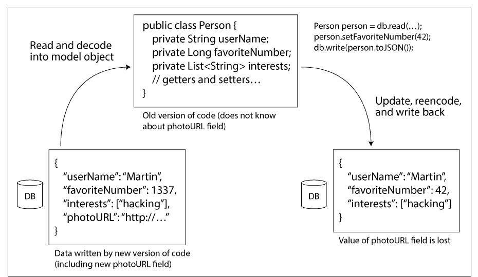
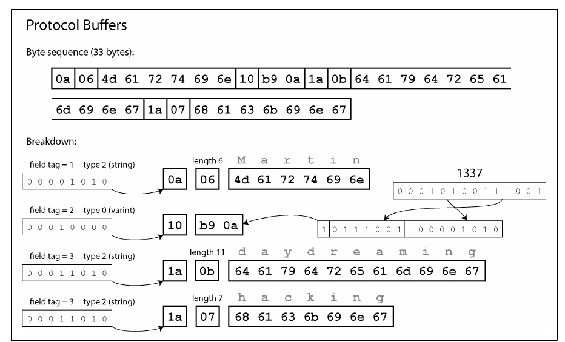
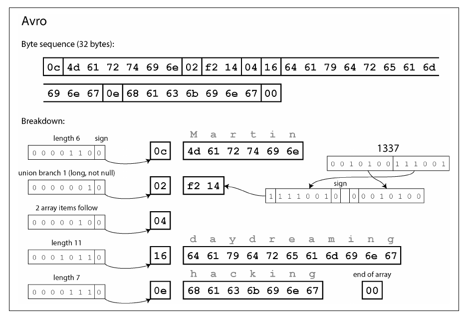
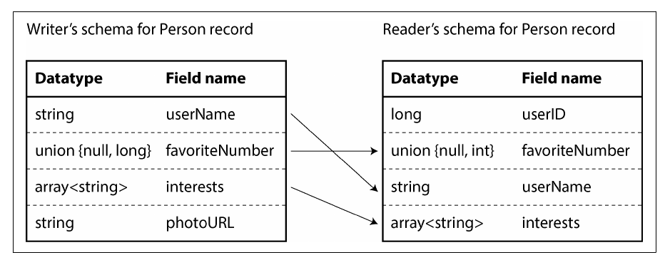
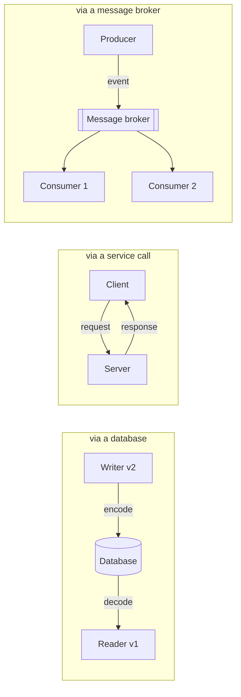

# 5. Encoding and Evolution

[← 4. Storage and Retrieval](04-storage-and-retrieval.md) · [Book](../README.md) · [6. Replication →](06-replication.md)

## Summary

Applications change, and during rolling upgrades old and new code run side by side, reading data the other wrote. The chapter examines how data is encoded into bytes — language-specific formats, JSON/XML/CSV, and schema-driven binary formats (Protocol Buffers, Avro) — through the lens of **backward compatibility** (new code reads old data) and **forward compatibility** (old code reads new data). It then follows encoded data through the main **modes of dataflow**: databases, service calls (REST and RPC), durable execution and workflow engines, and event-driven architectures with message brokers and actors.

## Key takeaways

- **Two compatibility directions**: backward (new code, old data) is usually easy; forward (old code, new data) requires old code to ignore what it doesn't understand — and not destroy it (pp. 162–163).
- **Language-specific serialization** (Java Serializable, pickle) ties you to one language, has poor versioning, and can be a security hole when decoding untrusted bytes (p. 164).
- **Textual formats are ambiguous about types**: numbers (integers above 2<sup>53</sup> in JavaScript), binary strings (Base64), and optional schemas (pp. 165–168).
- **Protocol Buffers rely on field tags**: names can change, tags can't; new fields must be optional; unknown tags are skipped (pp. 169–171).
- **Avro has no tags**: the reader resolves the writer's schema against its own by field name; added or removed fields need defaults; the writer's schema must be known (embedded, versioned, or negotiated) (pp. 172–177).
- **Schemas are valuable documentation and enable code generation and compatibility checks** (p. 177).
- **Durable execution** (e.g. Temporal) makes multi-step workflows survive crashes by logging and replaying — but requires deterministic, idempotent code (pp. 187–189).

## Section outline

*From the book’s own table of contents (PDF bookmarks); printed page numbers.*

- Formats for Encoding Data — p. 163
  - Language-Specific Formats — p. 164
  - JSON, XML, and Binary Variants — p. 165
  - Protocol Buffers — p. 169
  - Avro — p. 172
  - The Merits of Schemas — p. 177
- Modes of Dataflow — p. 178
  - Dataflow Through Databases — p. 178
  - Dataflow Through Services: REST and RPC — p. 180
  - Durable Execution and Workflows — p. 187
  - Event-Driven Architectures — p. 189
- Summary — p. 191

## Notes

Features change, so stored data changes. Relational databases have exactly one schema in force at a time (changed by migrations); schema-on-read databases may hold a mixture of old and new formats (p. 161). Code changes can’t happen everywhere at once — servers roll out in **rolling upgrades** (staged rollouts), and users install client updates whenever they like — so old and new code and data coexist (pp. 161–162):

| Direction | Means | Difficulty |
|---|---|---|
| **Backward compatibility** | Newer code reads data written by older code | Usually easy: you know the old format |
| **Forward compatibility** | Older code reads data written by newer code | Harder: old code must ignore — and keep — what it doesn’t understand |

For APIs: an old client calling a new service needs backward-compatible requests and forward-compatible responses; a new client calling an old service needs the reverse (p. 162). The classic trap (Figure 5-1): new code writes a record with a new field; old code reads it into a model object, updates it and writes it back — and the unknown field is silently lost unless it is preserved (pp. 162–163).



*Figure 5-1 (p. 163): the unknown field is dropped on the round trip through the old model object.*

### Formats for encoding data

In memory, data lives in objects, structs, hash tables and trees linked by pointers; to write a file or send it over the network it must become a self-contained byte sequence. **Encoding** (serialization, marshaling) turns one into the other; **decoding** (parsing, deserialization, unmarshaling) reverses it. The book avoids “serialization”, which means something else for transactions (pp. 163–164). Zero-copy formats (Cap’n Proto, FlatBuffers) skip the step (p. 164).

#### Language-specific formats (pp. 164–165)

Java’s `Serializable`, Python’s `pickle`, Ruby’s `Marshal`, Kryo: convenient, but tied to one language, a **security hole** (decoding can instantiate arbitrary classes → remote code execution), careless about versioning and often slow and bloated. Use them only for very transient purposes.

#### JSON, XML, and binary variants (pp. 165–169)

| Problem | Detail |
|---|---|
| Verbosity | XML is often criticized as verbose and complicated |
| Numbers | XML/CSV can’t tell numbers from digit strings; JSON has no int/float distinction or precision. Integers above 2<sup>53</sup> break in JavaScript — X’s API sends 64-bit post IDs twice, as a number and as a string |
| Binary data | No byte strings; Base64 works but is hacky and **~33% larger** |
| Schemas | XML Schema and JSON Schema are powerful but complicated; without them, decoding logic is hard-coded |
| CSV | No schema at all; vague escaping (commas, newlines) despite a spec |

They remain fine for **data interchange between organizations**: agreeing on anything is the hard part (p. 166).

**JSON Schema** (pp. 166–167) is everywhere — OpenAPI, Confluent’s Schema Registry and Apicurio, PostgreSQL’s `pg_jsonschema`, MongoDB’s `$jsonSchema`. It adds validation (a port between 1 and 65,535) and an **open content model** by default (`additionalProperties: true`), so a schema mostly says what *isn’t* allowed. Closed models, `patternProperties` (e.g. integer-keyed maps, Example 5-1), conditionals and remote references make it powerful — and hard to evolve compatibly.

**Binary JSON/XML** — MessagePack, CBOR, BSON, BJSON, UBJSON, BISON, Hessian, Smile; WBXML, Fast Infoset — stay niche. Without a schema they must still include every field name (p. 167).

#### The book’s running record (pp. 167–177)

```json
{ "userName": "Martin", "favoriteNumber": 1337, "interests": ["daydreaming", "hacking"] }
```

| Encoding | Bytes | What identifies a field | Schema needed? |
|---|---|---|---|
| JSON (no whitespace) | **81** | Field name as text | No |
| MessagePack | **66** | Field name, length-prefixed (`0x83` = object with 3 fields, `0xa8` = 8-byte string “userName”) | No |
| Protocol Buffers | **33** | Tag number + wire type packed in one byte | Yes |
| Avro | **32** | Nothing — values in schema order | Yes, writer’s *and* reader’s |

> **Try it:** [One record, four encodings](../widgets/05-encodings.html) — the book's example record byte by byte in JSON, MessagePack, Protocol Buffers and Avro.

#### Protocol Buffers (pp. 169–171)

Google’s format (Apache Thrift, from Facebook, is similar). A schema in its IDL, with code generation for many languages:

```protobuf
syntax = "proto3";
message Person {
  string user_name       = 1;
  int64  favorite_number = 2;
  repeated string interests = 3;
}
```

Encoded fields carry **tag numbers** (1, 2, 3) instead of names. Integers are **variable-length**: 1337 takes two bytes (top bit = “more bytes follow”); −64…63 fit in one byte, −8,192…8,191 in two. `repeated` fields are simply the same tag appearing several times (p. 170). Evolution rules (p. 171):



*Figure 5-3 (p. 170): tags, not field names, identify each value — which is why tags can never change.*

| Change | Effect |
|---|---|
| Rename a field | Fine — encoded data never mentions names |
| Change a tag | Never — all existing data becomes invalid |
| Add a field with a new tag | Old code skips the unknown tag (type annotation says how many bytes) and can preserve it → **forward compatible**; new code reading old data gets a default (empty string, 0) → **backward compatible** |
| Remove a field | Reverse concerns; never reuse its tag (mark it **reserved**) |
| Change a type, e.g. 32 → 64-bit int | New code reads old data fine; old code reading a large new value **truncates** it |

#### Avro (pp. 172–177)

Started in 2009 as a Hadoop subproject because Protocol Buffers fit Hadoop poorly; two schema languages, Avro IDL for humans and JSON for machines:

```text
record Person {
  string               userName;
  union { null, long } favoriteNumber = null;
  array<string>        interests;
}
```

The binary encoding is just values concatenated — a string is a length prefix plus UTF-8, an integer a varint — so decoding needs exactly the **writer’s schema** (p. 172). The application decodes with two schemas, resolving the **writer’s schema** into its own **reader’s schema** by field **name** (Figures 5-5, 5-6):



*Figure 5-4 (p. 173): nothing in the bytes says which field is which, so decoding needs the exact schema the writer used.*



*Figure 5-6 (p. 174): fields are matched by name; a field only the writer has is ignored, and one only the reader has takes its default.*

**Evolution rules** (p. 175): forward compatibility = writer newer than reader; backward = writer older. **Add or remove only fields that have a default.** Adding without a default breaks backward compatibility; removing without one breaks forward compatibility. `null` is not a universal default — declare a union such as `union { null, long, string }`, with `null` first if it is the default. Type changes work if Avro can convert; renaming via reader **aliases** and adding a union branch are backward- but not forward-compatible.

> **Try it:** [Writer’s schema, reader’s schema](../widgets/05-schema-evolution.html) — add, remove and rename fields in the book's Avro schema and see which direction of compatibility breaks.

**Where does the reader get the writer’s schema?** (pp. 175–176)

| Context | Answer |
|---|---|
| Large file of records with one schema | Write the schema once at the start (Avro **object container files**) |
| Database with records written over time | A version number per record + a table of schema versions (Confluent’s schema registry for Kafka, LinkedIn’s Espresso) |
| Network connection | Negotiate the version at connection setup (Avro RPC) |

A version database doubles as documentation and a compatibility check; the version can be a counter or a hash of the schema (p. 176). **Dynamically generated schemas** are Avro’s edge: dump a relational database by generating one record schema per table, one field per column — and regenerate when columns change, since fields match by name. With Protocol Buffers someone would have to assign and never reuse tag numbers by hand (pp. 176–177).

#### The merits of schemas (pp. 177–178)

Protocol Buffers and Avro schemas are simple compared with XML/JSON Schema, so many languages support them. The ideas are old: **ASN.1** (1984), whose DER encoding still encodes X.509 certificates, uses tag numbers too — but is complex and badly documented. Database wire protocols are proprietary binary encodings decoded by ODBC/JDBC drivers. Schema-driven binary encodings give: compactness (no field names), always-up-to-date documentation, compatibility checks before deployment, and code generation with compile-time type checking — schema-on-read flexibility with better guarantees. Keep the number of concurrent schema versions small (p. 178).

### Modes of dataflow

Compatibility is a relationship between the process that encodes and the one that decodes (p. 178).



#### Dataflow through databases (pp. 178–180)

Writing to a database is “sending a message to your future self” — backward compatibility is essential. With many processes and rolling upgrades, newer code may write what older code reads, so **forward compatibility** is needed too (pp. 178–179).

- **Data outlives code**: one database holds values written 5 ms and 5 years ago in their original encodings. Rewriting everything is expensive, so databases migrate lazily — LSM compaction rewrites into the latest format; adding a nullable column fills nulls on read. Complex changes (single- to multi-valued, moving data to another table) still need rewrites, and compatibility across them is a research problem (p. 179).
- **Archival storage**: snapshots and warehouse loads are written once in the latest schema — a good fit for Avro container files or columnar Parquet (pp. 179–180).

#### Dataflow through services: REST and RPC (pp. 180–186)

Servers expose an API — a **service** — that, unlike a database, allows only inputs and outputs fixed by business logic, an encapsulation that lets each team deploy and evolve its service independently (pp. 180–181). **Web services** use HTTP: apps calling a backend over the internet, services calling services in one organization, and organizations calling each other (payments, OAuth) (p. 181). **REST** builds on HTTP: simple formats, URLs for resources, HTTP caching, authentication and content negotiation. IDLs describe APIs — **OpenAPI** (Swagger) for JSON, **Protocol Buffers** for gRPC — and frameworks (Spring Boot, FastAPI, gRPC) handle routing, metrics, caching and auth, generating client SDKs, docs and compatibility checks (pp. 181–183).

**The problems with RPC** (pp. 183–184). EJB and RMI (Java only), DCOM (Microsoft only), CORBA (complex, no compatibility), SOAP/WS-* (complexity) all chased **location transparency** — making a remote call look like a local one — which is fundamentally flawed:

| Local function call | Network request |
|---|---|
| Predictable; fails only for reasons you control | Lost requests or responses, slow or unavailable machines |
| Returns, throws, or never returns | Can also **time out** with no idea what happened |
| Calling twice is your choice | Retrying may repeat the action unless it is **idempotent** |
| Roughly constant time | Much slower, wildly variable latency |
| Pass pointers | Encode every parameter into bytes |
| One language | Translate types across languages (recall 2<sup>53</sup>) |

REST’s appeal is partly that it treats state transfer as distinct from a function call (p. 184).

**Load balancers, service discovery, and service meshes** (pp. 184–186):

| Option | How it finds/balances instances | Trade-off |
|---|---|---|
| Hardware load balancer | Datacenter appliance in front of servers | Special equipment |
| Software load balancer (NGINX, HAProxy) | Same, as an ordinary application | Simple deployments |
| DNS | Several IPs per name | Caching → stale addresses when instances move |
| Service discovery (etcd, ZooKeeper) | Instances register and heartbeat; clients look up endpoints and metadata | Suits dynamic environments; smarter client balancing |
| Service mesh (Istio, Linkerd) | Sidecar or in-process balancers on both ends | Complex, but handles TLS and gives rich observability; common with Kubernetes |

**Evolution for RPC** (p. 186): assume servers upgrade before clients → requests need backward compatibility, responses forward compatibility. gRPC and Avro RPC inherit their encodings’ rules; REST APIs may add optional request parameters and new response fields. Across organizations, clients can’t be forced to upgrade, so old API versions live on — versioned in the URL, the `Accept` header, or per API key on the server.

#### Durable execution and workflows (pp. 187–189)

A payment touches fraud detection, the card network and the bank: a **workflow** of **tasks** (Temporal calls them *activities*; others *durable functions*), defined in code, a DSL or BPEL/BPMN (Figure 5-7). A **workflow engine** — orchestrator (schedules, triggers on time or events) plus executors — decides where and when tasks run and how failures are retried (pp. 187–188).

| Kind of engine | Examples |
|---|---|
| ETL / data orchestration | Airflow, Dagster, Prefect |
| Graphical (BPMN) for non-engineers | Camunda, Orkes |
| **Durable execution** | Temporal, Restate |

Durable execution gives **exactly-once semantics for a workflow**: every RPC and state change is logged to durable storage (like a WAL); after a failure the task re-runs, but logged calls return their recorded results instead of executing again (p. 188). Catches (p. 189): external services still need idempotent APIs with unique IDs; replays expect the same calls in the same order, so reordering code is dangerous — deploy new versions alongside old ones; code must be **deterministic** — use the framework’s random and clock functions (Temporal’s Workflow Check helps).

#### Event-driven architectures (pp. 189–191)

Events/messages go through a **message broker** (event broker, message queue, message-oriented middleware) and the sender usually doesn’t wait. A broker buffers when recipients are down or overloaded, redelivers to crashed consumers, removes the need for service discovery, fans one message out to many recipients, and decouples senders from recipients; request/response can be layered on top with a reply channel (pp. 189–190).

- From TIBCO, IBM WebSphere and webMethods to RabbitMQ, ActiveMQ, HornetQ, NATS, Redpanda and Kafka; in the cloud Kinesis, Azure Service Bus, Google Pub/Sub (p. 190).
- Two patterns: a **queue** (one consumer gets each message) and a **topic** (every subscriber gets it) (p. 190).
- Messages are opaque bytes plus metadata: use Protocol Buffers, Avro or JSON with a **schema registry**, or describe them with **AsyncAPI**. Many brokers delete consumed messages; event sourcing needs indefinite retention. Consumers republishing messages must **preserve unknown fields** (pp. 190–191).

**Distributed actor frameworks** (Akka, Orleans, Erlang/OTP): each actor owns local state and processes one asynchronous message at a time — no threads, locks or races. Location transparency works better here because actors already assume messages can be lost; rolling upgrades still need compatible encodings (p. 191).

## Trade-offs at a glance

| Format | Size (book's example) | Schema | Forward compat. via | Backward compat. via |
|---|---|---|---|---|
| JSON | 81 bytes | Optional (JSON Schema) | Readers ignoring unknown fields | Readers tolerating missing fields |
| MessagePack | 66 bytes | None | As JSON | As JSON |
| Protocol Buffers | 33 bytes | Required (`.proto`) | Skipping unknown tags | New fields optional; tags never reused |
| Avro | 32 bytes | Required; writer's schema needed | Reader ignores writer-only fields | Defaults for reader-only fields |

## Beyond the book

- Protocol Buffers 3 initially removed field presence for scalars and later reintroduced `optional`; "required" fields are widely considered a mistake because they make removal impossible.
- Consumer-driven contract testing (e.g. Pact) is a practical complement to schema registries for REST APIs.

## Connections

- **Run it:** [Binary encodings and schema evolution](../lab/05-schema-evolution/README.md) — reproduces the 81/33/32-byte figures and demonstrates both compatibility directions.
- **Related chapters:** [3. Data Models](03-data-models-and-query-languages.md) (schema-on-read), [8. Transactions](08-transactions.md) (exactly-once), [12. Stream Processing](12-stream-processing.md) (brokers and event logs).

## Check yourself

*Questions and answers are the vault's, written from the notes above; answers cite the book's pages.*

1. **Why must an old version of a service preserve fields it doesn't understand when it reads, modifies and writes back a record?**

   *Answer:* During a rolling upgrade, newer code may have added a field. If old code decodes the record into objects that drop unknown fields and then writes it back, the new field's data is silently lost (pp. 178–180).

2. **In Protocol Buffers, what can you change freely, and what never?**
   - [ ] Field types freely; names never
   - [x] Field names freely; tag numbers never
   - [ ] Tag numbers freely; names never
   - [ ] Nothing — any change breaks old readers

   *Answer:* The encoded data contains only tag numbers, never field names, so renaming is harmless; changing a tag would make all existing data unreadable. New fields get new tag numbers (pp. 169–172).

3. **Avro encodes no field identifiers at all. How does a reader decode data written with an older schema?**

   *Answer:* The reader needs the exact writer's schema; the Avro library resolves the writer's schema against the reader's schema, matching fields by name, ignoring fields the reader lacks and filling in defaults for fields the writer lacked (pp. 172–176).

4. **What makes RPC's "location transparency" a leaky abstraction?**

   *Answer:* A network request is unlike a local call: it can be lost or time out with an unknown outcome, latency is variable, retries may execute an action twice, and parameters must be encoded (pp. 182–184).

5. **Why must code run under durable execution be deterministic?**
   - [ ] Because the framework compiles it ahead of time
   - [x] Because after a failure the framework replays the code and must reach the same steps to reuse their logged results
   - [ ] Because workflows cannot call external services
   - [ ] Because determinism makes the code run faster

   *Answer:* Durable execution logs each step's result and, after a crash, re-runs the workflow, substituting logged results. If the code took a different path on replay (random numbers, clock reads, changed code), the log would no longer match (pp. 187–189).
