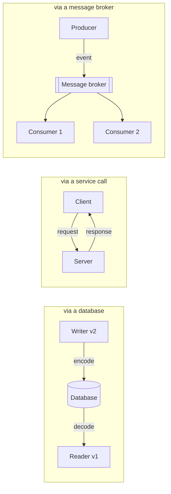

# فصل ۵: قالب‌های encoding و تکامل

[فصل ۴: ذخیره‌سازی و بازیابی →](04-storage-and-retrieval.md) · [کتاب](../README.md) · [فصل ۶: مفهوم replication ←](06-replication.md)

## خلاصه

اپلیکیشن‌ها عوض می‌شوند، و در rolling upgrade کد قدیم و جدید کنار هم اجرا می‌شوند و داده‌ای را می‌خوانند که دیگری نوشته. این فصل بررسی می‌کند داده چطور به بایت encode می‌شود: قالب‌های مخصوص یک زبان، JSON و XML و CSV، و قالب‌های باینری مبتنی بر schema مثل Protocol Buffers و Avro؛ و همه را از زاویه‌ی **backward compatibility**، یعنی کد جدید داده‌ی قدیم را بخواند، و **forward compatibility**، یعنی کد قدیم داده‌ی جدید را بخواند، می‌سنجد. بعد داده‌ی encodeشده را در **حالت‌های اصلی dataflow** دنبال می‌کند: دیتابیس، فراخوانی سرویس با REST و RPC، durable execution و workflow engine، و معماری event-driven با message broker و actor.

## نکته‌های کلیدی

- **سازگاری دو جهت دارد:** backward، یعنی کد جدید و داده‌ی قدیم، معمولاً آسان است؛ forward، یعنی کد قدیم و داده‌ی جدید، لازم دارد کد قدیم چیزی را که نمی‌فهمد نادیده بگیرد و خرابش نکند (pp. 162–163).
- **روش serialization مخصوص یک زبان**، مثل Serializable در Java و pickle در Python، شما را به یک زبان می‌بندد، versioning ضعیفی دارد و decode کردن بایت‌های نامطمئن با آن می‌تواند حفره‌ی امنیتی باشد (p. 164).
- **قالب‌های متنی درباره‌ی type مبهم‌اند:** عددها، مثلاً عدد صحیح بالای 2<sup>53</sup> در JavaScript، رشته‌های باینری با Base64، و schemaهای اختیاری (pp. 165–168).
- **قالب Protocol Buffers به field tag تکیه می‌کند:** اسم‌ها عوض می‌شوند، tagها نه؛ فیلد تازه باید اختیاری باشد؛ tagهای ناشناخته رد می‌شوند (pp. 169–171).
- **قالب Avro هیچ tagی ندارد:** خواننده writer's schema را با schema خودش بر اساس اسم فیلد تطبیق می‌دهد؛ فیلدی که اضافه یا حذف می‌شود default لازم دارد؛ و writer's schema باید معلوم باشد، یعنی داخل فایل، با شماره‌ی نسخه یا با مذاکره (pp. 172–177).
- **هر schema مستندات ارزشمندی است** و code generation و بررسی سازگاری را ممکن می‌کند (p. 177).
- **مفهوم durable execution**، مثلاً در Temporal، workflowهای چندمرحله‌ای را با log کردن و replay در برابر crash مقاوم می‌کند؛ اما کد باید deterministic و idempotent باشد (pp. 187–189).

## فهرست بخش‌ها

*از فهرست مطالب خود کتاب، یعنی bookmarkهای PDF، با شماره‌ی صفحه‌های چاپی.*

- قالب‌های encoding داده (p. 163)
  - قالب‌های مخصوص یک زبان (p. 164)
  - قالب JSON و XML و نسخه‌های باینری‌شان (p. 165)
  - قالب Protocol Buffers (p. 169)
  - قالب Avro (p. 172)
  - مزیت‌های schema (p. 177)
- حالت‌های dataflow (p. 178)
  - جریان داده از طریق دیتابیس (p. 178)
  - جریان داده از طریق سرویس: REST و RPC (p. 180)
  - مفهوم durable execution و workflow (p. 187)
  - معماری event-driven (p. 189)
- جمع‌بندی (p. 191)

## یادداشت‌ها

قابلیت‌ها عوض می‌شوند، پس داده‌ی ذخیره‌شده هم عوض می‌شود. دیتابیس‌های relational در هر لحظه دقیقاً یک schema دارند که با migration عوض می‌شود؛ دیتابیس‌های schema-on-read ممکن است ترکیبی از قالب‌های قدیم و جدید را نگه دارند (p. 161). تغییر کد نمی‌تواند همه‌جا هم‌زمان اتفاق بیفتد: سرورها با **rolling upgrade**، یعنی staged rollout، به‌روز می‌شوند و کاربرها آپدیت client را هر وقت بخواهند نصب می‌کنند؛ پس کد و داده‌ی قدیم و جدید کنار هم زندگی می‌کنند (pp. 161–162):

| جهت | یعنی | سختی |
|---|---|---|
| **backward compatibility** | کد جدیدتر داده‌ای را می‌خواند که کد قدیمی‌تر نوشته | معمولاً آسان: قالب قدیم را می‌شناسید |
| **forward compatibility** | کد قدیمی‌تر داده‌ای را می‌خواند که کد جدیدتر نوشته | سخت‌تر: کد قدیم باید چیزی را که نمی‌فهمد نادیده بگیرد و نگه دارد |

برای APIها: client قدیمی که سرویس جدید را صدا می‌زند درخواست backward-compatible و پاسخ forward-compatible لازم دارد؛ client جدیدی که سرویس قدیمی را صدا می‌زند برعکس (p. 162). تله‌ی کلاسیک، شکل ۵-۱: کد جدید رکوردی با یک فیلد تازه می‌نویسد؛ کد قدیم آن را در یک model object می‌خواند، به‌روزش می‌کند و برمی‌گرداند؛ و فیلد ناشناخته بی‌صدا از دست می‌رود، مگر این‌که حفظ شود (pp. 162–163).


*Figure 5-1 (p. 163): فیلد ناشناخته در رفت‌وبرگشت از model object قدیمی می‌افتد.*

> **Try it:** [فصل ۵ در طول یک pipeline داده](../widgets/05-pipeline-map.html): از دیتابیس منبع تا داشبورد را با lensهای قالب، سازگاری و retry طی کنید و ببینید داده در هر مرحله با چه encodingی جابه‌جا می‌شود.

> **In practice:** loader در reference stack برای هر جدول یک فهرست صریح ستون در YAML دارد. وقتی تیم صاحب منبع ستونی اضافه می‌کند، loader همان کد قدیمی شکل ۵-۱ است: ستون تازه را نمی‌شناسد و بی‌صدا کنارش می‌گذارد.
>
> **Your turn:** تیم منبع ستون `phone` را به `mobile` تغییر نام می‌دهد. در Bronze چه می‌بینید، و چه چیزی باید زودتر خبرتان کند؟
>
> *Answer:* ستون `phone` دیگر در منبع نیست، پس loader یا خطا می‌دهد یا از این به بعد null می‌نویسد، و `mobile` اصلاً load نمی‌شود: داده‌ی تازه گم می‌شود، مثل فیلد ناشناخته در شکل ۵-۱ (pp. 162–163). یک بررسی schema drift که ستون‌های منبع را با فهرست YAML مقایسه کند باید پیش از اولین load غلط هشدار بدهد.

### قالب‌های encoding داده

داده در حافظه به شکل object، struct، hash table و درخت‌هایی است که با pointer به هم وصل‌اند؛ برای نوشتن در فایل یا فرستادن روی شبکه باید به یک دنباله‌ی بایت خودبسنده تبدیل شود. **encoding**، یا serialization و marshaling، یکی را به دیگری تبدیل می‌کند و **decoding**، یا parsing و deserialization و unmarshaling، برعکس. کتاب از واژه‌ی «serialization» پرهیز می‌کند، چون در تراکنش‌ها معنای دیگری دارد (pp. 163–164). قالب‌های zero-copy، مثل Cap’n Proto و FlatBuffers، این قدم را حذف می‌کنند (p. 164).

#### قالب‌های مخصوص یک زبان (pp. 164–165)

قالب‌هایی مثل `Serializable` در Java، `pickle` در Python، `Marshal` در Ruby و Kryo راحت‌اند، اما به یک زبان بسته‌اند، یک **حفره‌ی امنیتی** هستند چون decode کردن می‌تواند کلاس دلخواه بسازد و به remote code execution برسد، به versioning بی‌اعتنا هستند و اغلب کند و حجیم. فقط برای کارهای خیلی موقت از آن‌ها استفاده کنید.

#### قالب JSON و XML و نسخه‌های باینری‌شان (pp. 165–169)

| مشکل | جزئیات |
|---|---|
| پرحرفی | XML را اغلب پرحرف و پیچیده می‌دانند |
| عددها | XML و CSV عدد را از رشته‌ی رقمی تشخیص نمی‌دهند؛ JSON بین int و float فرقی نمی‌گذارد و دقت را مشخص نمی‌کند. عدد صحیح بالای 2<sup>53</sup> در JavaScript خراب می‌شود؛ API شبکه‌ی X شناسه‌های ۶۴ بیتی پست‌ها را دو بار می‌فرستد، یک بار عدد و یک بار رشته |
| داده‌ی باینری | رشته‌ی بایتی ندارند؛ Base64 کار می‌کند اما وصله‌پینه است و **حدود ۳۳٪ بزرگ‌تر** |
| schema | XML Schema و JSON Schema قدرتمند اما پیچیده‌اند؛ بدونشان منطق decode در کد سخت‌کد می‌شود |
| CSV | هیچ schemaی ندارد؛ escape کردن ویرگول و خط تازه با وجود یک spec مبهم است |

این قالب‌ها برای **تبادل داده بین سازمان‌ها** همچنان خوب‌اند: سخت‌ترین بخش، توافق روی هر چیزی است (p. 166).

**قالب JSON Schema** (pp. 166–167) همه‌جا هست: OpenAPI، Schema Registry در Confluent و Apicurio، `pg_jsonschema` در PostgreSQL و `$jsonSchema` در MongoDB. validation اضافه می‌کند، مثلاً port بین ۱ و ۶۵٬۵۳۵، و پیش‌فرض یک **open content model** دارد، یعنی `additionalProperties: true`؛ پس schema بیشتر می‌گوید چه چیزی *مجاز نیست*. مدل‌های بسته، `patternProperties`، مثلاً mapهایی با کلید عددی در مثال ۵-۱، شرط‌ها و ارجاع‌های راه دور آن را قدرتمند می‌کنند، و تکامل سازگارش را سخت.

**نسخه‌های باینری JSON و XML**، یعنی MessagePack، CBOR، BSON، BJSON، UBJSON، BISON، Hessian و Smile، و WBXML و Fast Infoset، کاربرد محدودی دارند. بدون schema هنوز باید اسم همه‌ی فیلدها را داخل داده بنویسند (p. 167).

> **In practice:** وقتی یک API یا partner شناسه‌ی تراکنش را به شکل عدد JSON می‌فرستد، هر خواننده‌ای که عدد را double تفسیر کند، مثل JavaScript، شناسه‌های بزرگ را گرد می‌کند.
>
> **Your turn:** در یک گزارش، دو تراکنش مختلف با یک شناسه دیده می‌شوند و join روی این شناسه ردیف اضافه می‌دهد. شناسه‌ها ۱۸ رقمی‌اند. احتمالاً چه شده و راه درست چیست؟
>
> *Answer:* شناسه‌های بالای 2<sup>53</sup> در یک خواننده‌ی JavaScript یا هر تبدیل به float دقتشان را از دست داده‌اند و به یک عدد گرد شده‌اند (p. 165). شناسه را به شکل رشته منتقل و ذخیره کنید، همان کاری که API شبکه‌ی X با فرستادن نسخه‌ی رشته‌ای می‌کند.

#### رکورد نمونه‌ی کتاب (pp. 167–177)

```json
{ "userName": "Martin", "favoriteNumber": 1337, "interests": ["daydreaming", "hacking"] }
```

| encoding | بایت | چه چیزی فیلد را مشخص می‌کند | schema لازم است؟ |
|---|---|---|---|
| JSON بدون فاصله | **۸۱** | اسم فیلد به شکل متن | نه |
| MessagePack | **۶۶** | اسم فیلد با پیشوند طول؛ `0x83` یعنی object با ۳ فیلد و `0xa8` یعنی رشته‌ی ۸ بایتی «userName» | نه |
| Protocol Buffers | **۳۳** | شماره‌ی tag و wire type در یک بایت | بله |
| Avro | **۳۲** | هیچ چیز؛ مقدارها به ترتیب schema | بله، هم writer's و هم reader's |

> **Try it:** [یک رکورد، چهار encoding](../widgets/05-encodings.html): رکورد نمونه‌ی کتاب، بایت به بایت، در JSON، MessagePack، Protocol Buffers و Avro.

#### قالب Protocol Buffers (pp. 169–171)

قالب Google است؛ Apache Thrift، از Facebook، شبیه آن است. یک schema به زبان IDL خودش، با code generation برای زبان‌های زیاد:

```protobuf
syntax = "proto3";
message Person {
  string user_name       = 1;
  int64  favorite_number = 2;
  repeated string interests = 3;
}
```

فیلدهای encodeشده به جای اسم، **شماره‌ی tag**، یعنی ۱ و ۲ و ۳، دارند. عددهای صحیح **طول متغیر** دارند: ۱۳۳۷ دو بایت می‌گیرد، چون بیت بالایی یعنی «بایت‌های بیشتری می‌آید»؛ بازه‌ی −۶۴ تا ۶۳ در یک بایت جا می‌شود و −۸٬۱۹۲ تا ۸٬۱۹۱ در دو بایت. فیلدهای `repeated` همان tag است که چند بار تکرار می‌شود (p. 170). قاعده‌های تکامل (p. 171):


*Figure 5-3 (p. 170): هر مقدار را tag مشخص می‌کند، نه اسم فیلد؛ برای همین tag هیچ‌وقت نباید عوض شود.*

| تغییر | اثر |
|---|---|
| تغییر نام فیلد | بی‌اشکال؛ داده‌ی encodeشده هیچ‌وقت اسم‌ها را ندارد |
| تغییر tag | هرگز؛ همه‌ی داده‌ی موجود نامعتبر می‌شود |
| اضافه کردن فیلد با tag تازه | کد قدیم tag ناشناخته را رد می‌کند، چون type annotation می‌گوید چند بایت است، و می‌تواند آن را نگه دارد؛ یعنی **forward compatible**. کد جدید با خواندن داده‌ی قدیم مقدار default می‌گیرد، مثل رشته‌ی خالی یا ۰؛ یعنی **backward compatible** |
| حذف فیلد | نگرانی‌ها برعکس است؛ tag آن را هرگز دوباره به کار نبرید و **reserved** علامتش بزنید |
| تغییر type، مثلاً int سی‌ودو بیتی به شصت‌وچهار بیتی | کد جدید داده‌ی قدیم را درست می‌خواند؛ کد قدیم مقدار بزرگ تازه را **truncate** می‌کند |

#### قالب Avro (pp. 172–177)

در ۲۰۰۹ به عنوان زیرپروژه‌ی Hadoop شروع شد، چون Protocol Buffers به Hadoop خوب نمی‌خورد؛ دو زبان schema دارد، Avro IDL برای انسان و JSON برای ماشین:

```text
record Person {
  string               userName;
  union { null, long } favoriteNumber = null;
  array<string>        interests;
}
```

مفهوم encoding باینری فقط مقدارهای پشت سر هم است؛ هر رشته یک پیشوند طول و UTF-8 است و هر عدد صحیح یک varint؛ پس decode کردن دقیقاً **writer's schema** را لازم دارد (p. 172). اپلیکیشن با دو schema decode می‌کند و **writer's schema** را با **reader's schema** خودش بر اساس **اسم** فیلد تطبیق می‌دهد (شکل‌های ۵-۵ و ۵-۶):


*Figure 5-4 (p. 173): هیچ چیز در بایت‌ها نمی‌گوید کدام فیلد کدام است، پس decode کردن همان schemaی را لازم دارد که نویسنده به کار برده.*


*Figure 5-6 (p. 174): فیلدها با اسم تطبیق داده می‌شوند؛ فیلدی که فقط نویسنده دارد نادیده گرفته می‌شود و فیلدی که فقط خواننده دارد default می‌گیرد.*

**قاعده‌های تکامل** (p. 175): forward compatibility یعنی نویسنده جدیدتر از خواننده؛ backward یعنی نویسنده قدیمی‌تر. **فقط فیلدهایی را اضافه یا حذف کنید که default دارند.** اضافه کردن بدون default backward compatibility را می‌شکند؛ حذف بدون default forward compatibility را. `null` یک default همگانی نیست؛ یک union تعریف کنید، مثل `union { null, long, string }`، و اگر null پیش‌فرض است اول بیاید. تغییر type اگر Avro بتواند تبدیل کند کار می‌کند؛ تغییر نام با **alias** خواننده و اضافه کردن شاخه به union سازگار backward هستند اما forward نه.

> **Try it:** [writer's schema و reader's schema](../widgets/05-schema-evolution.html): در schema نمونه‌ی Avro کتاب فیلد اضافه، حذف و تغییر نام بدهید و ببینید کدام جهت سازگاری می‌شکند.

**خواننده writer's schema را از کجا می‌آورد؟** (pp. 175–176)

| موقعیت | جواب |
|---|---|
| فایل بزرگی از رکوردها با یک schema | schema را یک بار اول فایل بنویسید؛ همان **object container file** در Avro |
| دیتابیسی که رکوردهایش در طول زمان نوشته شده‌اند | یک شماره‌ی نسخه برای هر رکورد و یک جدول از نسخه‌های schema؛ مثل schema registry در Confluent برای Kafka و Espresso در LinkedIn |
| اتصال شبکه | مذاکره روی نسخه هنگام برقراری اتصال؛ مثل Avro RPC |

پایگاه نسخه‌ها هم مستندات است و هم بررسی سازگاری؛ نسخه می‌تواند یک شمارنده یا hash خود schema باشد (p. 176). **schemaهای پویا** نقطه‌ی قوت Avro هستند: برای dump یک دیتابیس relational می‌شود برای هر جدول یک record schema و برای هر ستون یک فیلد ساخت، و با تغییر ستون‌ها دوباره تولیدش کرد، چون فیلدها با اسم تطبیق داده می‌شوند. با Protocol Buffers کسی باید tagها را دستی تخصیص بدهد و هیچ‌وقت دوباره به کار نبرد (pp. 176–177).

> **In practice:** فایل‌های Parquet در staging هم schema را یک بار داخل خود فایل نگه می‌دارند، شبیه object container file در Avro؛ و loader schema هر جدول را از روی ستون‌های منبع می‌سازد، شبیه schemaهای پویای کتاب.
>
> **Your turn:** چرا warehouse می‌تواند یک فایل Parquet را بدون این‌که کسی ستون‌هایش را بگوید load کند، اما یک فایل CSV را نه؟
>
> *Answer:* فایل Parquet schema نویسنده را همراه خودش دارد، همان راه‌حل «schema را یک بار اول فایل بنویسید» (p. 175)، پس خواننده می‌داند هر ستون چه type و اسمی دارد. CSV هیچ schemaی ندارد (p. 166) و خواننده باید type هر ستون را حدس بزند.

#### مزیت‌های schema (pp. 177–178)

زبان‌های schema در Protocol Buffers و Avro در مقایسه با XML Schema و JSON Schema ساده‌اند، پس زبان‌های زیادی پشتیبانی‌شان می‌کنند. ایده‌ها قدیمی‌اند: **ASN.1** از ۱۹۸۴، که encoding نوع DER آن هنوز گواهی‌های X.509 را encode می‌کند، هم از شماره‌ی tag استفاده می‌کند؛ اما پیچیده و بد مستندشده است. پروتکل‌های شبکه‌ی دیتابیس‌ها encodingهای باینری اختصاصی‌اند که driverهای ODBC و JDBC decodeشان می‌کنند. encodingهای باینری مبتنی بر schema این‌ها را می‌دهند: فشردگی، چون اسم فیلد ندارند؛ مستنداتی که همیشه به‌روز است؛ بررسی سازگاری پیش از deploy؛ و code generation با بررسی type در زمان compile؛ یعنی انعطاف schema-on-read با تضمین‌های بهتر. تعداد نسخه‌های هم‌زمان schema را کم نگه دارید (p. 178).

### حالت‌های dataflow

سازگاری رابطه‌ای است بین processی که encode می‌کند و processی که decode می‌کند (p. 178).



#### جریان داده از طریق دیتابیس (pp. 178–180)

نوشتن در دیتابیس یعنی «فرستادن پیام برای خود آینده‌تان»؛ backward compatibility ضروری است. با processهای زیاد و rolling upgrade، کد جدیدتر ممکن است چیزی بنویسد که کد قدیمی‌تر می‌خواند، پس **forward compatibility** هم لازم است (pp. 178–179).

- **داده از کد بیشتر عمر می‌کند:** یک دیتابیس مقدارهایی دارد که ۵ میلی‌ثانیه پیش و ۵ سال پیش نوشته شده‌اند، هر کدام با encoding اصلی خودش. بازنویسی همه‌چیز گران است، پس دیتابیس‌ها migration را تنبلانه انجام می‌دهند: compaction در LSM داده را در آخرین قالب بازنویسی می‌کند؛ ستون nullable تازه در زمان خواندن null برمی‌گرداند. تغییرهای پیچیده، مثل تبدیل یک‌مقداری به چندمقداری یا انتقال داده به جدول دیگر، هنوز بازنویسی لازم دارند و سازگاری در آن‌ها مسئله‌ای پژوهشی است (p. 179).
- **ذخیره‌سازی آرشیوی:** snapshot و loadهای warehouse یک بار و با آخرین schema نوشته می‌شوند؛ جای خوبی برای container fileهای Avro یا Parquet ستونی (pp. 179–180).

> **In practice:** لایه‌ی Bronze دقیقاً همین «داده بیشتر از کد عمر می‌کند» است: ردیف‌هایی که سه سال پیش با شکل قدیم منبع load شده‌اند کنار ردیف‌های دیروز می‌نشینند و هیچ‌کس دوباره نمی‌نویسدشان.
>
> **Your turn:** منبع از یک سال پیش به جای `full_name` دو ستون `first_name` و `last_name` دارد. کوئری Silver باید با ردیف‌های Bronze چه کند؟
>
> *Answer:* هر دو شکل را بخواند: برای ردیف‌های قدیم `full_name` را بشکند یا برای ردیف‌های جدید دو ستون را به هم بچسباند، مثلاً با `coalesce`. این همان migration تنبل کتاب است، که به جای بازنویسی همه‌ی داده، اختلاف را در زمان خواندن حل می‌کند (p. 179).

#### جریان داده از طریق سرویس: REST و RPC (pp. 180–186)

سرورها یک API، یعنی یک **سرویس**، در اختیار می‌گذارند که برخلاف دیتابیس فقط ورودی‌ها و خروجی‌هایی را که منطق کسب‌وکار تعیین کرده می‌پذیرد؛ همین encapsulation به هر تیم اجازه می‌دهد سرویسش را مستقل deploy و تکامل بدهد (pp. 180–181). **web service**ها از HTTP استفاده می‌کنند: اپ‌هایی که روی اینترنت backend را صدا می‌زنند، سرویس‌هایی که داخل یک سازمان همدیگر را صدا می‌زنند، و سازمان‌هایی که همدیگر را صدا می‌زنند؛ مثل پرداخت و OAuth (p. 181). سبک **REST** روی HTTP ساخته می‌شود: قالب‌های ساده، URL برای منابع، و cache و احراز هویت و content negotiation در HTTP. IDLها APIها را توصیف می‌کنند، **OpenAPI** یا Swagger برای JSON و **Protocol Buffers** برای gRPC، و frameworkهایی مثل Spring Boot، FastAPI و gRPC مسیریابی، metric، cache و احراز هویت را مدیریت می‌کنند و SDK برای client، مستندات و بررسی سازگاری تولید می‌کنند (pp. 181–183).

**مشکل‌های RPC** (pp. 183–184). EJB و RMI فقط برای Java، DCOM فقط برای Microsoft، CORBA پیچیده و بدون سازگاری، و SOAP و WS-* با پیچیدگی‌شان همه دنبال **location transparency** بودند، یعنی این‌که فراخوانی راه دور شبیه فراخوانی محلی به نظر برسد؛ ایده‌ای که از پایه معیوب است:

| فراخوانی تابع محلی | درخواست شبکه |
|---|---|
| قابل پیش‌بینی؛ فقط به دلیل‌هایی شکست می‌خورد که در کنترل شماست | درخواست یا پاسخ گم می‌شود، ماشین کند یا در دسترس نیست |
| برمی‌گردد، exception می‌دهد، یا هیچ‌وقت برنمی‌گردد | ممکن است **time out** شود و ندانید چه شد |
| دو بار صدا زدن انتخاب خودتان است | retry ممکن است کار را تکرار کند، مگر **idempotent** باشد |
| زمان تقریباً ثابت | خیلی کندتر، با latency بسیار متغیر |
| pointer پاس می‌دهید | هر پارامتر باید به بایت encode شود |
| یک زبان | ترجمه‌ی typeها بین زبان‌ها؛ مسئله‌ی 2<sup>53</sup> را به یاد بیاورید |

جذابیت REST تا حدی از این است که انتقال state را چیزی متفاوت از فراخوانی تابع می‌بیند (p. 184).

**مفهوم load balancer، service discovery و service mesh** (pp. 184–186):

| گزینه | نمونه‌ها را چطور پیدا و بار را پخش می‌کند | بده‌بستان |
|---|---|---|
| load balancer سخت‌افزاری | دستگاهی در datacenter جلوی سرورها | تجهیزات خاص |
| load balancer نرم‌افزاری، مثل NGINX و HAProxy | همان کار، به شکل یک اپلیکیشن معمولی | deploy ساده |
| DNS | چند IP برای یک اسم | cache شدن یعنی آدرس‌های کهنه وقتی نمونه‌ها جابه‌جا می‌شوند |
| service discovery، مثل etcd و ZooKeeper | نمونه‌ها ثبت می‌شوند و heartbeat می‌فرستند؛ clientها endpoint و metadata را پیدا می‌کنند | به محیط‌های پویا می‌خورد؛ پخش بار هوشمندتر سمت client |
| service mesh، مثل Istio و Linkerd | load balancer در sidecar یا داخل process در هر دو سر | پیچیده، اما TLS را مدیریت می‌کند و observability غنی می‌دهد؛ با Kubernetes رایج است |

**تکامل در RPC** (p. 186): فرض کنید سرورها پیش از clientها به‌روز می‌شوند؛ پس درخواست‌ها backward compatibility و پاسخ‌ها forward compatibility لازم دارند. gRPC و Avro RPC قاعده‌های encoding خودشان را به ارث می‌برند؛ REST API می‌تواند پارامتر اختیاری تازه به درخواست و فیلد تازه به پاسخ اضافه کند. بین سازمان‌ها نمی‌شود clientها را مجبور به به‌روزرسانی کرد، پس نسخه‌های قدیم API زنده می‌مانند؛ نسخه در URL، در header `Accept`، یا برای هر API key روی سرور نگه داشته می‌شود.

> **In practice:** API پیش‌بینی reference stack یک سرویس REST کوچک است که اپ‌ها صدایش می‌زنند. clientها همیشه هم‌زمان با سرویس به‌روز نمی‌شوند.
>
> **Your turn:** مدل تازه یک category جدید به اسم `subscriptions` برمی‌گرداند. اپ نسخه‌ی قدیم فقط categoryهای قبلی را می‌شناسد. چه کاری پاسخ را forward-compatible نگه می‌دارد؟
>
> *Answer:* پاسخ از سرور جدید به client قدیم می‌رود، پس باید forward-compatible باشد (p. 186): client قدیم باید با مقدار ناشناخته کنار بیاید، مثلاً آن را «سایر» نشان بدهد، و سرور تا وقتی clientهای قدیم زنده‌اند مقدار تازه را پشت یک نسخه‌ی تازه‌ی API نگه دارد.

#### مفهوم durable execution و workflow (pp. 187–189)

هر پرداخت با تشخیص تقلب، شبکه‌ی کارت و بانک سروکار دارد: یک **workflow** از **task**ها، که Temporal به آن‌ها *activity* و بقیه *durable function* می‌گویند، و در کد، یک DSL یا BPEL و BPMN تعریف می‌شود (شکل ۵-۷). یک **workflow engine**، یعنی یک orchestrator که زمان‌بندی می‌کند و با زمان یا رویداد شروع می‌کند به همراه executorها، تصمیم می‌گیرد taskها کجا و کی اجرا شوند و شکست‌ها چطور retry شوند (pp. 187–188).

| نوع engine | نمونه‌ها |
|---|---|
| ETL و هماهنگی داده | Airflow، Dagster، Prefect |
| گرافیکی با BPMN برای غیرمهندس‌ها | Camunda، Orkes |
| **مفهوم durable execution** | Temporal، Restate |

مفهوم durable execution برای یک workflow **exactly-once semantics** می‌دهد: هر RPC و تغییر state در یک storage پایدار log می‌شود، شبیه WAL؛ بعد از شکست task دوباره اجرا می‌شود، اما فراخوانی‌های logشده به جای اجرای دوباره نتیجه‌ی ثبت‌شده‌شان را برمی‌گردانند (p. 188). نکته‌ها (p. 189): سرویس‌های بیرونی هنوز API idempotent با شناسه‌ی یکتا لازم دارند؛ replay همان فراخوانی‌ها را با همان ترتیب انتظار دارد، پس جابه‌جا کردن کد خطرناک است و نسخه‌های تازه باید کنار نسخه‌های قدیم deploy شوند؛ و کد باید **deterministic** باشد، یعنی از تابع‌های random و ساعت خود framework استفاده کند؛ Workflow Check در Temporal کمک می‌کند.

> **In practice:** ابزار Airflow در reference stack برای هر جدول یک DAG دارد و taskهای شکست‌خورده را retry می‌کند؛ اما durable execution نیست: هیچ log‌ای از نتیجه‌ی قدم‌های قبلی را دوباره استفاده نمی‌کند. loader هم با `write_disposition: append` می‌نویسد.
>
> **Your turn:** task مربوط به load بعد از درج نیمی از ردیف‌ها در Bronze شکست می‌خورد و Airflow آن را retry می‌کند. چه اتفاقی می‌افتد و چه چیزی آن را بی‌خطر می‌کند؟
>
> *Answer:* retry دوباره append می‌کند، پس نیمه‌ی اول دو بار در Bronze است؛ retry فقط وقتی بی‌خطر است که کار idempotent باشد (pp. 184, 189). در این stack، Silver با انتخاب جدیدترین نسخه‌ی هر id تکراری‌ها را حذف می‌کند؛ راه دیگر این است که هر load پارتیشن هدفش را اول پاک کند و بعد بنویسد، تا اجرای دوباره همان نتیجه را بدهد.

#### معماری event-driven (pp. 189–191)

رویدادها یا پیام‌ها از یک **message broker**، که به آن event broker، message queue یا message-oriented middleware هم می‌گویند، عبور می‌کنند و فرستنده معمولاً منتظر نمی‌ماند. broker وقتی گیرنده‌ها خاموش یا پربارند پیام را buffer می‌کند، به consumerهای crashکرده دوباره تحویل می‌دهد، نیاز به service discovery را حذف می‌کند، یک پیام را به گیرنده‌های زیاد پخش می‌کند و فرستنده را از گیرنده جدا می‌کند؛ request و response را هم می‌شود با یک reply channel رویش ساخت (pp. 189–190).

- از TIBCO، IBM WebSphere و webMethods تا RabbitMQ، ActiveMQ، HornetQ، NATS، Redpanda و Kafka؛ و در cloud سرویس‌های Kinesis، Azure Service Bus و Google Pub/Sub (p. 190).
- دو الگو: **queue**، که هر پیام را یک consumer می‌گیرد، و **topic**، که هر subscriber آن را می‌گیرد (p. 190).
- پیام‌ها بایت‌های مبهم به همراه metadata هستند: از Protocol Buffers، Avro یا JSON با یک **schema registry** استفاده کنید، یا با **AsyncAPI** توصیفشان کنید. خیلی از brokerها پیام مصرف‌شده را پاک می‌کنند؛ event sourcing نگهداری نامحدود لازم دارد. consumerهایی که پیام را دوباره منتشر می‌کنند باید **فیلدهای ناشناخته را حفظ کنند** (pp. 190–191).

**چارچوب‌های distributed actor**، مثل Akka، Orleans و Erlang/OTP: هر actor state محلی خودش را دارد و هر بار یک پیام asynchronous را پردازش می‌کند؛ بدون thread، lock یا race. location transparency این‌جا بهتر کار می‌کند، چون actorها از اول فرض می‌کنند پیام ممکن است گم شود؛ rolling upgrade همچنان encoding سازگار لازم دارد (p. 191).

## بده‌بستان‌ها در یک نگاه

| قالب | اندازه در مثال کتاب | schema | forward compatibility با | backward compatibility با |
|---|---|---|---|---|
| JSON | ۸۱ بایت | اختیاری، با JSON Schema | نادیده گرفتن فیلدهای ناشناخته توسط خواننده | تحمل فیلدهای غایب توسط خواننده |
| MessagePack | ۶۶ بایت | ندارد | مثل JSON | مثل JSON |
| Protocol Buffers | ۳۳ بایت | لازم، در `.proto` | رد کردن tagهای ناشناخته | فیلدهای تازه اختیاری؛ tag هرگز دوباره به کار نمی‌رود |
| Avro | ۳۲ بایت | لازم؛ writer's schema هم لازم است | خواننده فیلدهای فقط‌نویسنده را نادیده می‌گیرد | default برای فیلدهای فقط‌خواننده |

## فراتر از کتاب

- نسخه‌ی ۳ از Protocol Buffers اول field presence را برای scalarها حذف کرد و بعد `optional` را برگرداند؛ فیلدهای «required» را عموماً اشتباه می‌دانند، چون حذفشان را ناممکن می‌کنند.
- روش consumer-driven contract testing، مثلاً با Pact، مکمل عملی schema registry برای REST APIهاست.

## پیوندها

- **Run it:** [encodingهای باینری و تکامل schema](../lab/05-schema-evolution/README.md): عددهای ۸۱ و ۳۳ و ۳۲ بایت را بازتولید می‌کند و هر دو جهت سازگاری را نشان می‌دهد.
- **فصل‌های مرتبط:** [فصل ۳: مدل‌های داده و زبان‌های کوئری](03-data-models-and-query-languages.md) برای schema-on-read، [فصل ۸: تراکنش‌ها](08-transactions.md) برای exactly-once، و [فصل ۱۲: پردازش stream](12-stream-processing.md) برای broker و event log.

## خودتان را بسنجید

*پرسش‌ها و پاسخ‌ها را خود vault از روی یادداشت‌های بالا نوشته است؛ پاسخ‌ها به صفحه‌های کتاب ارجاع می‌دهند.*

1. **چرا نسخه‌ی قدیمی یک سرویس باید فیلدهایی را که نمی‌فهمد حفظ کند، وقتی رکوردی را می‌خواند، تغییر می‌دهد و برمی‌گرداند؟**

   *Answer:* در rolling upgrade ممکن است کد جدیدتر یک فیلد اضافه کرده باشد. اگر کد قدیم رکورد را به objectهایی decode کند که فیلدهای ناشناخته را می‌اندازند و بعد آن را برگرداند، داده‌ی فیلد تازه بی‌صدا از دست می‌رود (pp. 178–180).

2. **در Protocol Buffers چه چیزی را آزادانه می‌شود عوض کرد و چه چیزی را هرگز؟**
   - [ ] نوع فیلد را آزادانه؛ اسم را هرگز
   - [x] اسم فیلد را آزادانه؛ شماره‌ی tag را هرگز
   - [ ] شماره‌ی tag را آزادانه؛ اسم را هرگز
   - [ ] هیچ چیز را؛ هر تغییری خواننده‌های قدیم را می‌شکند

   *Answer:* داده‌ی encodeشده فقط شماره‌ی tag دارد، هرگز اسم فیلد؛ پس تغییر نام بی‌ضرر است و تغییر tag همه‌ی داده‌ی موجود را ناخوانا می‌کند. فیلدهای تازه tag تازه می‌گیرند (pp. 169–172).

3. **قالب Avro هیچ شناسه‌ی فیلدی encode نمی‌کند. خواننده چطور داده‌ای را decode می‌کند که با schema قدیمی‌تری نوشته شده؟**

   *Answer:* خواننده دقیقاً writer's schema را لازم دارد؛ کتابخانه‌ی Avro آن را با reader's schema تطبیق می‌دهد، فیلدها را با اسم جفت می‌کند، فیلدهایی را که خواننده ندارد نادیده می‌گیرد و برای فیلدهایی که نویسنده نداشته default می‌گذارد (pp. 172–176).

4. **چه چیزی location transparency در RPC را یک abstraction نشت‌دار می‌کند؟**

   *Answer:* درخواست شبکه شبیه فراخوانی محلی نیست: ممکن است گم یا time out شود و نتیجه‌اش نامعلوم بماند، latency متغیر است، retry ممکن است کاری را دو بار انجام دهد، و پارامترها باید encode شوند (pp. 182–184).

5. **چرا کدی که زیر durable execution اجرا می‌شود باید deterministic باشد؟**
   - [ ] چون framework آن را از پیش compile می‌کند
   - [x] چون بعد از شکست، framework کد را replay می‌کند و باید به همان قدم‌ها برسد تا نتیجه‌های logشده‌شان را دوباره استفاده کند
   - [ ] چون workflowها نمی‌توانند سرویس بیرونی صدا بزنند
   - [ ] چون determinism کد را سریع‌تر می‌کند

   *Answer:* durable execution نتیجه‌ی هر قدم را log می‌کند و بعد از crash workflow را دوباره اجرا می‌کند و نتیجه‌های logشده را جایگزین می‌کند. اگر کد در replay مسیر دیگری برود، مثلاً به خاطر عدد تصادفی، خواندن ساعت یا کد تغییرکرده، log دیگر جور درنمی‌آید (pp. 187–189).

6. **مفهوم loader با یک فهرست صریح ستون کار می‌کند و تیم منبع ستونی اضافه می‌کند. این از نظر جهت سازگاری چه وضعی است؟**
   - [ ] شکست backward compatibility؛ loader جدید است و داده قدیم
   - [x] مفهوم loader کد قدیمی است که داده‌ی جدیدتر را می‌خواند؛ forward compatibility برقرار است چون فیلد ناشناخته را نادیده می‌گیرد، اما داده‌ی آن فیلد از دست می‌رود
   - [ ] هیچ مسئله‌ای نیست، چون warehouse ستون را خودش اضافه می‌کند
   - [ ] شکست هر دو جهت

   *Answer:* کد قدیم داده‌ای را می‌خواند که کد جدیدتر نوشته، یعنی forward compatibility (p. 162). نادیده گرفتن فیلد ناشناخته جلوی شکستن را می‌گیرد، اما همان تله‌ی شکل ۵-۱ است: داده‌ی تازه بی‌صدا گم می‌شود، مگر کسی ستون را اضافه کند (pp. 162–163).
