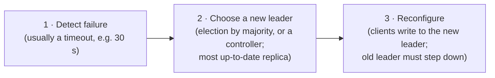
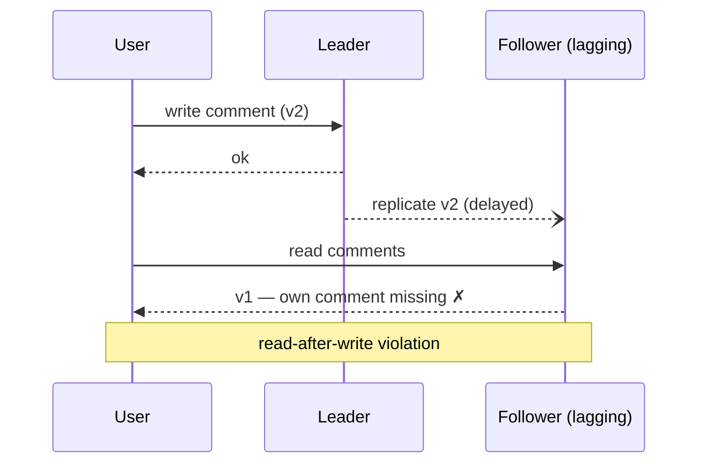
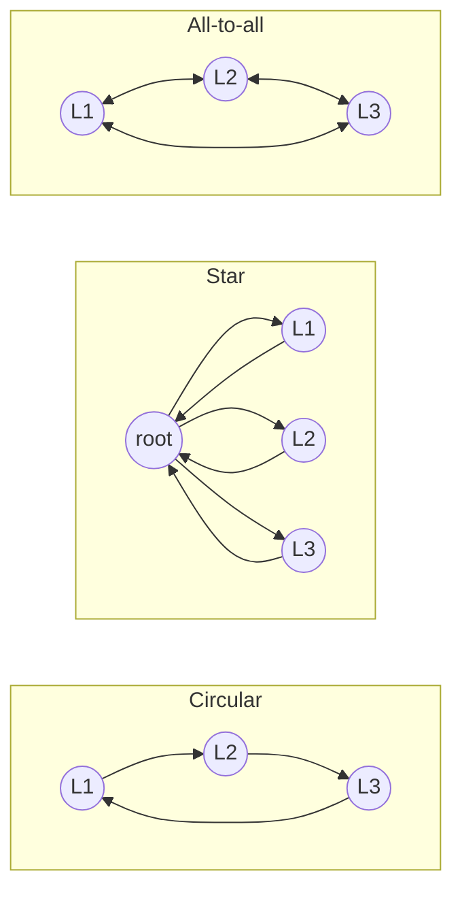
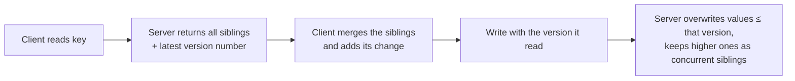

# 6. Replication

[← 5. Encoding and Evolution](05-encoding-and-evolution.md) · [Book](../README.md) · [7. Sharding →](07-sharding.md)

## Summary

Replication keeps a copy of the same data on several machines — for availability, durability, disconnected operation, lower latency, and read scalability. Keeping copies is easy when data never changes; all the difficulty lies in propagating changes. The chapter compares the three families of algorithms — **single-leader**, **multi-leader**, and **leaderless** — along with synchronous versus asynchronous propagation, failover, the anomalies replication lag causes (and the consistency guarantees that fix them), local-first sync engines, and how concurrent writes are detected (version vectors) and resolved (last-write-wins, manual resolution, CRDTs).

## Key takeaways

- **Replication is not backup**: an accidental delete replicates instantly; backups preserve history (p. 198).
- **Synchronous replication guarantees an up-to-date follower but blocks writes when it is down**; in practice one follower is synchronous (semi-synchronous) or replication is fully asynchronous — and then **failover can lose acknowledged writes** (pp. 200–208).
- **Failover is fraught**: detecting failure by timeout, choosing the most up-to-date replica, and avoiding **split brain** (pp. 204–207).
- **Replication lag causes anomalies** that consistency models address: **read-after-write**, **monotonic reads**, **consistent prefix reads** (pp. 209–215).
- **Multi-leader replication** suits multi-region operation and offline-capable clients (**sync engines, local-first software**), but concurrent writes conflict (pp. 215–229).
- **Leaderless replication** writes to and reads from several replicas in parallel; with **w + r > n** quorums, reads overlap the latest write — though edge cases remain (pp. 229–237).
- **Concurrency is about knowledge, not time**: two writes are concurrent if neither knew of the other. **Version vectors** detect this; merging siblings (e.g. CRDTs) resolves it (pp. 237–243).

## Section outline

*From the book’s own table of contents (PDF bookmarks); printed page numbers.*

- Single-Leader Replication — p. 198
  - Synchronous Versus Asynchronous Replication — p. 200
  - Setting Up New Followers — p. 201
  - Handling Node Outages — p. 204
  - Implementation of Replication Logs — p. 206
  - Problems with Replication Lag — p. 209
  - Solutions for Replication Lag — p. 214
- Multi-Leader Replication — p. 215
  - Geographically Distributed Operation — p. 216
  - Sync Engines and Local-First Software — p. 220
  - Dealing with Conflicting Writes — p. 222
- Leaderless Replication — p. 229
  - Writing to the Database When a Node Is Down — p. 229
  - Single-Leader Versus Leaderless Replication Performance — p. 235
  - Multi-Region Operation — p. 236
  - Detecting Concurrent Writes — p. 237
- Summary — p. 243

## Notes

**Replication** keeps a copy of the same data on several networked machines — to keep data close to users (latency), keep working when parts fail (availability, durability), and serve more reads (throughput). This chapter assumes every node holds the whole dataset; Chapter 7 shards it. All the difficulty lies in *changes*; nearly every distributed database uses one of three families — single-leader, multi-leader, leaderless (pp. 197–198).

**Backups are still needed** (p. 198): replicas propagate an accidental delete within moments; backups let you go back in time. The two complement each other — snapshots seed new replicas, and archived replication logs form part of a backup.

### Single-leader replication

Also called leader-based, primary-backup or active/passive (pp. 198–199):

1. One replica is the **leader** (primary, source); all writes go to it and it writes them locally.
2. It sends each change to the **followers** (read replicas, secondaries, hot standbys) in a **replication log** (change stream); they apply changes in the same order.
3. Reads may go to any replica; only the leader accepts writes.

With sharding, each shard has its own leader. Used by PostgreSQL, MySQL, Oracle Data Guard, SQL Server Always On, MongoDB, DynamoDB, Kafka, DRBD, and consensus systems such as Raft (CockroachDB, TiDB, etcd, RabbitMQ quorum queues). “Master–slave” is the old, offensive term (pp. 199–200).

#### Synchronous versus asynchronous replication (pp. 200–201)

| Mode | Leader waits for | Gain | Cost |
|---|---|---|---|
| Synchronous (all followers) | Every follower | Every follower up to date | One slow or dead node blocks all writes — impractical |
| **Semi-synchronous** | One follower (another promoted if it lags) | At least two up-to-date copies | Some latency |
| Majority quorum (e.g. 3 of 5) | A majority | Basis of consensus systems (Ch. 10) | Latency of the median node |
| Fully asynchronous | No follower | Leader keeps going even if all followers lag; common with many or distant followers | An **acknowledged write can be lost** if the leader dies |

Replication is usually sub-second, but followers can fall minutes behind — during recovery, near capacity, or with network problems (pp. 200–201).

#### Setting up new followers (pp. 201–203)

1. Take a **consistent snapshot** of the leader without locking it (built in, or tools like Percona XtraBackup).
2. Copy it to the new node.
3. Request every change since the snapshot’s exact log position — PostgreSQL’s **log sequence number**, MySQL’s binlog coordinates or GTIDs.
4. When the backlog is processed, the follower has **caught up**.

Archiving snapshots plus the replication log in an object store (WAL-G for PostgreSQL/MySQL/SQL Server, Litestream for SQLite) gives backups, disaster recovery and steps 1–2 for free (p. 202).

**Databases backed by object storage** (pp. 202–203):

| Benefits | Trade-offs |
|---|---|
| Cheap; working set in memory/SSD, cold data on object storage | Much higher read/write latency than local disks or EBS |
| Multi-zone/region durability, avoiding inter-zone fees | Per-request fees force batching (more latency) |
| Conditional writes (compare-and-set) for transactions and leader election | Immutable objects make random writes expensive |
| One store for many systems eases integration (Parquet, Iceberg) | No standard filesystem interface; FUSE mounts lack POSIX features |

Designs range from **tiered storage**, to object storage as primary with a low-latency WAL (EBS, Neon’s Safekeepers), to **zero-disk architectures** with disks only as cache — WarpStream, Confluent Freight, Bufstream, Redpanda Serverless, most cloud warehouses, Turbopuffer, SlateDB (p. 203).

#### Handling node outages (pp. 204–206)

**Follower failure → catch-up recovery**: the follower knows the last change it processed and asks for everything since. Catching up after a long outage loads both nodes, and the leader must either retain its log (risking full disks) or delete it (forcing a restore from backup) (p. 204).

**Leader failure → failover**, manual or automatic (pp. 204–205):

What goes wrong (pp. 205–206):

- With async replication the new leader may lack the old leader’s last writes; they are usually **discarded** — “committed” writes weren’t durable.
- Discarding is dangerous when other systems saw them: at **GitHub**, a lagging MySQL follower was promoted and **reused autoincrement keys** already used in Redis, disclosing private data to the wrong users.
- **Split brain**: two nodes both act as leader; naive shutdown mechanisms can kill both, or act too late. Guarding against it is **fencing** (Ch. 9).
- The **timeout**: too long → slow recovery; too short → needless failovers during load spikes, making things worse. Some teams prefer manual failover.

Always promote the most up-to-date follower — the synchronous one, or the highest log sequence number (p. 206).

#### Implementation of replication logs (pp. 206–208)

| Method | What is shipped | Problems / uses |
|---|---|---|
| **Statement-based** | Each `INSERT`/`UPDATE`/`DELETE` statement | Nondeterministic functions (`NOW`, `RAND`), autoincrement or data-dependent statements needing identical order, side effects of triggers and procedures. Workaround: substitute fixed values — i.e. **state machine replication**. MySQL before 5.1; VoltDB requires deterministic transactions |
| **Write-ahead log shipping** | The storage engine’s WAL — which bytes changed in which blocks | PostgreSQL, Oracle. Tied to the storage format: leader and followers usually can’t run different versions, so upgrades need downtime |
| **Logical (row-based) log** | Per-row inserts (all values), deletes (key), updates (key + new values), then a commit record | Decoupled from storage → mixed versions, near-zero-downtime upgrades; parseable by outside systems — **change data capture**. MySQL’s binlog; PostgreSQL decodes its WAL logically |

A zero-downtime upgrade = upgrade the followers, then fail over to one of them — possible only if the protocol tolerates version differences (pp. 207–208).

### Problems with replication lag

Mostly-read workloads tempt you to add many followers and spread reads — **read scaling**, which only works with asynchronous replication (synchronous to all would make any single failure stop writes). Readers then may see stale data: **eventual consistency** (coined by Terry et al., popularized by Werner Vogels). “Eventually” has no bound — normally a fraction of a second of **replication lag**, but seconds or minutes near capacity or during network trouble (p. 209).

| Anomaly | Guarantee | Techniques (pp. 210–214) |
|---|---|---|
| You don’t see your own write (Figure 6-3) | **Read-after-write** (read-your-writes): you always see your own updates; nothing promised about others’ | Read things the user can edit from the leader (own profile from the leader, others’ from followers); read from the leader for a minute after a write, or avoid followers lagging > 1 min; remember the user’s last write timestamp (logical, e.g. LSN, or clock-based) and only use replicas at least that fresh |
| Data appears, then disappears on refresh (Figure 6-4) | **Monotonic reads**: no going back in time — stronger than eventual, weaker than strong consistency | Each user reads from one replica, chosen by hash of user ID (rerouted if it fails) |
| An answer appears before its question — Mrs Cake answering Mr Poons (Figure 6-5) | **Consistent prefix reads**: writes are seen in the order they happened | Write causally related data to the same shard; or track causal dependencies |

**Cross-device** read-after-write needs centralized “last write” metadata, and different devices (home broadband vs cellular) may reach different **regions** — collections of **availability zones** (separate datacenters with their own power and cooling, linked by fast networks). Multi-zone survives a zone outage; surviving a regional outage needs multiple regions, with higher latency and cost (pp. 211–212).

**Solutions** (pp. 214–215): ask how the app behaves if lag grows to minutes or hours; don’t pretend asynchronous replication is synchronous. Application-level fixes are complex; the simplest model is a database with **linearizability** (Ch. 10) and **ACID transactions** (Ch. 8). NoSQL argued these don’t scale; **NewSQL** databases now provide them with distribution — yet weaker models remain attractive for resilience to network interruptions and lower overhead.

> **Try it:** [Replication lag and quorums](../widgets/06-replication.html) — break read-your-writes and monotonic reads with a lagging follower, lose writes on failover, then tune n, w and r.

### Multi-leader replication

Several nodes accept writes, each also a follower of the others (active/active, bidirectional). **Synchronous** multi-leader is effectively single-leader, so the book focuses on **asynchronous**: any leader keeps accepting writes while cut off (pp. 215–216).

#### Geographically distributed operation (pp. 216–220)

One leader per region (Figure 6-6), with ordinary leader–follower replication inside each region (pp. 216–217):

| | Single leader across regions | Multi-leader (one per region) |
|---|---|---|
| Write latency | Every write crosses the internet to the leader’s region | Local; replicated asynchronously — delay hidden from users |
| Regional outage | Fail over to a follower elsewhere | Each region keeps running; catch up later |
| Inter-region network problems | Very sensitive — writes wait on the link | Tolerated |
| Consistency | Can offer serializable transactions | Much weaker: can’t guarantee a balance never goes negative or a username is unique |

Supported by MySQL, Oracle, SQL Server, YugabyteDB, and add-ons (Redis Enterprise, EDB Postgres Distributed, pglogical). Often retrofitted, so autoincrement keys, triggers and integrity constraints misbehave — “dangerous territory” (pp. 217–218).

**Topologies** (Figure 6-7):

In circular and star topologies writes are forwarded through other nodes, tagged with the IDs of nodes they passed to prevent loops — and one failed node can halt the flow. All-to-all is more fault-tolerant, but messages can **overtake** one another: leader 2 may receive B’s *update* before A’s *insert* of the same row (Figure 6-8). Timestamps can’t fix this; **version vectors** can — yet many systems don’t use them, so test what you rely on (pp. 218–220).

#### Sync engines and local-first software (pp. 220–222)

Offline calendars and collaborative apps (Google Docs/Sheets, Figma, Linear) are multi-leader taken to the extreme: every device or browser tab is a replica-leader; lag can be hours or days. A **sync engine** captures local changes, sends or queues them, merges remote ones and updates the UI. **Offline-first** apps keep working offline; **local-first** apps keep working even if the vendor shuts down, e.g. via an open sync protocol — Git is local-first (without real-time collaboration) (pp. 220–221).

| Pros (pp. 221–222) | Limits |
|---|---|
| Local data → UI can respond within a frame (16 ms at 60 Hz) | Works best when all data the user needs can be downloaded in advance — fine for a user’s own files, not an entire e-commerce catalog |
| Offline needs no special mode — it is just a very large network delay | Concurrent edits make conflicts inevitable |
| Local reads/writes almost never fail → declarative programming | |
| Real-time updates via reactive programming | |

Pioneered by Lotus Notes in the 1980s; today Firestore, Realm, Ditto (proprietary backends) and PouchDB/CouchDB, Automerge, Yjs (open). Games call it **netcode** (p. 222).

#### Dealing with conflicting writes (pp. 222–229)

Two users change a wiki title from A to B and A to C on different leaders (Figure 6-9). The writes are **concurrent** because neither was aware of the other — not because of wall-clock time.

| Strategy | How | Catch |
|---|---|---|
| **Conflict avoidance** | Route all writes for a record to one leader (a user’s “home” region); odd/even ID ranges for two leaders | Breaks when the designated leader changes; impossible for offline clients |
| **Last write wins (LWW)** | Keep the greatest timestamp (tie → compare values) | Really means *randomly* pick a winner and **silently discard** the rest; clock skew lets a later write lose. Fine only if keys are written once |
| **Manual resolution** | Keep all values as **siblings** (CouchDB) and resolve in app code or with the user | API returns sets; resolution UI is hard; naive merges surprise — Amazon’s cart re-added deleted items (Figure 6-10); concurrent resolutions can conflict again (B/C vs C/B) |
| **Automatic resolution** | Merge algorithms per data type → **strong eventual consistency** | Can’t enforce everything (e.g. “at most five items” means dropping some) |

Automatic merges (pp. 226–227): text keeps all insertions and deletions with a deterministic order for same-position inserts; collections track insertions *and deletions* (so the cart becomes {Soap}); counters add up increments and decrements without double-counting; maps merge per key.

**CRDTs vs operational transformation** — both merge `ice` → `nice` and `ice!` into `nice!` (Figure 6-11):

| | Operational transformation (OT) | CRDT |
|---|---|---|
| Positions | Indexes: insert `n` at 0, `!` at 3 | Unique immutable IDs per character: insert `!` (4B) after `e` (3A) |
| Merging | Transform concurrent operations’ indexes (`!` moves to 4) | No transformation; concurrent same-position inserts ordered by ID |
| Typical use | Real-time text editing — Google Docs; ShareDB | Databases — Redis Enterprise, Riak, Cosmos DB; Automerge, Yjs |

**Types of conflict** (pp. 228–229): obvious ones (same field) and subtle ones — two **meeting-room bookings** for the same slot, each inserting a new record after checking availability. Chapters 8 and 13 return to this.

### Leaderless replication

Any replica accepts writes directly from clients (or via a **coordinator** that imposes no ordering). Early systems were leaderless; Amazon’s **Dynamo** (2007) revived the idea for Riak, Cassandra and ScyllaDB — “Dynamo-style”. (DynamoDB, confusingly, is single-leader on Multi-Paxos.) (p. 229)

#### Writing when a node is down (pp. 229–231)

With three replicas and one down, the client writes to all three and succeeds once two acknowledge; reads also go to several replicas, and **version numbers** pick the newest response (Figure 6-12). No failover is needed. Missed writes are repaired by:

| Mechanism | How | Covers |
|---|---|---|
| **Read repair** | A reader seeing v6 on one replica and v7 on others writes v7 back | Frequently read values |
| **Hinted handoff** | Another replica stores **hints** for the down node and forwards them when it returns | Values never read |
| **Anti-entropy** | Background comparison and copying, in no particular order, possibly with long delays | Everything, eventually |

#### Quorums for reading and writing (pp. 231–235)

With **n** replicas, a write needs **w** acknowledgments and a read queries **r** replicas. If **w + r > n**, the read set and write set overlap, so at least one replica read has the latest write (Figure 6-13). Requests always go to all n replicas; w and r say how many to wait for.

| Setting | Tolerates | Notes |
|---|---|---|
| n = 3, w = 2, r = 2 | 1 unavailable node | Common: n odd, w = r = (n + 1)/2 |
| n = 5, w = 3, r = 3 | 2 unavailable nodes | |
| w = n, r = 1 | No node failure for writes | Fast reads for read-heavy, write-light workloads |
| w + r ≤ n | More failures, lower latency | More stale reads |

Quorums needn’t be majorities — only overlap matters (p. 233). **Edge cases where stale values still appear even with w + r > n** (pp. 233–234): a node with the new value is restored from a stale replica; rebalancing changes which nodes hold the n copies; a read concurrent with a write; a write that succeeded on fewer than w replicas isn’t rolled back; LWW with clock skew (Cassandra, ScyllaDB) silently drops writes; concurrent writes applied in different orders. Dynamo-style systems are built for eventual consistency — treat w and r as tuning the *probability* of staleness.

**Monitoring staleness** (pp. 234–235): leader-based systems expose lag as the difference in log positions; leaderless systems have no fixed write order, so it’s hard — hint counts are one rough signal. “Eventual” should be quantified.

#### Single-leader versus leaderless performance (pp. 235–236)

| | Read from the leader | Leaderless |
|---|---|---|
| Consistency | Up-to-date; strong guarantees possible | Probabilistic |
| Throughput | Limited by one leader | Spread across replicas |
| Failure / slowness | Wait for detection and failover; a slow leader slows everyone | No failover; use the fastest responses — **request hedging** cuts tail latency; handles **gray failures** (degraded nodes) gracefully |
| Costs | — | Hinted handoff adds load when the system is already strained; bigger quorums wait on more replicas (rarely beyond 4 of 7 or 5 of 9); a large partition can prevent any quorum — **sloppy quorum** (Riak, Dynamo) / consistency level **ANY** (Cassandra, ScyllaDB) accepts writes anywhere, with no read guarantee |

Multi-leader is even more resilient to network interruptions (talk to one nearby leader) but reads can be arbitrarily stale; quorums are the middle ground (p. 236).

**Multi-region** (pp. 236–237): in Cassandra and ScyllaDB the client’s local **coordinator** sends a write to all local replicas and to one replica per other region, which forwards it locally. Consistency levels choose a global quorum, a quorum per region, or a **local quorum** (fast, more likely stale). Riak keeps n within a region and replicates between regions asynchronously, multi-leader style.

### Detecting concurrent writes

Variable delays and partial failures mean replicas receive writes in different orders: in Figure 6-14, node 1 never gets B’s write, node 2 sees A then B, node 3 sees B then A — naive overwriting leaves them permanently inconsistent. Replicas must **converge** — via LWW (Cassandra, ScyllaDB), siblings, or CRDTs (Riak) — and LWW can’t tell concurrent writes from sequential ones (pp. 237–238).

#### The happens-before relation (pp. 238–239)

**A happens before B** if B knows about, depends on, or builds upon A (Figure 6-8’s update builds on the insert). Two operations are **concurrent if neither happens before the other** — physical time is irrelevant, much as in relativity events too far apart for light to connect them can’t affect each other; a slow network can make operations seconds apart concurrent. So for any A and B: A → B, B → A, or A ∥ B — and only the last is a conflict.

#### Capturing the happens-before relationship (pp. 239–242)

A write without a version is concurrent with everything and overwrites nothing. The book’s cart walkthrough (Figure 6-15): client 1 adds milk (v1); client 2 adds eggs unaware (v2, siblings [milk] and [eggs]); client 1 writes [milk, flour] based on v1 (v3 replaces [milk], keeps [eggs]); client 2 writes [eggs, milk, ham] based on v2 (v4 replaces [eggs]); client 1 writes [milk, flour, eggs, bacon] based on v3 (v5) — leaving siblings v4 and v5. Old versions are overwritten eventually and **no writes are lost** (pp. 240–241).

> **Try it:** [Concurrent writes: siblings vs last write wins](../widgets/06-concurrent-writes.html) — replay the book's shopping-cart example with version numbers, then with last write wins.

**Version vectors** (p. 242): with several replicas accepting writes, keep a version number **per replica per key**; the collection is a **version vector** (Riak 2.0 uses *dotted version vectors* and calls it the *causal context*). It travels to the client on reads and back on writes, distinguishing overwrites from concurrent writes, and makes it safe to read from one replica and write to another. A **vector clock** is similar but subtly different; for comparing replica states, version vectors are the right structure.

## Trade-offs at a glance

| | Single-leader | Multi-leader | Leaderless |
|---|---|---|---|
| Writes go to | One leader | Any leader | Several replicas in parallel |
| Consistency | Strongest (reads from leader) | Conflicts must be resolved | Quorums; conflicts resolved |
| Write availability | Leader failure → failover | Each leader independent | Tolerates node failures without failover |
| Latency (multi-region) | Writes cross regions | Local writes | Local quorums |
| Main hazard | Lost writes on async failover; split brain | Conflicts; broken constraints | Stale reads despite quorums; siblings |

## Beyond the book

- Pre-vote and leader leases are the practical mechanisms consensus-based systems use to avoid disruptive elections and stale-leader reads (see Chapter 10).
- A common way to support removals in a set-like CRDT is to record removals as tombstones (or use an observed-remove set), so a concurrent add and remove can be merged without the removed item resurrecting.

## Connections

- **Run it:** [Concurrent writes and version vectors](../lab/06-version-vectors/README.md) — the book's shopping-cart example.
- **Related chapters:** [7. Sharding](07-sharding.md), [9. The Trouble with Distributed Systems](09-the-trouble-with-distributed-systems.md) (timeouts, clocks for LWW), [10. Consistency and Consensus](10-consistency-and-consensus.md) (linearizability, automatic failover done right).

## Check yourself

*Questions and answers are the vault's, written from the notes above; answers cite the book's pages.*

1. **With fully asynchronous replication, how can a write that the client saw succeed be lost?**

   *Answer:* The leader confirms the write before any follower has it. If the leader then fails and a follower is promoted, the new leader never received the write; when the old leader comes back, its unreplicated writes are typically discarded (pp. 200–206).

2. **"Always read from the same replica" provides which guarantee?**
   - [ ] Read-after-write consistency
   - [x] Monotonic reads
   - [ ] Consistent prefix reads across shards
   - [ ] Linearizability

   *Answer:* Routing each user to one replica means they never see data go "back in time" (monotonic reads). It doesn't guarantee they see their own recent writes, and consistent prefix is a separate problem with sharded data (pp. 209–214).

3. **Why are autoincrement keys and uniqueness constraints problematic with multi-leader replication?**

   *Answer:* Each leader accepts writes independently and only later learns about the others', so two leaders can hand out the same ID or accept the same username concurrently — the conflict is detected only after both writes succeeded (pp. 216–229).

4. **Give a scenario where w + r > n holds and a read still returns a stale value.**

   *Answer:* For example: a write succeeds on fewer than w replicas and is reported as failed but not rolled back; a node carrying the new value fails and is restored from an old replica; concurrent writes resolved by last-write-wins with skewed clocks; or a read concurrent with a write (pp. 232–235).

5. **What makes two writes "concurrent"?**
   - [ ] They happen within the same millisecond
   - [ ] They are sent to the same replica
   - [x] Neither write knew about the other when it was made
   - [ ] They modify different keys

   *Answer:* Concurrency is about causality, not clock time: two writes a minute apart are concurrent if neither client had seen the other's write. Version vectors detect this (pp. 237–243).
