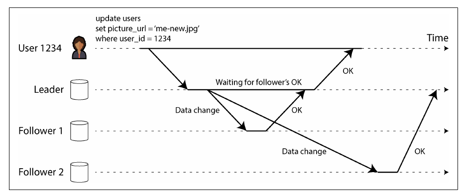
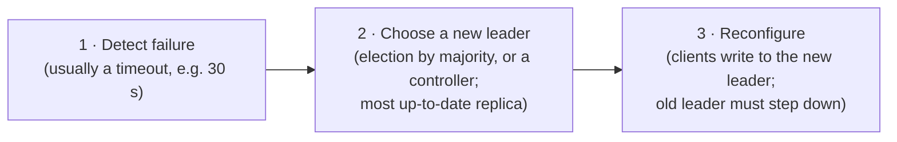
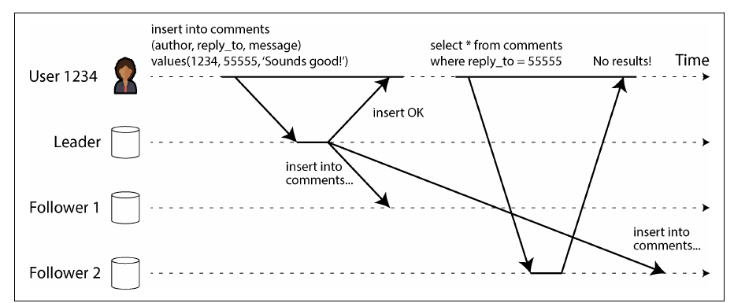
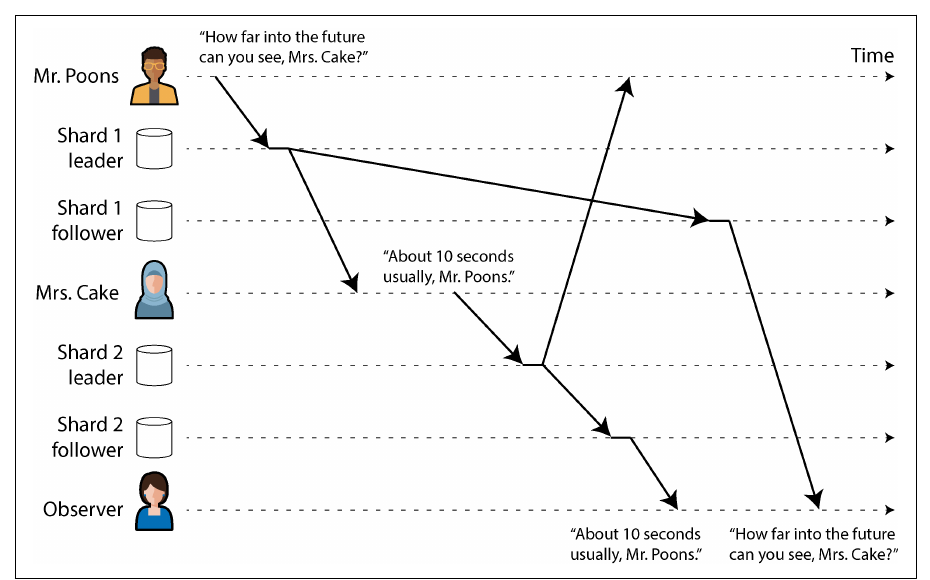
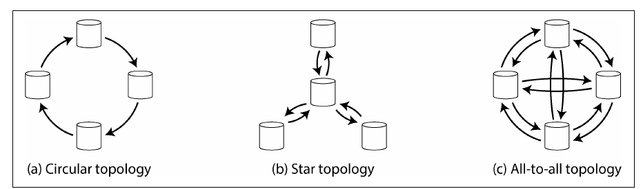
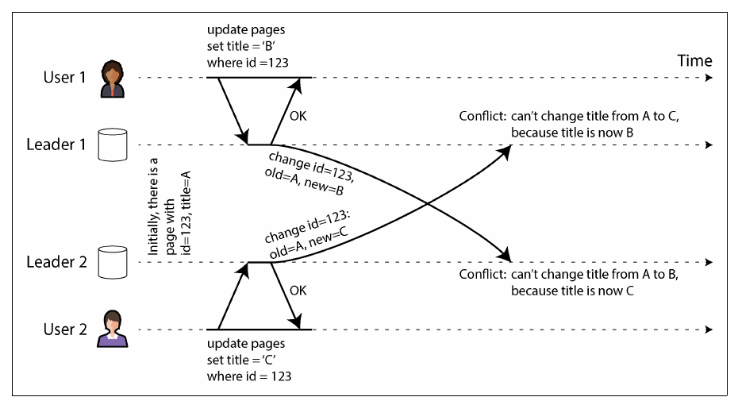
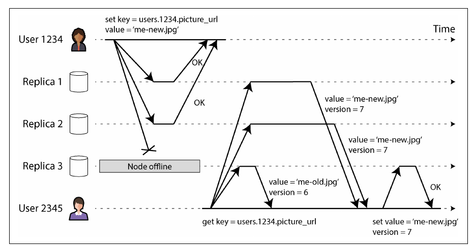
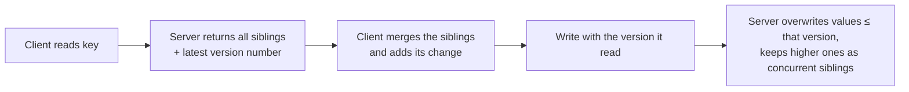
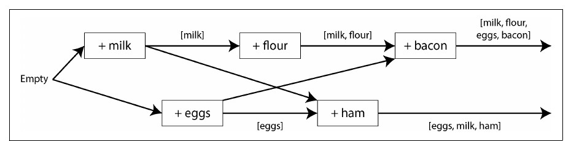

# فصل ۶: مفهوم replication

[فصل ۵: قالب‌های encoding و تکامل →](05-encoding-and-evolution.md) · [کتاب](../README.md) · [فصل ۷: مفهوم sharding ←](07-sharding.md)

## خلاصه

مفهوم replication یعنی نگه داشتن یک کپی از همان داده روی چند ماشین، برای availability، durability، کار بدون اتصال، latency کمتر و مقیاس‌پذیری خواندن. نگه داشتن کپی وقتی داده عوض نمی‌شود آسان است؛ همه‌ی سختی در پخش کردن تغییرهاست. فصل سه خانواده‌ی الگوریتم را مقایسه می‌کند: **single-leader**، **multi-leader** و **leaderless**؛ و در کنارش انتشار synchronous و asynchronous، failover، ناهنجاری‌هایی که replication lag می‌سازد و تضمین‌های consistency که درمانشان می‌کنند، sync engineهای local-first، و این‌که نوشتن‌های concurrent چطور تشخیص داده می‌شوند، با version vector، و چطور حل می‌شوند، با last write wins، حل دستی یا CRDT.

## نکته‌های کلیدی

- **مفهوم replication جای backup را نمی‌گیرد:** یک حذف اشتباهی بلافاصله replicate می‌شود؛ backup تاریخچه را نگه می‌دارد (p. 198).
- **مدل synchronous یک follower به‌روز را تضمین می‌کند اما وقتی آن follower خاموش است نوشتن‌ها را متوقف می‌کند**؛ در عمل یک follower synchronous است، یعنی semi-synchronous، یا replication کاملاً asynchronous است، و آن وقت **failover ممکن است نوشتن‌های تأییدشده را گم کند** (pp. 200–208).
- **کار failover پرخطر است:** تشخیص خرابی با timeout، انتخاب به‌روزترین replica، و پرهیز از **split brain** (pp. 204–207).
- **پدیده‌ی replication lag ناهنجاری می‌سازد** و مدل‌های consistency درمانش می‌کنند: **read-after-write**، **monotonic reads** و **consistent prefix reads** (pp. 209–215).
- **مدل multi-leader** به کار در چند region و clientهایی که آفلاین کار می‌کنند می‌خورد، یعنی **sync engine و نرم‌افزار local-first**؛ اما نوشتن‌های concurrent با هم conflict پیدا می‌کنند (pp. 215–229).
- **مدل leaderless** به چند replica موازی می‌نویسد و از چند replica می‌خواند؛ با quorumهایی که **`w + r > n`** باشند، هر خواندن با آخرین نوشتن هم‌پوشانی دارد، هرچند حالت‌های مرزی می‌مانند (pp. 229–237).
- **مفهوم concurrency به دانستن مربوط است، نه به زمان:** دو نوشتن concurrent هستند اگر هیچ‌کدام از دیگری خبر نداشته باشد. **version vector** این را تشخیص می‌دهد و merge کردن siblingها، مثلاً با CRDT، حلش می‌کند (pp. 237–243).

## فهرست بخش‌ها

*از فهرست مطالب خود کتاب، یعنی bookmarkهای PDF، با شماره‌ی صفحه‌های چاپی.*

- مفهوم single-leader replication (p. 198)
  - مقایسه‌ی replication از نوع synchronous و asynchronous (p. 200)
  - راه‌اندازی follower تازه (p. 201)
  - مدیریت از کار افتادن node (p. 204)
  - پیاده‌سازی replication log (p. 206)
  - مشکل‌های replication lag (p. 209)
  - راه‌حل‌های replication lag (p. 214)
- مفهوم multi-leader replication (p. 215)
  - کار در چند منطقه‌ی جغرافیایی (p. 216)
  - مفهوم sync engine و نرم‌افزار local-first (p. 220)
  - برخورد با نوشتن‌های متعارض (p. 222)
- مفهوم leaderless replication (p. 229)
  - نوشتن در دیتابیس وقتی یک node خاموش است (p. 229)
  - مقایسه‌ی کارایی single-leader و leaderless (p. 235)
  - کار در چند region (p. 236)
  - تشخیص نوشتن‌های concurrent (p. 237)
- جمع‌بندی (p. 243)

## یادداشت‌ها

مفهوم **replication** یعنی نگه داشتن کپی همان داده روی چند ماشین که با شبکه به هم وصل‌اند: تا داده نزدیک کاربر باشد، یعنی latency؛ تا وقتی بخشی خراب می‌شود کار ادامه پیدا کند، یعنی availability و durability؛ و تا خواندن‌های بیشتری سرویس داده شود، یعنی throughput. این فصل فرض می‌کند هر node کل داده را دارد؛ فصل ۷ آن را shard می‌کند. همه‌ی سختی در *تغییرها*ست و تقریباً هر دیتابیس توزیع‌شده از یکی از سه خانواده استفاده می‌کند: single-leader، multi-leader و leaderless (pp. 197–198).

**هنوز به backup نیاز دارید** (p. 198): replicaها یک حذف اشتباهی را در چند لحظه پخش می‌کنند؛ backup اجازه می‌دهد به گذشته برگردید. این دو مکمل هم‌اند: snapshotها replicaهای تازه را راه می‌اندازند و replication logهای آرشیوشده بخشی از backup می‌شوند.

> **Try it:** [فصل ۶ در طول یک pipeline داده](../widgets/06-pipeline-map.html): از دیتابیس منبع تا داشبورد را با lensهای کپی‌ها، lag و خرابی طی کنید و ببینید کجا یک replica پشت سر است و کجا یک خرابی داده را گم می‌کند.

> **In practice:** warehouse در reference stack دو replica دارد و Bronze خام همه‌ی ردیف‌های منبع را نگه می‌دارد.
>
> **Your turn:** کسی با یک `DELETE` اشتباه نیمی از یک جدول Silver را پاک می‌کند. replica دوم warehouse کمکی می‌کند؟ چه چیزی جدول را برمی‌گرداند؟
>
> *Answer:* نه؛ حذف در چند لحظه به replica دوم هم می‌رسد، چون replication جای backup را نمی‌گیرد (p. 198). در این stack لایه‌ی Bronze نقش تاریخچه را دارد: Silver را می‌شود با اجرای دوباره‌ی همان SQL از Bronze ساخت. برای Bronze خودش، که از هیچ چیز دیگری ساخته نمی‌شود، backup واقعی لازم است.

### مفهوم single-leader replication

به آن leader-based، primary-backup یا active/passive هم می‌گویند (pp. 198–199):

1. یک replica **leader** است، یا primary یا source؛ همه‌ی نوشتن‌ها به آن می‌روند و آن‌ها را محلی می‌نویسد.
2. هر تغییر را در یک **replication log**، یا change stream، برای **follower**ها می‌فرستد، که read replica، secondary یا hot standby هم نام دارند؛ آن‌ها تغییرها را با همان ترتیب اعمال می‌کنند.
3. خواندن از هر replicaای ممکن است؛ فقط leader نوشتن می‌پذیرد.

با sharding هر shard leader خودش را دارد. این مدل را PostgreSQL، MySQL، Oracle Data Guard، SQL Server Always On، MongoDB، DynamoDB، Kafka و DRBD به کار می‌برند، و سیستم‌های consensus مثل Raft هم، یعنی CockroachDB، TiDB، etcd و quorum queueهای RabbitMQ. اصطلاح «master–slave» قدیمی و توهین‌آمیز است (pp. 199–200).

#### مقایسه‌ی replication از نوع synchronous و asynchronous (pp. 200–201)

| حالت | leader منتظر چه کسی می‌ماند | سود | هزینه |
|---|---|---|---|
| synchronous برای همه‌ی followerها | همه‌ی followerها | همه‌ی followerها به‌روزند | یک node کند یا مرده همه‌ی نوشتن‌ها را متوقف می‌کند؛ عملی نیست |
| **مدل semi-synchronous** | یک follower، و اگر عقب بیفتد یکی دیگر جایش می‌آید | دست‌کم دو کپی به‌روز | کمی latency |
| quorum اکثریت، مثلاً ۳ از ۵ | اکثریت | پایه‌ی سیستم‌های consensus در فصل ۱۰ | latency نود میانه |
| کاملاً asynchronous | هیچ followerی | leader حتی اگر همه‌ی followerها عقب باشند ادامه می‌دهد؛ با followerهای زیاد یا دور رایج است | اگر leader بمیرد **نوشتن تأییدشده ممکن است گم شود** |

*Figure 6-2 (p. 200): follower ۱ synchronous است، پس OK کاربر منتظر آن می‌ماند؛ follower ۲ asynchronous است و ممکن است هر قدر عقب بیفتد.*

مفهوم latency replication معمولاً زیر یک ثانیه است، اما followerها ممکن است چند دقیقه عقب بیفتند: هنگام بازیابی، نزدیک ظرفیت یا با مشکل شبکه (pp. 200–201).

#### راه‌اندازی follower تازه (pp. 201–203)

1. یک **snapshot سازگار** از leader بگیرید، بدون قفل کردنش؛ قابلیت داخلی دیتابیس یا ابزارهایی مثل Percona XtraBackup.
2. آن را به node تازه کپی کنید.
3. همه‌ی تغییرها از موقعیت دقیق snapshot در log را درخواست کنید: **log sequence number** در PostgreSQL، و مختصات binlog یا GTID در MySQL.
4. وقتی عقب‌ماندگی پردازش شد، follower **به leader رسیده** است.

آرشیو کردن snapshotها و replication log در یک object store، با WAL-G برای PostgreSQL و MySQL و SQL Server یا Litestream برای SQLite، backup، بازیابی از فاجعه و قدم‌های ۱ و ۲ را مجانی می‌دهد (p. 202).

**دیتابیس‌هایی که روی object storage ساخته شده‌اند** (pp. 202–203):

| مزیت‌ها | بده‌بستان‌ها |
|---|---|
| ارزان؛ working set در حافظه یا SSD و داده‌ی سرد روی object storage | latency خواندن و نوشتن خیلی بیشتر از دیسک محلی یا EBS |
| durability در چند zone یا region، بدون هزینه‌ی ترافیک بین zoneها | هزینه‌ی هر درخواست مجبورتان می‌کند batch کنید، یعنی latency بیشتر |
| نوشتن شرطی، یعنی compare-and-set، برای تراکنش و انتخاب leader | objectهای immutable نوشتن تصادفی را گران می‌کنند |
| یک store برای سیستم‌های زیاد یکپارچه‌سازی را آسان می‌کند، مثل Parquet و Iceberg | interface استاندارد filesystem ندارد؛ mountهای FUSE قابلیت‌های POSIX را ندارند |

طراحی‌ها از **tiered storage** شروع می‌شوند، به object storage به عنوان storage اصلی با یک WAL کم‌latency می‌رسند، مثل EBS یا Safekeepers در Neon، و تا **معماری zero-disk** پیش می‌روند که دیسک فقط cache است: WarpStream، Confluent Freight، Bufstream، Redpanda Serverless، بیشتر warehouseهای cloud، Turbopuffer و SlateDB (p. 203).

#### مدیریت از کار افتادن node (pp. 204–206)

**خرابی follower و بازیابی با catch-up:** follower آخرین تغییری را که پردازش کرده می‌داند و همه‌ی تغییرهای بعد از آن را می‌خواهد. رسیدن دوباره بعد از یک قطعی طولانی به هر دو node فشار می‌آورد، و leader یا باید log را نگه دارد، با خطر پر شدن دیسک، یا پاکش کند و follower را مجبور به بازیابی از backup کند (p. 204).

**خرابی leader و failover**، دستی یا خودکار (pp. 204–205):

چه چیزهایی خراب می‌شود (pp. 205–206):

- با replication از نوع asynchronous ممکن است leader تازه آخرین نوشتن‌های leader قدیم را نداشته باشد؛ معمولاً **دور ریخته می‌شوند**، یعنی نوشتن‌های «commitشده» durable نبودند.
- دور ریختن وقتی سیستم‌های دیگر آن نوشتن‌ها را دیده‌اند خطرناک است: در **GitHub** یک follower عقب‌مانده‌ی MySQL به leader تبدیل شد و **کلیدهای autoincrementی را دوباره به کار برد** که پیش‌تر در Redis استفاده شده بودند، و داده‌ی خصوصی به دست کاربرهای اشتباه رسید.
- پدیده‌ی **split brain**: دو node هر دو خودشان را leader می‌دانند؛ سازوکارهای خام خاموش‌کردن ممکن است هر دو را بکشند یا دیر عمل کنند. محافظت در برابرش **fencing** است، در فصل ۹.
- مقدار **timeout**: اگر خیلی طولانی باشد بازیابی کند است؛ اگر خیلی کوتاه، failoverهای بی‌دلیل در اوج بار وضع را بدتر می‌کنند. بعضی تیم‌ها failover دستی را ترجیح می‌دهند.

همیشه به‌روزترین follower را ارتقا بدهید: follower synchronous یا آن که بالاترین log sequence number را دارد (p. 206).

> **In practice:** دیتابیس منبع A در reference stack یک replica read-only از دیتابیس اصلی محصول است. اگر دیتابیس اصلی failover کند و follower تازه آخرین نوشتن‌ها را نداشته باشد، آن نوشتن‌ها دور ریخته می‌شوند.
>
> **Your turn:** بعد از یک failover در دیتابیس اصلی، چند پرداخت که loader ساعت پیش در Bronze نوشته دیگر در منبع نیستند و شناسه‌هایشان به پرداخت‌های تازه داده شده. چرا، و این برای Silver چه معنایی دارد؟
>
> *Answer:* leader قدیم آن نوشتن‌ها را تأیید کرده بود، اما پیش از replicate شدن مرد؛ leader تازه آن‌ها را نداشت و شمارنده‌ی autoincrement را از عقب‌تر ادامه داد، مثل ماجرای GitHub (pp. 205–206). حالا Bronze دو نسخه با یک id دارد که دو پرداخت متفاوت‌اند، و dedup در Silver بر اساس id یکی را بی‌صدا دور می‌ریزد. یک بررسی reconciliation با منبع باید این را بگیرد.

#### پیاده‌سازی replication log (pp. 206–208)

| روش | چه چیزی فرستاده می‌شود | مشکل‌ها و کاربردها |
|---|---|---|
| **مدل statement-based** | هر دستور `INSERT`، `UPDATE` و `DELETE` | تابع‌های nondeterministic مثل `NOW` و `RAND`، autoincrement یا دستورهای وابسته به داده که ترتیب یکسان لازم دارند، و اثر جانبی trigger و procedure. راه‌حل: گذاشتن مقدارهای ثابت به جای آن‌ها، یعنی **state machine replication**. در MySQL پیش از ۵.۱؛ VoltDB تراکنش‌های deterministic لازم دارد |
| **ارسال write-ahead log** | همان WAL خود storage engine: کدام بایت‌ها در کدام بلوک‌ها عوض شدند | در PostgreSQL و Oracle. به قالب storage بسته است: leader و followerها معمولاً نمی‌توانند نسخه‌های متفاوت اجرا کنند، پس ارتقا downtime لازم دارد |
| **لاگ logical یا row-based** | برای هر ردیف: insert با همه‌ی مقدارها، delete با کلید، update با کلید و مقدارهای تازه، و بعد یک رکورد commit | از storage جداست، پس نسخه‌های مختلف کنار هم و ارتقای تقریباً بدون downtime ممکن است؛ سیستم‌های بیرونی هم می‌توانند بخوانندش، یعنی **change data capture**. binlog در MySQL؛ PostgreSQL WAL خودش را logical decode می‌کند |

ارتقای بدون downtime یعنی followerها را ارتقا بدهید و بعد به یکی از آن‌ها failover کنید؛ فقط وقتی ممکن است که پروتکل اختلاف نسخه را تحمل کند (pp. 207–208).

> **In practice:** loader در reference stack هیچ replication logی نمی‌خواند؛ هر ساعت ردیف‌هایی را می‌گیرد که `update_date` آن‌ها جلو رفته. برای همین hard deleteها در منبع برایش نامرئی‌اند.
>
> **Your turn:** کدام روش replication log کتاب این مشکل را حل می‌کند و چرا؟
>
> *Answer:* لاگ logical یا row-based، یعنی change data capture: برای هر ردیف حذف‌شده یک رکورد delete با کلیدش دارد، و سیستم‌های بیرونی می‌توانند parseاش کنند (pp. 207–208). cursor روی `update_date` فقط وضع فعلی ردیف‌های باقی‌مانده را می‌بیند، نه رویداد حذف را.

### مشکل‌های replication lag

بارهای کاری که بیشترشان خواندن است وسوسه‌تان می‌کنند followerهای زیاد اضافه کنید و خواندن‌ها را پخش کنید، یعنی **read scaling**، که فقط با replication از نوع asynchronous کار می‌کند؛ synchronous برای همه یعنی هر خرابی تکی نوشتن‌ها را متوقف می‌کند. آن وقت خواننده‌ها ممکن است داده‌ی کهنه ببینند: **eventual consistency**، اصطلاحی که Terry و همکارانش ساختند و Werner Vogels رایجش کرد. «بالاخره» هیچ حد مشخصی ندارد: معمولاً کسری از ثانیه **replication lag** است، اما نزدیک ظرفیت یا هنگام مشکل شبکه چند ثانیه یا چند دقیقه (p. 209).

| ناهنجاری | تضمین | روش‌ها (pp. 210–214) |
|---|---|---|
| نوشتن خودتان را نمی‌بینید؛ شکل ۶-۳ | **مدل read-after-write**، یا read-your-writes: به‌روزرسانی‌های خودتان را همیشه می‌بینید؛ درباره‌ی دیگران قولی نیست | چیزهایی را که کاربر می‌تواند ویرایش کند از leader بخوانید، مثلاً پروفایل خودش از leader و پروفایل دیگران از followerها؛ تا یک دقیقه بعد از هر نوشتن از leader بخوانید، یا از followerهایی که بیش از یک دقیقه عقب‌اند نخوانید؛ timestamp آخرین نوشتن کاربر را نگه دارید، logical مثل LSN یا بر اساس ساعت، و فقط از replicaهایی بخوانید که دست‌کم همان‌قدر تازه‌اند |
| داده ظاهر می‌شود و با refresh ناپدید؛ شکل ۶-۴ | **مدل monotonic reads**: برگشت به گذشته ممنوع؛ قوی‌تر از eventual و ضعیف‌تر از strong consistency | هر کاربر از یک replica بخواند که با hash شناسه‌ی کاربر انتخاب می‌شود و اگر خراب شد جایش عوض می‌شود |
| جواب پیش از سؤال ظاهر می‌شود: خانم Cake به آقای Poons جواب می‌دهد؛ شکل ۶-۵ | **مدل consistent prefix reads**: نوشتن‌ها با همان ترتیبی دیده می‌شوند که اتفاق افتاده‌اند | داده‌های علّی مرتبط را در یک shard بنویسید، یا وابستگی‌های علّی را دنبال کنید |

*Figure 6-3 (p. 210): خواندن از یک follower عقب‌مانده درست بعد از نوشتن باعث می‌شود نوشتن خودتان ناپدید به نظر برسد.*

*Figure 6-5 (p. 214): وقتی shardها با سرعت‌های متفاوت replicate می‌شوند، ناظر ممکن است جواب را پیش از سؤال ببیند.*

**مدل read-after-write بین دستگاه‌ها** به metadata متمرکز «آخرین نوشتن» نیاز دارد، و دستگاه‌های مختلف، مثلاً اینترنت خانگی و شبکه‌ی موبایل، ممکن است به **region**های مختلف برسند. هر region مجموعه‌ای از **availability zone**هاست، یعنی datacenterهای جدا با برق و سرمایش خودشان که با شبکه‌ی سریع به هم وصل‌اند. چند zone از یک قطعی zone جان سالم به در می‌برد؛ برای قطعی کل region چند region لازم است، با latency و هزینه‌ی بیشتر (pp. 211–212).

**راه‌حل‌ها** (pp. 214–215): بپرسید اگر lag به چند دقیقه یا چند ساعت برسد اپلیکیشن چه رفتاری دارد؛ وانمود نکنید replication از نوع asynchronous همان synchronous است. راه‌حل‌های سطح اپلیکیشن پیچیده‌اند؛ ساده‌ترین مدل دیتابیسی است با **linearizability**، در فصل ۱۰، و **تراکنش‌های ACID**، در فصل ۸. دنیای NoSQL می‌گفت این‌ها scale نمی‌شوند؛ دیتابیس‌های **NewSQL** حالا آن‌ها را به شکل توزیع‌شده می‌دهند؛ با این حال مدل‌های ضعیف‌تر به خاطر تحمل قطعی شبکه و سربار کمتر هنوز جذاب‌اند.

> **Try it:** [مفهوم replication lag و quorum](../widgets/06-replication.html): با یک follower عقب‌مانده read-your-writes و monotonic reads را بشکنید، در failover نوشتن گم کنید، و بعد n و w و r را تنظیم کنید.

> **In practice:** کوئری‌ها از طریق یک SQL proxy به هر کدام از دو replica در warehouse می‌رسند، و یک insert ممکن است چند لحظه بعد به replica دیگر برسد.
>
> **Your turn:** یک تحلیل‌گر ردیف‌هایی را در یک جدول موقت insert می‌کند و کوئری بعدی‌اش جدول را خالی نشان می‌دهد؛ با refresh ردیف‌ها می‌آیند و با refresh بعدی دوباره می‌روند. این دو ناهنجاری کدام‌اند و درمان کتاب چیست؟
>
> *Answer:* اول نقض read-after-write است، چون نوشتن خودش را نمی‌بیند؛ بعد نقض monotonic reads، چون بین یک replica تازه و یک replica عقب‌مانده جابه‌جا می‌شود (pp. 210–213). درمان کتاب این است که هر کاربر همیشه از یک replica بخواند، مثلاً با hash شناسه‌ی کاربر، یا فقط از replicaای که دست‌کم تا آخرین نوشتن او رسیده.

> **In practice:** loader در شب، هم‌زمان با batchهای سنگین دیتابیس اصلی، از replica منبع می‌خواند.
>
> **Your turn:** داشبورد پرداخت‌های دیروز ساعت یک بامداد ناقص است و صبح کامل. چطور می‌شود فهمید تقصیر replication lag است؟
>
> *Answer:* در سیستم‌های leader-based lag را می‌شود اندازه گرفت: اختلاف موقعیت log بین leader و replica (pp. 234–235). اگر این عدد را کنار زمان هر load ثبت کنید، معلوم می‌شود loader از replicaای خوانده که چند دقیقه یا چند ساعت عقب بوده؛ بررسی freshness باید به این عدد نگاه کند، نه فقط به زمان اجرای load.

### مفهوم multi-leader replication

چند node نوشتن می‌پذیرند و هر کدام follower بقیه هم هستند، یعنی active/active یا دوطرفه. multi-leader از نوع **synchronous** در عمل همان single-leader است، پس کتاب روی **asynchronous** تمرکز می‌کند: هر leader حتی وقتی ارتباطش قطع شده نوشتن می‌پذیرد (pp. 215–216).

#### کار در چند منطقه‌ی جغرافیایی (pp. 216–220)

یک leader در هر region، شکل ۶-۶، با replication معمولی leader و follower داخل هر region (pp. 216–217):

| | یک leader برای همه‌ی regionها | مدل multi-leader، یک leader در هر region |
|---|---|---|
| latency نوشتن | هر نوشتن از اینترنت تا region مربوط به leader می‌رود | محلی؛ asynchronous replicate می‌شود و latencyش از کاربر پنهان است |
| قطعی یک region | failover به followerی در جای دیگر | هر region کار می‌کند و بعداً عقب‌ماندگی را جبران می‌کند |
| مشکل شبکه بین regionها | خیلی حساس؛ نوشتن‌ها منتظر لینک می‌مانند | تحمل می‌شود |
| مفهوم consistency | می‌تواند تراکنش serializable بدهد | خیلی ضعیف‌تر: نمی‌تواند تضمین کند موجودی منفی نشود یا یک username یکتا باشد |

این مدل را MySQL، Oracle، SQL Server و YugabyteDB پشتیبانی می‌کنند، و افزونه‌هایی مثل Redis Enterprise، EDB Postgres Distributed و pglogical. اغلب بعداً به سیستم اضافه شده، پس کلیدهای autoincrement، triggerها و integrity constraintها بد رفتار می‌کنند؛ کتاب آن را «قلمرو خطرناک» می‌نامد (pp. 217–218).

**توپولوژی‌ها** (شکل ۶-۷):

*Figure 6-7 (p. 218): توپولوژی دایره‌ای و ستاره‌ای نوشتن‌ها را از node‌های دیگر عبور می‌دهند؛ all-to-all مستقیم می‌فرستد اما ممکن است ترتیب نوشتن‌ها را به هم بزند.*

در توپولوژی دایره‌ای و ستاره‌ای نوشتن‌ها از nodeهای دیگر عبور داده می‌شوند و با شناسه‌ی nodeهایی که از آن‌ها گذشته‌اند علامت می‌خورند تا حلقه پیش نیاید؛ و یک node خراب ممکن است جریان را متوقف کند. all-to-all fault toleranceی بیشتری دارد، اما پیام‌ها ممکن است از هم **سبقت** بگیرند: leader ۲ ممکن است *update* از B را پیش از *insert* از A برای همان ردیف بگیرد؛ شکل ۶-۸. timestamp این را حل نمی‌کند؛ **version vector** حل می‌کند؛ با این حال خیلی از سیستم‌ها از آن استفاده نمی‌کنند، پس آنچه را که به آن تکیه دارید تست کنید (pp. 218–220).

#### مفهوم sync engine و نرم‌افزار local-first (pp. 220–222)

تقویم‌های آفلاین و اپ‌های همکاری، مثل Google Docs و Sheets، Figma و Linear، همان multi-leader در حد افراط‌اند: هر دستگاه یا tab مرورگر یک replica-leader است و lag ممکن است چند ساعت یا چند روز باشد. یک **sync engine** تغییرهای محلی را می‌گیرد، می‌فرستد یا در صف می‌گذارد، تغییرهای راه دور را merge می‌کند و UI را به‌روز می‌کند. اپ‌های **offline-first** بدون اینترنت کار می‌کنند؛ اپ‌های **local-first** حتی اگر شرکت سازنده تعطیل شود کار می‌کنند، مثلاً با یک پروتکل sync باز؛ Git یک ابزار local-first است، بدون همکاری real-time (pp. 220–221).

| مزیت‌ها (pp. 221–222) | محدودیت‌ها |
|---|---|
| داده‌ی محلی یعنی UI می‌تواند در یک frame پاسخ بدهد، یعنی ۱۶ میلی‌ثانیه در ۶۰ هرتز | وقتی بهترین کار را می‌کند که همه‌ی داده‌ای که کاربر لازم دارد از پیش دانلود شود؛ برای فایل‌های خود کاربر خوب است، برای کل کاتالوگ یک فروشگاه نه |
| آفلاین بودن حالت خاصی نیست؛ فقط یک latency شبکه‌ی خیلی بزرگ است | ویرایش‌های هم‌زمان conflict را اجتناب‌ناپذیر می‌کنند |
| خواندن و نوشتن محلی تقریباً هیچ‌وقت شکست نمی‌خورد، پس برنامه‌نویسی declarative ممکن می‌شود | |
| به‌روزرسانی real-time با برنامه‌نویسی reactive | |

پیشگامش Lotus Notes در دهه‌ی ۱۹۸۰ بود؛ امروز Firestore، Realm و Ditto با backend اختصاصی، و PouchDB و CouchDB، Automerge و Yjs به شکل باز. بازی‌ها به آن **netcode** می‌گویند (p. 222).

#### برخورد با نوشتن‌های متعارض (pp. 222–229)

دو کاربر عنوان یک صفحه‌ی ویکی را روی دو leader مختلف عوض می‌کنند، یکی از A به B و دیگری از A به C؛ شکل ۶-۹. این نوشتن‌ها **concurrent** هستند چون هیچ‌کدام از دیگری خبر نداشت، نه به خاطر زمان ساعت دیواری.

*Figure 6-9 (p. 223): هر دو نوشتن محلی موفق می‌شوند؛ conflict بعداً کشف می‌شود، وقتی دیگر نمی‌شود به کاربرها گزارشش داد.*

| راهبرد | چطور | گیرش |
|---|---|---|
| **پرهیز از conflict** | همه‌ی نوشتن‌های یک رکورد را به یک leader بفرستید، مثلاً region «خانه»‌ی کاربر؛ یا بازه‌ی id زوج و فرد برای دو leader | وقتی leader تعیین‌شده عوض شود می‌شکند؛ برای clientهای آفلاین ناممکن است |
| **مدل last write wins یا LWW** | بزرگ‌ترین timestamp را نگه دارید و در تساوی مقدارها را مقایسه کنید | در واقع یعنی برنده را *تصادفی* انتخاب کنید و بقیه را **بی‌صدا دور بریزید**؛ clock skew ممکن است نوشتن دیرتر را بازنده کند. فقط وقتی خوب است که هر کلید یک بار نوشته شود |
| **حل دستی** | همه‌ی مقدارها را به شکل **sibling** نگه دارید، مثل CouchDB، و در کد اپلیکیشن یا با کمک کاربر حلشان کنید | API مجموعه برمی‌گرداند؛ UI حل conflict سخت است؛ mergeهای ساده غافلگیر می‌کنند: سبد خرید Amazon آیتم‌های حذف‌شده را برمی‌گرداند، شکل ۶-۱۰؛ حل‌های هم‌زمان ممکن است دوباره conflict بسازند، مثل B/C در برابر C/B |
| **حل خودکار** | الگوریتم merge برای هر نوع داده، یعنی **strong eventual consistency** | نمی‌تواند همه‌چیز را اجرا کند؛ مثلاً «حداکثر پنج آیتم» یعنی باید بعضی را دور ریخت |

همه‌ی mergeهای خودکار یا mergeها (pp. 226–227): متن همه‌ی درج‌ها و حذف‌ها را نگه می‌دارد و برای درج‌های هم‌مکان یک ترتیب deterministic دارد؛ collectionها هم درج *و هم حذف* را ثبت می‌کنند، پس سبد خرید {Soap} می‌شود؛ counterها افزایش‌ها و کاهش‌ها را بدون دو بار شمردن جمع می‌کنند؛ mapها برای هر کلید merge می‌کنند.

**مقایسه‌ی CRDT و operational transformation:** هر دو `ice` را با `nice` و `ice!` به `nice!` merge می‌کنند؛ شکل ۶-۱۱:

| | مدل operational transformation یا OT | مدل CRDT |
|---|---|---|
| موقعیت‌ها | با index: `n` را در ۰ و `!` را در ۳ درج کن | شناسه‌ی یکتا و immutable برای هر کاراکتر: `!` با شناسه‌ی 4B را بعد از `e` با شناسه‌ی 3A درج کن |
| merge کردن | indexهای عملیات‌های هم‌زمان را تبدیل می‌کند؛ `!` به ۴ می‌رود | تبدیلی لازم نیست؛ درج‌های هم‌مکان با شناسه مرتب می‌شوند |
| کاربرد رایج | ویرایش real-time متن؛ Google Docs و ShareDB | دیتابیس‌ها؛ Redis Enterprise، Riak و Cosmos DB، و Automerge و Yjs |

**انواع conflict** (pp. 228–229): conflictهای آشکار، مثل یک فیلد، و conflictهای ظریف، مثل دو **رزرو اتاق جلسه** برای یک بازه که هر کدام بعد از بررسی خالی بودن یک رکورد تازه درج می‌کنند. فصل‌های ۸ و ۱۳ به این برمی‌گردند.

> **In practice:** جدول Silver در reference stack برای هر id «جدیدترین نسخه» را بر اساس `update_date` نگه می‌دارد. این همان last write wins است.
>
> **Your turn:** دو نسخه از یک ردیف با `update_date` یکسان تا ثانیه در Bronze هست. کدام برنده می‌شود، و چه چیزی بی‌صدا از دست می‌رود؟
>
> *Answer:* بدون یک قاعده‌ی شکستن تساوی، برنده عملاً تصادفی است و نسخه‌ی دیگر بی‌صدا دور ریخته می‌شود، همان ضعف LWW (pp. 222–229). قاعده‌ای deterministic اضافه کنید، مثلاً زمان load یا موقعیت در فایل، و تعداد تساوی‌ها را بشمارید؛ اگر ساعت منبع عقب و جلو برود، حتی نسخه‌ی واقعاً دیرتر هم ممکن است ببازد.

### مفهوم leaderless replication

هر replica نوشتن را مستقیم از client می‌پذیرد، یا از طریق یک **coordinator** که هیچ ترتیبی تحمیل نمی‌کند. سیستم‌های اولیه leaderless بودند؛ **Dynamo** در Amazon در سال ۲۰۰۷ این ایده را برای Riak، Cassandra و ScyllaDB زنده کرد، که به آن‌ها «Dynamo-style» می‌گویند. DynamoDB، برخلاف اسمش، single-leader و روی Multi-Paxos است (p. 229).

#### نوشتن در دیتابیس وقتی یک node خاموش است (pp. 229–231)

با سه replica و یکی خاموش، client به هر سه می‌نویسد و وقتی دو تا تأیید کنند موفق است؛ خواندن هم به چند replica می‌رود و **شماره‌ی نسخه** جدیدترین پاسخ را انتخاب می‌کند؛ شکل ۶-۱۲. failover لازم نیست. نوشتن‌های جاافتاده این‌طور جبران می‌شوند:

*Figure 6-12 (p. 230): نوشتن در اکثریت و خواندن از اکثریت همیشه در یک replica به‌روز هم‌پوشانی دارند، و خواننده replica کهنه را تعمیر می‌کند.*

| سازوکار | چطور | چه چیزی را پوشش می‌دهد |
|---|---|---|
| **مفهوم read repair** | خواننده‌ای که v6 را روی یک replica و v7 را روی بقیه می‌بیند، v7 را برمی‌گرداند و می‌نویسد | مقدارهایی که زیاد خوانده می‌شوند |
| **مفهوم hinted handoff** | replica دیگری برای node خاموش **hint** نگه می‌دارد و وقتی برگشت برایش می‌فرستد | مقدارهایی که هیچ‌وقت خوانده نمی‌شوند |
| **مفهوم anti-entropy** | مقایسه و کپی در پس‌زمینه، بدون ترتیب خاص و شاید با latency طولانی | همه‌چیز، بالاخره |

#### مفهوم quorum برای خواندن و نوشتن (pp. 231–235)

با **n** replica، هر نوشتن **w** تأیید لازم دارد و هر خواندن از **r** replica می‌پرسد. اگر `w + r > n` باشد، مجموعه‌ی خواندن و مجموعه‌ی نوشتن هم‌پوشانی دارند، پس دست‌کم یکی از replicaهای خوانده‌شده آخرین نوشتن را دارد؛ شکل ۶-۱۳. درخواست‌ها همیشه به هر n replica می‌روند؛ w و r می‌گویند منتظر چند تا بمانیم.

| تنظیم | چه چیزی را تحمل می‌کند | نکته |
|---|---|---|
| `n = 3, w = 2, r = 2` | یک node از دسترس خارج | رایج: n فرد و `w = r = (n + 1)/2` |
| `n = 5, w = 3, r = 3` | دو node از دسترس خارج | |
| `w = n, r = 1` | برای نوشتن هیچ خرابی node را تحمل نمی‌کند | خواندن سریع برای بارهای پرخواندن و کم‌نوشتن |
| `w + r ≤ n` | خرابی‌های بیشتر، latency کمتر | خواندن‌های کهنه‌ی بیشتر |

مفهوم quorumها لازم نیست اکثریت باشند؛ فقط هم‌پوشانی مهم است (p. 233). **حالت‌های مرزی که حتی با `w + r > n` مقدار کهنه برمی‌گرداند** (pp. 233–234): nodeی که مقدار تازه دارد از یک replica کهنه بازیابی می‌شود؛ rebalancing جای n کپی را عوض می‌کند؛ خواندنی هم‌زمان با یک نوشتن؛ نوشتنی که روی کمتر از w replica موفق شد rollback نمی‌شود؛ LWW با clock skew، در Cassandra و ScyllaDB، نوشتن‌ها را بی‌صدا می‌اندازد؛ و نوشتن‌های هم‌زمان با ترتیب‌های متفاوت اعمال می‌شوند. سیستم‌های Dynamo-style برای eventual consistency ساخته شده‌اند؛ w و r را تنظیم *احتمال* کهنگی بدانید.

**مفهوم monitoring کهنگی** (pp. 234–235): سیستم‌های leader-based مقدار lag را به شکل اختلاف موقعیت در log نشان می‌دهند؛ سیستم‌های leaderless ترتیب نوشتن ثابتی ندارند، پس سخت است؛ تعداد hintها یک نشانه‌ی تقریبی است. «بالاخره» را باید اندازه گرفت.

#### مقایسه‌ی کارایی single-leader و leaderless (pp. 235–236)

| | خواندن از leader | مدل leaderless |
|---|---|---|
| مفهوم consistency | به‌روز؛ تضمین‌های قوی ممکن است | احتمالاتی |
| مقدار throughput | محدود به یک leader | پخش بین replicaها |
| خرابی یا کندی | منتظر تشخیص و failover بمانید؛ leader کند همه را کند می‌کند | failover ندارد؛ از سریع‌ترین پاسخ‌ها استفاده می‌کند؛ **request hedging** tail latency را کم می‌کند؛ با **gray failure**، یعنی nodeهای نیمه‌خراب، آرام کنار می‌آید |
| هزینه‌ها | ندارد | hinted handoff وقتی سیستم زیر فشار است بار اضافه می‌کند؛ quorumهای بزرگ‌تر منتظر replicaهای بیشتری می‌مانند، به‌ندرت بیش از ۴ از ۷ یا ۵ از ۹؛ یک partition بزرگ ممکن است جلوی هر quorumی را بگیرد؛ **sloppy quorum** در Riak و Dynamo، یا سطح consistency از نوع **ANY** در Cassandra و ScyllaDB، نوشتن را هر جایی می‌پذیرد، بدون هیچ تضمینی برای خواندن |

مدل multi-leader در برابر قطعی شبکه حتی مقاوم‌تر است، چون با یک leader نزدیک حرف می‌زنید، اما خواندن‌ها ممکن است هر قدر کهنه باشند؛ quorumها حد وسط‌اند (p. 236).

**کار در چند region** (pp. 236–237): در Cassandra و ScyllaDB، **coordinator** محلی client یک نوشتن را به همه‌ی replicaهای محلی و به یک replica در هر region دیگر می‌فرستد، که آن را در region خودش پخش می‌کند. سطح‌های consistency یک quorum سراسری، یک quorum برای هر region یا یک **local quorum** را انتخاب می‌کنند، که سریع است و احتمال کهنگی‌اش بیشتر. Riak مقدار n را داخل یک region نگه می‌دارد و بین regionها asynchronous و به سبک multi-leader replicate می‌کند.

### تشخیص نوشتن‌های concurrent

همه‌ی latencyهای متغیر و خرابی‌های جزئی یعنی replicaها نوشتن‌ها را با ترتیب‌های متفاوت می‌گیرند: در شکل ۶-۱۴ node ۱ هیچ‌وقت نوشتن B را نمی‌گیرد، node ۲ اول A و بعد B را می‌بیند و node ۳ اول B و بعد A را؛ بازنویسی ساده آن‌ها را برای همیشه ناسازگار می‌گذارد. replicaها باید **همگرا شوند**، با LWW در Cassandra و ScyllaDB، با sibling، یا با CRDT در Riak؛ و LWW نمی‌تواند نوشتن‌های concurrent را از نوشتن‌های پشت سر هم تشخیص بدهد (pp. 237–238).

#### رابطه‌ی happens-before (pp. 238–239)

**رویداد A پیش از B اتفاق می‌افتد** اگر B از A خبر داشته باشد، به آن وابسته باشد یا روی آن ساخته شده باشد؛ update در شکل ۶-۸ روی insert ساخته شده. دو عملیات **concurrent هستند اگر هیچ‌کدام پیش از دیگری اتفاق نیفتد**؛ زمان فیزیکی بی‌ربط است، همان‌طور که در نسبیت رویدادهایی که آن‌قدر از هم دورند که نور نمی‌تواند به هم وصلشان کند نمی‌توانند روی هم اثر بگذارند؛ یک شبکه‌ی کند ممکن است عملیات‌هایی را که چند ثانیه از هم فاصله دارند concurrent کند. پس برای هر A و B یکی از این سه برقرار است: `A → B`، `B → A` یا `A ∥ B`؛ و فقط آخری conflict است.

#### ثبت رابطه‌ی happens-before (pp. 239–242)

نوشتنی که هیچ نسخه‌ای همراهش نیست با همه‌چیز concurrent است و هیچ چیز را بازنویسی نمی‌کند. مثال سبد خرید کتاب، شکل ۶-۱۵: client ۱ شیر را اضافه می‌کند و نسخه‌ی v1 ساخته می‌شود؛ client ۲ بی‌خبر تخم‌مرغ را اضافه می‌کند و v2 با siblingهای [milk] و [eggs] ساخته می‌شود؛ client ۱ بر اساس v1 مقدار [milk, flour] را می‌نویسد و v3 جای [milk] را می‌گیرد و [eggs] را نگه می‌دارد؛ client ۲ بر اساس v2 مقدار [eggs, milk, ham] را می‌نویسد و v4 جای [eggs] را می‌گیرد؛ client ۱ بر اساس v3 مقدار [milk, flour, eggs, bacon] را می‌نویسد و v5 ساخته می‌شود؛ و siblingهای v4 و v5 می‌مانند. نسخه‌های قدیمی بالاخره بازنویسی می‌شوند و **هیچ نوشتنی گم نمی‌شود** (pp. 240–241).

*Figure 6-16 (p. 242): هر نوشتن نسخه‌ای را که رویش ساخته شده نام می‌برد، پس سرور می‌تواند بازنویسی را از sibling هم‌زمان تشخیص بدهد.*

> **Try it:** [نوشتن‌های concurrent: sibling در برابر last write wins](../widgets/06-concurrent-writes.html): مثال سبد خرید کتاب را با شماره‌ی نسخه و بعد با last write wins دوباره اجرا کنید.

**مفهوم version vector** (p. 242): وقتی چند replica نوشتن می‌پذیرند، برای **هر replica و هر کلید** یک شماره‌ی نسخه نگه دارید؛ مجموعه‌ی آن‌ها یک **version vector** است. Riak 2.0 از *dotted version vector* استفاده می‌کند و آن را *causal context* می‌نامد. این بردار در خواندن به client می‌رود و در نوشتن برمی‌گردد، بازنویسی را از نوشتن concurrent جدا می‌کند و خواندن از یک replica و نوشتن در replica دیگر را بی‌خطر می‌کند. **vector clock** شبیه آن است اما تفاوت ظریفی دارد؛ برای مقایسه‌ی وضعیت replicaها، version vector ساختار درست است.

## بده‌بستان‌ها در یک نگاه

| | مدل single-leader | مدل multi-leader | مدل leaderless |
|---|---|---|---|
| نوشتن‌ها به کجا می‌روند | یک leader | هر leader | چند replica به شکل موازی |
| مفهوم consistency | قوی‌ترین، با خواندن از leader | conflictها باید حل شوند | quorum؛ conflictها حل می‌شوند |
| availability نوشتن | خرابی leader یعنی failover | هر leader مستقل است | خرابی node را بدون failover تحمل می‌کند |
| latency در چند region | نوشتن‌ها از regionها عبور می‌کنند | نوشتن‌های محلی | quorumهای محلی |
| خطر اصلی | گم شدن نوشتن در failover ناهمگام؛ split brain | conflict؛ constraintهای شکسته | خواندن کهنه با وجود quorum؛ sibling |

## فراتر از کتاب

- سازوکارهای pre-vote و leader lease راه‌های عملی سیستم‌های مبتنی بر consensus برای پرهیز از انتخاب‌های مزاحم و خواندن از leader کهنه‌اند؛ فصل ۱۰ را ببینید.
- یک راه رایج برای پشتیبانی از حذف در CRDTهای شبیه set این است که حذف‌ها را به شکل tombstone ثبت کنید، یا از observed-remove set استفاده کنید، تا یک افزودن و حذف هم‌زمان بدون زنده شدن دوباره‌ی آیتم حذف‌شده merge شوند.

## پیوندها

- **Run it:** [نوشتن‌های concurrent و version vector](../lab/06-version-vectors/README.md): مثال سبد خرید کتاب.
- **فصل‌های مرتبط:** [فصل ۷: مفهوم sharding](07-sharding.md)، [فصل ۹: دردسرهای سیستم‌های توزیع‌شده](09-the-trouble-with-distributed-systems.md) برای timeout و ساعت‌ها در LWW، و [فصل ۱۰: مفهوم consistency و consensus](10-consistency-and-consensus.md) برای linearizability و failover خودکار درست.

## خودتان را بسنجید

*پرسش‌ها و پاسخ‌ها را خود vault از روی یادداشت‌های بالا نوشته است؛ پاسخ‌ها به صفحه‌های کتاب ارجاع می‌دهند.*

1. **با replication کاملاً asynchronous، چطور نوشتنی که client موفقیتش را دیده ممکن است گم شود؟**

   *Answer:* leader نوشتن را پیش از این‌که هیچ followerی داشته باشدش تأیید می‌کند. اگر leader بعد از آن خراب شود و یک follower ارتقا پیدا کند، leader تازه هیچ‌وقت آن نوشتن را نگرفته؛ وقتی leader قدیم برمی‌گردد، نوشتن‌های replicateنشده‌اش معمولاً دور ریخته می‌شوند (pp. 200–206).

2. **قاعده‌ی «همیشه از یک replica بخوان» کدام تضمین را می‌دهد؟**
   - [ ] مدل read-after-write
   - [x] مدل monotonic reads
   - [ ] مدل consistent prefix reads بین shardها
   - [ ] مفهوم linearizability

   *Answer:* فرستادن هر کاربر به یک replica یعنی هیچ‌وقت نمی‌بیند داده «به گذشته برگردد»، یعنی monotonic reads. تضمین نمی‌کند نوشتن‌های تازه‌ی خودش را ببیند، و consistent prefix مسئله‌ی جدایی در داده‌ی shardشده است (pp. 209–214).

3. **چرا کلیدهای autoincrement و قیدهای یکتایی در multi-leader replication مشکل‌سازند؟**

   *Answer:* هر leader مستقل نوشتن می‌پذیرد و فقط بعداً از نوشتن‌های بقیه خبردار می‌شود، پس دو leader ممکن است یک id را بدهند یا یک username را هم‌زمان بپذیرند؛ conflict فقط بعد از موفق شدن هر دو نوشتن کشف می‌شود (pp. 216–229).

4. **سناریویی بگویید که `w + r > n` برقرار است و خواندن باز هم مقدار کهنه برمی‌گرداند.**

   *Answer:* برای نمونه: نوشتنی روی کمتر از w replica موفق شده و شکست‌خورده گزارش شده اما rollback نشده؛ nodeی که مقدار تازه را داشت خراب و از یک replica قدیمی بازیابی شده؛ نوشتن‌های concurrent که با last write wins و ساعت‌های ناهماهنگ حل شده‌اند؛ یا خواندنی هم‌زمان با یک نوشتن (pp. 232–235).

5. **چه چیزی دو نوشتن را «concurrent» می‌کند؟**
   - [ ] این‌که در یک میلی‌ثانیه اتفاق بیفتند
   - [ ] این‌که به یک replica فرستاده شوند
   - [x] این‌که هیچ‌کدام هنگام انجام شدن از دیگری خبر نداشته باشد
   - [ ] این‌که کلیدهای متفاوتی را تغییر دهند

   *Answer:* concurrency به علیت مربوط است، نه به زمان ساعت: دو نوشتن با یک دقیقه فاصله concurrent هستند اگر هیچ‌کدام از clientها نوشتن دیگری را ندیده باشد. version vector این را تشخیص می‌دهد (pp. 237–243).

6. **دو کوئری پشت سر هم یک تحلیل‌گر از طریق proxy به دو replica متفاوت warehouse می‌رسند و دومی ردیفی را که اولی دیده نشان نمی‌دهد. کدام تضمین نقض شده؟**
   - [ ] مدل read-after-write
   - [x] مدل monotonic reads
   - [ ] مفهوم durability
   - [ ] مدل consistent prefix reads

   *Answer:* تحلیل‌گر چیزی را دیده و بعد آن را ندیده، یعنی خواندن به گذشته برگشته؛ این نقض monotonic reads است و درمانش خواندن هر کاربر از یک replica ثابت است (pp. 212–213).
