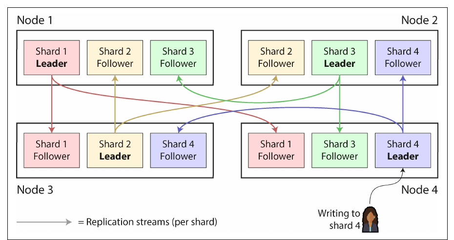
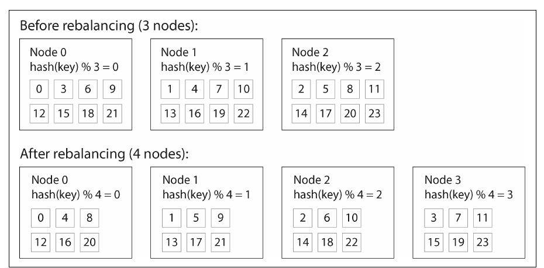
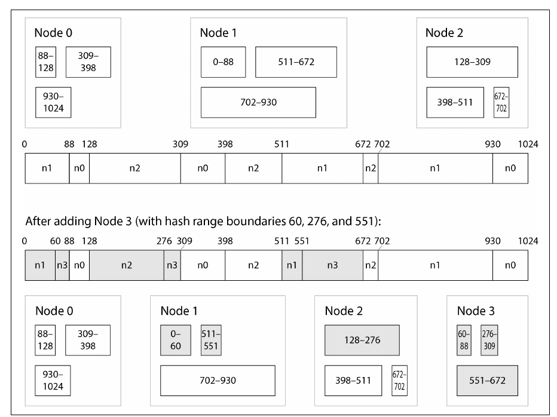
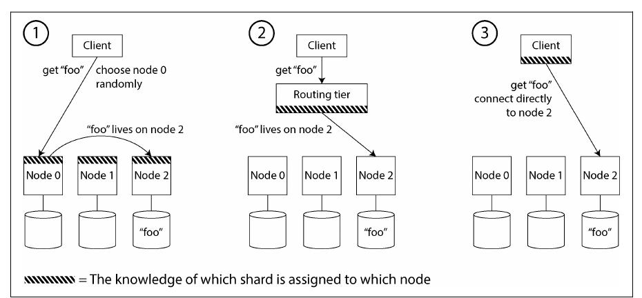
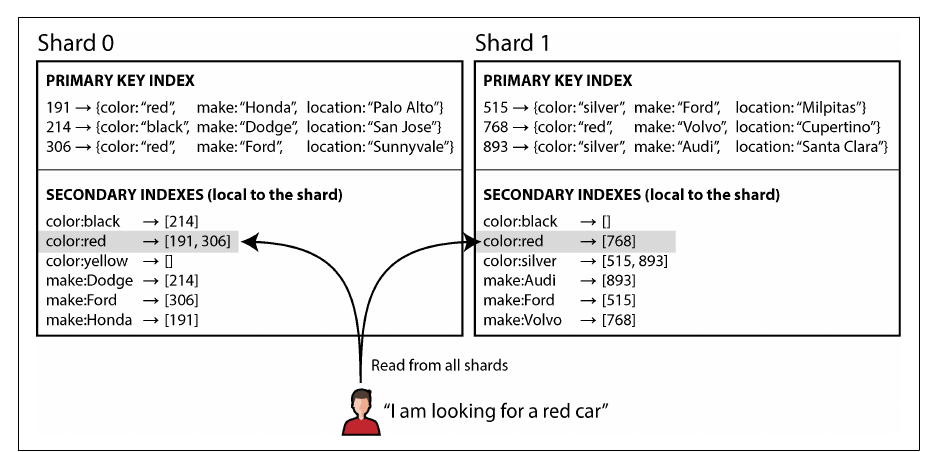
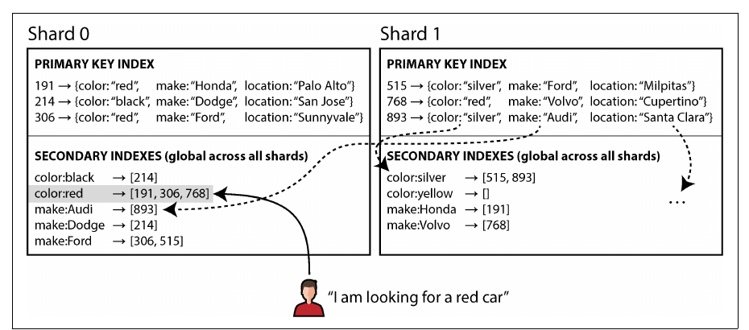

# فصل ۷: مفهوم sharding

[فصل ۶: مفهوم replication →](06-replication.md) · [کتاب](../README.md) · [فصل ۸: تراکنش‌ها ←](08-transactions.md)

## خلاصه

وقتی داده یا بار کوئری از یک ماشین بیشتر شود، به **shard**ها، یا partitionها، تقسیم می‌شود؛ هر کدام یک دیتابیس کوچک مستقل که معمولاً replicate هم می‌شود. هدف پخش یکنواخت داده و بار و پرهیز از **hot spot** است. فصل sharding بر اساس **key range**، با range scan کارآمد و خطر hot spot روی کلیدهای پشت سر هم، را با sharding بر اساس **hash کلید**، با پخش یکنواخت و بدون range scan کارآمد، مقایسه می‌کند؛ از جمله این‌که چرا *hash mod N* ایده‌ی بدی است و تعداد ثابت shard، sharding با hash range و consistent hashing چطور با جابه‌جایی کم داده rebalance می‌کنند. بعد به بارهای نامتوازن، rebalancing خودکار در برابر دستی، **request routing**، که اغلب از یک coordination service کمک می‌گیرد، و دو راه shard کردن **secondary index**، یعنی local و global، می‌پردازد.

## نکته‌های کلیدی

- **مفهوم sharding برای scale است و replication برای redundancy**؛ سیستم‌ها معمولاً هر دو را با هم دارند و هر node replicaهای چند shard را نگه می‌دارد (pp. 251–253).
- **فقط وقتی لازم است shard کنید:** پیچیدگی اضافه می‌کند، کوئری و تراکنش بین shardها را سخت می‌کند و روی سخت‌افزار امروزی اغلب لازم نیست (pp. 253–254).
- **مفهوم multitenancy** طبیعی روی sharding می‌نشیند: یک shard برای هر tenant یعنی isolation، backup جدا برای هر tenant و رعایت محل نگهداری داده؛ اما tenantهای خیلی بزرگ ممکن است تقسیم لازم داشته باشند (pp. 254–255).
- **مدل key range** از range scan پشتیبانی می‌کند اما روی کلیدهای پشت سر هم، مثل timestamp، hot spot می‌سازد؛ **مدل hash** کلیدها را پخش می‌کند اما بازه‌ها را هم پراکنده می‌کند (pp. 256–262).
- **هرگز از hash mod N استفاده نکنید:** تغییر N تقریباً همه‌ی کلیدها را جابه‌جا می‌کند. از تعداد shard خیلی بیشتر از node، hash rangeهایی که تقسیم می‌شوند، یا consistent hashing استفاده کنید (pp. 258–263).
- **مفهوم hashing جلوی skew روی یک کلید تکی را نمی‌گیرد**، مثلاً یک چهره‌ی مشهور؛ تقسیم کلید در سطح اپلیکیشن پخش نوشتن را با جمع کردن خواندن عوض می‌کند (pp. 263–264).
- **مدل local secondary index** نوشتن را ارزان و خواندن را scatter/gather می‌کند؛ **مدل global secondary index** خواندن را ارزان و نوشتن را چند-shardی می‌کند (pp. 268–271).

## فهرست بخش‌ها

*از فهرست مطالب خود کتاب، یعنی bookmarkهای PDF، با شماره‌ی صفحه‌های چاپی.*

- مزیت‌ها و عیب‌های sharding (p. 253)
- مفهوم sharding برای multitenancy (p. 254)
- مفهوم sharding برای داده‌ی key-value (p. 255)
  - مفهوم sharding بر اساس key range (p. 256)
  - مفهوم sharding بر اساس hash کلید (p. 258)
  - بارهای نامتوازن و کم کردن hot spot (p. 263)
  - عملیات: rebalancing خودکار در برابر دستی (p. 264)
- مفهوم request routing (p. 265)
- مفهوم sharding و secondary index (p. 268)
  - مفهوم local secondary index (p. 268)
  - مفهوم global secondary index (p. 270)
- جمع‌بندی (p. 271)

## یادداشت‌ها

یک دیتابیس توزیع‌شده داده را به دو شکل پخش می‌کند: **replication**، یعنی کپی‌های همان داده در فصل ۶، و **sharding**، یعنی تقسیم داده‌ای که برای یک node خیلی بزرگ است یا خیلی سریع نوشته می‌شود به **shard**ها، یا partitionها، که هر رکورد دقیقاً به یکی از آن‌ها تعلق دارد. این دو با هم ترکیب می‌شوند: هر shard replicate می‌شود و یک node ممکن است leader بعضی shardها و follower بعضی دیگر باشد؛ شکل ۷-۱ (pp. 251–252).

*Figure 7-1 (p. 252): هر node leader بعضی shardها و follower بقیه است، پس leadership و بار نوشتن در کل cluster پخش می‌شود.*

**اسم‌های shard** (p. 252): partition در Kafka، range در CockroachDB، region در HBase و TiDB، vBucket در Couchbase، vnode در Riak، token-range در Cassandra، و tablet در Bigtable، YugabyteDB و ScyllaDB. در PostgreSQL واژه‌ی *partitioning* یعنی تقسیم یک جدول به چند فایل روی یک ماشین، برخلاف sharding که بین ماشین‌هاست. واژه‌ی «shard» شاید از کریستال شکسته‌ی بازی *Ultima Online* آمده باشد، یا از یک سرواژه‌ی گمشده‌ی دهه‌ی ۱۹۸۰. هیچ ربطی به **network partition** در فصل ۹ ندارد.

> **Try it:** [فصل ۷ در طول یک pipeline داده](../widgets/07-pipeline-map.html): از دیتابیس منبع تا داشبورد را با lensهای تقسیم داده، hot spot و جست‌وجو با مقدار غیرکلیدی طی کنید.

### مزیت‌ها و عیب‌های sharding

مفهوم sharding ابزار اصلی **horizontal scaling** برای حجم داده و throughput **نوشتن** است؛ throughput خواندن را به‌تنهایی می‌شود با read replica حل کرد (p. 253). سنگین است، پس اگر یک ماشین از پسش برمی‌آید از آن پرهیز کنید (pp. 253–254):

| هزینه | چرا |
|---|---|
| انتخاب **partition key** | رکوردهایی که کلید یکسان دارند در یک shard‌اند؛ پیدا کردن رکورد بدون کلید یعنی گشتن همه‌ی shardها؛ تغییر طرح سخت است |
| داده‌ی relational | secondary index و join بین shardها پخش می‌شوند |
| نوشتن بین shardها | **تراکنش توزیع‌شده** لازم دارد: کندتر، و شاید یک گلوگاه؛ فصل ۸ |

بعضی سیستم‌ها *داخل* یک ماشین shard می‌کنند: یک process تک‌thread برای هر core یا هر بانک حافظه‌ی NUMA؛ مثل Redis، VoltDB و FoundationDB (p. 254).

> **In practice:** warehouse در reference stack دو replica دارد و هیچ shardی ندارد: هر node کل داده را دارد.
>
> **Your turn:** حجم داده سه برابر شده و داشبوردها کند شده‌اند. کسی پیشنهاد می‌دهد warehouse را shard کنید. پیش از قبول چه می‌پرسید؟
>
> *Answer:* اول این‌که مشکل حجم داده و throughput نوشتن است یا فقط throughput خواندن؛ دومی را replica و کوئری بهتر حل می‌کنند (p. 253). بعد هزینه‌ها: کدام partition key، و joinهای Silver که منبع‌ها را روی شناسه‌های مشترک به هم وصل می‌کنند آیا بین shardها پخش می‌شوند (pp. 253–254). اگر یک ماشین بزرگ‌تر کافی است، shard نکنید.

### مفهوم sharding برای multitenancy

محصولات SaaS **multitenant** هستند: هر tenant، یعنی هر مشتری، یک مجموعه داده‌ی مستقل دارد؛ یک shard برای هر tenant، یا گروهی از tenantهای کوچک، به شکل دیتابیس‌های جدا، حتی embedded، یا بخش‌های مدیریت‌شده‌ی یک دیتابیس منطقی (p. 254).

| مزیت (pp. 254–255) | |
|---|---|
| isolation منابع | کار گران یک tenant بقیه را کند نمی‌کند |
| isolation دسترسی | احتمال این‌که یک باگ access control داده را بین tenantها نشت دهد کمتر است |
| **معماری cell-based** | سرویس‌ها *و* storage برای مجموعه‌ای از tenantها یک cell مستقل می‌سازند و خطاها داخل همان می‌مانند |
| backup و restore برای هر tenant | حذف اشتباهی یک tenant را بدون دست زدن به بقیه برگردانید |
| رعایت مقررات | export یا حذف داده‌ی یک نفر یعنی کار روی یک shard |
| محل نگهداری داده | shard یک tenant را در حوزه‌ی قضایی لازم بگذارید |
| ارائه‌ی تدریجی schema | هر بار یک tenant را migrate کنید، که انجامش به شکل تراکنشی سخت است |

چالش‌ها (p. 255): tenantی که برای یک node خیلی بزرگ است و باید داخل خودش shard شود؛ shard جدا برای هر tenant کوچک خیلی گران است، اما tenantهای گروه‌بندی‌شده با رشدشان باید جابه‌جا شوند؛ و قابلیت‌های بین tenantها به join بین shardها تبدیل می‌شوند.

> **In practice:** در reference stack داده‌ی یک مشتری در همه‌ی partitionهای ماهانه‌ی جدول‌های warehouse پخش است، نه در یک shard.
>
> **Your turn:** یک مشتری درخواست حذف داده می‌دهد. چرا این کار در این warehouse گران‌تر از یک دیتابیس multitenant با shard برای هر tenant است؟
>
> *Answer:* در طرح multitenant، حذف داده‌ی یک نفر یعنی کار روی یک shard (pp. 254–255). این‌جا ردیف‌های آن مشتری در همه‌ی partitionهای ماهانه و همه‌ی لایه‌ها هستند، پس حذف یک mutation است که باید همه‌ی partitionها را بازنویسی کند؛ partition key، یعنی ماه، برای خواندن انتخاب شده، نه برای حذف بر اساس مشتری.

### مفهوم sharding برای داده‌ی key-value

هدف: پخش یکنواخت داده و کوئری‌ها، تا ۱۰ node ده برابر داده و throughput را تحمل کنند، و rebalance کردن وقتی nodeها می‌آیند و می‌روند. عدم توازن را **skew** می‌گویند؛ shardی که بار نامتناسب دارد **hot shard** یا **hot spot** است؛ و یک کلید تکی خیلی پرکار **hot key** است (pp. 255–256).

#### مفهوم sharding بر اساس key range (pp. 256–258)

هر shard یک بازه‌ی پیوسته از کلیدها را دارد، مثل جلدهای دایرةالمعارف: جلد ۱ حرف‌های A تا B است اما جلد ۱۲ حرف‌های T تا Z، چون مرزها باید دنبال داده بروند؛ شکل ۷-۲. مرزها دستی تعیین می‌شوند، مثل Vitess، یا خودکار، مثل Bigtable، HBase، گزینه‌ی range در MongoDB، CockroachDB، RethinkDB و FoundationDB؛ YugabyteDB هر دو را دارد. کلیدها داخل هر shard مرتب‌اند، پس **range scan** آسان است؛ مثلاً یک ماه داده‌ی sensor.

- **مفهوم hot spot روی کلیدهای پشت سر هم:** با کلید timestamp، همه‌ی نوشتن‌های فعلی به shard «این ماه» می‌روند. با پیشوند شناسه‌ی sensor نوشتن‌ها را پخش کنید؛ آن وقت یک بازه‌ی زمانی برای همه‌ی sensorها یک کوئری برای هر sensor لازم دارد (p. 257).
- **مفهوم rebalancing:** اگر توزیع کلیدها را می‌دانید یک دیتابیس خالی را **pre-split** کنید، مثل HBase و MongoDB؛ بعداً shardهایی را که خیلی بزرگ می‌شوند **split** کنید، که پیش‌فرض HBase **۱۰ گیگابایت** است، یا آن‌هایی را که بار نوشتن زیادی دارند، و shardهای کوچک را merge کنید؛ مثل بالای یک B-tree. هر split همه‌ی داده‌ی shard را بازنویسی می‌کند، اغلب درست وقتی که shard زیر بار است (pp. 257–258).

> **In practice:** جدول‌های warehouse در reference stack بر اساس ماه partition می‌شوند، که شکلی از key range است، اما همه روی یک ماشین؛ مثل partitioning در PostgreSQL، نه sharding.
>
> **Your turn:** همه‌ی insertهای هر ساعت به partition ماه جاری می‌روند. چرا این hot spot این‌جا آن‌قدر که کتاب هشدار می‌دهد دردسر نیست، و این partitioning در عوض چه می‌دهد؟
>
> *Answer:* نگرانی کتاب این است که یک *node* همه‌ی بار نوشتن را بگیرد (p. 257)؛ این‌جا هیچ shardی نیست و هر نوشتن به‌هرحال روی هر دو replica می‌رود، پس partition جاری فقط فایل‌های تازه را می‌گیرد. در عوض کوئری‌هایی که بر اساس بازه‌ی زمانی فیلتر می‌کنند فقط partitionهای همان ماه‌ها را می‌خوانند، یعنی همان range scan کارآمد key range (p. 256).

#### مفهوم sharding بر اساس hash کلید (pp. 258–263)

وقتی لازم نیست کلیدهای نزدیک کنار هم باشند، مثل شناسه‌ی tenant، اول hash کنید. تابع hash لازم نیست رمزنگارانه باشد؛ MongoDB از MD5 و Cassandra و ScyllaDB از Murmur3 استفاده می‌کنند؛ اما باید **بین processها پایدار** باشد، برخلاف `Object.hashCode()` در Java یا `Object#hash` در Ruby (p. 258).

| طرح | چطور | اضافه کردن node | بده‌بستان | چه کسی به کار می‌برد |
|---|---|---|---|---|
| **مدل hash mod N** | `hash(key) % N` روی nodeها | بیشتر کلیدها جابه‌جا می‌شوند؛ در شکل ۷-۳ کلید ۳ به node ۳، کلید ۶ به node ۲ و کلید ۹ به node ۱ می‌رود | ساده، با rebalancing افتضاح | هیچ‌کس |
| **تعداد ثابت shard** | مثلاً ۱٬۰۰۰ shard روی ۱۰ node؛ `hash(key) % 1000`؛ mapping shard به node را نگه دارید | shardهای کامل را به node تازه منتقل کنید؛ شکل ۷-۴؛ کلیدها هرگز shardشان عوض نمی‌شود | تعدادی با مقسوم‌علیه‌های زیاد انتخاب کنید؛ به ماشین‌های بزرگ‌تر shard بیشتری بدهید؛ از تعداد shard بیشتر node نمی‌شود داشت؛ resharding گران است؛ اندازه‌ی shard با داده بزرگ می‌شود | Citus، Riak، Elasticsearch و Couchbase |
| **مدل hash range** | هر shard یک بازه از مقدارهای hash دارد؛ در مثال ۱۶ بیتی، ۰ تا ۱۶٬۳۸۳ به shard ۰ و …؛ شکل ۷-۵ | shardها را هر وقت لازم شد split کنید | تعداد shard خودش را تطبیق می‌دهد؛ کوئری بازه‌ای روی partition key ممکن نیست، اما compound key ستون‌های بعدی را داخل هر partition مرتب نگه می‌دارد | YugabyteDB، DynamoDB و گزینه‌ای در MongoDB |
| **نسخه‌ی Cassandra و ScyllaDB** | فضای hash به بازه‌هایی با مرز تصادفی تقسیم می‌شود، چند بازه برای هر node؛ ۱۶ در Cassandra و ۲۵۶ در ScyllaDB؛ شکل ۷-۶ | node تازه بخش‌هایی از چند بازه را از چند node می‌گیرد | عدم توازن‌ها با تعداد زیاد بازه‌ها جبران می‌شوند | Cassandra و ScyllaDB |
| **مدل consistent hashing**، مثل rendezvous یا highest random weight، و jump | کلیدها یکنواخت پخش می‌شوند و کمترین تعداد کلید جابه‌جا می‌شود | node تازه کلیدهای تکی پراکنده از همه‌ی nodeها را می‌گیرد | واژه‌ی «consistent» این‌جا ربطی به consistency در replica یا ACID ندارد | سیستم‌های مختلف |

مفهوم data warehouseها همین کار را با واژه‌های دیگر می‌کنند: partition key و **cluster column** در BigQuery، micro-partition و cluster key در Snowflake، و Delta Lake؛ clustering به فشرده‌سازی و فیلتر کردن هم کمک می‌کند (p. 262).

*Figure 7-3 (p. 259): تغییر N در hash mod N بیشتر کلیدها را جابه‌جا می‌کند، و برای همین طرح‌های rebalancing از آن پرهیز می‌کنند.*

*Figure 7-6 (p. 262): با مرزهای تصادفی و چند بازه برای هر node، node تازه از هر node موجود سهمی می‌گیرد.*

> **Try it:** [مفهوم sharding و rebalancing](../widgets/07-sharding.html): زیر hash mod N، تعداد ثابت shard و rendezvous hashing یک node اضافه کنید، و hot spot بسازید و کمش کنید.

> **In practice:** کلید `ORDER BY` در MergeTree همان کاری را می‌کند که کتاب به cluster column در BigQuery و cluster key در Snowflake نسبت می‌دهد: ردیف‌ها را داخل هر partition مرتب نگه می‌دارد (p. 262).
>
> **Your turn:** یک جدول Silver با `PARTITION BY` ماه و `ORDER BY (account_id, posting_date)` دارید. کوئری «همه‌ی تراکنش‌های یک حساب در سه ماه اخیر» چقدر از جدول را می‌خواند؟
>
> *Answer:* فقط سه partition ماهانه، و داخل هر کدام فقط بلوک‌های همان `account_id`، چون ردیف‌های هر حساب کنار هم مرتب‌اند؛ مثل compound key که ستون‌های بعدی را داخل هر partition مرتب نگه می‌دارد (pp. 258–262). کوئری بر اساس ستونی که در `ORDER BY` نیست باید همه‌ی بلوک‌های آن سه partition را بگردد.

#### بارهای نامتوازن و کم کردن hot spot (pp. 263–264)

کلیدهای یکنواخت یعنی بار یکنواخت نیست: پست یک چهره‌ی مشهور ممکن است خواندن و نوشتن را روی یک کلید متمرکز کند. طرح‌های مبتنی بر بازه می‌توانند به یک hot key shard یا ماشین خودش را بدهند. در سطح اپلیکیشن می‌شود **دو رقم تصادفی به کلید اضافه کرد** تا نوشتن‌های یک hot key بین ۱۰۰ کلید پخش شوند؛ اما خواندن باید هر ۱۰۰ تا را بگیرد و ترکیب کند، بار خواندن هر shard کم نمی‌شود، و باید حساب کنید کدام کلیدها تقسیم شده‌اند. بار در طول زمان جابه‌جا می‌شود، مثلاً یک پست وایرال بعد از چند روز آرام می‌شود، و کلیدها ممکن است برای خواندن یا برای نوشتن داغ باشند. بعضی cloudها این را خودکار می‌کنند: **heat management** یا **adaptive capacity** در Amazon (p. 264).

> **In practice:** در یک جدول تراکنش، چند merchant بزرگ یا یک حساب partner بخش بزرگی از ردیف‌ها را دارند.
>
> **Your turn:** یک تحلیل‌گر در notebook روی تراکنش‌ها `groupby("merchant")` می‌زند و یک گروه چند برابر بقیه است. در یک موتور توزیع‌شده این چه اثری دارد و ایده‌ی کتاب چطور کمک می‌کند؟
>
> *Answer:* در یک موتور توزیع‌شده همه‌ی ردیف‌های آن merchant به یک worker می‌روند، یک hot key، و کل کار منتظر همان worker می‌ماند (pp. 263–264). ایده‌ی کتاب، یعنی اضافه کردن یک پسوند تصادفی، گروه داغ را بین چند worker پخش می‌کند؛ هزینه‌اش یک قدم دوم است که نتیجه‌های جزئی را دوباره ترکیب کند، همان «خواندن باید همه را بگیرد».

#### عملیات: rebalancing خودکار در برابر دستی (pp. 264–265)

| خودکار، مثل DynamoDB که shardها را در چند دقیقه scale می‌کند | انسان در حلقه، مثل Couchbase و Riak که پیشنهاد می‌دهند و admin تأیید می‌کند |
|---|---|
| کار روزمره‌ی کمتر؛ می‌تواند autoscale کند | کندتر، اما غافلگیری کمتر |
| جابه‌جایی داده ممکن است شبکه و nodeها را زیر بار ببرد؛ نزدیک حداکثر throughput نوشتن، split ممکن است عقب بماند | rebalancing پیشگیرانه پیش از اوج‌های معلوم، مثل Cyber Monday یا فروش بلیت جام جهانی |
| **همراه با تشخیص خودکار خرابی خطرناک است:** یک node کند و زیر بار مرده اعلام می‌شود، بارش به بقیه می‌رود، آن‌ها کند می‌شوند و مرده اعلام می‌شوند؛ یک cascading failure | |

### مفهوم request routing

کدام node، یعنی کدام IP و port، یک کلید را دارد؟ شبیه service discovery است، با این تفاوت که هر نمونه‌ی stateless یک سرویس می‌تواند درخواست را جواب بدهد، اما فقط یک replica از shard درست می‌تواند یک کلید را سرویس بدهد (p. 265). سه روش، شکل ۷-۷:

| روش | چطور |
|---|---|
| هر node | به شکل round-robin به هر nodeی بروید، که اگر shard را ندارد درخواست را جلو می‌فرستد |
| **مفهوم routing tier** | یک load balancer آگاه از shardها که خودش هیچ درخواستی را پردازش نمی‌کند |
| **مدل shard-aware client** | خود client mapping را می‌داند و مستقیم وصل می‌شود |

مسئله‌های باز (pp. 266–267): چه کسی mapping را تعیین می‌کند، که اگر یک coordinator تکی باشد خودش باید بدون split brain failover کند؛ routerها چطور از تغییرها خبردار می‌شوند؛ و درخواست‌هایی که هنگام جابه‌جایی یک shard در راه‌اند.

*Figure 7-7 (p. 266): جزء هاشورخورده همان چیزی است که باید بداند کدام shard روی کدام node است.*

| هماهنگی | سیستم‌ها (pp. 267–268) |
|---|---|
| ابزار ZooKeeper یا etcd، با consensus | HBase و SolrCloud؛ Kubernetes از etcd برای نمونه‌های سرویس استفاده می‌کند |
| config serverهای خودش و routerهای `mongos` | MongoDB |
| ابزار Raft داخلی | Kafka، YugabyteDB، TiDB و ScyllaDB |
| **مفهوم gossip** بین nodeها؛ ضعیف‌تر و با امکان split brain، که با تضمین‌های ضعیف قابل تحمل است | Riak |

آدرس IP nodeها آن‌قدر آهسته عوض می‌شود که **DNS** کافی است. دیتابیس‌های تحلیلی هم shard می‌کنند، اما هر کوئری را به شکل موازی روی shardهای زیادی اجرا می‌کنند؛ فصل ۱۱ (p. 268).

### مفهوم sharding و secondary index

مفهوم secondary index جست‌وجو بر اساس مقدار است: همه‌ی کارهای کاربر ۱۲۳، مقاله‌هایی که واژه‌ی *hogwash* را دارند، ماشین‌هایی که رنگشان قرمز است؛ پس تمیز روی shardها نمی‌نشیند. در دیتابیس‌های relational و document استاندارد است و دلیل وجود Solr و Elasticsearch است (p. 268). مثال کتاب: آگهی‌های ماشین دست‌دوم که بر اساس ID shard شده‌اند، ۰ تا ۴۹۹ در shard ۰ و ۵۰۰ تا ۹۹۹ در shard ۱، با index روی رنگ و سازنده.

| | **مدل local**، یا document-partitioned؛ شکل ۷-۹ | **مدل global**، یا term-partitioned؛ شکل ۷-۱۰ |
|---|---|---|
| هر shard چه چیزی را index می‌کند | فقط رکوردهای خودش؛ `color:red` به ماشین‌های قرمز خودش اشاره می‌کند | برشی از کل index بر اساس term: رنگ‌های a تا r در index shard ۰ و s تا z در shard ۱؛ سازنده‌ها بین f و h تقسیم می‌شوند |
| نوشتن | فقط به shard همان رکورد دست می‌زند | ممکن است چند index shard را به‌روز کند؛ تراکنش توزیع‌شده لازم دارد، یا **asynchronous** اعمال می‌شود؛ در DynamoDB خواندن‌ها ممکن است کهنه باشند |
| خواندن با یک term | **همه‌ی shardها**، یعنی scatter/gather؛ گران، با بزرگ شدن tail latency، و shardهای بیشتر throughput کوئری را بالا نمی‌برند، مگر هر نتیجه‌ای کافی باشد یا partition key معلوم باشد | یک index shard برای postings list؛ گرفتن خود رکوردها ممکن است به چند shard برسد |
| خواندن با چند term، یعنی AND | هر shard محلی intersect می‌کند | postings listهای shardهای مختلف باید جابه‌جا و intersect شوند؛ اگر طولانی باشند کند است |
| چه کسی به کار می‌برد | MongoDB، Riak، Cassandra، Elasticsearch، SolrCloud و VoltDB | CockroachDB، TiDB و YugabyteDB؛ DynamoDB هر دو را دارد |
| کجا خوب است | بارهای پرنوشتن | وقتی throughput خواندن از نوشتن بیشتر است و postings listها کوتاه‌اند |

ساختن secondary index خودتان در یک key-value store یعنی سازگار نگه داشتنش با خودتان است؛ race condition و خرابی جزئی به‌راحتی آن را از داده جدا می‌کنند (p. 269).

*Figure 7-9 (p. 269): هر local index فقط رکوردهای shard خودش را پوشش می‌دهد، پس کوئری بر اساس رنگ به همه‌ی shardها پخش می‌شود.*

*Figure 7-10 (p. 270): هر global index خواندن را به یک جا می‌فرستد اما باعث می‌شود یک نوشتن index shardهای جای دیگر را به‌روز کند.*

> **Try it:** [مقایسه‌ی local و global secondary index](../widgets/07-secondary-indexes.html): در آگهی‌های ماشین دست‌دوم کتاب جست‌وجو کنید و بشمارید هر خواندن و نوشتن به چند shard دست می‌زند.

> **In practice:** skip indexها در MergeTree برای هر part جدا ساخته می‌شوند، مثل local secondary index برای هر shard. یک جدول دوم با `ORDER BY` متفاوت، که با materialized view پر می‌شود، شبیه global index است.
>
> **Your turn:** جدول Silver بر اساس `account_id` مرتب است و یک کوئری مدام تراکنش‌های یک `card_hash` را می‌خواهد. دو راه بگویید و هزینه‌ی هر کدام را از زبان کتاب.
>
> *Answer:* راه اول یک skip index روی `card_hash` است: نوشتن ارزان می‌ماند، اما هر کوئری باید index همه‌ی partها را بررسی کند، یعنی scatter/gather مثل local index (pp. 268–269). راه دوم یک جدول یا projection با `ORDER BY card_hash` است: خواندن به یک بازه‌ی کوچک می‌رسد، اما هر insert باید دو جا نوشته شود، مثل global index که نوشتن را چند-shardی می‌کند (pp. 270–271).

## بده‌بستان‌ها در یک نگاه

| | مدل key range | مدل hash کلید، با hash range یا تعداد ثابت shard |
|---|---|---|
| کوئری بازه‌ای روی partition key | کارآمد | پخش به همه‌ی shardها |
| کلیدهای پشت سر هم مثل timestamp | hot spot روی جدیدترین بازه | یکنواخت پخش می‌شود |
| مفهوم rebalancing | split کردن بازه‌ها با رشدشان | جابه‌جایی shardهای کامل یا split کردن hash rangeها |
| یک hot key تکی | می‌شود آن را در shard خودش جدا کرد | باز هم یک shard است؛ تقسیم کلید لازم دارد |

| نوع secondary index | هزینه‌ی نوشتن | هزینه‌ی خواندن | تازگی |
|---|---|---|---|
| مدل local | یک shard | همه‌ی shardها | synchronous |
| مدل global | چند index shard | یک index shard، به همراه گرفتن رکوردها | اغلب asynchronous |

## فراتر از کتاب

- مفهوم consistent hashing به شکل یک حلقه با virtual node، از Karger و همکاران در ۱۹۹۷ که Dynamo رایجش کرد، شکلی است که بیشتر مهندس‌ها با آن روبه‌رو می‌شوند؛ [آزمایش rebalancing](../lab/07-rebalancing/README.md) در vault نشان می‌دهد حدود 1/N کلیدها را جابه‌جا می‌کند، اما با ۶۴ virtual node توازن بار ضعیف‌تری از rendezvous hashing دارد.
- روش jump consistent hash، از Lamping و Veach در ۲۰۱۴، هیچ storageی لازم ندارد، اما فقط اضافه یا حذف کردن bucket با بزرگ‌ترین شماره را پشتیبانی می‌کند.

## پیوندها

- **Run it:** [وقتی یک node اضافه می‌شود چقدر داده جابه‌جا می‌شود](../lab/07-rebalancing/README.md).
- **فصل‌های مرتبط:** [فصل ۲: تعریف نیازمندی‌های غیرکارکردی](02-defining-nonfunctional-requirements.md) برای skew چهره‌های مشهور، [فصل ۶: مفهوم replication](06-replication.md)، [فصل ۸: تراکنش‌ها](08-transactions.md) برای atomicity بین shardها، و [فصل ۱۰: مفهوم consistency و consensus](10-consistency-and-consensus.md).

## خودتان را بسنجید

*پرسش‌ها و پاسخ‌ها را خود vault از روی یادداشت‌های بالا نوشته است؛ پاسخ‌ها به صفحه‌های کتاب ارجاع می‌دهند.*

1. **چرا hash mod N با تغییر N تقریباً همه‌ی کلیدها را جابه‌جا می‌کند، در حالی که تعداد ثابت shard فقط حدود 1/N را؟**

   *Answer:* با mod N، node هر کلید به N وابسته است، پس تغییر N بیشتر کلیدها را دوباره تخصیص می‌دهد. با تعداد shard خیلی بیشتر از node، هر کلید همیشه به همان shard تعلق دارد؛ node تازه shardهای کامل را از بقیه می‌گیرد، پس فقط همان shardها جابه‌جا می‌شوند (pp. 258–262).

2. **داده‌ی sensorها را بر اساس timestamp shard می‌کنید. چه چیزی خراب می‌شود؟**
   - [ ] کوئری بازه‌ای ناممکن می‌شود
   - [x] همه‌ی نوشتن‌های فعلی به shardی می‌روند که جدیدترین بازه‌ی زمانی را دارد، و hot spot می‌سازند
   - [ ] دیگر نمی‌شود shardها را split کرد
   - [ ] نمی‌شود timestampها را مرتب کرد

   *Answer:* با sharding بر اساس key range روی زمان، shard امروز همه‌ی نوشتن‌ها را می‌گیرد. پیشوند شناسه‌ی sensor نوشتن‌ها را پخش می‌کند، به قیمت این‌که خواندن یک بازه‌ی زمانی برای همه‌ی sensorها یک کوئری بازه‌ای برای هر sensor لازم دارد (pp. 256–258).

3. **چرا rebalancing خودکار ممکن است یک overload را بدتر کند؟**

   *Answer:* اگر یک node زیر بار دیر جواب بدهد، سیستم ممکن است نتیجه بگیرد مرده است و داده‌اش را جابه‌جا کند؛ یعنی درست در بدترین لحظه بار بیشتری روی آن و روی شبکه بگذارد و شاید یک cascading failure راه بیندازد. انسان در حلقه می‌تواند امن‌تر باشد (pp. 264–265).

4. **یک کوئری بر اساس یک ویژگی ثانویه فیلتر می‌کند. هزینه‌اش را با local و global secondary index مقایسه کنید.**

   *Answer:* با local index، یا document-partitioned، هر shard سندهای خودش را index می‌کند، پس هر خواندن باید از همه‌ی shardها بپرسد، یعنی scatter/gather، در حالی که نوشتن روی یک shard می‌ماند. global index، یا term-partitioned، خواندن را از shard یا shardهایی که آن term را دارند جواب می‌دهد، اما یک نوشتن ممکن است چند index shard را به‌روز کند (pp. 268–271).

5. **چرا تقسیم یک hot key به ۱۰۰ زیرکلید بار خواندن را کم نمی‌کند؟**
   - [ ] چون زیرکلیدها روی یک node ذخیره می‌شوند
   - [x] چون هر خواندن حالا باید هر ۱۰۰ زیرکلید را بگیرد و ترکیب کند
   - [ ] چون نوشتن در زیرکلیدها باید پشت سر هم باشد
   - [ ] چون hash کردن زیرکلیدها گران است

   *Answer:* اضافه کردن یک پسوند تصادفی نوشتن‌ها را پخش می‌کند، اما خواننده دیگر نمی‌داند داده در کدام زیرکلید است و باید همه را بخواند (pp. 263–264).

6. **جدول Silver بر اساس `account_id` مرتب است و برای کوئری بر اساس `card_hash` یک جدول دوم با `ORDER BY card_hash` می‌سازید. این شبیه کدام طرح کتاب است و هزینه‌اش کجاست؟**
   - [ ] مدل local secondary index؛ هزینه در خواندن
   - [x] مدل global secondary index؛ هر نوشتن باید دو جا انجام شود
   - [ ] مدل hash mod N؛ هزینه در rebalancing
   - [ ] مدل key range؛ هزینه در hot spot

   *Answer:* جدول دوم کل داده را بر اساس مقدار دیگری مرتب می‌کند، مثل index که بر اساس term تقسیم شده؛ خواندن به یک جا می‌رسد اما هر insert باید هر دو جا را به‌روز کند، و اگر asynchronous پر شود ممکن است کهنه باشد (pp. 270–271).
