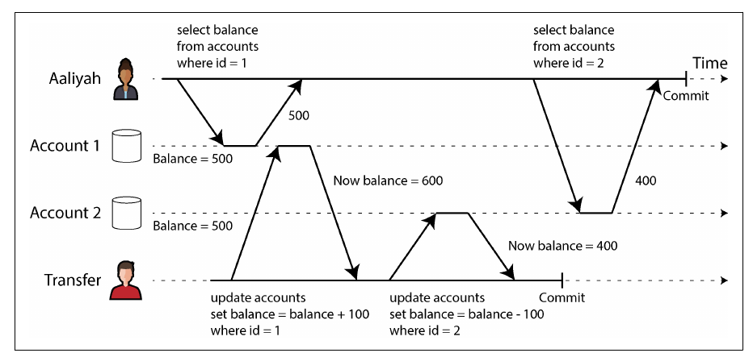
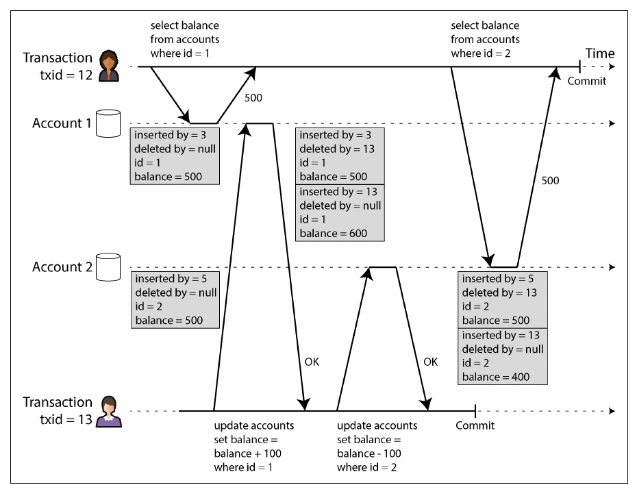
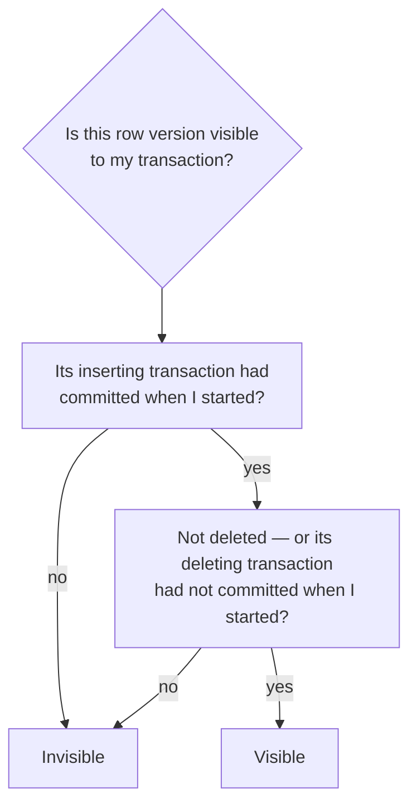
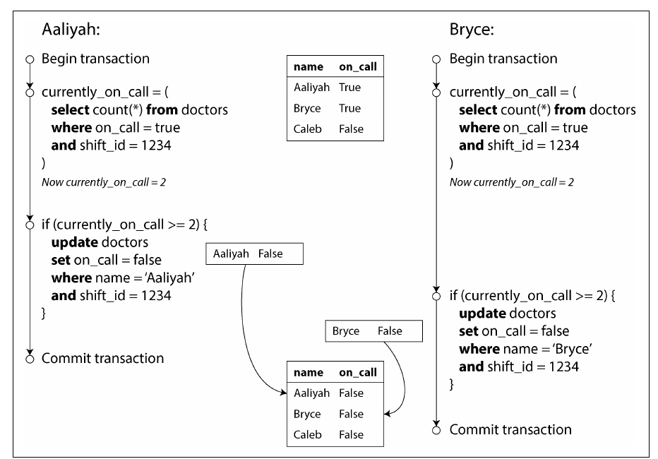
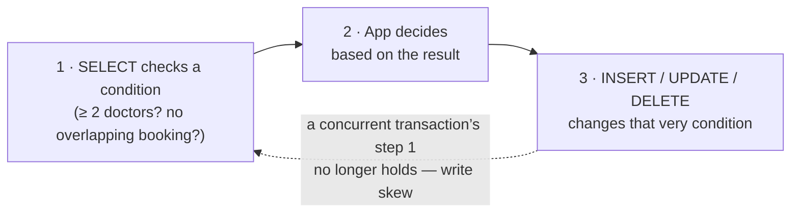
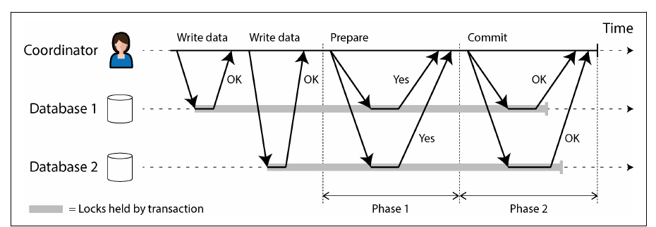
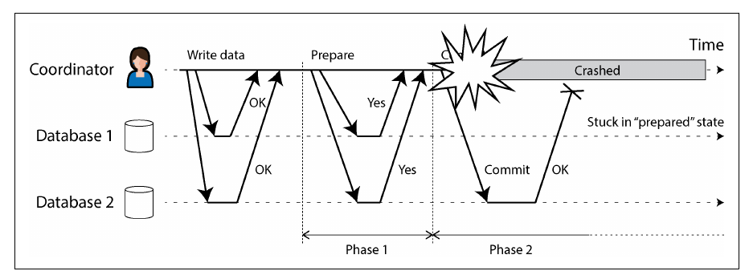
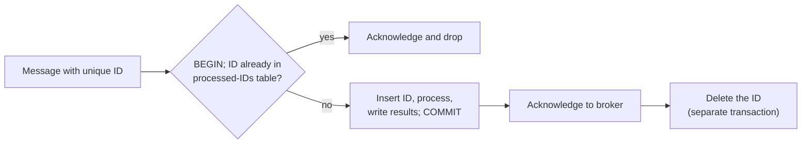

# فصل ۸: تراکنش‌ها

[فصل ۷: مفهوم sharding →](07-sharding.md) · [کتاب](../README.md) · [فصل ۹: دردسرهای سیستم‌های توزیع‌شده ←](09-the-trouble-with-distributed-systems.md)

## خلاصه

یک تراکنش چند خواندن و نوشتن را در یک واحد منطقی جمع می‌کند که یا commit می‌شود یا abort، و اجازه می‌دهد اپلیکیشن وانمود کند بعضی مشکل‌های concurrency و خرابی وجود ندارند. فصل باز می‌کند که ACID واقعاً چه تضمینی می‌دهد و چرا تراکنش‌های چند-objectی مهم‌اند، و بعد عمیق به **isolation** می‌پردازد: race conditionهایی که سطح‌های ضعیف isolation اجازه می‌دهند، یعنی dirty read و dirty write، read skew، lost update، write skew و phantom؛ این‌که read committed و snapshot isolation، با MVCC، چطور پیاده‌سازی می‌شوند؛ و سه راه رسیدن به **serializability** کامل: اجرای واقعاً serial، two-phase locking و serializable snapshot isolation. در پایان به **تراکنش‌های توزیع‌شده** می‌رسد: two-phase commit، مشکل‌هایش بین سیستم‌های ناهمگون یعنی XA، رفتار بهترش داخل یک دیتابیس، و پردازش exactly-once پیام‌ها.

## نکته‌های کلیدی

- **حرف‌های ACID هم‌وزن نیستند:** atomicity در واقع یعنی *قابلیت abort*؛ consistency ویژگی اپلیکیشن است؛ isolation در حالت ایده‌آل یعنی serializability اما دیتابیس‌ها اغلب کمتر می‌دهند؛ و durability هیچ‌وقت مطلق نیست (pp. 279–284).
- **مفهوم isolation ضعیف رایج است و باگ واقعی می‌سازد:** read committed جلوی dirty read و dirty write را می‌گیرد؛ snapshot isolation، با MVCC، جلوی read skew را (pp. 288–299).
- **مفهوم lost update** عملیات atomic، قفل صریح با `SELECT … FOR UPDATE`، تشخیص خودکار یا نوشتن شرطی لازم دارد (pp. 299–303).
- **مفهوم write skew**، یعنی تصمیم بر اساس یک فرض، نوشتن در جای دیگر، و نادرست شدن فرض، فقط با serializable isolation، یا قفل صریح دقیق و materialize کردن conflict، جلوگیری می‌شود (pp. 303–308).
- **سه راه به serializability:** اجرای serial روی یک thread با stored procedure و تراکنش‌های کوچک و سریع؛ **مدل 2PL**، بدبینانه، با کارایی ضعیف و deadlock؛ و **مدل SSI**، خوش‌بینانه، با abort در زمان commit (pp. 308–323).
- **مدل 2PC بین nodeها commit اتمی می‌دهد اما اگر coordinator خراب شود قفل می‌ماند**؛ XA بین فناوری‌های مختلف شکننده است، در حالی که تراکنش‌های توزیع‌شده‌ی داخل دیتابیس می‌توانند خوب کار کنند (pp. 323–335).
- **مفهوم idempotence می‌تواند بدون commit اتمی بین سیستم‌ها exactly-once semantics بدهد** (pp. 334–335).

## فهرست بخش‌ها

*از فهرست مطالب خود کتاب، یعنی bookmarkهای PDF، با شماره‌ی صفحه‌های چاپی.*

- تراکنش دقیقاً چیست؟ (p. 278)
  - معنای ACID (p. 279)
  - عملیات روی یک object و چند object (p. 284)
- سطح‌های ضعیف isolation (p. 288)
  - مدل read committed (p. 290)
  - مدل snapshot isolation و repeatable read (p. 293)
  - جلوگیری از lost update (p. 299)
  - مفهوم write skew و phantom (p. 303)
- مفهوم serializability (p. 308)
  - اجرای واقعاً serial (p. 309)
  - مفهوم two-phase locking (p. 313)
  - مفهوم serializable snapshot isolation (p. 317)
- تراکنش‌های توزیع‌شده (p. 323)
  - مفهوم two-phase commit (p. 324)
  - تراکنش توزیع‌شده بین سیستم‌های مختلف (p. 328)
  - تراکنش توزیع‌شده داخل دیتابیس (p. 333)
  - بازگشت به پردازش exactly-once پیام‌ها (p. 334)
- جمع‌بندی (p. 335)

## یادداشت‌ها

دیتابیس‌ها و اپلیکیشن‌ها وسط کار crash می‌کنند، شبکه client را قطع می‌کند، clientها روی کار هم می‌نویسند و داده‌ی نیمه‌به‌روز می‌خوانند، و race conditionها باگ‌های غافلگیرکننده می‌سازند. یک **تراکنش** خواندن‌ها و نوشتن‌ها را در یک واحد منطقی جمع می‌کند که یا **commit** می‌شود یا **abort**، یعنی rollback، تا اپلیکیشن بتواند به‌سادگی retry کند. تراکنش‌ها قانون طبیعت نیستند: برای ساده کردن مدل برنامه‌نویسی با **تضمین‌های ایمنی** ساخته شده‌اند. کتاب حدس می‌زند رسوایی Horizon در اداره‌ی پست بریتانیا احتمالاً از نبود تراکنش‌های ACID آمده (pp. 277–278).

> **Try it:** [فصل ۸ در طول یک pipeline داده](../widgets/08-pipeline-map.html): از دیتابیس منبع تا داشبورد را با lensهای atomicity، isolation و اجرای هم‌زمان طی کنید.

### تراکنش دقیقاً چیست؟

تقریباً هر دیتابیس relational از **System R** در IBM، سال ۱۹۷۵، followerی می‌کند؛ MySQL، PostgreSQL، Oracle و SQL Server به گفته‌ی کتاب «به‌طرز عجیبی شبیه» آن‌اند. دیتابیس‌های NoSQL اواخر دهه‌ی ۲۰۰۰ تراکنش را کنار گذاشتند یا رقیقش کردند و این باور را پخش کردند که scale نمی‌شود؛ سیستم‌های **NewSQL**، یعنی CockroachDB، TiDB، Spanner، FoundationDB و YugabyteDB، با ترکیب sharding و consensus خلافش را نشان دادند (pp. 278–279).

#### معنای ACID (pp. 279–284)

این واژه را Härder و Reuter در ۱۹۸۳ ساختند؛ امروز «سازگار با ACID» بیشتر یک برچسب بازاریابی است. **مفهوم BASE**، یعنی basically available، soft state و eventual consistency، حتی مبهم‌تر است؛ در اصل یعنی «ACID نیست» (p. 279).

| حرف | یعنی | نباید اشتباه گرفته شود با |
|---|---|---|
| **مفهوم atomicity** | اگر وسط تراکنش خطایی رخ دهد، مثل crash، شبکه، دیسک پر یا نقض constraint، همه‌ی نوشتن‌هایش دور ریخته می‌شوند، پس می‌شود **بی‌خطر retry کرد**؛ یعنی *قابلیت abort* | عملیات atomic در کد چند-threadی، که در واقع isolation است |
| **مفهوم consistency** | **invariant**های اپلیکیشن، مثلاً برابر بودن بدهکار و بستانکار، قبل و بعد برقرارند؛ دیتابیس بعضی را به شکل constraint اجرا می‌کند: foreign key، unique، check، trigger و materialized view | consistency در replica، snapshot سازگار، consistent hashing، و linearizability در CAP؛ «دست‌کم پنج معنا» |
| **مفهوم isolation** | تراکنش‌های هم‌زمان پا روی پای هم نمی‌گذارند؛ به‌طور رسمی **serializability**؛ در شکل ۸-۱ دو افزایش از ۴۲ باید ۴۴ بدهد، نه ۴۳ | سطح «serializable» در Oracle، که در واقع snapshot isolation است |
| **مفهوم durability** | داده‌ی commitشده فراموش نمی‌شود: storage پایدار، `fsync`، WAL و checksum؛ یا replication به تعداد کافی node | یک تضمین مطلق؛ durability کامل وجود ندارد |

**مفهوم replication و durability** (pp. 283–284)؛ هر تکنیکی سوراخ دارد:

- دیسک یک ماشین مرده داده را نگه می‌دارد اما در دسترس نیست؛ سیستم‌های replicateشده در دسترس می‌مانند.
- خرابی‌های همبسته، مثل قطع برق یا باگی که یک ورودی خاص فعالش می‌کند، ممکن است همه‌ی replicaهای در حافظه را یک‌جا پاک کنند؛ پس دیسک هنوز مهم است.
- مدل replication از نوع asynchronous با خرابی leader نوشتن‌های اخیر را گم می‌کند.
- حافظه‌ی SSD ممکن است با قطع برق تضمین‌ها را بشکند؛ استفاده‌ی درست از `fsync` سخت است و PostgreSQL بیش از ۲۰ سال اشتباهش می‌کرد؛ باگ‌های firmware، مثل درایوهایی که بعد از **۳۲٬۷۶۸ ساعت** می‌میرند؛ و باگ‌های تعامل با filesystem که بین replicaها پخش می‌شوند.
- خرابی بی‌صدا هم ممکن است به replicaها و backupهای اخیر برسد.
- **۳۰ تا ۸۰ درصد SSDها** در چهار سال اول یک بلوک خراب پیدا می‌کنند؛ SSDهای فرسوده وقتی برق ندارند ممکن است در چند هفته تا چند ماه داده از دست بدهند.

نوشتن روی دیسک، replicaهای راه دور و backup را *با هم* به کار ببرید.

#### عملیات روی یک object و چند object (pp. 284–288)

مثال ایمیل، شکل‌های ۸-۲ و ۸-۳: درج یک پیام و افزایش یک شمارنده‌ی denormalizeشده‌ی پیام‌های خوانده‌نشده. **مفهوم isolation** یعنی کاربر ۲ هر دو یا هیچ‌کدام را می‌بیند، وگرنه dirty read است؛ **مفهوم atomicity** یعنی اگر به‌روزرسانی شمارنده شکست بخورد درج هم rollback می‌شود. دیتابیس‌های relational یک تراکنش را با اتصال TCP بین `BEGIN` و `COMMIT` مشخص می‌کنند؛ خیلی از APIهای multi-put در NoSQL تراکنشی *نیستند* (pp. 284–286).

- **نوشتن روی یک object:** یک نوشتن JSON بیست کیلوبایتی نباید نیمه‌فرستاده ذخیره شود، با مقدار قدیمی قاطی شود یا نیمه‌کاره خوانده شود؛ engineها برای atomicity از log و برای isolation از قفل هر object استفاده می‌کنند. افزایش atomic و **نوشتن شرطی**، یعنی compare-and-set، جلوی lost update روی یک object را می‌گیرند اما تراکنش نیستند؛ strong consistency در Aerospike و lightweight transactionها در Cassandra و ScyllaDB فقط عملیات linearizable روی یک object می‌دهند (p. 286).
- **تراکنش‌های چند-objectی** برای ارجاع foreign key و یال‌های گراف، سندهای denormalizeشده و **secondary index**ها لازم‌اند؛ وگرنه یک رکورد ممکن است در یک index باشد و در دیگری نه (p. 287).

**برخورد با خطا و abort** (pp. 287–288): storeهای leaderless «با بهترین تلاش» کار می‌کنند؛ ORMهایی مثل ActiveRecord و Django تراکنش‌های abortشده را retry نمی‌کنند و ورودی کاربر را دور می‌ریزند. retry هم کامل نیست:

| دام | راه کم کردنش |
|---|---|
| commit موفق شد اما تأییدش گم شد، پس retry آن را دو بار اجرا می‌کند | dedup در سطح اپلیکیشن |
| abort به خاطر overload یا رقابت بود، پس retry بدترش می‌کند | محدود کردن retry، exponential backoff، و رفتار جدا با خطاهای overload |
| خطاهای دائمی مثل نقض constraint | فقط خطاهای transient را retry کنید: deadlock، نقض isolation، شبکه و failover |
| اثرهای جانبی بیرون از دیتابیس مثل ایمیل | مفهوم two-phase commit، یا idempotence |
| client هنگام retry crash می‌کند | داده‌اش از دست می‌رود |

> **In practice:** Silver و Gold در reference stack هر بار دوباره ساخته می‌شوند و داشبوردها هر لحظه ممکن است از آن‌ها بخوانند.
>
> **Your turn:** بازسازی یک جدول Gold در دو قدم است: اول `TRUNCATE` و بعد `INSERT … SELECT`. در این فاصله یک داشبورد باز می‌شود. چه می‌بیند، و راه atomic چیست؟
>
> *Answer:* جدول خالی یا نیمه‌پر را می‌بیند؛ یعنی چیزی شبیه dirty read، چون داشبورد وضعیت میانی یک کار چندقدمی را می‌بیند (pp. 284–286, 290–291). جدول تازه را با اسم دیگری بسازید و بعد اسم دو جدول را در یک عملیات جابه‌جا کنید: خواننده یا نسخه‌ی کامل قدیم را می‌بیند یا نسخه‌ی کامل جدید را، و اگر ساخت شکست بخورد، جدول نیمه‌کاره را دور می‌ریزید؛ همان abortability.

### سطح‌های ضعیف isolation

باگ‌های concurrency فقط با زمان‌بندی بدشانس ظاهر می‌شوند، پس تست و بازتولیدشان سخت است؛ و مهاجم‌ها می‌توانند با انبوه درخواست‌های هم‌زمان عمداً فعالشان کنند. isolation ضعیف پول واقعی از بین برده، حتی یک صرافی Bitcoin را ورشکست کرده، حسابرس‌ها را به سراغ شرکت‌ها آورده و داده‌ی مشتری را خراب کرده؛ و توصیه‌ی «از دیتابیس ACID استفاده کنید» اصل ماجرا را نمی‌بیند، چون دیتابیس‌های relational محبوب هم پیش‌فرضشان isolation ضعیف است. بخش زیادی از بانکداری روی فایل‌های متنی از طریق SFTP کار می‌کند، جایی که audit trail مهم‌تر از ACID است (pp. 288–289).

*مفهوم Table 8-1 (p. 335): هر سطح کدام ناهنجاری‌ها را اجازه می‌دهد.*

| سطح isolation | مفهوم dirty read | مفهوم read skew | مفهوم phantom read | مفهوم lost update | مفهوم write skew |
|---|---|---|---|---|---|
| مدل read uncommitted | ✗ ممکن | ✗ ممکن | ✗ ممکن | ✗ ممکن | ✗ ممکن |
| مدل read committed | ✓ جلوگیری | ✗ ممکن | ✗ ممکن | ✗ ممکن | ✗ ممکن |
| مدل snapshot isolation | ✓ جلوگیری | ✓ جلوگیری | ✓ جلوگیری | ? بستگی دارد | ✗ ممکن |
| مدل serializable | ✓ جلوگیری | ✓ جلوگیری | ✓ جلوگیری | ✓ جلوگیری | ✓ جلوگیری |

تقریباً هر پیاده‌سازی جلوی dirty write را می‌گیرد، پس جدول آن را نیاورده (p. 336).

#### مدل read committed (pp. 290–293)

پیش‌فرض Oracle، PostgreSQL، SQL Server و دیگران است. دو تضمین دارد:

- **مفهوم dirty read رخ نمی‌دهد:** نوشتن‌ها فقط با commit، و همه با هم، دیده می‌شوند؛ شکل ۸-۴. وگرنه دیگران به‌روزرسانی نیمه‌کاره یا داده‌ای را می‌بینند که بعداً rollback می‌شود، و این **cascading abort** را به اجبار می‌آورد.
- **مفهوم dirty write رخ نمی‌دهد:** فقط روی داده‌ی commitشده می‌نویسید. جلوی قاطی شدن شکل ۸-۵ را می‌گیرد: Bryce آگهی ماشین را می‌برد اما فاکتور به Aaliyah می‌رسد. جلوی race شمارنده در شکل ۸-۱ را *نمی‌گیرد*.

پیاده‌سازی: **قفل نوشتن در سطح ردیف** که تا commit نگه داشته می‌شود؛ برای خواندن، مقدار commitشده‌ی قدیم را به خاطر بسپارید و تا وقتی نوشتنی در جریان است همان را برگردانید؛ قفل خواندن باعث می‌شود یک نوشتن طولانی خواننده‌های زیادی را متوقف کند، که Db2 و SQL Server با `read_committed_snapshot=off` هنوز از آن استفاده می‌کنند. **مدل read uncommitted** فقط جلوی dirty write را می‌گیرد (pp. 292–293).

> **In practice:** loader در reference stack با read committed از replica منبع می‌خواند و cursor را روی `update_date` جلو می‌برد.
>
> **Your turn:** یک تراکنش طولانی در منبع ساعت ۹:۵۰ ردیفی را با `update_date = 9:50` می‌نویسد اما ساعت ۱۰:۰۲ commit می‌کند. loader ساعت ۱۰:۰۰ اجرا شده و cursor را به ۹:۵۹ رسانده. ردیف چه می‌شود؟
>
> *Answer:* ساعت ۱۰:۰۰ ردیف هنوز commit نشده بود، پس با read committed دیده نمی‌شد (pp. 290–291). اجرای بعدی فقط ردیف‌های بعد از ۹:۵۹ را می‌گیرد، و ۹:۵۰ پشت cursor است؛ ردیف هیچ‌وقت load نمی‌شود. راه رایج این است که cursor را با یک حاشیه‌ی همپوشان عقب‌تر بگیرید، مثلاً چند دقیقه، و تکراری‌ها را در Silver با dedup حذف کنید.

#### مدل snapshot isolation و repeatable read (pp. 293–299)

**مفهوم read skew**، یا *nonrepeatable read*: Aaliyah در هر کدام از دو حسابش ۵۰۰ دلار دارد؛ یک انتقال ۱۰۰ دلاری بین دو خواندن او اجرا می‌شود و او ۵۰۰ + ۴۰۰ = **۹۰۰ دلار** می‌بیند؛ شکل ۸-۶. با refresh بی‌ضرر است، اما برای **backup**، که ناسازگاری بعد از restore دائمی می‌شود، و برای **کوئری‌های تحلیلی و بررسی یکپارچگی** قابل تحمل نیست (pp. 293–294).

*Figure 8-6 (p. 294): هر خواندن از داده‌ی commitشده است، اما با هم وضعیتی را نشان می‌دهند که هیچ‌وقت وجود نداشته.*

**مفهوم snapshot isolation** به هر تراکنش اجازه می‌دهد یک snapshot سازگار از لحظه‌ی شروعش بخواند؛ PostgreSQL، MySQL با InnoDB، Oracle و SQL Server پشتیبانی‌اش می‌کنند؛ *بالاترین* سطح در Oracle، TiDB و Aurora DSQL است؛ و در BigQuery رایج است (p. 295). نویسنده‌ها هنوز قفل نوشتن می‌گیرند، اما **خواننده‌ها هرگز نویسنده‌ها را متوقف نمی‌کنند و نویسنده‌ها هرگز خواننده‌ها را** (p. 295).

**مفهوم MVCC**، یعنی multiversion concurrency control، مثل PostgreSQL در شکل ۸-۷: هر تراکنش یک **txid** افزایشی می‌گیرد، که در PostgreSQL سی‌ودو بیتی است و vacuum جلوی دور زدنش را می‌گیرد. هر نسخه‌ی ردیف `inserted_by` و `deleted_by` دارد؛ هر update یک delete به همراه یک insert است: txid ۱۳ ردیف ۵۰۰ دلاری حساب ۲ را به یک ردیف حذف‌شده‌ی ۵۰۰ دلاری و یک ردیف تازه‌ی ۴۰۰ دلاری تبدیل می‌کند؛ و garbage collection نسخه‌هایی را که هیچ‌کس نمی‌بیند پاک می‌کند (pp. 295–297).

*Figure 8-7 (p. 296): هر update یک نسخه‌ی تازه می‌نویسد و نسخه‌ی قدیم را با txid خودش حذف‌شده علامت می‌زند؛ خواننده‌ها نسخه‌ها را بر اساس txid انتخاب می‌کنند.*

*قاعده‌های visibility در ص. ۲۹۷: نوشتن‌های تراکنش‌هایی که هنگام شروع من در جریان بودند، تراکنش‌های بعدی و تراکنش‌های abortشده نادیده گرفته می‌شوند.*

- **مفهوم index** به یک نسخه اشاره می‌کند و زنجیره‌ی نسخه‌ها را دنبال می‌کند؛ PostgreSQL وقتی نسخه‌ها در یک page هستند index را به‌روز نمی‌کند؛ بعضی سیستم‌ها فقط تفاوت‌ها را ذخیره می‌کنند (p. 298).
- **مفهوم B-tree immutable**، یا copy-on-write، در CouchDB، Datomic و LMDB برای هر نوشتن یک root تازه می‌سازد؛ هر root خودش یک snapshot *است* (p. 298).
- **آشفتگی اسم‌ها** (pp. 298–299): snapshot isolation در PostgreSQL «repeatable read» و در Oracle «serializable» نام دارد؛ «repeatable read» در MySQL ضعیف‌تر از snapshot isolation است؛ و «repeatable read» در Db2 همان serializability است. استاندارد SQL از تعریف‌های System R در ۱۹۷۵ followerی می‌کند، که پیش از snapshot isolation است، و مبهم است؛ به گفته‌ی کتاب، هیچ‌کس واقعاً نمی‌داند repeatable read یعنی چه.

> **In practice:** هر جدول منبع در reference stack DAG خودش را دارد و در زمان خودش load می‌شود.
>
> **Your turn:** جدول وام‌ها ساعت ۱۰:۰۰ و جدول پرداخت‌ها ساعت ۱۰:۰۵ load شده. یک پرداخت ساعت ۱۰:۰۲ ثبت شده که وامی را تسویه می‌کند. گزارش «وام‌های باز با پرداخت کامل» در Silver چه نشان می‌دهد؟
>
> *Answer:* وام هنوز باز است، چون نسخه‌ی ساعت ۱۰:۰۰ را دارد، اما پرداختی که آن را بسته دیده می‌شود: وضعیتی که هیچ‌وقت در منبع وجود نداشته، یعنی read skew بین دو جدول (pp. 293–294). کتاب می‌گوید همین برای کوئری‌های تحلیلی و بررسی یکپارچگی قابل تحمل نیست؛ یا هر دو جدول را تا یک لحظه‌ی مشترک فیلتر کنید، یا بررسی reconciliation را از این اختلاف‌های transient آگاه کنید.

#### جلوگیری از lost update (pp. 299–303)

دو چرخه‌ی **read-modify-write** هم‌زمان: نوشتن بعدی روی نوشتن قبلی **می‌کوبد**؛ مثل شمارنده‌ها و موجودی‌ها، ویرایش یک فهرست JSON، یا دو نفر که یک صفحه‌ی ویکی کامل را ذخیره می‌کنند.

| درمان | مثال | نکته‌ها |
|---|---|---|
| **عملیات نوشتن atomic** | `UPDATE counters SET value = value + 1 WHERE key = 'foo'`؛ عملیات سند در MongoDB؛ ساختارهای Redis | هر جا قابل بیان است بهترین است؛ ORMها read-modify-write ناامن را آسان می‌کنند |
| **قفل صریح** | `SELECT … FOR UPDATE` روی مهره‌ای که در بازی جابه‌جا می‌شود؛ مثال ۸-۱ | فراموش کردنش آسان است؛ deadlock، که تشخیص داده می‌شود و یک تراکنش abort می‌شود |
| **تشخیص خودکار** | بازنده را abort و retry کنید؛ repeatable read در PostgreSQL، serializable در Oracle و snapshot در SQL Server | **نه repeatable read در MySQL با InnoDB**، پس می‌شود گفت snapshot isolation نیست؛ retry در اپلیکیشن لازم است |
| **نوشتن شرطی یا CAS** | `UPDATE … WHERE id = 1234 AND content = 'old content'`؛ ستون نسخه یعنی **optimistic locking** | زیر MVCC، شرط `WHERE` باید نوشتن‌های جدیدتر دیگران را ببیند، و خیلی از پیاده‌سازی‌ها این استثنا را دارند |
| **دیتابیس‌های replicateشده** | siblingها بعداً merge می‌شوند؛ عملیات **جابه‌جاپذیر**، مثل افزایش و افزودن به set، یعنی CRDT | قفل و CAS یک کپی به‌روز را فرض می‌کنند؛ LWW update گم می‌کند |

> **In practice:** loader برای هر جدول یک cursor ذخیره می‌کند: می‌خواند، load می‌کند و cursor تازه را می‌نویسد.
>
> **Your turn:** کسی DAG یک جدول را دستی trigger می‌کند در حالی که اجرای زمان‌بندی‌شده هنوز تمام نشده. هر دو cursor یکسان را می‌خوانند. چه می‌شود و درمان کتاب چیست؟
>
> *Answer:* دو چرخه‌ی read-modify-write هم‌زمان: هر دو همان ردیف‌ها را load می‌کنند، پس Bronze تکراری می‌گیرد، و cursorی که آخر نوشته می‌شود روی دیگری می‌کوبد؛ یعنی lost update (pp. 299–300). درمان قفل صریح است، یعنی فقط یک اجرای فعال برای هر DAG، یا نوشتن شرطی: cursor را فقط وقتی بنویسید که هنوز همان مقداری باشد که خوانده‌اید (pp. 301–302).

#### مفهوم write skew و phantom (pp. 303–308)

دو پزشک، Aaliyah و Bryce، on-call هستند؛ هر دو حالشان خوب نیست و هم‌زمان روی «خروج از on-call» می‌زنند. هر تراکنش روی snapshot خودش بررسی می‌کند «دست‌کم ۲ نفر on-call‌اند؟»، ۲ را می‌بیند و رکورد *خودش* را برمی‌دارد؛ هر دو commit می‌شوند و **هیچ‌کس on-call نیست**؛ شکل ۸-۸. این **write skew** است: دو تراکنش objectهای یکسانی را می‌خوانند و objectهای *متفاوتی* را به‌روز می‌کنند؛ تعمیمی از lost update. عملیات atomic روی یک object و تشخیص خودکار lost update کمکی نمی‌کنند؛ repeatable read در PostgreSQL و InnoDB، serializable در Oracle و snapshot در SQL Server همه از آن جا می‌مانند؛ constraintهای چند-objectی به‌ندرت پشتیبانی می‌شوند؛ راه آخر `SELECT … FOR UPDATE` روی ردیف‌هایی است که تصمیم به آن‌ها وابسته است (pp. 303–305).

*Figure 8-8 (p. 304): هر بررسی وقتی انجام شد درست بود؛ دو نوشتن به ردیف‌های متفاوت دست می‌زنند، پس هیچ conflictی نیست؛ یعنی write skew.*

مثال‌های دیگر (pp. 305–306): رزرو دوباره‌ی **اتاق جلسه**، مثال ۸-۲؛ یک **بازی چندنفره** که دو مهره را به یک خانه می‌برد؛ **گرفتن username**، که unique constraint حلش می‌کند؛ و **خرج دوباره**ی امتیاز یا پول.

وقتی قدم ۱ *نبودن* ردیف‌ها را بررسی می‌کند، `FOR UPDATE` چیزی برای قفل کردن ندارد: نوشتنی در یک تراکنش که نتیجه‌ی جست‌وجوی تراکنش دیگری را عوض می‌کند **phantom** است. snapshot isolation جلوی phantom را در کوئری‌های read-only می‌گیرد، نه در کوئری‌های خواندنی-نوشتنی؛ SQLی که ORMها می‌سازند در معرض آن است (p. 307). **materialize کردن conflict**، یعنی جدولی از ردیف‌های اتاق و بازه‌ی ۱۵ دقیقه‌ای که از پیش فقط برای قفل شدن ساخته می‌شود، کار می‌کند اما خطاپذیر است و concurrency control را به مدل داده نشت می‌دهد؛ راه آخر است؛ serializable isolation را ترجیح بدهید (pp. 307–308).

> **Try it:** [سطح‌های isolation، یک interleaving در هر بار](../widgets/08-isolation.html): مثال‌های dirty read، read skew، lost update و write skew کتاب را زیر چهار سطح isolation قدم به قدم اجرا کنید.

### مفهوم serializability

سطح‌های isolation سخت فهمیده می‌شوند و ناهمگون پیاده‌سازی شده‌اند، کد به‌ندرت نشان می‌دهد در یک سطح خاص امن است یا نه، و ابزار خوبی برای پیدا کردن race وجود ندارد. جواب پژوهشگرها از دهه‌ی ۱۹۷۰: **از serializable isolation استفاده کنید**؛ نتیجه با *یک* ترتیب serial برابر است، پس تراکنش‌هایی که جدا درست‌اند هم‌زمان هم درست می‌مانند (pp. 308–309).

| | اجرای واقعاً serial | مفهوم two-phase locking یا 2PL | مفهوم serializable snapshot isolation یا SSI |
|---|---|---|---|
| فلسفه | بدبینی افراطی: یک «قفل» روی همه‌چیز، برای زمان خیلی کوتاه | **بدبینانه:** هر وقت ممکن است چیزی خراب شود صبر کن | **خوش‌بینانه:** ادامه بده، در commit بررسی کن، اگر serializable نبود abort کن |
| خواننده و نویسنده | هیچ concurrency ندارد | خواننده‌ها نویسنده‌ها را متوقف می‌کنند و برعکس | هیچ‌کدام دیگری را متوقف نمی‌کند |
| scale روی coreها و ماشین‌ها | فقط با sharding؛ بین shardها حدود ۱٬۰۰۰ نوشتن در ثانیه در VoltDB | بله، اما رقابت آسیب می‌زند | بله؛ FoundationDB تشخیص conflict را توزیع می‌کند |
| نقطه‌ی ضعف | یک تراکنش کند همه‌چیز را متوقف می‌کند | tail latency ناپایدار و کند؛ deadlock زیاد | رقابت زیاد یعنی abort زیاد؛ تراکنش‌های خواندنی-نوشتنی طولانی |
| کجا به کار می‌رود | VoltDB یا H-Store، Redis و Datomic | serializable در MySQL با InnoDB و SQL Server، و repeatable read در Db2 | serializable در PostgreSQL، Hekaton در SQL Server، HyPer، CockroachDB، FoundationDB و BadgerDB |

#### اجرای واقعاً serial (pp. 309–313)

اجرای تک‌threadی فقط در دهه‌ی ۲۰۰۰ عملی شد: **RAM آن‌قدر ارزان است** که داده‌ی فعال در حافظه بماند، و **تراکنش‌های OLTP کوتاه‌اند**؛ تحلیل‌های طولانی جای دیگری روی snapshot اجرا می‌شوند. تراکنش‌های تعاملی چنددستوری thread را منتظر شبکه هدر می‌دهند، شکل ۸-۹، پس این سیستم‌ها دستورهای تکی یا **stored procedure**هایی را لازم دارند که از پیش فرستاده شده‌اند (pp. 309–310).

| شهرت بد stored procedureها (pp. 311–312) | جواب امروزی |
|---|---|
| زبان‌های مخصوص هر vendor، مثل PL/SQL، T-SQL و PL/pgSQL، قدیمی و با کتابخانه‌ی کم | زبان‌های همه‌منظوره: Java و Groovy در VoltDB، Java و Clojure در Datomic، Lua در Redis، JavaScript در MongoDB |
| debug، versioning، deploy، تست و monitor سخت | ندارد |
| یک procedure بد به دیتابیس مشترک و حساس به کارایی آسیب می‌زند | ندارد |
| کد نامطمئن tenant داخل kernel دیتابیس یک ریسک امنیتی است | ندارد |

همین procedureها منطق validation را پشت یک proxy مربوط به GraphQL نگه می‌دارند، و VoltDB با **اجرای دوباره‌ی procedureهای deterministic** روی هر replica، یعنی state machine replication، replicate می‌کند (p. 312). اجرای serial این‌ها را لازم دارد: تراکنش‌های کوچک و سریع؛ داده در حافظه؛ throughput نوشتنی که در یک core جا شود، یا sharding با تراکنش‌های بین‌shardی نادر (p. 313).

#### مفهوم two-phase locking (pp. 313–317)

حدود ۳۰ سال تنها الگوریتم serializable رایج بود، به شکل strong strict 2PL یا SS2PL. **مفهوم 2PL همان 2PC نیست.** قفل‌ها یا **shared** هستند، برای چند خواننده، یا **exclusive**، برای یک نویسنده؛ خواننده می‌تواند قفلش را ارتقا بدهد. قفل‌ها در طول اجرای تراکنش گرفته می‌شوند، یعنی **growing phase**، و همه در پایانش آزاد می‌شوند، یعنی **shrinking phase**؛ از همین «two-phase» می‌آید. **deadlock**ها خودکار تشخیص داده می‌شوند و یک تراکنش برای retry abort می‌شود (pp. 313–315).

کارایی (pp. 315–316): سربار قفل و، بیش از همه، concurrency کمتر؛ خواندن یک جدول کامل، مثل backup یا تحلیل، روی جدول قفل shared می‌گیرد و تا تمام شدنش همه‌ی نویسنده‌ها را متوقف می‌کند؛ latencyها ناپایدار و در صدک‌های بالا کندند؛ deadlockها خیلی بیشترند و کار retryشده را هدر می‌دهند.

**مفهوم predicate lock** *همه‌ی objectهایی را که با یک شرط جور درمی‌آیند* قفل می‌کند، حتی آن‌هایی که هنوز وجود ندارند، پس جلوی phantom را می‌گیرد؛ مثلاً رزروهای اتاق ۱۲۳ بین ظهر و ساعت یک. بررسی predicate lockهای زیاد کند است، پس سیستم‌های واقعی از **index-range lock**، یا next-key lock، استفاده می‌کنند: تقریبی درشت‌تر که به یک index وصل است، مثلاً همه‌ی رزروهای اتاق ۱۲۳ یا همه‌ی اتاق‌ها بین ظهر و ساعت یک، و اگر index مناسبی نباشد به قفل کل جدول برمی‌گردد (pp. 316–317).

#### مفهوم serializable snapshot isolation (pp. 317–322)

اولین بار در ۲۰۰۸ توصیف شد؛ serializability کامل با جریمه‌ی کمی نسبت به snapshot isolation. روی snapshot isolation ساخته شده، به همراه تشخیص تصمیم‌هایی که بر اساس یک **فرض کهنه** گرفته شده‌اند، مثل «دو پزشک on-callاند»:

| حالت | تشخیص |
|---|---|
| **خواندن کهنه در MVCC:** نوشتنی که snapshot نادیده گرفته تا زمان commit من commit شده؛ در شکل ۸-۱۰ تراکنش ۴۳ دیده که Aaliyah on-call است و تراکنش ۴۲ تغییر او را commit کرده | نوشتن‌های نادیده‌گرفته را دنبال کن؛ در commit، اگر هر کدام commit شده بود abort کن. صبر تا commit جلوی abort کردن تراکنش‌های read-only یا آن‌هایی را که خواندن «کهنه»شان بی‌ضرر از آب درمی‌آید می‌گیرد |
| **نوشتنی که روی یک خواندن قبلی اثر می‌گذارد**؛ شکل ۸-۱۱ | خواندن‌ها را روی ورودی‌های index، مثل `shift_id = 1234`، یا روی جدول ثبت کن؛ هر نویسنده این **tripwire**ها را فعال می‌کند و به خواننده‌ها خبر می‌دهد. اولین commitکننده، یعنی ۴۲، برنده است و دیگری، یعنی ۴۳، abort می‌شود |

بده‌بستان‌های مهندسی (pp. 321–322): ردیابی ریزدانه یعنی abort بی‌دلیل کمتر اما حساب‌وکتاب بیشتر؛ PostgreSQL ثابت می‌کند بعضی خواندن‌های داده‌ی بازنویسی‌شده بی‌ضررند. نبود قفل latency را قابل پیش‌بینی و کوئری‌های read-only را بدون قفل می‌کند؛ سربارش نسبت به snapshot isolation ساده محل بحث است. تراکنش‌های خواندنی-نوشتنی باید کوتاه باشند؛ تراکنش‌های read-only طولانی اشکالی ندارند.

### تراکنش‌های توزیع‌شده

وقتی یک تراکنش چند shard یا یک global secondary index را در بر می‌گیرد، concurrency control مشابه است، یعنی اجرای serial روی هر shard، 2PL توزیع‌شده یا بررسی‌کننده‌های SSI توزیع‌شده؛ مسئله‌ی تازه **atomic commitment** است (p. 323). روی یک node، لحظه‌ای که **رکورد commit** روی دیسک می‌نشیند همه‌چیز را تعیین می‌کند. بین nodeها، فرستادن مستقل commit به هر کدام ممکن است بعضی را commitشده و بقیه را abortشده بگذارد، به خاطر نقض constraint، درخواست‌های گم‌شده یا crash؛ و commit را نمی‌شود پس گرفت چون ممکن است دیگران آن را خوانده باشند؛ شکل ۸-۱۲ (pp. 323–324).

#### مفهوم two-phase commit (pp. 324–328)

داخل دیتابیس‌ها به کار می‌رود و به شکل **XA**، یا JTA، و WS-AtomicTransaction در اختیار اپلیکیشن‌ها گذاشته می‌شود. یک **coordinator**، یا transaction manager مثل Narayana، JOTM، BTM و MSDTC که اغلب یک کتابخانه داخل process اپلیکیشن است، با **participant**ها کار می‌کند (p. 325):

1. اپلیکیشن یک شناسه‌ی تراکنش یکتای سراسری از coordinator می‌گیرد.
2. روی هر participant تراکنش‌های تک‌nodeی با همان شناسه اجرا می‌کند؛ در این مرحله هر کسی می‌تواند abort کند.
3. نقش coordinator یا coordinator پیام **prepare** را می‌فرستد؛ هر خرابی یا timeout یعنی abort همه‌جا.
4. هر participantی که رأی **yes** می‌دهد همه‌چیز را روی دیسک نوشته و constraintها را بررسی کرده؛ حق abort را از دست می‌دهد، بدون این‌که هنوز commit کرده باشد.
5. نقش coordinator تصمیم می‌گیرد، یعنی فقط اگر همه yes گفته باشند commit، و تصمیم را در log خودش می‌نویسد؛ این **commit point** است.
6. پیام commit یا abort را می‌فرستد و **تا ابد retry می‌کند**؛ participantی که crash کرده باید در بازیابی commit کند.

دو نقطه‌ی بی‌بازگشت، یعنی رأی yes و تصمیم coordinator، آن را atomic می‌کنند؛ مثل مراسم ازدواج: بعد از «بله» نمی‌شود پس کشید، حتی اگر پیش از شنیدن اعلام رسمی غش کنید (pp. 326–327).

*Figure 8-13 (p. 325): فاز ۱ قول‌ها را جمع می‌کند و فاز ۲ تصمیم را می‌رساند؛ participantها در تمام این مدت قفل‌هایشان را نگه می‌دارند.*

**خرابی coordinator** (pp. 327–328): پیش از prepare، participantها می‌توانند abort کنند؛ بعد از رأی yes در حالت **in doubt**، یا نامطمئن، هستند؛ timeout و abort ممکن است با participantی که پیش‌تر commit کرده تناقض پیدا کند؛ شکل ۸-۱۴. فقط بازیابی coordinator با خواندن log خودش حلش می‌کند؛ اگر رکورد commit نباشد یعنی abort. اگر آن log گم شود، یک admin باید دستی تصمیم بگیرد. 2PC یک پروتکل **blocking** است؛ **three-phase commit** latency و زمان پاسخ محدود را فرض می‌کند که سیستم‌های واقعی ندارند؛ راه عملی یک **coordinator که با consensus replicate شده** است؛ فصل ۱۰.

*Figure 8-14 (p. 328): participantی که yes داده باید منتظر coordinator بماند و قفل‌هایش را نگه دارد، هر قدر طول بکشد.*

> **Try it:** [مفهوم two-phase commit و participant در حالت in doubt](../widgets/08-two-phase-commit.html): قدم به قدم prepare، رأی‌ها و commit point را اجرا کنید و بعد coordinator را crash کنید.

#### تراکنش توزیع‌شده بین سیستم‌های مختلف (pp. 328–333)

شهرت دوگانه‌ای دارد: ایمنی مهم در برابر دردسر عملیاتی و هزینه‌ی کارایی، یعنی `fsync` و رفت‌وبرگشت اضافه؛ خیلی از سرویس‌های cloud از ارائه‌اش خودداری می‌کنند (pp. 328–329).

| | داخل دیتابیس | ناهمگون |
|---|---|---|
| participantها | نرم‌افزار یکسان: YugabyteDB، TiDB، FoundationDB، Spanner، VoltDB، Cassandra و MySQL NDB | vendorها یا سیستم‌های مختلف، مثل یک دیتابیس و یک message broker |
| پروتکل | آزاد برای بهینه‌سازی | کوچک‌ترین مخرج مشترک: **XA** |

**پردازش exactly-once پیام** کاربرد انگیزه‌بخش است: پیامی را تأیید کن اگر و فقط اگر تراکنش دیتابیسش commit شود؛ فقط وقتی کار می‌کند که هر اثر جانبی همان پروتکل commit اتمی را بفهمد، که سرور ایمیل نمی‌فهمد (pp. 329–330).

**استاندارد XA**، از X/Open در ۱۹۹۱، را PostgreSQL، MySQL، Db2، SQL Server، Oracle، ActiveMQ، HornetQ، MSMQ و IBM MQ پشتیبانی می‌کنند. یک **C API** است، نه پروتکل شبکه؛ driverها callbackهای prepare و commit و abort را در اختیار می‌گذارند، و coordinator معمولاً کتابخانه‌ای داخل process اپلیکیشن است که log خودش را روی دیسک محلی دارد (pp. 330–331). مشکل‌هایش:

- **قفل‌ها در حالت in doubt نگه داشته می‌شوند:** restart بیست‌دقیقه‌ای coordinator قفل‌های ردیف را ۲۰ دقیقه نگه می‌دارد، و اگر log گم شود برای همیشه، و بخش‌های بزرگی از اپلیکیشن را متوقف می‌کند (p. 331).
- تراکنش‌های in doubt **یتیم** حتی از reboot دیتابیس جان سالم به در می‌برند؛ adminها باید زیر فشار حلشان کنند، یا از **heuristic decision** استفاده کنند، که اسم مؤدبانه‌ای برای احتمالاً شکستن atomicity است (pp. 331–332).
- نقش coordinator و **کد اپلیکیشن** نقطه‌ی شکست تکی می‌شوند؛ participantها فقط از طریق اپلیکیشن با coordinator حرف می‌زنند (p. 332).
- هیچ تشخیص deadlock بین سیستم‌ها و هیچ SSIی ندارد (pp. 332–333).

#### تراکنش توزیع‌شده داخل دیتابیس (pp. 333–334)

ویژگی تعیین‌کننده‌ی NewSQL است، در CockroachDB، TiDB، Spanner، FoundationDB و YugabyteDB، و داخل Kafka هم. این سیستم‌ها بدون مشکل‌های XA از 2PC استفاده می‌کنند، با این روش‌ها: replicate کردن coordinator با failover خودکار؛ گفت‌وگوی مستقیم coordinator و shardها؛ replicate کردن shardها؛ و یکپارچه کردن commit با concurrency control توزیع‌شده، یعنی تشخیص deadlock و خواندن سازگار بین shardها. consensus هر دو را replicate می‌کند؛ snapshot isolation و SSI هر دو بین shardها در دسترس‌اند.

#### بازگشت به پردازش exactly-once پیام‌ها (pp. 334–335)

هیچ تراکنش توزیع‌شده‌ای لازم نیست؛ فقط یک تراکنش دیتابیس و **شناسه‌ی پیام**:

اگر پیش از commit خراب شود، broker دوباره تحویل می‌دهد؛ اگر بعد از commit و پیش از تأیید، retry شناسه را پیدا می‌کند و پیام را دور می‌ریزد؛ اگر بعد از تأیید و پیش از حذف، یک شناسه‌ی اضافه‌ی بی‌ضرر می‌ماند؛ و retryهای هم‌زمان را یک **uniqueness constraint** روی شناسه کنترل می‌کند. ثبت شناسه پردازش را **idempotent** می‌کند؛ همان روشی که Kafka Streams به کار می‌برد، در فصل ۱۲. تراکنش‌های توزیع‌شده‌ی داخلی وقتی شناسه‌ها و داده روی shardهای مختلف‌اند هنوز کمک می‌کنند (pp. 334–335).

> **In practice:** بین staging روی object storage و warehouse هیچ تراکنش توزیع‌شده‌ای در reference stack نیست.
>
> **Your turn:** load فایل Parquet در Bronze موفق می‌شود، اما پیش از این‌که loader cursor تازه را ذخیره کند crash می‌کند. اجرای بعدی همان ردیف‌ها را دوباره load می‌کند. چرا این قابل قبول است، و از دید کتاب چه چیزی جای 2PC را گرفته؟
>
> *Answer:* ردیف‌های تکراری در Bronze می‌نشینند، اما Silver برای هر id فقط یک نسخه نگه می‌دارد؛ پس اثر نهایی exactly-once است. همان روش کتاب: به جای commit اتمی بین سیستم‌ها، هر رکورد یک شناسه‌ی یکتا دارد و پردازش بر اساس آن idempotent است (pp. 334–335). اگر Silver بر اساس id dedup نکند، این تضمین از بین می‌رود.

## بده‌بستان‌ها در یک نگاه

ناهنجاری‌هایی که هر سطح isolation اجازه می‌دهد، بر اساس جدول ۸-۱ در ص. ۳۳۵:

| سطح isolation | مفهوم dirty read | مفهوم read skew | مفهوم phantom read | مفهوم lost update | مفهوم write skew |
|---|---|---|---|---|---|
| مدل read uncommitted | ممکن | ممکن | ممکن | ممکن | ممکن |
| مدل read committed | جلوگیری | ممکن | ممکن | ممکن | ممکن |
| مدل snapshot isolation | جلوگیری | جلوگیری | جلوگیری | بستگی دارد | ممکن |
| مدل serializable | جلوگیری | جلوگیری | جلوگیری | جلوگیری | جلوگیری |

| رسیدن به serializability با | روش | قوت | ضعف |
|---|---|---|---|
| اجرای serial | یک thread، stored procedure | ساده، بدون قفل | throughput محدود به یک core برای هر shard |
| مفهوم 2PL | قفل‌های بدبینانه | دهه‌ها تجربه | کند، deadlock، latency غیرقابل پیش‌بینی |
| مفهوم SSI | خوش‌بینانه، بررسی در commit | خواننده و نویسنده همدیگر را متوقف نمی‌کنند | abort زیر رقابت |

## فراتر از کتاب

- پروژه‌ی Hermitage در github.com/ept/hermitage، که یکی از نویسنده‌ها نگهداری‌اش می‌کند، تست می‌کند سطح‌های isolation دیتابیس‌های واقعی واقعاً جلوی کدام ناهنجاری‌ها را می‌گیرند؛ وقتی اسم یک سطح گمراه‌کننده است مفید است.
- پیاده‌سازی SSI در PostgreSQL در مقاله‌ی Ports و Grittner با عنوان «Serializable Snapshot Isolation in PostgreSQL» در VLDB 2012 توصیف شده.

## پیوندها

- **Run it:** [مفهوم write skew زیر SI و SSI](../lab/08-write-skew/README.md).
- **فصل‌های مرتبط:** [فصل ۶: مفهوم replication](06-replication.md) برای lost update با replication، [فصل ۷: مفهوم sharding](07-sharding.md) برای تراکنش بین shardها، [فصل ۱۰: مفهوم consistency و consensus](10-consistency-and-consensus.md) برای atomic commit به شکل consensus و مقایسه‌ی linearizability و serializability، و [فصل ۱۳: فلسفه‌ی سیستم‌های streaming](13-a-philosophy-of-streaming-systems.md) برای constraint بدون تراکنش توزیع‌شده.

## خودتان را بسنجید

*پرسش‌ها و پاسخ‌ها را خود vault از روی یادداشت‌های بالا نوشته است؛ پاسخ‌ها به صفحه‌های کتاب ارجاع می‌دهند.*

1. **چرا atomicity را بهتر است «قابلیت abort» توصیف کرد، و چرا این retry را امن می‌کند؛ البته بیشتر وقت‌ها؟**

   *Answer:* مفهوم atomicity یعنی اگر تراکنش نتواند کامل شود، همه‌ی نوشتن‌هایش دور ریخته می‌شوند، پس اپلیکیشن می‌تواند retry کند. retry کاملاً امن نیست: ممکن است تراکنش commit شده و فقط تأییدش گم شده باشد، یا به خاطر overload شکست خورده باشد، و اثرهای جانبی بیرون از دیتابیس برنمی‌گردند (pp. 280–288).

2. **مفهوم MVCC چطور اجازه می‌دهد خواننده‌ها و نویسنده‌ها همدیگر را متوقف نکنند؟**
   - [ ] با قفل کردن هر ردیف فقط در طول یک دستور
   - [x] با نگه داشتن چند نسخه‌ی commitشده از هر ردیف، تا هر تراکنش نسخه‌های قابل دیدن در snapshot خودش را بخواند و نویسنده‌ها نسخه‌های تازه بسازند
   - [ ] با اجرای همه‌ی تراکنش‌ها روی یک thread
   - [ ] با abort کردن هر خواننده وقتی نویسنده‌ای می‌رسد

   *Answer:* هر نوشتن یک نسخه‌ی تازه با برچسب شناسه‌ی تراکنش نویسنده می‌سازد؛ خواننده فقط نسخه‌هایی را می‌بیند که پیش از گرفتن snapshot او commit شده‌اند، و تراکنش‌های در جریان یا بعدی را نادیده می‌گیرد (pp. 293–298).

3. **چرا snapshot isolation می‌تواند lost update را تشخیص بدهد اما write skew را نه؟**

   *Answer:* مفهوم lost update یعنی دو تراکنش روی یک object می‌نویسند، که دیتابیس می‌تواند متوجهش شود. در write skew هر تراکنش روی object متفاوتی می‌نویسد، بر اساس فرضی که دیگری نادرستش می‌کند، پس هیچ conflict نوشتن-نوشتنی برای تشخیص نیست (pp. 299–308).

4. **در two-phase locking، چرا قفل‌ها باید تا commit نگه داشته شوند؟**
   - [ ] برای کم کردن تعداد قفل‌های لازم
   - [x] آزاد کردن زودتر اجازه می‌دهد تراکنش‌های دیگر داده‌ای را ببینند یا تغییر دهند که این تراکنش هنوز به آن وابسته است، و serializability می‌شکند
   - [ ] چون فقط admin دیتابیس می‌تواند قفل‌ها را آزاد کند
   - [ ] برای جلوگیری از deadlock

   *Answer:* مفهوم 2PL قفل‌ها را در طول تراکنش می‌گیرد و همه را در پایان آزاد می‌کند؛ همین «فاز دوم» اجرا را با یک ترتیب serial برابر می‌کند (pp. 313–317).

5. **یک coordinator در 2PC بعد از جمع کردن همه‌ی رأی‌های «yes» crash می‌کند. participantها با خیال راحت چه کاری می‌توانند بکنند، و چرا؟**

   *Answer:* هیچ کاری جز صبر. participant با رأی yes قول داده اگر گفته شد commit کند، و نمی‌تواند خودش abort یا commit کند، چون تصمیم coordinator را نمی‌داند. در حالت «in doubt» می‌ماند و قفل‌ها را نگه می‌دارد تا coordinator بازیابی شود (pp. 324–328).

6. **ذخیره‌ی شناسه‌ی پیام‌های پردازش‌شده چطور بدون تراکنش توزیع‌شده اثر exactly-once می‌دهد؟**

   *Answer:* شناسه‌ی هر پیام پردازش‌شده را در همان تراکنش دیتابیسی ثبت کنید که اثرهایش را می‌نویسد. اگر پیام دوباره تحویل داده شود، شناسه‌ی ذخیره‌شده نشان می‌دهد پیش‌تر پردازش شده و رد می‌شود (pp. 334–335).

7. **جدول وام‌ها ساعت ۱۰:۰۰ و جدول پرداخت‌ها ساعت ۱۰:۰۵ load می‌شود و Silver این دو را join می‌کند. کدام ناهنجاری ممکن است در گزارش ظاهر شود؟**
   - [ ] مفهوم dirty write
   - [x] مفهوم read skew: دو جدول از دو لحظه‌ی متفاوت خوانده شده‌اند و با هم وضعیتی را نشان می‌دهند که هیچ‌وقت وجود نداشته
   - [ ] مفهوم lost update
   - [ ] مفهوم phantom

   *Answer:* هر load داده‌ی commitشده را خوانده، اما در دو لحظه؛ مثل Aaliyah که دو حسابش را قبل و بعد از انتقال می‌خواند (pp. 293–294). کتاب می‌گوید همین برای کوئری‌های تحلیلی و بررسی یکپارچگی قابل تحمل نیست.
