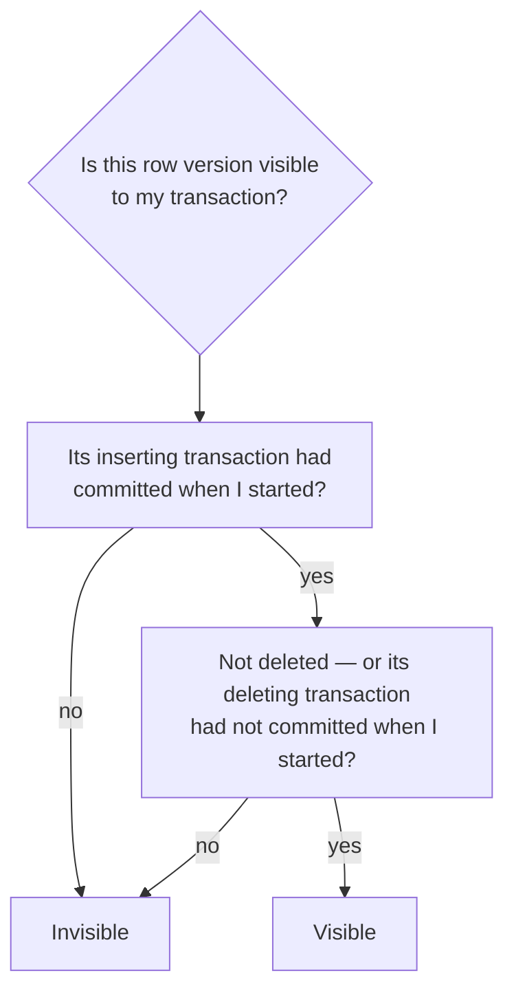
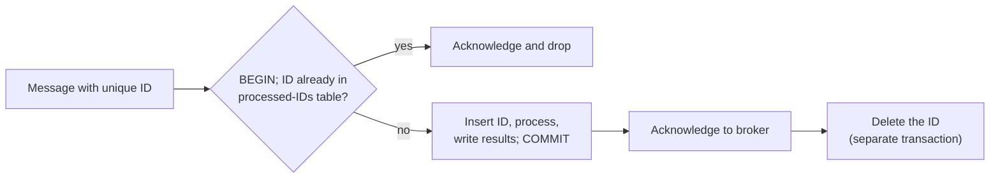

# 8. Transactions

[← 7. Sharding](07-sharding.md) · [Book](../README.md) · [9. The Trouble with Distributed Systems →](09-the-trouble-with-distributed-systems.md)

## Summary

A transaction groups several reads and writes into one logical unit that either commits or aborts, letting the application pretend that certain concurrency problems and faults don't exist. The chapter unpacks what ACID really guarantees, why multi-object transactions matter, and then goes deep into **isolation**: the race conditions that weak isolation levels allow (dirty reads and writes, read skew, lost updates, write skew, phantoms), how read committed and snapshot isolation (MVCC) are implemented, and three ways to achieve full **serializability** — actual serial execution, two-phase locking, and serializable snapshot isolation. It ends with **distributed transactions**: two-phase commit, its problems across heterogeneous systems (XA), its better behaviour inside one database, and exactly-once message processing.

## Key takeaways

- **ACID's letters are uneven**: atomicity is really *abortability*; consistency is an application property; isolation ideally means serializability but databases often offer less; durability is never absolute (pp. 279–284).
- **Weak isolation is common and causes real bugs**: read committed prevents dirty reads/writes; snapshot isolation (via MVCC) prevents read skew (pp. 288–299).
- **Lost updates** need atomic operations, explicit locks (`SELECT … FOR UPDATE`), automatic detection, or conditional writes (pp. 299–303).
- **Write skew** — decide on a premise, write somewhere else, premise is now false — is prevented only by serializable isolation (or careful explicit locking / materialized conflicts) (pp. 303–308).
- **Three roads to serializability**: serial execution on one thread (stored procedures, small fast transactions), **2PL** (pessimistic, poor performance and deadlocks), **SSI** (optimistic, aborts at commit) (pp. 308–323).
- **2PC achieves atomic commit across nodes but blocks if the coordinator fails**; XA across different technologies is fragile, whereas database-internal distributed transactions can work well (pp. 323–335).
- **Idempotence can give exactly-once semantics without atomic commit across systems** (pp. 334–335).

## Section outline

*From the book’s own table of contents (PDF bookmarks); printed page numbers.*

- What Exactly Is a Transaction? — p. 278
  - The Meaning of ACID — p. 279
  - Single-Object and Multi-Object Operations — p. 284
- Weak Isolation Levels — p. 288
  - Read Committed — p. 290
  - Snapshot Isolation and Repeatable Read — p. 293
  - Preventing Lost Updates — p. 299
  - Write Skew and Phantoms — p. 303
- Serializability — p. 308
  - Actual Serial Execution — p. 309
  - Two-Phase Locking — p. 313
  - Serializable Snapshot Isolation — p. 317
- Distributed Transactions — p. 323
  - Two-Phase Commit — p. 324
  - Distributed Transactions Across Different Systems — p. 328
  - Database-Internal Distributed Transactions — p. 333
  - Exactly-Once Message Processing Revisited — p. 334
- Summary — p. 335

## Notes

Databases and applications crash mid-operation, networks cut off clients, clients overwrite each other and read half-updated data — and race conditions cause surprising bugs. A **transaction** groups reads and writes into one logical unit that either **commits** or **aborts** (rolls back), so the application can simply retry. Transactions aren’t a law of nature: they exist to simplify the programming model by providing **safety guarantees**. The book suggests the Post Office Horizon scandal was probably caused by a lack of ACID transactions (pp. 277–278).

### What exactly is a transaction?

Almost every relational database follows IBM **System R** (1975) — MySQL, PostgreSQL, Oracle and SQL Server are “uncannily similar” to it. NoSQL databases of the late 2000s abandoned or watered down transactions, spreading the belief they don’t scale; **NewSQL** systems — CockroachDB, TiDB, Spanner, FoundationDB, YugabyteDB — disproved it by combining sharding with consensus (pp. 278–279).

#### The meaning of ACID (pp. 279–284)

Coined in 1983 by Härder and Reuter; today “ACID compliant” is mostly marketing. **BASE** (basically available, soft state, eventual consistency) is vaguer still — essentially “not ACID” (p. 279).

| Letter | Means | Not to be confused with |
|---|---|---|
| **Atomicity** | On a fault mid-transaction (crash, network, full disk, constraint violation), all its writes are discarded, so it can be **safely retried** — *abortability* | Atomic operations in multithreaded code (that is isolation) |
| **Consistency** | Application **invariants** (credits and debits balance) hold before and after; the database can enforce some as constraints (foreign key, unique, check; triggers, materialized views) | Replica consistency, consistent snapshots, consistent hashing, CAP’s linearizability — “at least five meanings” |
| **Isolation** | Concurrent transactions don’t step on each other — formally **serializability** (Figure 8-1: two increments from 42 must give 44, not 43) | Oracle’s “serializable”, which is really snapshot isolation |
| **Durability** | Committed data isn’t forgotten — non-volatile storage, `fsync`, WAL, checksums; or replication to enough nodes | A guarantee: perfect durability doesn’t exist |

**Replication and durability** (pp. 283–284) — every technique has holes:

- A dead machine’s disk keeps data but makes it unreachable; replicated systems stay available.
- Correlated faults (power, a bug triggered by one input) can wipe out all in-memory replicas at once — so disk still matters.
- Asynchronous replication loses recent writes on leader failure.
- SSDs can violate guarantees on power loss; `fsync` is hard to use (PostgreSQL got it wrong for 20+ years); firmware bugs (drives dying at **32,768 hours**); filesystem interaction bugs that spread between replicas.
- Silent corruption may also reach replicas and recent backups.
- **30–80% of SSDs** develop a bad block in their first four years; worn SSDs can lose data within weeks to months when unpowered.

Use disk writes, remote replicas and backups *together*.

#### Single-object and multi-object operations (pp. 284–288)

The email example (Figures 8-2, 8-3): inserting a message and incrementing a denormalized unread counter. **Isolation** means user 2 sees both or neither (else a dirty read); **atomicity** means a failed counter update rolls back the insert. Relational databases group a transaction by TCP connection between `BEGIN` and `COMMIT`; many NoSQL multi-put APIs are *not* transactional (pp. 284–286).

- **Single-object writes**: a 20 kB JSON write must not be stored half-sent, spliced with the old value, or read half-done — engines use a log (atomicity) and per-object locks (isolation). Atomic increments and **conditional writes** (compare-and-set) prevent lost updates on one object but aren’t transactions; Aerospike’s strong consistency and Cassandra/ScyllaDB’s lightweight transactions give single-object linearizable operations only (p. 286).
- **Multi-object transactions** are needed for foreign-key references and graph edges, denormalized documents, and **secondary indexes** (a record may otherwise appear in one index but not another) (p. 287).

**Handling errors and aborts** (pp. 287–288): leaderless stores work “best effort”; ORMs like ActiveRecord and Django don’t retry aborted transactions, throwing away user input. Retrying isn’t perfect:

| Pitfall | Mitigation |
|---|---|
| Commit succeeded but the ack was lost → retry runs it twice | Application-level deduplication |
| Abort was due to overload or contention → retry worsens it | Limit retries, exponential backoff, treat overload errors differently |
| Permanent errors (constraint violation) | Retry only transient errors (deadlock, isolation violation, network, failover) |
| Side effects outside the database (emails) | Two-phase commit, or idempotence |
| Client crashes while retrying | Its data is lost |

### Weak isolation levels

Concurrency bugs appear only with unlucky timing — hard to test or reproduce — and attackers can trigger them deliberately with bursts of concurrent requests. Weak isolation has lost real money (even bankrupted a Bitcoin exchange), drawn auditors and corrupted customer data; “use an ACID database” misses the point, since popular relational databases default to weak isolation too. (Much banking runs on text files over SFTP, where audit trails matter more than ACID.) (pp. 288–289)

*Table 8-1 (p. 335): which anomalies each level allows.*

| Isolation level | Dirty reads | Read skew | Phantom reads | Lost updates | Write skew |
|---|---|---|---|---|---|
| Read uncommitted | ✗ possible | ✗ possible | ✗ possible | ✗ possible | ✗ possible |
| Read committed | ✓ prevented | ✗ possible | ✗ possible | ✗ possible | ✗ possible |
| Snapshot isolation | ✓ prevented | ✓ prevented | ✓ prevented | ? depends | ✗ possible |
| Serializable | ✓ prevented | ✓ prevented | ✓ prevented | ✓ prevented | ✓ prevented |

Dirty writes are prevented by almost every implementation, so the table omits them (p. 336).

#### Read committed (pp. 290–293)

Default in Oracle, PostgreSQL, SQL Server and others. Two guarantees:

- **No dirty reads** — writes become visible only on commit, all at once (Figure 8-4). Otherwise others see partial updates, or data later rolled back (forcing **cascading aborts**).
- **No dirty writes** — you overwrite only committed data. Prevents Figure 8-5’s mix-up: Bryce wins the car listing while the invoice goes to Aaliyah. It does *not* stop the counter race of Figure 8-1.

Implementation: **row-level write locks** held until commit; for reads, remember the old committed value and serve it while a write is pending — read locks would let one long write stall many readers (still used by Db2 and SQL Server with `read_committed_snapshot=off`). **Read uncommitted** prevents only dirty writes (pp. 292–293).

#### Snapshot isolation and repeatable read (pp. 293–299)

**Read skew** (a *nonrepeatable read*): Aaliyah has $500 in each of two accounts; a $100 transfer runs between her two reads and she sees $500 + $400 = **$900** (Figure 8-6). Harmless on refresh, but intolerable for **backups** (inconsistencies become permanent on restore) and **analytical queries or integrity checks** (pp. 293–294).

*Figure 8-6 (p. 294): each read is of committed data, yet together they show a state that never existed.*

**Snapshot isolation** lets each transaction read a consistent snapshot as of its start — supported by PostgreSQL, MySQL/InnoDB, Oracle, SQL Server; the *highest* level in Oracle, TiDB and Aurora DSQL; common in BigQuery (p. 295). Writers still take write locks, but **readers never block writers, and writers never block readers** (p. 295).

**MVCC** (multiversion concurrency control), as in PostgreSQL (Figure 8-7): each transaction gets an increasing **txid** (32-bit in PostgreSQL, so vacuum guards against wraparound). Each row version has `inserted_by` and `deleted_by`; an update is a delete plus an insert (txid 13 turns account 2’s $500 row into a deleted $500 row and a new $400 row); garbage collection removes versions nobody can see (pp. 295–297).

*Figure 8-7 (p. 296): an update writes a new version and marks the old one deleted by its txid; readers choose versions by txid.*

*The visibility rules of p. 297: ignore writes by transactions in progress at my start, by later transactions, and by aborted ones.*

- **Indexes** point at one version and follow version chains; PostgreSQL avoids index updates when versions share a page; some systems store deltas (p. 298).
- **Immutable (copy-on-write) B-trees** — CouchDB, Datomic, LMDB — create a new root per write; each root *is* a snapshot (p. 298).
- **Naming chaos** (pp. 298–299): snapshot isolation is “repeatable read” in PostgreSQL and “serializable” in Oracle; MySQL’s “repeatable read” is weaker than snapshot isolation; Db2’s “repeatable read” is serializability. The SQL standard follows System R’s 1975 definitions, predating snapshot isolation, and is ambiguous — “nobody really knows what repeatable read isolation means.”

#### Preventing lost updates (pp. 299–303)

Two concurrent **read-modify-write** cycles: the later write **clobbers** the earlier — counters and balances, editing a JSON list, two people saving a whole wiki page.

| Remedy | Example | Caveats |
|---|---|---|
| **Atomic write operations** | `UPDATE counters SET value = value + 1 WHERE key = 'foo'`; MongoDB document ops; Redis structures | Best where expressible; ORMs make unsafe read-modify-write easy |
| **Explicit locking** | `SELECT … FOR UPDATE` on the game piece being moved (Example 8-1) | Easy to forget; deadlocks (detected, one transaction aborted) |
| **Automatic detection** | Abort and retry the loser — PostgreSQL repeatable read, Oracle serializable, SQL Server snapshot | **Not MySQL/InnoDB repeatable read** — so arguably not snapshot isolation; needs app retries |
| **Conditional write (CAS)** | `UPDATE … WHERE id = 1234 AND content = 'old content'`; version column = **optimistic locking** | Under MVCC, the `WHERE` must see others’ newer writes (many implementations make that exception) |
| **Replicated databases** | Siblings merged after the fact; **commutative** ops (increments, set adds) — CRDTs | Locks and CAS assume one up-to-date copy; LWW loses updates |

#### Write skew and phantoms (pp. 303–308)

Aaliyah and Bryce are the two on-call doctors; both feel unwell and click “go off call” together. Each transaction checks “≥ 2 on call?” on its snapshot, sees 2, and removes *its own* record — both commit, and **nobody is on call** (Figure 8-8). This is **write skew**: two transactions read the same objects and update *different* ones — a generalization of lost updates. Atomic single-object ops and automatic lost-update detection don’t help (PostgreSQL RR, InnoDB RR, Oracle serializable and SQL Server snapshot all miss it); multi-object constraints are rarely supported; the fallback is `SELECT … FOR UPDATE` on the rows the decision depends on (pp. 303–305).

*Figure 8-8 (p. 304): each check was true when made; the two writes touch different rows, so nothing conflicts — write skew.*

More examples (pp. 305–306): **meeting-room** double booking (Example 8-2); a **multiplayer game** moving two pieces onto one square; **claiming a username** (a unique constraint fixes it); **double-spending** points or money.

When step 1 checks for the **absence** of rows, `FOR UPDATE` has nothing to lock: a write in one transaction changing the result of another’s search is a **phantom**. Snapshot isolation stops phantoms in read-only queries, not in read-write ones; ORM-generated SQL is prone to it (p. 307). **Materializing conflicts** — a table of (room, 15-minute slot) rows created in advance purely to be locked — works but is error-prone and leaks concurrency control into the data model: a last resort; prefer serializable isolation (pp. 307–308).

> **Try it:** [Isolation levels, one interleaving at a time](../widgets/08-isolation.html) — step through the book's dirty-read, read-skew, lost-update and write-skew examples under four isolation levels.

### Serializability

Isolation levels are hard to understand and inconsistently implemented, code rarely reveals whether it is safe at a given level, and there are no good tools to find races. Researchers’ answer since the 1970s: **use serializable isolation** — the result equals *some* serial order, so transactions correct in isolation stay correct concurrently (pp. 308–309).

| | Actual serial execution | Two-phase locking (2PL) | Serializable snapshot isolation (SSI) |
|---|---|---|---|
| Philosophy | Extreme pessimism: one “lock” on everything, held very briefly | **Pessimistic**: wait whenever something *might* go wrong | **Optimistic**: proceed; check at commit; abort if not serializable |
| Readers vs writers | No concurrency at all | Readers block writers and vice versa | Neither blocks the other |
| Scales across cores/machines | Only by sharding; cross-shard ~1,000 writes/s in VoltDB | Yes, but contention hurts | Yes — FoundationDB distributes conflict detection |
| Weak spot | One slow transaction stalls everything | Unstable, slow tail latency; frequent deadlocks | High contention → many aborts; long read-write transactions |
| Used in | VoltDB/H-Store, Redis, Datomic | MySQL/InnoDB and SQL Server serializable, Db2 repeatable read | PostgreSQL serializable, SQL Server Hekaton, HyPer, CockroachDB, FoundationDB, BadgerDB |

#### Actual serial execution (pp. 309–313)

Only in the 2000s did single-threaded execution become viable: **RAM is cheap** enough to keep the active dataset in memory, and **OLTP transactions are short** (long analytics run on a snapshot elsewhere). Interactive multi-statement transactions waste the thread waiting on the network (Figure 8-9), so these systems require single statements or **stored procedures** submitted in advance (pp. 309–310).

| Stored procedures’ bad reputation (pp. 311–312) | Modern answer |
|---|---|
| Vendor languages — PL/SQL, T-SQL, PL/pgSQL — archaic, few libraries | General-purpose languages: Java/Groovy (VoltDB), Java/Clojure (Datomic), Lua (Redis), JavaScript (MongoDB) |
| Hard to debug, version, deploy, test, monitor | — |
| A bad procedure hurts a shared, performance-critical database | — |
| Untrusted tenant code inside the database kernel is a security risk | — |

They also host validation logic behind a GraphQL proxy, and VoltDB **replicates by re-running deterministic procedures** on each replica (state machine replication) (p. 312). Serial execution needs: small, fast transactions; data in memory; write throughput within one core — or sharding with rare cross-shard transactions (p. 313).

#### Two-phase locking (pp. 313–317)

For ~30 years the only widely used serializable algorithm (strong strict 2PL, SS2PL). **2PL is not 2PC.** Locks are **shared** (many readers) or **exclusive** (one writer); a reader can upgrade. Locks are acquired as the transaction runs (**growing phase**) and all released at its end (**shrinking phase**) — hence “two-phase”. **Deadlocks** are detected automatically and one transaction aborted for retry (pp. 313–315).

Performance (pp. 315–316): lock overhead and, above all, reduced concurrency — a whole-table read (backup, analytics) takes a shared lock on the table and blocks all writers for its duration; latencies are unstable and slow at high percentiles; deadlocks are far more frequent, wasting retried work.

**Predicate locks** lock *all objects matching a condition*, including ones that don’t exist yet, so they stop phantoms — e.g. bookings of room 123 between noon and 1 pm. Checking many predicate locks is slow, so real systems use **index-range (next-key) locks**: a coarser approximation attached to an index (all bookings of room 123, or all rooms between noon and 1 pm), falling back to a whole-table lock if no index fits (pp. 316–317).

#### Serializable snapshot isolation (pp. 317–322)

First described in 2008; full serializability with a small penalty over snapshot isolation. Built on snapshot isolation plus detection of decisions made on an **outdated premise** (“there are two doctors on call”):

| Case | Detection |
|---|---|
| **Stale MVCC read** — a write the snapshot ignored has committed by my commit time (Figure 8-10: txn 43 read Aaliyah as on call; txn 42 committed her change) | Track ignored writes; at commit, abort if any committed. Waiting until commit avoids aborting read-only transactions or ones whose “stale” read turns out fine |
| **Write affecting a prior read** (Figure 8-11) | Record reads on index entries (e.g. `shift_id = 1234`) or the table; a writer trips these **tripwires**, notifying readers. First committer wins (42); the other (43) aborts |

Engineering trade-offs (pp. 321–322): fine-grained tracking means fewer needless aborts but more bookkeeping; PostgreSQL proves some reads of overwritten data harmless. No blocking makes latency predictable and read-only queries lock-free; overhead vs plain snapshot isolation is debated. Read-write transactions must be short; long read-only ones are fine.

### Distributed transactions

When a transaction spans shards or a global secondary index, concurrency control is similar (serial on shards, distributed 2PL, distributed SSI checkers) — the new problem is **atomic commitment** (p. 323). On one node, the moment the **commit record** hits disk decides everything. Across nodes, sending commit to each independently can leave some committed and others aborted — constraint violations, lost requests, crashes — and a commit can’t be retracted because others may already have read it (Figure 8-12) (pp. 323–324).

#### Two-phase commit (pp. 324–328)

Used inside databases and exposed to apps as **XA** (JTA) and WS-AtomicTransaction. A **coordinator** (transaction manager: Narayana, JOTM, BTM, MSDTC — often a library in the app process) works with **participants** (p. 325):

1. The app gets a globally unique transaction ID from the coordinator.
2. It runs single-node transactions on each participant under that ID; anyone may abort at this stage.
3. The coordinator sends **prepare**; any failure or timeout → abort everywhere.
4. A participant voting **yes** has written everything to disk and checked constraints — it gives up the right to abort without committing yet.
5. The coordinator decides (commit only if all said yes) and writes the decision to its log — the **commit point**.
6. It sends commit/abort and **retries forever**; a participant that crashed must commit on recovery.

Two points of no return — a yes vote and the coordinator’s decision — make it atomic; the marriage-ceremony analogy: after “I do” you can’t back out, even if you faint before hearing the pronouncement (pp. 326–327).

*Figure 8-13 (p. 325): phase 1 collects promises, phase 2 delivers the decision; participants hold their locks throughout.*

**Coordinator failure** (pp. 327–328): before prepare, participants can abort; after voting yes they are **in doubt** (uncertain) — a timeout-and-abort could contradict a participant that already committed (Figure 8-14). Only the coordinator’s recovery, reading its log, resolves it (no commit record → abort). If that log is lost, an administrator must decide by hand. 2PC is a **blocking** protocol; **three-phase commit** assumes bounded delays and response times, which real systems lack; the practical fix is a **consensus-replicated coordinator** (Ch. 10).

*Figure 8-14 (p. 328): a participant that voted yes must wait for the coordinator, holding its locks, however long that takes.*

> **Try it:** [Two-phase commit and the in-doubt participant](../widgets/08-two-phase-commit.html) — step through prepare, votes and the commit point, then crash the coordinator.

#### Distributed transactions across different systems (pp. 328–333)

Mixed reputation: important safety vs operational pain and performance cost (extra `fsync`s and round trips); many cloud services refuse to offer them (pp. 328–329).

| | Database-internal | Heterogeneous |
|---|---|---|
| Participants | Same software — YugabyteDB, TiDB, FoundationDB, Spanner, VoltDB, Cassandra, MySQL NDB | Different vendors or systems (database + message broker) |
| Protocol | Free to optimize | Lowest common denominator: **XA** |

**Exactly-once message processing** is the motivating use: acknowledge a message if and only if its database transaction commits — works only if every side effect speaks the same atomic commit protocol (an email server doesn’t) (pp. 329–330).

**XA** (X/Open, 1991): supported by PostgreSQL, MySQL, Db2, SQL Server, Oracle, ActiveMQ, HornetQ, MSMQ, IBM MQ. It is a **C API**, not a network protocol; drivers expose prepare/commit/abort callbacks, and the coordinator is usually a library in the application process with its log on local disk (pp. 330–331). Its problems:

- **Locks held while in doubt** — a 20-minute coordinator restart holds row locks for 20 minutes, forever if the log is lost, blocking large parts of the app (p. 331).
- **Orphaned** in-doubt transactions survive even database reboots; admins must resolve them under pressure, or use **heuristic decisions** — a euphemism for probably breaking atomicity (pp. 331–332).
- The coordinator and the **application code** become single points of failure; participants can talk to the coordinator only through the app (p. 332).
- No cross-system deadlock detection and no SSI (pp. 332–333).

#### Database-internal distributed transactions (pp. 333–334)

A defining feature of NewSQL (CockroachDB, TiDB, Spanner, FoundationDB, YugabyteDB; Kafka internally too). They use 2PC without XA’s problems by: replicating the coordinator with automatic failover; letting coordinator and shards talk directly; replicating shards; and integrating commit with distributed concurrency control (deadlock detection, consistent cross-shard reads). Consensus replicates both; snapshot isolation and SSI are both available across shards.

#### Exactly-once message processing revisited (pp. 334–335)

No distributed transaction needed — only a database transaction and **message IDs**:

Crash before commit → broker redelivers; after commit but before ack → the retry finds the ID and drops it; after ack but before delete → a harmless leftover ID; concurrent retries → a **uniqueness constraint** on the ID. Recording the ID makes processing **idempotent** — the same approach Kafka Streams uses (Ch. 12). Internal distributed transactions still help when IDs and data live on different shards (pp. 334–335).

## Trade-offs at a glance

Anomalies allowed at each isolation level (after Table 8-1, p. 335):

| Isolation level | Dirty reads | Read skew | Phantom reads | Lost updates | Write skew |
|---|---|---|---|---|---|
| Read uncommitted | possible | possible | possible | possible | possible |
| Read committed | prevented | possible | possible | possible | possible |
| Snapshot isolation | prevented | prevented | prevented | depends | possible |
| Serializable | prevented | prevented | prevented | prevented | prevented |

| Serializability via | Approach | Strength | Weakness |
|---|---|---|---|
| Serial execution | One thread, stored procedures | Simple, no locks | Throughput limited to one core per shard |
| 2PL | Pessimistic locks | Decades of practice | Slow, deadlocks, unpredictable latency |
| SSI | Optimistic, check at commit | Readers and writers don't block | Aborts under contention |

## Beyond the book

- Hermitage (github.com/ept/hermitage), maintained by one of the authors, tests which anomalies real databases' isolation levels actually prevent — useful when the name of a level is misleading.
- PostgreSQL's SSI implementation is described in Ports & Grittner, "Serializable Snapshot Isolation in PostgreSQL" (VLDB 2012).

## Connections

- **Run it:** [Write skew under SI and SSI](../lab/08-write-skew/README.md).
- **Related chapters:** [6. Replication](06-replication.md) (lost updates with replication), [7. Sharding](07-sharding.md) (cross-shard transactions), [10. Consistency and Consensus](10-consistency-and-consensus.md) (atomic commit as consensus, linearizability vs serializability), [13. A Philosophy of Streaming Systems](13-a-philosophy-of-streaming-systems.md) (constraints without distributed transactions).

## Check yourself

*Questions and answers are the vault's, written from the notes above; answers cite the book's pages.*

1. **Why is atomicity better described as "abortability", and why does that make retries safe — mostly?**

   *Answer:* Atomicity means that if a transaction can't complete, all its writes are discarded, so the application can retry. Retries are not entirely safe: the transaction may have committed with only the acknowledgement lost, or failed because of overload, and side effects outside the database are not undone (pp. 280–288).

2. **How does MVCC let readers and writers avoid blocking each other?**
   - [ ] By locking each row only for the duration of a single statement
   - [x] By keeping several committed versions of each row, so a transaction reads the versions visible in its snapshot while writers create new ones
   - [ ] By running all transactions on a single thread
   - [ ] By aborting every reader when a writer arrives

   *Answer:* Each write creates a new version tagged with the writing transaction's ID; a reader sees only versions committed before its snapshot was taken (and ignores in-progress or later transactions) (pp. 293–298).

3. **Why can snapshot isolation detect a lost update but not write skew?**

   *Answer:* A lost update is two transactions writing the same object, which the database can notice. In write skew each transaction writes a different object based on a premise that the other invalidates, so there is no write–write conflict to detect (pp. 299–308).

4. **In two-phase locking, why must locks be held until commit?**
   - [ ] To reduce the number of locks needed
   - [x] Releasing them earlier would let other transactions see or change data that this transaction still depends on, breaking serializability
   - [ ] Because locks can only be released by the database administrator
   - [ ] To prevent deadlocks

   *Answer:* 2PL acquires locks during the transaction and releases them all at the end; that "second phase" is what makes the execution equivalent to a serial order (pp. 313–317).

5. **A 2PC coordinator crashes after collecting all "yes" votes. What can participants safely do, and why?**

   *Answer:* Nothing but wait. Having voted yes, a participant has promised to commit if told to and can't abort or commit on its own, because it doesn't know the coordinator's decision. It stays "in doubt", holding locks, until the coordinator recovers (pp. 324–328).

6. **How does storing processed message IDs give exactly-once effects without a distributed transaction?**

   *Answer:* Record the ID of each processed message in the same database transaction as its effects. If the message is redelivered, the stored ID shows it was already processed and it is skipped (pp. 334–335).
