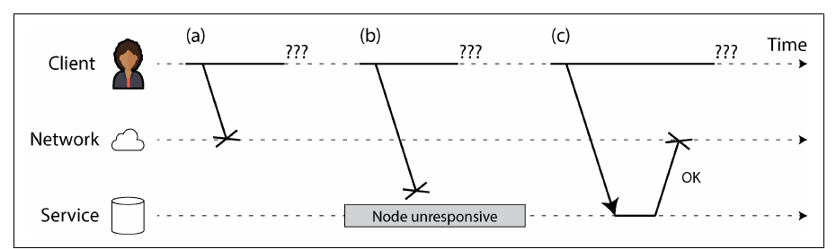
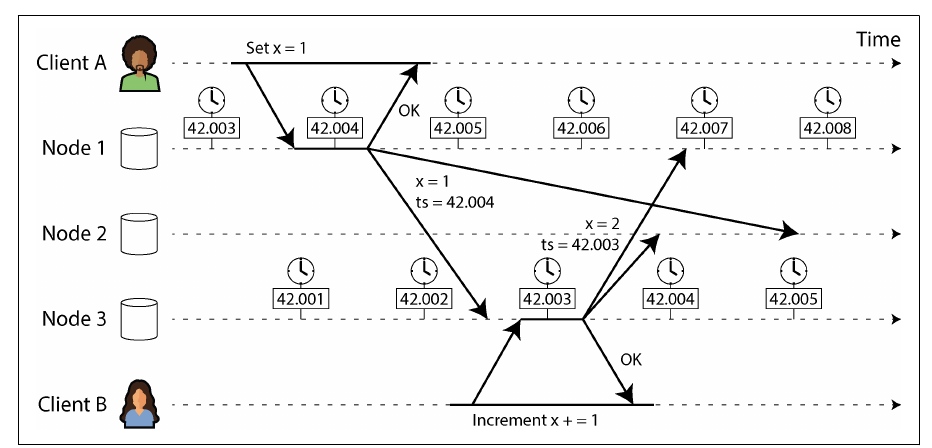
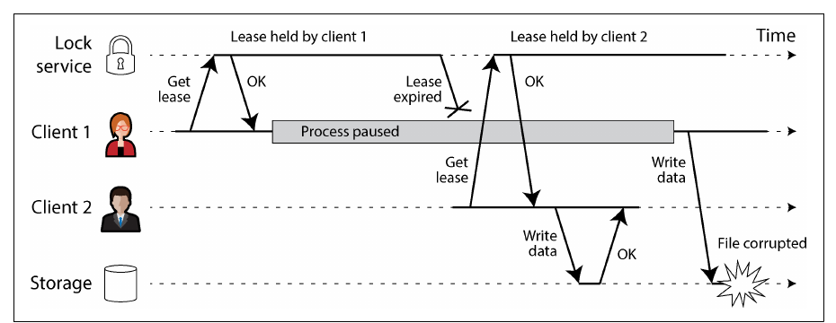
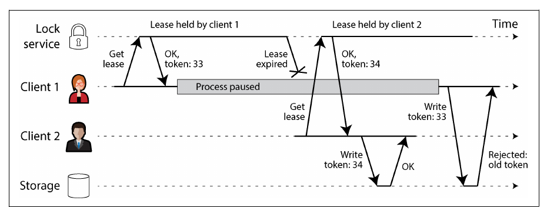

# فصل ۹: دردسرهای سیستم‌های توزیع‌شده

[فصل ۸: تراکنش‌ها →](08-transactions.md) · [کتاب](../README.md) · [فصل ۱۰: مفهوم consistency و consensus ←](10-consistency-and-consensus.md)

## خلاصه

این فصل عمداً فهرستی بدبینانه است از چیزهایی که وقتی نرم‌افزار روی بیش از یک ماشین اجرا می‌شود خراب می‌شوند. شبکه packetها را گم می‌کند و به تأخیر می‌اندازد و نمی‌گوید کدام را؛ ساعت‌ها drift می‌کنند، می‌پرند و با هم اختلاف دارند؛ processها برای مدت دلخواه متوقف می‌شوند و بی‌خبر برمی‌گردند. ویژگی اصلی سیستم توزیع‌شده **partial failure** است، و چون هیچ nodeی نمی‌تواند حقیقت را با اطمینان بداند، تصمیم‌ها باید با **quorum** گرفته شوند، با **fencing token** در برابر بازیگرهای کهنه محافظت شوند، و با **مدل‌های سیستم** صریح سنجیده شوند. فصل با راه‌های به دست آوردن اطمینان تمام می‌شود: روش‌های formal و تست تصادفی، یعنی fuzzing و deterministic simulation.

## نکته‌های کلیدی

- **مفهوم partial failure غیرقطعی است:** بعضی بخش‌ها کار می‌کنند و بعضی نه، و شاید حتی ندانید یک عملیات موفق شده یا نه (pp. 346–347).
- **شبکه‌ها asynchronous هستند:** نیامدن پاسخ می‌تواند یعنی درخواست گم‌شده، node مرده، node کند یا پاسخ گم‌شده، و این‌ها از هم قابل تشخیص نیستند. timeout تنها ابزار تشخیص است و نمی‌تواند بی‌نقص باشد (pp. 347–358).
- **مفهوم latency unbounded یک انتخاب است:** مدارهای تلفنی latency محدود می‌دهند اما ظرفیت را هدر می‌دهند؛ packet switching بهره‌وری را به قیمت صف‌ها بالا می‌برد (pp. 355–358).
- **ساعت time-of-day برای timestamp است و ساعت monotonic برای مدت زمان.** synchronization با NTP دقیق نیست، پس خواندن ساعت یک بازه‌ی اطمینان دارد؛ حل conflict با LWW بر اساس timestamp می‌تواند بی‌صدا نوشتن‌ها را دور بریزد (pp. 358–366).
- **مفهوم process pause** واقعی است، از GC و تعلیق VM تا paging، I/O و SIGSTOP؛ nodeی که lease دارد ممکن است بعد از انقضای آن برگردد و بر اساس باورهای کهنه کار کند (pp. 366–371).
- **حقیقت را اکثریت تعیین می‌کند**؛ یک node نمی‌تواند به قضاوت خودش اعتماد کند. **مفهوم fencing token** باعث می‌شود storage نوشتن‌های صاحب قبلی قفل را رد کند (pp. 371–377).
- **مدل واقع‌بینانه را crash-recovery با زمان‌بندی partially synchronous بگیرید**؛ تحمل Byzantine بیشتر برای محیط‌های خصمانه است (pp. 377–384).
- **روش‌های model checking، TLA+، fuzzing و deterministic simulation testing** باگ‌هایی پیدا می‌کنند که تست‌های معمولی پیدا نمی‌کنند (pp. 384–388).

## فهرست بخش‌ها

*از فهرست مطالب خود کتاب، یعنی bookmarkهای PDF، با شماره‌ی صفحه‌های چاپی.*

- مفهوم fault و partial failure (p. 346)
- شبکه‌های غیرقابل‌اعتماد (p. 347)
  - محدودیت‌های TCP (p. 348)
  - خرابی‌های شبکه در عمل (p. 350)
  - تشخیص fault (p. 351)
  - مفهوم timeout و latencyهای unbounded (p. 352)
  - شبکه‌های synchronous و asynchronous (p. 355)
- ساعت‌های غیرقابل‌اعتماد (p. 358)
  - ساعت monotonic و ساعت time-of-day (p. 359)
  - مفهوم synchronization و دقت ساعت (p. 360)
  - تکیه بر ساعت‌های synchronous (p. 362)
  - مفهوم process pause (p. 366)
- دانش، حقیقت و دروغ (p. 371)
  - حکم اکثریت (p. 372)
  - قفل و lease توزیع‌شده (p. 373)
  - مفهوم Byzantine fault (p. 377)
  - مدل سیستم و واقعیت (p. 380)
  - روش‌های formal و تست تصادفی (p. 384)
- جمع‌بندی (p. 388)

## یادداشت‌ها

مفهوم reliability یعنی تمرکز روی هر چیزی که ممکن است خراب شود، هر قدر هم بعید؛ در سیستمی به اندازه‌ی کافی بزرگ، رویدادهای یک در میلیون هر روز رخ می‌دهند. این فصل بدبینی درباره‌ی شبکه، ساعت و زمان‌بندی را «تا آخرین درجه» بالا می‌برد (p. 345).

> **Try it:** [فصل ۹ در طول یک pipeline داده](../widgets/09-pipeline-map.html): از دیتابیس منبع تا داشبورد را با lensهای timeout، ساعت و صاحب قفل طی کنید.

### مفهوم fault و partial failure

یک کامپیوتر تنها عمداً طوری طراحی شده که یا کامل کار کند یا کامل خراب باشد: یک fault داخلی آن را crash می‌کند، مثلاً kernel panic، به جای این‌که جواب غلط بدهد؛ یعنی یک مدل ایده‌آل و قطعی نشان می‌دهد، هرچند در واقعیت گاهی داده خراب می‌شود و CPU گاهی اشتباه حساب می‌کند (p. 346). ماشین‌های متصل به شبکه نمی‌توانند واقعیت را پنهان کنند: فهرست تجربه‌های Coda Hale شامل partitionهای طولانی، خرابی PDU و switch، خاموش و روشن شدن تصادفی کل rackها، قطع برق کل datacenter و راننده‌ای با افت قند خون است که به سیستم HVAC یک datacenter کوبیده (p. 346).

- **مفهوم partial failure** یعنی بعضی بخش‌ها به شکل غیرقابل پیش‌بینی خراب‌اند و بقیه درست کار می‌کنند؛ و **غیرقطعی** است: همان عملیات گاهی موفق می‌شود، گاهی شکست می‌خورد، و شاید حتی ندانید کدام (pp. 346–347).
- تحمل partial failure یک فرصت هم هست: rolling upgrade، و یک سیستم قابل اعتماد از قطعه‌های غیرقابل‌اعتماد. به گفته‌ی کتاب، بدگمانی، بدبینی و پارانویا جواب می‌دهد (p. 347).

### شبکه‌های غیرقابل‌اعتماد

ماشین‌های shared-nothing فقط از راه یک **شبکه‌ی packet asynchronous** با هم حرف می‌زنند، که نه تضمین می‌کند packet *کی* برسد و نه *این‌که* برسد. اگر درخواستی پاسخ نگیرد، شکل ۹-۱، نمی‌شود فهمید کدام‌یک از این‌ها رخ داده (pp. 347–348):

| چه شد | علت نمونه |
|---|---|
| درخواست گم شد | کابل جدا شده |
| درخواست در صف ماند و بعداً رسید | شبکه یا گیرنده‌ی overloadشده |
| مفهوم remote node خراب شد | crash یا خاموش شدن |
| مفهوم remote node موقتاً پاسخ نمی‌دهد | توقف طولانی GC |
| درخواست پردازش شد اما پاسخ گم شد | switch با config غلط |
| درخواست پردازش شد اما پاسخ دیر رسید | شبکه یا ماشین خود شما overload شده |

پاسخ معمول یک **timeout** است؛ که باز هم نمی‌گوید درخواست رسیده یا نه، و ممکن است هنوز برسد (p. 348).

*Figure 9-1 (p. 348): از دید client هر سه یکی‌اند، یعنی پاسخی نیامده، پس نمی‌تواند بفهمد چه شده.*

> **In practice:** loader در reference stack از replica منبع می‌خواند و Airflow برای هر task یک timeout دارد. وقتی timeout می‌رسد، Airflow task را می‌کشد و دوباره اجرا می‌کند.
>
> **Your turn:** کوئری loader روی منبع ده دقیقه بی‌جواب مانده و task با timeout کشته شده. آیا کوئری روی منبع اجرا شده؟ و retry چه خطری دارد؟
>
> *Answer:* معلوم نیست: شاید کوئری هنوز روی منبع در حال اجراست، شاید تمام شده و فقط ردیف‌ها نرسیده‌اند، شاید هرگز شروع نشده (pp. 347–348). retry یک کوئری سنگین دیگر روی همان منبع می‌فرستد، در حالی که اولی ممکن است هنوز زنده باشد، و اگر بخشی از ردیف‌ها پیش‌تر در staging نوشته شده باشند، با `append` تکراری می‌شوند. پس timeout باید با لغو کوئری سمت منبع همراه باشد، و Silver تکراری‌ها را با کلید حذف کند.

#### محدودیت‌های TCP (pp. 348–349)

پروتکل TCP، و همین‌طور QUIC، SCTP و uTP، streamها را به packet می‌شکند، packetهای گم‌شده را دوباره می‌فرستد، ترتیب را درست می‌کند، checksum می‌زند و congestion control و flow control دارد. اما نمی‌تواند بفهمد packet رفت گم شده یا ack، نمی‌تواند کابل را دوباره وصل کند، و آخر کار با خطا کوتاه می‌آید. حذف تکراری‌ها فقط داخل یک connection کار می‌کند؛ وصل شدن دوباره و فرستادن دوباره می‌تواند تکراری بسازد. بسته شدن connection چیزی درباره‌ی این‌که *اپلیکیشن* طرف مقابل چقدر پردازش کرده نمی‌گوید؛ حتی packet تحویل‌شده فقط به kernel طرف مقابل رسیده. **فقط پاسخ مثبت از خود اپلیکیشن موفقیت را تأیید می‌کند** (p. 349).

#### خرابی‌های شبکه در عمل (pp. 350–351)

| شاهد | جزئیات |
|---|---|
| مطالعه‌ی یک datacenter متوسط | حدود **۱۲ خرابی شبکه در ماه**: نیمی یک ماشین را جدا کردند، نیمی کل یک rack را |
| مطالعه‌ی قطعه‌ها | تجهیزات redundant کمتر از انتظار کمک می‌کنند؛ جلوی config غلط انسانی را نمی‌گیرند |
| لینک‌های wide-area | بریده‌شده به دست گاو، سگ آبی و **کوسه**، که با عایق بهتر نادرتر شده، config غلط، دزدی کابل و خرابکاری |
| latencyها | رفت‌وبرگشت بین regionها در percentileهای بالا تا **چند دقیقه**؛ و داخل یک datacenter **بیش از یک دقیقه** هنگام تغییر topology برای upgrade یک switch |
| خرابی‌های نامتقارن | مسیر A↔B و B↔C کار می‌کند اما A↔C نه؛ یا NICی که همه‌ی ورودی‌ها را دور می‌ریزد اما خروجی می‌فرستد |
| پیامدها | قطعی‌های کوتاه می‌توانند اثرهای طولانی بگذارند |

یک **network partition**، یا netsplit، فقط یک نوع قطعی است و ربطی به sharding ندارد. رفتار تست‌نشده در برابرش می‌تواند یک cluster را برای همیشه در deadlock بگذارد یا حتی همه‌ی داده را پاک کند. تحمل fault اجباری نیست و نشان دادن خطا ممکن است کافی باشد، اما باید بدانید نرم‌افزار چه واکنشی نشان می‌دهد و این‌که بازیابی می‌شود؛ faultها را عمداً ایجاد کنید (p. 351).

#### تشخیص fault (pp. 351–352)

مفهوم load balancer باید دیگر به nodeهای مرده درخواست نفرستد؛ دیتابیس‌های leader-based باید failover کنند. گاهی نشانه‌ی صریح وجود دارد: یک TCP RST یا FIN وقتی کسی روی port گوش نمی‌دهد، اسکریپتی که crash یک process را اعلام می‌کند، مثل HBase، interface مدیریتی switchها، یا ICMP Destination Unreachable؛ اما در حالت کلی باید فرض کنید **هیچ پاسخی نمی‌آید**: retry کنید، تا timeout صبر کنید، و node را مرده اعلام کنید (pp. 351–352).

#### مفهوم timeout و latencyهای unbounded (pp. 352–355)

مفهوم timeout طولانی یعنی انتظار طولانی و پیام خطا؛ timeout کوتاه یعنی nodeهای زنده مرده اعلام می‌شوند و کارها دو بار انجام می‌شوند، مثلاً ایمیلی که هم node قدیم می‌فرستد هم node جدید، به‌علاوه‌ی بار اضافه و شاید **cascading failure** که در آن همه همه را مرده اعلام می‌کنند (p. 352). اگر هر packet یا در زمان *d* برسد یا هرگز، و یک node سالم همیشه در زمان *r* جواب بدهد، **2d + r** یک timeout بی‌نقص بود؛ اما شبکه‌های asynchronous **latency unbounded** دارند و سرورها نمی‌توانند *r* را قول بدهند (p. 353).

**مفهوم congestion و صف‌ها** منشأ این mutabilityاند (pp. 353–354):

| صف | چرا packet منتظر می‌ماند |
|---|---|
| مفهوم switch | چند port به یک مقصد می‌فرستند؛ صف پر packetها را دور می‌ریزد؛ شکل ۹-۲ |
| سیستم‌عامل مقصد | همه‌ی coreهای CPU مشغول‌اند؛ packet منتظر اپلیکیشن می‌ماند |
| مفهوم hypervisor | مفهوم VM متوقف است تا VM دیگری اجرا شود |
| فرستنده‌ی TCP | مفهوم congestion control سرعت فرستادن را محدود می‌کند |
| مفهوم retransmission در TCP | اپلیکیشن گم شدن را فقط به شکل latency می‌بیند |

پروتکل **UDP** از flow control و retransmission پرهیز می‌کند، پس برای VoIP و ویدئو مناسب است که داده‌ی دیررسیده بی‌ارزش است و آدم فقط می‌گوید «می‌شود تکرار کنید؟» (p. 354). mutability latency نزدیک ظرفیت و با **noisy neighbor**ها در cloudهای مشترک بیشتر می‌شود، پس timeout را **به‌صورت تجربی** از توزیع اندازه‌گیری‌شده‌ی رفت‌وبرگشت انتخاب کنید؛ یا مثل failure detector با نام **Phi Accrual**، در Akka و Cassandra، یا timeoutهای retransmission در TCP، مدام تطبیقش دهید (pp. 354–355).

> **Try it:** [یک node کی مرده است؟](../widgets/09-timeouts.html): یک timeout برای تشخیص خرابی انتخاب کنید و شک‌های نادرست را با تشخیص کند بسنجید.

> **In practice:** هر DAG در reference stack برای taskهایش یک execution timeout و تعدادی retry دارد، و همه‌ی DAGها از یک replica منبع می‌خوانند.
>
> **Your turn:** مدت اجرای task یک جدول بزرگ معمولاً ۴ دقیقه است و گاهی ۱۲ دقیقه. timeout را ۵ دقیقه بگذارید یا ۳۰ دقیقه؟
>
> *Answer:* هیچ‌کدام بدون اندازه‌گیری: timeout را از توزیع واقعی مدت اجرا، مثلاً یک percentile بالا به‌علاوه‌ی حاشیه، انتخاب کنید (pp. 354–355). پنج دقیقه اجراهای سالم را می‌کشد و retry آن‌ها بار بیشتری روی همان replica می‌گذارد که اجراها را کندتر و timeoutها را بیشتر می‌کند؛ یعنی شکلی کوچک از cascading failure (p. 352). سی دقیقه یعنی کوئری واقعاً گیرکرده دیر تشخیص داده می‌شود و داده‌ی Gold کهنه می‌ماند.

#### شبکه‌های synchronous و asynchronous (pp. 355–358)

| | مدار تلفن، ISDN | datacenter و اینترنت |
|---|---|---|
| مفهوم switching | **مدار**: پهنای باند در کل مسیر رزرو می‌شود؛ ۱۶ بیت در هر frame با ۴٬۰۰۰ frame در ثانیه، یعنی ۱۶ بیت هر ۲۵۰ میکروثانیه | مفهوم **packet**، یعنی Ethernet و IP: packetها فرصت‌طلبانه لینک‌ها را شریک می‌شوند |
| latency | **محدود**: صفی در کار نیست | unbounded: صف |
| مناسب برای | صدا و ویدئو با نرخ ثابت | ترافیک **bursty**، یعنی صفحه، ایمیل و فایل، که نمی‌شود پهنای باندش را حدس زد |
| اشتراک منابع | تقسیم ایستا: سیمی با ۱۰٬۰۰۰ جای تماس جای شما را رزرو نگه می‌دارد حتی اگر ۹٬۹۹۹ تا خالی باشند | پویا: بهره‌وری را بیشینه می‌کند، پس هر بایت ارزان‌تر است |

همین بده‌بستان در CPUها، یعنی run queue، و VMها روی hostهای مشترک هم هست. **latency متغیر یک انتخاب هزینه و فایده است، نه قانون طبیعت** (pp. 356–357). روش‌های ترکیبی هم هست: ATM، flow control لایه‌ی لینک در InfiniBand، اولویت‌بندی QoS و admission control، L4S و traffic control در Linux؛ peering در BGP در سطح شبکه به مدار شبیه است؛ اما هیچ‌کدام در cloudهای multitenant یا روی اینترنت فعال نیستند، پس timeout «درست» وجود ندارد (pp. 357–358).

### ساعت‌های غیرقابل‌اعتماد

اپلیکیشن‌ها درباره‌ی **مدت زمان** می‌پرسند: این درخواست timeout شده؟ p99 چقدر است؟ چند کوئری در ثانیه؟ کاربر چقدر در سایت ماند؟ و درباره‌ی **نقطه‌های زمانی**: این کی منتشر شد؟ یادآوری را کی بفرستیم؟ این entry در cache کی منقضی می‌شود؟ این خط log کی نوشته شد؟ پیام‌ها زمان نامعلومی در راه‌اند، و هر ماشین ساعت quartz خودش را دارد که در بهترین حالت با **NTP** از سرورهایی که از GPS تغذیه می‌شوند synchronous می‌شود (p. 358).

#### ساعت monotonic و ساعت time-of-day (pp. 359–360)

| | ساعت time-of-day، یا wall-clock | ساعت monotonic |
|---|---|---|
| مفهوم API | تابع `clock_gettime(CLOCK_REALTIME)` و `System.currentTimeMillis`، از epoch یعنی ۱ ژانویه‌ی ۱۹۷۰ UTC، بدون حساب leap second | تابع‌های `CLOCK_MONOTONIC` و `CLOCK_BOOTTIME` و `System.nanoTime` |
| می‌تواند عقب بپرد؟ | **بله**: reset اجباری NTP، leap second؛ تغییر ساعت تابستانی اگر UTC نباشد؛ دقت پایین در سیستم‌های قدیمی | نه؛ تضمین می‌شود جلو برود، جز در timerهای چند-socketی؛ NTP ممکن است سرعتش را تا ۰٫۰۵٪ **slew** کند |
| بین ماشین‌ها قابل مقایسه؟ | در حالت ایده‌آل بله | **نه**؛ مقدار مطلقش بی‌معناست |
| کاربرد | نقطه‌های زمانی | مدت زمان و timeout؛ در سیستم‌های توزیع‌شده هم مشکلی ندارد |

#### مفهوم synchronization و دقت ساعت (pp. 360–362)

| مشکل | جزئیات |
|---|---|
| مفهوم **drift** در quartz | با دما تغییر می‌کند؛ Google تا **۲۰۰ ppm** فرض می‌کند، یعنی **۶ میلی‌ثانیه** drift بین synchronizationهای ۳۰ثانیه‌ای و **۱۷ ثانیه** اگر روزی یک بار synchronous شود |
| مفهوم reset اجباری | اگر خیلی از NTP دور باشد، یا synchronous نمی‌شود یا می‌پرد؛ اپلیکیشن‌ها می‌بینند زمان عقب یا جلو پریده |
| مسدود بودن NTP با firewall | دیده نمی‌شود و drift جمع می‌شود |
| محدودیت شبکه | حداقل حدود **۳۵ میلی‌ثانیه** خطا روی اینترنت؛ spikeهایی تا حدود ۱ ثانیه؛ NTP ممکن است کوتاه بیاید |
| سرورهای NTP اشتباه | چند ساعت اختلاف؛ clientها از چند سرور می‌پرسند و پرت‌ها را کنار می‌گذارند، ولی باز به غریبه‌ها اعتماد کرده‌اند |
| مفهوم **leap second** | دقیقه‌های ۵۹ یا ۶۱ثانیه‌ای سیستم‌های بزرگ را crash کرده‌اند؛ **smearing** تنظیم را در طول یک روز پخش می‌کند؛ leap secondها در **۲۰۳۵** تمام می‌شوند |
| مفهوم VM | ده‌ها میلی‌ثانیه متوقف می‌شود تا VMهای دیگر اجرا شوند، پس ساعت جلو می‌پرد |
| دستگاه‌هایی که در اختیارتان نیست | کاربرها تاریخ را غلط تنظیم می‌کنند، مثلاً برای تقلب در بازی |

با سرمایه‌گذاری کافی می‌تواند خوب باشد: **MiFID II** می‌خواهد ساعت‌های معاملات فرکانس بالا تا **۱۰۰ میکروثانیه از UTC** فاصله داشته باشند، با GPS یا ساعت اتمی، **PTP** و monitoring دقیق؛ هرچند GPS را می‌شود jam کرد، مثلاً نزدیک تأسیسات نظامی. بعضی cloudها synchronization دقیق به VMها می‌دهند (pp. 361–362).

#### تکیه بر ساعت‌های synchronous (pp. 362–366)

ممکن است یک روز ۸۶٬۴۰۰ ثانیه نباشد، ساعت‌ها عقب می‌پرند، و nodeها با هم اختلاف دارند. برخلاف CPU یا NIC خراب، ساعت بد به نظر سالم می‌آید و **از دست رفتن بی‌صدا و ظریف داده** می‌سازد. اگر به ساعت‌های synchronous تکیه می‌کنید، اختلاف‌ها را monitoring کنید و nodeهایی را که زیادی drift دارند کنار بگذارید (p. 362).

- **مفهوم timestamp برای ترتیب رویدادها** (pp. 362–364): در شکل ۹-۳ client A روی node 1 مقدار `x = 1` را می‌نویسد، با برچسب **۴۲٫۰۰۴ ثانیه**؛ node 3 آن را می‌گیرد؛ client B روی node 3 مقدار را به `x = 2` افزایش می‌دهد، با برچسب **۴۲٫۰۰۳ ثانیه** و کمتر از ۳ میلی‌ثانیه skew؛ و node 2 با **last write wins** مقدار `x = 1` را نگه می‌دارد. پیامدها: نوشتن‌های nodeی که ساعتش عقب است به‌طرز مرموزی ناپدید می‌شوند؛ LWW نمی‌تواند نوشتن‌های پشت‌سرهم را از concurrent تشخیص بدهد؛ timestampهای برابر در میلی‌ثانیه tiebreaker تصادفی لازم دارند. packetی که در ۱۰۰ میلی‌ثانیه فرستاده شده ممکن است در ۹۹ میلی‌ثانیه برسد. درست کردنش خطای ساعت خیلی کمتر از latency شبکه لازم دارد که ناممکن است. از **logical clock** استفاده کنید؛ فصل ۱۰.

*Figure 9-3 (p. 363): نوشتن B بعد از نوشتن A رخ داده، اما ساعت کندتر به آن timestamp زودتری داده، پس last write wins بی‌صدا دورش می‌ریزد.*

> **Try it:** [مفهوم clock skew و last write wins](../widgets/09-clock-skew.html): شکل ۹-۳ را دوباره اجرا کنید و ببینید نوشتنی که از نظر علّی بعدی است به یک ساعت کند می‌بازد.

- **خواندن ساعت یک بازه‌ی اطمینان دارد** (pp. 364–365): رقم‌های میکروثانیه بی‌معنی‌اند اگر زمان را فقط با ±۱۰۰ میلی‌ثانیه بدانید؛ مثلاً «با ۹۵٪ اطمینان بین ۱۰٫۳ و ۱۰٫۵ ثانیه از دقیقه گذشته». عدم قطعیت برابر است با drift از آخرین synchronization به‌علاوه‌ی عدم قطعیت سرور به‌علاوه‌ی رفت‌وبرگشت. `clock_gettime` آن را پنهان می‌کند؛ **TrueTime** در Spanner و **Amazon ClockBound** بازه‌ی `[earliest, latest]` برمی‌گردانند.
- **ساعت synchronous برای snapshotهای سراسری** (pp. 365–366): MVCC توزیع‌شده شناسه‌های تراکنش با ترتیب علّی لازم دارد، و یک شمارنده‌ی سراسری گلوگاه است. اگر دو بازه هم‌پوشانی نداشته باشند، ترتیبشان قطعی است؛ پس **Spanner پیش از commit به اندازه‌ی بازه‌ی اطمینانش صبر می‌کند** و با گیرنده‌های GPS یا ساعت اتمی در هر datacenter عدم قطعیت را کوچک، حدود **۷ میلی‌ثانیه**، نگه می‌دارد؛ YugabyteDB روی AWS می‌تواند از ClockBound استفاده کند.

> **In practice:** cursor روی `update_date` در reference stack با ساعت سرورهای اپلیکیشن منبع پر می‌شود، و Silver تکراری‌ها را با نگه داشتن ردیفی که `update_date` بزرگ‌تری دارد حذف می‌کند.
>
> **Your turn:** دو سرور اپلیکیشن در یک جدول منبع می‌نویسند و ساعت یکی دو ثانیه عقب است. loader cursor را تا `max(update_date)` جلو برده. چه ردیف‌هایی گم می‌شوند، و dedup در Silver چه اشتباهی می‌کند؟
>
> *Answer:* ردیفی که سرور عقب‌مانده درست بعد از اجرای loader commit می‌کند ممکن است timestampی کمتر از cursor داشته باشد و هیچ‌وقت خوانده نشود؛ و اگر همان ردیف را دو سرور پشت سر هم به‌روز کنند، Silver ممکن است نسخه‌ی قدیمی‌تر را نگه دارد چون timestamp بزرگ‌تری دارد؛ همان شکست بی‌صدای LWW (pp. 362–364). راه عملی: هر بار چند دقیقه پیش از cursor را دوباره بخوانید و بگذارید Silver تکراری‌ها را حذف کند، و برای ترتیب نسخه‌ها، اگر منبع یک شماره‌ی نسخه‌ی افزایشی دارد، به آن تکیه کنید نه به ساعت.

#### مفهوم process pause (pp. 366–371)

یک leader که یک **lease**، یعنی قفلی با timeout، دارد، اگر کمتر از ۱۰ ثانیه مانده باشد آن را تمدید می‌کند و بعد یک درخواست را پردازش می‌کند. دو باگ: زمان انقضا را ساعت *ماشین دیگری* تعیین کرده، و حتی با ساعت monotonic، **یک توقف ۱۵ثانیه‌ای** بین بررسی و `process(request)` یعنی کار کردن بعد از انقضای lease، وقتی کس دیگری آن را گرفته (pp. 366–367).

| علت توقف (pp. 367–369) | |
|---|---|
| رقابت روی قفل یا صف | با coreهای بیشتر بدتر می‌شود |
| مفهوم **garbage collection** | توقف‌های stop-the-world زمانی چند دقیقه طول می‌کشیدند |
| تعلیق و ادامه‌ی VM، **live migration** | با طول دلخواه |
| لپ‌تاپ و گوشی | بستن درِ لپ‌تاپ، تعلیق اپ |
| مفهوم context switch؛ **steal time** در hypervisor | صف‌های اجرای طولانی زیر بار |
| مفهوم I/O هم‌زمان با دیسک | حتی ضمنی، مثل بارگذاری تنبل classها در Java؛ روی دیسک‌های شبکه‌ای مثل EBS بدتر |
| مفهوم swapping و paging | **thrashing**؛ روی سرورها اغلب خاموش است |
| سیگنال `SIGSTOP` | با Ctrl-Z یا تصادفی فرستاده می‌شود؛ با `SIGCONT` ادامه پیدا می‌کند |

ابزارهای thread-safety روی یک ماشین، یعنی mutex، semaphore و atomic، به سیستم توزیع‌شده منتقل نمی‌شوند: حافظه‌ی مشترکی وجود ندارد. سیستم‌های **hard real-time**، مثل کیسه‌ی هوا، یک RTOS، زمان‌های بدترین‌حالت مستند و تخصیص حافظه‌ی محدود لازم دارند؛ گران‌اند و throughput کمتری دارند، و برای سرورها صرفه ندارند (pp. 369–370). **محدود کردن اثر GC** (pp. 370–371): collectorهای امروزی، یعنی CMS، G1، ZGC، Epsilon و Shenandoah، و collector هم‌زمان Go، چند میلی‌ثانیه توقف دارند؛ Swift با reference counting، و Rust و Mojo از GC پرهیز می‌کنند؛ object pool و حافظه‌ی off-heap؛ با GC مثل یک قطعی برنامه‌ریزی‌شده رفتار کنید، یعنی اول درخواست‌ها را تخلیه کنید، یا processها را پیش از جمع شدن زباله‌ی طولانی‌عمر restart کنید.

### دانش، حقیقت و دروغ

یک node هیچ چیز را با اطمینان نمی‌داند: از روی پیام‌هایی که رسیده یا نرسیده حدس می‌زند. پس یک **مدل سیستم** می‌نویسیم، یعنی فرض‌هایی درباره‌ی رفتار، و الگوریتم‌هایی طراحی می‌کنیم که درستی‌شان داخل آن مدل اثبات شده (pp. 371–372).

#### حکم اکثریت (pp. 372–373)

سه کابوس: nodeی که پیام می‌گیرد اما پیام‌های خروجی‌اش دور ریخته می‌شوند، به تعبیر کتاب با فریاد «من نمرده‌ام!» به قبرستان کشیده می‌شود؛ nodeی که نیمه‌قطع است متوجه می‌شود اما نمی‌تواند جلویش را بگیرد؛ و nodeی که یک دقیقه متوقف بوده «سرش را از تابوت بیرون می‌آورد» و نمی‌داند زمان گذشته. یک node نمی‌تواند به قضاوت خودش اعتماد کند، پس تصمیم‌ها، از جمله مرده اعلام کردن nodeها، یک **quorum** لازم دارند، معمولاً **اکثریت مطلق**: اقلیتی از خرابی‌ها را تحمل می‌کند، ۱ از ۳ یا ۲ از ۵، و دو اکثریت متعارض نمی‌توانند وجود داشته باشند (pp. 372–373).

#### قفل و lease توزیع‌شده (pp. 373–377)

مفهوم lease قاعده‌ی «فقط یکی» را اجرا می‌کند: یک leader برای هر shard، یعنی بدون split brain، یک نویسنده برای هر object، یک worker برای هر فایل ورودی. اگر دو node فکر کنند lease را دارند، در حالت آخر فقط هدر رفتن است؛ در دو حالت اول داده خراب می‌شود. شکل ۹-۴، یک باگ واقعی HBase: lease مربوط به client 1 وسط یک توقف منقضی می‌شود، client 2 می‌نویسد، client 1 ادامه می‌دهد و آن هم می‌نویسد. شکل ۹-۵: بدون توقف؛ نوشتن client 1 **در شبکه دیر می‌رسد**، بعد از انقضای lease (pp. 373–374).

صاحب قبلی‌ای که هنوز متوجه نشده یک **zombie** است؛ جلوگیری از آسیبش **fencing** نام دارد. خاموش کردن zombieها، یعنی STONITH با قطع برق یا شبکه، جلوی درخواست‌های دیررسیده را نمی‌گیرد، ممکن است nodeها همدیگر را خاموش کنند، و شاید دیر باشد (pp. 374–375). fencing مطمئن از **fencing token** استفاده می‌کند، یعنی عددهایی که با هر بار واگذاری بزرگ‌تر می‌شوند؛ شکل ۹-۶:

*Figure 9-4 (p. 374): آن client متوقف‌شده نمی‌تواند بفهمد lease منقضی شده؛ بررسی پیش از نوشتن کمکی نمی‌کند چون توقف می‌تواند درست بعد از بررسی بیاید.*

*Figure 9-6 (p. 375): سرویس storage بزرگ‌ترین توکنی را که دیده به خاطر می‌سپارد و هر چیز کمتر را رد می‌کند، پس نوشتن zombie بی‌خطر است.*

| سیستم | مفهوم fencing token در آن (pp. 375–376) |
|---|---|
| سیستم Chubby | مفهوم sequencer |
| سیستم Kafka | شماره‌ی epoch |
| الگوریتم Paxos یا Raft | شماره‌ی ballot یا شماره‌ی term |
| سیستم ZooKeeper | مقدار `zxid` یا `cversion` یک node |
| سیستم etcd | شماره‌ی revision به‌علاوه‌ی lease ID |
| سیستم Hazelcast | interface `FencedLock` |

صاحب تازه باید فوراً بنویسد تا zombieها را بیرون کند. شبیه optimistic concurrency control است، اما دائمی. خود منبع باید توکن‌ها را بررسی کند، یا نوشتن شرطی بدهد، مثل conditional write در S3، headerهای شرطی Azure یا request precondition در GCS؛ که در این صورت سرویس قفل تا حدی زائد است (pp. 375–376). **بین replicaها:** در یک store بدون leader با LWW، توکن را در رقم‌های پرارزش timestamp بگذارید، تا هر نوشتن صاحب ۳۴ از هر نوشتن zombie ۳۳ ببرد، و read repair و anti-entropy نوشتن zombieای را که روی یک replica نشسته پاک کنند؛ شکل ۹-۷ (pp. 376–377).

> **Try it:** [مفهوم lease، process pause و fencing token](../widgets/09-fencing.html): صاحب lease را آن‌قدر متوقف کنید که lease منقضی شود، و بعد fencing token را روشن کنید.

> **In practice:** بخش scheduler در Airflow از worker انتظار heartbeat دارد؛ اگر heartbeat برای مدتی نیاید، task را zombie اعلام می‌کند و دوباره اجرا می‌کند. این در واقع یک lease است.
>
> **Your turn:** یک worker وسط load یک جدول برای دو دقیقه متوقف می‌شود، مثلاً با تعلیق VM. Airflow task را دوباره روی worker دیگری اجرا می‌کند. worker اول بیدار می‌شود و کارش را تمام می‌کند. چه چیزی خراب می‌شود، و fencing اینجا چه شکلی دارد؟
>
> *Answer:* دو اجرا یک بازه را load می‌کنند و هر دو cursor را می‌نویسند؛ اجرای قدیم که دیرتر تمام شده ممکن است cursor را به مقدار کهنه‌اش برگرداند، و ردیف‌ها با `append` دو بار در Bronze بنشینند. این همان شکل ۹-۴ است (pp. 373–374). fencing یعنی هر اجرا یک شماره‌ی افزایشی بگیرد و ذخیره‌ی cursor یک نوشتن شرطی باشد: «فقط اگر شماره‌ی من از آخرین شماره‌ی ثبت‌شده کمتر نیست» (pp. 375–376). Silver هم باید تکراری‌ها را با کلید حذف کند.

#### مفهوم Byzantine fault (pp. 377–380)

کتاب فرض می‌کند nodeها **غیرقابل‌اعتماد اما صادق‌اند**. nodeهایی که «دروغ می‌گویند»، یعنی رأی متناقض یا fencing token جعلی، **Byzantine fault** دارند؛ رسیدن به consensus با وجود آن‌ها **مسئله‌ی ژنرال‌های بیزانسی** است، تعمیمی از مسئله‌ی دو ژنرال. به گفته‌ی کتاب این نام برای این انتخاب شد که کسی رنجیده نشود؛ از «ژنرال‌های آلبانیایی» منصرفشان کرده بودند (pp. 377–378).

| جایی که Byzantine fault tolerance مهم است | جایی که معمولاً نیست |
|---|---|
| صنعت هوافضا: تشعشع حافظه را خراب می‌کند و کنترل پرواز باید رفتار دلخواه را تحمل کند | nodeهای datacenter که یک سازمان کنترلشان می‌کند، با تشعشع کم؛ datacenterهای مداری در دست بررسی‌اند |
| طرف‌هایی که به هم اعتماد ندارند: blockchain و شبکه‌های peer-to-peer | مفهوم multitenancy، که با firewall، VM و access control جدا می‌شود |
| | مرورگر کاربرها، که با مرجع قرار دادن سرور حل می‌شود: validation، sanitization و escaping در برابر SQL injection و XSS |

پروتکل‌های BFT گران‌اند؛ بیشترشان یک **ابَراکثریت بیش از ⅔** از nodeهای سالم لازم دارند، پس برای مقابله با باگ چهار پیاده‌سازی مستقل لازم است؛ و مهاجمی که یک node را بگیرد معمولاً می‌تواند همه را بگیرد، پس امنیت سنتی همچنان سپر اصلی است (p. 379). **شکل‌های ضعیف دروغ** را ارزان می‌شود مهار کرد: checksum در سطح اپلیکیشن یا TLS برای packetهایی که از checksum در TCP و UDP رد می‌شوند؛ sanitization ورودی و محدودیت اندازه؛ clientهای NTP که از چند سرور می‌پرسند و پرت‌ها را کنار می‌گذارند (pp. 379–380).

#### مدل سیستم و واقعیت (pp. 380–384)

| مدل زمان‌بندی | فرض می‌کند | واقع‌بینانه؟ |
|---|---|---|
| مدل synchronous | تأخیر، توقف و خطای ساعت محدود | نه |
| مدل **partially synchronous** | معمولاً محدود، گاهی به‌دلخواه بزرگ | **بله** |
| مدل asynchronous | هیچ فرض زمانی، حتی ساعت | خیلی محدودکننده |

| مدل خرابی node | فرض می‌کند |
|---|---|
| مدل crash-stop | یک node فقط با crash خراب می‌شود، برای همیشه |
| مدل **crash-recovery** | یک node crash می‌کند و شاید بعداً برگردد؛ storage پایدار می‌ماند و حافظه نه |
| کارایی افت‌کرده | مفهوم **limping node** یا **gray failure** یا **fail-slow**: NICی که به ۱ کیلوبیت در ثانیه می‌افتد، thrashing در GC، SSDهای بی‌ثبات، گرما، اتصال شل؛ یا یک thread پس‌زمینه‌ی گیرکرده در deadlock |
| مدل Byzantine | هر چیزی، از جمله فریب |

مفیدترین ترکیب: **partially synchronous به‌علاوه‌ی crash-recovery** (p. 381). درستی به شکل ویژگی‌ها بیان می‌شود؛ مثلاً fencing token به **یکتایی**، **ترتیب یکنوا** و **availability** نیاز دارد (p. 382):

| | مفهوم **safety**: «اتفاق بدی نمی‌افتد» | مفهوم **liveness**: «بالاخره اتفاق خوبی می‌افتد» |
|---|---|---|
| نقض | در لحظه‌ی مشخصی رخ می‌دهد و برنمی‌گردد | شاید الان برقرار نباشد، اما هنوز می‌تواند برقرار شود |
| نمونه‌ها | یکتایی، توکن‌های یکنوا | مفهوم availability؛ **eventual consistency** |
| الزام | همیشه، حتی اگر همه‌ی nodeها crash کنند | می‌تواند شرط داشته باشد، مثل بالا بودن اکثریت یا درمان شدن بالاخره‌ی شبکه |

سیستم‌های واقعی فرض‌های مدل را می‌شکنند: دیسک‌هایی که با خطای سخت‌افزاری یا config غلط پاک می‌شوند، firmwareی که درایوهایش را نمی‌بیند، nodeهایی با **فراموشی** که quorumها را می‌شکنند؛ پس کد ممکن است یک راه آخر لازم داشته باشد، مثل `printf("Sucks to be you"); exit(666)`. مدل‌ها باز هم برای استدلال بی‌قیمت‌اند (pp. 383–384).

> **In practice:** warehouse در reference stack دو replica پشت یک SQL proxy دارد، و proxy هر کوئری را به یکی از آن‌ها می‌فرستد.
>
> **Your turn:** یکی از replicaها به خاطر یک دیسک بی‌ثبات کوئری‌ها را ده برابر کندتر جواب می‌دهد، اما health check ساده‌ی proxy را رد نمی‌کند. چرا این از crash بدتر است، و چه چیزی آن را آشکار می‌کند؟
>
> *Answer:* این یک limping node یا gray failure است: nodeی که crash کرده از گردش بیرون می‌رود، اما node کند همچنان سهم کوئری‌ها را می‌گیرد و نیمی از داشبوردها کند می‌شوند (p. 381). health check باید latency واقعی کوئری را بسنجد، نه فقط زنده بودن را؛ و مقایسه‌ی percentileهای latency دو replica، یعنی همان تمرکز روی tail latency در فصل ۲، این اختلاف را نشان می‌دهد.

#### روش‌های formal و تست تصادفی (pp. 384–388)

| روش | چه چیزی را بررسی می‌کند | نکته‌ها |
|---|---|---|
| مفهوم **model checking**، با TLA+، Gallina یا FizzBee | یک *specification* در همه‌ی وضعیت‌های قابل دسترسی، داخل محدوده‌ها | در CockroachDB، TiDB و Kafka استفاده می‌شود؛ TLA+ در توصیف نثری viewstamped replication احتمال از دست رفتن داده را پیدا کرد؛ specification ممکن است از کد فاصله بگیرد |
| مفهوم **fault injection** | سیستم واقعی زیر crash، partition، توقف و خرابی دیسک | مفهوم chaos engineering، مثل Chaos Monkey در Netflix؛ چارچوب‌هایی مثل **Jepsen** باگ‌های جدی در خیلی از سیستم‌ها پیدا کرده‌اند |
| مفهوم **deterministic simulation testing**، یا DST | کد واقعی شما، با شبکه، I/O و ساعت mockشده تا هر اجرای شکست‌خورده دقیقاً تکرار شود | در سطح اپلیکیشن، مثل Flow در FoundationDB و event loop تنهای TigerBeetle؛ در سطح runtime، مثل FrostDB که Go را patch می‌کند و MadSim در Rust؛ در سطح ماشین، مثل hypervisor در Antithesis؛ سریع‌تر از زمان واقعی اجرا می‌شود |

شرکت AWS و پروژه‌های FoundationDB و TigerBeetle property-based testing، fuzzing و DST را ترکیب می‌کنند (p. 384). **قدرت قطعیت** در سراسر کتاب تکرار می‌شود: replay در event sourcing، workflowهای durable execution، و state machine replication، یعنی statement-based replication و stored procedureهای serial؛ هرچند ترتیب پیمایش hash table و محدودیت منابع هنوز می‌توانند غیرقطعی باشند (pp. 387–388).

## بده‌بستان‌ها در یک نگاه

| مشکل | نمی‌توانید… | پاسخ عملی |
|---|---|---|
| پیام گم‌شده یا دیررسیده | node مرده را از node کند تشخیص بدهید | مفهوم timeout، ترجیحاً تطبیقی، و retry با idempotence |
| مفهوم clock skew و پرش ساعت | رویدادها را بین nodeها با timestamp مرتب کنید | مفهوم logical clock؛ بازه‌ی اطمینان؛ commit-wait |
| مفهوم process pause | فرض کنید یک بررسی وقتی بر اساسش عمل می‌کنید هنوز معتبر است | مفهوم fencing token؛ lease که خود منبع بررسی‌اش می‌کند |
| نبود دانش سراسری | به دید یک node تنها اعتماد کنید | تصمیم با quorum |
| رفتار unbounded | درستی را در یک مدل synchronous اثبات کنید | مدل‌های partially synchronous و crash-recovery، به‌علاوه‌ی تست |

## فراتر از کتاب

- مقاله‌ی Peter Bailis و Kyle Kingsbury با عنوان «The Network is Reliable» در ACM Queue، سال ۲۰۱۴، شواهد حادثه‌هایی را که اینجا خلاصه شده جمع کرده.
- جستار Martin Kleppmann در سال ۲۰۱۶ با عنوان «How to do distributed locking» نکته‌ی fencing token را در برابر Redlock با جزئیات استدلال می‌کند.

## پیوندها

- **Run it:** [ساعت فیزیکی در برابر logical clock](../lab/10-logical-clocks/README.md): ساعت‌های skewدار که ترتیب علّی را می‌شکنند.
- **فصل‌های مرتبط:** [فصل ۶: مفهوم replication](06-replication.md) برای failover و LWW، [فصل ۸: تراکنش‌ها](08-transactions.md)، و [فصل ۱۰: مفهوم consistency و consensus](10-consistency-and-consensus.md) برای راه‌حل این مشکل‌ها.

## خودتان را بسنجید

*پرسش‌ها و پاسخ‌ها را خود vault از روی یادداشت‌های بالا نوشته است؛ پاسخ‌ها به صفحه‌های کتاب ارجاع می‌دهند.*

1. **درخواستی فرستادید و timeout رسید. چه چیزی را می‌دانید؟**
   - [ ] درخواست گم شده
   - [ ] مفهوم remote node خراب شده
   - [x] هیچ چیز را با اطمینان: ممکن است درخواست، پردازش یا پاسخ گم شده یا دیر شده باشد
   - [ ] درخواست پردازش شده اما پاسخ گم شده

   *Answer:* ممکن است درخواست گم شده یا در صف مانده باشد، remote node خراب یا متوقف شده باشد، یا درخواست را پردازش کرده و پاسخ گم یا دیر شده باشد. اگر پردازش شده باشد، retry کار را دو بار انجام می‌دهد (pp. 347–352).

2. **چرا timeout را هیچ‌وقت نباید با ساعت time-of-day اندازه گرفت؟**

   *Answer:* ساعت time-of-day می‌تواند جلو یا عقب بپرد، مثلاً بعد از synchronization با NTP، پس مدت زمانی که از آن حساب می‌شود ممکن است غلط یا منفی باشد. ساعت monotonic برای اندازه‌گیری مدت زمان طراحی شده (pp. 359–360).

3. **چطور last write wins با ساعت‌های synchronous می‌تواند بی‌صدا نوشتنی را که در زمان واقعی بعدتر رخ داده گم کند؟**

   *Answer:* اگر ساعت nodeی که نوشتن بعدی را انجام داده عقب باشد، timestampش کوچک‌تر است و LWW آن را به نفع نوشتن قبلی دور می‌ریزد، بی‌آن‌که خطایی گزارش شود (pp. 362–364).

4. **صاحب یک lease آن را بررسی می‌کند و بعد می‌نویسد. در این فاصله چه چیزی می‌تواند خراب شود، و fencing token چطور جلویش را می‌گیرد؟**

   *Answer:* یک process ممکن است بعد از بررسی متوقف شود، مثلاً برای garbage collection؛ در این مدت lease منقضی می‌شود و client دیگری آن را می‌گیرد. fencing token با هر واگذاری بزرگ‌تر می‌شود و سرویس storage نوشتن‌هایی را که توکنی کمتر از توکن دیده‌شده دارند رد می‌کند (pp. 366–377).

5. **کدام مدل سیستم واقع‌بینانه‌ترین پیش‌فرض است؟**
   - [ ] شبکه‌ی synchronous، nodeهای crash-stop
   - [x] شبکه‌ی partially synchronous، nodeهای crash-recovery
   - [ ] شبکه‌ی asynchronous، nodeهای Byzantine
   - [ ] شبکه‌ی synchronous، nodeهای Byzantine

   *Answer:* شبکه‌های واقعی بیشتر وقت‌ها خوب رفتار می‌کنند اما گاهی latency unbounded دارند، و nodeها می‌توانند crash کنند و با وضعیت پایدارشان برگردند. الگوریتم‌هایی که با این مدل طراحی می‌شوند در عمل دوام می‌آورند (pp. 380–384).

6. **دو اجرای یک DAG هم‌زمان cursor را می‌نویسند چون scheduler اولی را zombie اعلام کرده. چرا بررسی «آیا هنوز صاحب کار هستم؟» پیش از نوشتن کافی نیست؟**

   *Answer:* چون توقف می‌تواند درست بعد از بررسی و پیش از نوشتن بیاید، یا نوشتن در شبکه دیر برسد؛ شکل‌های ۹-۴ و ۹-۵. فقط جایی که نوشتن را می‌پذیرد، با مقایسه‌ی یک توکن افزایشی، می‌تواند نوشتن کهنه را رد کند (pp. 373–376).
