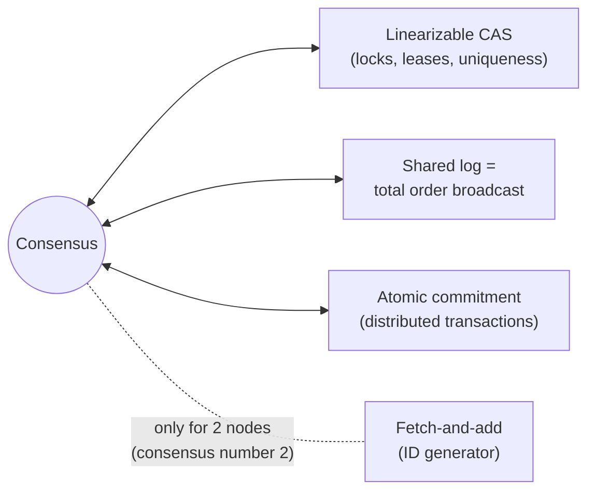
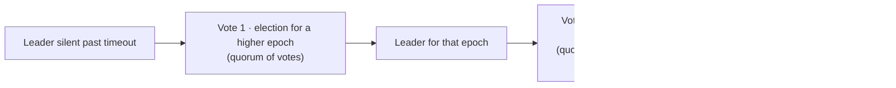

# فصل ۱۰: مفهوم consistency و consensus

[فصل ۹: دردسرهای سیستم‌های توزیع‌شده →](09-the-trouble-with-distributed-systems.md) · [کتاب](../README.md) · [فصل ۱۱: پردازش batch ←](11-batch-processing.md)

## خلاصه

بعد از فهرست مشکل‌های فصل ۹، این فصل، که در ویراست دوم تقریباً کامل از نو نوشته شده، abstractionهایی را معرفی می‌کند که آن مشکل‌ها را حل می‌کنند. **مفهوم linearizability** باعث می‌شود یک سیستم replicateشده طوری رفتار کند که انگار فقط یک نسخه از داده با عملیات atomic وجود دارد؛ استدلال درباره‌اش آسان است اما گران است، به‌خصوص بین regionها. **مولدهای ID و logical clockها** طیف تضمین‌های ترتیب را نشان می‌دهند: Lamport clock و hybrid logical clock رویدادها را سازگار با ترتیب علّی مرتب می‌کنند، و فقط یک مولد ID با linearizability آن‌ها را سازگار با زمان واقعی مرتب می‌کند. **مفهوم consensus** اجازه می‌دهد گروهی از nodeها با وجود fault روی یک دنباله‌ی واحد از عملیات توافق کنند؛ معلوم می‌شود خیلی از مسئله‌ها، یعنی compare-and-set، قفل و lease، constraint یکتایی، log مشترک، atomic commit و fetch-and-add، با آن هم‌ارزند. در عمل consensus یعنی single-leader replication با failover خودکار و امن، یعنی Raft، Paxos و Zab، که معمولاً از راه coordination serviceهایی مثل ZooKeeper و etcd مصرف می‌شود.

## نکته‌های کلیدی

- **مفهوم linearizability یعنی تضمین تازگی روی یک object:** وقتی یک خواندن مقدار تازه را برگرداند، همه‌ی خواندن‌های بعدی هم باید آن را برگردانند (pp. 402–407).
- **مفهوم linearizability با serializability یکی نیست:** اولی درباره‌ی تازگی یک object است و دومی درباره‌ی isolation تراکنش‌ها؛ *strict serializability* هر دو را با هم دارد (pp. 407–408).
- **کاربردهایش:** انتخاب leader و قفل، constraint یکتایی، و وابستگی‌های زمانی بین کانال‌ها (pp. 408–411).
- **کدام replication linearizable است:** مدل single-leader بالقوه بله، consensus به احتمال زیاد بله، multi-leader نه، و leaderless احتمالاً نه، حتی با quorum (pp. 411–413).
- **هزینه:** یک قطعی شبکه انتخاب بین linearizability و availability را تحمیل می‌کند؛ CAP بیشتر ارزش تاریخی دارد و هزینه‌ی هرروزه latency است (pp. 413–417).
- **مفهوم logical clock رویدادها را علّی مرتب می‌کند اما linearizability نمی‌دهد**؛ مولد ID با linearizability یک node تنها، البته replicateشده، یا عدم قطعیت محدود ساعت لازم دارد (pp. 417–425).
- **مفهوم consensus یعنی «single-leader replication که درست انجام شده»:** مفهوم epoch، یا term، leader را در هر epoch یکتا می‌کند؛ هر نوشتن و هر خواندن linearizable یک quorum لازم دارد (pp. 425–437).
- **مفهوم coordination service**، یعنی ZooKeeper، etcd و Consul، consensus را به شکل قفل، lease، تشخیص خرابی و اعلان تغییر بسته‌بندی می‌کند (pp. 437–440).

## فهرست بخش‌ها

*از فهرست مطالب خود کتاب، یعنی bookmarkهای PDF، با شماره‌ی صفحه‌های چاپی.*

- مفهوم linearizability (p. 402)
  - چه چیزی یک سیستم را linearizable می‌کند؟ (p. 404)
  - تکیه بر linearizability (p. 408)
  - پیاده‌سازی سیستم‌های linearizable (p. 411)
  - هزینه‌ی linearizability (p. 413)
- مولدهای ID و logical clockها (p. 417)
  - مفهوم logical clock (p. 420)
  - مولدهای ID با linearizability (p. 423)
- مفهوم consensus (p. 425)
  - چهره‌های گوناگون consensus (p. 427)
  - مفهوم consensus در عمل (p. 433)
  - مفهوم coordination service (p. 437)
- جمع‌بندی (p. 440)

## یادداشت‌ها

مفهوم replication fault را تحمل می‌کند اما ناسازگاری را دعوت می‌کند. دو فلسفه (pp. 401–402):

| | مفهوم eventual consistency | مفهوم strong consistency |
|---|---|---|
| چه کسی با replication سروکار دارد | برای اپلیکیشن دیده می‌شود و خودش ناسازگاری‌ها و conflictها را حل می‌کند | پنهان است: سیستم مثل یک node تنها رفتار می‌کند |
| مدل replication معمول | مدل multi-leader و leaderless | مدل single-leader به‌علاوه‌ی consensus |
| هزینه | برای اپلیکیشن سخت | کارایی؛ بعضی faultها قطعی می‌سازند |
| اجتناب‌ناپذیر وقتی | کاربرها آفلاین ویرایش می‌کنند، یعنی sync engineها | با شبکه‌های سریع و قابل اعتماد مناسب است |

این فصل «strong consistency» را دقیق می‌کند، یعنی linearizability، آن را به ساختن ID وصل می‌کند، و نشان می‌دهد consensus چطور با تحمل fault به آن می‌رسد؛ با شهود به جای اثبات؛ کار جدی به نظریه نیاز دارد (p. 402).

> **Try it:** [فصل ۱۰ در طول یک pipeline داده](../widgets/10-pipeline-map.html): از دیتابیس منبع تا داشبورد را با lensهای تازگی، ترتیب و هماهنگی طی کنید.

### مفهوم linearizability

اسم‌های دیگرش atomic consistency، strong consistency، immediate consistency و external consistency است: سیستم را طوری نشان بده که **انگار فقط یک نسخه از داده هست و همه‌ی عملیات روی آن atomic‌اند**؛ یعنی یک **تضمین تازگی**: وقتی یک نوشتن تمام شد، هر خواندنی آن را می‌بیند (pp. 402–403). در شکل ۱۰-۱ Aaliyah صفحه را تازه می‌کند و نتیجه‌ی نهایی بازی را اعلام می‌کند؛ Bryce که *بعد از* شنیدن حرف او صفحه را تازه می‌کند، به یک replica عقب‌مانده می‌خورد و می‌بیند بازی هنوز ادامه دارد؛ این نقض است، چون درخواست او بعد از تمام شدن درخواست Aaliyah شروع شده (pp. 403–404).

#### چه چیزی یک سیستم را linearizable می‌کند؟ (pp. 404–407)

یک object را به شکل یک **register** مدل کنید، یعنی یک کلید، یک ردیف یا یک document؛ هر عملیات یک میله از درخواست تا پاسخ است، و دیتابیس آن را جایی در این میان اعمال کرده.

*Figure 10-2 (p. 404): خواندنی که با یک نوشتن هم‌زمان است ممکن است هر کدام از دو مقدار را برگرداند؛ شکل ۱۰-۳ اضافه می‌کند که وقتی یک خواندن مقدار تازه را برگرداند، هر خواندن بعدی هم باید همان را برگرداند.*

| خواندن نسبت به نوشتن | نتیجه‌های مجاز |
|---|---|
| پیش از شروع نوشتن تمام شده | مقدار قدیم |
| بعد از پایان نوشتن شروع شده | مقدار تازه |
| با نوشتن هم‌پوشانی دارد | مقدار قدیم **یا** تازه؛ اما… |
| بعد از این‌که *هر* خواندنی مقدار تازه را برگرداند شروع شده | مقدار تازه؛ مقدار فقط **یک بار** و به‌شکل atomic عوض می‌شود و هرگز برنمی‌گردد |

شکل ۱۰-۴ عملیات **CAS(x, v_old, v_new)** را اضافه می‌کند: اگر لحظه‌ی اثر کردن هر عملیات را علامت بزنید، علامت‌ها باید به یک دنباله‌ی معتبر وصل شوند که **فقط در زمان جلو می‌رود**. درخواست‌های concurrent ممکن است به ترتیبی غیر از ترتیب فرستادن اعمال شوند؛ یک خواندن ممکن است مقداری را پیش از رسیدن ack به نویسنده‌اش برگرداند؛ CAS تغییرهای concurrent را تشخیص می‌دهد. linearizability را می‌شود از زمان‌بندی‌های ثبت‌شده تست کرد، با Knossos و Elle، اما بررسی‌اش گران است. قوی‌ترین مدل consistency رایج است و read-after-write، monotonic reads و consistent prefix reads را در خود دارد (p. 407).

*Figure 10-4 (p. 406): مفهوم linearizability یعنی علامت‌های اثر یک دنباله‌ی سازگار با زمان واقعی بسازند؛ خواندن علامت‌خورده آن را می‌شکند.*

#### مقایسه‌ی linearizability و serializability (pp. 407–408)

| | مفهوم serializability | مفهوم linearizability |
|---|---|---|
| موضوعش | تراکنش‌ها روی چند object | یک object، یعنی register |
| تضمین | معادل *یک* ترتیب serial، که ممکن است با زمان واقعی فرق کند؛ خواندن کهنه مجاز است | **تازگی**: عملیاتی که بعد از پایان دیگری شروع می‌شود دست‌کم اثرهای آن را می‌بیند |
| جلوی write skew را می‌گیرد؟ | بله | نه؛ چیزی را در تراکنش گروه نمی‌کند |

هر دو با هم یعنی **strict serializability**، یا strong one-copy serializability و strong-1SR. دیتابیس‌های تک‌node معمولاً linearizable‌اند؛ دیتابیس‌های توزیع‌شده‌ی مبتنی بر SSI ظریف‌ترند: **CockroachDB** serializability به‌علاوه‌ی کمی تازگی می‌دهد، نه strict serializability؛ **Spanner** و **FoundationDB** strictly serializable‌اند. سطح isolation و مدل consistency را می‌شود مستقل از هم انتخاب کرد؛ sequential consistency هم چیز دیگری است (p. 408).

#### تکیه بر linearizability (pp. 408–411)

| کاربرد | چرا linearizability لازم دارد |
|---|---|
| **قفل و انتخاب leader** | هرگز نباید دو node هم‌زمان lease داشته باشند، یعنی split brain. ZooKeeper و etcd با consensus، به‌علاوه‌ی دستورالعمل‌هایی مثل Apache Curator. نوشتن‌های ZooKeeper linearizable‌اند اما خواندن‌ها ممکن است کهنه باشند؛ خواندن‌های etcd v3 به‌طور پیش‌فرض linearizable‌اند. Oracle RAC برای هر صفحه‌ی دیسک یک قفل linearizable روی یک interconnect اختصاصی می‌گیرد |
| **مفهوم constraint و یکتایی** | یک username، مسیر فایل، صندلی، موجودی غیرمنفی یا سطح انبار؛ یک مقدار به‌روز که همه‌ی nodeها رویش توافق دارند؛ مثل گرفتن قفل یا CAS. گاهی رفتار شل کافی است، مثل overbooking با جبران. یکتایی سخت آن را لازم دارد؛ constraintهای foreign key و ویژگی‌ها نه |
| **وابستگی زمانی بین کانال‌ها** | در شکل ۱۰-۵ وب‌سرور یک ویدئوی آپلودشده را ذخیره می‌کند و بعد یک کار transcoding در صف می‌گذارد؛ اگر صف از replication storage جلو بزند، transcoder فایل قدیمی یا هیچ چیز را می‌خواند و ناسازگاری دائمی می‌شود. push notification و بعد خواندن از یک replica عقب‌مانده هم همین race را دارد |

اگر کانال دوم را در اختیار دارید، می‌توانید به قیمت پیچیدگی از جایگزین‌هایی شبیه read-your-writes استفاده کنید (p. 411).

> **In practice:** وقتی DAG مربوط به یک جدول Gold تمام می‌شود، در reference stack ممکن است پیامی بفرستد که گزارش آماده است، و تحلیل‌گر داشبورد را از راه SQL proxy باز می‌کند که کوئری را به یکی از دو replica می‌فرستد.
>
> **Your turn:** تحلیل‌گر پیام «گزارش آماده است» را می‌بیند، داشبورد را باز می‌کند و عددهای دیروز را می‌بیند. چه شده، و راه درست چیست؟
>
> *Answer:* این وابستگی زمانی بین کانال‌هاست، مثل شکل ۱۰-۵: پیام از کانالی آمده که از replication بین دو replica جلو زده، و proxy کوئری را به replicaی فرستاده که هنوز داده‌ی تازه را ندارد (pp. 409–411). یا پیش از فرستادن پیام صبر کنید تا هر دو replica داده را داشته باشند، مثلاً با بررسی یک نسخه یا تعداد ردیف روی هر دو، یا داشبوردهای حساس را به همان replicaای بفرستید که load رویش نوشته.

#### پیاده‌سازی سیستم‌های linearizable (pp. 411–413)

| روش replication | آیا linearizable است؟ | چرا |
|---|---|---|
| مدل single-leader | **بالقوه** | همه‌ی خواندن‌ها و نوشتن‌ها روی leader، اگر واقعاً leader باشد؛ leaderی که *توهم* leader بودن دارد آن را می‌شکند؛ failover asynchronous ممکن است نوشتن‌های commitشده را گم کند. leader جدا برای هر shard اشکالی ندارد، چون تضمین تک-objectی است |
| الگوریتم‌های consensus | **به احتمال زیاد** | مدل single-leader با انتخاب امن، یعنی Zab در ZooKeeper و Raft در etcd؛ مگر این‌که خواندن‌ها بررسی leader بودن را دور بزنند |
| مدل multi-leader | **نه** | نوشتن‌های concurrent روی چند node، که asynchronous replicate می‌شوند |
| مدل leaderless | **احتمالاً نه** | مدل LWW با timestamp ساعت، مثل Cassandra و ScyllaDB، تقریباً قطعاً نیست؛ حتی w + r > n هم ممکن است شکست بخورد؛ شکل ۱۰-۶ |

در شکل ۱۰-۶ با n = 3 و w = 3، یک نویسنده x را به ۱ تغییر می‌دهد؛ خواننده‌ی A با r = 2 مقدارهای ۱ و ۰ را می‌گیرد و ۱ برمی‌گرداند؛ خواننده‌ی B که *بعد از* پایان کار A شروع کرده، ۰ و ۰ می‌گیرد. فقط با **read repair هم‌زمان** پیش از برگرداندن نتیجه، و خواندن آخرین timestamp یک quorum به دست نویسنده‌ها پیش از نوشتن، درست می‌شود؛ Riak برای کارایی این را انجام نمی‌دهد؛ Cassandra repair را انجام می‌دهد اما از timestamp ساعت استفاده می‌کند. **مفهوم CAS** با linearizability در هر صورت consensus لازم دارد (pp. 412–413).

*Figure 10-6 (p. 413): شرط quorum در هر دو خواندن برقرار است، اما B مقداری قدیمی‌تر از A می‌بیند؛ linearizable نیست.*

#### هزینه‌ی linearizability (pp. 413–417)

دو region ارتباطشان قطع می‌شود، شکل ۱۰-۷: مدل multi-leader هر دو طرف را کارا نگه می‌دارد و replication را در صف می‌گذارد؛ با یک leader، clientهای region مربوط به follower نه می‌توانند بنویسند و نه خواندن linearizable انجام دهند؛ یعنی قطعی در آن‌جا (pp. 413–414). در حالت کلی، زیر یک خرابی شبکه، replicaهای جدامانده‌ی یک سیستم linearizable باید صبر کنند یا خطا بدهند، یعنی «**CP**»؛ سیستمی بدون linearizability می‌تواند به سرویس دادن ادامه دهد، یعنی «**AP**» (pp. 414–415).

*Figure 10-7 (p. 414): در طول قطعی، یک سیستم linearizable باید clientهای یک طرف را منتظر بگذارد یا خطا بدهد؛ در دسترس ماندن یعنی کنار گذاشتن linearizability.*

| مفهوم CAP چیست | چه نیست |
|---|---|
| قاعده‌ی سرانگشتی Brewer در سال ۲۰۰۰ که مهندس‌ها را به طراحی shared-nothing هل داد و به راه افتادن NoSQL کمک کرد؛ این بده‌بستان از دهه‌ی ۱۹۷۰ شناخته شده بود | «دو تا از سه تا را انتخاب کن»؛ partition انتخابی نیست؛ بهتر: *وقتی partition هست، یا consistent یا available* |
| به‌طور رسمی: یک مدل consistency، یعنی linearizability، و یک نوع fault، یعنی network partition، که طبق داده‌های Google **کمتر از ۸٪ حادثه‌ها**ست | برای طراحی مفید است: درباره‌ی latency و node مرده چیزی نمی‌گوید؛ «availability» آن با کاربرد رایج فرق دارد؛ خیلی از سیستم‌ها نه CP‌اند نه AP |
| مدل **PACELC** آن را تعمیم می‌دهد: اگر Partition، بین A و C؛ وگرنه، Else، بین Latency و Consistency | امروز: نتیجه‌های دقیق‌تر جایش را گرفته‌اند؛ به تعبیر کتاب بهتر است رویش نمانیم |

**هزینه‌ی واقعی latency است، همیشه** (pp. 416–417): حتی **حافظه‌ی RAM روی یک CPU چند-coreی linearizable نیست**؛ cacheهای هر core و store bufferها یعنی core دیگری بدون memory barrier ممکن است داده‌ی کهنه بخواند؛ و این برای کارایی کنار گذاشته شده، نه برای تحمل fault. Attiya و Welch اثبات کردند خواندن و نوشتن linearizable زمانی **متناسب با عدم قطعیت latency شبکه** می‌گیرد؛ الگوریتم سریع‌تری وجود ندارد، پس سیستم‌های حساس به latency مدل‌های ضعیف‌تر را انتخاب می‌کنند؛ فصل ۱۳.

### مولدهای ID و logical clockها

یک **ID خودافزاینده** روی یک node فشرده، ۶۴ بیت، و مرتب است؛ در چت شکل ۱۰-۸، پرسش Aaliyah شناسه‌ی ۱ و پاسخ Bryce شناسه‌ی ۳ می‌گیرد؛ پیام‌های concurrent، یعنی پیام Aaliyah و Caleb، فقط شناسه‌ی یکتا لازم دارند. این یک **fetch-and-add** با linearizability است؛ اما نقطه‌ی شکست تنهاست، از regionهای دیگر کند است و ممکن است گلوگاه شود (pp. 417–418).

| روش ID توزیع‌شده (pp. 418–419) | یکتا | به ترتیب ساخت مرتب؟ |
|---|---|---|
| تقسیم بین shardها، مثل فرد و زوج یا بیت‌های shard | بله، فشرده | نه؛ شناسه‌های ۱۶ و ۱۷ از دو node چیزی درباره‌ی ترتیب نمی‌گویند |
| بلوک‌های ازپیش‌تخصیص‌یافته، مثل ۱ تا ۱٬۰۰۰ و ۱٬۰۰۱ تا ۲٬۰۰۰ | بله | نه |
| مدل UUID v4 تصادفی، ۱۲۸ بیت | به احتمال | نه؛ تصادفی |
| مفهوم timestamp ساعت به‌علاوه‌ی بیت‌های یکتایی، مثل UUIDv7، Snowflake در X، ULID، Flake ID در Hazelcast و ObjectID در MongoDB | به احتمال | فقط تقریبی؛ clock skew و پرش ساعت؛ linearizable نیست |

#### مفهوم logical clock (pp. 420–423)

یک **logical clock** رویدادها را می‌شمارد نه ثانیه‌ها را. الزام‌ها: timestampهای فشرده و یکتا، یک **ترتیب کامل**، و **سازگاری با ترتیب علّی**؛ یعنی اگر A پیش از B رخ داده، ts(A) < ts(B). یک شمارنده‌ی تک‌node این را دارد؛ روش‌های بالا نه (p. 420).

| ساعت | چطور | چه می‌دهد | چه ندارد |
|---|---|---|---|
| **مفهوم Lamport timestamp**، ۱۹۷۸ | زوج (counter, node ID)؛ با هر رویداد یکی زیاد می‌شود؛ با دیدن counter بزرگ‌تر به آن می‌پرد | ترتیب کامل سازگار با ترتیب علّی؛ (1, Aaliyah) < (1, Caleb) < (2, Bryce)؛ شکل ۱۰-۹ | مفهوم linearizability؛ هیچ پیوندی با زمان فیزیکی؛ nodeهایی که هرگز با هم حرف نمی‌زنند از هم دور می‌شوند |
| **مفهوم hybrid logical clock** | واحدهای زمان فیزیکی، اما به timestampهای بزرگ‌ترِ دیده‌شده می‌پرد و همیشه زیاد می‌شود | نزدیک به زمان واقعی، با وجود پرش ساعت یکنوا، و علّی؛ در CockroachDB استفاده می‌شود | تشخیص رویدادهای concurrent |
| **مفهوم vector clock** | یک counter برای هر node | تشخیص concurrency | اندازه: یک عدد صحیح برای هر node |

مفهوم Lamport clock و hybrid clock شناسه‌ی تراکنش خوبی برای MVCC می‌سازند، چون آن‌وقت snapshotها ترتیب علّی را رعایت می‌کنند (p. 422).

*Figure 10-9 (p. 421): مرتب کردن با (counter, node ID) یک ترتیب کامل می‌دهد که در آن هر پاسخ بعد از پیامی است که به آن جواب داده.*

> **Try it:** [ساعت دیواری، Lamport clock و vector clock](../widgets/10-logical-clocks.html): چت Aaliyah و Bryce و Caleb کتاب را به سه روش مرتب کنید.

> **In practice:** بخش loader در reference stack ممکن است برای هر ردیف Bronze یک شناسه‌ی load بسازد، و Silver گاهی «آخرین» نسخه‌ی هر ردیف را لازم دارد.
>
> **Your turn:** تیم پیشنهاد می‌کند برای پیدا کردن آخرین نسخه، ردیف‌ها را بر اساس یک شناسه‌ی شبیه UUIDv7 که loader روی دو worker می‌سازد مرتب کنند. مشکل چیست؟
>
> *Answer:* شناسه‌های مبتنی بر timestamp یکتا هستند اما ترتیبشان فقط تقریبی است: دو worker ساعت‌های متفاوت دارند، پس شناسه‌ی بزرگ‌تر لزوماً یعنی بعدتر نیست (pp. 418–419). برای یکتایی از آن استفاده کنید؛ برای ترتیب نسخه‌ها به چیزی تکیه کنید که منبع با ترتیب علّی می‌سازد، مثل شماره‌ی نسخه‌ی افزایشی روی همان ردیف، یا position در log مربوط به CDC.

#### مولدهای ID با linearizability (pp. 423–425)

مفهوم linearizability بیش از ترتیب علّی لازم دارد: اگر A پیش از شروع B تمام شده، ID مربوط به B بزرگ‌تر است **حتی اگر هرگز با هم حرف نزده باشند**. شکل ۱۰-۱۰: کاربر A روی لپ‌تاپ حسابش را خصوصی می‌کند، بعد با گوشی عکسی آپلود می‌کند؛ حساب‌ها و عکس‌ها در دو دیتابیس با Lamport یا hybrid clock زندگی می‌کنند، عکس timestamp *کوچک‌تری* می‌گیرد، و یک خواندن snapshot بین این دو، عکس شرم‌آور را به یک غریبه نشان می‌دهد. راه‌حل‌ها: بررسی مجوز پیش از نوشتن، که آسان فراموش می‌شود؛ دنبال کردن timestampها برای هر دستگاه، که بین دستگاه‌ها سخت است؛ یا ساده‌ترین: یک مولد ID با linearizability (pp. 423–424).

| پیاده‌سازی | چطور | بده‌بستان |
|---|---|---|
| یک node | افزایش atomic، ذخیره‌ی پایدار و replication با single-leader؛ **timestamp oracle** در TiDB و TiKV، برگرفته از Percolator در Google؛ واگذاری **batch**های ذخیره‌شده، که ممکن است IDهایی جا بیفتند اما هرگز تکراری یا جابه‌جا نمی‌شوند | نمی‌شود shard کرد یا بین regionها پخش کرد؛ همه‌ی درخواست‌ها به یک region می‌روند؛ اما ساده و پرthroughput است |
| ساعت‌های synchronous با عدم قطعیت، یعنی TrueTime در Spanner | صبر به اندازه‌ی بازه‌ی عدم قطعیت | بدون ارتباط، حتی بین regionها؛ سخت‌افزار ساعت دقیقاً synchronous لازم دارد |

**مفهوم constraint بیش از ساعت لازم دارد** (p. 425): کمترین timestamp را برنده‌ی یک username یا قفل بگیرید؛ اما یک node فقط وقتی می‌تواند بداند کمترین است که از **همه‌ی** nodeهایی که ممکن است timestamp داده باشند خبر بگیرد؛ یک node دست‌نیافتنی همه‌چیز را متوقف می‌کند. قفل و lease با تحمل fault **مفهوم consensus** لازم دارند.

### مفهوم consensus

روی یک node آسان است و با تحمل fault سخت: failover یک leader linearizable بدون split brain، و fence کردن leader متوقف‌شده؛ یک شمارنده‌ی fetch-and-add مقاوم در برابر crash؛ یک CAS با تحمل fault (pp. 425–426). همه‌ی این‌ها **consensus** هستند: توافق nodeها روی یک مقدار. شناخته‌شده‌ترین الگوریتم‌ها: **Viewstamped Replication، Paxos، Raft و Zab**؛ همه غیر-Byzantine؛ نسخه‌های مقاوم در برابر Byzantine فرض می‌کنند کمتر از یک‌سوم nodeها خراب‌اند، مثل blockchainها (p. 426).

**نتیجه‌ی FLP**، از Fischer و Lynch و Paterson: هیچ الگوریتم قطعی‌ای در مدل asynchronous نمی‌تواند *پایان یافتن* را تضمین کند اگر ممکن باشد یک node crash کند. با timeout، حتی اگر گاهی اشتباه باشد، یا با تصادف، consensus حل‌شدنی است؛ در عمل کار می‌کند (p. 426).

#### مفهوم consensus روی یک مقدار (pp. 427–429)

| ویژگی | معنی | نوع |
|---|---|---|
| **مفهوم uniform agreement** | هیچ دو nodeی تصمیم متفاوت نمی‌گیرند | مفهوم safety |
| **مفهوم integrity** | تصمیمی را عوض نمی‌کنید | مفهوم safety |
| **مفهوم validity** | مقدار تصمیم‌گرفته‌شده پیشنهاد شده بوده؛ «همیشه null» را رد می‌کند | مفهوم safety |
| **مفهوم termination** | هر node سالم بالاخره تصمیم می‌گیرد؛ حتی اگر یک node خراب، به تعبیر کتاب، زیر ده متر گل مدفون شده باشد | مفهوم liveness |

یک «دیکتاتور» سخت‌کدشده سه تای اول را برآورده می‌کند اما وقتی بمیرد termination را نه. termination یک **اکثریت** سالم لازم دارد؛ safety حتی اگر بیشتر nodeها خراب شوند برقرار است؛ یک قطعی می‌تواند پیشرفت را متوقف کند اما هرگز تصمیم ناسازگار نمی‌سازد (pp. 428–429).

#### چهره‌های گوناگون consensus (pp. 427–433)

این مسئله‌ها **هم‌ارز**ند؛ راه‌حل یکی به هر کدام از بقیه تبدیل می‌شود:

- **هم‌ارزی CAS و consensus** (p. 429): یک register را null کنید؛ هر proposer با CAS آن را از null به مقدار خودش تغییر می‌دهد؛ مقدار ذخیره‌شده تصمیم است. برعکس، روی پیشنهادهای CAS هم‌زمان consensus اجرا کنید. نوشتن‌های شرطی object storeها CAS توزیع‌شده‌اند.
- **هم‌ارزی log مشترک و consensus** (pp. 429–431): یک log با **eventual append، reliable delivery، append-only، agreement و validity**، که با **total order broadcast**، یا atomic broadcast، پیاده می‌شود. هر چیزی را که اول ظاهر شود تصمیم بگیرید؛ برعکس، برای هر خانه‌ی log یک نمونه‌ی consensus اجرا کنید. single-leader replication بدون failover در liveness شکست می‌خورد.
- **مفهوم fetch-and-add** (pp. 431–432): با CAS پیاده‌شدنی است؛ اما به‌عنوان consensus، بازنده‌ها اگر برنده crash کند نمی‌توانند بفهمند چه کسی برده؛ فقط برای دو node consensus را حل می‌کند: **consensus number 2**، در برابر **∞** برای CAS و log مشترک.
- **مفهوم atomic commitment** (pp. 432–433): uniform agreement، integrity، validity، یعنی commit فقط اگر همه رأی commit داده باشند، **nontriviality**، یعنی همه yes و بدون timeout پس commit، و termination. از consensus می‌سازیدش با broadcast کردن رأی‌ها و پیشنهاد commit یا abort؛ و consensus را از آن می‌سازید با تراکنش‌هایی که CAS تک‌node روی یک quorum انجام می‌دهند.

#### مفهوم consensus در عمل (pp. 433–437)

بیشتر سیستم‌ها **log مشترک** می‌دهند: Raft، VR و Zab مستقیم؛ Paxos یک مقدار را تصمیم می‌گیرد اما به شکل **Multi-Paxos** استفاده می‌شود (p. 433). یک log مشترک **state machine replication** می‌دهد، و event sourcing، تراکنش‌های serializable با stored procedureهای قطعی، consensus برای هر صندلی، یعنی اولین entry برای هر صندلی، شمارنده‌ها و fencing tokenها، مثل `zxid` در ZooKeeper. دیتابیس‌های shardشده‌ی strongly consistent برای هر shard یک log نگه می‌دارند، که تضمین‌های بین shardها را محدود می‌کند (pp. 433–434).

**از single-leader replication تا consensus** (pp. 434–435): failover دستی در termination شکست می‌خورد؛ failover خودکار انگار برای انتخاب leaderی که consensus را حل می‌کند خودش consensus لازم دارد. راه خروج: تضمین یک leader یکتا **در هر epoch**؛ شماره‌ی *ballot* در Paxos، شماره‌ی *view* در VR، و **term** در Raft. nodeی که timeout می‌خورد انتخاباتی با epoch بزرگ‌تر شروع می‌کند؛ epochهای بزرگ‌تر برنده‌اند.

دو quorum باید **هم‌پوشانی** داشته باشند، پس یک رأی‌گیری موفق برای پیشنهاد ثابت می‌کند leader تازه‌تری وجود ندارد. برخلاف 2PC: هر کسی می‌تواند انتخابات را شروع کند، و فقط یک quorum، نه همه‌ی participantها، باید جواب بدهد (p. 435).

| نکته‌ی ظریف (pp. 435–437) | |
|---|---|
| مفهوم durability | هر entry پیش از خبر دادن به client به‌صورت synchronous به یک quorum replicate می‌شود |
| مفهوم log برای leader تازه | در Raft فقط nodeی که دست‌کم به اندازه‌ی یک اکثریت به‌روز است می‌تواند leader شود؛ در Paxos هر nodeی، بعد از به‌روز شدن |
| **تضعیف برای availability** | مفهوم **unclean leader election** در Kafka اجازه می‌دهد یک replica کهنه leader شود؛ بازیابی سریع‌تر، اما نظریه‌ی consensus دیگر صدق نمی‌کند |
| خواندن‌های linearizable | باید آن‌ها هم با یک quorum تأیید شوند، مثل etcd |
| عضویت | افزونه‌های reconfiguration nodeها را اضافه و حذف می‌کنند و regionها را جابه‌جا می‌کنند |

**مزایا و معایب** (p. 437): consensus یعنی **«single-leader replication که درست انجام شده»**؛ failover خودکار بدون گم شدن commitها و بدون split brain؛ هر failover خودکاری بدون یک الگوریتم اثبات‌شده احتمالاً ناامن است. هزینه‌ها: یک اکثریت سخت؛ ۳ node یک خرابی را تحمل می‌کنند و ۵ node دو خرابی را؛ هر عملیات با یک quorum حرف می‌زند، پس اضافه کردن node آن را *کندتر* می‌کند؛ سمت اقلیت یک partition مسدود است؛ تنظیم timeout بین regionها سخت است، و timeout کوتاه یعنی انتخابات بی‌پایان؛ حالت‌های لبه، مثلاً یک لینک بی‌ثبات می‌تواند leader بودن در Raft را برای همیشه دست‌به‌دست کند، برای همین Raft فاز **pre-vote** دارد؛ و **EPaxos** بدون leader در برابر nodeهای کند مقاوم‌تر است.

> **Try it:** [مفهوم consensus: انتخاب leader و replicate کردن log](../widgets/10-consensus.html): یک cluster پنج‌nodeی به سبک Raft با termها، رأی‌ها، commit با اکثریت، crash و partition.

> **In practice:** دو replica مربوط به ClickHouse در reference stack برای هماهنگ کردن replication جدول‌ها به یک coordination service تکیه می‌کنند؛ ClickHouse برای این کار ClickHouse Keeper یا ZooKeeper را به کار می‌برد، که با consensus کار می‌کنند.
>
> **Your turn:** کسی پیشنهاد می‌کند برای صرفه‌جویی، coordination service را به جای سه node روی دو node اجرا کنید، «چون فقط دو replica داریم». چرا بد است؟
>
> *Answer:* مفهوم consensus اکثریت سخت لازم دارد: اکثریت دو node یعنی هر دو، پس دو node هیچ خرابی‌ای را تحمل نمی‌کنند و از یک node تنها هم شکننده‌ترند؛ سه node یک خرابی را تحمل می‌کنند (p. 437). تعداد nodeهای coordination ربطی به تعداد replicaهای داده ندارد؛ یک سرویس ثابت سه یا پنج‌nodeی consensus را برای کل سیستم «برون‌سپاری» می‌کند (pp. 439–440).

### مفهوم coordination service

سیستم‌های **ZooKeeper، etcd و Consul** شبیه key-value store به نظر می‌آیند اما سیستم‌های *دیگر* را هماهنگ می‌کنند؛ Kubernetes روی etcd؛ HA در Spark و Flink روی ZooKeeper. داده‌ی کوچک در حافظه، که همچنان پایدار نوشته می‌شود، و با consensus replicate می‌شود؛ الگویشان **Chubby** در Google است (pp. 437–438).

| قابلیت | چطور | به consensus نیاز دارد؟ |
|---|---|---|
| قفل و lease | مفهوم CAS با تحمل fault | بله |
| مفهوم fencing | شناسه‌های یکنوا برای هر entry در log؛ `zxid` و `cversion` در ZooKeeper، revision در etcd | بله |
| تشخیص خرابی | sessionهای طولانی با heartbeat؛ leaseها با timeout شدن session آزاد می‌شوند؛ **ephemeral node** | نه |
| اعلان تغییر | نظارت روی کلیدها: خبر پیوستن و خرابی بدون polling | نه |
| config | ذخیره‌ی تنظیمات و اعلان هنگام تغییر؛ polling یک فایل یا URL هم کار می‌کند | نه |

**تقسیم کار** (pp. 439–440): انتخاب یک leader یا primary، مثلاً برای دیتابیس‌ها و job schedulerها، و واگذاری shardها به nodeها با پیوستن و خرابی nodeها؛ با عملیات atomic، ephemeral node و اعلان، و ترجیحاً با کتابخانه‌هایی مثل Apache Curator. یک سرویس ثابت ۳ تا ۵ nodeی consensus را برای سیستمی با هزاران shard «برون‌سپاری» می‌کند. داده باید آهسته تغییر کند، مثل «10.1.1.23 leader مربوط به shard 7 است» که در حد دقیقه تا ساعت عوض می‌شود؛ state پرتغییر جایش در یک دیتابیس یا Apache BookKeeper است.

**مفهوم service discovery** (p. 440): با تشخیص خرابی و اعلان راحت است، اما consensus برایش زیادی است؛ discovery باید بیشتر سریع و در دسترس باشد تا linearizable، پس cacheاش کنید، با TTL و لایه‌های DNS. **مفهوم observer** در ZooKeeper log را بدون رأی دادن replicate می‌کند: خواندن‌های کهنه اما در دسترس، و throughput خواندن بیشتر.

**کی از consensus استفاده نکنیم** (p. 443): اگر strong consistency لازم نیست، replication بدون leader یا multi-leader، همراه با logical clock، availability و کارایی بهتری می‌دهد.

## بده‌بستان‌ها در یک نگاه

| سازوکار ترتیب | ترتیب کامل | سازگار با ترتیب علّی | مفهوم linearizable | تحمل fault بدون یک node تنها |
|---|---|---|---|---|
| مفهوم UUID تصادفی | نه، تصادفی | نه | نه | بله |
| شناسه‌های مبتنی بر timestamp، مثل Snowflake و UUIDv7 | بله | فقط اگر ساعت‌ها خوب synchronous باشند | نه | بله |
| مفهوم Lamport clock یا hybrid logical clock | بله | بله | نه | بله |
| شمارنده‌ی تک‌node، یعنی timestamp oracle | بله | بله | بله | باید خود node شمارنده replicate شود |
| مفهوم consensus، یعنی log مشترک | بله | بله | بله | بله، با بالا بودن اکثریت |

## فراتر از کتاب

- بررسی‌کننده‌های linearizability مثل Knossos، Elle و Porcupine، که همه در مرجع‌های فصل آمده‌اند، همان چیزی‌اند که تست‌های سبک Jepsen برای تصمیم درباره‌ی linearizable بودن یک تاریخچه‌ی ثبت‌شده به کار می‌برند.
- مقاله‌ی Raft از Ongaro و Ousterhout در سال ۲۰۱۴ و مصورسازی آن در raft.github.io بهترین قدم بعدی بعد از [شبیه‌سازی consensus](../widgets/10-consensus.html) در vault است. این شبیه‌سازی عمداً pre-vote را ندارد، تا ببینید nodeهای جدامانده term خودشان را بالا می‌برند و وقتی partition درمان می‌شود leader سالم را وادار به کناره‌گیری می‌کنند.

## پیوندها

- **Run it:** [ساعت فیزیکی، Lamport clock و hybrid logical clock](../lab/10-logical-clocks/README.md).
- **فصل‌های مرتبط:** [فصل ۶: مفهوم replication](06-replication.md)، [فصل ۸: تراکنش‌ها](08-transactions.md)، [فصل ۹: دردسرهای سیستم‌های توزیع‌شده](09-the-trouble-with-distributed-systems.md)، [فصل ۱۲: پردازش stream](12-stream-processing.md) برای brokerهای مبتنی بر log به شکل log مشترک، و [فصل ۱۳: فلسفه‌ی سیستم‌های streaming](13-a-philosophy-of-streaming-systems.md) برای پرهیز از هماهنگی.

## خودتان را بسنجید

*پرسش‌ها و پاسخ‌ها را خود vault از روی یادداشت‌های بالا نوشته است؛ پاسخ‌ها به صفحه‌های کتاب ارجاع می‌دهند.*

1. **تازه کردن صفحه برای Bryce نتیجه‌ی کهنه‌ای برگرداند، بعد از این‌که برای Aaliyah نتیجه‌ی نهایی را برگردانده بود. این چه چیزی را نقض می‌کند؟**
   - [ ] مفهوم eventual consistency
   - [x] مفهوم linearizability: وقتی یک خواندن مقدار تازه را برگرداند، هر خواندن بعدی هم باید آن را برگرداند
   - [ ] مفهوم read-after-write consistency
   - [ ] مفهوم snapshot isolation

   *Answer:* خواندن Bryce بعد از پایان خواندن Aaliyah شروع شد، پس در یک سیستم linearizable باید مقداری دست‌کم به همان تازگی می‌دید. بدون یک کانال بیرونی، یعنی این‌که Aaliyah نتیجه را به او بگوید، کسی متوجه این نقض نمی‌شد (pp. 402–404).

2. **چرا یک سیستم leaderless مبتنی بر quorum با w + r > n باز هم لزوماً linearizable نیست؟**

   *Answer:* با latencyهای متغیر شبکه، یک خواننده ممکن است مقدار تازه را از replicaی ببیند که آن را دارد، در حالی که quorum خواننده‌ی بعدی هنوز آن را ندارد. حل conflict با last write wins بر اساس ساعت راه دیگری برای نقضش اضافه می‌کند (pp. 412–413).

3. **چرا Lamport timestamp برای اجرای یک constraint یکتایی کافی نیست؟**

   *Answer:* یک ترتیب کامل سازگار با ترتیب علّی می‌دهد، اما فقط بعد از واقعه: nodeی که همین الان باید درباره‌ی پذیرفتن یک username تصمیم بگیرد نمی‌تواند بداند node دیگری درخواستی با timestamp کوچک‌تر صادر کرده که هنوز خبرش نرسیده (pp. 420–425).

4. **توضیح دهید یک log مشترک چطور می‌تواند یک compare-and-set با linearizability پیاده کند.**

   *Answer:* عملیات را به log اضافه کنید، بعد log را تا entry خودتان بخوانید. هر node همان entryها را به همان ترتیب می‌بیند، پس اولین ادعا در log برنده است و بقیه می‌توانند تشخیص بدهند که باخته‌اند (pp. 427–433).

5. **چرا یک leader در consensus پیش از append کردن تأیید یک quorum را لازم دارد؟**
   - [ ] برای گرفتن timestamp مربوط به entry
   - [x] چون ممکن است بی‌خبر از او leader تازه‌تری انتخاب شده باشد، و فقط یک quorum می‌تواند تأیید کند که نشده
   - [ ] چون followerها log را نگه می‌دارند، نه leader
   - [ ] برای فشرده کردن entry

   *Answer:* یک leader نمی‌تواند به باور خودش که هنوز leader است اعتماد کند؛ هر دو quorum هم‌پوشانی دارند، پس انتخاب یک leader تازه‌تر دست‌کم برای یک node در quorum دیده می‌شد (pp. 433–437).

6. **کی عمداً از consensus استفاده نمی‌کنید؟**

   *Answer:* وقتی availability در مشکلات شبکه یا latency کم بین regionها از تضمین‌های سخت مهم‌تر است؛ مثلاً در سیستم‌های leaderless یا multi-leader؛ چون consensus برای هر تصمیم یک اکثریت و رفت‌وبرگشت لازم دارد (pp. 413–417, 433–437).

7. **سرویس coordination مربوط به یک warehouse دو replicaای روی دو node اجرا می‌شود. چند خرابی را تحمل می‌کند؟**

   *Answer:* هیچ: اکثریت دو node یعنی هر دو، پس خرابی هر کدام انتخاب leader و نوشتن را متوقف می‌کند. برای تحمل یک خرابی سه node لازم است (p. 437).
