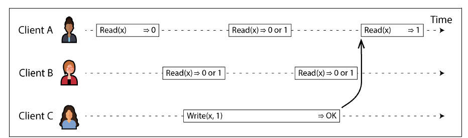
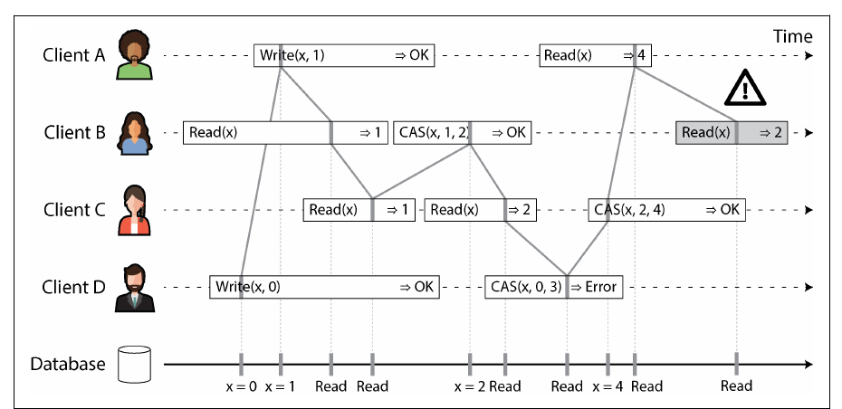
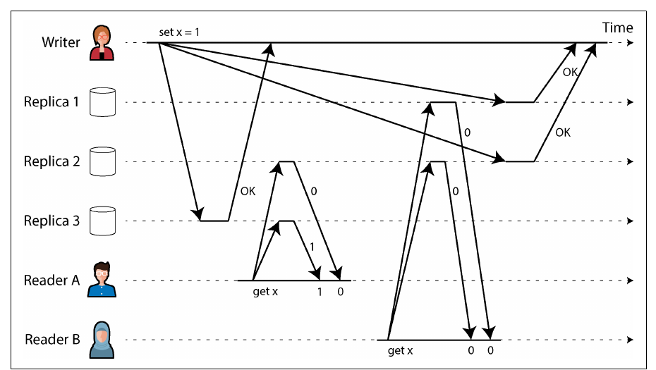
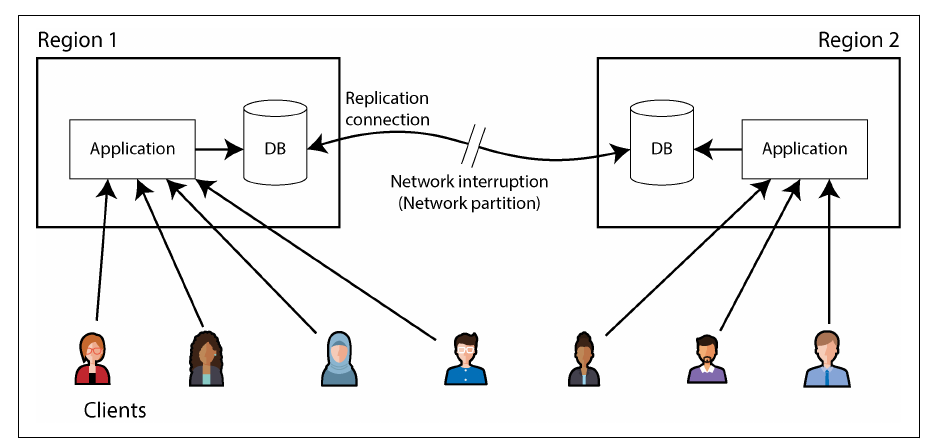
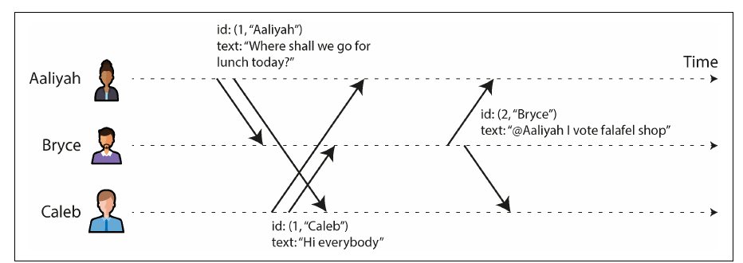
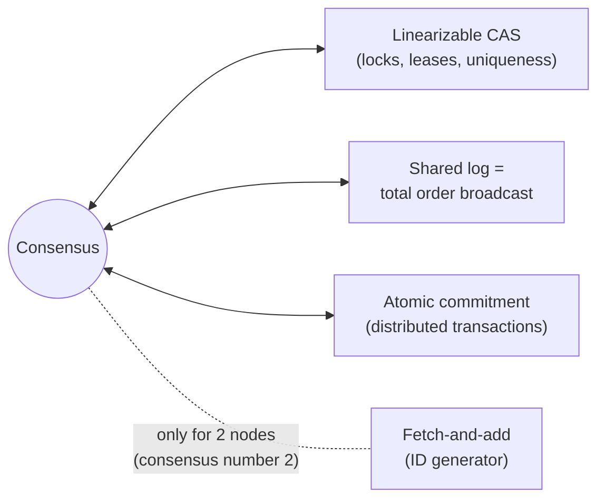
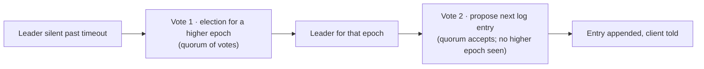

# 10. Consistency and Consensus

[← 9. The Trouble with Distributed Systems](09-the-trouble-with-distributed-systems.md) · [Book](../README.md) · [11. Batch Processing →](11-batch-processing.md)

## Summary

After Chapter 9's catalogue of problems, this chapter — almost completely rewritten for the second edition — presents the abstractions that solve them. **Linearizability** makes a replicated system behave as if there were a single copy of the data with atomic operations; it is easy to reason about but costly, especially across regions. **ID generators and logical clocks** show the spectrum of ordering guarantees: Lamport clocks and hybrid logical clocks order events consistently with causality, while only a linearizable ID generator orders them consistently with real time. **Consensus** lets a group of nodes agree on a single sequence of operations despite faults; many problems — compare-and-set, locks and leases, uniqueness constraints, shared logs, atomic commit, fetch-and-add — turn out to be equivalent to it. In practice consensus means single-leader replication with safe, automatic failover (Raft, Paxos, Zab), usually consumed via coordination services such as ZooKeeper and etcd.

## Key takeaways

- **Linearizability = recency guarantee on a single object**: once any read has returned a new value, all later reads must return it too (pp. 402–407).
- **Linearizability ≠ serializability**: one is about single-object recency, the other about transactions' isolation; *strict serializability* combines both (pp. 407–408).
- **Use it for**: leader election and locks, uniqueness constraints, and cross-channel timing dependencies (pp. 408–411).
- **Which replication is linearizable**: single-leader potentially, consensus likely, multi-leader no, leaderless probably not — even with quorums (pp. 411–413).
- **The cost**: a network interruption forces a choice between linearizability and availability; CAP is of mostly historical interest, and latency is the everyday cost (pp. 413–417).
- **Logical clocks order events causally but don't give linearizability**; a linearizable ID generator needs a single (replicated) node or bounded clock uncertainty (pp. 417–425).
- **Consensus is "single-leader replication done right"**: epochs (terms) make leaders unique per epoch; every write and linearizable read needs a quorum (pp. 425–437).
- **Coordination services** (ZooKeeper, etcd, Consul) package consensus as locks, leases, failure detection, and change notifications (pp. 437–440).

## Section outline

*From the book’s own table of contents (PDF bookmarks); printed page numbers.*

- Linearizability — p. 402
  - What Makes a System Linearizable? — p. 404
  - Relying on Linearizability — p. 408
  - Implementing Linearizable Systems — p. 411
  - The Cost of Linearizability — p. 413
- ID Generators and Logical Clocks — p. 417
  - Logical Clocks — p. 420
  - Linearizable ID Generators — p. 423
- Consensus — p. 425
  - The Many Faces of Consensus — p. 427
  - Consensus in Practice — p. 433
  - Coordination Services — p. 437
- Summary — p. 440

## Notes

Replication tolerates faults but invites inconsistency. Two philosophies (pp. 401–402):

| | Eventual consistency | Strong consistency |
|---|---|---|
| Who handles replication | Visible to the app, which resolves inconsistencies and conflicts | Hidden: the system behaves like a single node |
| Typical replication | Multi-leader, leaderless | Single-leader + consensus |
| Cost | Hard for applications | Performance; some faults cause outages |
| Unavoidable when | Users edit offline (sync engines) | — appropriate with fast, reliable networks |

This chapter makes “strong consistency” precise (linearizability), connects it to ID generation, and shows how consensus achieves it fault-tolerantly — using intuitions rather than proofs; serious work needs the theory (p. 402).

### Linearizability

Also called atomic, strong, immediate or external consistency: make a system **appear as if there were only one copy of the data, and all operations on it are atomic** — a **recency guarantee**: once a write completes, every read sees it (pp. 402–403). Figure 10-1: Aaliyah reloads and announces the final score; Bryce, reloading *after* hearing her, hits a lagging replica and sees the game still on — a violation, because his request started after hers completed (pp. 403–404).

#### What makes a system linearizable? (pp. 404–407)

Model one object as a **register** (a key, a row, a document); each operation is a bar from request to response, and the database applied it somewhere in between.

*Figure 10-2 (p. 404): a read concurrent with a write may return either value — Figure 10-3 adds that once any read returns the new value, every later read must too.*

| Read relative to the write | Allowed results |
|---|---|
| Finished before the write began | Old value |
| Began after the write completed | New value |
| Overlaps the write | Old **or** new — but… |
| Begins after *any* read returned the new value | New value — the value flips **once**, atomically, never back |

Figure 10-4 adds **CAS(x, v_old, v_new)**: marking the instant each operation took effect, the markers must join into a valid sequence that **only moves forward in time**. Requests may be applied in a different order than sent if they are concurrent; a read may return a value before its writer receives the ack; CAS detects concurrent changes. Linearizability can be tested from recorded timings (Knossos, Elle) but checking is expensive. It is the strongest common consistency model and includes read-after-write, monotonic reads and consistent prefix reads (p. 407).

*Figure 10-4 (p. 406): linearizability means the effect markers form one sequence consistent with real time; the flagged read breaks it.*

#### Linearizability versus serializability (pp. 407–408)

| | Serializability | Linearizability |
|---|---|---|
| Applies to | Transactions over multiple objects | Single objects (registers) |
| Guarantees | Same as *some* serial order — which may differ from real time; stale reads allowed | **Recency**: an operation that starts after another finished sees at least its effects |
| Prevents write skew? | Yes | No — no grouping into transactions |

Both together = **strict serializability** (strong one-copy serializability, strong-1SR). Single-node databases are typically linearizable; SSI-based distributed databases are subtler: **CockroachDB** gives serializability plus some recency, not strict serializability; **Spanner** and **FoundationDB** are strictly serializable. Isolation level and consistency model can be chosen independently; sequential consistency is yet another thing (p. 408).

#### Relying on linearizability (pp. 408–411)

| Use | Why it needs linearizability |
|---|---|
| **Locking and leader election** | Two nodes must never hold the lease at once (split brain). ZooKeeper, etcd (consensus) + recipes like Apache Curator. ZooKeeper writes are linearizable but reads may be stale; etcd v3 reads are linearizable by default. Oracle RAC takes a linearizable lock per disk page over a dedicated interconnect |
| **Constraints and uniqueness** | A username, a file path, a seat, a non-negative balance, stock levels — one up-to-date value all nodes agree on; like acquiring a lock or a CAS. Loose treatment is sometimes fine (overbooking with compensation). Hard uniqueness needs it; foreign-key and attribute constraints don’t |
| **Cross-channel timing dependencies** | Figure 10-5: the web server stores an uploaded video, then queues a transcoding job; if the queue outruns the storage’s replication, the transcoder reads an old file or nothing — permanently inconsistent. Push notifications followed by a fetch from a lagging replica: same race |

If you control the second channel you can use read-your-writes-style alternatives, at the cost of complexity (p. 411).

#### Implementing linearizable systems (pp. 411–413)

| Replication method | Linearizable? | Why |
|---|---|---|
| Single-leader | **Potentially** | All reads/writes on the leader — if it really is the leader (a *delusional* leader breaks it); async failover can lose committed writes. Per-shard leaders are fine (single-object guarantee) |
| Consensus algorithms | **Likely** | Single-leader with safe election (ZooKeeper’s Zab, etcd’s Raft) — unless reads skip the leadership check |
| Multi-leader | **No** | Concurrent writes on several nodes, replicated asynchronously |
| Leaderless | **Probably not** | LWW on clock timestamps (Cassandra, ScyllaDB) almost certainly isn’t; even w + r > n can fail (Figure 10-6) |

Figure 10-6: n = 3, w = 3 writer updating x to 1; reader A (r = 2) gets 1 and 0 → returns 1; reader B, starting *after* A finished, gets 0 and 0. Fixable only with **synchronous read repair** before returning and writers reading a quorum’s latest timestamp before writing — Riak skips this for performance; Cassandra does the repair but uses clock timestamps. Linearizable **CAS** needs consensus regardless (pp. 412–413).

*Figure 10-6 (p. 413): a quorum is satisfied in both reads, yet B sees an older value than A — not linearizable.*

#### The cost of linearizability (pp. 413–417)

Two regions lose contact (Figure 10-7): multi-leader keeps both sides working and queues replication; with a single leader, clients in the follower region can make no writes or linearizable reads — an outage there (pp. 413–414). Generally, under a network fault, a linearizable system’s cut-off replicas must wait or error (“**CP**”); a system without linearizability can keep serving (“**AP**”) (pp. 414–415).

*Figure 10-7 (p. 414): during the interruption, a linearizable system must make one side's clients wait or fail; staying available means giving up linearizability.*

| CAP — what it is | What it isn’t |
|---|---|
| Brewer’s 2000 rule of thumb that pushed engineers towards shared-nothing designs and helped trigger NoSQL; the trade-off was known since the 1970s | “Pick two of three” — partitions aren’t a choice; better: *either consistent or available when partitioned* |
| Formally: one consistency model (linearizability), one fault (network partitions — **under 8% of incidents** per Google data) | Useful for design: says nothing of delays, dead nodes; its “availability” differs from common usage; many systems are neither CP nor AP |
| Generalized by **PACELC**: if Partitioned choose A or C, Else choose Latency or Consistency | Current: superseded by more precise results — “best not to dwell on it” |

**The real cost is latency, all the time** (pp. 416–417): even **RAM on a multi-core CPU isn’t linearizable** — per-core caches and store buffers mean another core may read stale data without a memory barrier, dropped for performance, not fault tolerance. Attiya and Welch proved linearizable reads and writes take time **proportional to the uncertainty of network delay**; no faster algorithm exists, so latency-sensitive systems choose weaker models (Ch. 13).

### ID generators and logical clocks

A single-node **autoincrementing ID** is compact (64 bits) and ordered — Figure 10-8’s chat: Aaliyah’s question gets ID 1, Bryce’s answer ID 3; concurrent messages (Aaliyah’s and Caleb’s) just need unique IDs. It is a linearizable **fetch-and-add** — but a single point of failure, slow from other regions, and a possible bottleneck (pp. 417–418).

| Distributed ID scheme (pp. 418–419) | Unique | Ordered by creation? |
|---|---|---|
| Sharded assignment (odd/even, shard bits) | Yes, compact | No — IDs 16 and 17 from different nodes say nothing about order |
| Preallocated blocks (1–1,000, 1,001–2,000) | Yes | No |
| Random UUID v4 (128 bits) | Probabilistically | No — random |
| Wall-clock timestamp + uniqueness bits (UUIDv7, X’s Snowflake, ULID, Hazelcast Flake ID, MongoDB ObjectID) | Probabilistically | Only approximately — clock skew and jumps; not linearizable |

#### Logical clocks (pp. 420–423)

A **logical clock** counts events instead of seconds. Requirements: compact unique timestamps, a **total order**, and **consistency with causality** (A happened before B ⇒ ts(A) < ts(B)). A single-node counter qualifies; the schemes above don’t (p. 420).

| Clock | How | Gives | Lacks |
|---|---|---|---|
| **Lamport timestamp** (1978) | (counter, node ID); increment per event; on seeing a larger counter, jump to it | Total order consistent with causality — (1, Aaliyah) < (1, Caleb) < (2, Bryce) (Figure 10-9) | Linearizability; any link to physical time; nodes that never talk drift apart |
| **Hybrid logical clock** | Physical time units, but jump forward to larger timestamps seen and always increment | Close to real time, monotonic despite clock jumps, causal — used by CockroachDB | Distinguishing concurrent events |
| **Vector clock** | One counter per node | Detects concurrency | Size: an integer per node |

Lamport and hybrid clocks make good MVCC transaction IDs because snapshots then respect causality (p. 422).

*Figure 10-9 (p. 421): ordering by (counter, node ID) gives a total order in which every reply comes after the message it replies to.*

> **Try it:** [Wall clocks, Lamport clocks, vector clocks](../widgets/10-logical-clocks.html) — order the book's Aaliyah–Bryce–Caleb chat three ways.

#### Linearizable ID generators (pp. 423–425)

Linearizability needs more than causality: if A completed before B began, B’s ID is higher **even if they never communicated**. Figure 10-10: user A sets their account private on a laptop, then uploads a photo from their phone; accounts and photos live in different databases with Lamport/hybrid clocks, the photo gets a *lower* timestamp, and a snapshot read between the two shows the embarrassing photo to a stranger. Fixes: check permissions before writing (easily forgotten), track timestamps per device (hard across devices), or — simplest — a linearizable ID generator (pp. 423–424).

| Implementation | How | Trade-off |
|---|---|---|
| Single node | Atomically increment, persist, replicate (single-leader) — TiDB/TiKV’s **timestamp oracle**, after Google’s Percolator; hand out persisted **batches** (IDs may be skipped, never duplicated or reordered) | Can’t shard or spread across regions — all requests go to one region; but simple and high-throughput |
| Synchronized clocks with uncertainty (Spanner’s TrueTime) | Wait out the uncertainty interval | No communication, even across regions; needs tightly synchronized clock hardware |

**Constraints need more than clocks** (p. 425): pick the lowest timestamp to win a username or lock — but a node can only know it is lowest by hearing from **every** node that might have issued one; one unreachable node halts everything. Fault-tolerant locks and leases need **consensus**.

### Consensus

Easy on one node, hard with fault tolerance: failing over a linearizable leader without split brain (and fencing a paused one), a crash-proof fetch-and-add counter, a fault-tolerant CAS (pp. 425–426). All are **consensus**: getting nodes to agree on a value. Best-known algorithms: **Viewstamped Replication, Paxos, Raft, Zab** — all non-Byzantine; Byzantine-tolerant variants assume fewer than one-third faulty nodes (blockchains) (p. 426).

**The FLP result** (Fischer, Lynch, Paterson): no deterministic algorithm can *guarantee termination* in the asynchronous model if a node may crash. With timeouts — even sometimes wrong — or randomness, consensus is solvable; in practice it works (p. 426).

#### Single-value consensus (pp. 427–429)

| Property | Meaning | Kind |
|---|---|---|
| **Uniform agreement** | No two nodes decide differently | Safety |
| **Integrity** | No changing your mind | Safety |
| **Validity** | The decided value was proposed (rules out “always null”) | Safety |
| **Termination** | Every non-crashed node eventually decides — even if a crashed node is “buried under 30 feet of mud” | Liveness |

A hard-coded “dictator” satisfies the first three but not termination when it dies. Termination requires a **majority** working; safety holds even if most nodes fail — an outage can stop progress but never cause inconsistent decisions (pp. 428–429).

#### The many faces of consensus (pp. 427–433)

These problems are **equivalent** — a solution to one converts to any other:

- **CAS ⇄ consensus** (p. 429): set a register to null; every proposer CASes null → its value; the stored value is decided. Conversely, run consensus on concurrent CAS proposals. Object stores’ conditional writes are distributed CAS.
- **Shared log ⇄ consensus** (pp. 429–431): a log with **eventual append, reliable delivery, append-only, agreement, validity** — implemented by **total order broadcast** (atomic broadcast). Decide whatever appears first; conversely run one consensus instance per log slot. Single-leader replication without failover fails liveness.
- **Fetch-and-add** (pp. 431–432): implementable from CAS; but as consensus, losers can’t learn who won if the winner crashes — it solves consensus only for two nodes: **consensus number 2**, versus **∞** for CAS and shared logs.
- **Atomic commitment** (pp. 432–433): uniform agreement, integrity, validity (commit only if all voted commit), **nontriviality** (all yes + no timeouts ⇒ commit), termination. Build it from consensus by broadcasting votes and proposing commit/abort; build consensus from it via transactions doing single-node CAS on a quorum.

#### Consensus in practice (pp. 433–437)

Most systems provide **shared logs**: Raft, VR and Zab directly; Paxos decides one value but is used as **Multi-Paxos** (p. 433). A shared log gives **state machine replication** (and event sourcing), serializable transactions via deterministic stored procedures, per-seat consensus (first entry for each seat), counters and fencing tokens (ZooKeeper’s `zxid`). Sharded strongly consistent databases keep a log per shard, limiting cross-shard guarantees (pp. 433–434).

**From single-leader replication to consensus** (pp. 434–435): manual failover fails termination; automatic failover seems to need consensus to elect the leader that solves consensus. The way out: guarantee a unique leader **per epoch** — *ballot* number (Paxos), *view* number (VR), **term** (Raft). A node that times out starts an election with a higher epoch; higher epochs win.

The two quorums must **overlap**, so a successful proposal vote proves no newer leader exists. Unlike 2PC: anyone can start an election, and only a quorum (not every participant) must answer (p. 435).

| Subtlety (pp. 435–437) | |
|---|---|
| Durability | Each entry is synchronously replicated to a quorum before the client is told |
| New leader’s log | Raft: only a node at least as up to date as a majority may lead; Paxos: any node, after catching up |
| **Weakening for availability** | Kafka’s **unclean leader election** lets a stale replica lead — faster recovery, but consensus theory no longer applies |
| Linearizable reads | Must also be confirmed by a quorum (etcd) |
| Membership | Reconfiguration extensions add/remove nodes and move regions |

**Pros and cons** (p. 437): consensus is **“single-leader replication done right”** — automatic failover with no lost commits and no split brain; any auto-failover without a proven algorithm is likely unsafe. Costs: a strict majority (3 nodes tolerate 1 failure, 5 tolerate 2); every operation talks to a quorum, so adding nodes *slows* it; the minority side of a partition is blocked; timeouts are hard to tune across regions (too short → endless elections); edge cases — one flaky link can make Raft leadership bounce forever, hence Raft’s **pre-vote** phase; leaderless **EPaxos** is more robust to slow nodes.

> **Try it:** [Consensus: elect a leader, replicate a log](../widgets/10-consensus.html) — a five-node Raft-style cluster: terms, votes, majority commits, crashes and partitions.

### Coordination services

**ZooKeeper, etcd and Consul** look like key-value stores but coordinate *other* systems — Kubernetes on etcd; Spark and Flink HA on ZooKeeper. Small in-memory data (still durably written), replicated by consensus; modeled on Google’s **Chubby** (pp. 437–438).

| Feature | How | Needs consensus? |
|---|---|---|
| Locks and leases | Fault-tolerant CAS | Yes |
| Fencing | Monotonic IDs per log entry — `zxid`/`cversion` (ZooKeeper), revision (etcd) | Yes |
| Failure detection | Long-lived sessions with heartbeats; leases released when a session times out — **ephemeral nodes** | No |
| Change notifications | Watch keys: learn of joins and failures without polling | No |
| Configuration | Store settings, notify on change (polling a file or URL also works) | No |

**Allocating work** (pp. 439–440): choose a leader/primary (databases, job schedulers) and assign shards to nodes as nodes join and fail — via atomic ops, ephemeral nodes and notifications, ideally with libraries like Apache Curator. A fixed 3–5 node service “outsources” consensus for a system of thousands of shards. Data should change slowly (“10.1.1.23 leads shard 7” — minutes to hours); fast-changing state belongs in a database or Apache BookKeeper.

**Service discovery** (p. 440): convenient with failure detection and notifications, but consensus is overkill — discovery must be fast and available more than linearizable, so cache it (TTLs, DNS layers). ZooKeeper **observers** replicate the log without voting: stale but available reads and more read throughput.

**When not to use consensus** (p. 443): if strong consistency isn’t needed, leaderless or multi-leader replication — with logical clocks — gives better availability and performance.

## Trade-offs at a glance

| Ordering mechanism | Total order | Consistent with causality | Linearizable | Fault-tolerant without a single node |
|---|---|---|---|---|
| Random UUIDs | No (random) | No | No | Yes |
| Timestamp-based IDs (Snowflake, UUIDv7) | Yes | Only if clocks are well synced | No | Yes |
| Lamport / hybrid logical clocks | Yes | Yes | No | Yes |
| Single-node counter (timestamp oracle) | Yes | Yes | Yes | Needs replication of the counter node |
| Consensus (shared log) | Yes | Yes | Yes | Yes (with a majority up) |

## Beyond the book

- Linearizability checkers such as Knossos, Elle, and Porcupine (all cited in the chapter's references) are what Jepsen-style tests use to decide whether a recorded history is linearizable.
- The Raft paper (Ongaro & Ousterhout, 2014) and its visualization at raft.github.io are the best next step after the vault's [consensus explorable](../widgets/10-consensus.html). The explorable deliberately omits pre-vote, so you can watch partitioned nodes inflate their term and force the healthy leader to step down when the partition heals.

## Connections

- **Run it:** [Physical, Lamport, and hybrid logical clocks](../lab/10-logical-clocks/README.md).
- **Related chapters:** [6. Replication](06-replication.md), [8. Transactions](08-transactions.md), [9. The Trouble with Distributed Systems](09-the-trouble-with-distributed-systems.md), [12. Stream Processing](12-stream-processing.md) (log-based brokers as shared logs), [13. A Philosophy of Streaming Systems](13-a-philosophy-of-streaming-systems.md) (avoiding coordination).

## Check yourself

*Questions and answers are the vault's, written from the notes above; answers cite the book's pages.*

1. **Bryce's refresh returned a stale score after Aaliyah's had returned the final one. What does that violate?**
   - [ ] Eventual consistency
   - [x] Linearizability: once any read has returned a new value, every later read must return it too
   - [ ] Read-after-write consistency
   - [ ] Snapshot isolation

   *Answer:* Bryce's read started after Aaliyah's read had completed, so in a linearizable system it would have to see at least as recent a value. Without an outside channel (Aaliyah telling him the score), nobody would notice the violation (pp. 402–404).

2. **Why is a quorum-based leaderless system with w + r > n still not necessarily linearizable?**

   *Answer:* With variable network delays, one reader can see the new value from a replica that has it while a later reader's quorum does not yet include it. Clock-based last-write-wins conflict resolution adds another way to violate it (pp. 412–413).

3. **Why aren't Lamport timestamps enough to enforce a uniqueness constraint?**

   *Answer:* They give a total order consistent with causality, but only after the fact: a node deciding whether to accept a username now cannot know whether another node has issued a request with a lower timestamp that it hasn't heard about (pp. 420–425).

4. **Explain how a shared log can implement a linearizable compare-and-set.**

   *Answer:* Append the operation to the log, then read the log up to your entry. Every node sees the same entries in the same order, so the first claim in the log wins and the others can detect that they lost (pp. 427–433).

5. **Why does a consensus leader need confirmation from a quorum before appending?**
   - [ ] To get the entry's timestamp
   - [x] Because a newer leader might have been elected without it knowing, and only a quorum can confirm there isn't one
   - [ ] Because followers store the log, not the leader
   - [ ] To compress the entry

   *Answer:* A leader can't trust its own belief that it is still the leader; any two quorums overlap, so a newer leader's election would be visible to at least one node in the quorum (pp. 433–437).

6. **When would you deliberately not use consensus?**

   *Answer:* When availability during network problems or low latency across regions matters more than strict guarantees — e.g. leaderless or multi-leader systems — since consensus needs a majority and round trips for every decision (pp. 413–417, 433–437).
