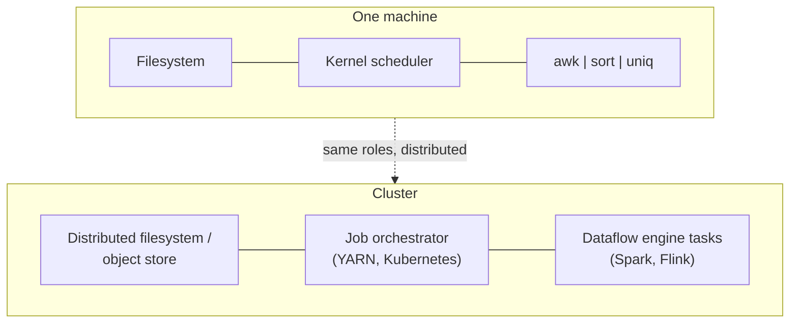
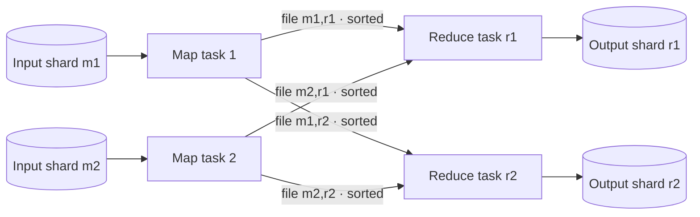
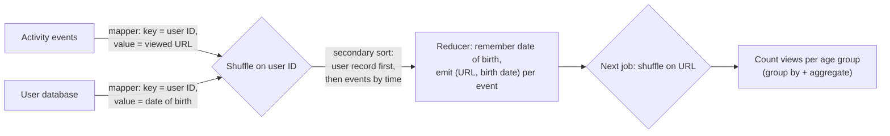

# 11. Batch Processing

[← 10. Consistency and Consensus](10-consistency-and-consensus.md) · [Book](../README.md) · [12. Stream Processing →](12-stream-processing.md)

## Summary

Batch processing takes a large, bounded, immutable input and produces derived output, typically on a schedule. Rewritten for the second edition (MapReduce is now treated as historical background), the chapter builds up from a Unix pipeline that finds the most popular pages in a web server log, to distributed batch systems made of three layers — **storage** (distributed filesystems and object stores), **orchestration** (job schedulers and workflow orchestrators), and **computation** (MapReduce and dataflow engines such as Spark and Flink). The central algorithm is the **shuffle**, a distributed sort that powers joins and grouping. As the infrastructure matured, focus shifted to usability — SQL and DataFrames — and batch frameworks converged with cloud data warehouses. It ends with the main uses: ETL, analytics, machine learning, and serving derived data to production.

## Key takeaways

- **Immutable inputs make batch jobs safe to rerun**: a buggy job's output can be discarded and recomputed — "human fault tolerance" (pp. 451–452).
- **Sorting beats in-memory aggregation when the working set exceeds memory**, because sorted runs can be merged sequentially from disk (pp. 456–457).
- **Distributed batch frameworks resemble a distributed OS**: filesystem/object store, scheduler, and programs connected by data (pp. 457–466).
- **Dataflow engines (Spark, Flink) model a whole workflow as one job**, keep intermediate state in memory or on local disk, and avoid MapReduce's mandatory sort-and-materialize between stages (pp. 466–469).
- **The shuffle is a sort, not a randomization**: it brings all records with the same key together, enabling **sort-merge joins** and grouping (pp. 469–473).
- **SQL and DataFrames became the main interfaces**, and batch frameworks and cloud warehouses converged (pp. 473–476).
- **Don't write to production databases record by record from a batch job**; build datasets and bulk-load them, or publish them to a stream (pp. 479–481).

## Section outline

*From the book’s own table of contents (PDF bookmarks); printed page numbers.*

- Batch Processing with Unix Tools — p. 454
  - Simple Log Analysis — p. 454
  - Chain of Commands Versus Custom Program — p. 456
  - Sorting Versus In-Memory Aggregation — p. 456
- Batch Processing in Distributed Systems — p. 457
  - Distributed Filesystems — p. 458
  - Object Stores — p. 460
  - Distributed Job Orchestration — p. 461
- Batch Processing Models — p. 466
  - MapReduce — p. 466
  - Dataflow Engines — p. 468
  - Shuffling Data — p. 469
  - Joins and Grouping — p. 471
  - Query Languages — p. 473
  - DataFrames — p. 475
- Batch Use Cases — p. 476
  - Extract–Transform–Load — p. 476
  - Analytics — p. 477
  - Machine Learning — p. 478
  - Serving Derived Data — p. 479
- Summary — p. 481

## Notes

**Online systems** answer requests as fast as possible (response time, availability). **Batch processing** jobs (offline systems) read **read-only input** and generate output **from scratch** each run — training models, transforming data, large analytics — measured by **throughput**, often scheduled (e.g. daily), taking minutes to days. **Stream processing** (Ch. 12) keeps running and reacts to new input (pp. 451–453).

| Benefit of immutable input, no side effects (p. 452) | Cost (p. 452) |
|---|---|
| **Human fault tolerance**: buggy code → roll back and rerun, or switch back to the old output (time travel in object stores and table formats) — a database can’t undo bad writes by rolling back code | Downstream jobs usually wait for the whole job to finish |
| Faster feature development (minimize irreversibility) | Any change, even one byte, means reprocessing the whole input |
| The same files feed many jobs, including monitoring jobs comparing outputs across runs | Jobs can take hours or days |
| Efficient use of compute vs doing it in OLTP systems | |

MapReduce (Google, 2004; Hadoop, CouchDB, MongoDB) shaped the field but is now **largely obsolete** — Google removed its code. Today: Spark, Flink and warehouse query engines; Airflow, Dagster and Prefect replaced Oozie and Azkaban; storage moved from HDFS, GlusterFS and CephFS to object stores like S3; BigQuery and Snowflake blur warehouse and batch (p. 453).

### Batch processing with Unix tools

An NGINX access-log line records client IP, user, time, request (`GET /css/typography.css`), status 200, 3,377 bytes, referrer and user agent. Log parsing drives ad pipelines and payments and fuelled the “big data” movement (p. 454).

```sh
cat /var/log/nginx/access.log |
  awk '{print $7}' |    # the requested URL
  sort             |    # make repeats adjacent
  uniq -c          |    # count each run
  sort -r -n       |    # most requested first
  head -n 5
```

*The five most popular pages (pp. 454–455) — e.g. 4,189 `/favicon.ico`. Tweak the `awk` to drop CSS (`$7 !~ /\.css$/`) or count IPs (`{print $1}`); gigabytes in seconds.*

| | Unix pipeline (sort, then count) | Python script (hash table) |
|---|---|---|
| Working set | Streams; sorted runs spill to disk and merge — the SSTable/mergesort principle | Must hold every distinct URL and its counter in memory |
| When it wins | Larger-than-memory data — GNU `sort` spills to disk and parallelizes across cores; bottleneck becomes disk read speed | Small-to-mid sites (≈1 GB of distinct URLs) — even on a laptop |
| Limit | One machine | One machine |

(pp. 456–457)

### Batch processing in distributed systems

The single machine has storage behind a filesystem, a scheduler, and programs connected by pipes; distributed batch frameworks are the same pieces spread out — a **distributed operating system** (p. 457).



#### Distributed filesystems (pp. 458–460)

| OS filesystem layer | Distributed equivalent |
|---|---|
| Block device (ext4 blocks of 4,096 bytes) | Large blocks on **data nodes** — HDFS **128 MB**, JuiceFS and many object stores **4 MB**; less metadata, cheaper seeks; a 900 MB file = seven 128 MB blocks + one 4 MB block |
| Page cache | Data nodes’ OS page caches, plus client/local-disk caches (JuiceFS) |
| Filesystem metadata (inodes, directories) | A metadata service — HDFS **NameNode**; DeepSeek’s 3FS persists metadata in FoundationDB |
| VFS | A pluggable protocol — the **S3 API** (MinIO, R2, Tigris, B2…); POSIX via FUSE or NFS (Amazon EFS, Archil) |

Distributed filesystems are **shared-nothing** on commodity hardware (unlike NAS/SAN appliances), so blocks are **replicated** or **erasure-coded** (Reed–Solomon) — RAID-like recovery over an ordinary network — which also lets schedulers run a task on any node holding a replica (pp. 459–460).

#### Object stores (pp. 460–461)

S3, Google Cloud Storage, Azure Blob Storage and OpenStack Swift — URLs like `s3://my-photo-bucket/2025/04/01/birthday.png` (globally unique bucket + key).

| Filesystem (HDFS) | Object store |
|---|---|
| Files with handles (`fopen`, `fseek`), appends | Immutable objects via `get`/`put`; rewrite to update (appends only in Azure Blob and S3 Express One Zone) |
| Real directories, empty ones allowed | Slashes are just part of the key; prefix listing is recursive; no empty “directories” (zero-byte placeholder objects) |
| Hard/soft links, locks, **atomic rename** | No links or locks; rename = copy + delete, per object |
| Run tasks where the data lives | Storage and compute separate — more bandwidth, but fast networks make it acceptable and resources scale independently |

Both suit large objects (MB–GB) and infrequent big reads, though S3 Express One Zone now offers single-millisecond latency. JuiceFS and Ceph expose both APIs — with very different guarantees (pp. 460–461).

#### Distributed job orchestration (pp. 461–466)

A job request carries: number of tasks; memory, CPU and disk per task; job ID; credentials; parameters (inputs, outputs); hardware needs (GPUs); the location of the code (pp. 461–462).

| Component | Role | Examples |
|---|---|---|
| **Task executors** | Run tasks, heartbeat, track status; isolate with cgroups | YARN NodeManager, Kubernetes kubelet |
| **Resource manager** | Global view of nodes and resources; state kept in a coordination service | YARN (ZooKeeper), Kubernetes (etcd) |
| **Scheduler** | Decide which tasks run where; app-specific sub-schedulers | YARN ApplicationMasters, Kubernetes operators |

**Resource allocation** (pp. 463–464): five nodes, 160 cores, two jobs wanting 100 each — split 80/80? **gang scheduling** (wait until 100 are free: idle nodes, possible deadlock or starvation)? **preempt** (wasted work)? Optimal allocation is **NP-hard**, so schedulers use heuristics: FIFO, dominant resource fairness, priority queues, capacity/quota scheduling, bin packing.

**Scheduling workflows** (pp. 464–465): a **workflow** (DAG of jobs) arises when one output feeds several teams’ jobs, data moves between tools (Spark → HDFS → Trino → S3), or stages need different sharding. Pipes pass data directly with backpressure (Spark and Flink can too), but usually each job writes to the DFS/object store and the next reads it — decoupled in time. Per-job schedulers don’t manage dependencies, so **Airflow, Dagster, Prefect** do; 50–100-job workflows are common. (Not the same as the RPC-orchestrating workflows of Ch. 5.)

**Handling faults** (pp. 465–466): long jobs will see failures — and deliberate **preemption** of cheap low-priority **spot/preemptible** instances, which happens more often than hardware faults. Since output is regenerated from scratch, delete the partial output and **retry just the failed task**.

| Intermediate data between tasks | Fault tolerance |
|---|---|
| MapReduce | Written to the DFS; readers wait until the writer succeeded — safe but write-heavy |
| Spark | Kept in memory (spilling to local disk); tracks how it was computed (lineage) to **recompute** if lost |
| Flink | Periodic **checkpoints** of task state |

### Batch processing models

#### MapReduce (pp. 466–468)

The log analysis maps directly: (1) read input files (Parquet, Avro…) as records; (2) **mapper** extracts key-value pairs (`awk '{print $7}'`); (3) **sort** by key — implicit; (4) **reducer** iterates over each key’s values (`uniq -c`). A second ranking `sort` is a second MapReduce job. Mappers are stateless per record and run in parallel; reducers run per key in parallel (pp. 466–467). The model comes from functional programming (Lisp’s map and fold); no mutable state makes parallelism and retries safe. But raw MapReduce is laborious (hand-written joins) and slow — file-based I/O prevents pipelining (p. 468).

#### Dataflow engines (pp. 468–469)

**Spark** and **Flink** (after research systems Dryad and Nephele) treat a whole workflow as **one job** with relational operators — join, group by, filter, aggregate — built on shuffles, assembled freely rather than strict map/reduce alternation.

| MapReduce | Dataflow engine |
|---|---|
| Sorts between every map and reduce | Sorts only where required |
| Separate stages | Fuses operators that keep the sharding (map, filter) into one task |
| — | Knows all data dependencies → locality optimizations (exchange via shared memory) |
| Intermediate state replicated in the DFS | In memory or local disk |
| Next stage waits for the whole previous one | Operators start as soon as input is ready |
| New JVM per task | Reuses processes |

#### Shuffling data (pp. 469–471)

A **shuffle** is a distributed sort with sharded input *and* output — and despite the name, it produces **sorted** order, not randomness. Implemented by MapReduce, Spark, Flink, Daft, Dataflow, BigQuery (p. 470).



*After Figure 11-1: one map task per input shard; the job author picks the number of reducers. Each mapper writes one locally **sorted** file per reducer, choosing the file by hash of key (LSM-style sorted runs and merges). Reducers copy their file from every mapper and **merge** them, so equal keys become adjacent; outputs return to the DFS (pp. 470–471). BigQuery keeps shuffle data in memory and uses external sorting services (p. 471).*

#### Joins and grouping (pp. 471–473)

The book’s join: **activity events** (clickstream — the fact table) with a **user database** (a dimension), to see whether pages are more popular with younger or older users (Figure 11-2).



This is a **sort-merge join** (Figure 11-3): sorted mapper output, merged per key; each reducer holds only **one user record** in memory and makes **no network requests** (p. 472).

> **Try it:** [Shuffle and sort-merge join](../widgets/11-sort-merge-join.html) — step a join of activity events and user records through map, shuffle, sort and reduce.

#### Query languages and DataFrames (pp. 473–475)

Clusters of **10,000+ machines** processing many petabytes are “more or less solved”, so focus moved to the programming model. **SQL** became the lingua franca: less code, interactive exploration, and **cost-based optimizers** (Hive, Trino, Spark, Flink) that pick join algorithms and reorder joins. Niche alternatives: Apache Pig (step-by-step relational pipelines), Morel, jq/JMESPath/JSONPath, Gremlin for graphs (pp. 473–474).

**Batch processing and cloud warehouses converge** (pp. 474–475): batch frameworks gained SQL, Parquet and vectorized/compiled execution; warehouses gained cloud scale, shuffles and fault tolerance — and non-SQL models (BigQuery DataFrames, Snowflake’s Snowpark). Still: iterative graph algorithms, complex ML and multimodal AI data are hard in SQL; warehouses are weaker at row-by-row work and often costlier than Spark or Flink. The choice comes down to cost, convenience and availability.

**DataFrames** (p. 475) bring R/Pandas APIs to Spark, Flink and Daft. Local DataFrames are indexed and ordered; distributed ones generally aren’t — performance surprises. Pandas executes eagerly; Spark builds and optimizes a query plan first; Daft runs small operations client-side and large ones server-side, sharing Apache Arrow.

### Batch use cases

Wherever data is large and freshness unimportant: accounting and inventory reconciliation, manufacturing demand forecasting, recommendation training — and the US banking network runs almost entirely on batch jobs (p. 476).

| Use case | What batch provides (pp. 476–479) |
|---|---|
| **ETL** | Embarrassingly parallel transforms; schedulers that retry, flag failing jobs, and ship operators for MySQL, PostgreSQL, Snowflake, Spark, Flink…; easy debugging of failed files. **Data mesh**, **data contracts** and **data fabric** let teams publish their own pipelines; ETL and analytics now share engines (SparkSQL, Trino, DuckDB) |
| **Analytics** | SQL engines over object storage + table formats (Iceberg) + catalogs (Unity) = a **data lakehouse**. **Pre-aggregation** into cubes/data marts or Druid/Pinot on a schedule; **ad hoc** iterative queries; BI tools (Tableau, Power BI, Looker, Superset) connect via SparkSQL, Presto, Trino |
| **Machine learning** | **Feature engineering**, **model training** (input data → weights), **batch inference**; Spark MLlib, FlinkML. Graph algorithms in the **bulk synchronous parallel (Pregel)** model — Giraph, GraphX, Gelly. **LLM data prep**: extract text from HTML, drop low-quality and duplicate documents, tokenize and embed — Kubeflow, Flyte, **Ray** (used by OpenAI for ChatGPT training); notebooks (Jupyter, Hex) |

#### Serving derived data (pp. 479–481)

Recommendations, reports and ML features must reach a production database, key-value store or search engine.

| Approach | Verdict |
|---|---|
| Write record by record from the batch job into the production database | **Bad**: a network request per record is orders of magnitude slower; parallel tasks can overwhelm the database; breaks the job’s **all-or-nothing** output (partial or duplicate writes become visible) |
| Push output to a stream (Kafka topics) that Elasticsearch, Pinot, Druid, Venice, ClickHouse ingest | Sequential writes; a **buffer** consumers throttle; one output, many consumers; a **DMZ** security boundary. For all-or-nothing, notify consumers when done and keep data invisible until then, like read committed |
| Build a brand-new database in the job and **bulk-load** it (TiDB Lightning, Pinot’s Hadoop import, RocksDB SST ingestion) | Very fast and allows atomic switching between versions; incremental updates are harder — hybrids like Venice support both |

## Trade-offs at a glance

| | MapReduce | Dataflow engines (Spark, Flink) |
|---|---|---|
| Unit of work | Independent map/reduce jobs chained by files | Whole workflow as one job |
| Intermediate data | Written to the distributed filesystem | Memory or local disk |
| Sorting | Always, between map and reduce | Only where an operator needs it |
| Fault recovery | Rerun task from materialized input | Recompute from lineage (Spark) / checkpoints (Flink) |
| Interfaces | Low-level map and reduce functions | Operators, SQL, DataFrames |

## Beyond the book

- The "sorting vs hashing" choice resurfaces inside query engines: hash aggregation and hash joins when the working set fits in memory, external sort or partitioned (Grace) hash joins when it doesn't.
- dbt popularized "ELT with SQL" on warehouses — the convergence the chapter describes, from the analytics-engineering side.

## Connections

- **Related chapters:** [1. Trade-Offs](01-trade-offs-in-data-systems-architecture.md) (ETL, data lakes), [3. Data Models](03-data-models-and-query-languages.md) (DataFrames, star schemas), [4. Storage and Retrieval](04-storage-and-retrieval.md) (sort-merge and columnar storage), [12. Stream Processing](12-stream-processing.md) (the unbounded case), [13. A Philosophy of Streaming Systems](13-a-philosophy-of-streaming-systems.md) (reprocessing).

## Check yourself

*Questions and answers are the vault's, written from the notes above; answers cite the book's pages.*

1. **Why does `sort | uniq -c` keep working when the distinct URLs no longer fit in memory, while the hash-table script fails?**

   *Answer:* `sort` spills sorted chunks to disk and merges them (as in SSTables), so it handles data larger than memory using sequential I/O; the in-memory hash table simply runs out of space (pp. 456–457).

2. **What does immutability of inputs buy a batch framework when a task fails halfway?**
   - [ ] Nothing — the job must restart from scratch
   - [x] The task can simply be rerun on the same input and its partial output discarded
   - [ ] The framework can skip the failed records
   - [ ] Inputs can be deleted as soon as they are read

   *Answer:* Because inputs never change and outputs are written atomically (only committed on success), a failed task is retried without side effects (pp. 461–466).

3. **In the sort-merge join, why should the reducer see the user record before the activity events?**

   *Answer:* Records for each user ID are grouped together by the shuffle; if the user record comes first (a secondary sort), the reducer holds just that one record in memory and streams through the activity events, outputting joined records (pp. 471–473).

4. **List three optimizations dataflow engines make that MapReduce couldn't.**

   *Answer:* For example: they avoid writing intermediate state to the distributed filesystem, sort only where needed, pipeline operators instead of waiting for whole stages, and schedule work with knowledge of the whole job graph (pp. 468–469).

5. **Why is writing directly to a production database from inside a batch job a bad idea?**
   - [ ] Batch jobs cannot open network connections
   - [x] Row-by-row writes are slow, can overload the database, and break the all-or-nothing semantics of retried tasks
   - [ ] Databases can't store batch output
   - [ ] Batch jobs must only write to local disk

   *Answer:* The alternative is to build a new database file or index in the batch job and load it in bulk, or to publish the output to a stream that consumers apply (pp. 479–481).
