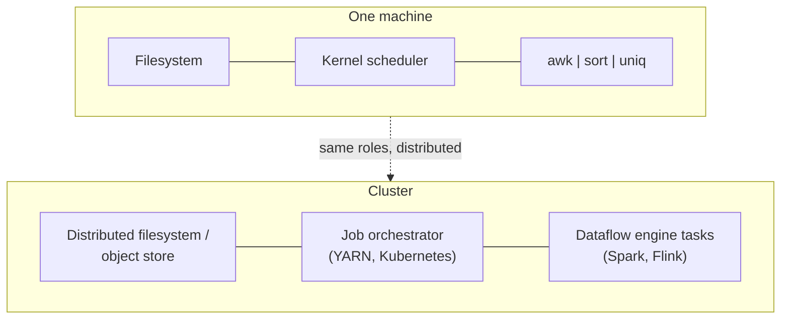
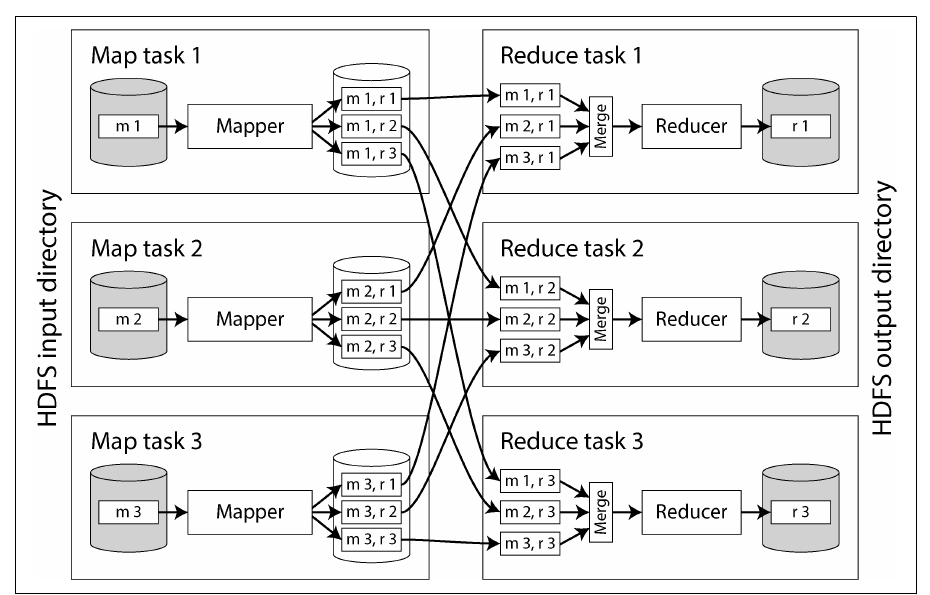
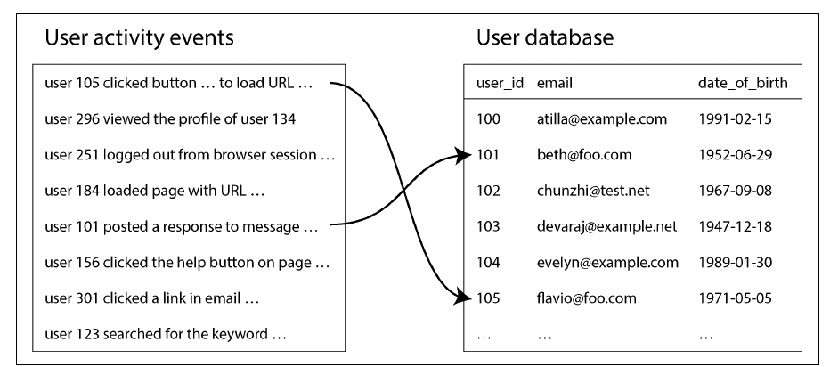
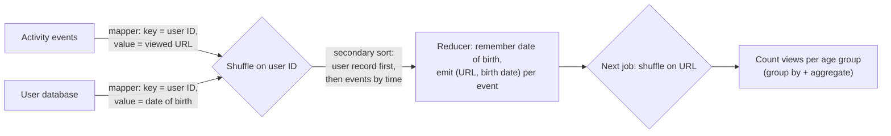
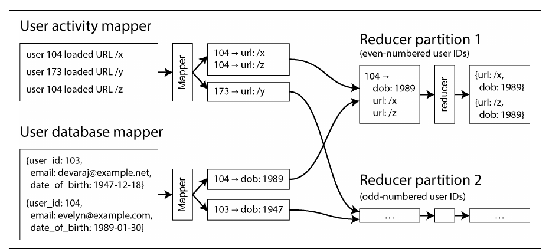

# فصل ۱۱: پردازش batch

[فصل ۱۰: مفهوم consistency و consensus →](10-consistency-and-consensus.md) · [کتاب](../README.md) · [فصل ۱۲: پردازش stream ←](12-stream-processing.md)

## خلاصه

پردازش batch یک ورودی بزرگ، محدود و immutable را می‌گیرد و خروجی مشتق‌شده می‌سازد، معمولاً طبق یک زمان‌بندی. این فصل در ویراست دوم از نو نوشته شده و MapReduce حالا پیشینه‌ی تاریخی حساب می‌شود. از یک pipeline یونیکسی شروع می‌کند که پرطرفدارترین صفحه‌ها را در log یک وب‌سرور پیدا می‌کند، و به سیستم‌های batch توزیع‌شده با سه لایه می‌رسد: **storage**، یعنی filesystemهای توزیع‌شده و object storeها؛ **orchestration**، یعنی job schedulerها و workflow orchestratorها؛ و **computation**، یعنی MapReduce و dataflow engineهایی مثل Spark و Flink. الگوریتم مرکزی **shuffle** است، یک sort توزیع‌شده که join و grouping را ممکن می‌کند. با بالغ شدن زیرساخت، تمرکز به سادگی استفاده رفت، یعنی SQL و DataFrame، و چارچوب‌های batch با cloud data warehouseها به هم نزدیک شدند. فصل با کاربردهای اصلی تمام می‌شود: ETL، تحلیل، machine learning و رساندن داده‌ی مشتق‌شده به production.

## نکته‌های کلیدی

- **ورودی immutable اجرای دوباره‌ی کارهای batch را امن می‌کند:** خروجی یک کار باگ‌دار را می‌شود دور ریخت و دوباره حساب کرد؛ یعنی «fault toleranceی انسانی» (pp. 451–452).
- **وقتی working set از حافظه بزرگ‌تر است، sort از تجمیع در حافظه بهتر است**، چون runهای مرتب را می‌شود به‌ترتیب از دیسک merge کرد (pp. 456–457).
- **چارچوب‌های batch توزیع‌شده شبیه یک سیستم‌عامل توزیع‌شده‌اند:** filesystem یا object store، scheduler، و برنامه‌هایی که با داده به هم وصل‌اند (pp. 457–466).
- **مفهوم dataflow engine، یعنی Spark و Flink، کل workflow را یک job می‌بیند**، state میانی را در حافظه یا دیسک محلی نگه می‌دارد، و از sort و materialize اجباری MapReduce بین مرحله‌ها پرهیز می‌کند (pp. 466–469).
- **مفهوم shuffle یک sort است، نه درهم‌ریختن تصادفی:** همه‌ی رکوردهای یک کلید را کنار هم می‌آورد و **sort-merge join** و grouping را ممکن می‌کند (pp. 469–473).
- **مفهوم SQL و DataFrame interfaceهای اصلی شدند**، و چارچوب‌های batch و warehouseهای cloud به هم نزدیک شدند (pp. 473–476).
- **از یک کار batch رکورد به رکورد در دیتابیس production ننویسید**؛ dataset بسازید و bulk-load کنید، یا آن را در یک stream منتشر کنید (pp. 479–481).

## فهرست بخش‌ها

*از فهرست مطالب خود کتاب، یعنی bookmarkهای PDF، با شماره‌ی صفحه‌های چاپی.*

- پردازش batch با ابزارهای Unix (p. 454)
  - تحلیل ساده‌ی log (p. 454)
  - زنجیره‌ی دستورها در برابر برنامه‌ی سفارشی (p. 456)
  - مقایسه‌ی sort و تجمیع در حافظه (p. 456)
- پردازش batch در سیستم‌های توزیع‌شده (p. 457)
  - مفهوم distributed filesystem (p. 458)
  - مفهوم object store (p. 460)
  - مفهوم orchestration توزیع‌شده‌ی jobها (p. 461)
- مدل‌های پردازش batch (p. 466)
  - مدل MapReduce (p. 466)
  - مفهوم dataflow engine (p. 468)
  - مفهوم shuffle (p. 469)
  - مفهوم join و grouping (p. 471)
  - زبان‌های کوئری (p. 473)
  - مفهوم DataFrame (p. 475)
- کاربردهای batch (p. 476)
  - مفهوم Extract–Transform–Load (p. 476)
  - تحلیل (p. 477)
  - مفهوم machine learning (p. 478)
  - رساندن داده‌ی مشتق‌شده (p. 479)
- جمع‌بندی (p. 481)

## یادداشت‌ها

**سیستم‌های online** به درخواست‌ها هر چه سریع‌تر جواب می‌دهند، یعنی response time و availability. کارهای **batch**، یا سیستم‌های offline، **ورودی read-only** را می‌خوانند و هر بار خروجی را **از صفر** می‌سازند؛ آموزش مدل، تبدیل داده و تحلیل‌های بزرگ؛ با **throughput** سنجیده می‌شوند، اغلب زمان‌بندی‌شده‌اند، مثلاً روزانه، و از چند دقیقه تا چند روز طول می‌کشند. **پردازش stream**، فصل ۱۲، مدام اجرا می‌شود و به ورودی تازه واکنش نشان می‌دهد (pp. 451–453).

| فایده‌ی ورودی immutable و بدون اثر جانبی (p. 452) | هزینه (p. 452) |
|---|---|
| **fault toleranceی انسانی**: کد باگ‌دار یعنی rollback و اجرای دوباره، یا برگشت به خروجی قبلی، یعنی time travel در object storeها و table formatها؛ دیتابیس با rollback کد نوشتن‌های بد را برنمی‌گرداند | کارهای downstreamی معمولاً منتظر تمام شدن کل کار می‌مانند |
| توسعه‌ی سریع‌تر قابلیت‌ها، با کم کردن برگشت‌ناپذیری | هر تغییری، حتی یک بایت، یعنی پردازش دوباره‌ی کل ورودی |
| همان فایل‌ها به کارهای زیادی غذا می‌دهند، از جمله کارهای monitoringی که خروجی اجراها را مقایسه می‌کنند | ممکن است کارها چند ساعت یا چند روز طول بکشند |
| استفاده‌ی کارآمد از compute در مقایسه با انجامش در سیستم‌های OLTP | |

مدل MapReduce، از Google در ۲۰۰۴ و بعد Hadoop، CouchDB و MongoDB، این حوزه را شکل داد اما حالا **تقریباً منسوخ** است؛ Google کدش را حذف کرده. امروز: Spark، Flink و موتورهای کوئری warehouse؛ Airflow، Dagster و Prefect جای Oozie و Azkaban را گرفته‌اند؛ storage از HDFS، GlusterFS و CephFS به object storeهایی مثل S3 رفته؛ و BigQuery و Snowflake مرز warehouse و batch را کم‌رنگ کرده‌اند (p. 453).

> **Try it:** [فصل ۱۱ در طول یک pipeline داده](../widgets/11-pipeline-map.html): از دیتابیس منبع تا داشبورد را با lensهای اجرای دوباره، حافظه و تحویل خروجی طی کنید.

> **In practice:** لایه‌ی Bronze در reference stack فقط append می‌شود و Silver و Gold از روی آن دوباره ساخته می‌شوند؛ یعنی همان ورودی immutable و خروجی از صفر.
>
> **Your turn:** یک باگ در منطق Silver سه هفته عددهای غلط ساخته. اگر Bronze را overwrite می‌کردید، چه چیزی از دست می‌رفت؟ و حالا چطور درستش می‌کنید؟
>
> *Answer:* با overwrite، نسخه‌های قدیم ردیف‌ها از بین رفته بودند و دیگر نمی‌شد گذشته را درست حساب کرد؛ باگ به داده‌ی دائمی تبدیل می‌شد. چون Bronze دست نخورده، کد Silver را درست می‌کنید و آن را از Bronze دوباره می‌سازید، و Gold را هم بعد از آن؛ همان fault toleranceی انسانی (p. 452). هزینه‌اش پردازش دوباره‌ی کل ورودی است.

### پردازش batch با ابزارهای Unix

یک خط از access log در NGINX این‌ها را ثبت می‌کند: IP مربوط به client، کاربر، زمان، درخواست، مثلاً `GET /css/typography.css`، وضعیت ۲۰۰، ۳٬۳۷۷ بایت، referrer و user agent. تجزیه‌ی log پشت pipelineهای تبلیغات و پرداخت است و به جنبش «big data» سوخت داد (p. 454).

```sh
cat /var/log/nginx/access.log |
  awk '{print $7}' |    # the requested URL
  sort             |    # make repeats adjacent
  uniq -c          |    # count each run
  sort -r -n       |    # most requested first
  head -n 5
```

*پنج صفحه‌ی پرطرفدار (pp. 454–455)؛ مثلاً ۴٬۱۸۹ بار `/favicon.ico`. با تغییر `awk` می‌شود CSS را کنار گذاشت، با `$7 !~ /\.css$/`، یا IPها را شمرد، با `{print $1}`؛ چند گیگابایت در چند ثانیه.*

| | مفهوم pipeline در Unix، اول sort و بعد شمارش | اسکریپت Python با hash table |
|---|---|---|
| مفهوم working set | جریان دارد؛ runهای مرتب به دیسک می‌ریزند و merge می‌شوند؛ همان اصل SSTable و mergesort | باید همه‌ی URLهای متمایز و شمارنده‌شان را در حافظه نگه دارد |
| کی می‌برد | داده‌ی بزرگ‌تر از حافظه؛ `sort` در GNU به دیسک می‌ریزد و بین coreها موازی می‌شود؛ گلوگاه سرعت خواندن دیسک می‌شود | سایت‌های کوچک و متوسط، حدود ۱ گیگابایت URL متمایز، حتی روی لپ‌تاپ |
| محدودیت | یک ماشین | یک ماشین |

(pp. 456–457)

> **In practice:** تحلیل‌گرها در JupyterHub در reference stack گاهی یک فایل Parquet بزرگ را با pandas باز می‌کنند و روی آن groupby می‌زنند.
>
> **Your turn:** یک groupby روی ستونی با ده‌ها میلیون مقدار متمایز در notebook با خطای حافظه از کار می‌افتد. چه گزینه‌هایی دارید؟
>
> *Answer:* مفهوم groupby در pandas یک hash table در حافظه است و باید همه‌ی کلیدهای متمایز را جا بدهد، مثل اسکریپت Python کتاب (pp. 456–457). یا تجمیع را به ClickHouse بفرستید، که می‌تواند برای GROUP BY بزرگ به دیسک بریزد، یا داده را با کلید به تکه‌ها بخش کنید و هر تکه را جدا تجمیع کنید؛ همان ایده‌ی runهای مرتب و merge.

### پردازش batch در سیستم‌های توزیع‌شده

یک ماشین تنها storage پشت یک filesystem، یک scheduler و برنامه‌هایی دارد که با pipe به هم وصل‌اند؛ چارچوب‌های batch توزیع‌شده همین قطعه‌ها هستند که پخش شده‌اند؛ یک **سیستم‌عامل توزیع‌شده** (p. 457).



#### مفهوم distributed filesystem (pp. 458–460)

| لایه‌ی filesystem در سیستم‌عامل | معادل توزیع‌شده |
|---|---|
| مفهوم block device، با blockهای ۴٬۰۹۶بایتی در ext4 | blockهای بزرگ روی **data node**ها؛ **۱۲۸ مگابایت** در HDFS، و **۴ مگابایت** در JuiceFS و خیلی از object storeها؛ metadata کمتر و seek ارزان‌تر؛ یک فایل ۹۰۰ مگابایتی یعنی هفت block ۱۲۸ مگابایتی و یک block ۴ مگابایتی |
| مفهوم page cache | مفهوم page cache سیستم‌عامل روی data nodeها، به‌علاوه‌ی cache سمت client یا دیسک محلی، مثل JuiceFS |
| مفهوم metadata در filesystem، یعنی inode و دایرکتوری | یک سرویس metadata؛ **NameNode** در HDFS؛ 3FS در DeepSeek metadata را در FoundationDB نگه می‌دارد |
| مفهوم VFS | یک پروتکل قابل تعویض؛ **S3 API**، با MinIO، R2، Tigris، B2 و…؛ POSIX از راه FUSE یا NFS، مثل Amazon EFS و Archil |

مفهوم distributed filesystem روی سخت‌افزار معمولی **shared-nothing** است، برخلاف دستگاه‌های NAS و SAN، پس blockها **replicate** یا با **erasure coding**، مثل Reed–Solomon، ذخیره می‌شوند؛ بازیابی شبیه RAID روی یک شبکه‌ی معمولی؛ و همین اجازه می‌دهد scheduler یک task را روی هر nodeی اجرا کند که یک replica دارد (pp. 459–460).

#### مفهوم object store (pp. 460–461)

سرویس‌های S3، Google Cloud Storage، Azure Blob Storage و OpenStack Swift؛ با URLهایی مثل `s3://my-photo-bucket/2025/04/01/birthday.png`، یعنی bucket یکتا در کل دنیا به‌علاوه‌ی key.

| مفهوم filesystem، مثل HDFS | مفهوم object store |
|---|---|
| فایل با handle، یعنی `fopen` و `fseek`، و append | مفهوم object immutable با `get` و `put`؛ برای به‌روزرسانی بازنویسی می‌کنید؛ append فقط در Azure Blob و S3 Express One Zone |
| دایرکتوری واقعی، حتی خالی | اسلش فقط بخشی از key است؛ فهرست کردن با prefix بازگشتی است؛ «دایرکتوری» خالی وجود ندارد، فقط objectهای صفربایتی جانگهدار |
| لینک سخت و نرم، قفل، و **rename اتمی** | لینک و قفل ندارد؛ rename یعنی copy و delete، یکی‌یکی برای هر object |
| اجرای task جایی که داده هست | جدایی storage و compute؛ پهنای باند بیشتر، اما شبکه‌های سریع آن را قابل قبول می‌کنند و منابع مستقل scale می‌شوند |

هر دو برای objectهای بزرگ، از مگابایت تا گیگابایت، و خواندن‌های بزرگ و کم‌تکرار مناسب‌اند، هرچند S3 Express One Zone حالا latency در حد یک میلی‌ثانیه می‌دهد. JuiceFS و Ceph هر دو API را می‌دهند، با تضمین‌های خیلی متفاوت (pp. 460–461).

> **In practice:** بخش loader در reference stack فایل‌های Parquet را در staging روی storage سازگار با S3 می‌نویسد، و مرحله‌ی بعد فایل‌های زیر یک prefix را برای load در Bronze فهرست می‌کند.
>
> **Your turn:** بخش loader چند فایل در یک prefix می‌نویسد و وسط کار شکست می‌خورد. مرحله‌ی بعد prefix را فهرست می‌کند و هر چه هست load می‌کند. چه مشکلی پیش می‌آید، و چرا «اول در prefix موقت بنویس، بعد rename کن» اینجا کمک کامل نمی‌کند؟
>
> *Answer:* بخشی از batch در Bronze می‌نشیند و اجرای بعدی تکرارشان می‌کند. در object store، rename اتمی نیست و برای هر object یک copy و delete است (pp. 460–461)، پس جابه‌جا کردن prefix هم نیمه‌کاره می‌ماند. راه رایج: آخر کار یک فایل manifest یا یک نشانه‌ی پایان، مثل `_SUCCESS`، با فهرست فایل‌ها بنویسید، و مرحله‌ی بعد فقط وقتی آن فایل هست و فقط فایل‌های فهرست‌شده را بخواند.

#### مفهوم orchestration توزیع‌شده‌ی jobها (pp. 461–466)

یک درخواست job این‌ها را دارد: تعداد taskها؛ حافظه، CPU و دیسک برای هر task؛ شناسه‌ی job؛ اعتبارنامه‌ها؛ پارامترها، یعنی ورودی‌ها و خروجی‌ها؛ نیاز سخت‌افزاری، مثل GPU؛ و محل کد (pp. 461–462).

| جزء | نقش | نمونه‌ها |
|---|---|---|
| **مفهوم task executor** | اجرای taskها، heartbeat و پیگیری وضعیت؛ جداسازی با cgroup | سرویس NodeManager در YARN و kubelet در Kubernetes |
| **مفهوم resource manager** | دید کلی از nodeها و منابع؛ state در یک coordination service | سیستم YARN با ZooKeeper و Kubernetes با etcd |
| **مفهوم scheduler** | تصمیم این‌که کدام task کجا اجرا شود؛ sub-schedulerهای مخصوص هر اپلیکیشن | مفهوم ApplicationMaster در YARN و operatorها در Kubernetes |

**تخصیص منابع** (pp. 463–464): پنج node، ۱۶۰ core، دو job که هر کدام ۱۰۰ می‌خواهند؛ تقسیم ۸۰ و ۸۰؟ **gang scheduling**، یعنی صبر تا ۱۰۰ core آزاد شود، با nodeهای بیکار و احتمال deadlock یا گرسنگی؟ **preempt**، با کار هدررفته؟ تخصیص بهینه **NP-hard** است، پس schedulerها از روش‌های ابتکاری استفاده می‌کنند: FIFO، dominant resource fairness، صف‌های اولویت، زمان‌بندی با ظرفیت یا سهمیه، و bin packing.

**زمان‌بندی workflowها** (pp. 464–465): یک **workflow**، یعنی DAGی از jobها، وقتی پیش می‌آید که خروجی یک job به jobهای چند تیم غذا بدهد، داده بین ابزارها جابه‌جا شود، مثل Spark به HDFS به Trino به S3، یا مرحله‌ها sharding متفاوتی لازم داشته باشند. pipeها داده را مستقیم با backpressure رد می‌کنند، و Spark و Flink هم می‌توانند، اما معمولاً هر job در DFS یا object store می‌نویسد و بعدی از آن می‌خواند؛ جدا از هم در زمان. schedulerهای هر job وابستگی‌ها را مدیریت نمی‌کنند، پس **Airflow، Dagster و Prefect** این کار را می‌کنند؛ workflowهای ۵۰ تا ۱۰۰ jobی رایج‌اند. این با workflowهای orchestrate کردن RPC در فصل ۵ یکی نیست.

**مدیریت fault** (pp. 465–466): کارهای طولانی خرابی خواهند دید، و همین‌طور **preemption** عمدی instanceهای ارزان و کم‌اولویت **spot** یا **preemptible**، که از خرابی سخت‌افزار رایج‌تر است. چون خروجی از صفر ساخته می‌شود، خروجی نیمه‌کاره را پاک کنید و **فقط task شکست‌خورده را retry کنید**.

| داده‌ی میانی بین taskها | تحمل fault |
|---|---|
| مدل MapReduce | در DFS نوشته می‌شود؛ خواننده‌ها صبر می‌کنند تا نویسنده موفق شود؛ امن اما پرنوشتن |
| موتور Spark | در حافظه نگه داشته می‌شود و به دیسک محلی می‌ریزد؛ ردیابی می‌کند چطور حساب شده، یعنی lineage، تا اگر گم شد **دوباره حسابش کند** |
| موتور Flink | **مفهوم checkpoint** دوره‌ای از state هر task |

> **In practice:** هر جدول در reference stack DAG خودش را در Airflow دارد، و ساختن Silver و Gold به چند جدول Bronze وابسته است.
>
> **Your turn:** یک جدول Silver به سه جدول Bronze وابسته است که سه DAG جدا load می‌کنند. اگر Silver فقط با یک زمان‌بندی ثابت، مثلاً ساعت ۶، اجرا شود، چه می‌شود؟ و اگر وسط ساختش شکست بخورد؟
>
> *Answer:* اگر یکی از loadها دیر کند، Silver روی ورودی ناقص ساخته می‌شود و کسی خبردار نمی‌شود؛ وابستگی بین jobها کار workflow orchestrator است، پس Silver باید به پایان موفق هر سه load وابسته باشد، نه به ساعت (pp. 464–465). اگر شکست بخورد، چون خروجی از صفر ساخته می‌شود، خروجی نیمه‌کاره را دور بریزید و فقط همان task را retry کنید (pp. 465–466).

### مدل‌های پردازش batch

#### مدل MapReduce (pp. 466–468)

تحلیل log مستقیم به آن map می‌شود: ۱) فایل‌های ورودی، مثل Parquet و Avro، به شکل رکورد خوانده می‌شوند؛ ۲) **mapper** زوج‌های کلید و مقدار را بیرون می‌کشد، مثل `awk '{print $7}'`؛ ۳) **sort** بر اساس کلید، به‌طور ضمنی؛ ۴) **reducer** روی مقدارهای هر کلید می‌چرخد، مثل `uniq -c`. یک `sort` دوم برای رتبه‌بندی یعنی یک job دوم MapReduce. mapperها برای هر رکورد بدون state هستند و موازی اجرا می‌شوند؛ reducerها برای هر کلید موازی اجرا می‌شوند (pp. 466–467). این مدل از برنامه‌نویسی تابعی آمده، یعنی map و fold در Lisp؛ نبود state mutable موازی‌سازی و retry را امن می‌کند. اما MapReduce خام پرزحمت است، مثلاً joinها را باید دستی نوشت، و کند است؛ I/O مبتنی بر فایل جلوی pipeline کردن را می‌گیرد (p. 468).

#### مفهوم dataflow engine (pp. 468–469)

موتورهای **Spark** و **Flink**، که بعد از سیستم‌های پژوهشی Dryad و Nephele آمدند، کل workflow را **یک job** با عملگرهای relational می‌بینند، یعنی join، group by، filter و aggregate، که روی shuffle ساخته شده‌اند و آزادانه کنار هم چیده می‌شوند، به جای تناوب سخت map و reduce.

| مدل MapReduce | مفهوم dataflow engine |
|---|---|
| بین هر map و reduce sort می‌کند | فقط جایی که لازم است sort می‌کند |
| مرحله‌های جدا | عملگرهایی را که sharding را حفظ می‌کنند، مثل map و filter، در یک task merge می‌کند |
| | همه‌ی وابستگی‌های داده را می‌داند، پس بهینه‌سازی locality می‌کند، مثل تبادل از راه حافظه‌ی مشترک |
| مفهوم state میانی در DFS replicate می‌شود | در حافظه یا دیسک محلی |
| مرحله‌ی بعد منتظر کل مرحله‌ی قبل می‌ماند | عملگرها به‌محض آماده شدن ورودی شروع می‌کنند |
| یک JVM تازه برای هر task | processها را دوباره به کار می‌برد |

#### مفهوم shuffle (pp. 469–471)

یک **shuffle** یک sort توزیع‌شده با ورودی *و* خروجی shardشده است؛ و برخلاف اسمش، ترتیب **مرتب** می‌سازد، نه تصادف. MapReduce، Spark، Flink، Daft، Dataflow و BigQuery آن را پیاده کرده‌اند (p. 470).



*Figure 11-1 (p. 470): هر mapper برای هر reducer یک فایل مرتب می‌فرستد، یعنی shuffle، و هر reducer آنچه را می‌گیرد merge می‌کند.*

برای هر بخش ورودی یک map task اجرا می‌شود؛ نویسنده‌ی job تعداد reducerها را انتخاب می‌کند. هر mapper فایل مقصد را با hash کلید انتخاب می‌کند، با runهای مرتب و merge به سبک LSM؛ reducerها فایلشان را از هر mapper کپی می‌کنند و **merge** می‌کنند، پس کلیدهای برابر کنار هم قرار می‌گیرند؛ خروجی‌ها به DFS برمی‌گردند (pp. 470–471). BigQuery داده‌ی shuffle را در حافظه نگه می‌دارد و از سرویس‌های sort بیرونی استفاده می‌کند (p. 471).

#### مفهوم join و grouping (pp. 471–473)

مثال join کتاب: **رویدادهای فعالیت**، یعنی clickstream یا fact table، با یک **دیتابیس کاربر**، یعنی یک dimension، تا ببینیم صفحه‌ها بین کاربرهای جوان‌تر پرطرفدارترند یا مسن‌تر؛ شکل ۱۱-۲.



*Figure 11-2 (p. 472): هر رویداد فیلدهایی از کاربری که نامش آمده لازم دارد؛ یک join روی user ID.*



این یک **sort-merge join** است، شکل ۱۱-۳: خروجی مرتب mapperها، که برای هر کلید merge می‌شود؛ هر reducer فقط **یک رکورد کاربر** را در حافظه نگه می‌دارد و **هیچ درخواست شبکه‌ای** نمی‌فرستد (p. 472).



*Figure 11-3 (p. 473): هر دو ورودی با user ID کلید خورده‌اند، پس reducer رکورد یک کاربر و همه‌ی رویدادهایش را با هم می‌بیند.*

> **Try it:** [مفهوم shuffle و sort-merge join](../widgets/11-sort-merge-join.html): یک join بین رویدادهای فعالیت و رکوردهای کاربر را قدم به قدم از map، shuffle، sort و reduce عبور دهید.

> **In practice:** ساختن Silver در reference stack اغلب یعنی join یک جدول رویداد بزرگ، مثل تراکنش‌ها، با یک جدول dimension، مثل مشتری‌ها، داخل ClickHouse.
>
> **Your turn:** یک join بین تراکنش‌ها و مشتری‌ها با خطای حافظه شکست می‌خورد، در حالی که همان join با جدول کوچک‌تر شعبه‌ها خوب کار می‌کند. چه فرقی دارند؟
>
> *Answer:* مفهوم hash join یک طرف join را کامل در حافظه نگه می‌دارد؛ جدول شعبه‌ها جا می‌شود و جدول میلیونی مشتری‌ها شاید نه. sort-merge join کتاب هر دو طرف را با کلید مرتب می‌کند و هر بار فقط رکوردهای یک کلید را در حافظه دارد، پس با داده‌ی بزرگ‌تر از حافظه کار می‌کند (pp. 471–473). در عمل یعنی الگوریتم join مناسب را انتخاب کنید یا طرف کوچک‌تر را در حافظه بگذارید؛ همان انتخاب بین hashing و sorting.

#### زبان‌های کوئری و DataFrame (pp. 473–475)

مفهوم clusterهای **بیش از ۱۰٬۰۰۰ ماشین** که چندین petabyte را پردازش می‌کنند به گفته‌ی کتاب «کم‌وبیش حل‌شده» است، پس تمرکز به مدل برنامه‌نویسی رفت. **مفهوم SQL** زبان مشترک شد: کد کمتر، کاوش تعاملی، و **cost-based optimizer**هایی، در Hive، Trino، Spark و Flink، که الگوریتم join را انتخاب می‌کنند و ترتیب joinها را عوض می‌کنند. جایگزین‌های خاص: Apache Pig برای pipelineهای relational قدم‌به‌قدم، Morel، jq و JMESPath و JSONPath، و Gremlin برای graph (pp. 473–474).

**پردازش batch و warehouseهای cloud به هم نزدیک می‌شوند** (pp. 474–475): چارچوب‌های batch صاحب SQL، Parquet و اجرای vectorized یا compiled شدند؛ warehouseها صاحب scale در cloud، shuffle و تحمل fault، و مدل‌های غیر-SQL، مثل BigQuery DataFrames و Snowpark در Snowflake. با این حال الگوریتم‌های graph تکراری، ML پیچیده و داده‌ی چندرسانه‌ای AI در SQL سخت‌اند؛ warehouseها در کار ردیف‌به‌ردیف ضعیف‌ترند و اغلب از Spark یا Flink گران‌ترند. انتخاب به هزینه، راحتی و در دسترس بودن برمی‌گردد.

**مفهوم DataFrame** (p. 475) interfaceهای R و Pandas را به Spark، Flink و Daft می‌آورد. DataFrameهای محلی index و ترتیب دارند؛ نوع توزیع‌شده معمولاً ندارد، که کارایی را غافلگیرکننده می‌کند. Pandas مشتاقانه اجرا می‌کند؛ Spark اول یک query plan می‌سازد و بهینه‌اش می‌کند؛ Daft عملیات کوچک را سمت client و بزرگ را سمت سرور اجرا می‌کند و Apache Arrow را به اشتراک می‌گذارد.

### کاربردهای batch

هر جا داده بزرگ است و تازگی مهم نیست: تطبیق حسابداری و انبار، پیش‌بینی تقاضا در تولید، آموزش سیستم پیشنهاد؛ و شبکه‌ی بانکی آمریکا تقریباً کامل روی کارهای batch می‌چرخد (p. 476).

| کاربرد | چه چیزی batch می‌دهد (pp. 476–479) |
|---|---|
| **مفهوم ETL** | تبدیل‌هایی که به‌سادگی موازی می‌شوند؛ schedulerهایی که retry می‌کنند، کارهای شکست‌خورده را علامت می‌زنند و operator برای MySQL، PostgreSQL، Snowflake، Spark، Flink و… دارند؛ اشکال‌زدایی آسان فایل‌های شکست‌خورده. **مفهوم data mesh**، **data contract** و **data fabric** اجازه می‌دهند تیم‌ها pipelineهای خودشان را منتشر کنند؛ ETL و تحلیل حالا موتورهای مشترک دارند، یعنی SparkSQL، Trino و DuckDB |
| **تحلیل** | موتورهای SQL روی object storage به‌علاوه‌ی table formatها، مثل Iceberg، به‌علاوه‌ی catalogها، مثل Unity، یعنی یک **data lakehouse**. **پیش‌تجمیع** در cube و data mart یا Druid و Pinot طبق زمان‌بندی؛ کوئری‌های **ad hoc** تکراری؛ ابزارهای BI، یعنی Tableau، Power BI، Looker و Superset، از راه SparkSQL، Presto و Trino وصل می‌شوند |
| **مفهوم machine learning** | **مفهوم feature engineering**، **آموزش مدل**، یعنی از داده‌ی ورودی به وزن‌ها، و **batch inference**؛ Spark MLlib و FlinkML. الگوریتم‌های graph در مدل **bulk synchronous parallel**، یا Pregel، با Giraph، GraphX و Gelly. **آماده‌سازی داده برای LLM**: بیرون کشیدن متن از HTML، حذف سندهای کم‌کیفیت و تکراری، tokenize و embed؛ Kubeflow، Flyte و **Ray**، که OpenAI برای آموزش ChatGPT استفاده کرده؛ notebookها، یعنی Jupyter و Hex |

#### رساندن داده‌ی مشتق‌شده (pp. 479–481)

پیشنهادها، گزارش‌ها و featureهای ML باید به یک دیتابیس production، key-value store یا موتور جست‌وجو برسند.

| روش | حکم |
|---|---|
| نوشتن رکورد به رکورد از کار batch در دیتابیس production | **بد**: یک درخواست شبکه برای هر رکورد چندین مرتبه کندتر است؛ taskهای موازی ممکن است دیتابیس را از پا بیندازند؛ خروجی **همه یا هیچ** کار را می‌شکند، یعنی نوشتن‌های نیمه‌کاره یا تکراری دیده می‌شوند |
| فرستادن خروجی به یک stream، مثل topicهای Kafka، که Elasticsearch، Pinot، Druid، Venice و ClickHouse از آن ingest می‌کنند | نوشتن ترتیبی؛ یک **buffer** که consumerها سرعتش را تنظیم می‌کنند؛ یک خروجی و چند مصرف‌کننده؛ یک مرز امنیتی **DMZ**. برای همه یا هیچ، وقتی تمام شد به consumerها خبر بدهید و تا آن موقع داده را نامرئی نگه دارید، مثل read committed |
| ساختن یک دیتابیس کاملاً تازه در خود job و **bulk-load** کردنش، مثل TiDB Lightning، import از Hadoop در Pinot و ingest فایل‌های SST در RocksDB | خیلی سریع است و اجازه‌ی جابه‌جایی اتمی بین نسخه‌ها را می‌دهد؛ به‌روزرسانی افزایشی سخت‌تر است؛ ترکیب‌هایی مثل Venice هر دو را پشتیبانی می‌کنند |

> **In practice:** مفهوم API پیش‌بینی در reference stack از یک مدل ثبت‌شده در MLflow استفاده می‌کند، و بعضی امتیازها هر شب به‌صورت batch برای همه‌ی مشتری‌ها حساب می‌شوند.
>
> **Your turn:** کار شبانه امتیاز میلیون‌ها مشتری را حساب می‌کند و هر کدام را با یک INSERT جدا در جدولی می‌نویسد که API از آن می‌خواند. وسط کار شکست می‌خورد و retry می‌شود. چه مشکلی دارد و بهتر چیست؟
>
> *Answer:* میلیون‌ها درخواست شبکه کند است و ممکن است دیتابیسی را که API از آن می‌خواند زیر بار ببرد؛ و بعد از شکست، API ترکیبی از امتیازهای امشب و دیشب را می‌بیند، و retry ممکن است تکراری بسازد (pp. 479–480). بهتر: کل خروجی را در یک جدول یا فایل تازه بسازید و بعد API را یک‌جا به نسخه‌ی تازه بفرستید؛ همان bulk-load با جابه‌جایی اتمی (pp. 480–481).

## بده‌بستان‌ها در یک نگاه

| | مدل MapReduce | مفهوم dataflow engine، یعنی Spark و Flink |
|---|---|---|
| واحد کار | jobهای مستقل map و reduce که با فایل به هم زنجیر شده‌اند | کل workflow به شکل یک job |
| داده‌ی میانی | در distributed filesystem نوشته می‌شود | حافظه یا دیسک محلی |
| مفهوم sort | همیشه، بین map و reduce | فقط جایی که یک عملگر لازمش دارد |
| بازیابی از fault | اجرای دوباره‌ی task از ورودی materializeشده | محاسبه‌ی دوباره از lineage در Spark، یا checkpoint در Flink |
| interfaceها | تابع‌های سطح پایین map و reduce | عملگرها، SQL و DataFrame |

## فراتر از کتاب

- انتخاب بین «sorting و hashing» داخل موتورهای کوئری دوباره پیدا می‌شود: hash aggregation و hash join وقتی working set در حافظه جا می‌شود، و external sort یا hash join بخش‌بندی‌شده، یعنی Grace، وقتی جا نمی‌شود.
- ابزار dbt مفهوم «ELT با SQL» روی warehouseها را رایج کرد؛ همان نزدیک شدنی که فصل توصیف می‌کند، از سمت analytics engineering.

## پیوندها

- **فصل‌های مرتبط:** [فصل ۱: بده‌بستان‌ها در معماری سیستم‌های داده](01-trade-offs-in-data-systems-architecture.md) برای ETL و data lake، [فصل ۳: مدل‌های داده و زبان‌های کوئری](03-data-models-and-query-languages.md) برای DataFrame و star schema، [فصل ۴: ذخیره‌سازی و بازیابی](04-storage-and-retrieval.md) برای sort-merge و ذخیره‌سازی ستونی، [فصل ۱۲: پردازش stream](12-stream-processing.md) برای حالت بی‌کران، و [فصل ۱۳: فلسفه‌ی سیستم‌های streaming](13-a-philosophy-of-streaming-systems.md) برای پردازش دوباره.

## خودتان را بسنجید

*پرسش‌ها و پاسخ‌ها را خود vault از روی یادداشت‌های بالا نوشته است؛ پاسخ‌ها به صفحه‌های کتاب ارجاع می‌دهند.*

1. **چرا `sort | uniq -c` وقتی URLهای متمایز دیگر در حافظه جا نمی‌شوند همچنان کار می‌کند، اما اسکریپت hash table شکست می‌خورد؟**

   *Answer:* دستور `sort` تکه‌های مرتب را به دیسک می‌ریزد و merge می‌کند، مثل SSTableها، پس با I/O ترتیبی داده‌ی بزرگ‌تر از حافظه را اداره می‌کند؛ hash table در حافظه به‌سادگی جا کم می‌آورد (pp. 456–457).

2. **مفهوم immutability ورودی‌ها وقتی یک task وسط کار شکست می‌خورد چه چیزی به چارچوب batch می‌دهد؟**
   - [ ] هیچ؛ job باید از صفر شروع شود
   - [x] می‌شود task را روی همان ورودی دوباره اجرا کرد و خروجی نیمه‌کاره‌اش را دور ریخت
   - [ ] چارچوب می‌تواند رکوردهای شکست‌خورده را رد کند
   - [ ] ورودی‌ها را می‌شود به‌محض خواندن پاک کرد

   *Answer:* چون ورودی‌ها هرگز تغییر نمی‌کنند و خروجی‌ها اتمی نوشته می‌شوند، یعنی فقط با موفقیت commit می‌شوند، task شکست‌خورده بدون اثر جانبی retry می‌شود (pp. 461–466).

3. **در sort-merge join، چرا reducer باید رکورد کاربر را پیش از رویدادهای فعالیت ببیند؟**

   *Answer:* مفهوم shuffle رکوردهای هر user ID را کنار هم می‌آورد؛ اگر رکورد کاربر اول بیاید، با secondary sort، reducer فقط همان یک رکورد را در حافظه نگه می‌دارد و رویدادهای فعالیت را پشت سر هم می‌خواند و رکوردهای join‌شده را بیرون می‌دهد (pp. 471–473).

4. **سه بهینه‌سازی را نام ببرید که dataflow engineها انجام می‌دهند و MapReduce نمی‌توانست.**

   *Answer:* مثلاً: state میانی را در distributed filesystem نمی‌نویسند، فقط جایی که لازم است sort می‌کنند، عملگرها را pipeline می‌کنند به جای انتظار برای کل مرحله‌ها، و کار را با دانستن گراف کامل job زمان‌بندی می‌کنند (pp. 468–469).

5. **چرا نوشتن مستقیم در دیتابیس production از داخل یک کار batch ایده‌ی بدی است؟**
   - [ ] چون کارهای batch نمی‌توانند connection شبکه باز کنند
   - [x] چون نوشتن ردیف‌به‌ردیف کند است، می‌تواند دیتابیس را زیر بار ببرد، و معنای همه یا هیچ taskهای retryشده را می‌شکند
   - [ ] چون دیتابیس‌ها نمی‌توانند خروجی batch را ذخیره کنند
   - [ ] چون کارهای batch فقط باید روی دیسک محلی بنویسند

   *Answer:* جایگزین این است که در خود کار batch یک فایل دیتابیس یا index تازه بسازید و یک‌جا load کنید، یا خروجی را در streamی منتشر کنید که consumerها اعمالش می‌کنند (pp. 479–481).

6. **مفهوم loader فایل‌های Parquet را در یک prefix روی object storage می‌نویسد و وسط کار شکست می‌خورد. چرا مرحله‌ی بعد نباید هر چه را زیر prefix هست load کند؟**

   *Answer:* چون بخشی از فایل‌ها نوشته شده‌اند و object store نه rename اتمی دارد نه قفل؛ خواندن prefix نیمه‌کاره خروجی همه یا هیچ را می‌شکند. یک manifest یا نشانه‌ی پایان در آخر کار، و خواندن فقط فایل‌های فهرست‌شده، راه رایج است (pp. 460–461, 479–481).
